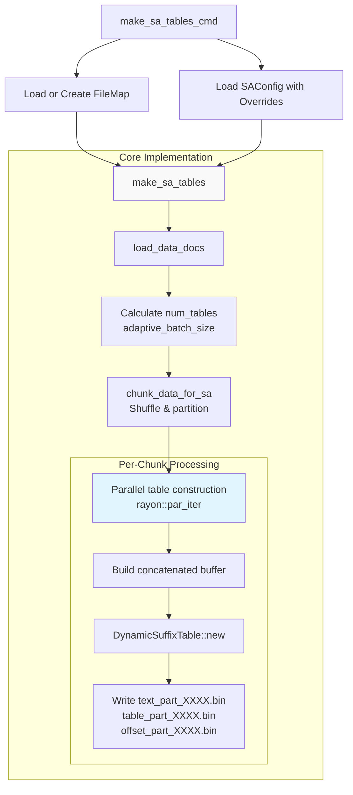
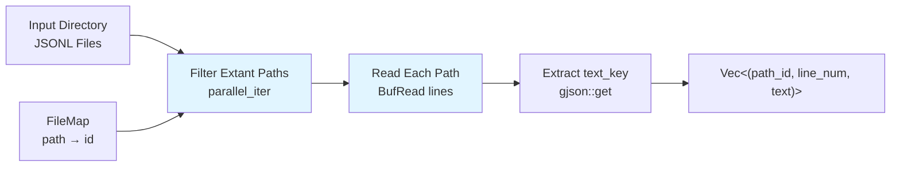
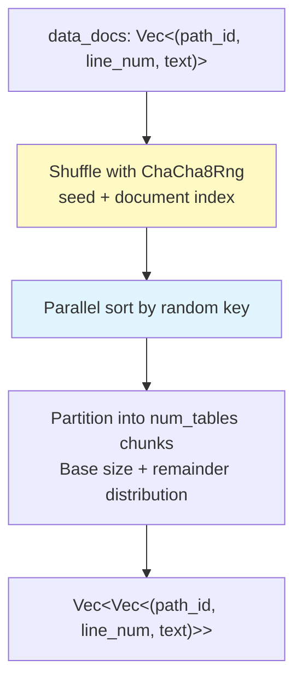
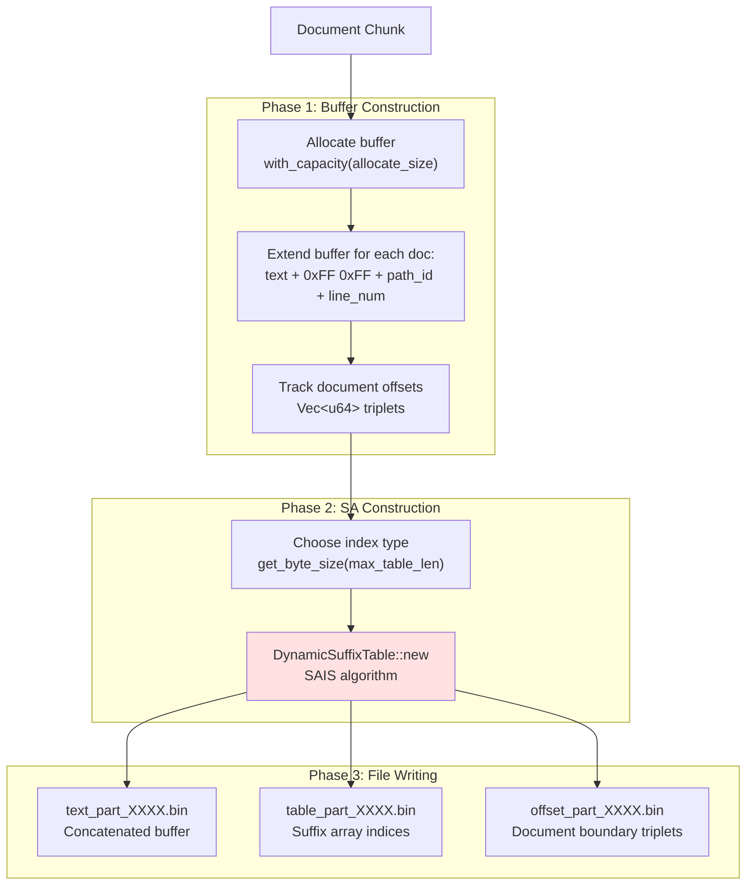
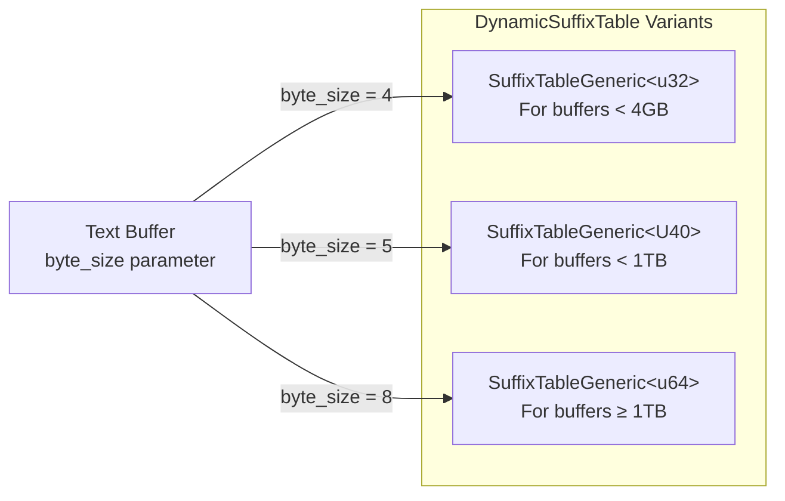
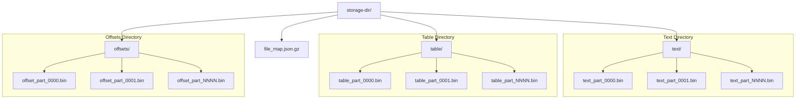

<!-- source: DeepWiki mcp.deepwiki.com · repo allenai/duplodocus · extra page Make Tables Stage · fetched 2026-10-26 -->

# Make Tables Stage

<details>
<summary>Relevant source files</summary>

The following files were used as context for generating this wiki page:

- [src/sa_base.rs](src/sa_base.rs)
- [src/table_generic.rs](src/table_generic.rs)

</details>


## Purpose and Scope

The Make Tables Stage is the first stage of the Suffix Array (SA) pipeline. It transforms a collection of JSONL documents into a set of disk-backed suffix array tables with associated metadata. This stage handles:

- Loading and parsing documents from the input directory
- Adaptive memory-based chunking to stay within RAM constraints
- Constructing suffix arrays using the SAIS (Induced Sorting) algorithm
- Writing synchronized text, table, and offset files to disk

For information about how these tables are used to find matches, see [Match Finding Stage](#2.1.2). For the overall SA pipeline architecture, see [SA Pipeline Stages](#2.1).

**Sources:** [src/sa_base.rs:92-264]()

---

## Entry Points and Command Flow

The stage is invoked through two primary entry points:

| Function | Purpose | Location |
|----------|---------|----------|
| `make_sa_tables_cmd` | CLI wrapper that handles configuration loading | [src/sa_base.rs:98-128]() |
| `make_sa_tables` | Core implementation that orchestrates table construction | [src/sa_base.rs:130-264]() |

The command flow proceeds as follows:



**Sources:** [src/sa_base.rs:98-264]()

---

## Input Requirements

### FileMap Structure

The stage requires a `FileMap` that maps file paths to unique integer IDs. This mapping is either:
- Loaded from an existing `file_map.json.gz` (if `--file-map` provided)
- Generated from the input directory and saved to `output_dir/file_map.json.gz`

**Sources:** [src/sa_base.rs:108-116]()

### Configuration

Configuration is managed through `SAConfig` with optional overrides:

| Parameter | Type | Purpose | Default |
|-----------|------|---------|---------|
| `tokenizer` | `Option<String>` | Tokenizer name (future use) | None |
| `max_lines_per_path` | `Option<usize>` | Limit lines per file | None |
| `text_key` | `Option<String>` | JSON key for text extraction | "text" |
| `random_seed` | `u64` | Seed for document shuffling | From config |
| `batch_size` | `f32` | Manual batch size multiplier | 0.0 (auto) |

**Sources:** [src/sa_base.rs:118-127](), [src/sa_config.rs]()

---

## Document Loading

### Loading Process

The `load_data_docs` function reads all documents from disk into memory as tuples:

```rust
Vec<(usize, usize, String)>
// (path_id, line_num, text_content)
```



**Key characteristics:**
- Uses parallel iteration over paths (`par_iter`)
- Only processes files that exist in the input directory
- Extracts text using `gjson::get` with configurable `text_key`
- Preserves document ordering within each file via `line_num`

**Sources:** [src/sa_base.rs:266-295]()

---

## Memory Management and Adaptive Chunking

### Memory Calculation

The stage must handle datasets larger than RAM by chunking documents into multiple suffix arrays. The number of tables is determined by:

```rust
const MEMORY_SAFETY_MARGIN: f64 = 0.90;

let corpus_len: usize = data_docs.par_iter()
    .map(|(_, _, doc)| doc.len() + 2 * 8)
    .sum();

let num_tables = if batch_size == 0.0 {
    adaptive_batch_size(corpus_len, MEMORY_SAFETY_MARGIN)
} else {
    (rayon::current_num_threads() as f32 * batch_size) as usize
};
```

The `adaptive_batch_size` function (in `sa_utils.rs`) calculates how many tables are needed based on:
- Total corpus length (text + metadata per document)
- Available system memory
- Safety margin (90% utilization)
- Suffix array memory overhead (9x text size for construction)

**Sources:** [src/sa_base.rs:95, 158-163](), [src/sa_utils.rs]()

### Chunking Strategy

The `chunk_data_for_sa` function divides documents into balanced chunks:



**Why shuffling?** Documents are shuffled to ensure each chunk has similar characteristics (length distribution, complexity). Without shuffling, if documents are ordered by size, some tables would be disproportionately large.

**Deterministic randomness:** Uses `ChaCha8Rng` seeded with `config.random_seed.wrapping_add(i)` for reproducible chunking.

**Sources:** [src/sa_base.rs:310-339]()

---

## Parallel Table Construction

### Per-Chunk Processing

Each chunk is processed independently in parallel using `rayon::par_iter`:



**Sources:** [src/sa_base.rs:176-246]()

### Buffer Format

The concatenated text buffer has this structure:

```
[document_1_text][0xFF][0xFF][path_id as u64 LE][line_num as u64 LE]
[document_2_text][0xFF][0xFF][path_id as u64 LE][line_num as u64 LE]
...
```

- **Text separator:** Two `0xFF` bytes mark document boundaries
- **Metadata:** 16 bytes per document (two u64 values in little-endian)
- **Total overhead:** 18 bytes per document (2 + 8 + 8)

**Sources:** [src/sa_base.rs:195-202]()

---

## Suffix Array Construction

### DynamicSuffixTable

The stage uses `DynamicSuffixTable`, which automatically selects the appropriate integer type for suffix array indices:



The `byte_size` is determined by `get_byte_size(max_text_len)` which returns:
- `4` if length fits in `u32` (< 4,294,967,296 bytes)
- `5` if length fits in `U40` (< 1,099,511,627,776 bytes)
- `8` otherwise

**Why variable sizes?** Memory efficiency. Using `u32` indices saves 50% memory vs `u64` for smaller corpora, significantly improving cache performance during construction and matching.

**Sources:** [src/sa_base.rs:183, 207](), [src/table_generic.rs:90-118](), [src/compact_uint.rs]()

### SAIS Algorithm

The suffix array is constructed using the Induced Sorting (SAIS) algorithm:

| Property | Value |
|----------|-------|
| Time Complexity | O(n) |
| Space Complexity | O(n) during construction |
| Algorithm | SAIS (Nong et al., 2009) |
| Implementation | `sais_table_generic` |

The algorithm:
1. Classifies suffixes as Ascending (S-type), Descending (L-type), or Valley (LMS)
2. Sorts valley suffixes recursively
3. Induces the order of remaining suffixes in linear scans

**Sources:** [src/table_generic.rs:440-447, 449-641]()

---

## Output File Structure

### File Organization

The stage creates three synchronized sets of files:



**Sources:** [src/sa_base.rs:48-64, 216-237]()

### File Format Specifications

#### text_part_XXXX.bin

Binary file containing concatenated document text with separators.

**Format:**
```
[document_text_bytes][0xFF 0xFF][path_id: u64 LE][line_num: u64 LE]
[document_text_bytes][0xFF 0xFF][path_id: u64 LE][line_num: u64 LE]
...
```

**Sources:** [src/sa_base.rs:216-220]()

#### table_part_XXXX.bin

Binary file containing the suffix array - lexicographically sorted byte indices.

**Format:**
```
[index_0: u32/U40/u64 LE]
[index_1: u32/U40/u64 LE]
...
[index_n: u32/U40/u64 LE]
```

Where each index points to a byte position in the corresponding `text_part_XXXX.bin` file.

**Sources:** [src/sa_base.rs:232-237]()

#### offset_part_XXXX.bin

Binary file containing document boundary information.

**Format:**
```
[u64::MAX][u64::MAX][0]  // Sentinel triple
[path_id: u64 LE][line_num: u64 LE][end_offset: u64 LE]
[path_id: u64 LE][line_num: u64 LE][end_offset: u64 LE]
...
```

Each triplet indicates:
- `path_id`: File path identifier from FileMap
- `line_num`: Line number within the file
- `end_offset`: Byte position where this document ends in the text buffer

The sentinel triple at the start ensures safe binary search operations.

**Sources:** [src/sa_base.rs:189-190, 224-229]()

---

## Performance Characteristics

### Timing Breakdown

The stage tracks four phases per chunk:

| Phase | Operation | Typical Proportion |
|-------|-----------|-------------------|
| Allocation | Buffer pre-allocation | < 5% |
| Building | Text concatenation | 10-15% |
| SA Construction | SAIS algorithm | 70-80% |
| Writing | Disk I/O | 5-15% |

Average timings are printed at completion:

```rust
println!("Average alloc: {:?}ms, build: {:?}ms, SA: {:?}ms, write: {:?}ms",
    times.iter().map(|t| t.1).sum::<u128>() / times.len() as u128,
    ...
);
```

**Sources:** [src/sa_base.rs:240-254]()

### System Requirements

The stage validates the system is little-endian:

```rust
assert_eq!(
    1u16.to_ne_bytes(),
    1u16.to_le_bytes(),
    "System must be little-endian"
);
```

This ensures binary compatibility of all output files across different machines in the processing cluster.

**Sources:** [src/sa_base.rs:137-141]()

---

## Usage Example

```bash
# Basic usage - auto-detect chunking
duplodocus make-sa-tables \
    --input-dir /data/corpus \
    --output-dir /scratch/sa-tables \
    --text-key "text"

# Manual batch size control
duplodocus make-sa-tables \
    --input-dir /data/corpus \
    --output-dir /scratch/sa-tables \
    --batch-size 2.0  # 2x thread count

# With existing file map
duplodocus make-sa-tables \
    --input-dir /data/corpus \
    --output-dir /scratch/sa-tables \
    --file-map /data/file_map.json.gz
```

**Sources:** [src/sa_base.rs:98-107]()

---

