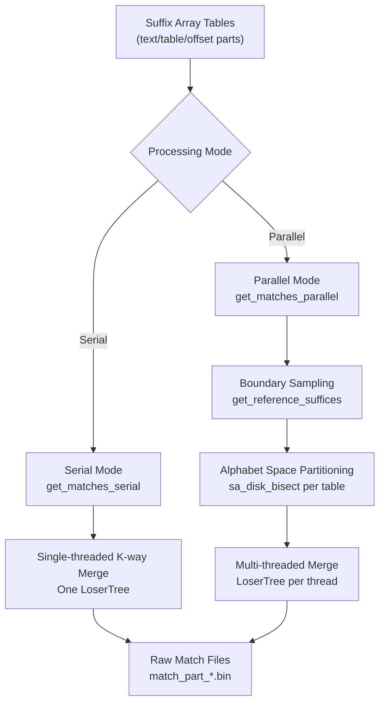
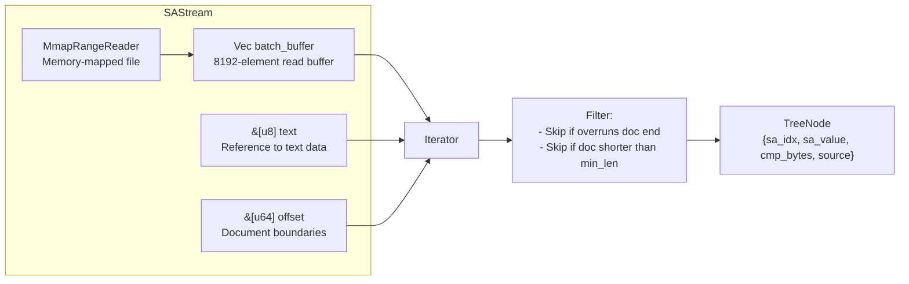
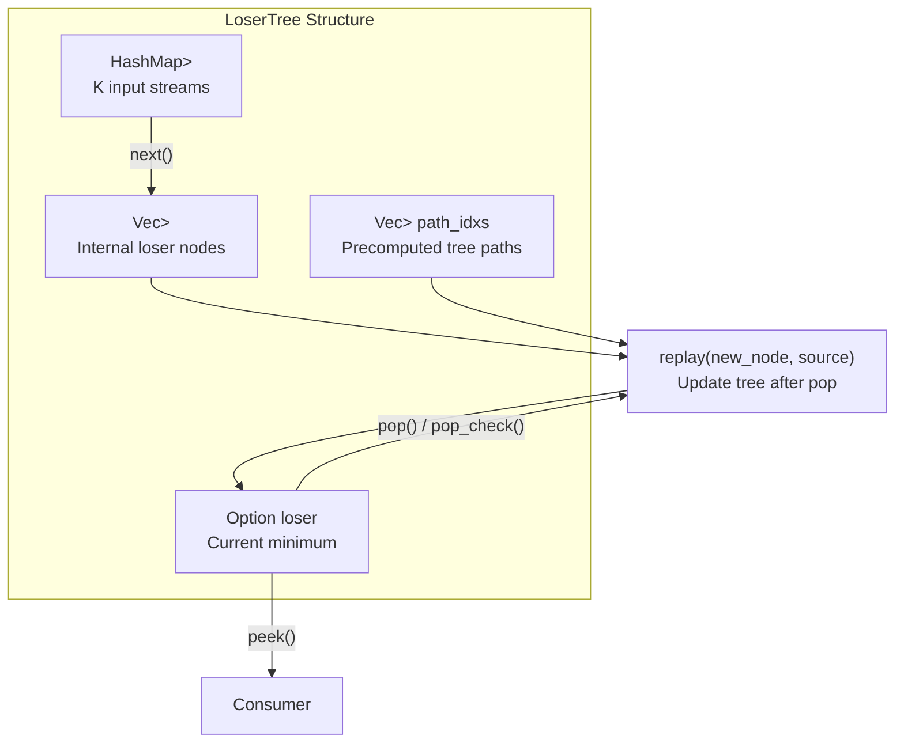
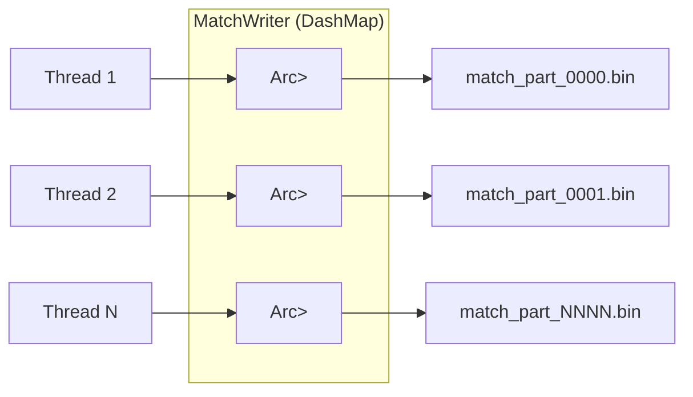
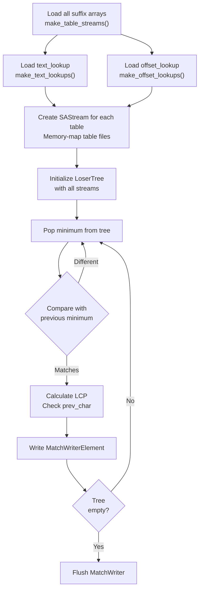
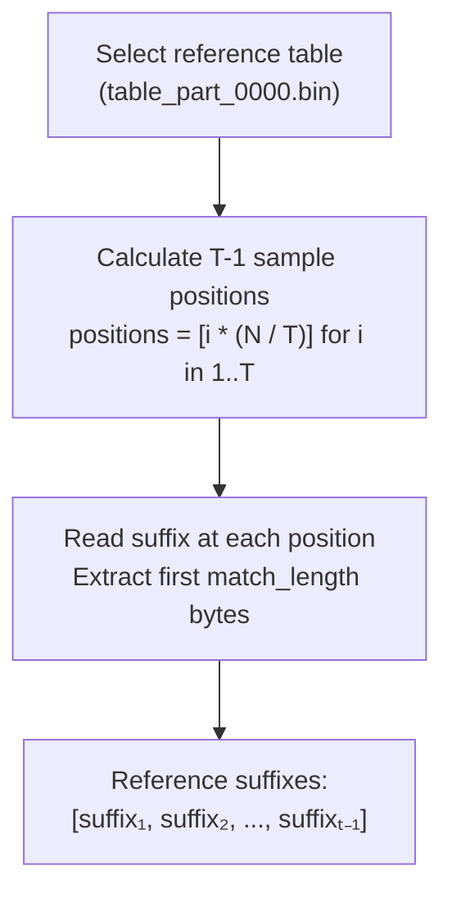
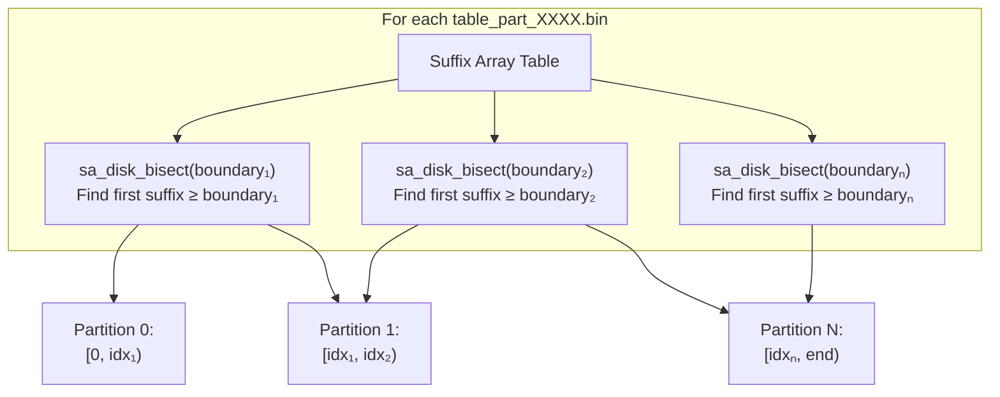
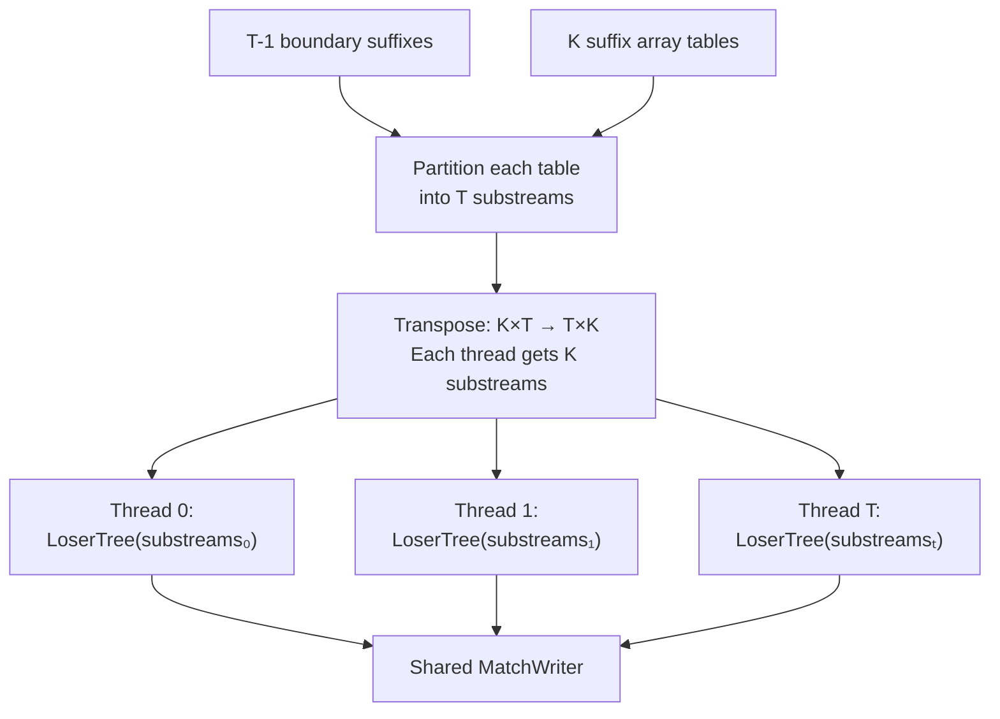
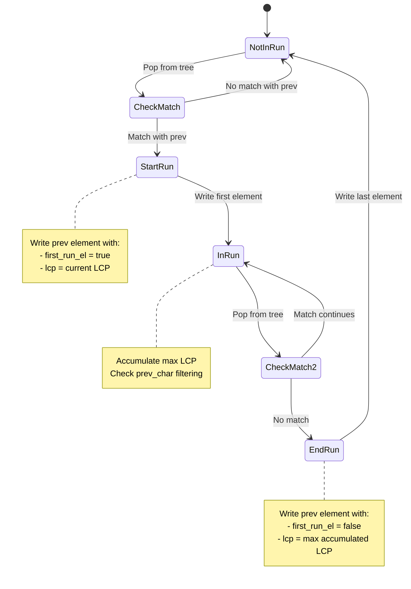

<!-- source: DeepWiki mcp.deepwiki.com · repo allenai/duplodocus · extra page Match Finding Stage · fetched 2026-10-26 -->

# Match Finding Stage

<details>
<summary>Relevant source files</summary>

The following files were used as context for generating this wiki page:

- [src/sa_base.rs](src/sa_base.rs)
- [src/sa_utils.rs](src/sa_utils.rs)

</details>


## Purpose and Scope

The Match Finding Stage is Stage 2 of the four-stage Suffix Array (SA) pipeline. This stage takes the suffix array tables produced in Stage 1 (see [Make Tables Stage](#2.1.1)) and identifies all repeated text sequences that meet the minimum length threshold. The stage performs an efficient k-way merge across multiple suffix arrays to detect duplicates, outputting raw match data that will be consolidated in Stage 3 (see [Merge and Annotate Stages](#2.1.3)).

This document covers the match finding algorithms, data structures, and parallelization strategies. For information about the underlying suffix table construction, see [Suffix Table Implementation](#2.3). For details on compact integer types used in the suffix arrays, see [Compact Integer Types](#2.4).

---

## Input and Output Format

### Input Files

The stage operates on files produced by Stage 1:

| File Pattern | Content | Format |
|--------------|---------|--------|
| `text/text_part_*.bin` | Concatenated document text | Raw bytes with `\xff\xff` separators + 16-byte metadata |
| `table/table_part_*.bin` | Suffix array indices | CompactUint array (u32, U40, or u64) |
| `offsets/offset_part_*.bin` | Document boundaries | u64 triples: `(path_id, line_num, offset)` |

### Output Files

| File Pattern | Content | Format |
|--------------|---------|--------|
| `matches/match_part_*.bin` | Raw match locations | 33-byte `MatchWriterElement` structs |

The `MatchWriterElement` structure contains:

```
- part_num (u64): Which table partition the match came from
- sa_idx (u64): Index into the suffix array
- sa_value (u64): Position in text where match occurs
- lcp (u64): Length of the repeated sequence
- first_run_el (bool): Whether this starts a new duplicate run
```

Sources: [src/sa_base.rs:48-88](), [src/sa_utils.rs:375-420]()

---

## Processing Modes

The stage supports two processing modes selected via CLI commands:



**Serial Mode**: Best for smaller datasets or when memory is constrained. Uses a single thread to perform k-way merge across all suffix arrays.

**Parallel Mode**: Scales to large datasets by partitioning the suffix array space across threads based on lexicographic boundaries.

Sources: [src/sa_base.rs:347-389](), [src/sa_base.rs:481-556]()

---

## Core Data Structures

### SAStream

The `SAStream<T>` struct provides efficient streaming access to memory-mapped suffix arrays with automatic filtering of invalid entries.



Key methods:
- `new()`: Create stream from memory-mapped file
- `next_eos()`: Binary search to find end-of-document position
- `read_next_batch()`: Batch read for performance (8192 elements at a time)

Sources: [src/sa_utils.rs:211-365]()

### LoserTree

The `LoserTree<T>` implements an efficient k-way merge using the loser tree data structure, which maintains O(log k) comparison complexity per element.



The loser tree maintains the invariant that the current minimum is always available in O(1) time, while insertions require O(log k) comparisons.

**Optimization: pop_check()**: This method implements a fast path that avoids the full replay when the new element from a stream is still less than the second-minimum element:

```
if new_node < second_min:
    # Fast path: new node is still minimum
    return without replay
else:
    # Slow path: perform full replay
```

Sources: [src/sa_utils.rs:565-843]()

### MatchWriter

Thread-safe concurrent writer for match output:



Each thread writes to separate files identified by the source table index, avoiding lock contention.

Sources: [src/sa_utils.rs:424-483]()

---

## Serial Processing

Serial mode performs a straightforward k-way merge using a single `LoserTree`.

### Serial Processing Flow



Sources: [src/sa_base.rs:376-389](), [src/sa_base.rs:776-876]()

---

## Parallel Processing

Parallel mode distributes work across threads by partitioning the suffix array space based on lexicographic boundaries.

### Boundary Sampling Strategy

To partition suffix arrays, the system samples boundary suffixes from a reference table:



For T threads, we need T-1 internal boundaries to create T partitions.

Sources: [src/sa_base.rs:559-606]()

### Alphabet Space Partitioning

Each suffix array is partitioned using binary search (`sa_disk_bisect`) to find split points:



The binary search compares the first `match_length` bytes of each suffix against the boundary string. Partitions are dilated by ±1 element to prevent missing duplicates at boundaries.

Sources: [src/sa_base.rs:608-723](), [src/sa_base.rs:725-774]()

### Thread Allocation and Execution



Each thread operates independently on its portion of the alphabet space, writing matches to source-specific files via the shared `MatchWriter`.

Sources: [src/sa_base.rs:508-556]()

---

## Match Detection Algorithm

The core k-way merge loop in `get_matches_parallel_thread` implements the match detection logic.

### Match Detection State Machine



Sources: [src/sa_base.rs:776-876]()

### TreeNode Comparison

The `TreeNode` struct carries the information needed for comparison and LCP calculation:

| Field | Purpose |
|-------|---------|
| `sa_idx` | Position in suffix array (for tracking) |
| `sa_value` | Position in text where suffix starts |
| `cmp_bytes` | First `match_length` bytes (for equality check) |
| `source` | Which table this came from |
| `prev_char` | Byte before suffix (for filtering) |
| `rest_of_doc` | Remaining document bytes (for LCP calculation) |

**Comparison Logic**:
1. Primary: Compare `cmp_bytes` lexicographically
2. Tie-breaker: Compare `source` index to ensure deterministic ordering

**LCP Calculation**: When two nodes match on `cmp_bytes`, extend the comparison into `rest_of_doc` to find the full length of the repeated sequence.

Sources: [src/sa_utils.rs:499-560]()

### Previous Character Filtering

The `prev_char_same()` check prevents writing subsumed matches:

```
Example:
  Text: "...banana..."
  
  Suffixes:
    "anana..."  (prev_char = 'b')
    "anana..."  (prev_char = 'n')  ← subsumed match
    
  Only write the first occurrence where prev_char differs
```

This filtering ensures that overlapping matches are properly deduplicated in later stages.

Sources: [src/sa_utils.rs:509-521](), [src/sa_base.rs:819-836]()

---

## Performance Characteristics

### Serial Mode

| Aspect | Characteristic |
|--------|----------------|
| Time Complexity | O(N log K) where N = total suffixes, K = number of tables |
| Space Complexity | O(K) for tree + memory-mapped files |
| Parallelism | None (single-threaded) |
| Best For | Small datasets, memory-constrained environments |

### Parallel Mode

| Aspect | Characteristic |
|--------|----------------|
| Time Complexity | O(N/T log K) per thread, where T = thread count |
| Space Complexity | O(K×T) for substreams + memory-mapped files |
| Parallelism | T threads (typically = CPU cores) |
| Overhead | Boundary sampling + binary search partitioning |
| Best For | Large datasets with sufficient memory |

The parallel mode achieves near-linear scaling because:
1. Each thread processes a disjoint portion of the alphabet space
2. Memory-mapped I/O is already parallelized by the OS
3. Lock contention is minimized (separate output files per source)

**Shortcut Optimization**: The `pop_check()` method in `LoserTree` implements an early-exit optimization that skips tree replay when the new element is still the minimum. This optimization is particularly effective when data has long runs of duplicates.

Sources: [src/sa_utils.rs:699-732]()

---

## File Path to Code Entity Mapping

### Entry Points

| CLI Command | Function | File |
|-------------|----------|------|
| `duplodocus sa-get-matches-serial` | `get_matches_serial()` | [src/sa_base.rs:347-373]() |
| `duplodocus sa-get-matches-parallel` | `get_matches_parallel()` | [src/sa_base.rs:481-506]() |

### Core Processing Functions

| Function | Purpose | Location |
|----------|---------|----------|
| `make_text_lookups()` | Load all text files into memory | [src/sa_base.rs:391-418]() |
| `make_offset_lookups()` | Load all offset files into memory | [src/sa_base.rs:420-447]() |
| `make_table_streams()` | Create SAStream instances for all tables | [src/sa_base.rs:450-479]() |
| `get_reference_suffices()` | Sample boundary suffixes for partitioning | [src/sa_base.rs:559-606]() |
| `get_all_substreams()` | Partition all tables using boundaries | [src/sa_base.rs:608-645]() |
| `sa_disk_bisect()` | Binary search in memory-mapped suffix array | [src/sa_base.rs:725-774]() |
| `get_matches_parallel_thread()` | K-way merge with match detection | [src/sa_base.rs:776-876]() |

### Data Structure Implementations

| Type | File | Key Methods |
|------|------|-------------|
| `SAStream<T>` | [src/sa_utils.rs:211-365]() | `new()`, `next()`, `read_next_batch()` |
| `LoserTree<T>` | [src/sa_utils.rs:565-843]() | `new()`, `pop()`, `pop_check()`, `replay()` |
| `MatchWriter` | [src/sa_utils.rs:424-483]() | `new()`, `write_element()`, `finish()` |
| `MatchWriterElement` | [src/sa_utils.rs:375-420]() | `into_bytes()`, `from_bytes()` |
| `TreeNode` | [src/sa_utils.rs:499-560]() | `cmp_eq()`, `lcp()`, `prev_char_same()` |
| `MmapRangeReader` | [src/sa_utils.rs:136-199]() | `new()`, `from_range()` |

Sources: [src/sa_base.rs:1-1199](), [src/sa_utils.rs:1-844]()

---

