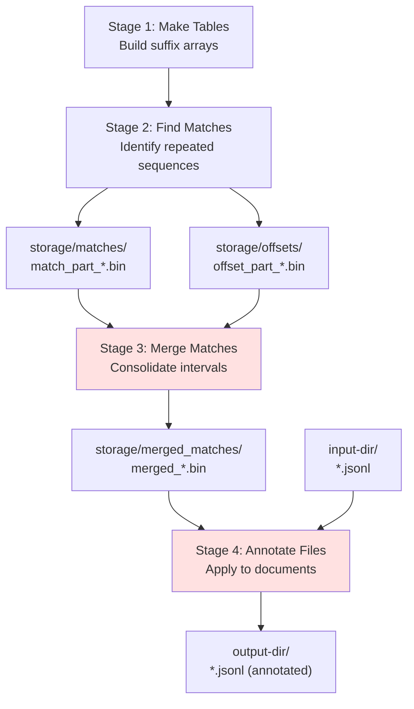
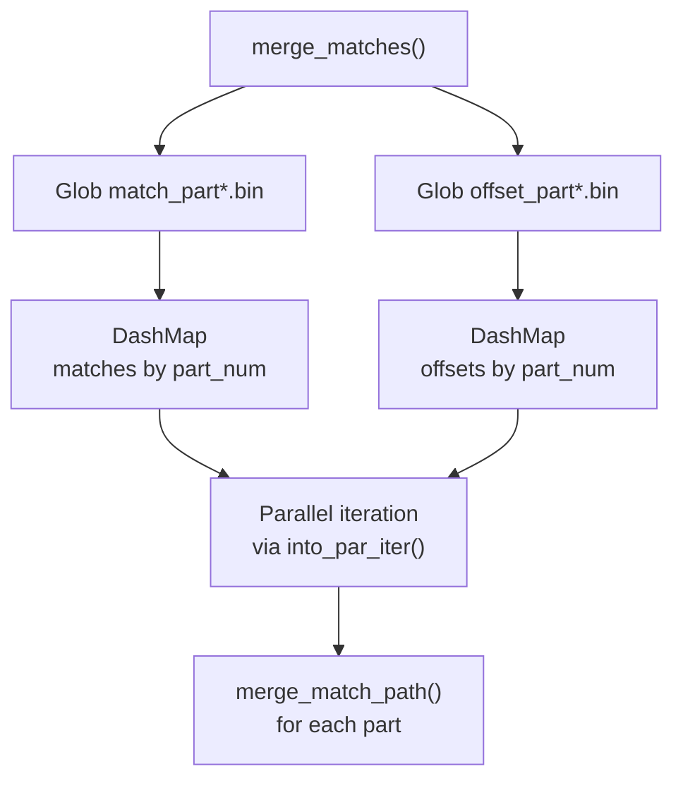
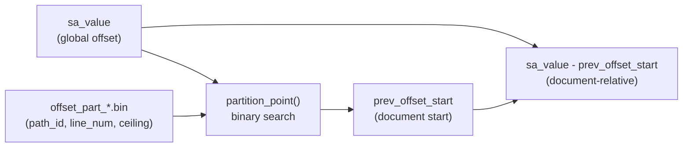
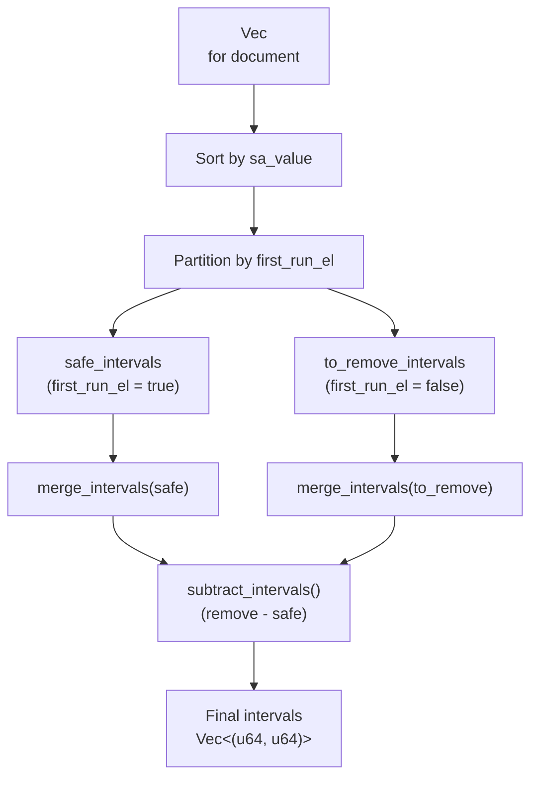
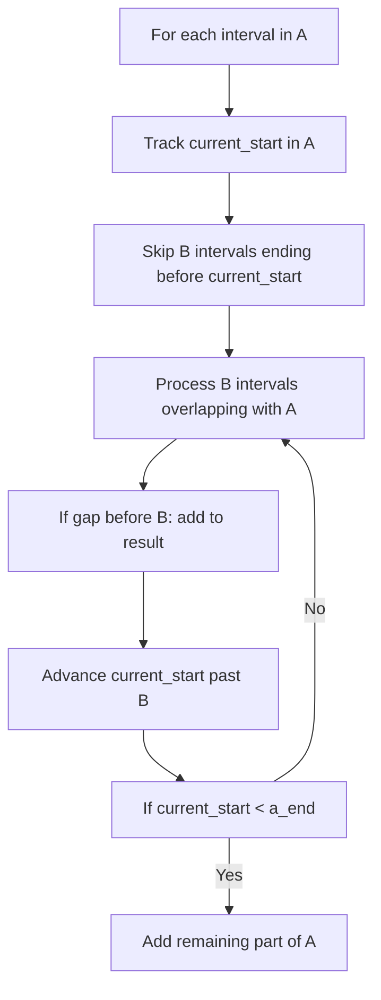
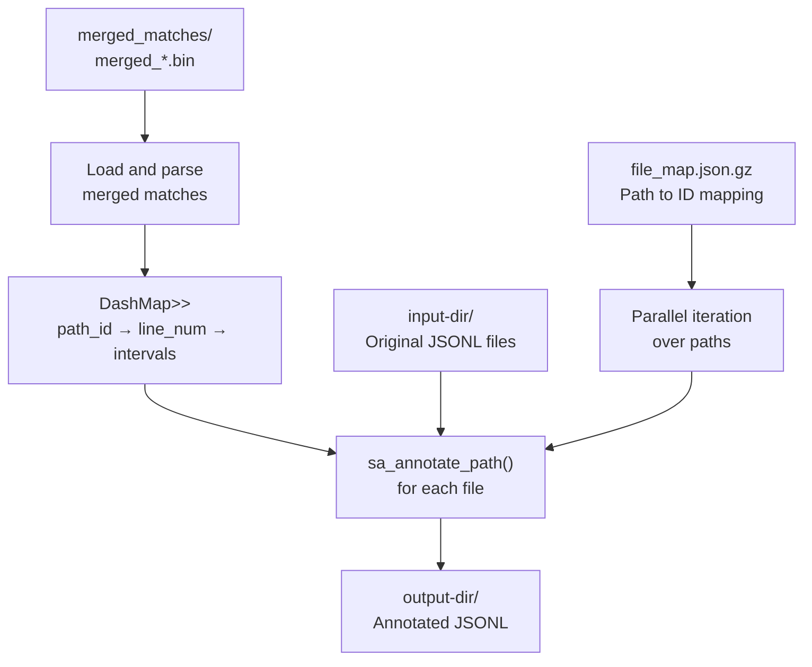
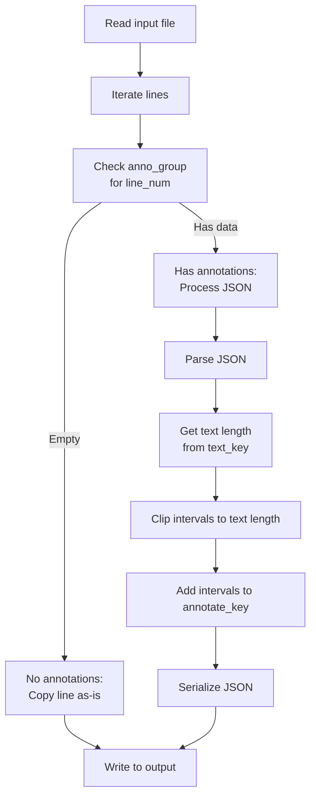

<!-- source: DeepWiki mcp.deepwiki.com · repo allenai/duplodocus · extra page Merge and Annotate Stages · fetched 2026-10-26 -->

# Merge and Annotate Stages

<details>
<summary>Relevant source files</summary>

The following files were used as context for generating this wiki page:

- [src/sa_base.rs](src/sa_base.rs)

</details>


## Purpose and Scope

This document describes Stages 3 and 4 of the Suffix Array pipeline: the **Merge Matches** stage and the **Annotate Files** stage. These final stages consolidate raw match data into document-relative intervals and apply them back to the original documents.

For information about earlier pipeline stages, see [Make Tables Stage](#2.1.1) and [Match Finding Stage](#2.1.2). For details on the overall SA pipeline architecture, see [SA Pipeline Stages](#2.1).

---

## Pipeline Context

The Merge and Annotate stages complete the SA pipeline by transforming raw suffix array matches into actionable annotations on original documents:



**Sources:** [src/sa_base.rs:47-88]()

---

## Stage 3: Merge Matches

### Overview

The `merge_matches` function consolidates raw match data from Stage 2 into merged interval representations. This stage performs three critical operations:

1. **Grouping**: Organize matches by document (path_id, line_num)
2. **Offset Conversion**: Transform global text offsets into document-relative positions
3. **Interval Processing**: Merge overlapping intervals and apply safe region filtering

**Sources:** [src/sa_base.rs:887-936]()

---

### Entry Point and Parallelization



The function uses `glob` to discover all match files and offset files, stores them in `DashMap` collections indexed by part number, then processes each part in parallel using `into_par_iter()`.

**Sources:** [src/sa_base.rs:887-936]()

---

### Input Format: MatchWriterElement

Raw matches from Stage 2 are stored as `MatchWriterElement` structures:

| Field | Type | Description |
|-------|------|-------------|
| `source` | u64 | Source table index (which text_part_*.bin) |
| `part_num` | u64 | Match writer part number (for parallelization) |
| `sa_idx` | u64 | Index in the suffix array |
| `sa_value` | u64 | **Global text offset** where repeat starts |
| `lcp` | u64 | Longest common prefix length (repeat length) |
| `first_run_el` | bool | Whether this is first in a run (safe region marker) |

The structure serializes to `MatchWriterElement::MATCH_EL_SIZE` bytes per element.

**Sources:** [src/sa_base.rs:945-947](), [src/sa_utils.rs]()

---

### Offset Conversion Algorithm

The merge process must convert global text offsets (across entire `text_part_*.bin` file) to document-relative offsets:



The algorithm:

1. Loads offset triplets: `(path_id, line_num, document_end)` from offset files
2. Uses `partition_point` to binary search for the document containing each offset
3. Subtracts the previous document's end position to get document-relative offset
4. Groups matches by `(path_id, line_num)` key

**Sources:** [src/sa_base.rs:948-976]()

---

### Interval Merging and Safe Region Handling

Each document's matches are processed to produce final intervals:



**Key concepts:**

- **first_run_el flag**: Marks the first element in a repeated sequence. These are "safe" intervals that represent novel text (the original occurrence).
- **Safe intervals**: Should NOT be marked as repeats, as they are the source text.
- **Remove intervals**: The actual repeated occurrences that should be marked.
- **Subtraction**: Final intervals are `remove_merged - safe_merged` to avoid marking original occurrences.

**Sources:** [src/sa_base.rs:982-1007]()

---

### Merge Intervals Algorithm

The `merge_intervals` function consolidates overlapping intervals:

```rust
// Pseudocode based on src/sa_base.rs:1017-1036
Input: sorted Vec<&mut MatchWriterElement>
Output: Vec<(u64, u64)> of merged intervals

1. Initialize with first element: start = first.sa_value, cur_end = start + first.lcp
2. For each subsequent element:
   - If element.sa_value > cur_end: intervals don't overlap
     - Push (start, cur_end) to output
     - Reset: start = element.sa_value
   - Always update: cur_end = element.sa_value + element.lcp
3. Push final interval (start, cur_end)
```

This classic interval merging algorithm assumes sorted input and produces non-overlapping intervals.

**Sources:** [src/sa_base.rs:1017-1036]()

---

### Subtract Intervals Algorithm

The `subtract_intervals(vec_a, vec_b)` function computes `A - B` for interval sets:



The algorithm maintains an index into `vec_b` to avoid redundant comparisons, processing intervals in order to compute set difference.

**Sources:** [src/sa_base.rs:1038-1071]()

---

### Output Format: Merged Matches

The merged match files contain quadruplets:

| Field | Type | Description |
|-------|------|-------------|
| path_id | u64 (8 bytes) | File path identifier from FileMap |
| line_num | u64 (8 bytes) | Line number within file |
| start | u64 (8 bytes) | Document-relative start offset |
| end | u64 (8 bytes) | Document-relative end offset (exclusive) |

Each record is 32 bytes. Files are named `merged_match_part_XXXX.bin`.

**Sources:** [src/sa_base.rs:995-1002]()

---

## Stage 4: Annotate Files

### Overview

The `sa_annotate_files` function applies merged intervals back to original documents, adding JSON metadata to mark repeated text regions. This stage:

1. Loads merged match intervals
2. Groups annotations by document
3. Processes each input file
4. Adds annotation arrays to JSON documents
5. Writes annotated output

**Sources:** [src/sa_base.rs:1081-1152]()

---

### Data Flow Architecture



The annotation structure uses nested `DashMap` for thread-safe access during parallel file processing.

**Sources:** [src/sa_base.rs:1081-1152]()

---

### Annotation Loading and Grouping

The loading phase uses parallel iteration over all merged match files:

```rust
// Based on src/sa_base.rs:1108-1124
anno_groups: DashMap<usize, DashMap<usize, Vec<(u64, u64)>>>
//           path_id → (line_num → intervals)

For each merged_*.bin file:
  1. Read as Vec<u64>
  2. Chunk into (path_id, line_num, start, end) quadruplets
  3. Insert into nested DashMap structure
```

The nested `DashMap` provides:
- **Outer map**: Groups by path_id (file)
- **Inner map**: Groups by line_num (document within file)
- **Values**: Vectors of (start, end) intervals

**Sources:** [src/sa_base.rs:1105-1124]()

---

### Document Processing Pipeline

For each input file, `sa_annotate_path` processes line-by-line:



**Sources:** [src/sa_base.rs:1154-1197]()

---

### JSON Manipulation

The annotation process modifies JSON documents:

**Before:**
```json
{"text": "This is a sample document with repeated text.", "id": "doc1"}
```

**After (with annotate_key="sa_annotations"):**
```json
{
  "text": "This is a sample document with repeated text.",
  "id": "doc1",
  "sa_annotations": [[15, 30], [35, 42]]
}
```

The intervals `[[15, 30], [35, 42]]` indicate byte ranges in the `text` field that contain repeated content.

**Implementation details:**
- Uses `json_get` to retrieve text field and measure length
- Clips intervals to text boundaries: `l.min(text_len)`, `r.min(text_len)`
- Filters out zero-length intervals: `if l2 == r2 { None }`
- Uses `json_set` to add annotation array to document

**Sources:** [src/sa_base.rs:1165-1191]()

---

## Key Functions and Data Structures

### Function Reference

| Function | Purpose | Parallelization |
|----------|---------|-----------------|
| `merge_matches()` | Orchestrates merge stage | Parallel over parts |
| `merge_match_path()` | Processes one part file | Single-threaded |
| `merge_intervals()` | Merges overlapping intervals | Single-threaded |
| `subtract_intervals()` | Computes interval set difference | Single-threaded |
| `sa_annotate_files()` | Orchestrates annotation stage | Parallel over files |
| `sa_annotate_path()` | Annotates one input file | Single-threaded |

**Sources:** [src/sa_base.rs:887-1197]()

---

### Data Structure Summary

| Structure | Location | Purpose |
|-----------|----------|---------|
| `MatchWriterElement` | sa_utils.rs | Raw match representation with LCP |
| `DashMap<usize, PathBuf>` | merge_matches | Thread-safe part number → path mapping |
| `HashMap<(usize, usize), Vec<...>>` | merge_match_path | Document → matches grouping |
| `DashMap<usize, DashMap<...>>` | sa_annotate_files | Thread-safe nested annotation map |
| `Vec<(u64, u64)>` | Throughout | Interval representation (start, end) |

**Sources:** [src/sa_base.rs:887-1197](), [src/sa_utils.rs]()

---

## Performance Characteristics

### Merge Stage

- **Parallelization**: Across part files (one thread per part)
- **Memory**: Loads one part file at a time into memory
- **I/O Pattern**: Sequential reads of match/offset files, sequential writes of merged files
- **Bottleneck**: Binary search in offset files for each match element

### Annotate Stage

- **Parallelization**: Across input files (one thread per file)
- **Memory**: Loads entire file into memory for processing
- **I/O Pattern**: Random access to annotation map, sequential file writes
- **Bottleneck**: JSON parsing/serialization for each document

**Sources:** [src/sa_base.rs:887-1197]()

---

## Progress Tracking

Both stages provide progress feedback:

**Merge stage:**
- First thread to start gets a progress bar
- Tracks matches processed (2x elements.len())
- Controlled by `pbar_flag` parameter

**Annotate stage:**
- Progress bar over all paths
- Atomic counters for annotated documents and bytes
- Final summary: `"Annotated X docs, marked Y bytes in Z secs"`

**Sources:** [src/sa_base.rs:918-930](), [src/sa_base.rs:1131-1150]()

---

## Usage Context

These stages are invoked as the final steps of the SA pipeline:

1. User runs: `duplodocus sa-make-tables` (Stage 1)
2. User runs: `duplodocus sa-get-matches-serial` or `sa-get-matches-parallel` (Stage 2)
3. User runs: `duplodocus sa-merge-matches` (Stage 3) ← **This page**
4. User runs: `duplodocus sa-annotate-files` (Stage 4) ← **This page**

After completion, the output directory contains annotated JSONL files with intervals marking repeated text regions.

**Sources:** [src/main.rs](), [src/sa_base.rs:887-1197]()

---

