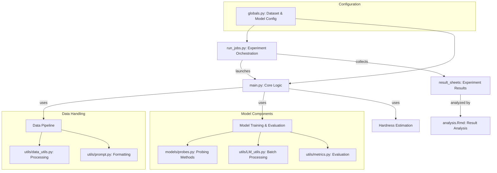
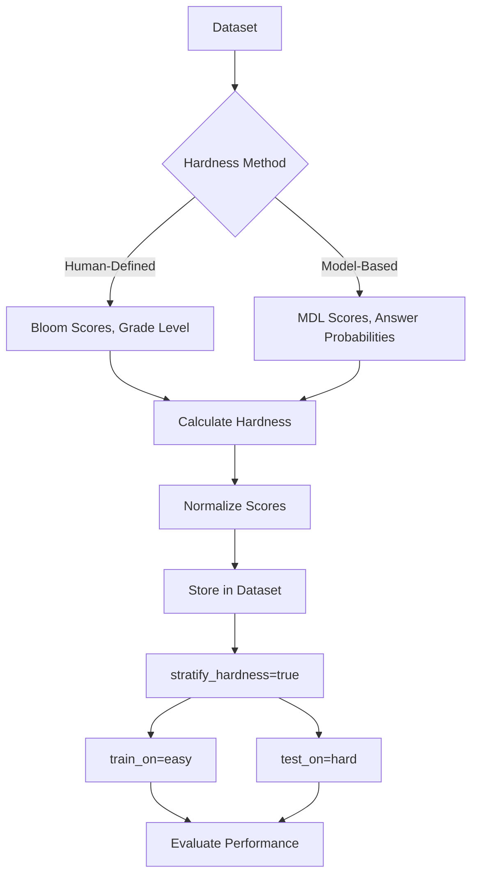

<!-- source: DeepWiki mcp.deepwiki.com · repo allenai/easy-to-hard-generalization · page 1 Overview · fetched 2026-10-26 -->

# Overview

<details>
<summary>Relevant source files</summary>

The following files were used as context for generating this wiki page:

- [README.md](README.md)

</details>


This document provides an introduction to the Easy-to-Hard Generalization framework, which implements experiments from the paper "The Unreasonable Effectiveness of Easy Training Data for Hard Tasks." The system enables researchers to investigate how language models trained on easy examples can generalize to more difficult problems.

## Purpose and Scope

The Easy-to-Hard Generalization codebase allows researchers to:

1. Evaluate language models on tasks with varying levels of difficulty
2. Test the hypothesis that models can generalize from easy to hard examples
3. Compare different training methods (ICL, CoT, linear probing, fine-tuning)
4. Measure performance across multiple domains and datasets

For detailed information about running specific experiments, see [Usage Guide](#6), and for system architecture details, see [System Architecture](#2).

## System Architecture

The framework consists of several interconnected components that handle experiment orchestration, data processing, model training, and evaluation:

### System Architecture Overview



Sources: [README.md:1-38]()

## Experiment Workflow

The system follows a structured workflow for conducting experiments:

### Experiment Execution Flow

```mermaid
flowchart TD
    start["Start Experiment"] --> runJobs["run_jobs.py: Select Experiment Type"]
    runJobs --> configs["Configure Models & Datasets"]
    configs --> jobGen["Generate Experiment Commands"]
    jobGen --> launchJobs["Launch Jobs (main.py instances)"]
    
    launchJobs --> dataLoad["Load & Process Dataset"]
    dataLoad --> modelLoad["Load Language Model"]
    
    modelLoad --> expType{"Experiment Type?"}
    
    expType -->|"write_hidden_states"| hiddenStates["Extract Model Hidden States"]
    expType -->|"estimate_hardness"| hardnessEst["Calculate Hardness Scores"]
    expType -->|"all_to_all_table/get_population_table"| trainEval["Train/Evaluate Model"]
    
    hiddenStates & hardnessEst & trainEval --> saveResults["Save Results"]
    saveResults --> collectResults["Collect Results"]
    collectResults --> aggregateResults["Aggregate Results"]
    aggregateResults --> end["Generate CSV in result_sheets/"]
```

Sources: [README.md:35-95]()

## Key Features

### 1. Hardness Stratification

A central feature of the framework is its ability to stratify examples by difficulty, enabling targeted training and evaluation:

### Hardness Evaluation System



Sources: [README.md:64-70]()

### 2. Multiple Probing Methods

The system supports several approaches to assess model knowledge:

- **Decoding** (`probing_method=decoding`): Direct language model generation
- **Learned Probes** (`probing_method=learned`): Linear classifiers or MLPs trained on model hidden states
- **Fine-tuning** (`probing_method=finetuned`): Parameter-efficient tuning with QLoRA

### 3. Datasets

The framework includes support for multiple datasets covering different domains:

| Dataset | Codebase Identifier | Description | Hardness Variables |
|---------|-----------|-------------|-------------------|
| ARC Challenge | `ai2_arc/ARC-Challenge` | Science questions | Human difficulty rating |
| MMLU STEM-5 | `mmlu_STEM-5` | College/professional STEM exams | `human_hardness` (grade, high school, college) |
| StrategyQA | `strategy-qa` | Questions requiring multi-step reasoning | Model-based difficulty |
| GSM8K | `gsm8k_main` | Mathematical word problems | Length, operation complexity |

Sources: [README.md:57-62]()

## Experiment Types

The system supports several experiment types that can be launched through `run_jobs.py`:

1. **write_hidden_states**: Extract and save model hidden states for later probing
   ```
   python run_jobs.py -e write_hidden_states --dataset ai2_arc
   ```

2. **estimate_hardness**: Calculate difficulty scores for dataset examples using models defined in `globals.hardness_models`
   ```
   python run_jobs.py -e estimate_hardness --dataset ai2_arc
   ```

3. **all_to_all_table**: Evaluate performance across all datasets and models
   ```
   python run_jobs.py -e all_to_all_table --dataset ai2_arc -nb 5
   ```

4. **get_population_table**: Measure easy-to-hard generalization with various hardness measures
   ```
   python run_jobs.py -e get_population_table --dataset mmlu_STEM-5 -nb 5
   ```

5. **third_grade_to_college**: Test knowledge transfer across educational levels
   ```
   python run_jobs.py -e third_grade_to_college -nb 5
   ```

Sources: [README.md:40-91]()

## Result Analysis

The framework includes tools for analyzing experimental results:

- Results are stored as CSV files in the `result_sheets` directory
- The `analysis.Rmd` R markdown file provides visualization and statistical analysis
- Supports performance comparisons across models, methods, and hardness levels

For details on interpreting results and available metrics, see [Evaluation Metrics](#4.3).

Sources: [README.md:93-95]()

## Models Supported

The framework primarily works with the following language models:

- Llama models (7B, 13B, 70B) 
- Llama-2 models (7B, 13B, 70B)
- Mixtral-8x7B
- Other HuggingFace-compatible models

For models requiring specific handling (like Llama-2), the `llama2_path` variable must be set in `utils/utils.py`.

Sources: [README.md:7-33]()

---

