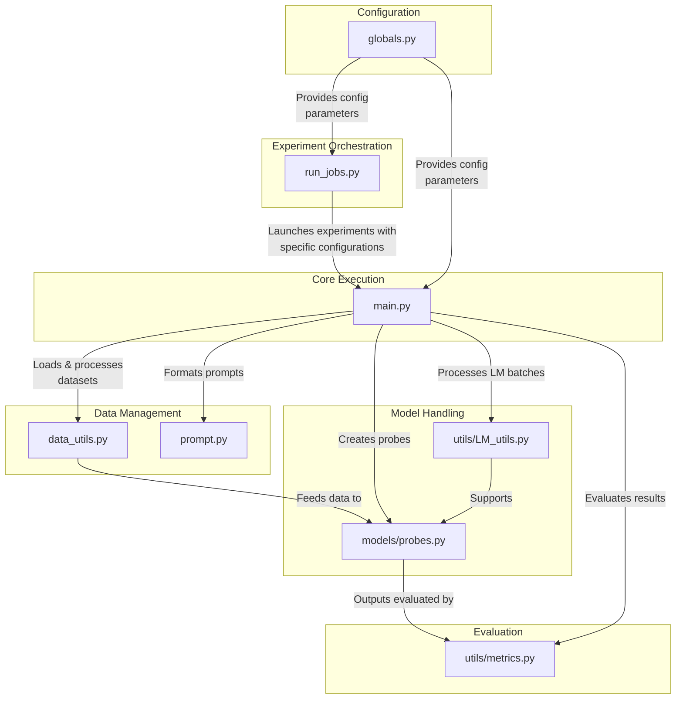
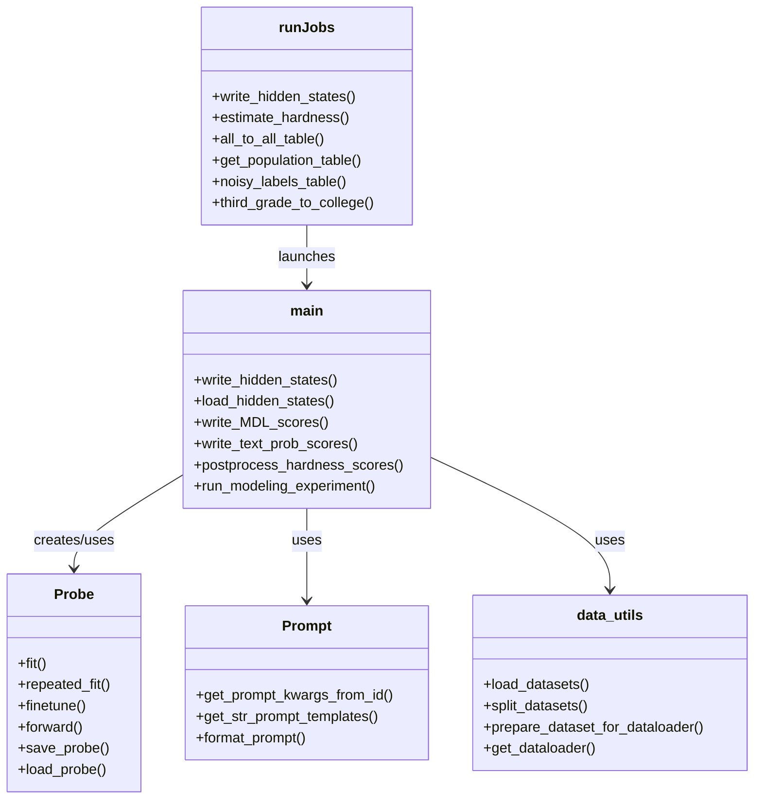
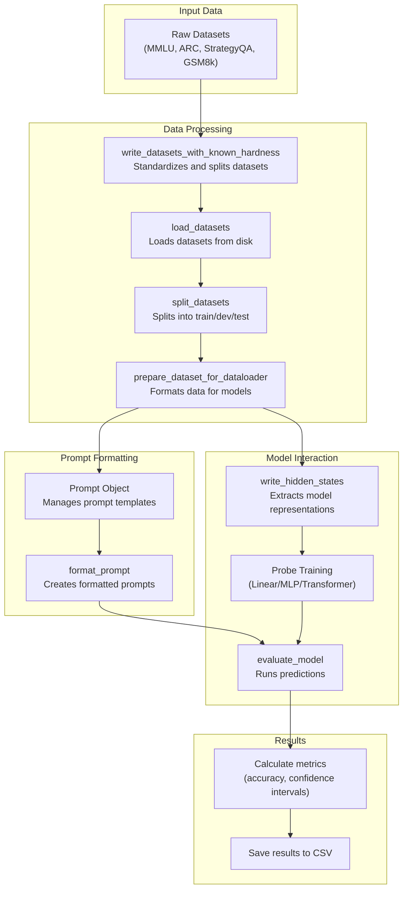
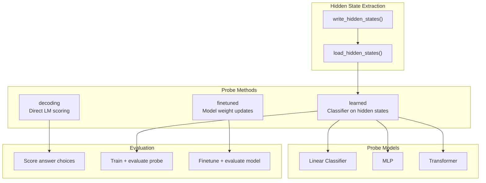
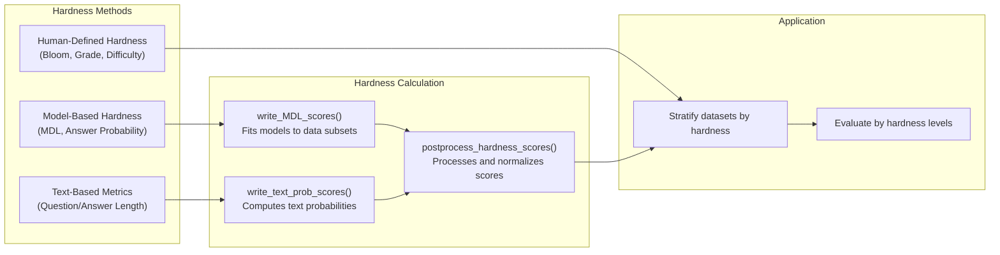
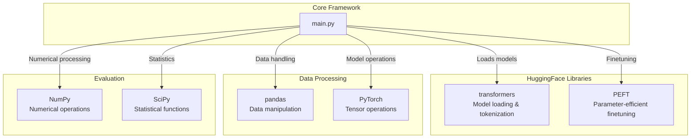
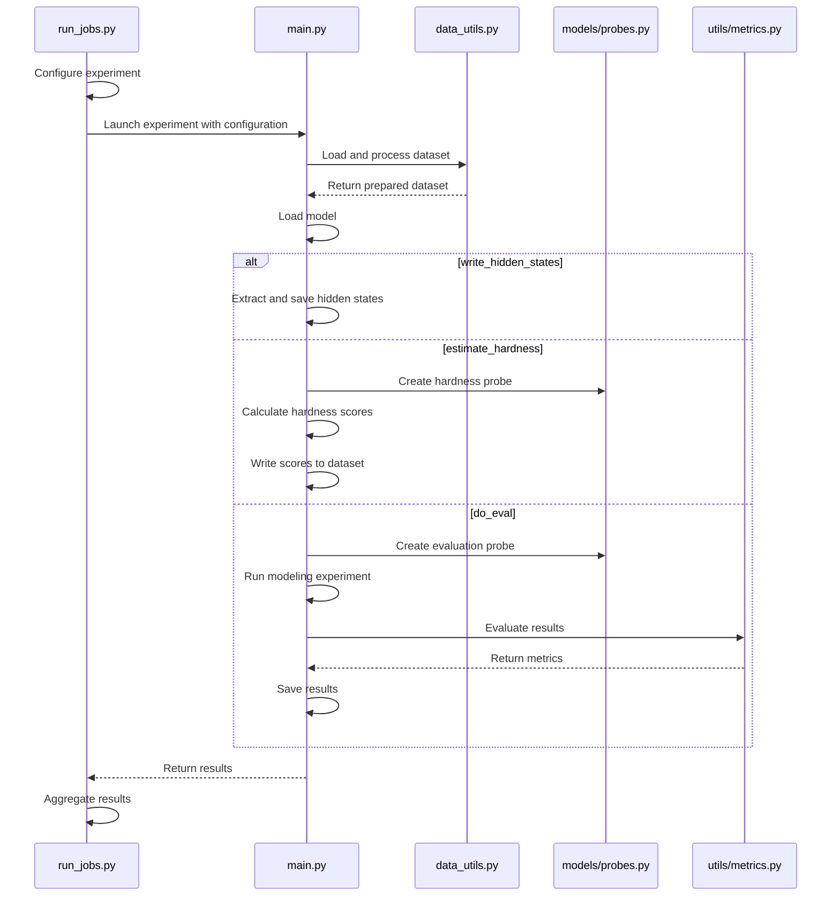

<!-- source: DeepWiki mcp.deepwiki.com · repo allenai/easy-to-hard-generalization · page 2 System Architecture · fetched 2026-10-26 -->

# System Architecture

Relevant source files

The following files were used as context for generating this wiki page:

- [README.md](README.md)
- [main.py](main.py)
- [run_jobs.py](run_jobs.py)

This page provides a high-level overview of the system architecture for the "Easy-to-Hard Generalization" framework. It describes the main system components, how they interact, and the overall data and control flow. For detailed information about the experiment workflow, see [Experiment Workflow](#2.1), and for configuration details, see [Configuration System](#2.2).

## System Components Overview

The codebase is organized into several core components that work together to test the hypothesis that language models can generalize from easy to hard examples:

Sources: [main.py:963-1114](), [run_jobs.py:193-251](), [run_jobs.py:677-795]()

## Component Roles and Responsibilities

The system consists of these primary components:

1. **Experiment Orchestration (`run_jobs.py`)**: Manages experiment configuration and launches experiments
2. **Core Execution (`main.py`)**: Implements experiment logic including training, evaluation, and hardness estimation
3. **Data Management**: Handles dataset loading, processing, and formatting
4. **Model Handling**: Manages model interaction, probing methods, and batch processing
5. **Evaluation**: Computes metrics and analyzes results
6. **Configuration (`globals.py`)**: Defines dataset and model configurations

### Component Details

Sources: [main.py:26-98](), [main.py:99-196](), [main.py:500-963](), [run_jobs.py:255-318]()

## Data Flow Architecture

The system processes data through several stages, from raw datasets to evaluation results:

Sources: [main.py:1171-1207](), [main.py:1247-1266](), [main.py:1500-1580]()

## Experimental Methods Architecture

The system supports multiple approaches to evaluate model generalization:

| Method | Description | Implementation | Key Components |
|--------|-------------|----------------|----------------|
| **Decoding** | Direct use of language model probabilities | Uses model's native token prediction | LM_utils.py for scoring |
| **Learned Probes** | Trains a classifier on extracted representations | Linear, MLP, or Transformer on hidden states | models/probes.py |
| **Finetuning** | Updates model weights (QLoRA) | PEFT-based finetuning | PEFT library integration |

### Probing and Evaluation System

Sources: [main.py:26-98](), [main.py:500-596](), [main.py:660-699]()

## Hardness Evaluation System

A key component of the framework is measuring the "hardness" of examples:

Sources: [main.py:99-317](), [main.py:336-368](), [main.py:369-498]()

## Integration with External Libraries

The system integrates with several key external libraries:

Sources: [main.py:1-24](), [main.py:1242-1266]()

## Control Flow between Components

The high-level control flow across the system:

Sources: [run_jobs.py:255-318](), [run_jobs.py:394-496](), [main.py:963-1303]()

## Storage Architecture

The system organizes its data across several key directories:

| Directory | Purpose | Contents |
|-----------|---------|----------|
| `data/` | Dataset storage | Raw and processed datasets, hidden representations |
| `outputs/` | Results storage | Experiment results CSV files |
| `result_sheets/` | Aggregated results | Combined results for analysis |
| Model directory | Model storage | Saved models and probes |
| Cache directory | HuggingFace cache | Downloaded models |

Sources: [main.py:1091-1116](), [main.py:1147-1151](), [main.py:863-894]()

---

