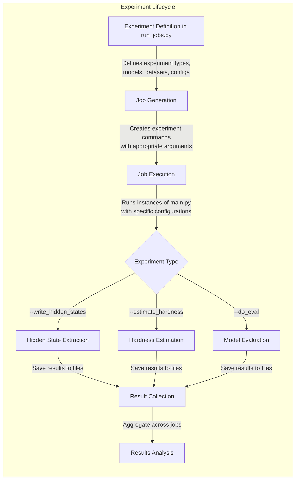
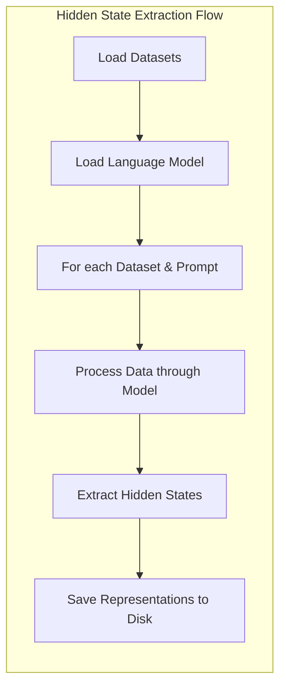
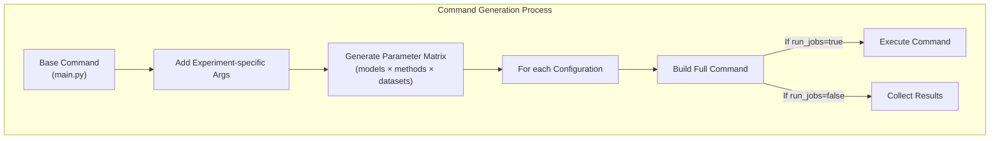
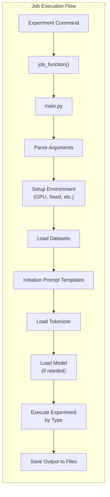
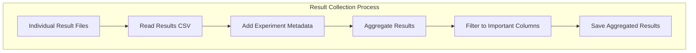
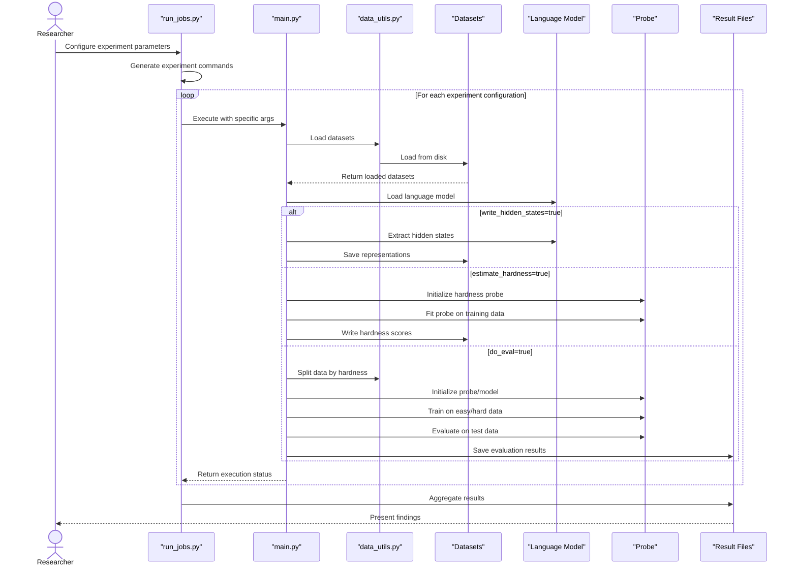

<!-- source: DeepWiki mcp.deepwiki.com · repo allenai/easy-to-hard-generalization · page 2.1 Experiment Workflow · fetched 2026-10-26 -->

# Experiment Workflow

<details>
<summary>Relevant source files</summary>

The following files were used as context for generating this wiki page:

- [main.py](main.py)
- [run_jobs.py](run_jobs.py)

</details>


This document details the end-to-end process of defining, running, and analyzing experiments in the Easy-to-Hard Generalization framework. The workflow orchestrates experiments that test how models trained on easy examples perform when evaluated on harder examples across different datasets and model configurations.

## Overview of the Experiment Pipeline

The experiment workflow is orchestrated by two main scripts: `run_jobs.py` and `main.py`. The `run_jobs.py` script acts as the entry point for launching experiments, while `main.py` contains the core experimental logic.



Sources:
- [run_jobs.py:782-786]()
- [run_jobs.py:226-230]()
- [main.py:26-76]() (write_hidden_states)
- [main.py:99-334]() (write_MDL_scores)
- [main.py:500-962]() (run_modeling_experiment)
- [main.py:369-497]() (postprocess_hardness_scores)

## Experiment Types

The codebase supports three main types of experiments, each serving a specific purpose in the research pipeline:

### 1. Hidden State Extraction

Extracts and saves the hidden representations from language models for later use in probing experiments. This is a preprocessing step for subsequent hardness estimation and model evaluation.



Sources:
- [main.py:26-76]() (write_hidden_states)
- [run_jobs.py:255-281]() (write_hidden_states)

### 2. Hardness Estimation

Estimates the "hardness" of data points using model-based metrics. This information is used to stratify data for training and evaluation.

```mermaid
flowchart TD
    subgraph "Hardness Estimation Flow"
        loadHData["Load Datasets"] --> loadHProbe["Load/Create Hardness Probe"]
        loadHProbe --> trainLoop["For each Dataset & Bootstrap"]
        
        trainLoop --> fitProbe["Fit Probe on Various Training Sizes"]
        fitProbe --> evalProbe["Evaluate Probe on Probing Data"]
        evalProbe --> collectScores["Collect Confidence Scores"]
        
        collectScores --> calculateHardness["Calculate Hardness = 1 - Confidence"]
        calculateHardness --> saveScores["Save Hardness Scores to Dataset"]
        
        saveScores --> postProcess["Post-process Hardness Scores"]
    end
```



Sources:
- [main.py:99-334]() (write_MDL_scores)
- [main.py:336-367]() (write_text_prob_scores)
- [main.py:369-497]() (postprocess_hardness_scores)
- [run_jobs.py:283-318]() (estimate_hardness)

### 3. Model Evaluation

Evaluates model performance across different training and testing conditions, including easy-to-hard generalization scenarios.

```mermaid
flowchart TD
    subgraph "Model Evaluation Flow"
        loadEData["Load Datasets"] --> stratify["Stratify Data by Hardness"]
        stratify --> createSplits["Create Training/Testing Splits"]
        
        createSplits --> sampleSizes["For each Training Sample Size"]
        
        sampleSizes --> methodLoop["For each Probing Method"]
        methodLoop --> prepData["Prepare Data for Method"]
        
        prepData --> trainModel["Train Model/Probe"]
        trainModel --> evalModel["Evaluate on Dev/Test"]
        
        evalModel --> breakdownResults["Break Down Results by Hardness"]
        breakdownResults --> saveResults["Save Results"]
    end
```



Sources:
- [main.py:500-962]() (run_modeling_experiment)
- [run_jobs.py:320-391]() (all_to_all_table)
- [run_jobs.py:393-496]() (get_population_table)

## Experiment Configuration and Command Generation

Experiments are configured through a combination of command-line arguments and configuration dictionaries in `run_jobs.py`. The script generates specific commands for each experimental condition.



The configuration process follows these steps:

1. Define base experimental parameters in `run_jobs.py`
2. Configure dataset-specific and model-specific parameters
3. Generate commands with the appropriate arguments
4. Either execute commands or collect results from previous runs

Key configuration components include:

| Configuration Component | Purpose | Example |
|------------------------|---------|---------|
| Method Configs | Define probing method settings | `finetuned_CoT=False`: Uses finetuned models without chain-of-thought |
| Data × Method Configs | Dataset-specific settings | `strategy-qa_CoT=True`: Uses specific prompts for strategy QA with CoT |
| Model Configs | Model-specific overrides | Batch size adjustments based on model size |
| Hardness Variables | Dataset-specific hardness measures | `human_grade` for ARC, `num_steps` for GSM8K |
| Training Conditions | Define training data characteristics | `--train_on easy`, `--train_on hard` |

Sources:
- [run_jobs.py:182-201]() (method_configs)
- [run_jobs.py:202-744]() (various configuration dictionaries) 
- [run_jobs.py:746-786]() (add_job_args construction)

## Job Execution

The experimental jobs are executed through the `job_function`, which runs the generated commands. The execution flow varies based on the experiment type.



The `job_function` is straightforward:

```python
def job_function(job_command):
    os.system(job_command)
```

When executed, `main.py` follows these steps:
1. Parse arguments and initialize experiment configuration
2. Set up environment (GPU, seed, directories)
3. Load datasets and create splits
4. Initialize prompt templates
5. Load tokenizer and model
6. Execute the specific experiment type
7. Save results to the appropriate files

Sources:
- [run_jobs.py:226-230]() (job_function)
- [main.py:963-1167]() (main script initialization)
- [main.py:1169-1202]() (data loading)
- [main.py:1213-1241]() (tokenizer loading)
- [main.py:1243-1252]() (model loading)

## Result Collection and Analysis

After experiments are executed, results are collected and aggregated for analysis.



Results are processed through these steps:

1. Individual experiment results are saved as CSV files
2. The `accumulate_results_to_df` function reads these files and adds experiment metadata
3. Results are aggregated across different experiment configurations
4. Important columns are filtered and the aggregated results are saved

The final output includes:
- Aggregated CSV files with experiment results
- Item-level accuracy data for detailed analysis
- Bootstrap confidence intervals for statistical significance

Sources:
- [run_jobs.py:232-253]() (accumulate_results_to_df)
- [run_jobs.py:212-223]() (filter_results_columns)
- [main.py:843-963]() (collect and save results)

## Full Experiment Workflow Example

Below is an example of a complete experiment workflow for testing easy-to-hard generalization:



Sources:
- [run_jobs.py:787-793]() (experiment selection)
- [main.py:1243-1342]() (experiment execution)

## Common Experiment Workflows

The repository includes several predefined experiment workflows:

| Experiment Type | Command | Purpose |
|-----------------|---------|---------|
| Hidden State Extraction | `python run_jobs.py --experiment write_hidden_states` | Extract model hidden states for later probing |
| Hardness Estimation | `python run_jobs.py --experiment estimate_hardness` | Calculate hardness scores for data points |
| All-to-All Evaluation | `python run_jobs.py --experiment all_to_all_table` | Evaluate all models on all datasets |
| Population Evaluation | `python run_jobs.py --experiment get_population_table` | Test easy-to-hard generalization across population distributions |
| Label Noise Analysis | `python run_jobs.py --experiment noisy_labels_table` | Test robustness to label noise |
| Transfer Learning | `python run_jobs.py --experiment third_grade_to_college` | Test transfer from grade-school to college-level questions |

Sources:
- [run_jobs.py:787-793]() (experiment execution)
- [run_jobs.py:255-634]() (experiment implementations)

---

