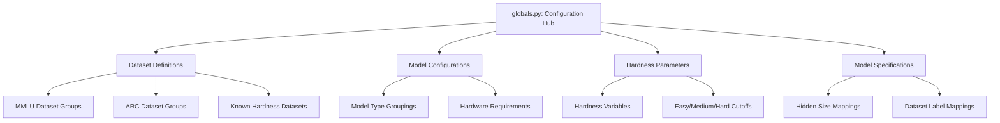
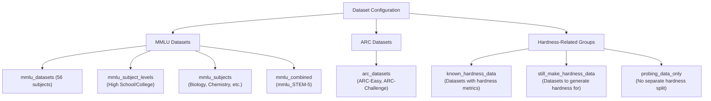
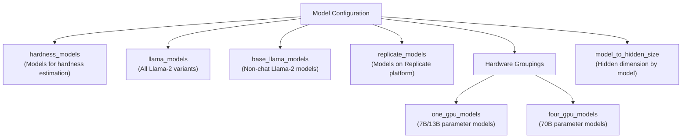
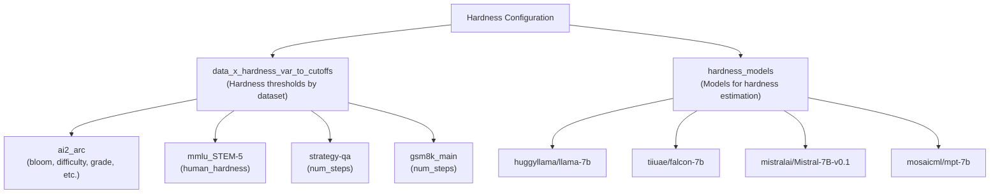
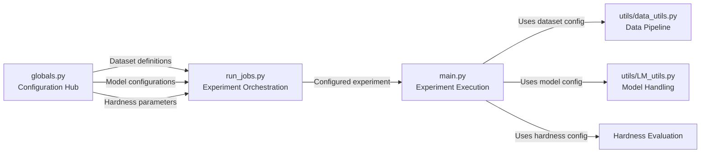

<!-- source: DeepWiki mcp.deepwiki.com · repo allenai/easy-to-hard-generalization · page 2.2 Configuration System · fetched 2026-10-26 -->

# Configuration System

<details>
<summary>Relevant source files</summary>

The following files were used as context for generating this wiki page:

- [README.md](README.md)
- [globals.py](globals.py)

</details>


## Purpose and Scope

This document describes the global configuration system used in the Easy-to-Hard Generalization framework. The configuration system defines datasets, models, and hardness evaluation parameters that are used consistently across the entire codebase. Understanding these global configurations is essential for customizing experiments and interpreting results.

For information about running specific experiments with these configurations, see [Experiment Workflow](#2.1).

## Overview

The configuration system is primarily implemented in `globals.py`, which serves as a central repository of constants and settings used throughout the codebase. These global variables define the available datasets, model configurations, hardness evaluation parameters, and various mappings used by the experiment framework.



Sources: [globals.py:1-112]()

## Dataset Configuration

The configuration system defines various dataset groups and hierarchies that organize the experimental data.



Key dataset configurations include:

1. **MMLU Datasets**: A comprehensive list of 56 individual subjects (Line 2), organized into:
   - Subject levels (high school vs. college) (Line 6)
   - Subject categories (biology, chemistry, etc.) (Line 8)
   - Combined datasets like `mmlu_STEM-5` (Line 9)

2. **ARC Datasets**: Includes ARC-Easy and ARC-Challenge (Line 3)

3. **Hardness-Related Groupings**:
   - `known_hardness_data`: Datasets with established hardness metrics (Line 13)
   - `still_make_hardness_data`: Datasets for which hardness should be generated (Line 14)
   - `probing_data_only`: Datasets used only for evaluation, not for hardness estimation (Line 15)

Sources: [globals.py:1-16]()

## Model Configuration

The configuration system defines various model groupings to facilitate experiment organization and execution.



Key model configurations include:

1. **Model Groupings**:
   - `hardness_models`: Models used for estimating data point hardness (Lines 57-62)
   - `llama_models`: All Llama-2 variants including chat models (Line 63)
   - `base_llama_models`: Non-chat Llama-2 models (Line 64)
   - `replicate_models`: Models hosted on the Replicate platform (Line 69)

2. **Hardware Groupings**:
   - `one_gpu_models`: Models that can run on a single GPU (Line 66)
   - `four_gpu_models`: Models requiring four GPUs (Line 67)

3. **Model Specifications**:
   - `model_to_hidden_size`: Dictionary mapping model names to their hidden state dimensions (Lines 72-100)

Sources: [globals.py:57-100]()

## Hardness Configuration

The configuration system provides parameters for hardness evaluation and stratification of datasets.



Key hardness configurations include:

1. **Hardness Variable Cutoffs**:
   - `data_x_hardness_var_to_cutoffs`: Dictionary defining the threshold values for easy/medium/hard data points for each dataset (Lines 20-42)
   - Dataset-specific metrics:
     - ARC: bloom, difficulty, grade, depth of knowledge
     - MMLU: human_hardness
     - Strategy-QA and GSM8K: num_steps

2. **Hardness Evaluation Models**:
   - `hardness_models`: Models used for computing model-based hardness scores (Lines 57-62)
   - Default includes four 7B parameter models: Llama, Falcon, Mistral, and MPT

Sources: [globals.py:20-62]()

## Additional Configurations

The configuration system also defines several other mappings and parameters:

1. **MMLU Statistics**:
   - `mmlu_subject_stat_cols`: Additional statistics to record for MMLU subjects (Lines 44-55)

2. **Label Mappings**:
   - `label_dict`: Maps dataset names to their respective output labels (Lines 101-112)

Sources: [globals.py:44-112]()

## Integration with Experiment Workflow

The configuration variables from `globals.py` are used throughout the codebase, particularly in experiment orchestration and execution.



Users can modify the configuration parameters to customize their experiments:

1. **Modifying Datasets**:
   - To use specific datasets, modify the dataset variables in `globals.py`
   - For experiment-specific datasets, adjust the dataset arguments in `run_jobs.py`

2. **Customizing Models**:
   - To use a subset of models, edit `use_models` in `run_jobs.py`
   - For hardness estimation with different models, modify `hardness_models` in `globals.py`

3. **Adjusting Hardness Evaluation**:
   - To change hardness stratification variables, modify `stratify_var_names` in `run_jobs.py`
   - For different hardness thresholds, adjust `data_x_hardness_var_to_cutoffs` in `globals.py`

Sources: [README.md:35-53]()

## Usage Examples

Here are examples of how the configuration system affects experiment execution:

1. **Model Selection for Hardness Estimation**:
   ```python
   # To use fewer than the default four 7B models, edit globals.hardness_models
   # Before running:
   python run_jobs.py -e estimate_hardness --dataset ai2_arc
   ```

2. **Hardness Stratification Variables**:
   ```python
   # To adjust which hardness measures are used for dataset stratification,
   # modify the stratify_var_names value in run_jobs.py before running:
   python run_jobs.py -e get_population_table --dataset mmlu_STEM-5
   ```

Sources: [README.md:47-70]()

## Summary

The configuration system in `globals.py` serves as the central repository for dataset definitions, model configurations, and hardness evaluation parameters used throughout the Easy-to-Hard Generalization framework. Understanding these global configurations is essential for customizing experiments and interpreting results. The system is designed to be modular, allowing users to adjust parameters for specific experimental needs while maintaining consistency across the codebase.

---

