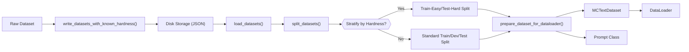
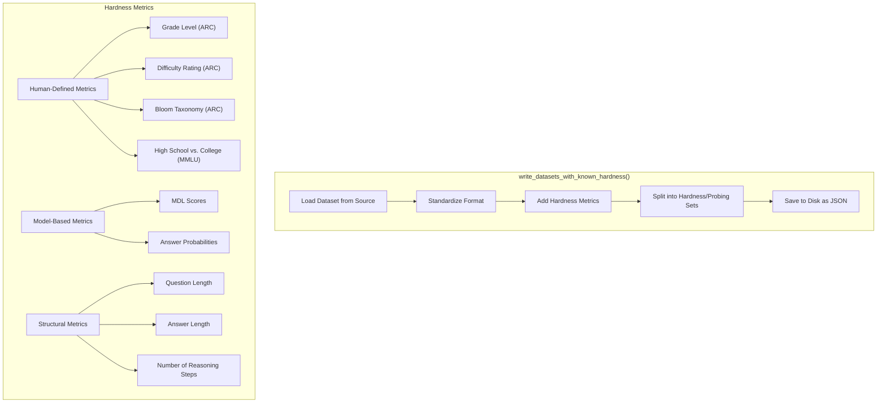
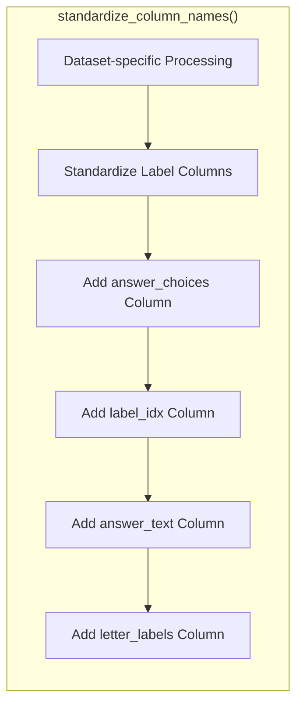
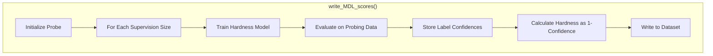
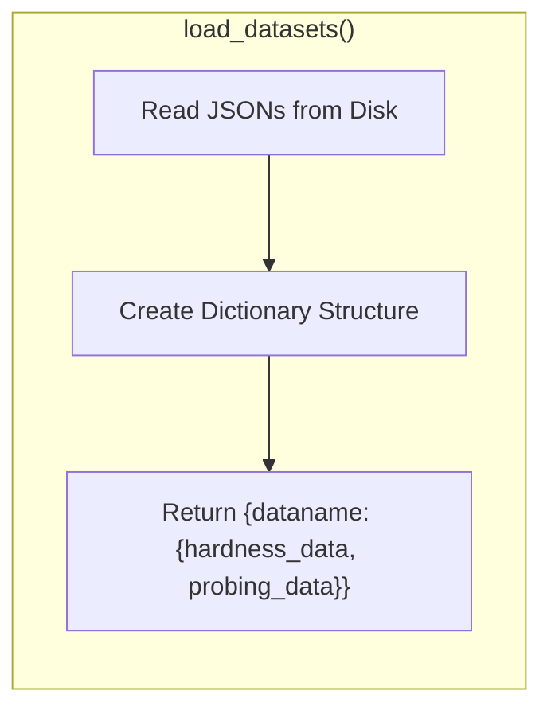
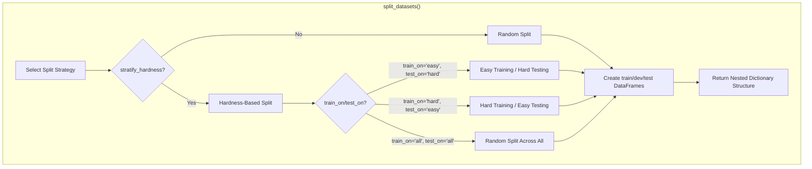
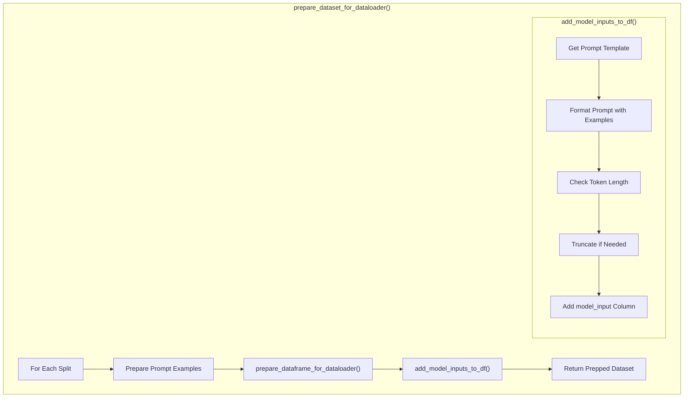
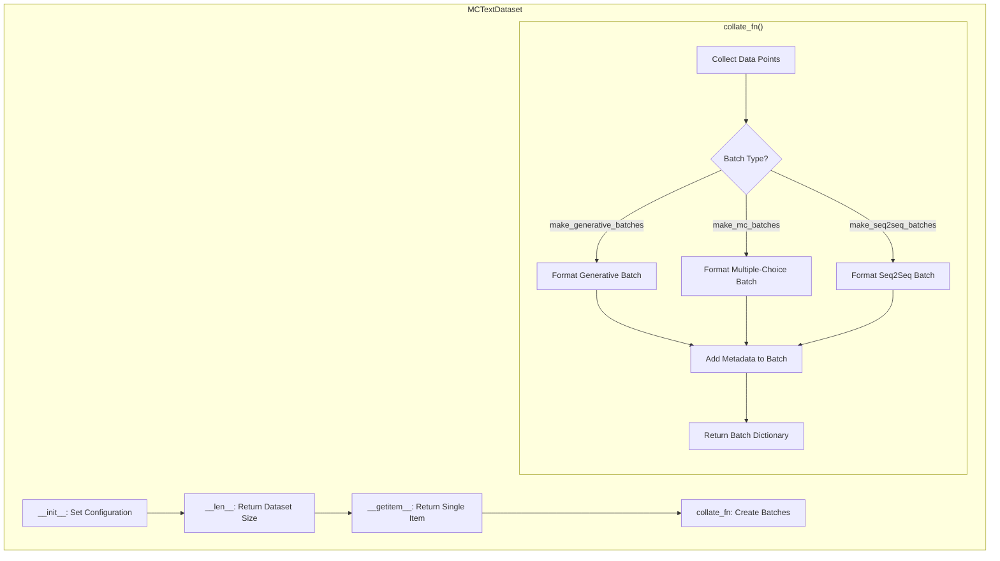
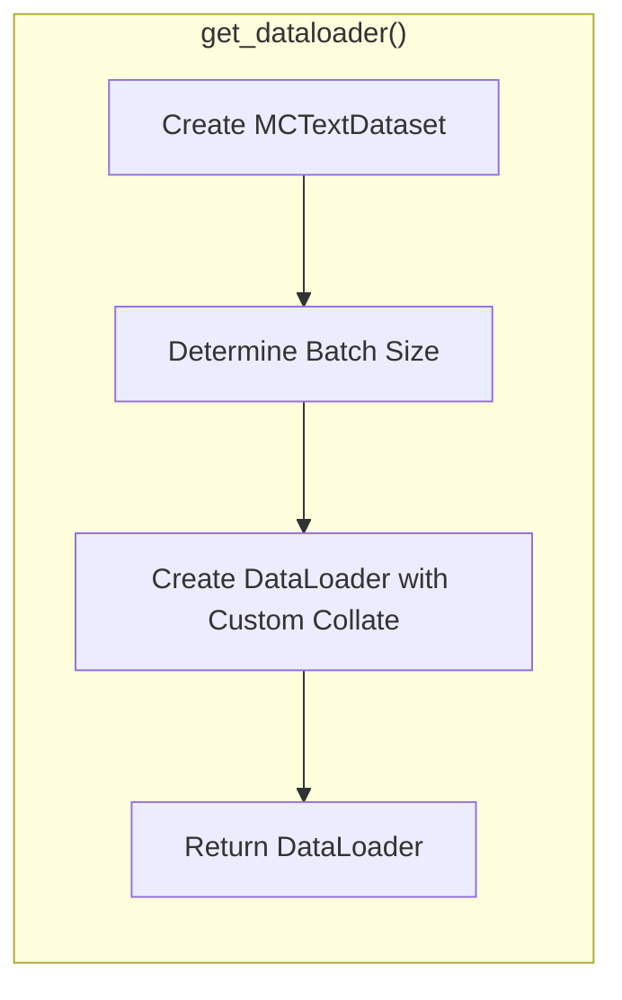
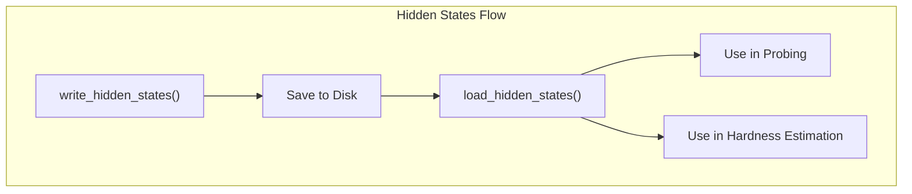

<!-- source: DeepWiki mcp.deepwiki.com · repo allenai/easy-to-hard-generalization · page 3 Data Pipeline · fetched 2026-10-26 -->

# Data Pipeline

Relevant source files

The following files were used as context for generating this wiki page:

- [main.py](main.py)
- [utils/data_utils.py](utils/data_utils.py)

This page documents the data pipeline used in the Easy-to-Hard Generalization framework. The data pipeline is responsible for loading, processing, and preparing datasets for experiments that test how language models trained on easy data generalize to hard examples. It provides standardized interfaces for dataset handling, hardness evaluation, and data preparation for model training and evaluation.

For information about model training and evaluation components that consume this data, see [Model Training and Evaluation](#4).

## Dataset Structure and Lifecycle

The data pipeline follows this general flow:

The pipeline transforms raw datasets into structured formats with hardness annotations, splits them appropriately for experiments, and prepares them for model consumption through dataloaders.

Sources: [utils/data_utils.py:294-533](), [utils/data_utils.py:644-670](), [utils/data_utils.py:814-1132]()

## Dataset Types and Supported Datasets

The framework supports several dataset types with different characteristics:

| Dataset Type | Examples | Hardness Metrics | Special Considerations |
|--------------|----------|------------------|------------------------|
| Multiple-choice QA | MMLU, ARC | Grade level, difficulty rating, Bloom taxonomy | Variable number of answer choices |
| Reasoning | Strategy-QA, GSM8k | Number of reasoning steps, reasoning complexity | Includes reasoning chains |

Supported datasets are configured in `globals.py` and include:
- MMLU (college vs. high school difficulty)
- ARC (easy vs. challenge)
- Strategy-QA (varying reasoning complexity)
- GSM8k (varying solution step counts)

Sources: [utils/data_utils.py:197-214](), [utils/data_utils.py:294-533]()

## Dataset Creation and Processing

### Writing Datasets with Known Hardness

The pipeline includes specialized functions for writing datasets with known hardness metrics:

Different datasets use different hardness metrics:
- **ARC**: Grade level, difficulty rating, Bloom taxonomy
- **MMLU**: High school vs. college level topics
- **Strategy-QA**: Number of reasoning steps, reasoning complexity
- **GSM8k**: Number of solution steps, problem complexity

Sources: [utils/data_utils.py:294-533](), [main.py:336-367]()

### Standardizing Dataset Format

All datasets are standardized to have consistent column names and structures:

This standardization allows the pipeline to uniformly handle datasets from various sources.

Sources: [utils/data_utils.py:216-245]()

### Computing and Processing Hardness Scores

Hardness metrics are computed using several approaches:

1. **MDL-based Hardness**: `write_MDL_scores()` trains models of increasing capacity and measures label confidence
2. **Probability-based Hardness**: `write_text_prob_scores()` computes LM probabilities for questions/answers
3. **Postprocessing**: `postprocess_hardness_scores()` normalizes scores and adds hardness level categories

These functions enable quantitative comparison of example difficulty across datasets.

Sources: [main.py:99-334](), [main.py:336-367](), [main.py:369-498]()

## Dataset Loading and Splitting

### Loading Datasets

Datasets are loaded using the `load_datasets()` function:

The resulting structure organizes data by dataset name and purpose (hardness estimation vs. probing).

Sources: [utils/data_utils.py:644-670]()

### Splitting Datasets

Datasets are split for experiments using two main approaches:

1. **Standard Splitting**: Random 70/10/20 train/dev/test splits
2. **Hardness-Stratified Splitting**: Splits based on hardness criteria (e.g., train on easy, test on hard)

The `stratified_test_sampling()` function provides specialized sampling when training on a specific hardness level while ensuring balanced test sets.

Sources: [utils/data_utils.py:672-812](), [utils/data_utils.py:814-1132](), [utils/data_utils.py:1134-1196]()

## Prompt Formatting and Preparation

Preparing datasets for model consumption involves:

1. **Prompt Formatting**: Adding model inputs based on prompt templates
2. **Example Selection**: Selecting examples for in-context learning
3. **Sequence Length Management**: Handling sequence truncation

This process involves close integration with the Prompt class to format examples and manage prompt templates.

Sources: [utils/data_utils.py:1198-1388](), [utils/data_utils.py:1389-1406]()

## DataLoader and Batch Formation

### MCTextDataset

The custom `MCTextDataset` class handles multiple-choice datasets and batch formation:

The class supports three batch formation modes:
1. **Generative Batches**: For autoregressive generation (free-form answers)
2. **Multiple-Choice Batches**: For classification among answer choices
3. **Seq2Seq Batches**: For generation with target sequences (e.g., reasoning chains)

Sources: [utils/data_utils.py:20-136]()

### DataLoader Creation

The `get_dataloader()` function creates dataloaders with appropriate batch sizes and collation:

Batch sizes are adjusted based on the number of answer choices and batch type to maintain memory efficiency.

Sources: [utils/data_utils.py:138-165]()

## Hidden States Integration

The data pipeline supports capturing and using model hidden states:

Hidden states are used for:
1. **Learned Probes**: For model analysis via linear and non-linear probes
2. **Hardness Estimation**: For MDL-based hardness scoring

This integration allows for more sophisticated analysis beyond simple model predictions.

Sources: [main.py:26-97]()

## Key Data Pipeline Functions

The table below summarizes the key functions in the data pipeline:

| Function | Purpose | File Location |
|----------|---------|---------------|
| `write_datasets_with_known_hardness()` | Write datasets with inherent hardness metrics | [utils/data_utils.py:294-533]() |
| `load_datasets()` | Load datasets from disk | [utils/data_utils.py:644-670]() |
| `split_datasets()` | Split datasets for experiments | [utils/data_utils.py:814-1132]() |
| `prepare_dataset_for_dataloader()` | Prepare datasets for dataloaders | [utils/data_utils.py:1198-1295]() |
| `MCTextDataset` | Custom dataset class for multiple-choice data | [utils/data_utils.py:20-136]() |
| `get_dataloader()` | Create dataloaders | [utils/data_utils.py:138-165]() |
| `write_MDL_scores()` | Compute MDL-based hardness scores | [main.py:99-334]() |
| `write_text_prob_scores()` | Compute probability-based hardness scores | [main.py:336-367]() |
| `postprocess_hardness_scores()` | Process and normalize hardness scores | [main.py:369-498]() |

The data pipeline provides a comprehensive framework for handling diverse datasets, computing hardness metrics, and preparing data for model training and evaluation.

Sources: [utils/data_utils.py](), [main.py:26-498]()

---

