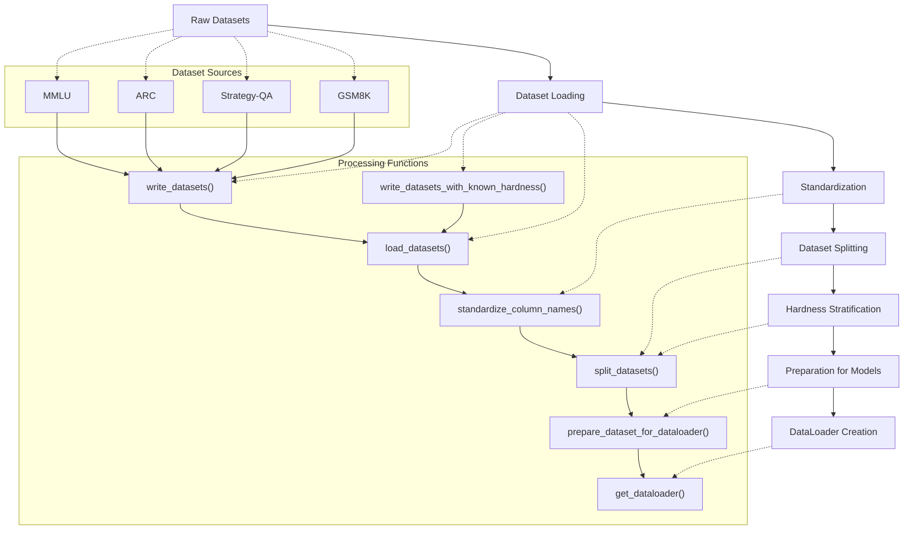
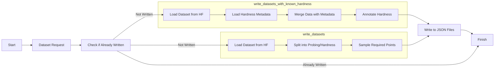
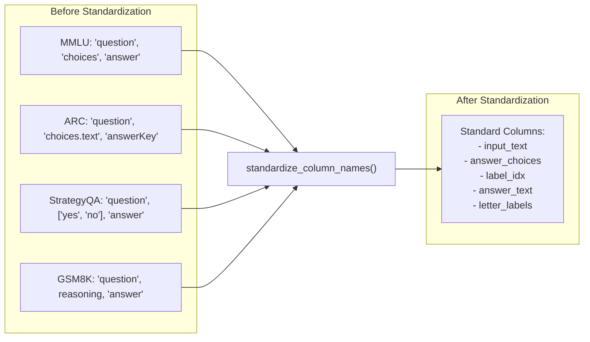
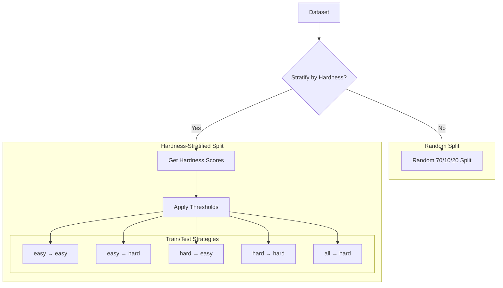
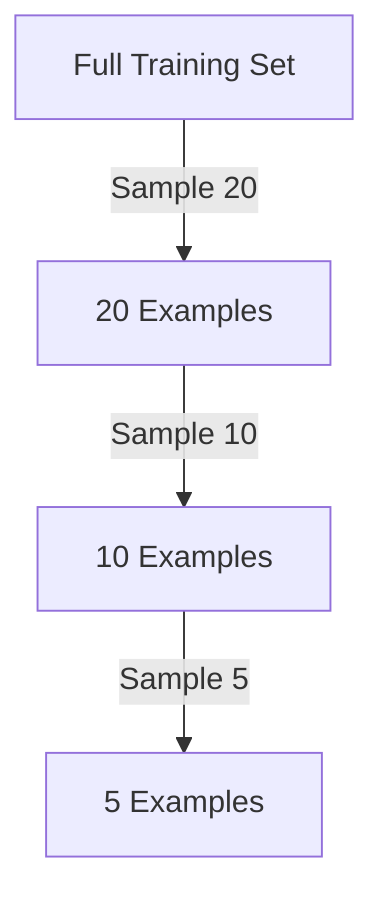
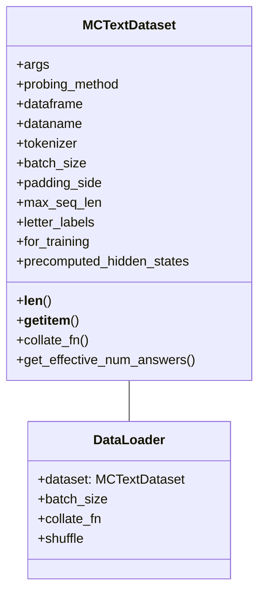
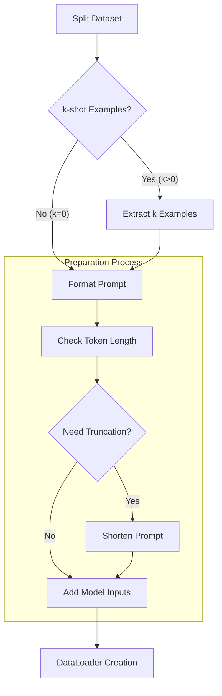
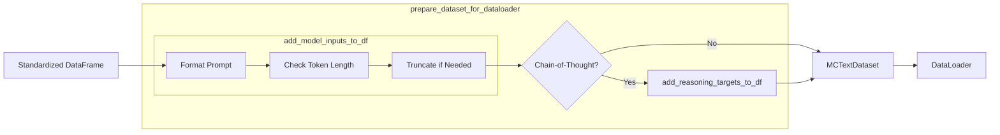
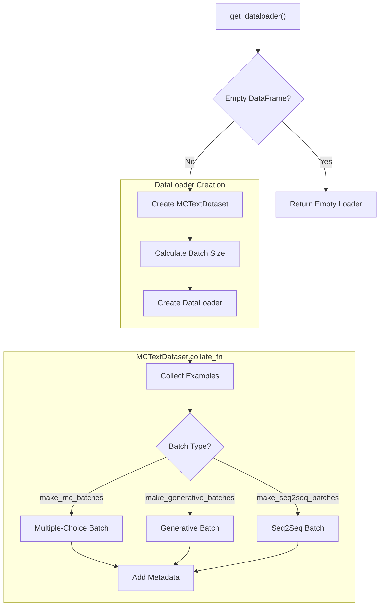
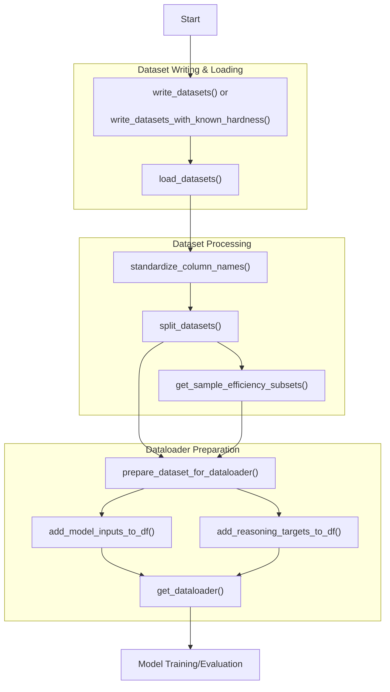

<!-- source: DeepWiki mcp.deepwiki.com · repo allenai/easy-to-hard-generalization · page 3.1 Dataset Loading and Processing · fetched 2026-10-26 -->

# Dataset Loading and Processing

Relevant source files

The following files were used as context for generating this wiki page:

- [data/arc-challenge-easy-annotations.json](data/arc-challenge-easy-annotations.json)
- [utils/data_utils.py](utils/data_utils.py)

## Purpose and Scope

This document describes the dataset loading and processing system in the Easy-to-Hard Generalization framework. It covers how datasets are loaded from external sources, processed with hardness annotations, transformed into standardized formats, split for experiments, and prepared for model consumption. For information about prompt formatting specifically, see [Prompt Formatting](#3.2).

## Overview of the Data Pipeline

The data pipeline transforms raw datasets into properly formatted inputs for language model training and evaluation. This process includes hardness annotation, standardization, stratified splitting, and preparation for model input.

Sources: [utils/data_utils.py:534-642](), [utils/data_utils.py:294-533](), [utils/data_utils.py:644-670]()

## Dataset Loading

The system loads datasets from Hugging Face's datasets library or from custom JSON files. Two primary functions handle dataset loading:

1. `write_datasets()`: Loads standard datasets from Hugging Face, splits them into probing and hardness evaluation sets, and writes them to JSON files.

2. `write_datasets_with_known_hardness()`: Handles datasets that have predefined hardness metrics (e.g., grade level for ARC, high school vs. college for MMLU).

3. `load_datasets()`: Loads the JSON files written by the functions above.

### Supported Dataset Sources

| Dataset Source | Hardness Metrics | Description |
|----------------|------------------|-------------|
| MMLU | High school vs. college level | Multiple-choice questions across 57 subjects |
| ARC | Grade level, Bloom taxonomy, Difficulty | Multiple-choice science questions |
| Strategy-QA | Number of reasoning steps, Word count | Yes/no questions requiring multi-step reasoning |
| GSM8K | Number of reasoning steps, Word count | Grade school math problems with step-by-step solutions |

### Dataset Loading Process

Sources: [utils/data_utils.py:294-533](), [utils/data_utils.py:534-642](), [utils/data_utils.py:644-670]()

## Dataset Standardization

Because datasets come from different sources with varying formats, the system standardizes them to a common format with consistent column names.

### Column Standardization

The `standardize_column_names()` function transforms dataset-specific columns into a standard format:

- `input_text`: The question or problem
- `answer_choices`: List of possible answers
- `label_idx`: Index of the correct answer
- `answer_text`: The correct answer text
- `letter_labels`: A, B, C, D labels for the answers

Sources: [utils/data_utils.py:216-245]()

## Dataset Splitting

The `split_datasets()` function divides datasets into train, development, and test sets. It supports several splitting strategies:

1. **Random splitting**: Default 70/10/20 split for train/dev/test
2. **Hardness-stratified splitting**: Split based on item difficulty
3. **Easy-to-hard splitting**: Train on easy examples, test on hard ones

### Hardness Stratification

When `stratify_hardness=True`, datasets are split based on hardness scores:

- **Model-based hardness**: Uses quantiles (30% easiest, 30% hardest)
- **Human-defined hardness**: Uses predefined thresholds (e.g., grade levels)

Sources: [utils/data_utils.py:814-1132]()

### Sample Efficiency Subsets

For sample efficiency experiments, the system can create nested subsets of training data of different sizes:

Sources: [utils/data_utils.py:1134-1196]()

## Data Preparation for Models

### MCTextDataset Class

The `MCTextDataset` class is a PyTorch Dataset implementation for multiple-choice text data. It handles different types of batches:

1. **Multiple choice batches**: Each example has multiple answer choices
2. **Generative batches**: For generative evaluation
3. **Seq2seq batches**: For sequence-to-sequence finetuning

Sources: [utils/data_utils.py:20-136]()

### Dataset Preparation Pipeline

The `prepare_dataset_for_dataloader()` function transforms split datasets into a format suitable for model input:

Sources: [utils/data_utils.py:1198-1295](), [utils/data_utils.py:1297-1387]()

### Data Transformation for Models

The preparation process converts the standardized dataset into model-ready inputs:

1. Formats prompts using the Prompt class
2. Adds model inputs to dataframes
3. Optionally adds reasoning targets for chain-of-thought
4. Checks and truncates long sequences
5. Creates DataLoader with appropriate batch sizing

Sources: [utils/data_utils.py:1198-1295](), [utils/data_utils.py:1297-1387](), [utils/data_utils.py:1389-1405]()

## DataLoader Creation

The `get_dataloader()` function creates PyTorch DataLoaders from prepared datasets:

1. Creates an `MCTextDataset` instance
2. Configures batch size based on number of answers and model type
3. Sets up the appropriate collate function
4. Returns the DataLoader or a dummy empty loader if no data is available

### Batch Processing

The `MCTextDataset.collate_fn()` method prepares batches for the model:

1. Collects examples from the dataset
2. Processes prompts and answer choices
3. Formats batches differently based on model type (multiple-choice, generative, seq2seq)
4. Adds precomputed hidden states if available

Sources: [utils/data_utils.py:138-165](), [utils/data_utils.py:67-136]()

## Dataset Utilities

Several utility functions support the data processing pipeline:

| Function | Purpose |
|----------|---------|
| `get_max_num_answers()` | Finds the maximum number of answer choices for a dataset |
| `get_load_name()` | Returns the Hugging Face dataset name for loading |
| `standardize_data_source()` | Standardizes dataset source names |
| `randomize_dataframe_labels()` | Randomizes labels for ablation studies |
| `set_for_training()` | Configures DataLoader for training or evaluation |

Sources: [utils/data_utils.py:176-196](), [utils/data_utils.py:198-214](), [utils/data_utils.py:247-266](), [utils/data_utils.py:268-292](), [utils/data_utils.py:167-174]()

## Complete Data Processing Workflow

The full data processing pipeline combines all the components described above:

Sources: [utils/data_utils.py:294-670](), [utils/data_utils.py:814-1132](), [utils/data_utils.py:1134-1196](), [utils/data_utils.py:1198-1405](), [utils/data_utils.py:138-165]()

---

