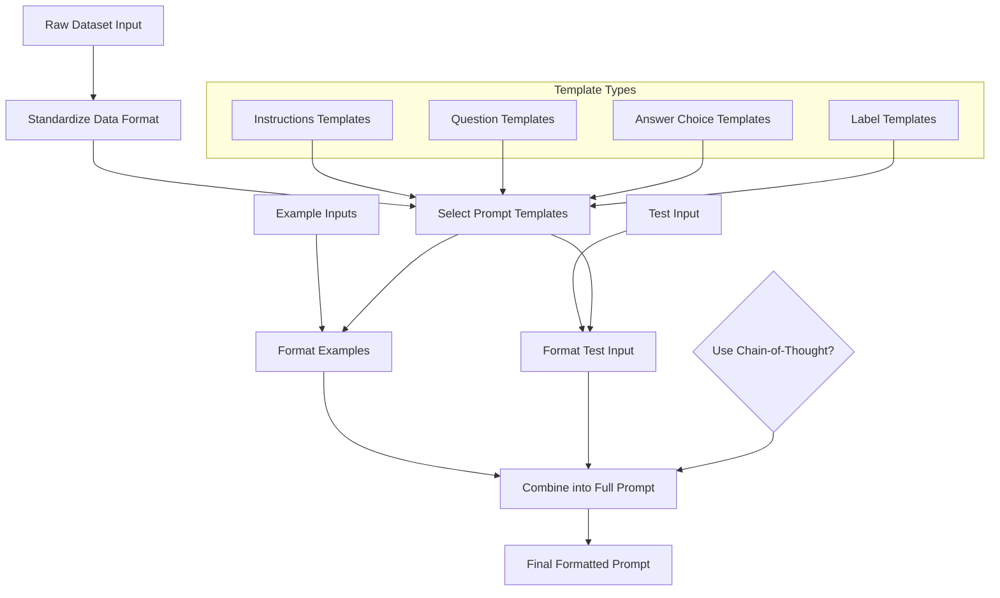
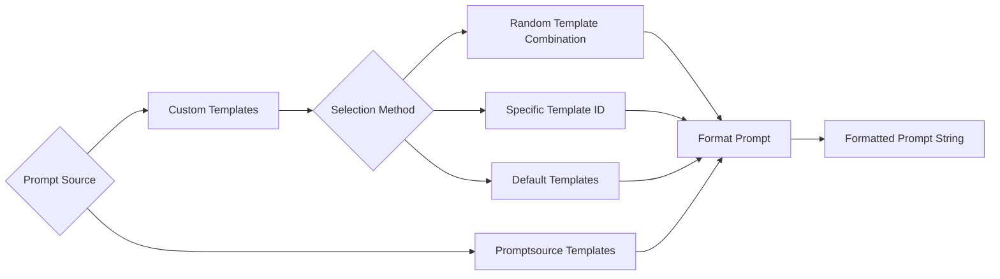
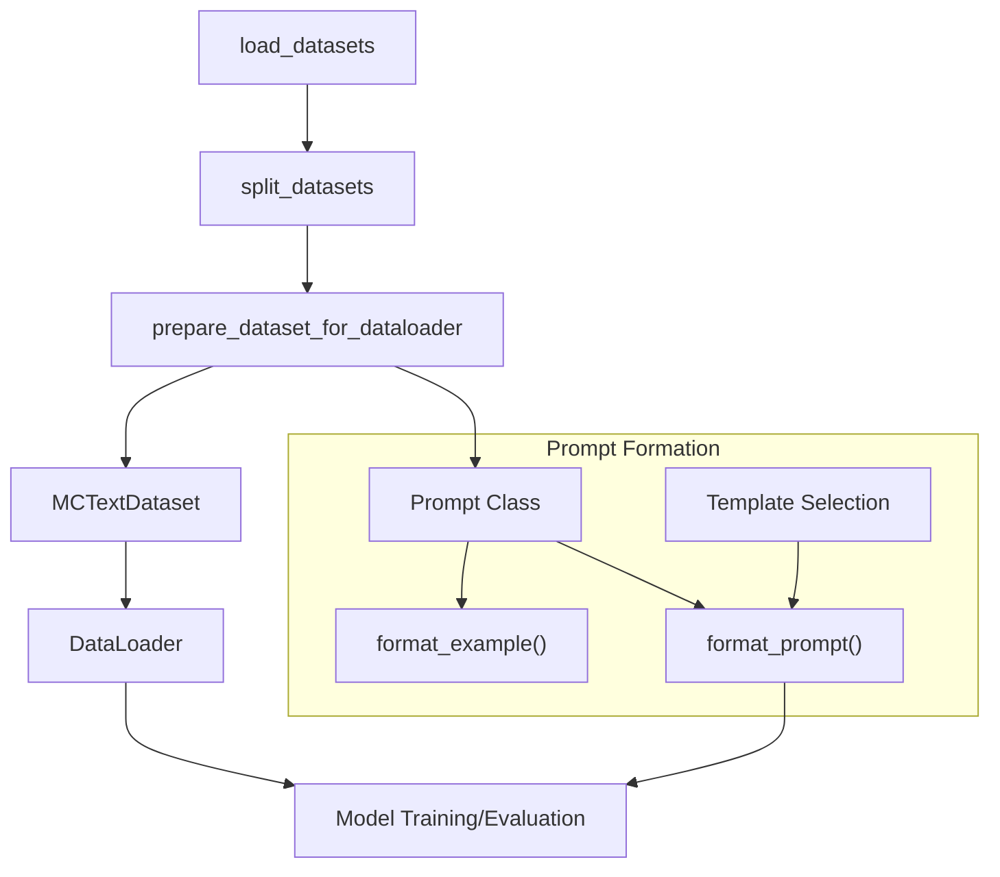

<!-- source: DeepWiki mcp.deepwiki.com · repo allenai/easy-to-hard-generalization · page 3.2 Prompt Formatting · fetched 2026-10-26 -->

# Prompt Formatting

<details>
<summary>Relevant source files</summary>

The following files were used as context for generating this wiki page:

- [utils/prompt.py](utils/prompt.py)

</details>


## Purpose and Scope

This document describes the prompt formatting system used in the Easy-to-Hard Generalization framework. The system is responsible for converting raw dataset examples and test inputs into properly formatted prompts that can be passed to language models. It supports various prompt templates, few-shot examples, and Chain-of-Thought (CoT) reasoning. This page focuses specifically on the implementation in the `Prompt` class, which provides a flexible interface for creating consistent, customizable prompts for multiple-choice tasks.

Sources: [utils/prompt.py:8-15]()

## Prompt Class Overview

The `Prompt` class is the core component of the prompt formatting system. It manages the creation and formatting of prompts for language models, handling various template styles, example formatting, and prompt generation patterns.

```mermaid
classDiagram
    class "Prompt" {
        +instructions[]
        +question_templates[]
        +answer_choices_functions[]
        +label_templates[]
        +format_example()
        +format_prompt()
        +format_prompt_from_df()
        +standardize()
        +get_random_prompts()
    }
    "Prompt" --> "Template Collections" : contains
    "Prompt" --> "Formatting Methods" : implements
    class "Template Collections" {
        +instructions[]
        +question_templates[]
        +answer_choices_functions[]
        +label_templates[]
    }
    class "Formatting Methods" {
        +format_example()
        +format_prompt()
        +format_prompt_from_df()
        +format_reasoning_target_from_df()
    }
```

### Key Features

- Support for multiple-choice questions with predefined answer options
- Customizable templates for instructions, questions, answer choices, and labels
- Support for Chain-of-Thought (CoT) reasoning
- Integration with promptsource templates (though currently shown as not implemented)
- Random prompt generation for prompt engineering experiments

Sources: [utils/prompt.py:8-31]()

## Prompt Formatting Workflow

The prompt formatting process involves several steps that transform raw data into fully formatted prompts:



The workflow begins with standardizing the input data, selecting appropriate templates, formatting examples and test inputs according to those templates, and finally combining them into a complete prompt.

Sources: [utils/prompt.py:192-270](), [utils/prompt.py:281-327]()

## Template System

The `Prompt` class maintains several collections of templates that can be combined to create diverse prompting strategies.

### Instructions Templates

Instructions provide context and guidance to the model at the beginning of the prompt. Examples include:

- Empty instructions (no explicit guidance)
- Role-based instructions ("You are a very intelligent individual...")
- Educational context ("I am a teacher, and I am going to test you...")
- Step-by-step thinking instructions

Sources: [utils/prompt.py:32-50]()

### Question Templates

Question templates determine how the question is presented to the model:

```
"Question: {}"
"{}"
"Problem: {}"
"Q: {}"
```

Sources: [utils/prompt.py:51-60]()

### Answer Choice Templates

Answer choice templates determine how multiple-choice options are presented:

```
"" (no formatting)
"choice: {} choice: {} ..."
"answer: {} answer: {} ..."
"A) {} B) {} ..."
```

Sources: [utils/prompt.py:63-72]()

### Label Templates

Label templates determine how the answer is formatted:

```
"\nAnswer: {}"
"{}"
"The answer is: {}"
```

Sources: [utils/prompt.py:74-83]()

## Prompt Template Selection

The system supports multiple methods for selecting prompt templates:



The selection process starts by choosing a prompt source (custom or promptsource), then selecting specific templates from that source, and finally applying those templates to format the prompt.

Sources: [utils/prompt.py:95-107](), [utils/prompt.py:135-174]()

## Example Formatting

Example formatting is a critical part of few-shot learning. The system handles this by:

1. Standardizing each example's format
2. Applying selected templates to format the question, answer choices, and label
3. Optionally including Chain-of-Thought reasoning
4. Combining formatted examples with buffer space between them

```
Example Format:
[Question Template] + Question Text + [Answer Choice Template with Choices] + [Label Template with Label]
```

For Chain-of-Thought examples, the reasoning steps are included before the final answer.

Sources: [utils/prompt.py:192-216](), [utils/prompt.py:217-270]()

## Chain-of-Thought Support

The system supports Chain-of-Thought (CoT) reasoning through:

1. A CoT preface that prompts the model to think step-by-step
2. Special handling for CoT examples that include reasoning steps
3. Formatting of reasoning targets for evaluation

When `use_cot` is enabled, the system adds a thinking prompt such as "Let's think step by step" after the question and answer choices.

Sources: [utils/prompt.py:84-88](), [utils/prompt.py:209-215](), [utils/prompt.py:329-346]()

## Practical Usage

The primary interface for using the `Prompt` class is the `format_prompt_from_df` method, which takes:

- A test input DataFrame
- An optional examples DataFrame for few-shot prompting
- Template selection parameters (either indices or promptsource index)

```
# Example workflow (pseudocode):
prompt = Prompt(args, datanames, "custom", use_cot=True)
formatted_prompt = prompt.format_prompt_from_df(
    test_input_df=test_example,
    examples_df=few_shot_examples,
    instr_idx=0,
    question_idx=0,
    answers_idx=4,
    label_idx=0
)
```

Sources: [utils/prompt.py:281-327]()

## Integration with Data Pipeline

The prompt formatting system integrates with the data pipeline as shown below:



The `Prompt` class is used within the data preparation pipeline to format examples before they are passed to the language model for training or evaluation.

Sources: [utils/prompt.py:8-15]()

---

