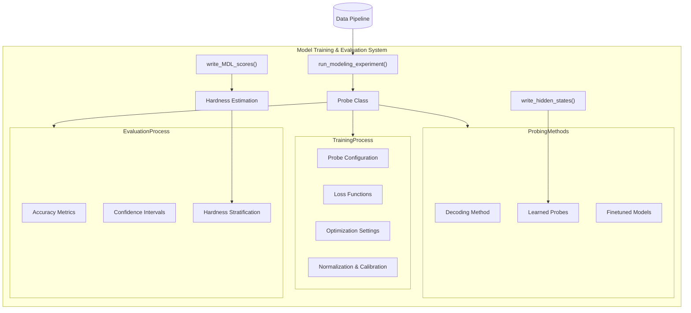
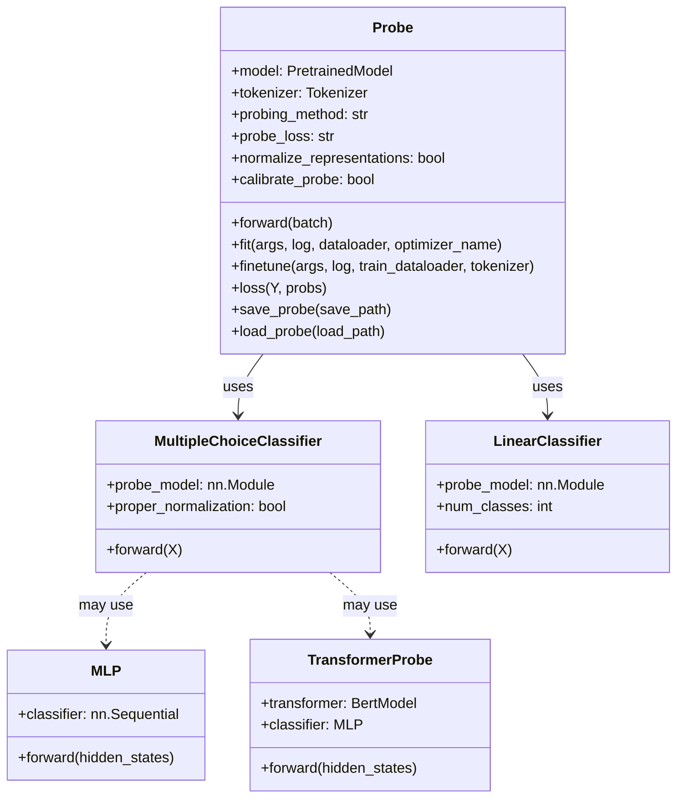
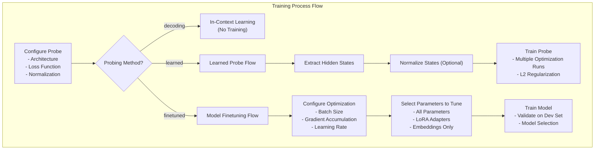
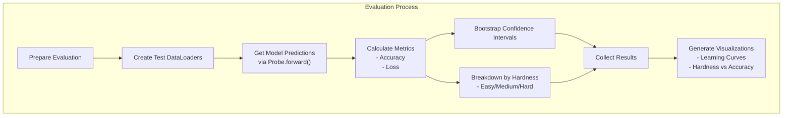
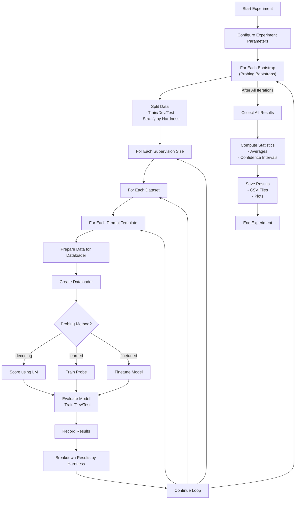
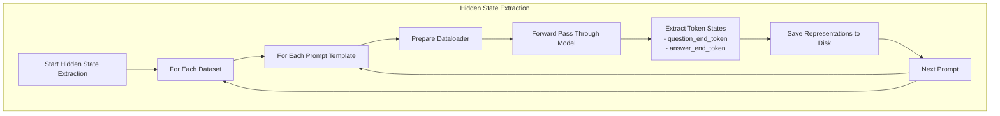
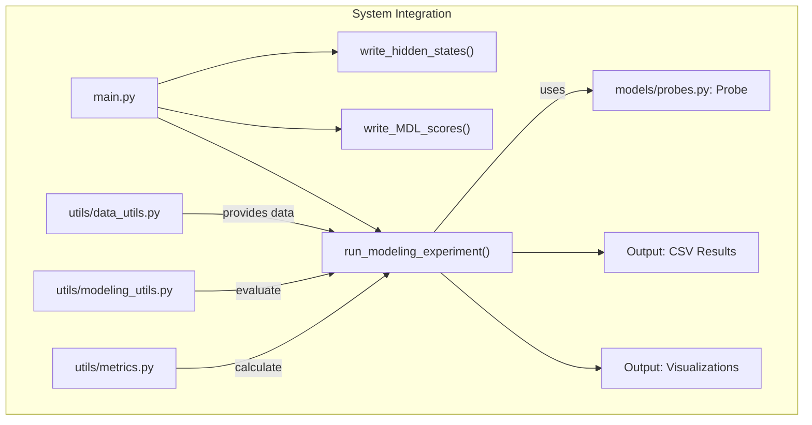

<!-- source: DeepWiki mcp.deepwiki.com · repo allenai/easy-to-hard-generalization · page 4 Model Training and Evaluation · fetched 2026-10-26 -->

# Model Training and Evaluation

Relevant source files

The following files were used as context for generating this wiki page:

- [main.py](main.py)
- [models/probes.py](models/probes.py)

This page documents the system components responsible for training and evaluating language models within the easy-to-hard generalization framework. It explains how different probing methods are implemented, configured, and executed to measure model performance across varying hardness levels.

For information about data processing before training, see [Data Pipeline](#3). For understanding hardness measures, see [Hardness Estimation](#5).

## Core Components

The model training and evaluation system consists of several key components:

1. **Probe Class**: Central class for implementing different model evaluation strategies
2. **Probing Methods**: Different approaches for evaluating model knowledge (decoding, learned probes, finetuning)
3. **Training Process**: Configuration of optimization and learning parameters
4. **Evaluation Process**: Metrics calculation and result collection
5. **Experiment Orchestration**: Automation of training/evaluation across different configurations

Sources: [main.py:26-76](), [main.py:500-962](), [models/probes.py:23-98]()

## Probe Class

The `Probe` class serves as the unified interface for different methods of evaluating model knowledge:

Sources: [models/probes.py:23-98](), [models/probes.py:690-759]()

### Initialization

When initializing a `Probe` object, various configuration options are provided:

- **Probing Method**: Defines how the model knowledge is accessed (decoding, learned, finetuned)
- **Probe Loss**: Determines the training objective for learned probes
- **Normalization**: Whether to normalize hidden representations
- **Calibration**: Whether to calibrate probability outputs

Sources: [models/probes.py:29-98]()

## Probing Methods

The system implements three main probing methods for evaluating language models:

### Decoding Probes

**Description**: Uses the language model directly to compute answer probabilities through autoregressive decoding.

**Process**:
1. Formats prompt with in-context examples
2. Computes next-token probabilities for each answer choice
3. Selects the answer with highest probability

**Key Features**:
- No training required
- Directly measures model's in-context learning capability
- Configurable through different prompt strategies

Sources: [models/probes.py:582-605]()

### Learned Probes

**Description**: Trains a separate classifier on the hidden states of the language model.

**Process**:
1. Extract hidden representations from the model for each example
2. Train a classifier (linear, MLP, or transformer) on these representations
3. Evaluate on test data using the trained classifier

**Architectures**:
- **Linear**: Simple linear layer
- **MLP**: Multi-layer perceptron with nonlinearities
- **Transformer**: Small transformer layer for more complex relationships

**Training Objectives**:
- **Supervised**: Standard classification loss
- **Unsupervised/CCS**: Confidence-consistency-softness loss with no labels
- **Mixed**: Combinations of supervised and unsupervised signals

Sources: [models/probes.py:143-322](), [models/probes.py:605-645]()

### Finetuned Models

**Description**: Directly finetunes the entire model or specific parameters using methods like QLoRA.

**Process**:
1. Initialize model parameters for training (all or subset)
2. Fine-tune on training data with careful optimization
3. Evaluate on test data using the tuned model

**Key Features**:
- Parameter-efficient fine-tuning options (LoRA)
- Model selection based on development set
- Gradient accumulation for effective batch size control

Sources: [models/probes.py:324-526]()

## Training Process

The training process varies based on the probing method selected:

Sources: [main.py:500-962](), [models/probes.py:143-322](), [models/probes.py:324-526]()

### Optimization Parameters

The system provides various optimization parameters to control training:

| Parameter | Description | Used By |
|-----------|-------------|---------|
| `learned_probe_epochs` | Number of epochs for learned probes | Learned probes |
| `finetuned_epochs` | Number of epochs for finetuning | Finetuned models |
| `train_batch_size` | Batch size for training | All methods |
| `probing_optimizer` | Optimizer type (SGD, AdamW, LBFGS) | Learned probes |
| `probing_lr` | Learning rate for finetuning | Finetuned models |
| `l2_reg` | L2 regularization strength | Learned probes |
| `grad_accumulation_factor` | Factor for gradient accumulation | Finetuned models |
| `weight_decay` | Weight decay for optimizers | Finetuned models |
| `max_grad_norm` | Maximum gradient norm for clipping | All trained models |

Sources: [main.py:965-1096](), [models/probes.py:231-252](), [models/probes.py:362-401]()

### Normalization and Calibration

The system supports two methods to improve probe reliability:

1. **Hidden State Normalization**: Z-normalizes hidden representations before training probes
   - Can be per-label or shared across answers
   - Stabilizes training, especially for small datasets

2. **Probability Calibration**: Adjusts model predictions to have uniform distribution
   - Helps address model bias toward certain answers
   - Applied during evaluation

Sources: [models/probes.py:101-142](), [models/probes.py:637-644]()

## Evaluation Process

The evaluation process involves:

Sources: [main.py:685-707](), [main.py:902-943]()

### Metrics and Results

The system tracks various metrics during evaluation:

| Metric | Description |
|--------|-------------|
| Train Accuracy | Accuracy on training data |
| Dev Accuracy | Accuracy on development data |
| Test Accuracy | Accuracy on test data |
| Test Accuracy by Hardness | Test accuracy broken down by hardness levels |
| Test Accuracy (Train Distribution) | Test accuracy on examples matching training distribution |
| Probe Loss | Loss value for the trained probe |

Sources: [main.py:716-741](), [main.py:774-811]()

### Confidence Intervals

The system computes bootstrap confidence intervals for test accuracies:

1. Bootstrap samples are created by resampling test examples
2. Accuracy is computed for each bootstrap sample
3. Confidence intervals are derived from the distribution of accuracies
4. Results are formatted and saved alongside point estimates

Sources: [main.py:902-950]()

## Experiment Workflow

The main experimental workflow is orchestrated by the `run_modeling_experiment` function:

Sources: [main.py:500-962]()

### Sample Efficiency and Learning Curves

A key aspect of the evaluation is measuring how model performance changes with training data size:

1. Multiple training data sizes are tested (`supervision_n`)
2. For each size, a separate probe is trained
3. Results are plotted as learning curves
4. Confidence intervals are computed for each point

This helps determine how efficiently models learn from easy versus hard examples.

Sources: [main.py:570-582](), [main.py:902-962]()

## Hidden State Extraction

For learned probes, the system extracts hidden states from the language model:

Sources: [main.py:26-76](), [main.py:77-97]()

### State Selection

The system can extract different types of hidden states:

- **Token Type**: 
  - `question_end_token`: Last token of the question (for classification)
  - `answer_end_token`: Last token of each answer (for multiple-choice comparison)

- **Layer Selection**:
  - `middle`: Middle layer of the model
  - `last`: Last layer of the model
  - `middle_and_last`: Both middle and last layers

- **Model Component**:
  - `encoder`: For encoder-only or encoder part of encoder-decoder models
  - `decoder`: For decoder-only or decoder part of encoder-decoder models

Sources: [models/probes.py:647-663](), [main.py:1119-1139]()

## Hardness Estimation and MDL Scores

The system includes functionality to estimate the hardness of examples using Minimum Description Length (MDL) scores:

1. Train models of increasing complexity (more training data)
2. Measure how quickly models learn to predict each example
3. Examples learned with less data are considered "easier"
4. Examples requiring more data are considered "harder"

This process is implemented in the `write_MDL_scores` function.

Sources: [main.py:99-334]()

## Integration with System Architecture

The model training and evaluation system integrates with the broader system architecture:

Sources: [main.py:1-24](), [main.py:963-1344]()

## Command-Line Interface

The system provides extensive command-line options to configure model training and evaluation:

| Category | Key Parameters | Description |
|----------|----------------|-------------|
| **Method Selection** | `probing_method` | Choose between decoding, learned, or finetuned |
| **Probe Configuration** | `probe_model`, `probe_loss` | Configure probe architecture and loss function |
| **Training Parameters** | `learned_probe_epochs`, `finetuned_epochs` | Set training duration |
| **Optimization** | `probing_optimizer`, `probing_lr`, `l2_reg` | Configure optimization process |
| **Feature Selection** | `probing_token_state`, `probing_layers` | Select which model features to use |
| **Evaluation** | `train_on`, `test_on`, `stratify_hardness` | Configure evaluation strategy |
| **Data Size** | `n_train`, `n_dev`, `n_test` | Control data splits |
| **Efficiency** | `probing_bootstraps`, `probing_learning_curve` | Control experimental trials |

For complete usage details, see [Command-Line Interface](#6.1).

Sources: [main.py:964-1094]()

---

