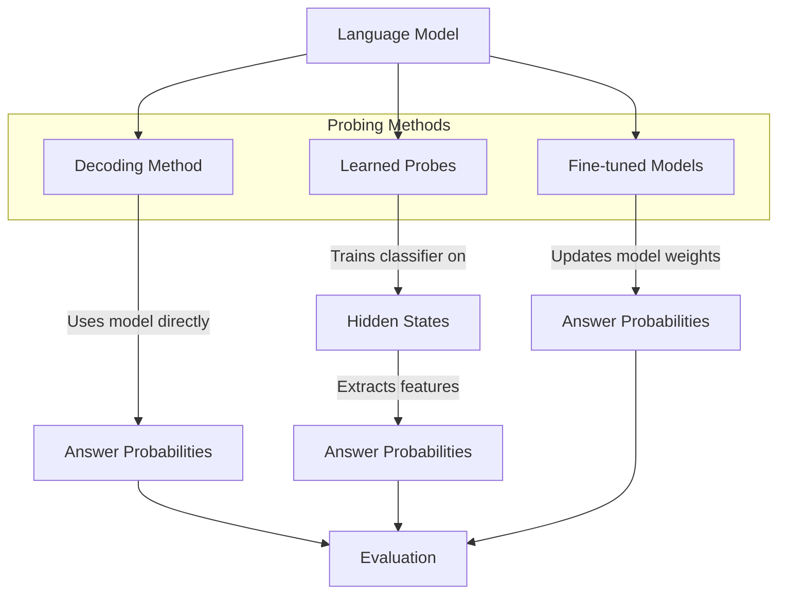
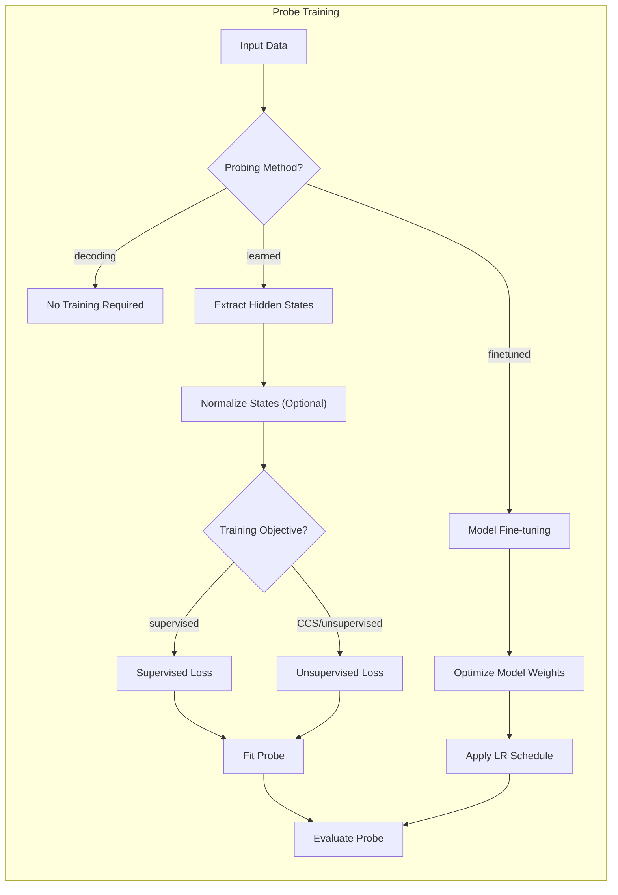
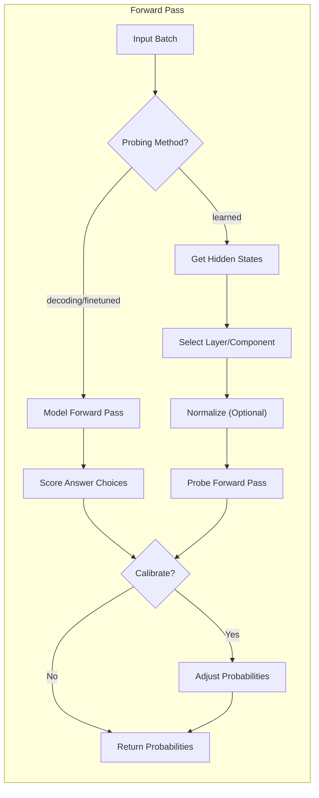
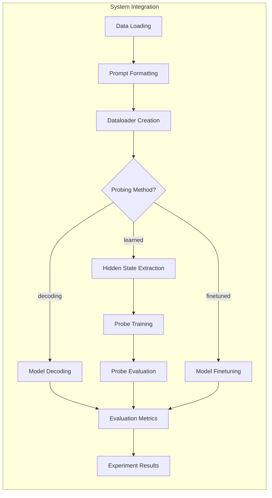

<!-- source: DeepWiki mcp.deepwiki.com · repo allenai/easy-to-hard-generalization · page 4.1 Probing Methods · fetched 2026-10-26 -->

# Probing Methods

<details>
<summary>Relevant source files</summary>

The following files were used as context for generating this wiki page:

- [models/probes.py](models/probes.py)

</details>


## Purpose and Scope

This document details the probing methods implemented in the Easy-to-Hard Generalization framework. Probing methods are techniques for analyzing or utilizing the internal representations of language models to perform multiple-choice classification tasks. The framework supports three primary probing approaches: decoding-based, learned probes, and fine-tuning approaches. These methods allow us to investigate how language models trained on easy data perform on hard tasks.

For information about the overall model training and evaluation process, see [Model Training and Evaluation](#4).

Sources: [models/probes.py:23-46]()

## Probing Approaches Overview

The framework implements three main probing methods, each with different characteristics and use cases:



Sources: [models/probes.py:69-76](), [models/probes.py:582-645]()

### 1. Decoding Method

The decoding method uses the language model directly to compute probabilities for each answer choice without additional training. This approach leverages the model's existing knowledge through techniques like in-context learning.

**Key characteristics:**
- No additional parameters are trained
- Uses the model's inherent token probabilities to score answer choices
- Probabilities are computed using the model's output distribution

Sources: [models/probes.py:586-604]()

### 2. Learned Probes

Learned probes train separate classifier models on the hidden states extracted from the language model. This approach allows for analyzing what information is encoded in the model's representations without changing the underlying model.

**Key characteristics:**
- Extracts hidden states from specific layers of the language model
- Can normalize representations before classification
- Multiple probe architectures available (linear, MLP, transformer)
- Supports supervised and unsupervised training objectives

Sources: [models/probes.py:69-76](), [models/probes.py:605-633]()

### 3. Fine-tuned Models

The fine-tuning approach updates the weights of the language model itself to optimize performance on the target task.

**Key characteristics:**
- Can update all model weights or use parameter-efficient methods (e.g., LoRA)
- Supports both traditional fine-tuning and optimizing only embedding layers
- Includes options for weight decay, learning rate scheduling, and gradient accumulation

Sources: [models/probes.py:324-526]()

## Probe Model Architectures

The framework implements various probe architectures for the "learned" probing method:

```mermaid
classDiagram
    class Probe {
        +probing_method: str
        +probe_loss: str
        +normalize_representations: bool
        +model: LLM
        +fit()
        +forward()
        +loss()
        +finetune()
    }
    
    class MultipleChoiceClassifier {
        +probe_model: nn.Module
        +proper_normalization: bool
        +forward(X)
    }
    
    class LinearClassifier {
        +probe_model: nn.Module
        +num_classes: int
        +forward(X)
    }
    
    class MLP {
        +classifier: nn.Sequential
        +forward(hidden_states)
    }
    
    class TransformerProbe {
        +transformer: BertModel
        +classifier: MLP
        +forward(hidden_states)
    }
    
    Probe --> MultipleChoiceClassifier: "uses for answer_end_token"
    Probe --> LinearClassifier: "uses for question_end_token"
    MultipleChoiceClassifier --> "LinearProbe/MLP/TransformerProbe": "contains"
    LinearClassifier --> "LinearProbe": "contains"
```

Sources: [models/probes.py:690-759]()

### Linear Classifier

The simplest probe architecture is a linear classifier that maps hidden states directly to class probabilities.

**Implementation:**
- For `answer_end_token` probing: A linear layer mapping from hidden dimensions to a single score
- For `question_end_token` probing: A linear layer mapping from hidden dimensions to class logits

Sources: [models/probes.py:77-80](), [models/probes.py:710-725]() 

### MLP (Multi-Layer Perceptron)

A more expressive probe with a hidden layer and non-linearity:

**Implementation:**
- Input layer → Hidden layer → Tanh activation → Dropout → Output layer
- Configurable hidden size and dropout probability

Sources: [models/probes.py:83-83](), [models/probes.py:728-740]()

### Transformer Probe

The most complex probe architecture that uses a transformer layer to further process the hidden states:

**Implementation:**
- Uses a single-layer BERT model to process hidden states
- Followed by an MLP classifier
- Allows for contextual processing of representations

Sources: [models/probes.py:84-90](), [models/probes.py:748-759]()

## Probe Training Process

The training process differs across the three probing methods:



Sources: [models/probes.py:143-182](), [models/probes.py:183-322](), [models/probes.py:324-526]()

### Learned Probe Training

For learned probes, the training process involves:

1. **Hidden State Extraction**: Extracting hidden states from specified layers of the language model
2. **Normalization** (optional): Z-normalizing the representations 
3. **Training Objectives**:
   - **Supervised**: Standard cross-entropy loss with labels
   - **CCS (Contrast-Consistent Search)**: Unsupervised approach using contrast consistency
   - **Unsupervised**: Maximizing confidence while matching a prior distribution

4. **Optimization**:
   - Supports SGD, Adam, AdamW, and LBFGS optimizers
   - Options for learning rate scheduling
   - L2 regularization

Sources: [models/probes.py:183-322](), [models/probes.py:526-560]()

### Fine-tuning Process

For the fine-tuning method, the process involves:

1. **Parameter Selection**:
   - Full model fine-tuning (`all`)
   - Parameter-efficient fine-tuning (`LORA`) 
   - Embedding-only fine-tuning (`embeddings`)
   - ABCD-token embeddings only (`ABCD_embeddings`)

2. **Optimization**:
   - AdamW optimizer (with 8-bit quantization option)
   - Gradient accumulation for effective batch size control
   - Learning rate scheduling
   - Weight decay with parameter-specific settings

3. **Model Selection**:
   - Based on validation performance or training metrics
   - Checkpoint saving and loading

Sources: [models/probes.py:324-526]()

## Forward Pass Implementation

The forward pass differs based on the probing method:



Sources: [models/probes.py:582-645]()

### Decoding/Finetuned Forward Pass

For decoding and finetuned methods:
1. Pass input tokens to the language model
2. Compute probabilities for answer choices using model outputs
3. Return scores based on the specified scoring method (e.g., token probabilities)

Sources: [models/probes.py:586-604]()

### Learned Probe Forward Pass

For learned probes:
1. Get hidden states (precomputed or computed on-the-fly)
2. Select states from specified layers and model components
3. Normalize representations if configured
4. Pass through the probe model to get probabilities
5. Apply calibration if enabled

Sources: [models/probes.py:605-645](), [models/probes.py:647-663]()

## Probe Loss Functions

The framework supports multiple loss functions for training probes:

### Supervised Loss

Standard cross-entropy loss with optional L2 regularization:
- Negative log-likelihood of the correct answer
- L2 regularization on model weights
- Special handling for ABCD embedding regularization

Sources: [models/probes.py:527-542]()

### Contrast-Consistent Search (CCS)

Unsupervised loss requiring no labels:
- Minimizes the minimum probability across answer choices
- Encourages a sum of probabilities close to 1
- Used for unsupervised probing

Sources: [models/probes.py:546-550]()

### Unsupervised Loss

Alternative unsupervised approach:
- Maximizes the confidence of predictions
- Maintains a prior on the overall distribution of predictions
- Includes L2 regularization

Sources: [models/probes.py:551-559]()

## Integration with the Overall System

Probing methods integrate with the larger system as follows:



Sources: [models/probes.py:1-21]()

The `Probe` class serves as the central component for implementing and executing all probing methods. It integrates with:

- **Data Pipeline**: Consumes processed data from dataloaders
- **Language Models**: Extracts representations or uses models directly
- **Evaluation System**: Produces probabilities that are converted to metrics

## Utility Functions

The `Probe` class includes several utility functions:

### Calibration

The `set_calibration_params` method adjusts output probabilities to be uniformly distributed across classes:
- Computes a median probability vector across examples
- Subtracts this vector from all predictions
- Re-normalizes the adjusted probabilities

Sources: [models/probes.py:101-125]()

### Normalization

The `set_normalization_params` method computes statistics for z-normalizing hidden states:
- Computes mean and standard deviation across examples
- Can normalize either per-label or across all answer choices
- Applied during the forward pass when enabled

Sources: [models/probes.py:127-141]()

### Model Saving and Loading

Methods for saving and loading probe models:
- For learned probes: Saves and loads the classifier state dict
- For finetuned models: Uses the Hugging Face save_pretrained/from_pretrained methods
- Handles cleanup of old models to prevent memory leaks

Sources: [models/probes.py:664-688]()

## Usage Examples

### Creating and Training a Linear Probe

1. Initialize a `Probe` instance with the "learned" method and appropriate configuration
2. Prepare a dataloader with input examples and labels
3. Call `probe.fit()` to train the probe on hidden states
4. Evaluate the probe on test data using `probe.forward()`

### Using the Decoding Method

1. Initialize a `Probe` instance with the "decoding" method
2. Prepare input examples with answer choices
3. Call `probe.forward()` to compute answer probabilities directly

### Fine-tuning a Model

1. Initialize a `Probe` instance with the "finetuned" method
2. Prepare training data with examples and labels
3. Call `probe.finetune()` to update the model weights
4. Evaluate the fine-tuned model on test data

---

