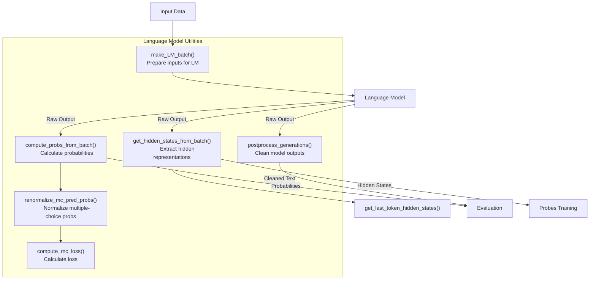
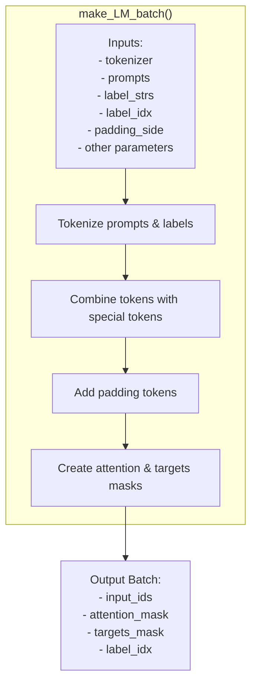
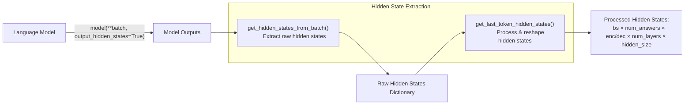
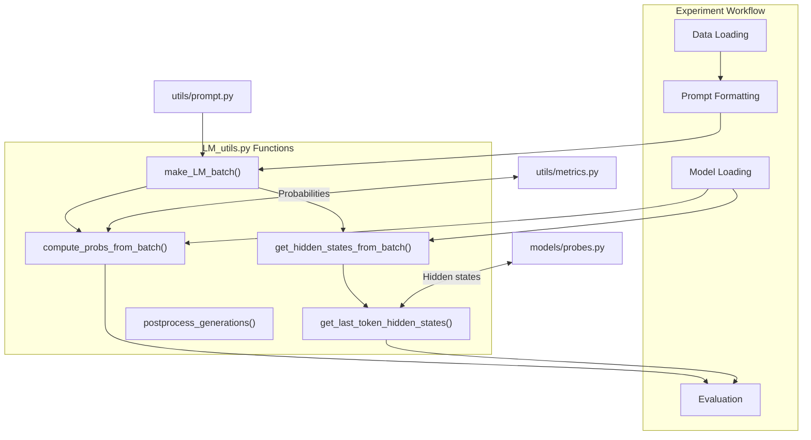

<!-- source: DeepWiki mcp.deepwiki.com · repo allenai/easy-to-hard-generalization · page 4.2 Language Model Utilities · fetched 2026-10-26 -->

# Language Model Utilities

Relevant source files

The following files were used as context for generating this wiki page:

- [utils/LM_utils.py](utils/LM_utils.py)

## Purpose and Scope

The Language Model Utilities module provides core functionality for processing and interacting with language models in the Easy-to-Hard Generalization framework. These utilities handle batch processing, probability computation, hidden state extraction, and text processing required for training and evaluating language models on different datasets.

This page focuses on the technical implementation of language model interactions. For information about probing methods, see [Probing Methods](#4.1), and for evaluation metrics, see [Evaluation Metrics](#4.3).

Sources: [utils/LM_utils.py:1-10]()

## Core Functionality Overview

The LM Utilities module provides a comprehensive set of functions for working with language models:

Sources: [utils/LM_utils.py:13-34](), [utils/LM_utils.py:36-103](), [utils/LM_utils.py:105-167](), [utils/LM_utils.py:246-257]()

## Batch Processing

The batch processing functionality prepares data for language model inference by properly formatting prompts, labels, and attention masks.

### Batch Creation

The `make_LM_batch()` function is the primary method for preparing data for language model processing:

The function handles several key aspects:
- Tokenizing prompts and label strings
- Combining tokens with special tokens (BOS/EOS)
- Creating attention masks and target masks
- Handling padding based on the specified padding side
- Supporting both multiple-choice and generative formats

Sources: [utils/LM_utils.py:169-244]()

## Probability Computation

The probability computation functions calculate token and sequence probabilities from language model outputs, supporting various normalization methods.

### Core Probability Functions

- `compute_probs_from_batch()`: Calculates probabilities or log-probabilities from model outputs
- `renormalize_mc_pred_probs()`: Normalizes multiple-choice prediction probabilities
- `compute_mc_loss()`: Computes loss for multiple-choice predictions
- `score_seq_probs_from_strings()`: Directly scores probabilities for text strings

The `compute_probs_from_batch()` function supports multiple output formats:
- `probs`: Raw probabilities
- `log_probs`: Log probabilities
- `log_probs_token_normed`: Log probabilities normalized by sequence length in tokens
- `log_probs_char_normed`: Log probabilities normalized by sequence length in characters

Sources: [utils/LM_utils.py:19-34](), [utils/LM_utils.py:36-103](), [utils/LM_utils.py:266-289]()

## Hidden State Extraction

Hidden state extraction is critical for probe training and analysis of model representations. These functions extract and process hidden states from language model outputs.

### Hidden State Processing Workflow

The `get_last_token_hidden_states()` function performs several key operations:
- Adds a dimension for number of answers
- Stacks hidden states from different layers
- Handles different numbers of answers per item
- Selects hidden states for the middle and last layers
- Processes both encoder and decoder states if applicable

Sources: [utils/LM_utils.py:105-167]()

## Model Generation Handling

The module provides utilities for processing model generations and preparing prompts for in-context learning.

### Generation Processing

- `postprocess_generations()`: Removes prompt text from model generations and handles special token processing
- `pull_prompt_from_data()`: Selects random examples from a dataset to use as prompts for in-context learning

Sources: [utils/LM_utils.py:246-264]()

## Integration with Overall System

The Language Model Utilities integrate with the broader system to support the core experimental workflows:

The Language Model Utilities serve as a bridge between the data preparation pipeline and model evaluation components, enabling efficient processing of language model inputs and outputs for the Easy-to-Hard generalization experiments.

Sources: [utils/LM_utils.py:1-10](), [utils/LM_utils.py:36-103](), [utils/LM_utils.py:105-167]()

## Key Implementation Details

### Multiple-Choice Processing

The utilities support processing both standard sequence inputs and multiple-choice inputs, with special handling for varying numbers of answer choices per item:

| Function | Multiple-Choice Support | Description |
|----------|-------------------------|-------------|
| `compute_probs_from_batch()` | Yes, via `num_answers_list` | Reshapes and normalizes probabilities for multiple-choice answers |
| `get_last_token_hidden_states()` | Yes, via `num_answers_list` | Handles padding and reshaping for multiple-choice representations |
| `make_LM_batch()` | Yes, via generating batches with label strings | Creates batches with both prompts and answer choices |

### Padding and Masking

The utilities handle proper padding and masking for language model processing:

| Component | Description |
|-----------|-------------|
| `input_ids` | Tokenized inputs with padding |
| `attention_mask` | Identifies non-padding tokens (1 for real tokens, 0 for padding) |
| `targets_mask` | Identifies tokens that are part of the target (1 for target tokens, 0 for prompt or padding) |
| `padding_side` | Controls whether padding is applied on the left or right side |

Sources: [utils/LM_utils.py:169-244](), [utils/LM_utils.py:36-103](), [utils/LM_utils.py:105-167]()

---

