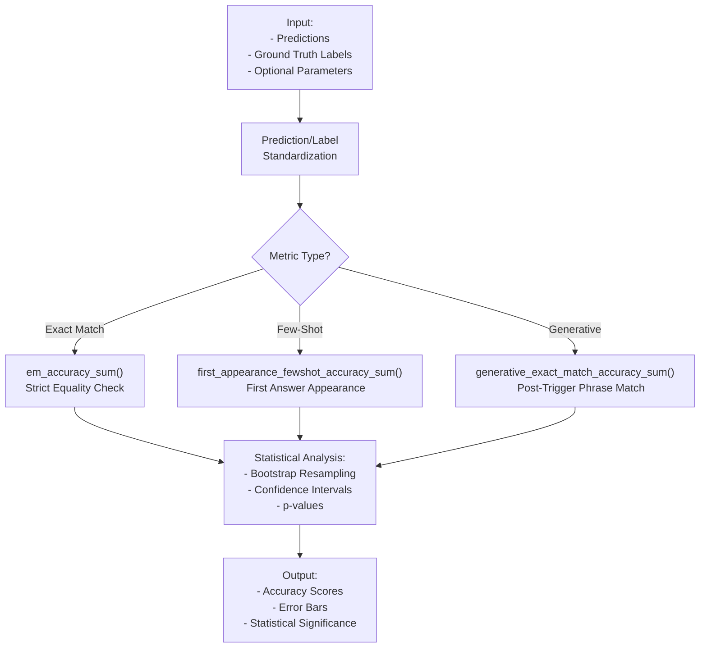
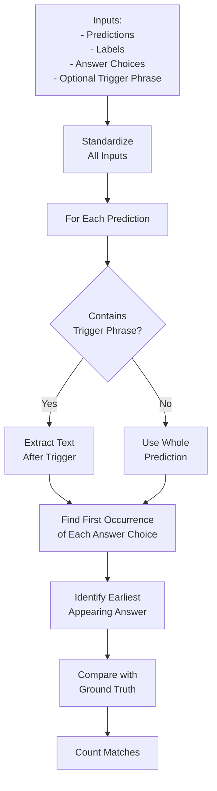
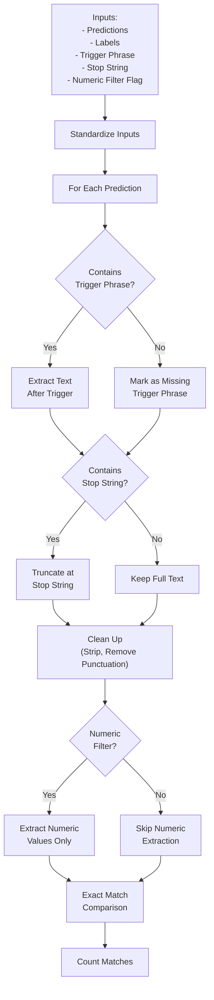
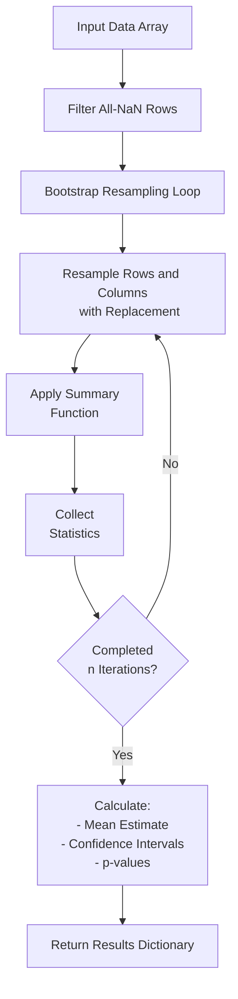
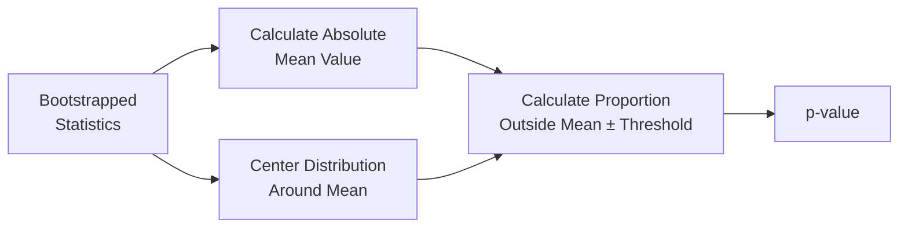
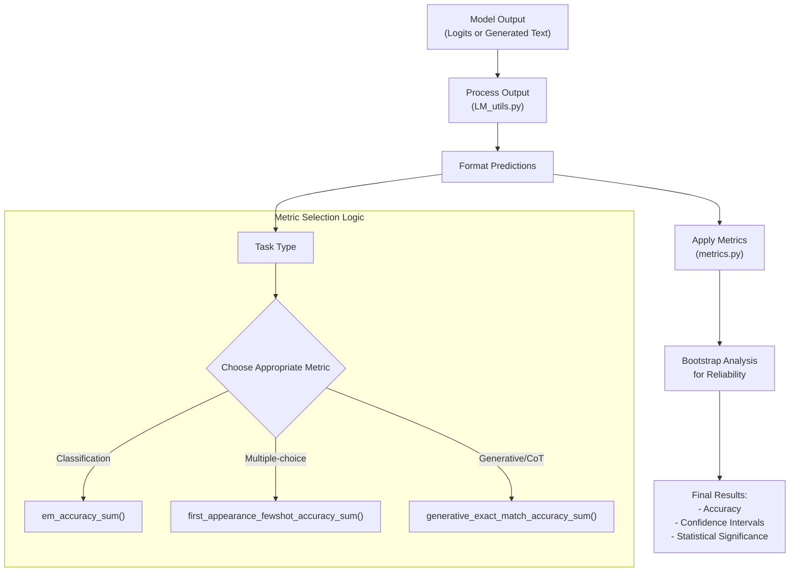

<!-- source: DeepWiki mcp.deepwiki.com · repo allenai/easy-to-hard-generalization · page 4.3 Evaluation Metrics · fetched 2026-10-26 -->

# Evaluation Metrics

Relevant source files

The following files were used as context for generating this wiki page:

- [utils/metrics.py](utils/metrics.py)

This document details the evaluation metrics implemented in the Easy-to-Hard Generalization framework. These metrics are used to measure model performance on various tasks, with specific focus on comparing performance between easy and hard examples. The metrics system supports both exact match evaluation and more flexible matching approaches suitable for different types of language model outputs.

For information about the probing methods that generate the predictions being evaluated, see [Probing Methods](#4.1). For details about language model utilities that help process these predictions, see [Language Model Utilities](#4.2).

## Metrics System Overview

The evaluation metrics system provides various functions to assess model performance through different accuracy metrics, along with statistical tools to ensure the reliability of the results.

Sources: [utils/metrics.py:1-212]()

## Core Accuracy Metrics

The framework implements three primary accuracy metrics designed for different evaluation scenarios:

| Metric Name | Function | Best For | Description |
|-------------|----------|----------|-------------|
| Exact Match | `em_accuracy_sum` | Classification | Direct equality check between predictions and labels |
| Few-Shot Appearance | `first_appearance_fewshot_accuracy_sum` | Multiple-choice with explanations | Identifies which answer choice first appears in model output |
| Generative Exact Match | `generative_exact_match_accuracy_sum` | Chain-of-thought responses | Extracts answer after trigger phrase and compares with label |

Sources: [utils/metrics.py:72-81](), [utils/metrics.py:118-165](), [utils/metrics.py:178-212]()

### Exact Match Accuracy

The most straightforward metric is exact match accuracy, which simply counts the number of predictions that exactly match their corresponding labels.

```mermaid
flowchart LR
    preds["Predictions Array"] --> compare["Direct
    Equality Check"]
    labels["Labels Array"] --> compare
    compare --> count["Count Matches"]
    count --> accuracy["Accuracy Score"]
```

Implementation details:
- Takes prediction and label arrays of the same length
- Returns the sum of matches (optionally with a boolean mask of correct predictions)
- Handles various input formats (tensors, arrays, lists)

Sources: [utils/metrics.py:72-81]()

### Few-Shot Appearance Accuracy

This metric is more flexible and designed for few-shot learning scenarios where the model output may contain explanations along with answers.

Key features:
- Finds the first occurrence of any answer choice in the output
- Optionally focuses on text after a trigger phrase (e.g., "The answer is")
- Returns the number of correct matches and optionally the processed predictions

Sources: [utils/metrics.py:118-165]()

### Generative Exact Match Accuracy

Specifically designed for chain-of-thought (CoT) reasoning, this metric extracts the final answer after a trigger phrase and performs an exact match against the label.

Key features:
- Extracts the answer part from text following a trigger phrase
- Optionally stops at a specified string (e.g., new line)
- Can filter for numeric answers only (useful for math tasks)
- Returns count of correct answers and optionally processed predictions

Sources: [utils/metrics.py:178-212]()

## Statistical Analysis Tools

To ensure reliable evaluation, especially when comparing models or analyzing trends, the framework includes statistical tools:

### Bootstrap Resampling

The `grid_bootstrap` function implements bootstrap resampling to estimate the reliability of evaluation metrics:

The bootstrap function:
- Resamples data with replacement
- Applies a user-defined summary function to each resample
- Calculates mean, error bars, and statistical significance
- Handles missing data appropriately

Sources: [utils/metrics.py:17-60]()

### P-Value Calculation

The `p_value` function calculates the statistical significance of results:

This two-sided test helps determine if observed effects are statistically significant.

Sources: [utils/metrics.py:10-15]()

## Utility Functions

The metrics system includes several utility functions that support the main evaluation metrics:

### Standardization

The `standardize_preds_or_labels` function normalizes predictions and labels into a consistent format:

- Converts tensors, arrays, and lists to standardized strings
- Handles tokenized outputs by decoding when necessary
- Applies consistent normalization (lowercase, whitespace trimming)
- Handles both single labels and multiple eligible labels

Sources: [utils/metrics.py:83-116]()

### Numeric Extraction

For mathematical tasks, the `extract_numeric` function extracts numeric values from text:

- Identifies numeric content in prediction strings
- Handles various formats of number presentation
- Particularly useful for mathematical reasoning tasks

Sources: [utils/metrics.py:167-176]()

## Integration with Model Evaluation

The evaluation metrics connect with the broader model evaluation pipeline as follows:

Sources: [utils/metrics.py:1-212]()

## Usage Considerations

When using these evaluation metrics, several considerations should be taken into account:

1. **Task-Appropriate Metrics**:
   - Use exact match for simple classification tasks
   - Use few-shot appearance for multiple-choice questions with explanations
   - Use generative exact match for chain-of-thought or numeric answers

2. **Statistical Reliability**:
   - Always use bootstrap resampling for reporting results with confidence intervals
   - Consider p-values when comparing performance across models or data subsets

3. **Edge Cases**:
   - For few-shot metrics, be careful when answers are subsets of each other
   - For generative metrics, choose trigger phrases that reliably appear in model outputs
   - For numeric tasks, consider using the numeric filter option

Sources: [utils/metrics.py:1-212]()

---

