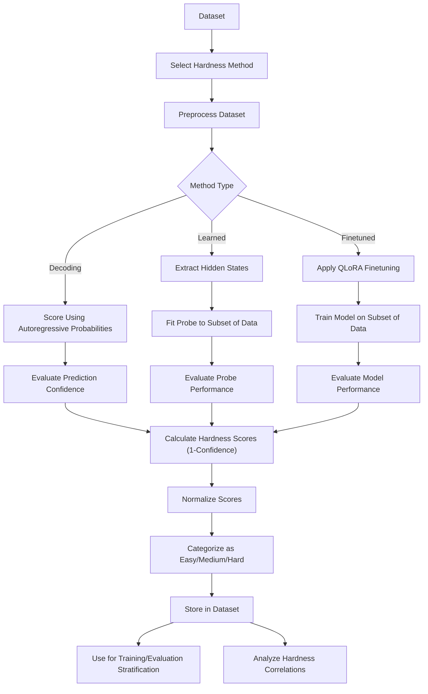
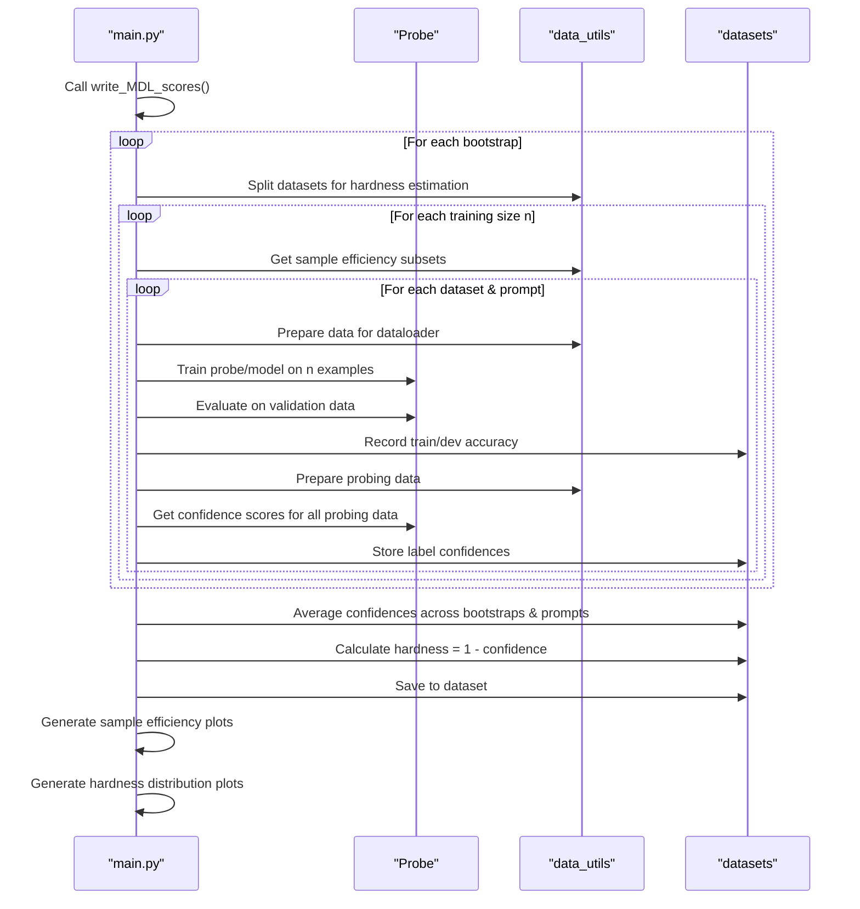
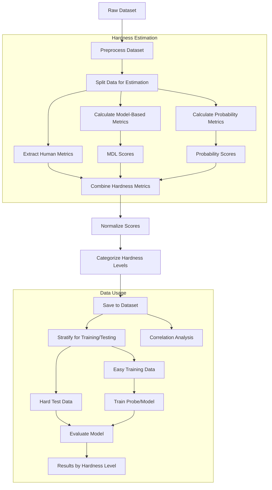
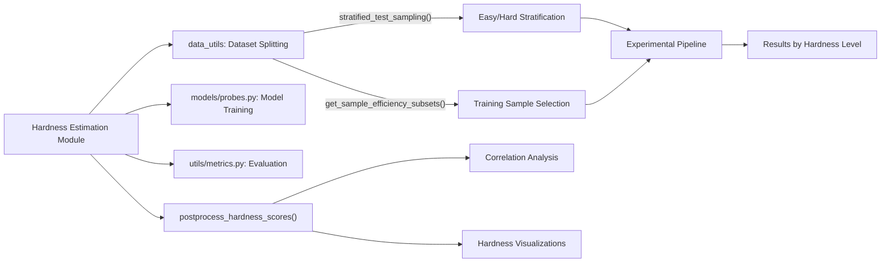

<!-- source: DeepWiki mcp.deepwiki.com · repo allenai/easy-to-hard-generalization · page 5 Hardness Estimation · fetched 2026-10-26 -->

# Hardness Estimation

<details>
<summary>Relevant source files</summary>

The following files were used as context for generating this wiki page:

- [globals.py](globals.py)
- [main.py](main.py)

</details>


This document describes the hardness estimation system in the Easy-to-Hard Generalization codebase. Hardness estimation is a critical component that calculates how "difficult" different examples are for language models, enabling experiments to test generalization from easy to hard examples.

The system supports various metrics for determining item hardness, from human-annotated difficulty levels to model-based metrics that quantify how challenging items are for specific language models.

## Types of Hardness Metrics

The codebase supports several categories of hardness metrics:

### Human-Defined Metrics

These are predefined metrics based on human annotation or inherent properties of the data:

- **Educational standards**: `human_grade`, `human_bloom`, `human_difficulty`, `human_depth_of_knowledge` (for ARC dataset)
- **Subject complexity**: `human_hardness` (for MMLU dataset)
- **Reasoning complexity**: `num_steps` (for strategy-qa and gsm8k datasets)
- **Text complexity**: `question_num_words`, `answer_num_words`, `reasoning_num_words`, `answer_num_chars`

### Model-Based Metrics

These metrics estimate hardness by fitting models to data and measuring prediction confidence:

- **MDL scores**: Derived from Minimum Description Length principle
  - `model_based_finetuned`: Using QLoRA finetuning
  - `model_based_learned`: Using parametric probes on hidden states
  - `model_based_decoding`: Using autoregressive decoding

- **Text probability scores**:
  - `question_prob`: Log probability of the question text
  - `answer_prob`: Log probability of the answer text
  - `reasoning_prob`: Log probability of reasoning chains (for strategy-qa and gsm8k)

- **Cross-model averages**:
  - `model_based_*_avg`: Averaged MDL scores across multiple LLMs
  - `*_prob_avg`: Averaged probability scores across models

Sources: [main.py:369-498](), [globals.py:20-42]()

### Hardness Metrics Taxonomy

```mermaid
graph TD
    hardness["Hardness Metrics"] --> human["Human-Defined"]
    hardness --> model["Model-Based"]
    
    human --> educational["Educational Standards"]
    human --> complexity["Complexity Measures"]
    
    educational --> grade["human_grade (ARC)"]
    educational --> bloom["human_bloom (ARC)"]
    educational --> difficulty["human_difficulty (ARC)"]
    educational --> dok["human_depth_of_knowledge (ARC)"]
    
    complexity --> steps["num_steps (Strategy-QA/GSM8K)"]
    complexity --> mmlu["human_hardness (MMLU)"]
    complexity --> textfeatures["Text Features"]
    
    textfeatures --> qwords["question_num_words"]
    textfeatures --> awords["answer_num_words"]
    textfeatures --> rwords["reasoning_num_words"]
    textfeatures --> achars["answer_num_chars"]
    
    model --> mdl["MDL-Based Scores"]
    model --> prob["Probability-Based"]
    
    mdl --> finetuned["model_based_finetuned"]
    mdl --> learned["model_based_learned"]
    mdl --> decoding["model_based_decoding"]
    
    prob --> qprob["question_prob"]
    prob --> aprob["answer_prob"]
    prob --> rprob["reasoning_prob"]
    
    mdl --> avgmdl["Cross-Model Averages"]
    prob --> avgprob["Cross-Model Averages"]
    
    avgmdl --> ftuned_avg["model_based_finetuned_avg"]
    avgmdl --> learned_avg["model_based_learned_avg"]
    avgmdl --> decoding_avg["model_based_decoding_avg"]
    
    avgprob --> qprob_avg["question_prob_avg"]
    avgprob --> aprob_avg["answer_prob_avg"]
    avgprob --> rprob_avg["reasoning_prob_avg"]
```



Sources: [main.py:375-378](), [globals.py:20-42]()

## Hardness Estimation Methods

The system implements three primary methods for estimating model-based hardness:

### Decoding Method (`hardness_method='decoding'`)

Uses the language model's native autoregressive probability to estimate hardness. Examines how confidently the model predicts the correct answer without additional training.

### Learned Method (`hardness_method='learned'`)

Trains a parametric probe (linear, MLP, or transformer) on the hidden states of the language model. Measures how easily the probe learns to predict correct answers.

### Finetuned Method (`hardness_method='finetuned'`)

Applies parameter-efficient finetuning (QLoRA by default) to the language model. Estimates hardness based on the finetuned model's confidence.

Sources: [main.py:99-334](), [main.py:1016-1020]()

## Hardness Estimation Workflow

The system estimates hardness through the following process:



Sources: [main.py:99-334](), [main.py:336-367]()

## Implementation Details

### MDL-Based Hardness Estimation

The `write_MDL_scores` function implements the primary hardness estimation pipeline:

1. For each data point, it fits models to different-sized subsets of data
2. Evaluates model performance on validation data
3. Uses model confidence to calculate hardness scores
4. Averages results across multiple bootstraps and prompts

The function supports multiple probe types (linear, MLP, transformer) and methods (decoding, learned, finetuned).



Sources: [main.py:99-334]()

### Text Probability-Based Hardness

The `write_text_prob_scores` function calculates probability-based hardness metrics:

1. Computes log probabilities for questions, answers, and reasoning
2. Adds these scores to the dataset as potential explanatory variables
3. Works with any language model that can score text sequences

Sources: [main.py:336-367]()

### Hardness Score Post-processing

The `postprocess_hardness_scores` function processes hardness scores:

1. Averages scores across different models
2. Normalizes raw scores to 0-1 range
3. Categorizes scores into easy/medium/hard levels
4. Computes correlations between different hardness metrics
5. Generates visualizations of hardness distributions

Sources: [main.py:369-498]()

## Hardness Data Flow

This diagram illustrates how hardness scores move through the system:



Sources: [main.py:99-334](), [main.py:369-498]()

## Hardness Configuration & Integration

### Key Configuration Parameters

| Parameter | Description | Default | Options |
|-----------|-------------|---------|---------|
| `hardness_method` | Method for computing model-based hardness | `'decoding'` | `'decoding'`, `'learned'`, `'finetuned'` |
| `hardness_probe_model` | Architecture for learned probe | `'linear'` | `'linear'`, `'MLP'`, `'transformer'` |
| `hardness_var_name` | Type of hardness variable to use | `'NA'` | Human metrics, model metrics, prob metrics |
| `hardness_multitask` | Train hardness model on all datasets | `False` | `True`, `False` |
| `hardness_multiprompt` | Train hardness model on all prompts | `False` | `True`, `False` |
| `hardness_bootstraps` | Number of bootstrap iterations | `1` | Integer > 0 |
| `stratify_hardness` | Stratify data by hardness | `True` | `True`, `False` |
| `human_easy_max` | Cutoff for easy human-scored data | `0.5` | Float between 0-1 |
| `human_hard_min` | Cutoff for hard human-scored data | `0.5` | Float between 0-1 |

Sources: [main.py:1016-1031](), [main.py:1043-1063]()

### Hardness Levels

Hardness scores are converted to categorical levels using either:

1. **Quantile-based thresholds** for model-based and probability metrics:
   - Easy: Bottom 30% of scores
   - Medium: Middle 40% of scores
   - Hard: Top 30% of scores

2. **Dataset-specific fixed thresholds** for human-defined metrics:
   - Defined in `globals.py` for each dataset-variable combination
   - Example: ARC dataset grade levels 3-5 are "easy", 6-7 are "medium", 8+ are "hard"

```python
# Example hardness level classification function
def classify_hardness_level(x, easy_max, hard_min):
    if x <= easy_max:
        return 'easy'
    elif x >= hard_min:
        return 'hard'
    else:
        return 'medium'
```

Sources: [main.py:428-447](), [globals.py:20-42]()

### Integration with Evaluation

Hardness scores enable several experiment types:

1. **Train-easy/test-hard split**: Train on easy examples, test on hard examples
2. **Stratified analysis**: Evaluate model performance by hardness level
3. **Hardness correlation**: Compare different hardness metrics to identify factors affecting generalization

The hardness estimation system connects to the broader framework through:



Sources: [main.py:500-962](), [main.py:369-498]()

## Models Used for Hardness Estimation

The system can use various models to estimate hardness. By default, scores can be averaged across these models:

```python
hardness_models = [
    "huggyllama/llama-7b",
    "tiiuae/falcon-7b",
    "mistralai/Mistral-7B-v0.1",
    "mosaicml/mpt-7b",
]
```

Sources: [globals.py:57-62]()

## Conclusion

The hardness estimation system provides a flexible framework for quantifying and analyzing example difficulty. By supporting both human-defined and model-based metrics, it enables experiments on generalization from easy to hard examples, which is central to the repository's purpose.

For information on how this system integrates with the data pipeline, see [Data Pipeline](#3) and [Dataset Loading and Processing](#3.1).

---

