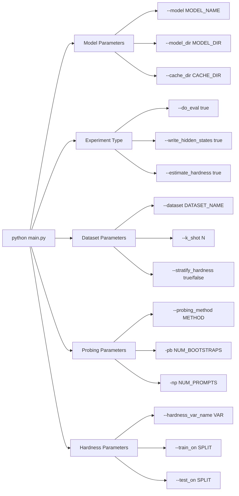
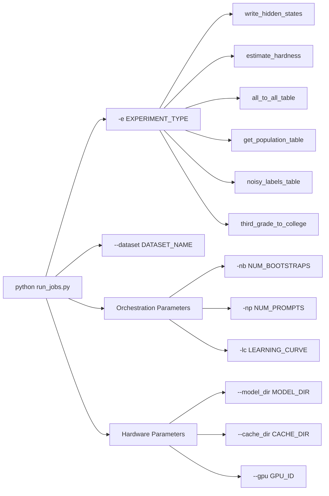
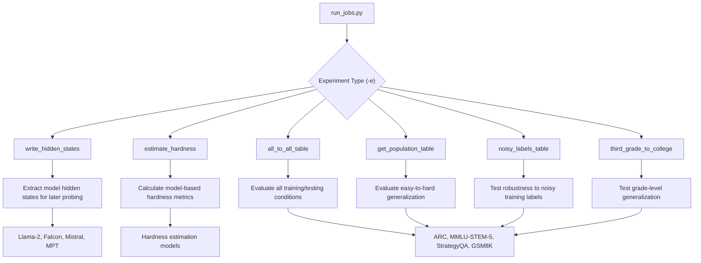
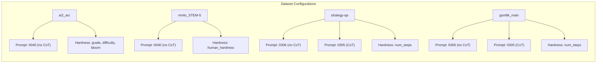
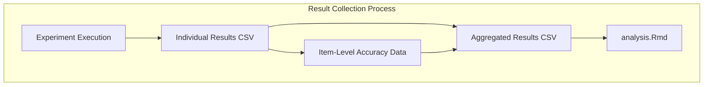

<!-- source: DeepWiki mcp.deepwiki.com · repo allenai/easy-to-hard-generalization · page 6 Usage Guide · fetched 2026-10-26 -->

# Usage Guide

<details>
<summary>Relevant source files</summary>

The following files were used as context for generating this wiki page:

- [README.md](README.md)
- [requirements.txt](requirements.txt)
- [run_jobs.py](run_jobs.py)

</details>


This document provides comprehensive instructions for running experiments using the Easy-to-Hard Generalization codebase. It explains how to configure your environment, execute various experiment types, and collect results. For information about the system architecture and components, see [System Architecture](#2), and for details about the data pipeline, see [Data Pipeline](#3).

## Environment Setup

### Prerequisites

Before running experiments, ensure you have the necessary dependencies installed and environment configured.

```bash
pip install -r requirements.txt
```

### Environment Variables

Set the following environment variables for model storage and caching:

```bash
export MODEL_DIR=/path/to/store/models
export CACHE_DIR=/path/to/cache/huggingface
```

These variables are required for any experiment using language models.

### Hardware Requirements

Experiments can be run on various GPU configurations:
- Basic experiments: Single GPU with at least 16GB VRAM
- Larger models (Llama-2-70b): Four 48GB GPUs when using 8-bit quantization
- Memory usage can be reduced by lowering batch sizes (-ebs, -tbs parameters)

Sources: [README.md:9-21](), [requirements.txt:1-20]()

## Basic Command Structure

The codebase supports two primary methods of running experiments:

1. **Direct execution** using `main.py` for single experiments
2. **Experiment orchestration** using `run_jobs.py` for batched execution

### Direct Command Structure

Executing experiments directly through `main.py`:



### Orchestration Command Structure

Using `run_jobs.py` to launch multiple related experiments:



Sources: [README.md:15-32](), [run_jobs.py:677-793]()

## Simple Example Commands

Here are basic examples to get started:

### Run Llama-7b on ARC Challenge test with a zero-shot prompt

```bash
python main.py --model huggyllama/llama-7b --do_eval true -llm true \
  --probing_method decoding --dataset ai2_arc/ARC-Challenge \
  --hardness_var_name NA --specific_prompt 0040 -pb 1 -np 1 \
  --stratify_hardness false --k_shot 0 -ebs 8 --all_data_to_test true \
  --model_dir $MODEL_DIR --cache_dir $CACHE_DIR
```

### Run Mixtral-8x7B on college-level MMLU-STEM with high school examples

```bash
python main.py --model mistralai/Mixtral-8x7B-v0.1 --do_eval true -llm true \
  --probing_method decoding --dataset mmlu_STEM-5 \
  --hardness_var_name human_hardness --specific_prompt 0040 -pb 5 -np 1 \
  --stratify_hardness true --train_on easy --test_on hard --k_shot 10 \
  --ebs 8 --all_data_to_test true --model_dir $MODEL_DIR --cache_dir $CACHE_DIR
```

Sources: [README.md:15-32]()

## Experiment Types

The codebase supports several experiment types that are orchestrated through `run_jobs.py`:



### 1. Writing Hidden States

```bash
python run_jobs.py -e write_hidden_states --dataset ai2_arc \
  --model_dir $MODEL_DIR --cache_dir $CACHE_DIR
```

This extracts and saves model hidden states for later use with linear probes.

### 2. Estimating Hardness

```bash
python run_jobs.py -e estimate_hardness --dataset ai2_arc \
  --model_dir $MODEL_DIR --cache_dir $CACHE_DIR
```

This calculates model-based hardness scores for dataset examples.

### 3. All-to-All Evaluation

```bash
python run_jobs.py -e all_to_all_table --dataset ai2_arc -nb 5 -lc 0 \
  --n_train 160 --k_shot 10 --model_dir $MODEL_DIR --cache_dir $CACHE_DIR
```

Evaluates models on all training/testing conditions without hardness stratification.

### 4. Easy-to-Hard Generalization

```bash
python run_jobs.py -e get_population_table --dataset ai2_arc -nb 5 -lc 0 \
  --n_train 160 --k_shot 10 --model_dir $MODEL_DIR --cache_dir $CACHE_DIR
```

Evaluates models on easy-to-hard generalization with hardness stratification.

### 5. Noisy Labels Experiments

```bash
python run_jobs.py -e noisy_labels_table --dataset mmlu_STEM-5 -nb 5 -lc 0 \
  --n_train 160 --model_dir $MODEL_DIR --cache_dir $CACHE_DIR
```

Tests robustness to noisy training labels.

### 6. Grade-Level Generalization

```bash
python run_jobs.py -e third_grade_to_college -nb 5 -lc 0 --n_train 160 \
  --k_shot 10 -rj 0 --model_dir $MODEL_DIR --cache_dir $CACHE_DIR
```

Evaluates college test performance using grade-school training data.

Sources: [run_jobs.py:255-634](), [README.md:34-90]()

## Parameter Reference

### Common Parameters

| Parameter | Description | Example Values |
|-----------|-------------|----------------|
| `--model` | Language model name | `huggyllama/llama-7b`, `Llama-2-70b` |
| `--dataset` | Dataset name | `ai2_arc`, `mmlu_STEM-5`, `strategy-qa`, `gsm8k_main` |
| `--probing_method` | Method for model evaluation | `decoding`, `learned`, `finetuned` |
| `--use_cot` | Whether to use chain-of-thought | `true`, `false` |
| `--k_shot` | Number of examples in prompt | `0`, `8`, `10` |
| `--n_train` | Number of training examples | `160` |
| `-nb` | Number of bootstrap iterations | `5` |
| `-np` | Number of prompts to try | `1` |
| `-ebs` | Evaluation batch size | `4`, `8` |
| `-tbs` | Training batch size | `8` |

### Hardness Stratification Parameters

| Parameter | Description | Example Values |
|-----------|-------------|----------------|
| `--stratify_hardness` | Use hardness-stratified data | `true`, `false` |
| `--hardness_var_name` | Hardness variable to use | `human_hardness`, `model_based_decoding_avg`, `num_steps` |
| `--train_on` | Which hardness level to train on | `easy`, `medium`, `hard`, `all` |
| `--test_on` | Which hardness level to test on | `easy`, `medium`, `hard`, `all` |
| `--human_easy_max` | Max value for easy examples | Dataset-specific |
| `--human_hard_min` | Min value for hard examples | Dataset-specific |

### Model-Specific Parameters

| Parameter | Description | Example Values |
|-----------|-------------|----------------|
| `--quantization` | Quantization for models | `8bit`, `16bit`, `NA` |
| `--model_type` | Type of model architecture | `decoder`, `encoder_decoder` |
| `--probing_layers` | Layers to use for probing | `middle_and_last`, `last` |
| `--max_seq_len` | Maximum sequence length | `2048` |

Sources: [run_jobs.py:16-192](), [run_jobs.py:677-785]()

## Dataset-Specific Configurations

Each dataset has specific configurations for prompts, hardness variables, and optimal parameters:



### Hardness Cutoffs by Dataset

| Dataset | Hardness Variable | Easy Max | Hard Min |
|---------|------------------|----------|----------|
| ai2_arc | human_bloom | 2 | 4 |
| ai2_arc | human_difficulty | 1 | 3 |
| ai2_arc | human_grade | 5 | 8 |
| mmlu_STEM-5 | human_hardness | 0 | 1 |
| strategy-qa | num_steps | 2 | 4 |
| gsm8k_main | num_steps | 4 | 7 |

Sources: [run_jobs.py:29-69](), [run_jobs.py:192-201]()

## Result Collection and Analysis

When experiments complete, results are saved to the `result_sheets` directory:



### Result File Naming Convention

Result files follow this naming pattern:
```
[dataset]_[experiment]_models-[count]_LC-[bool]_prompts-[count]_boots-[count].csv
```

Example: `ai2_arc_get_population_table_models-3_LC-0_prompts-1_boots-5.csv`

### Analyzing Results

Results can be analyzed using the provided R markdown file:

```bash
# Open the R markdown file in RStudio
open analysis.Rmd  # or equivalent for your system
```

The analysis script loads results from the `result_sheets` directory and generates plots and tables similar to those in the paper.

Sources: [run_jobs.py:232-253](), [run_jobs.py:367-390](), [README.md:93-95]()

## Advanced Usage

### Learning Curves

To generate learning curves (evaluating performance vs. training examples):

```bash
python run_jobs.py -e get_population_table --dataset ai2_arc -nb 10 -lc 1 \
  --model_dir $MODEL_DIR --cache_dir $CACHE_DIR
```

The `-lc 1` flag enables learning curve experiments.

### Customizing Model Selection

Edit the `use_models` list in `run_jobs.py` to control which models are included:

```python
# For only using a specific model
use_models = ['Llama-2-70b']

# For using all Llama models
use_models = globals.base_llama_models
```

### Customizing Methods

Edit the `use_methods` dictionary in `run_jobs.py` to control which methods are run:

```python
# Example for selecting only specific methods
dataname_to_methods = {
    'ai2_arc': ['decoding_CoT=False', 'learned_CoT=False'],
    # ...
}
```

Sources: [run_jobs.py:414-416](), [run_jobs.py:400-407](), [README.md:85-90]()

## Troubleshooting

### Memory Issues

If you encounter CUDA out-of-memory errors:
1. Reduce batch sizes (-ebs and -tbs parameters)
2. Use stronger quantization (8bit or 4bit)
3. For large models, use gradient accumulation (-gaf parameter)

### Missing Results

If results are missing after experiments complete:
1. Check the outputs directory
2. Verify that the experiment completed successfully
3. Try running with `--overwrite_existing_results true`

### Slow Execution

For faster execution:
1. Use smaller models when feasible
2. Reduce -nb (number of bootstraps)
3. Run experiments in parallel on multiple GPUs

Sources: [README.md:15-21](), [run_jobs.py:101-111]()

---

