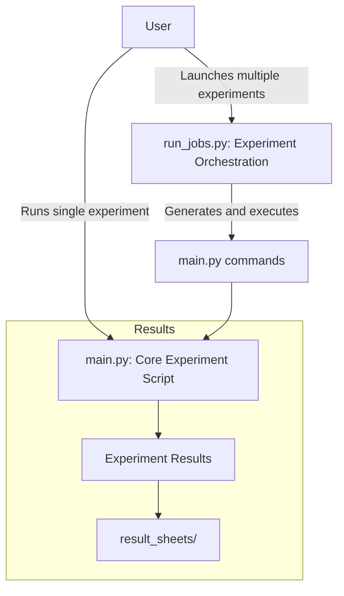
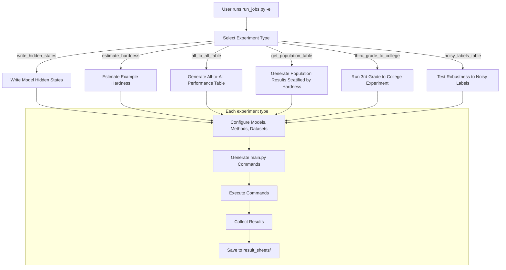
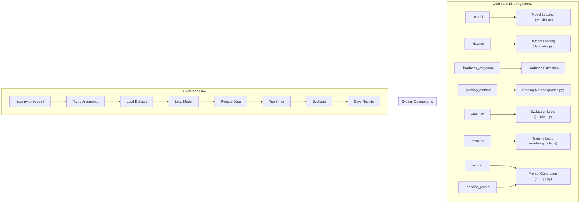
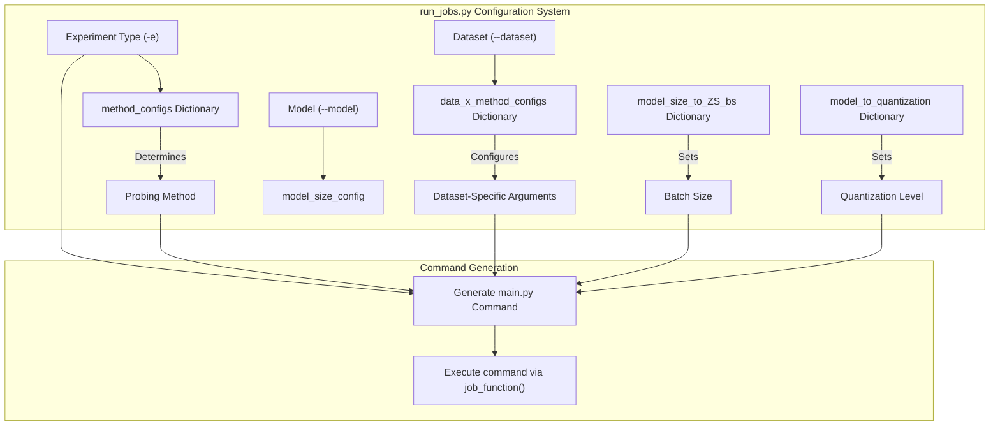

<!-- source: DeepWiki mcp.deepwiki.com · repo allenai/easy-to-hard-generalization · page 6.1 Command-Line Interface · fetched 2026-10-26 -->

# Command-Line Interface

<details>
<summary>Relevant source files</summary>

The following files were used as context for generating this wiki page:

- [README.md](README.md)
- [main.py](main.py)
- [run_jobs.py](run_jobs.py)

</details>


This document details the command-line interface for the Easy-to-Hard Generalization framework, focusing on how to launch various experiments through the command line. The framework supports two primary entry points for running experiments: `main.py` for individual experiment execution and `run_jobs.py` for orchestrating multiple experiment runs.

For information on experiment workflow architecture, see [System Architecture](#2) and [Experiment Workflow](#2.1). For environment setup instructions, see [Environment Setup](#6.2).

## Command Line Entry Points

The framework provides two main command-line entry points with different purposes:



Sources: [main.py:963-1096](), [run_jobs.py:677-794]()

### `main.py` - Core Experiment Script

The `main.py` script is the primary entry point for running individual experiments. It provides a comprehensive set of command-line arguments to control all aspects of an experiment, including model selection, dataset configuration, evaluation method, and training parameters.

### `run_jobs.py` - Experiment Orchestration

The `run_jobs.py` script serves as an orchestration layer for running multiple experiments. It defines high-level experiment types and constructs appropriate `main.py` commands with the necessary arguments. This script is particularly useful for reproducing the paper's results, which involve running experiments across multiple models, datasets, and methods.

## Common Command-Line Arguments

The following tables list the most commonly used command-line arguments grouped by category.

### Environment and Resource Arguments

| Argument | Description | Default |
|----------|-------------|---------|
| `--gpu` | GPU ID to use (-1 for CPU) | 0 |
| `--model_dir` | Directory for saving/loading models | Required |
| `--cache_dir` | Directory for model cache | Required |
| `--data_dir` | Directory for dataset files | 'data' |
| `--output_dir` | Directory for output files | 'outputs' |
| `--log_dir` | Directory for training logs | 'training_logs' |
| `--seed` | Random seed for reproducibility | 0 |
| `--quantization` | Model quantization method ('NA', '8bit', '4bit', '16bit') | '8bit' |

Sources: [main.py:965-983]()

### Model Selection Arguments

| Argument | Description | Default |
|----------|-------------|---------|
| `--model` | Pretrained model name/path | 'gpt2-medium' |
| `--model_type` | Model architecture type ('decoder', 'encoder_decoder') | 'decoder' |
| `--load_model` (`-llm`) | Whether to load the model | False |
| `--probing_method` (`-pm`) | Method for probing the model ('decoding', 'learned', 'finetuned') | 'learned' |
| `--optimize_weights` | Model weights to finetune ('embeddings', 'all', 'LORA', 'ABCD_embeddings') | 'LORA' |

Sources: [main.py:974-1000]()

### Dataset Configuration

| Argument | Description | Default |
|----------|-------------|---------|
| `--dataset` | Dataset name | 'amazon_polarity' |
| `--hardness_var_name` | Variable used for hardness measurement | 'NA' |
| `--stratify_hardness` | Whether to stratify data by hardness | True |
| `--train_on` | Split of data to fit probe to ('all', 'easy', 'medium', 'hard') | 'all' |
| `--test_on` | Split of data to evaluate on ('all', 'easy', 'medium', 'hard') | 'all' |
| `--k_shot` (`-k`) | Number of examples in prompt | 5 |
| `--specific_prompt` | Specific prompt ID to use | None |

Sources: [main.py:984-998]()

### Experiment Type Arguments

| Argument | Description | Default |
|----------|-------------|---------|
| `--do_eval` | Perform model evaluation | False |
| `--write_hidden_states` | Write model representations to file | False |
| `--estimate_hardness` | Compute hardness scores for dataset examples | False |
| `--record_results_by_hardness` | Record results stratified by hardness level | False |
| `--use_cot` | Use chain-of-thought reasoning | False |
| `--generative_eval` | Evaluate in generative manner | False |

Sources: [main.py:1084-1093]()

### Training and Evaluation Arguments

| Argument | Description | Default |
|----------|-------------|---------|
| `--train_batch_size` (`-tbs`) | Training batch size | 8 |
| `--eval_batch_size` (`-ebs`) | Evaluation batch size | 8 |
| `--grad_accumulation_factor` (`-gaf`) | Gradient accumulation factor | 1 |
| `--max_seq_len` | Maximum sequence length | 2048 |
| `--probing_bootstraps` (`-pb`) | Number of bootstrap evaluations | 1 |
| `--n_train` | Number of training examples | 320 |
| `--n_test` (`-nt`) | Number of test examples (-1 for all) | -1 |
| `--learned_probe_epochs` (`-pe`) | Number of epochs for learned probe | 100 |
| `--finetuned_epochs` (`-fe`) | Number of epochs for finetuned model | Automatically set |

Sources: [main.py:1072-1084]()

## Experiment Workflow with `run_jobs.py`

The `run_jobs.py` script provides several predefined experiment types that can be executed with the `-e` argument.



Sources: [run_jobs.py:227-254](), [run_jobs.py:787-793]()

### Experiment Types in `run_jobs.py`

| Experiment Type | Description | Function |
|-----------------|-------------|----------|
| `write_hidden_states` | Extracts and saves model hidden states for datasets | `write_hidden_states()` |
| `estimate_hardness` | Estimates hardness scores for dataset examples | `estimate_hardness()` |
| `all_to_all_table` | Generates a table of model performance across different conditions | `all_to_all_table()` |
| `get_population_table` | Generates results stratified by hardness level | `get_population_table()` |
| `third_grade_to_college` | Tests college-level performance with elementary/high school training | `third_grade_to_college()` |
| `noisy_labels_table` | Tests model robustness to noisy labels | `noisy_labels_table()` |

Sources: [run_jobs.py:255-634]()

### Command Structure for `run_jobs.py`

```
python run_jobs.py -e <experiment_type> --dataset <dataset> [additional arguments] --model_dir $MODEL_DIR --cache_dir $CACHE_DIR
```

Key additional arguments:
- `-nb <num>`: Number of bootstrap evaluations
- `-lc <bool>`: Whether to generate learning curves
- `-rj <bool>`: Whether to actually run jobs (False to just collect results)
- `--overwrite_existing_results`: Whether to overwrite existing results

Sources: [run_jobs.py:677-781]()

## Running Basic Experiments with `main.py`

### Direct Model Evaluation

The basic structure for direct model evaluation:

```
python main.py --model <model_name> --do_eval true --load_model true --probing_method decoding --dataset <dataset> --hardness_var_name <hardness_var> --specific_prompt <prompt_id> --stratify_hardness <bool> --k_shot <num> --eval_batch_size <num> --model_dir $MODEL_DIR --cache_dir $CACHE_DIR
```

Example - Evaluating Llama-7b on ARC Challenge with zero-shot:

```
python main.py --model huggyllama/llama-7b --do_eval true --load_model true --probing_method decoding --dataset ai2_arc/ARC-Challenge --hardness_var_name NA --specific_prompt 0040 --probing_bootstraps 1 --num_prompts 1 --stratify_hardness false --k_shot 0 --eval_batch_size 8 --all_data_to_test true --model_dir $MODEL_DIR --cache_dir $CACHE_DIR
```

Sources: [README.md:15-21]()

### Easy-to-Hard Generalization Experiment

Evaluating a model on hard examples when trained on easy ones:

```
python main.py --model <model_name> --do_eval true --load_model true --probing_method decoding --dataset <dataset> --hardness_var_name <hardness_var> --specific_prompt <prompt_id> --stratify_hardness true --train_on easy --test_on hard --k_shot <num> --eval_batch_size <num> --model_dir $MODEL_DIR --cache_dir $CACHE_DIR
```

Example - Running Mixtral on college-level MMLU questions with high school examples:

```
python main.py --model mistralai/Mixtral-8x7B-v0.1 --do_eval true --load_model true --probing_method decoding --dataset mmlu_STEM-5 --hardness_var_name human_hardness --specific_prompt 0040 --probing_bootstraps 5 --num_prompts 1 --stratify_hardness true --train_on easy --test_on hard --k_shot 10 --eval_batch_size 8 --all_data_to_test true --model_dir $MODEL_DIR --cache_dir $CACHE_DIR
```

Sources: [README.md:30-33]()

## Understanding Command to System Mapping

This diagram illustrates how command-line arguments map to the system components:



Sources: [main.py:963-1168](), [main.py:1197-1215](), [main.py:1241-1248](), [main.py:500-963]()

## `run_jobs.py` Configuration System

The `run_jobs.py` script uses a series of configuration dictionaries to map models, datasets, and methods to appropriate command-line arguments.



Sources: [run_jobs.py:173-201](), [run_jobs.py:29-151](), [run_jobs.py:334-391]()

## Examples from `README.md`

The README provides several examples of how to use the command-line interface for different types of experiments.

### Writing Model Hidden States

```
python run_jobs.py -e write_hidden_states --dataset ai2_arc --model_dir $MODEL_DIR --cache_dir $CACHE_DIR
```

Sources: [README.md:41-45]()

### Estimating Model-Based Hardness

```
python run_jobs.py -e estimate_hardness --dataset ai2_arc --model_dir $MODEL_DIR --cache_dir $CACHE_DIR
```

Sources: [README.md:49-53]()

### All-to-All Performance Table

```
python run_jobs.py -e all_to_all_table --dataset ai2_arc -nb 5 -lc 0 --n_train 160 --k_shot 10 --model_dir $MODEL_DIR --cache_dir $CACHE_DIR
```

Sources: [README.md:57-62]()

### Easy-to-Hard Generalization Results

```
python run_jobs.py -e get_population_table --dataset ai2_arc -nb 5 -lc 0 --n_train 160 --k_shot 10 --model_dir $MODEL_DIR --cache_dir $CACHE_DIR
```

Sources: [README.md:66-71]()

### 3rd Grade to College Experiment

```
python run_jobs.py -e third_grade_to_college -nb 5 -lc 0 --n_train 160 --k_shot 10 -rj 0 --model_dir $MODEL_DIR --cache_dir $CACHE_DIR
```

Sources: [README.md:76-77]()

## Tips for Efficient Command-Line Usage

1. **Environment Variables**: Set `MODEL_DIR` and `CACHE_DIR` as environment variables to avoid typing them repeatedly.

2. **GPU Memory**: Use lower `--eval_batch_size` (`-ebs`) with large models to fit on smaller GPUs. The minimum for multiple-choice tasks is typically 4.

3. **Model Quantization**: Use `--quantization 8bit` for large models to reduce memory usage.

4. **Result Collection**: Set `-rj 0` with `run_jobs.py` to only collect results without running experiments.

5. **Experiment Naming**: Results are saved with experiment-specific names derived from command-line arguments. The `--experiment_name` field in saved files reflects these parameters.

Sources: [README.md:17-18](), [main.py:1142-1143]()

---

