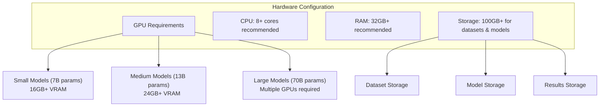
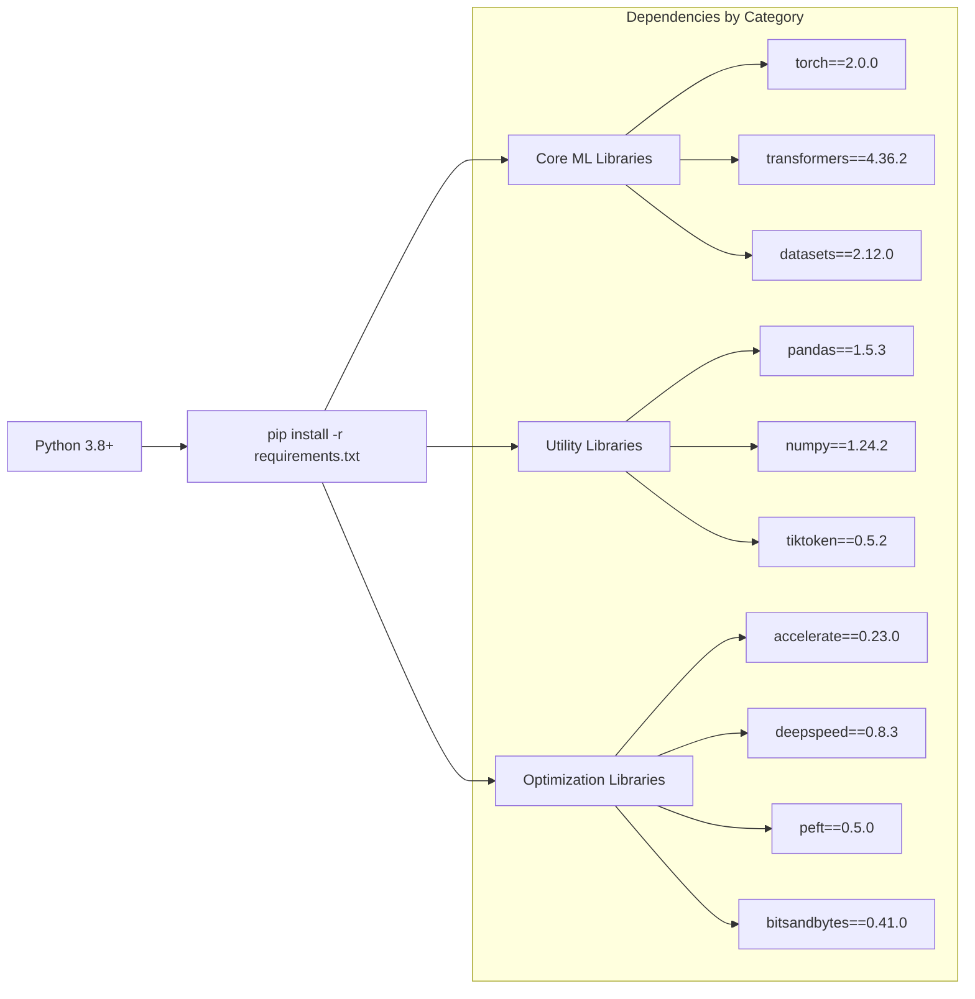
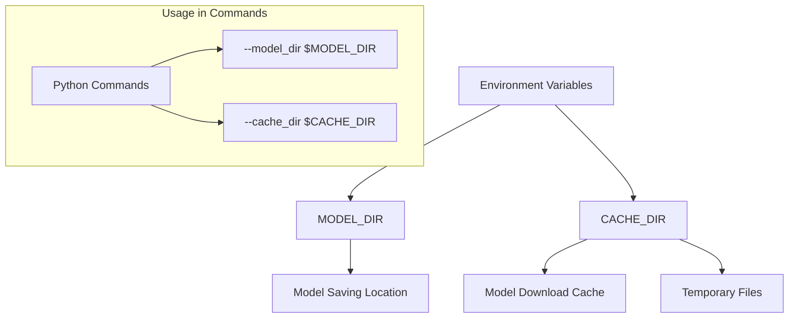
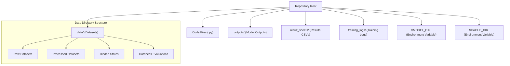
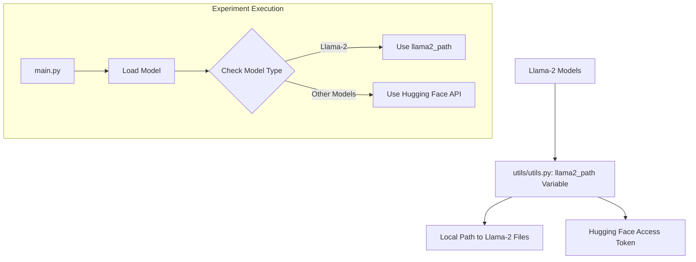
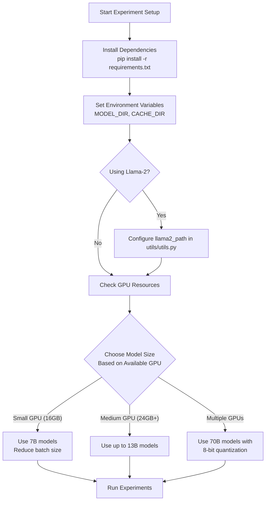

<!-- source: DeepWiki mcp.deepwiki.com · repo allenai/easy-to-hard-generalization · page 6.2 Environment Setup · fetched 2026-10-26 -->

# Environment Setup

<details>
<summary>Relevant source files</summary>

The following files were used as context for generating this wiki page:

- [.gitignore](.gitignore)
- [README.md](README.md)
- [requirements.txt](requirements.txt)

</details>


This page provides detailed instructions on setting up the necessary environment for running the Easy-to-Hard Generalization experiments. It covers hardware requirements, software dependencies, environment variables, and directory structure. For information about running specific experiments after setup, see [Command-Line Interface](#6.1).

## Hardware Requirements

The repository's experiments are designed to run on CUDA-capable GPUs. Different experiments have different memory requirements depending on the model size:

| Model | Minimum VRAM | Recommended Setup |
|-------|--------------|-------------------|
| Llama-7B, Falcon-7B, etc. | 16GB | Single GPU with 24GB VRAM |
| Llama-13B, Mixtral-8x7B | 24GB | Single GPU with 48GB VRAM or multiple GPUs |
| Llama-70B | 80GB | Four 48GB GPUs (with 8-bit quantization) |

For smaller GPUs, you can reduce the evaluation batch size (`-ebs`) parameter to accommodate memory constraints.



Sources: [README.md:13-17](), [README.md:37-38]()

## Software Dependencies

The repository requires Python 3.8+ and several dependencies listed in the requirements.txt file.

### Installation

To install required dependencies:

```bash
pip install -r requirements.txt
```

Key dependencies include:

| Package | Version | Purpose |
|---------|---------|---------|
| torch | 2.0.0 | Deep learning framework |
| transformers | 4.36.2 | Hugging Face Transformers library |
| accelerate | 0.23.0 | Distributed training utilities |
| peft | 0.5.0 | Parameter-Efficient Fine-Tuning |
| bitsandbytes | 0.41.0 | 8-bit quantization |
| deepspeed | 0.8.3 | Distributed training optimization |
| datasets | 2.12.0 | Dataset loading and processing |
| pandas | 1.5.3 | Data manipulation |
| numpy | 1.24.2 | Numerical computing |



Sources: [requirements.txt:1-20](), [README.md:9-13]()

## Environment Variables

The codebase relies on two critical environment variables that must be set before running experiments:

| Variable | Purpose | Example |
|----------|---------|---------|
| `MODEL_DIR` | Directory for saving/storing models | `/path/to/models` |
| `CACHE_DIR` | Directory for model cache and downloads | `/path/to/cache` |

These variables are referenced in all experiment commands and must be set in your shell environment:

```bash
# For bash/zsh:
export MODEL_DIR=/path/to/models
export CACHE_DIR=/path/to/cache

# For Windows command prompt:
set MODEL_DIR=C:\path\to\models
set CACHE_DIR=C:\path\to\cache
```



Sources: [README.md:17](), [README.md:20-33]()

## Directory Structure

The repository will create several directories during operation:

| Directory | Purpose |
|-----------|---------|
| `data/` | Stores datasets and processed data |
| `outputs/` | Outputs from model runs and evaluations |
| `result_sheets/` | CSV files with experiment results |
| `training_logs/` | Logs from training sessions |

These directories are included in the `.gitignore` file and will be created automatically when running experiments.



Sources: [.gitignore:1-5]()

## Special Configuration for Llama-2 Models

When using Llama-2 models, you need to set the `llama2_path` variable in `utils/utils.py`. This should point to your local copy of the Llama-2 model files or your access token for downloading them.



Sources: [README.md:7]()

## Preparing to Run Experiments

Before running experiments, ensure:

1. All dependencies are installed
2. Environment variables (`MODEL_DIR` and `CACHE_DIR`) are set
3. For Llama-2 models, the `llama2_path` is configured in `utils/utils.py`
4. You have sufficient GPU resources for your chosen model

For large models, consider these memory optimization techniques:

- Reduce evaluation batch size (`-ebs`)
- Use 8-bit quantization for large models
- For Llama-70B, ensure you have distributed setup with multiple GPUs



Sources: [README.md:15-17](), [README.md:37-38]()

## Troubleshooting Common Issues

| Issue | Solution |
|-------|----------|
| CUDA out of memory | Reduce batch size (`-ebs`), use smaller model, or enable gradient checkpointing |
| Model download failures | Check internet connection, ensure `CACHE_DIR` is set and has sufficient space |
| ImportError for dependencies | Verify all requirements are installed with correct versions |
| Permission errors | Ensure write permissions for `MODEL_DIR` and `CACHE_DIR` |
| Slow execution | Consider using DeepSpeed (already in requirements) for optimization |

Sources: [README.md:15-17](), [requirements.txt:1-20]()

## Verification

To verify your environment is correctly set up, run a simple test experiment:

```bash
python main.py --model huggyllama/llama-7b --do_eval true -llm true --probing_method decoding --dataset ai2_arc/ARC-Challenge --hardness_var_name NA --specific_prompt 0040 -pb 1 -np 1 --stratify_hardness false --k_shot 0 -ebs 4 --all_data_to_test true --model_dir $MODEL_DIR --cache_dir $CACHE_DIR
```

This command runs a minimal test using the Llama-7B model on ARC Challenge with a minimal batch size. If this executes successfully, your environment is properly configured.

Sources: [README.md:15-21]()