# Page: Overview

# Overview

<details>
<summary>Relevant source files</summary>

The following files were used as context for generating this wiki page:

- [README.md](README.md)

</details>


This document provides an introduction to the Easy-to-Hard Generalization framework, which implements experiments from the paper "The Unreasonable Effectiveness of Easy Training Data for Hard Tasks." The system enables researchers to investigate how language models trained on easy examples can generalize to more difficult problems.

## Purpose and Scope

The Easy-to-Hard Generalization codebase allows researchers to:

1. Evaluate language models on tasks with varying levels of difficulty
2. Test the hypothesis that models can generalize from easy to hard examples
3. Compare different training methods (ICL, CoT, linear probing, fine-tuning)
4. Measure performance across multiple domains and datasets

For detailed information about running specific experiments, see [Usage Guide](#6), and for system architecture details, see [System Architecture](#2).

## System Architecture

The framework consists of several interconnected components that handle experiment orchestration, data processing, model training, and evaluation:

### System Architecture Overview

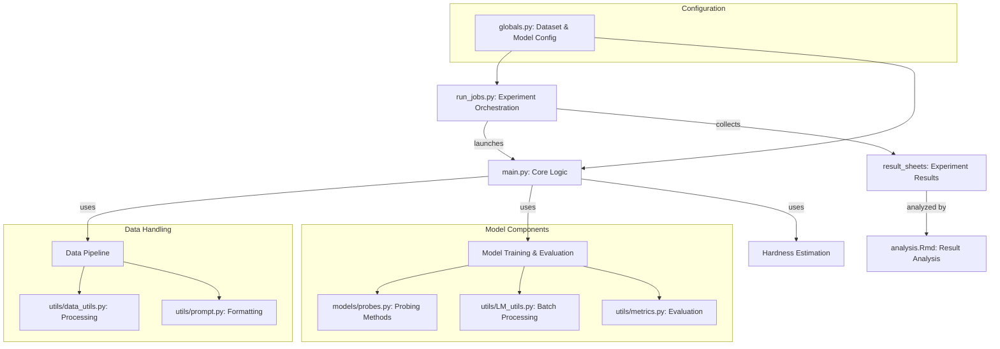

Sources: [README.md:1-38]()

## Experiment Workflow

The system follows a structured workflow for conducting experiments:

### Experiment Execution Flow

```mermaid
flowchart TD
    start["Start Experiment"] --> runJobs["run_jobs.py: Select Experiment Type"]
    runJobs --> configs["Configure Models & Datasets"]
    configs --> jobGen["Generate Experiment Commands"]
    jobGen --> launchJobs["Launch Jobs (main.py instances)"]
    
    launchJobs --> dataLoad["Load & Process Dataset"]
    dataLoad --> modelLoad["Load Language Model"]
    
    modelLoad --> expType{"Experiment Type?"}
    
    expType -->|"write_hidden_states"| hiddenStates["Extract Model Hidden States"]
    expType -->|"estimate_hardness"| hardnessEst["Calculate Hardness Scores"]
    expType -->|"all_to_all_table/get_population_table"| trainEval["Train/Evaluate Model"]
    
    hiddenStates & hardnessEst & trainEval --> saveResults["Save Results"]
    saveResults --> collectResults["Collect Results"]
    collectResults --> aggregateResults["Aggregate Results"]
    aggregateResults --> end["Generate CSV in result_sheets/"]
```

Sources: [README.md:35-95]()

## Key Features

### 1. Hardness Stratification

A central feature of the framework is its ability to stratify examples by difficulty, enabling targeted training and evaluation:

### Hardness Evaluation System

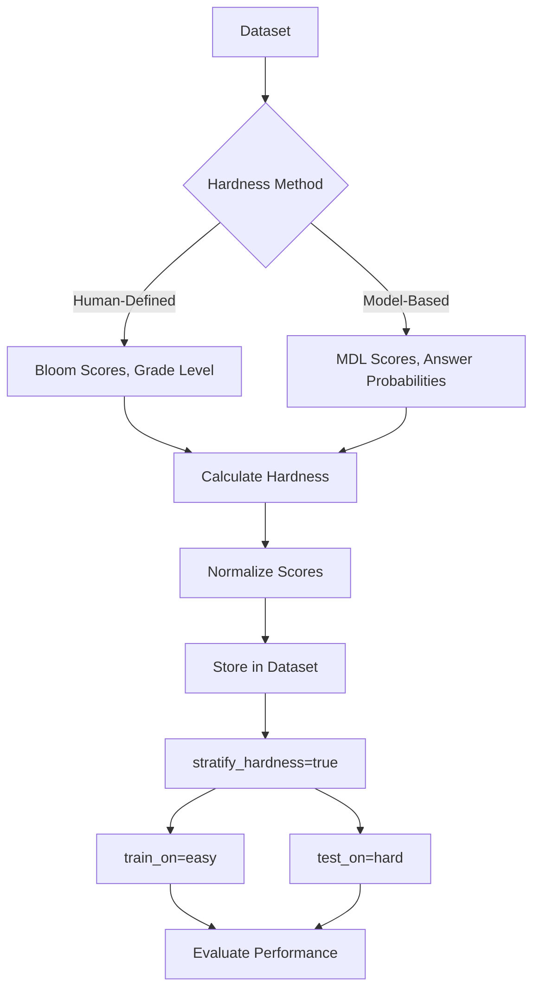

Sources: [README.md:64-70]()

### 2. Multiple Probing Methods

The system supports several approaches to assess model knowledge:

- **Decoding** (`probing_method=decoding`): Direct language model generation
- **Learned Probes** (`probing_method=learned`): Linear classifiers or MLPs trained on model hidden states
- **Fine-tuning** (`probing_method=finetuned`): Parameter-efficient tuning with QLoRA

### 3. Datasets

The framework includes support for multiple datasets covering different domains:

| Dataset | Codebase Identifier | Description | Hardness Variables |
|---------|-----------|-------------|-------------------|
| ARC Challenge | `ai2_arc/ARC-Challenge` | Science questions | Human difficulty rating |
| MMLU STEM-5 | `mmlu_STEM-5` | College/professional STEM exams | `human_hardness` (grade, high school, college) |
| StrategyQA | `strategy-qa` | Questions requiring multi-step reasoning | Model-based difficulty |
| GSM8K | `gsm8k_main` | Mathematical word problems | Length, operation complexity |

Sources: [README.md:57-62]()

## Experiment Types

The system supports several experiment types that can be launched through `run_jobs.py`:

1. **write_hidden_states**: Extract and save model hidden states for later probing
   ```
   python run_jobs.py -e write_hidden_states --dataset ai2_arc
   ```

2. **estimate_hardness**: Calculate difficulty scores for dataset examples using models defined in `globals.hardness_models`
   ```
   python run_jobs.py -e estimate_hardness --dataset ai2_arc
   ```

3. **all_to_all_table**: Evaluate performance across all datasets and models
   ```
   python run_jobs.py -e all_to_all_table --dataset ai2_arc -nb 5
   ```

4. **get_population_table**: Measure easy-to-hard generalization with various hardness measures
   ```
   python run_jobs.py -e get_population_table --dataset mmlu_STEM-5 -nb 5
   ```

5. **third_grade_to_college**: Test knowledge transfer across educational levels
   ```
   python run_jobs.py -e third_grade_to_college -nb 5
   ```

Sources: [README.md:40-91]()

## Result Analysis

The framework includes tools for analyzing experimental results:

- Results are stored as CSV files in the `result_sheets` directory
- The `analysis.Rmd` R markdown file provides visualization and statistical analysis
- Supports performance comparisons across models, methods, and hardness levels

For details on interpreting results and available metrics, see [Evaluation Metrics](#4.3).

Sources: [README.md:93-95]()

## Models Supported

The framework primarily works with the following language models:

- Llama models (7B, 13B, 70B) 
- Llama-2 models (7B, 13B, 70B)
- Mixtral-8x7B
- Other HuggingFace-compatible models

For models requiring specific handling (like Llama-2), the `llama2_path` variable must be set in `utils/utils.py`.

Sources: [README.md:7-33]()

---

# Page: System Architecture

# System Architecture

<details>
<summary>Relevant source files</summary>

The following files were used as context for generating this wiki page:

- [README.md](README.md)
- [main.py](main.py)
- [run_jobs.py](run_jobs.py)

</details>


This page provides a high-level overview of the system architecture for the "Easy-to-Hard Generalization" framework. It describes the main system components, how they interact, and the overall data and control flow. For detailed information about the experiment workflow, see [Experiment Workflow](#2.1), and for configuration details, see [Configuration System](#2.2).

## System Components Overview

The codebase is organized into several core components that work together to test the hypothesis that language models can generalize from easy to hard examples:

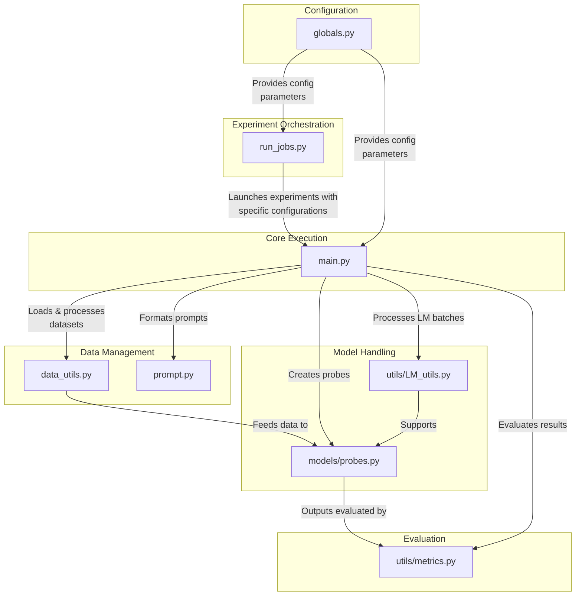

Sources: [main.py:963-1114](), [run_jobs.py:193-251](), [run_jobs.py:677-795]()

## Component Roles and Responsibilities

The system consists of these primary components:

1. **Experiment Orchestration (`run_jobs.py`)**: Manages experiment configuration and launches experiments
2. **Core Execution (`main.py`)**: Implements experiment logic including training, evaluation, and hardness estimation
3. **Data Management**: Handles dataset loading, processing, and formatting
4. **Model Handling**: Manages model interaction, probing methods, and batch processing
5. **Evaluation**: Computes metrics and analyzes results
6. **Configuration (`globals.py`)**: Defines dataset and model configurations

### Component Details

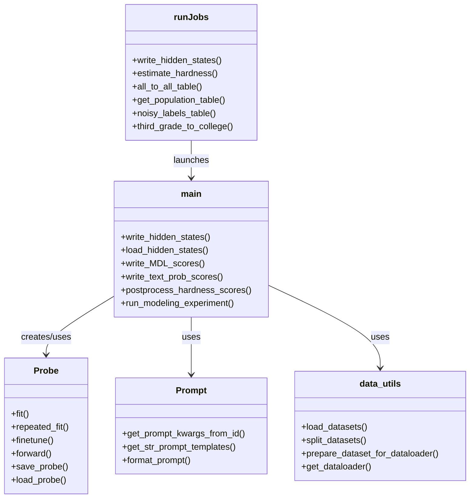

Sources: [main.py:26-98](), [main.py:99-196](), [main.py:500-963](), [run_jobs.py:255-318]()

## Data Flow Architecture

The system processes data through several stages, from raw datasets to evaluation results:

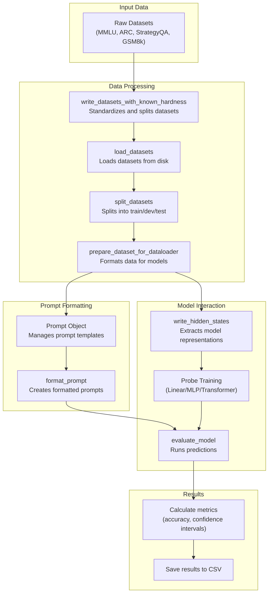

Sources: [main.py:1171-1207](), [main.py:1247-1266](), [main.py:1500-1580]()

## Experimental Methods Architecture

The system supports multiple approaches to evaluate model generalization:

| Method | Description | Implementation | Key Components |
|--------|-------------|----------------|----------------|
| **Decoding** | Direct use of language model probabilities | Uses model's native token prediction | LM_utils.py for scoring |
| **Learned Probes** | Trains a classifier on extracted representations | Linear, MLP, or Transformer on hidden states | models/probes.py |
| **Finetuning** | Updates model weights (QLoRA) | PEFT-based finetuning | PEFT library integration |

### Probing and Evaluation System

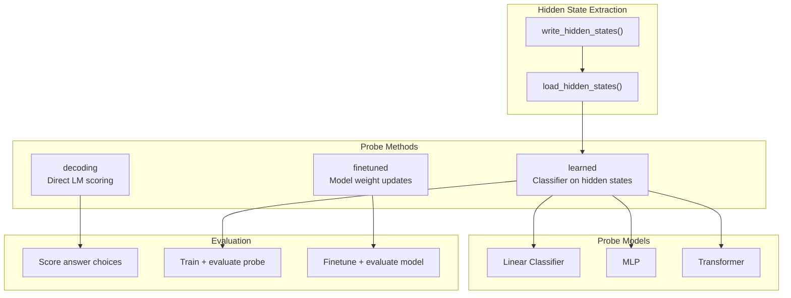

Sources: [main.py:26-98](), [main.py:500-596](), [main.py:660-699]()

## Hardness Evaluation System

A key component of the framework is measuring the "hardness" of examples:

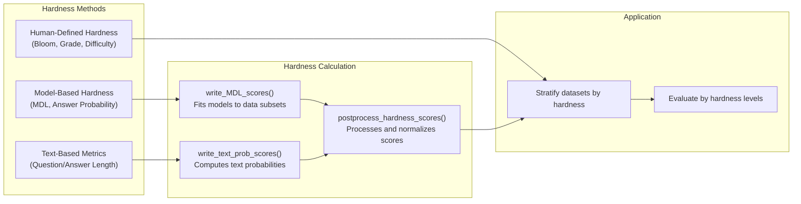

Sources: [main.py:99-317](), [main.py:336-368](), [main.py:369-498]()

## Integration with External Libraries

The system integrates with several key external libraries:

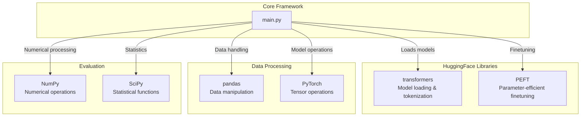

Sources: [main.py:1-24](), [main.py:1242-1266]()

## Control Flow between Components

The high-level control flow across the system:

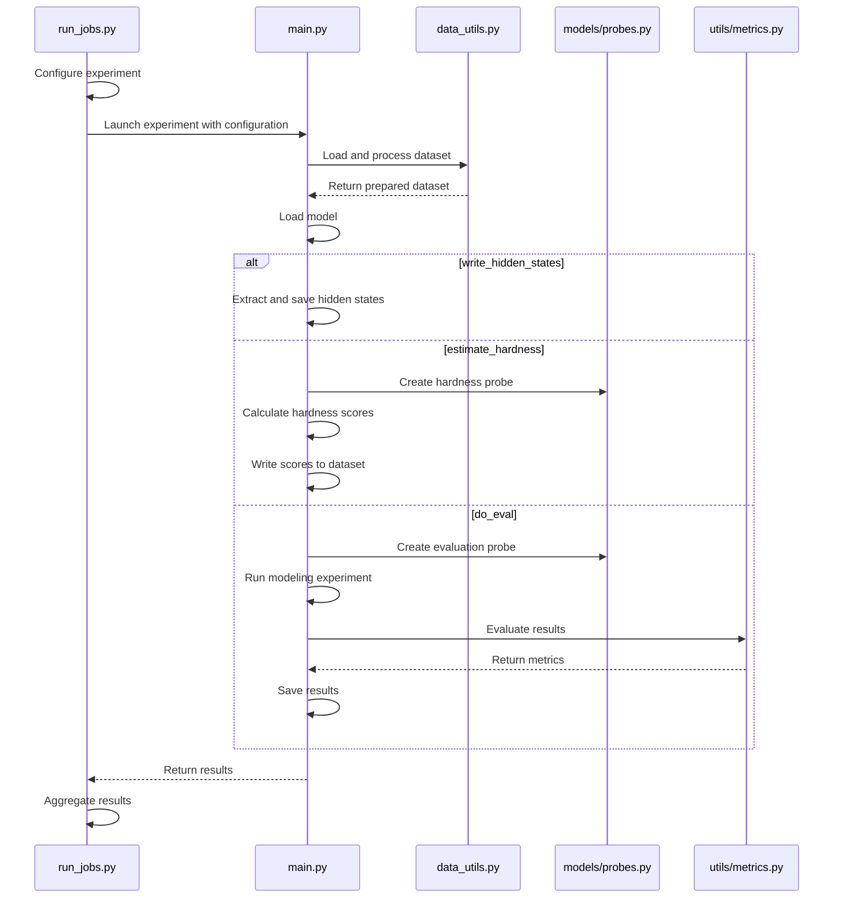

Sources: [run_jobs.py:255-318](), [run_jobs.py:394-496](), [main.py:963-1303]()

## Storage Architecture

The system organizes its data across several key directories:

| Directory | Purpose | Contents |
|-----------|---------|----------|
| `data/` | Dataset storage | Raw and processed datasets, hidden representations |
| `outputs/` | Results storage | Experiment results CSV files |
| `result_sheets/` | Aggregated results | Combined results for analysis |
| Model directory | Model storage | Saved models and probes |
| Cache directory | HuggingFace cache | Downloaded models |

Sources: [main.py:1091-1116](), [main.py:1147-1151](), [main.py:863-894]()

---

# Page: Experiment Workflow

# Experiment Workflow

<details>
<summary>Relevant source files</summary>

The following files were used as context for generating this wiki page:

- [main.py](main.py)
- [run_jobs.py](run_jobs.py)

</details>


This document details the end-to-end process of defining, running, and analyzing experiments in the Easy-to-Hard Generalization framework. The workflow orchestrates experiments that test how models trained on easy examples perform when evaluated on harder examples across different datasets and model configurations.

## Overview of the Experiment Pipeline

The experiment workflow is orchestrated by two main scripts: `run_jobs.py` and `main.py`. The `run_jobs.py` script acts as the entry point for launching experiments, while `main.py` contains the core experimental logic.

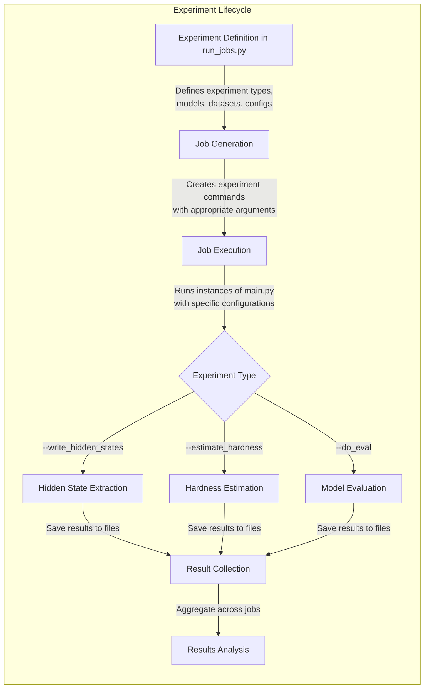

Sources:
- [run_jobs.py:782-786]()
- [run_jobs.py:226-230]()
- [main.py:26-76]() (write_hidden_states)
- [main.py:99-334]() (write_MDL_scores)
- [main.py:500-962]() (run_modeling_experiment)
- [main.py:369-497]() (postprocess_hardness_scores)

## Experiment Types

The codebase supports three main types of experiments, each serving a specific purpose in the research pipeline:

### 1. Hidden State Extraction

Extracts and saves the hidden representations from language models for later use in probing experiments. This is a preprocessing step for subsequent hardness estimation and model evaluation.

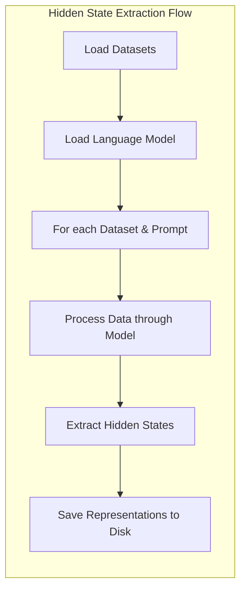

Sources:
- [main.py:26-76]() (write_hidden_states)
- [run_jobs.py:255-281]() (write_hidden_states)

### 2. Hardness Estimation

Estimates the "hardness" of data points using model-based metrics. This information is used to stratify data for training and evaluation.

```mermaid
flowchart TD
    subgraph "Hardness Estimation Flow"
        loadHData["Load Datasets"] --> loadHProbe["Load/Create Hardness Probe"]
        loadHProbe --> trainLoop["For each Dataset & Bootstrap"]
        
        trainLoop --> fitProbe["Fit Probe on Various Training Sizes"]
        fitProbe --> evalProbe["Evaluate Probe on Probing Data"]
        evalProbe --> collectScores["Collect Confidence Scores"]
        
        collectScores --> calculateHardness["Calculate Hardness = 1 - Confidence"]
        calculateHardness --> saveScores["Save Hardness Scores to Dataset"]
        
        saveScores --> postProcess["Post-process Hardness Scores"]
    end
```

Sources:
- [main.py:99-334]() (write_MDL_scores)
- [main.py:336-367]() (write_text_prob_scores)
- [main.py:369-497]() (postprocess_hardness_scores)
- [run_jobs.py:283-318]() (estimate_hardness)

### 3. Model Evaluation

Evaluates model performance across different training and testing conditions, including easy-to-hard generalization scenarios.

```mermaid
flowchart TD
    subgraph "Model Evaluation Flow"
        loadEData["Load Datasets"] --> stratify["Stratify Data by Hardness"]
        stratify --> createSplits["Create Training/Testing Splits"]
        
        createSplits --> sampleSizes["For each Training Sample Size"]
        
        sampleSizes --> methodLoop["For each Probing Method"]
        methodLoop --> prepData["Prepare Data for Method"]
        
        prepData --> trainModel["Train Model/Probe"]
        trainModel --> evalModel["Evaluate on Dev/Test"]
        
        evalModel --> breakdownResults["Break Down Results by Hardness"]
        breakdownResults --> saveResults["Save Results"]
    end
```

Sources:
- [main.py:500-962]() (run_modeling_experiment)
- [run_jobs.py:320-391]() (all_to_all_table)
- [run_jobs.py:393-496]() (get_population_table)

## Experiment Configuration and Command Generation

Experiments are configured through a combination of command-line arguments and configuration dictionaries in `run_jobs.py`. The script generates specific commands for each experimental condition.

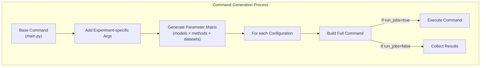

The configuration process follows these steps:

1. Define base experimental parameters in `run_jobs.py`
2. Configure dataset-specific and model-specific parameters
3. Generate commands with the appropriate arguments
4. Either execute commands or collect results from previous runs

Key configuration components include:

| Configuration Component | Purpose | Example |
|------------------------|---------|---------|
| Method Configs | Define probing method settings | `finetuned_CoT=False`: Uses finetuned models without chain-of-thought |
| Data × Method Configs | Dataset-specific settings | `strategy-qa_CoT=True`: Uses specific prompts for strategy QA with CoT |
| Model Configs | Model-specific overrides | Batch size adjustments based on model size |
| Hardness Variables | Dataset-specific hardness measures | `human_grade` for ARC, `num_steps` for GSM8K |
| Training Conditions | Define training data characteristics | `--train_on easy`, `--train_on hard` |

Sources:
- [run_jobs.py:182-201]() (method_configs)
- [run_jobs.py:202-744]() (various configuration dictionaries) 
- [run_jobs.py:746-786]() (add_job_args construction)

## Job Execution

The experimental jobs are executed through the `job_function`, which runs the generated commands. The execution flow varies based on the experiment type.

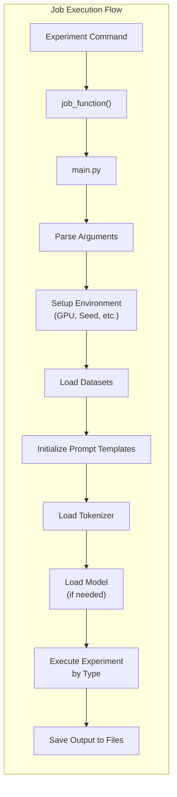

The `job_function` is straightforward:

```python
def job_function(job_command):
    os.system(job_command)
```

When executed, `main.py` follows these steps:
1. Parse arguments and initialize experiment configuration
2. Set up environment (GPU, seed, directories)
3. Load datasets and create splits
4. Initialize prompt templates
5. Load tokenizer and model
6. Execute the specific experiment type
7. Save results to the appropriate files

Sources:
- [run_jobs.py:226-230]() (job_function)
- [main.py:963-1167]() (main script initialization)
- [main.py:1169-1202]() (data loading)
- [main.py:1213-1241]() (tokenizer loading)
- [main.py:1243-1252]() (model loading)

## Result Collection and Analysis

After experiments are executed, results are collected and aggregated for analysis.

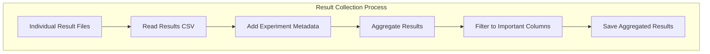

Results are processed through these steps:

1. Individual experiment results are saved as CSV files
2. The `accumulate_results_to_df` function reads these files and adds experiment metadata
3. Results are aggregated across different experiment configurations
4. Important columns are filtered and the aggregated results are saved

The final output includes:
- Aggregated CSV files with experiment results
- Item-level accuracy data for detailed analysis
- Bootstrap confidence intervals for statistical significance

Sources:
- [run_jobs.py:232-253]() (accumulate_results_to_df)
- [run_jobs.py:212-223]() (filter_results_columns)
- [main.py:843-963]() (collect and save results)

## Full Experiment Workflow Example

Below is an example of a complete experiment workflow for testing easy-to-hard generalization:

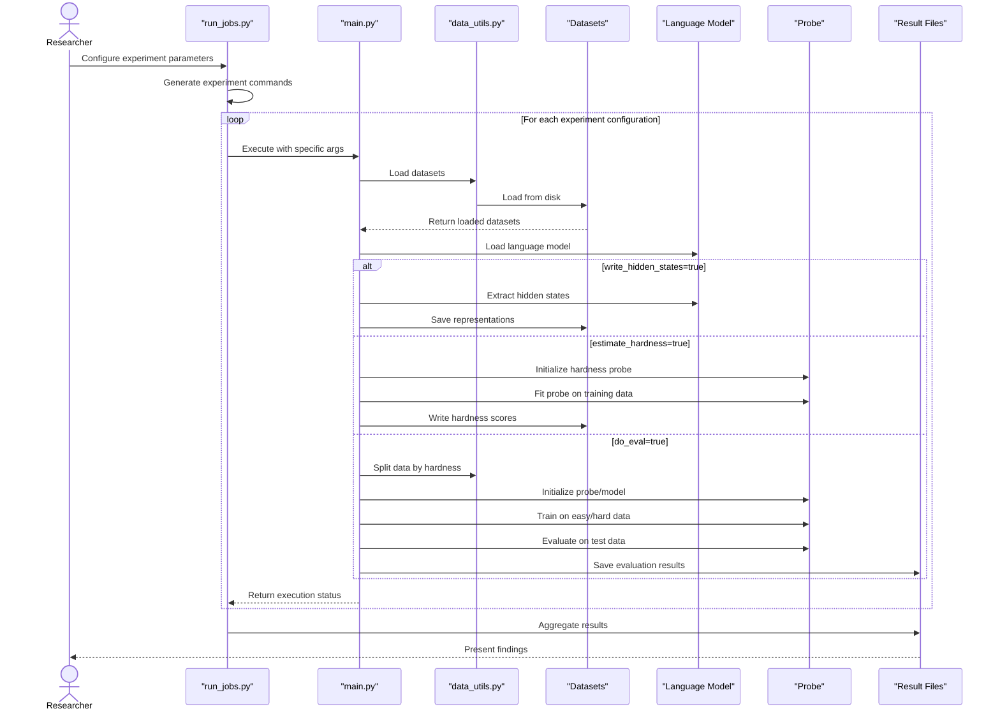

Sources:
- [run_jobs.py:787-793]() (experiment selection)
- [main.py:1243-1342]() (experiment execution)

## Common Experiment Workflows

The repository includes several predefined experiment workflows:

| Experiment Type | Command | Purpose |
|-----------------|---------|---------|
| Hidden State Extraction | `python run_jobs.py --experiment write_hidden_states` | Extract model hidden states for later probing |
| Hardness Estimation | `python run_jobs.py --experiment estimate_hardness` | Calculate hardness scores for data points |
| All-to-All Evaluation | `python run_jobs.py --experiment all_to_all_table` | Evaluate all models on all datasets |
| Population Evaluation | `python run_jobs.py --experiment get_population_table` | Test easy-to-hard generalization across population distributions |
| Label Noise Analysis | `python run_jobs.py --experiment noisy_labels_table` | Test robustness to label noise |
| Transfer Learning | `python run_jobs.py --experiment third_grade_to_college` | Test transfer from grade-school to college-level questions |

Sources:
- [run_jobs.py:787-793]() (experiment execution)
- [run_jobs.py:255-634]() (experiment implementations)

---

# Page: Configuration System

# Configuration System

<details>
<summary>Relevant source files</summary>

The following files were used as context for generating this wiki page:

- [README.md](README.md)
- [globals.py](globals.py)

</details>


## Purpose and Scope

This document describes the global configuration system used in the Easy-to-Hard Generalization framework. The configuration system defines datasets, models, and hardness evaluation parameters that are used consistently across the entire codebase. Understanding these global configurations is essential for customizing experiments and interpreting results.

For information about running specific experiments with these configurations, see [Experiment Workflow](#2.1).

## Overview

The configuration system is primarily implemented in `globals.py`, which serves as a central repository of constants and settings used throughout the codebase. These global variables define the available datasets, model configurations, hardness evaluation parameters, and various mappings used by the experiment framework.

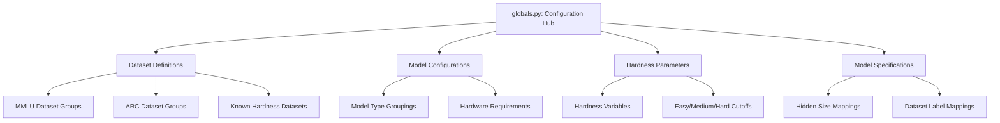

Sources: [globals.py:1-112]()

## Dataset Configuration

The configuration system defines various dataset groups and hierarchies that organize the experimental data.

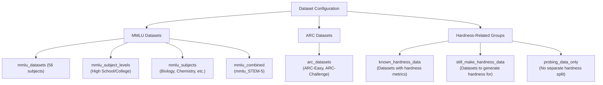

Key dataset configurations include:

1. **MMLU Datasets**: A comprehensive list of 56 individual subjects (Line 2), organized into:
   - Subject levels (high school vs. college) (Line 6)
   - Subject categories (biology, chemistry, etc.) (Line 8)
   - Combined datasets like `mmlu_STEM-5` (Line 9)

2. **ARC Datasets**: Includes ARC-Easy and ARC-Challenge (Line 3)

3. **Hardness-Related Groupings**:
   - `known_hardness_data`: Datasets with established hardness metrics (Line 13)
   - `still_make_hardness_data`: Datasets for which hardness should be generated (Line 14)
   - `probing_data_only`: Datasets used only for evaluation, not for hardness estimation (Line 15)

Sources: [globals.py:1-16]()

## Model Configuration

The configuration system defines various model groupings to facilitate experiment organization and execution.

```mermaid
graph TD
    models["Model Configuration"]
    
    models --> hardness_models["hardness_models<br>(Models for hardness estimation)"]
    models --> llama_models["llama_models<br>(All Llama-2 variants)"]
    models --> base_llama_models["base_llama_models<br>(Non-chat Llama-2 models)"]
    models --> replicate_models["replicate_models<br>(Models on Replicate platform)"]
    
    models --> hardware["Hardware Groupings"]
    hardware --> one_gpu_models["one_gpu_models<br>(7B/13B parameter models)"]
    hardware --> four_gpu_models["four_gpu_models<br>(70B parameter models)"]
    
    models --> model_to_hidden_size["model_to_hidden_size<br>(Hidden dimension by model)"]
```

Key model configurations include:

1. **Model Groupings**:
   - `hardness_models`: Models used for estimating data point hardness (Lines 57-62)
   - `llama_models`: All Llama-2 variants including chat models (Line 63)
   - `base_llama_models`: Non-chat Llama-2 models (Line 64)
   - `replicate_models`: Models hosted on the Replicate platform (Line 69)

2. **Hardware Groupings**:
   - `one_gpu_models`: Models that can run on a single GPU (Line 66)
   - `four_gpu_models`: Models requiring four GPUs (Line 67)

3. **Model Specifications**:
   - `model_to_hidden_size`: Dictionary mapping model names to their hidden state dimensions (Lines 72-100)

Sources: [globals.py:57-100]()

## Hardness Configuration

The configuration system provides parameters for hardness evaluation and stratification of datasets.

```mermaid
graph TD
    hardness["Hardness Configuration"]
    
    hardness --> cutoffs["data_x_hardness_var_to_cutoffs<br>(Hardness thresholds by dataset)"]
    hardness --> models["hardness_models<br>(Models for hardness estimation)"]
    
    cutoffs --> arc["ai2_arc<br>(bloom, difficulty, grade, etc.)"]
    cutoffs --> mmlu["mmlu_STEM-5<br>(human_hardness)"]
    cutoffs --> strategy["strategy-qa<br>(num_steps)"]
    cutoffs --> gsm8k["gsm8k_main<br>(num_steps)"]
    
    models --> llama["huggyllama/llama-7b"]
    models --> falcon["tiiuae/falcon-7b"]
    models --> mistral["mistralai/Mistral-7B-v0.1"]
    models --> mpt["mosaicml/mpt-7b"]
```

Key hardness configurations include:

1. **Hardness Variable Cutoffs**:
   - `data_x_hardness_var_to_cutoffs`: Dictionary defining the threshold values for easy/medium/hard data points for each dataset (Lines 20-42)
   - Dataset-specific metrics:
     - ARC: bloom, difficulty, grade, depth of knowledge
     - MMLU: human_hardness
     - Strategy-QA and GSM8K: num_steps

2. **Hardness Evaluation Models**:
   - `hardness_models`: Models used for computing model-based hardness scores (Lines 57-62)
   - Default includes four 7B parameter models: Llama, Falcon, Mistral, and MPT

Sources: [globals.py:20-62]()

## Additional Configurations

The configuration system also defines several other mappings and parameters:

1. **MMLU Statistics**:
   - `mmlu_subject_stat_cols`: Additional statistics to record for MMLU subjects (Lines 44-55)

2. **Label Mappings**:
   - `label_dict`: Maps dataset names to their respective output labels (Lines 101-112)

Sources: [globals.py:44-112]()

## Integration with Experiment Workflow

The configuration variables from `globals.py` are used throughout the codebase, particularly in experiment orchestration and execution.

```mermaid
flowchart LR
    globals["globals.py<br>Configuration Hub"]
    
    globals --> |"Dataset definitions"| runJobs["run_jobs.py<br>Experiment Orchestration"]
    globals --> |"Model configurations"| runJobs
    globals --> |"Hardness parameters"| runJobs
    
    runJobs --> |"Configured experiment"| main["main.py<br>Experiment Execution"]
    
    main --> |"Uses dataset config"| dataUtils["utils/data_utils.py<br>Data Pipeline"]
    main --> |"Uses model config"| modelUtils["utils/LM_utils.py<br>Model Handling"]
    main --> |"Uses hardness config"| hardnessUtils["Hardness Evaluation"]
```

Users can modify the configuration parameters to customize their experiments:

1. **Modifying Datasets**:
   - To use specific datasets, modify the dataset variables in `globals.py`
   - For experiment-specific datasets, adjust the dataset arguments in `run_jobs.py`

2. **Customizing Models**:
   - To use a subset of models, edit `use_models` in `run_jobs.py`
   - For hardness estimation with different models, modify `hardness_models` in `globals.py`

3. **Adjusting Hardness Evaluation**:
   - To change hardness stratification variables, modify `stratify_var_names` in `run_jobs.py`
   - For different hardness thresholds, adjust `data_x_hardness_var_to_cutoffs` in `globals.py`

Sources: [README.md:35-53]()

## Usage Examples

Here are examples of how the configuration system affects experiment execution:

1. **Model Selection for Hardness Estimation**:
   ```python
   # To use fewer than the default four 7B models, edit globals.hardness_models
   # Before running:
   python run_jobs.py -e estimate_hardness --dataset ai2_arc
   ```

2. **Hardness Stratification Variables**:
   ```python
   # To adjust which hardness measures are used for dataset stratification,
   # modify the stratify_var_names value in run_jobs.py before running:
   python run_jobs.py -e get_population_table --dataset mmlu_STEM-5
   ```

Sources: [README.md:47-70]()

## Summary

The configuration system in `globals.py` serves as the central repository for dataset definitions, model configurations, and hardness evaluation parameters used throughout the Easy-to-Hard Generalization framework. Understanding these global configurations is essential for customizing experiments and interpreting results. The system is designed to be modular, allowing users to adjust parameters for specific experimental needs while maintaining consistency across the codebase.

---

# Page: Data Pipeline

# Data Pipeline

<details>
<summary>Relevant source files</summary>

The following files were used as context for generating this wiki page:

- [main.py](main.py)
- [utils/data_utils.py](utils/data_utils.py)

</details>


This page documents the data pipeline used in the Easy-to-Hard Generalization framework. The data pipeline is responsible for loading, processing, and preparing datasets for experiments that test how language models trained on easy data generalize to hard examples. It provides standardized interfaces for dataset handling, hardness evaluation, and data preparation for model training and evaluation.

For information about model training and evaluation components that consume this data, see [Model Training and Evaluation](#4).

## Dataset Structure and Lifecycle

The data pipeline follows this general flow:

```mermaid
flowchart LR
    rawData["Raw Dataset"] --> write["write_datasets_with_known_hardness()"]
    write --> diskStorage["Disk Storage (JSON)"]
    diskStorage --> load["load_datasets()"]
    
    load --> split["split_datasets()"]
    split --> stratify{{"Stratify by Hardness?"}}
    
    stratify -->|Yes| hardSplit["Train-Easy/Test-Hard Split"]
    stratify -->|No| randomSplit["Standard Train/Dev/Test Split"]
    
    hardSplit & randomSplit --> prepare["prepare_dataset_for_dataloader()"]
    prepare --> dataset["MCTextDataset"]
    dataset --> dataloader["DataLoader"]
    
    prepare --> prompt["Prompt Class"]
```

The pipeline transforms raw datasets into structured formats with hardness annotations, splits them appropriately for experiments, and prepares them for model consumption through dataloaders.

Sources: [utils/data_utils.py:294-533](), [utils/data_utils.py:644-670](), [utils/data_utils.py:814-1132]()

## Dataset Types and Supported Datasets

The framework supports several dataset types with different characteristics:

| Dataset Type | Examples | Hardness Metrics | Special Considerations |
|--------------|----------|------------------|------------------------|
| Multiple-choice QA | MMLU, ARC | Grade level, difficulty rating, Bloom taxonomy | Variable number of answer choices |
| Reasoning | Strategy-QA, GSM8k | Number of reasoning steps, reasoning complexity | Includes reasoning chains |

Supported datasets are configured in `globals.py` and include:
- MMLU (college vs. high school difficulty)
- ARC (easy vs. challenge)
- Strategy-QA (varying reasoning complexity)
- GSM8k (varying solution step counts)

Sources: [utils/data_utils.py:197-214](), [utils/data_utils.py:294-533]()

## Dataset Creation and Processing

### Writing Datasets with Known Hardness

The pipeline includes specialized functions for writing datasets with known hardness metrics:

```mermaid
flowchart TD
    subgraph "write_datasets_with_known_hardness()"
        A["Load Dataset from Source"] --> B["Standardize Format"]
        B --> C["Add Hardness Metrics"]
        C --> D["Split into Hardness/Probing Sets"]
        D --> E["Save to Disk as JSON"]
    end

    subgraph "Hardness Metrics"
        H1["Human-Defined Metrics"]
        H2["Model-Based Metrics"]
        H3["Structural Metrics"]
        
        H1 --> HM1["Grade Level (ARC)"]
        H1 --> HM2["Difficulty Rating (ARC)"]
        H1 --> HM3["Bloom Taxonomy (ARC)"]
        H1 --> HM4["High School vs. College (MMLU)"]
        
        H2 --> HB1["MDL Scores"]
        H2 --> HB2["Answer Probabilities"]
        
        H3 --> HS1["Question Length"]
        H3 --> HS2["Answer Length"]
        H3 --> HS3["Number of Reasoning Steps"]
    end
```

Different datasets use different hardness metrics:
- **ARC**: Grade level, difficulty rating, Bloom taxonomy
- **MMLU**: High school vs. college level topics
- **Strategy-QA**: Number of reasoning steps, reasoning complexity
- **GSM8k**: Number of solution steps, problem complexity

Sources: [utils/data_utils.py:294-533](), [main.py:336-367]()

### Standardizing Dataset Format

All datasets are standardized to have consistent column names and structures:

```mermaid
flowchart LR
    subgraph "standardize_column_names()"
        A["Dataset-specific Processing"] --> B["Standardize Label Columns"]
        B --> C["Add answer_choices Column"]
        C --> D["Add label_idx Column"]
        D --> E["Add answer_text Column"]
        E --> F["Add letter_labels Column"]
    end
```

This standardization allows the pipeline to uniformly handle datasets from various sources.

Sources: [utils/data_utils.py:216-245]()

### Computing and Processing Hardness Scores

Hardness metrics are computed using several approaches:

1. **MDL-based Hardness**: `write_MDL_scores()` trains models of increasing capacity and measures label confidence
2. **Probability-based Hardness**: `write_text_prob_scores()` computes LM probabilities for questions/answers
3. **Postprocessing**: `postprocess_hardness_scores()` normalizes scores and adds hardness level categories

```mermaid
flowchart TD
    subgraph "write_MDL_scores()"
        A["Initialize Probe"] --> B["For Each Supervision Size"]
        B --> C["Train Hardness Model"]
        C --> D["Evaluate on Probing Data"]
        D --> E["Store Label Confidences"]
        E --> F["Calculate Hardness as 1-Confidence"]
        F --> G["Write to Dataset"]
    end
```

These functions enable quantitative comparison of example difficulty across datasets.

Sources: [main.py:99-334](), [main.py:336-367](), [main.py:369-498]()

## Dataset Loading and Splitting

### Loading Datasets

Datasets are loaded using the `load_datasets()` function:

```mermaid
flowchart LR
    subgraph "load_datasets()"
        A["Read JSONs from Disk"] --> B["Create Dictionary Structure"]
        B --> C["Return {dataname: {hardness_data, probing_data}}"]
    end
```

The resulting structure organizes data by dataset name and purpose (hardness estimation vs. probing).

Sources: [utils/data_utils.py:644-670]()

### Splitting Datasets

Datasets are split for experiments using two main approaches:

1. **Standard Splitting**: Random 70/10/20 train/dev/test splits
2. **Hardness-Stratified Splitting**: Splits based on hardness criteria (e.g., train on easy, test on hard)

```mermaid
flowchart TD
    subgraph "split_datasets()"
        A["Select Split Strategy"] --> B{"stratify_hardness?"}
        B -->|No| C1["Random Split"]
        B -->|Yes| C2["Hardness-Based Split"]
        
        C2 --> D{"train_on/test_on?"}
        D -->|"train_on='easy', test_on='hard'"| E1["Easy Training / Hard Testing"]
        D -->|"train_on='hard', test_on='easy'"| E2["Hard Training / Easy Testing"]
        D -->|"train_on='all', test_on='all'"| E3["Random Split Across All"]
        
        C1 & E1 & E2 & E3 --> F["Create train/dev/test DataFrames"]
        F --> G["Return Nested Dictionary Structure"]
    end
```

The `stratified_test_sampling()` function provides specialized sampling when training on a specific hardness level while ensuring balanced test sets.

Sources: [utils/data_utils.py:672-812](), [utils/data_utils.py:814-1132](), [utils/data_utils.py:1134-1196]()

## Prompt Formatting and Preparation

Preparing datasets for model consumption involves:

1. **Prompt Formatting**: Adding model inputs based on prompt templates
2. **Example Selection**: Selecting examples for in-context learning
3. **Sequence Length Management**: Handling sequence truncation

```mermaid
flowchart TD
    subgraph "prepare_dataset_for_dataloader()"
        A["For Each Split"] --> B["Prepare Prompt Examples"]
        B --> C["prepare_dataframe_for_dataloader()"]
        C --> D["add_model_inputs_to_df()"]
        
        subgraph "add_model_inputs_to_df()"
            D1["Get Prompt Template"] --> D2["Format Prompt with Examples"]
            D2 --> D3["Check Token Length"]
            D3 --> D4["Truncate if Needed"]
            D4 --> D5["Add model_input Column"]
        end
        
        D --> E["Return Prepped Dataset"]
    end
```

This process involves close integration with the Prompt class to format examples and manage prompt templates.

Sources: [utils/data_utils.py:1198-1388](), [utils/data_utils.py:1389-1406]()

## DataLoader and Batch Formation

### MCTextDataset

The custom `MCTextDataset` class handles multiple-choice datasets and batch formation:

```mermaid
flowchart TD
    subgraph "MCTextDataset"
        A["__init__: Set Configuration"] --> B["__len__: Return Dataset Size"]
        B --> C["__getitem__: Return Single Item"]
        C --> D["collate_fn: Create Batches"]
        
        subgraph "collate_fn()"
            E["Collect Data Points"] --> F{"Batch Type?"}
            F -->|"make_generative_batches"| G1["Format Generative Batch"]
            F -->|"make_mc_batches"| G2["Format Multiple-Choice Batch"]
            F -->|"make_seq2seq_batches"| G3["Format Seq2Seq Batch"]
            G1 & G2 & G3 --> H["Add Metadata to Batch"]
            H --> I["Return Batch Dictionary"]
        end
    end
```

The class supports three batch formation modes:
1. **Generative Batches**: For autoregressive generation (free-form answers)
2. **Multiple-Choice Batches**: For classification among answer choices
3. **Seq2Seq Batches**: For generation with target sequences (e.g., reasoning chains)

Sources: [utils/data_utils.py:20-136]()

### DataLoader Creation

The `get_dataloader()` function creates dataloaders with appropriate batch sizes and collation:

```mermaid
flowchart LR
    subgraph "get_dataloader()"
        A["Create MCTextDataset"] --> B["Determine Batch Size"]
        B --> C["Create DataLoader with Custom Collate"]
        C --> D["Return DataLoader"]
    end
```

Batch sizes are adjusted based on the number of answer choices and batch type to maintain memory efficiency.

Sources: [utils/data_utils.py:138-165]()

## Hidden States Integration

The data pipeline supports capturing and using model hidden states:

```mermaid
flowchart TD
    subgraph "Hidden States Flow"
        A["write_hidden_states()"] --> B["Save to Disk"]
        B --> C["load_hidden_states()"]
        C --> D["Use in Probing"]
        C --> E["Use in Hardness Estimation"]
    end
```

Hidden states are used for:
1. **Learned Probes**: For model analysis via linear and non-linear probes
2. **Hardness Estimation**: For MDL-based hardness scoring

This integration allows for more sophisticated analysis beyond simple model predictions.

Sources: [main.py:26-97]()

## Key Data Pipeline Functions

The table below summarizes the key functions in the data pipeline:

| Function | Purpose | File Location |
|----------|---------|---------------|
| `write_datasets_with_known_hardness()` | Write datasets with inherent hardness metrics | [utils/data_utils.py:294-533]() |
| `load_datasets()` | Load datasets from disk | [utils/data_utils.py:644-670]() |
| `split_datasets()` | Split datasets for experiments | [utils/data_utils.py:814-1132]() |
| `prepare_dataset_for_dataloader()` | Prepare datasets for dataloaders | [utils/data_utils.py:1198-1295]() |
| `MCTextDataset` | Custom dataset class for multiple-choice data | [utils/data_utils.py:20-136]() |
| `get_dataloader()` | Create dataloaders | [utils/data_utils.py:138-165]() |
| `write_MDL_scores()` | Compute MDL-based hardness scores | [main.py:99-334]() |
| `write_text_prob_scores()` | Compute probability-based hardness scores | [main.py:336-367]() |
| `postprocess_hardness_scores()` | Process and normalize hardness scores | [main.py:369-498]() |

The data pipeline provides a comprehensive framework for handling diverse datasets, computing hardness metrics, and preparing data for model training and evaluation.

Sources: [utils/data_utils.py](), [main.py:26-498]()

---

# Page: Dataset Loading and Processing

# Dataset Loading and Processing

<details>
<summary>Relevant source files</summary>

The following files were used as context for generating this wiki page:

- [data/arc-challenge-easy-annotations.json](data/arc-challenge-easy-annotations.json)
- [utils/data_utils.py](utils/data_utils.py)

</details>


## Purpose and Scope

This document describes the dataset loading and processing system in the Easy-to-Hard Generalization framework. It covers how datasets are loaded from external sources, processed with hardness annotations, transformed into standardized formats, split for experiments, and prepared for model consumption. For information about prompt formatting specifically, see [Prompt Formatting](#3.2).

## Overview of the Data Pipeline

The data pipeline transforms raw datasets into properly formatted inputs for language model training and evaluation. This process includes hardness annotation, standardization, stratified splitting, and preparation for model input.

```mermaid
flowchart TB
    rawData["Raw Datasets"]
    loadData["Dataset Loading"]
    standardize["Standardization"]
    split["Dataset Splitting"]
    stratify["Hardness Stratification"]
    prepare["Preparation for Models"]
    dataloader["DataLoader Creation"]
    
    rawData --> loadData
    loadData --> standardize
    standardize --> split
    split --> stratify
    stratify --> prepare
    prepare --> dataloader
    
    subgraph "Dataset Sources"
        mmlu["MMLU"]
        arc["ARC"]
        strategyqa["Strategy-QA"]
        gsm8k["GSM8K"]
    end
    
    subgraph "Processing Functions"
        write_datasets["write_datasets()"]
        write_datasets_with_known_hardness["write_datasets_with_known_hardness()"]
        load_datasets["load_datasets()"]
        standardize_column_names["standardize_column_names()"]
        split_datasets["split_datasets()"]
        prepare_dataset_for_dataloader["prepare_dataset_for_dataloader()"]
        get_dataloader["get_dataloader()"]
    end
    
    mmlu & arc & strategyqa & gsm8k --> write_datasets
    write_datasets & write_datasets_with_known_hardness --> load_datasets
    load_datasets --> standardize_column_names
    standardize_column_names --> split_datasets
    split_datasets --> prepare_dataset_for_dataloader
    prepare_dataset_for_dataloader --> get_dataloader
    
    rawData -.-> mmlu & arc & strategyqa & gsm8k
    loadData -.-> write_datasets & write_datasets_with_known_hardness & load_datasets
    standardize -.-> standardize_column_names
    split -.-> split_datasets
    stratify -.-> split_datasets
    prepare -.-> prepare_dataset_for_dataloader
    dataloader -.-> get_dataloader
```

Sources: [utils/data_utils.py:534-642](), [utils/data_utils.py:294-533](), [utils/data_utils.py:644-670]()

## Dataset Loading

The system loads datasets from Hugging Face's datasets library or from custom JSON files. Two primary functions handle dataset loading:

1. `write_datasets()`: Loads standard datasets from Hugging Face, splits them into probing and hardness evaluation sets, and writes them to JSON files.

2. `write_datasets_with_known_hardness()`: Handles datasets that have predefined hardness metrics (e.g., grade level for ARC, high school vs. college for MMLU).

3. `load_datasets()`: Loads the JSON files written by the functions above.

### Supported Dataset Sources

| Dataset Source | Hardness Metrics | Description |
|----------------|------------------|-------------|
| MMLU | High school vs. college level | Multiple-choice questions across 57 subjects |
| ARC | Grade level, Bloom taxonomy, Difficulty | Multiple-choice science questions |
| Strategy-QA | Number of reasoning steps, Word count | Yes/no questions requiring multi-step reasoning |
| GSM8K | Number of reasoning steps, Word count | Grade school math problems with step-by-step solutions |

### Dataset Loading Process

```mermaid
flowchart LR
    start["Start"]
    request["Dataset Request"]
    checkWritten["Check if Already Written"]
    
    subgraph "write_datasets_with_known_hardness"
        loadDS["Load Dataset from HF"]
        meta["Load Hardness Metadata"]
        merge["Merge Data with Metadata"]
        annoHard["Annotate Hardness"]
    end
    
    subgraph "write_datasets"
        loadHF["Load Dataset from HF"]
        split["Split into Probing/Hardness"]
        sample["Sample Required Points"]
    end
    
    write["Write to JSON Files"]
    finish["Finish"]
    
    start --> request
    request --> checkWritten
    
    checkWritten -->|"Not Written"| loadDS
    checkWritten -->|"Not Written"| loadHF
    
    loadDS --> meta --> merge --> annoHard
    loadHF --> split --> sample
    
    annoHard --> write
    sample --> write
    
    write --> finish
    
    checkWritten -->|"Already Written"| finish
```

Sources: [utils/data_utils.py:294-533](), [utils/data_utils.py:534-642](), [utils/data_utils.py:644-670]()

## Dataset Standardization

Because datasets come from different sources with varying formats, the system standardizes them to a common format with consistent column names.

### Column Standardization

The `standardize_column_names()` function transforms dataset-specific columns into a standard format:

- `input_text`: The question or problem
- `answer_choices`: List of possible answers
- `label_idx`: Index of the correct answer
- `answer_text`: The correct answer text
- `letter_labels`: A, B, C, D labels for the answers

```mermaid
flowchart LR
    subgraph "Before Standardization"
        mq["MMLU: 'question', 'choices', 'answer'"]
        arcq["ARC: 'question', 'choices.text', 'answerKey'"]
        sq["StrategyQA: 'question', ['yes', 'no'], 'answer'"]
        gsm["GSM8K: 'question', reasoning, 'answer'"]
    end
    
    subgraph "After Standardization"
        std["Standard Columns:
        - input_text
        - answer_choices
        - label_idx
        - answer_text
        - letter_labels"]
    end
    
    mq & arcq & sq & gsm --> standardize["standardize_column_names()"]
    standardize --> std
```

Sources: [utils/data_utils.py:216-245]()

## Dataset Splitting

The `split_datasets()` function divides datasets into train, development, and test sets. It supports several splitting strategies:

1. **Random splitting**: Default 70/10/20 split for train/dev/test
2. **Hardness-stratified splitting**: Split based on item difficulty
3. **Easy-to-hard splitting**: Train on easy examples, test on hard ones

### Hardness Stratification

When `stratify_hardness=True`, datasets are split based on hardness scores:

- **Model-based hardness**: Uses quantiles (30% easiest, 30% hardest)
- **Human-defined hardness**: Uses predefined thresholds (e.g., grade levels)

```mermaid
flowchart TB
    start["Dataset"]
    strat{"Stratify by Hardness?"}
    
    subgraph "Random Split"
        rand["Random 70/10/20 Split"]
    end
    
    subgraph "Hardness-Stratified Split"
        hard["Get Hardness Scores"]
        thresh["Apply Thresholds"]
        
        subgraph "Train/Test Strategies"
            ee["easy → easy"]
            eh["easy → hard"]
            he["hard → easy"]
            hh["hard → hard"]
            ah["all → hard"]
        end
    end
    
    start --> strat
    strat -->|"No"| rand
    strat -->|"Yes"| hard
    
    hard --> thresh
    thresh --> ee & eh & he & hh & ah
```

Sources: [utils/data_utils.py:814-1132]()

### Sample Efficiency Subsets

For sample efficiency experiments, the system can create nested subsets of training data of different sizes:

```mermaid
flowchart TB
    full["Full Training Set"]
    subset20["20 Examples"]
    subset10["10 Examples"]
    subset5["5 Examples"]
    
    full -->|"Sample 20"| subset20
    subset20 -->|"Sample 10"| subset10
    subset10 -->|"Sample 5"| subset5
```

Sources: [utils/data_utils.py:1134-1196]()

## Data Preparation for Models

### MCTextDataset Class

The `MCTextDataset` class is a PyTorch Dataset implementation for multiple-choice text data. It handles different types of batches:

1. **Multiple choice batches**: Each example has multiple answer choices
2. **Generative batches**: For generative evaluation
3. **Seq2seq batches**: For sequence-to-sequence finetuning

```mermaid
classDiagram
    class MCTextDataset {
        +args
        +probing_method
        +dataframe
        +dataname
        +tokenizer
        +batch_size
        +padding_side
        +max_seq_len
        +letter_labels
        +for_training
        +precomputed_hidden_states
        +__len__()
        +__getitem__()
        +collate_fn()
        +get_effective_num_answers()
    }
    
    class DataLoader {
        +dataset: MCTextDataset
        +batch_size
        +collate_fn
        +shuffle
    }
    
    MCTextDataset -- DataLoader
```

Sources: [utils/data_utils.py:20-136]()

### Dataset Preparation Pipeline

The `prepare_dataset_for_dataloader()` function transforms split datasets into a format suitable for model input:

```mermaid
flowchart TB
    split["Split Dataset"]
    kshot{"k-shot Examples?"}
    
    subgraph "Preparation Process"
        prompt["Format Prompt"]
        check["Check Token Length"]
        trunc{"Need Truncation?"}
        shorten["Shorten Prompt"]
        add["Add Model Inputs"]
    end
    
    loader["DataLoader Creation"]
    
    split --> kshot
    
    kshot -->|"Yes (k>0)"| prompt_ex["Extract k Examples"]
    kshot -->|"No (k=0)"| prompt
    
    prompt_ex --> prompt
    prompt --> check
    check --> trunc
    
    trunc -->|"Yes"| shorten
    trunc -->|"No"| add
    
    shorten --> add
    add --> loader
```

Sources: [utils/data_utils.py:1198-1295](), [utils/data_utils.py:1297-1387]()

### Data Transformation for Models

The preparation process converts the standardized dataset into model-ready inputs:

1. Formats prompts using the Prompt class
2. Adds model inputs to dataframes
3. Optionally adds reasoning targets for chain-of-thought
4. Checks and truncates long sequences
5. Creates DataLoader with appropriate batch sizing

```mermaid
flowchart LR
    df["Standardized DataFrame"]
    
    subgraph "prepare_dataset_for_dataloader"
        subgraph "add_model_inputs_to_df"
            format["Format Prompt"]
            check["Check Token Length"]
            truncate["Truncate if Needed"]
        end
        
        reason{"Chain-of-Thought?"}
        add_reason["add_reasoning_targets_to_df"]
    end
    
    dataset["MCTextDataset"]
    loader["DataLoader"]
    
    df --> format --> check --> truncate
    truncate --> reason
    
    reason -->|"Yes"| add_reason
    reason -->|"No"| dataset
    
    add_reason --> dataset
    dataset --> loader
```

Sources: [utils/data_utils.py:1198-1295](), [utils/data_utils.py:1297-1387](), [utils/data_utils.py:1389-1405]()

## DataLoader Creation

The `get_dataloader()` function creates PyTorch DataLoaders from prepared datasets:

1. Creates an `MCTextDataset` instance
2. Configures batch size based on number of answers and model type
3. Sets up the appropriate collate function
4. Returns the DataLoader or a dummy empty loader if no data is available

### Batch Processing

The `MCTextDataset.collate_fn()` method prepares batches for the model:

1. Collects examples from the dataset
2. Processes prompts and answer choices
3. Formats batches differently based on model type (multiple-choice, generative, seq2seq)
4. Adds precomputed hidden states if available

```mermaid
flowchart TB
    get["get_dataloader()"]
    check{"Empty DataFrame?"}
    
    subgraph "DataLoader Creation"
        mc["Create MCTextDataset"]
        batch["Calculate Batch Size"]
        loader["Create DataLoader"]
    end
    
    subgraph "MCTextDataset.collate_fn"
        collect["Collect Examples"]
        process{"Batch Type?"}
        
        mc_batch["Multiple-Choice Batch"]
        gen_batch["Generative Batch"]
        seq_batch["Seq2Seq Batch"]
        
        add["Add Metadata"]
    end
    
    get --> check
    
    check -->|"Yes"| dummy["Return Empty Loader"]
    check -->|"No"| mc
    
    mc --> batch --> loader
    
    loader --> collect --> process
    
    process -->|"make_mc_batches"| mc_batch
    process -->|"make_generative_batches"| gen_batch
    process -->|"make_seq2seq_batches"| seq_batch
    
    mc_batch & gen_batch & seq_batch --> add
```

Sources: [utils/data_utils.py:138-165](), [utils/data_utils.py:67-136]()

## Dataset Utilities

Several utility functions support the data processing pipeline:

| Function | Purpose |
|----------|---------|
| `get_max_num_answers()` | Finds the maximum number of answer choices for a dataset |
| `get_load_name()` | Returns the Hugging Face dataset name for loading |
| `standardize_data_source()` | Standardizes dataset source names |
| `randomize_dataframe_labels()` | Randomizes labels for ablation studies |
| `set_for_training()` | Configures DataLoader for training or evaluation |

Sources: [utils/data_utils.py:176-196](), [utils/data_utils.py:198-214](), [utils/data_utils.py:247-266](), [utils/data_utils.py:268-292](), [utils/data_utils.py:167-174]()

## Complete Data Processing Workflow

The full data processing pipeline combines all the components described above:

```mermaid
flowchart TB
    start["Start"]
    
    subgraph "Dataset Writing & Loading"
        write["write_datasets() or
        write_datasets_with_known_hardness()"]
        load["load_datasets()"]
    end
    
    subgraph "Dataset Processing"
        standard["standardize_column_names()"]
        split["split_datasets()"]
        efficiency["get_sample_efficiency_subsets()"]
    end
    
    subgraph "Dataloader Preparation"
        prepare["prepare_dataset_for_dataloader()"]
        format["add_model_inputs_to_df()"]
        reason["add_reasoning_targets_to_df()"]
        dataloader["get_dataloader()"]
    end
    
    model["Model Training/Evaluation"]
    
    start --> write --> load
    load --> standard --> split
    split --> efficiency
    split & efficiency --> prepare
    prepare --> format
    prepare --> reason
    format & reason --> dataloader
    dataloader --> model
```

Sources: [utils/data_utils.py:294-670](), [utils/data_utils.py:814-1132](), [utils/data_utils.py:1134-1196](), [utils/data_utils.py:1198-1405](), [utils/data_utils.py:138-165]()

---

# Page: Prompt Formatting

# Prompt Formatting

<details>
<summary>Relevant source files</summary>

The following files were used as context for generating this wiki page:

- [utils/prompt.py](utils/prompt.py)

</details>


## Purpose and Scope

This document describes the prompt formatting system used in the Easy-to-Hard Generalization framework. The system is responsible for converting raw dataset examples and test inputs into properly formatted prompts that can be passed to language models. It supports various prompt templates, few-shot examples, and Chain-of-Thought (CoT) reasoning. This page focuses specifically on the implementation in the `Prompt` class, which provides a flexible interface for creating consistent, customizable prompts for multiple-choice tasks.

Sources: [utils/prompt.py:8-15]()

## Prompt Class Overview

The `Prompt` class is the core component of the prompt formatting system. It manages the creation and formatting of prompts for language models, handling various template styles, example formatting, and prompt generation patterns.

```mermaid
classDiagram
    class "Prompt" {
        +instructions[]
        +question_templates[]
        +answer_choices_functions[]
        +label_templates[]
        +format_example()
        +format_prompt()
        +format_prompt_from_df()
        +standardize()
        +get_random_prompts()
    }
    "Prompt" --> "Template Collections" : contains
    "Prompt" --> "Formatting Methods" : implements
    class "Template Collections" {
        +instructions[]
        +question_templates[]
        +answer_choices_functions[]
        +label_templates[]
    }
    class "Formatting Methods" {
        +format_example()
        +format_prompt()
        +format_prompt_from_df()
        +format_reasoning_target_from_df()
    }
```

### Key Features

- Support for multiple-choice questions with predefined answer options
- Customizable templates for instructions, questions, answer choices, and labels
- Support for Chain-of-Thought (CoT) reasoning
- Integration with promptsource templates (though currently shown as not implemented)
- Random prompt generation for prompt engineering experiments

Sources: [utils/prompt.py:8-31]()

## Prompt Formatting Workflow

The prompt formatting process involves several steps that transform raw data into fully formatted prompts:

```mermaid
flowchart TD
    input["Raw Dataset Input"] --> standardize["Standardize Data Format"]
    standardize --> select["Select Prompt Templates"]
    examples["Example Inputs"] --> formatEx["Format Examples"]
    testInput["Test Input"] --> formatTest["Format Test Input"]
    
    select --> formatEx
    select --> formatTest
    
    formatEx --> combine["Combine into Full Prompt"]
    formatTest --> combine
    
    cot{"Use Chain-of-Thought?"} --> combine
    
    combine --> final["Final Formatted Prompt"]
    
    subgraph "Template Types"
        instructions["Instructions Templates"]
        question["Question Templates"]
        answer["Answer Choice Templates"]
        label["Label Templates"]
    end
    
    instructions & question & answer & label --> select
```

The workflow begins with standardizing the input data, selecting appropriate templates, formatting examples and test inputs according to those templates, and finally combining them into a complete prompt.

Sources: [utils/prompt.py:192-270](), [utils/prompt.py:281-327]()

## Template System

The `Prompt` class maintains several collections of templates that can be combined to create diverse prompting strategies.

### Instructions Templates

Instructions provide context and guidance to the model at the beginning of the prompt. Examples include:

- Empty instructions (no explicit guidance)
- Role-based instructions ("You are a very intelligent individual...")
- Educational context ("I am a teacher, and I am going to test you...")
- Step-by-step thinking instructions

Sources: [utils/prompt.py:32-50]()

### Question Templates

Question templates determine how the question is presented to the model:

```
"Question: {}"
"{}"
"Problem: {}"
"Q: {}"
```

Sources: [utils/prompt.py:51-60]()

### Answer Choice Templates

Answer choice templates determine how multiple-choice options are presented:

```
"" (no formatting)
"choice: {} choice: {} ..."
"answer: {} answer: {} ..."
"A) {} B) {} ..."
```

Sources: [utils/prompt.py:63-72]()

### Label Templates

Label templates determine how the answer is formatted:

```
"\nAnswer: {}"
"{}"
"The answer is: {}"
```

Sources: [utils/prompt.py:74-83]()

## Prompt Template Selection

The system supports multiple methods for selecting prompt templates:

```mermaid
flowchart LR
    source{"Prompt Source"} --> custom["Custom Templates"]
    source --> promptsource["Promptsource Templates"]
    
    custom --> selectionMethod{"Selection Method"}
    
    selectionMethod --> random["Random Template Combination"]
    selectionMethod --> specific["Specific Template ID"]
    selectionMethod --> default["Default Templates"]
    
    random --> formatPrompt["Format Prompt"]
    specific --> formatPrompt
    default --> formatPrompt
    promptsource --> formatPrompt
    
    formatPrompt --> output["Formatted Prompt String"]
```

The selection process starts by choosing a prompt source (custom or promptsource), then selecting specific templates from that source, and finally applying those templates to format the prompt.

Sources: [utils/prompt.py:95-107](), [utils/prompt.py:135-174]()

## Example Formatting

Example formatting is a critical part of few-shot learning. The system handles this by:

1. Standardizing each example's format
2. Applying selected templates to format the question, answer choices, and label
3. Optionally including Chain-of-Thought reasoning
4. Combining formatted examples with buffer space between them

```
Example Format:
[Question Template] + Question Text + [Answer Choice Template with Choices] + [Label Template with Label]
```

For Chain-of-Thought examples, the reasoning steps are included before the final answer.

Sources: [utils/prompt.py:192-216](), [utils/prompt.py:217-270]()

## Chain-of-Thought Support

The system supports Chain-of-Thought (CoT) reasoning through:

1. A CoT preface that prompts the model to think step-by-step
2. Special handling for CoT examples that include reasoning steps
3. Formatting of reasoning targets for evaluation

When `use_cot` is enabled, the system adds a thinking prompt such as "Let's think step by step" after the question and answer choices.

Sources: [utils/prompt.py:84-88](), [utils/prompt.py:209-215](), [utils/prompt.py:329-346]()

## Practical Usage

The primary interface for using the `Prompt` class is the `format_prompt_from_df` method, which takes:

- A test input DataFrame
- An optional examples DataFrame for few-shot prompting
- Template selection parameters (either indices or promptsource index)

```
# Example workflow (pseudocode):
prompt = Prompt(args, datanames, "custom", use_cot=True)
formatted_prompt = prompt.format_prompt_from_df(
    test_input_df=test_example,
    examples_df=few_shot_examples,
    instr_idx=0,
    question_idx=0,
    answers_idx=4,
    label_idx=0
)
```

Sources: [utils/prompt.py:281-327]()

## Integration with Data Pipeline

The prompt formatting system integrates with the data pipeline as shown below:

```mermaid
flowchart TD
    datasetLoad["load_datasets"] --> datasetSplit["split_datasets"]
    datasetSplit --> prepare["prepare_dataset_for_dataloader"]
    prepare --> dataset["MCTextDataset"]
    dataset --> dataloader["DataLoader"]
    
    prepare --> promptClass["Prompt Class"]
    
    subgraph "Prompt Formation"
        promptClass --> formatExample["format_example()"]
        promptClass --> formatPrompt["format_prompt()"]
        templateSelect["Template Selection"] --> formatPrompt
    end
    
    dataloader --> modelSystem["Model Training/Evaluation"]
    formatPrompt --> modelSystem
```

The `Prompt` class is used within the data preparation pipeline to format examples before they are passed to the language model for training or evaluation.

Sources: [utils/prompt.py:8-15]()

---

# Page: Model Training and Evaluation

# Model Training and Evaluation

<details>
<summary>Relevant source files</summary>

The following files were used as context for generating this wiki page:

- [main.py](main.py)
- [models/probes.py](models/probes.py)

</details>


This page documents the system components responsible for training and evaluating language models within the easy-to-hard generalization framework. It explains how different probing methods are implemented, configured, and executed to measure model performance across varying hardness levels.

For information about data processing before training, see [Data Pipeline](#3). For understanding hardness measures, see [Hardness Estimation](#5).

## Core Components

The model training and evaluation system consists of several key components:

1. **Probe Class**: Central class for implementing different model evaluation strategies
2. **Probing Methods**: Different approaches for evaluating model knowledge (decoding, learned probes, finetuning)
3. **Training Process**: Configuration of optimization and learning parameters
4. **Evaluation Process**: Metrics calculation and result collection
5. **Experiment Orchestration**: Automation of training/evaluation across different configurations

```mermaid
flowchart TD
    subgraph "Model Training & Evaluation System"
        ProbeClass["Probe Class"] --> ProbingMethods
        ProbeClass --> TrainingProcess
        ProbeClass --> EvaluationProcess
        
        subgraph "ProbingMethods"
            Decoding["Decoding Method"]
            Learned["Learned Probes"]
            Finetuned["Finetuned Models"]
        end
        
        subgraph "TrainingProcess"
            ProbeConfig["Probe Configuration"]
            LossFunction["Loss Functions"]
            Optimization["Optimization Settings"]
            NormalizationCalibration["Normalization & Calibration"]
        end
        
        subgraph "EvaluationProcess"
            Metrics["Accuracy Metrics"]
            ConfidenceIntervals["Confidence Intervals"]
            HardnessStratification["Hardness Stratification"]
        end
        
        RunModelingExperiment["run_modeling_experiment()"] --> ProbeClass
        WriteHiddenStates["write_hidden_states()"] --> Learned
        WriteMDLScores["write_MDL_scores()"] --> HardnessEstimation
    end

    DataPipeline[("Data Pipeline")] --> RunModelingExperiment
    HardnessEstimation["Hardness Estimation"] --> HardnessStratification
```

Sources: [main.py:26-76](), [main.py:500-962](), [models/probes.py:23-98]()

## Probe Class

The `Probe` class serves as the unified interface for different methods of evaluating model knowledge:

```mermaid
classDiagram
    class Probe {
        +model: PretrainedModel
        +tokenizer: Tokenizer
        +probing_method: str
        +probe_loss: str
        +normalize_representations: bool
        +calibrate_probe: bool
        +forward(batch)
        +fit(args, log, dataloader, optimizer_name)
        +finetune(args, log, train_dataloader, tokenizer)
        +loss(Y, probs)
        +save_probe(save_path)
        +load_probe(load_path)
    }

    class MultipleChoiceClassifier {
        +probe_model: nn.Module
        +proper_normalization: bool
        +forward(X)
    }

    class LinearClassifier {
        +probe_model: nn.Module
        +num_classes: int
        +forward(X)
    }

    class MLP {
        +classifier: nn.Sequential
        +forward(hidden_states)
    }

    class TransformerProbe {
        +transformer: BertModel
        +classifier: MLP
        +forward(hidden_states)
    }

    Probe --> MultipleChoiceClassifier: uses
    Probe --> LinearClassifier: uses
    MultipleChoiceClassifier ..> MLP: may use
    MultipleChoiceClassifier ..> TransformerProbe: may use
```

Sources: [models/probes.py:23-98](), [models/probes.py:690-759]()

### Initialization

When initializing a `Probe` object, various configuration options are provided:

- **Probing Method**: Defines how the model knowledge is accessed (decoding, learned, finetuned)
- **Probe Loss**: Determines the training objective for learned probes
- **Normalization**: Whether to normalize hidden representations
- **Calibration**: Whether to calibrate probability outputs

Sources: [models/probes.py:29-98]()

## Probing Methods

The system implements three main probing methods for evaluating language models:

### Decoding Probes

**Description**: Uses the language model directly to compute answer probabilities through autoregressive decoding.

**Process**:
1. Formats prompt with in-context examples
2. Computes next-token probabilities for each answer choice
3. Selects the answer with highest probability

**Key Features**:
- No training required
- Directly measures model's in-context learning capability
- Configurable through different prompt strategies

Sources: [models/probes.py:582-605]()

### Learned Probes

**Description**: Trains a separate classifier on the hidden states of the language model.

**Process**:
1. Extract hidden representations from the model for each example
2. Train a classifier (linear, MLP, or transformer) on these representations
3. Evaluate on test data using the trained classifier

**Architectures**:
- **Linear**: Simple linear layer
- **MLP**: Multi-layer perceptron with nonlinearities
- **Transformer**: Small transformer layer for more complex relationships

**Training Objectives**:
- **Supervised**: Standard classification loss
- **Unsupervised/CCS**: Confidence-consistency-softness loss with no labels
- **Mixed**: Combinations of supervised and unsupervised signals

Sources: [models/probes.py:143-322](), [models/probes.py:605-645]()

### Finetuned Models

**Description**: Directly finetunes the entire model or specific parameters using methods like QLoRA.

**Process**:
1. Initialize model parameters for training (all or subset)
2. Fine-tune on training data with careful optimization
3. Evaluate on test data using the tuned model

**Key Features**:
- Parameter-efficient fine-tuning options (LoRA)
- Model selection based on development set
- Gradient accumulation for effective batch size control

Sources: [models/probes.py:324-526]()

## Training Process

The training process varies based on the probing method selected:

```mermaid
flowchart TD
    subgraph "Training Process Flow"
        ProbeConfig["Configure Probe\n- Architecture\n- Loss Function\n- Normalization"] --> MethodCheck{"Probing Method?"}
        
        MethodCheck -->|"decoding"| ICL["In-Context Learning\n(No Training)"]
        
        MethodCheck -->|"learned"| LearnedFlow["Learned Probe Flow"]
        LearnedFlow --> ExtractHiddenStates["Extract Hidden States"]
        ExtractHiddenStates --> NormalizeStates["Normalize States (Optional)"]
        NormalizeStates --> ProbeTraining["Train Probe\n- Multiple Optimization Runs\n- L2 Regularization"]
        
        MethodCheck -->|"finetuned"| FinetunedFlow["Model Finetuning Flow"]
        FinetunedFlow --> ConfigFinetune["Configure Optimization\n- Batch Size\n- Gradient Accumulation\n- Learning Rate"]
        ConfigFinetune --> SelectParams["Select Parameters to Tune\n- All Parameters\n- LoRA Adapters\n- Embeddings Only"]
        SelectParams --> TrainModel["Train Model\n- Validate on Dev Set\n- Model Selection"]
    end
```

Sources: [main.py:500-962](), [models/probes.py:143-322](), [models/probes.py:324-526]()

### Optimization Parameters

The system provides various optimization parameters to control training:

| Parameter | Description | Used By |
|-----------|-------------|---------|
| `learned_probe_epochs` | Number of epochs for learned probes | Learned probes |
| `finetuned_epochs` | Number of epochs for finetuning | Finetuned models |
| `train_batch_size` | Batch size for training | All methods |
| `probing_optimizer` | Optimizer type (SGD, AdamW, LBFGS) | Learned probes |
| `probing_lr` | Learning rate for finetuning | Finetuned models |
| `l2_reg` | L2 regularization strength | Learned probes |
| `grad_accumulation_factor` | Factor for gradient accumulation | Finetuned models |
| `weight_decay` | Weight decay for optimizers | Finetuned models |
| `max_grad_norm` | Maximum gradient norm for clipping | All trained models |

Sources: [main.py:965-1096](), [models/probes.py:231-252](), [models/probes.py:362-401]()

### Normalization and Calibration

The system supports two methods to improve probe reliability:

1. **Hidden State Normalization**: Z-normalizes hidden representations before training probes
   - Can be per-label or shared across answers
   - Stabilizes training, especially for small datasets

2. **Probability Calibration**: Adjusts model predictions to have uniform distribution
   - Helps address model bias toward certain answers
   - Applied during evaluation

Sources: [models/probes.py:101-142](), [models/probes.py:637-644]()

## Evaluation Process

The evaluation process involves:

```mermaid
flowchart TD
    subgraph "Evaluation Process"
        EvalStart["Prepare Evaluation"] --> DataLoaders["Create Test DataLoaders"]
        DataLoaders --> ModelPrediction["Get Model Predictions\nvia Probe.forward()"]
        ModelPrediction --> MetricsCalculation["Calculate Metrics\n- Accuracy\n- Loss"]
        MetricsCalculation --> ConfidenceIntervals["Bootstrap Confidence Intervals"]
        MetricsCalculation --> HardnessBreakdown["Breakdown by Hardness\n- Easy/Medium/Hard"]
        ConfidenceIntervals --> ResultCollection["Collect Results"]
        HardnessBreakdown --> ResultCollection
        ResultCollection --> Visualization["Generate Visualizations\n- Learning Curves\n- Hardness vs Accuracy"]
    end
```

Sources: [main.py:685-707](), [main.py:902-943]()

### Metrics and Results

The system tracks various metrics during evaluation:

| Metric | Description |
|--------|-------------|
| Train Accuracy | Accuracy on training data |
| Dev Accuracy | Accuracy on development data |
| Test Accuracy | Accuracy on test data |
| Test Accuracy by Hardness | Test accuracy broken down by hardness levels |
| Test Accuracy (Train Distribution) | Test accuracy on examples matching training distribution |
| Probe Loss | Loss value for the trained probe |

Sources: [main.py:716-741](), [main.py:774-811]()

### Confidence Intervals

The system computes bootstrap confidence intervals for test accuracies:

1. Bootstrap samples are created by resampling test examples
2. Accuracy is computed for each bootstrap sample
3. Confidence intervals are derived from the distribution of accuracies
4. Results are formatted and saved alongside point estimates

Sources: [main.py:902-950]()

## Experiment Workflow

The main experimental workflow is orchestrated by the `run_modeling_experiment` function:

```mermaid
flowchart TD
    StartExperiment["Start Experiment"] --> ConfigureParams["Configure Experiment Parameters"]
    ConfigureParams --> BootstrapLoop["For Each Bootstrap\n(Probing Bootstraps)"]
    
    BootstrapLoop --> DataSplit["Split Data\n- Train/Dev/Test\n- Stratify by Hardness"]
    DataSplit --> SupervisionLoop["For Each Supervision Size"]
    
    SupervisionLoop --> DatasetLoop["For Each Dataset"]
    DatasetLoop --> PromptLoop["For Each Prompt Template"]
    
    PromptLoop --> PrepareData["Prepare Data for Dataloader"]
    PrepareData --> CreateDataloader["Create Dataloader"]
    CreateDataloader --> MethodCheck{"Probing Method?"}
    
    MethodCheck -->|"decoding"| DecodeModel["Score using LM"]
    MethodCheck -->|"learned"| TrainProbe["Train Probe"]
    MethodCheck -->|"finetuned"| FineTuneModel["Finetune Model"]
    
    DecodeModel & TrainProbe & FineTuneModel --> EvaluateModel["Evaluate Model\n- Train/Dev/Test"]
    EvaluateModel --> RecordResults["Record Results"]
    RecordResults --> BreakdownHardness["Breakdown Results by Hardness"]
    BreakdownHardness --> NextIteration["Continue Loop"]
    
    NextIteration --> PromptLoop
    NextIteration --> DatasetLoop
    NextIteration --> SupervisionLoop
    NextIteration --> BootstrapLoop
    
    BootstrapLoop --> |"After All Iterations"| CollectResults["Collect All Results"]
    CollectResults --> ComputeStats["Compute Statistics\n- Averages\n- Confidence Intervals"]
    ComputeStats --> SaveResults["Save Results\n- CSV Files\n- Plots"]
    SaveResults --> End["End Experiment"]
```

Sources: [main.py:500-962]()

### Sample Efficiency and Learning Curves

A key aspect of the evaluation is measuring how model performance changes with training data size:

1. Multiple training data sizes are tested (`supervision_n`)
2. For each size, a separate probe is trained
3. Results are plotted as learning curves
4. Confidence intervals are computed for each point

This helps determine how efficiently models learn from easy versus hard examples.

Sources: [main.py:570-582](), [main.py:902-962]()

## Hidden State Extraction

For learned probes, the system extracts hidden states from the language model:

```mermaid
flowchart TD
    subgraph "Hidden State Extraction"
        StartHiddenStates["Start Hidden State Extraction"] --> ForDatasets["For Each Dataset"]
        ForDatasets --> ForPrompts["For Each Prompt Template"]
        ForPrompts --> PrepDataloader["Prepare Dataloader"]
        PrepDataloader --> ForwardPass["Forward Pass Through Model"]
        ForwardPass --> ExtractStates["Extract Token States\n- question_end_token\n- answer_end_token"]
        ExtractStates --> SaveRepresentations["Save Representations to Disk"]
        SaveRepresentations --> NextPrompt["Next Prompt"]
        NextPrompt --> ForPrompts
        NextPrompt --> ForDatasets
    end
```

Sources: [main.py:26-76](), [main.py:77-97]()

### State Selection

The system can extract different types of hidden states:

- **Token Type**: 
  - `question_end_token`: Last token of the question (for classification)
  - `answer_end_token`: Last token of each answer (for multiple-choice comparison)

- **Layer Selection**:
  - `middle`: Middle layer of the model
  - `last`: Last layer of the model
  - `middle_and_last`: Both middle and last layers

- **Model Component**:
  - `encoder`: For encoder-only or encoder part of encoder-decoder models
  - `decoder`: For decoder-only or decoder part of encoder-decoder models

Sources: [models/probes.py:647-663](), [main.py:1119-1139]()

## Hardness Estimation and MDL Scores

The system includes functionality to estimate the hardness of examples using Minimum Description Length (MDL) scores:

1. Train models of increasing complexity (more training data)
2. Measure how quickly models learn to predict each example
3. Examples learned with less data are considered "easier"
4. Examples requiring more data are considered "harder"

This process is implemented in the `write_MDL_scores` function.

Sources: [main.py:99-334]()

## Integration with System Architecture

The model training and evaluation system integrates with the broader system architecture:

```mermaid
flowchart TD
    subgraph "System Integration"
        MainPy["main.py"] --> WriteHiddenStates["write_hidden_states()"]
        MainPy --> WriteMDLScores["write_MDL_scores()"]
        MainPy --> RunModelingExperiment["run_modeling_experiment()"]
        
        RunModelingExperiment --> |uses| Probe["models/probes.py: Probe"]
        
        DataUtils["utils/data_utils.py"] --> |provides data| RunModelingExperiment
        ModelingUtils["utils/modeling_utils.py"] --> |evaluate| RunModelingExperiment
        Metrics["utils/metrics.py"] --> |calculate| RunModelingExperiment
        
        RunModelingExperiment --> ResultsCSV["Output: CSV Results"]
        RunModelingExperiment --> PlottedResults["Output: Visualizations"]
    end
```

Sources: [main.py:1-24](), [main.py:963-1344]()

## Command-Line Interface

The system provides extensive command-line options to configure model training and evaluation:

| Category | Key Parameters | Description |
|----------|----------------|-------------|
| **Method Selection** | `probing_method` | Choose between decoding, learned, or finetuned |
| **Probe Configuration** | `probe_model`, `probe_loss` | Configure probe architecture and loss function |
| **Training Parameters** | `learned_probe_epochs`, `finetuned_epochs` | Set training duration |
| **Optimization** | `probing_optimizer`, `probing_lr`, `l2_reg` | Configure optimization process |
| **Feature Selection** | `probing_token_state`, `probing_layers` | Select which model features to use |
| **Evaluation** | `train_on`, `test_on`, `stratify_hardness` | Configure evaluation strategy |
| **Data Size** | `n_train`, `n_dev`, `n_test` | Control data splits |
| **Efficiency** | `probing_bootstraps`, `probing_learning_curve` | Control experimental trials |

For complete usage details, see [Command-Line Interface](#6.1).

Sources: [main.py:964-1094]()

---

# Page: Probing Methods

# Probing Methods

<details>
<summary>Relevant source files</summary>

The following files were used as context for generating this wiki page:

- [models/probes.py](models/probes.py)

</details>


## Purpose and Scope

This document details the probing methods implemented in the Easy-to-Hard Generalization framework. Probing methods are techniques for analyzing or utilizing the internal representations of language models to perform multiple-choice classification tasks. The framework supports three primary probing approaches: decoding-based, learned probes, and fine-tuning approaches. These methods allow us to investigate how language models trained on easy data perform on hard tasks.

For information about the overall model training and evaluation process, see [Model Training and Evaluation](#4).

Sources: [models/probes.py:23-46]()

## Probing Approaches Overview

The framework implements three main probing methods, each with different characteristics and use cases:

```mermaid
flowchart TD
    subgraph "Probing Methods"
        direction LR
        decoding["Decoding Method"]
        learned["Learned Probes"]
        finetuned["Fine-tuned Models"]
    end

    LM["Language Model"] --> decoding
    LM --> learned
    LM --> finetuned

    decoding --> |"Uses model directly"| probs1["Answer Probabilities"]
    learned --> |"Trains classifier on"| hiddenStates["Hidden States"]
    hiddenStates --> |"Extracts features"| probs2["Answer Probabilities"]
    finetuned --> |"Updates model weights"| probs3["Answer Probabilities"]

    probs1 & probs2 & probs3 --> eval["Evaluation"]
```

Sources: [models/probes.py:69-76](), [models/probes.py:582-645]()

### 1. Decoding Method

The decoding method uses the language model directly to compute probabilities for each answer choice without additional training. This approach leverages the model's existing knowledge through techniques like in-context learning.

**Key characteristics:**
- No additional parameters are trained
- Uses the model's inherent token probabilities to score answer choices
- Probabilities are computed using the model's output distribution

Sources: [models/probes.py:586-604]()

### 2. Learned Probes

Learned probes train separate classifier models on the hidden states extracted from the language model. This approach allows for analyzing what information is encoded in the model's representations without changing the underlying model.

**Key characteristics:**
- Extracts hidden states from specific layers of the language model
- Can normalize representations before classification
- Multiple probe architectures available (linear, MLP, transformer)
- Supports supervised and unsupervised training objectives

Sources: [models/probes.py:69-76](), [models/probes.py:605-633]()

### 3. Fine-tuned Models

The fine-tuning approach updates the weights of the language model itself to optimize performance on the target task.

**Key characteristics:**
- Can update all model weights or use parameter-efficient methods (e.g., LoRA)
- Supports both traditional fine-tuning and optimizing only embedding layers
- Includes options for weight decay, learning rate scheduling, and gradient accumulation

Sources: [models/probes.py:324-526]()

## Probe Model Architectures

The framework implements various probe architectures for the "learned" probing method:

```mermaid
classDiagram
    class Probe {
        +probing_method: str
        +probe_loss: str
        +normalize_representations: bool
        +model: LLM
        +fit()
        +forward()
        +loss()
        +finetune()
    }
    
    class MultipleChoiceClassifier {
        +probe_model: nn.Module
        +proper_normalization: bool
        +forward(X)
    }
    
    class LinearClassifier {
        +probe_model: nn.Module
        +num_classes: int
        +forward(X)
    }
    
    class MLP {
        +classifier: nn.Sequential
        +forward(hidden_states)
    }
    
    class TransformerProbe {
        +transformer: BertModel
        +classifier: MLP
        +forward(hidden_states)
    }
    
    Probe --> MultipleChoiceClassifier: "uses for answer_end_token"
    Probe --> LinearClassifier: "uses for question_end_token"
    MultipleChoiceClassifier --> "LinearProbe/MLP/TransformerProbe": "contains"
    LinearClassifier --> "LinearProbe": "contains"
```

Sources: [models/probes.py:690-759]()

### Linear Classifier

The simplest probe architecture is a linear classifier that maps hidden states directly to class probabilities.

**Implementation:**
- For `answer_end_token` probing: A linear layer mapping from hidden dimensions to a single score
- For `question_end_token` probing: A linear layer mapping from hidden dimensions to class logits

Sources: [models/probes.py:77-80](), [models/probes.py:710-725]() 

### MLP (Multi-Layer Perceptron)

A more expressive probe with a hidden layer and non-linearity:

**Implementation:**
- Input layer → Hidden layer → Tanh activation → Dropout → Output layer
- Configurable hidden size and dropout probability

Sources: [models/probes.py:83-83](), [models/probes.py:728-740]()

### Transformer Probe

The most complex probe architecture that uses a transformer layer to further process the hidden states:

**Implementation:**
- Uses a single-layer BERT model to process hidden states
- Followed by an MLP classifier
- Allows for contextual processing of representations

Sources: [models/probes.py:84-90](), [models/probes.py:748-759]()

## Probe Training Process

The training process differs across the three probing methods:

```mermaid
flowchart TD
    subgraph "Probe Training"
        direction TB
        
        input["Input Data"] --> method{"Probing Method?"}
        
        method -->|"decoding"| noTraining["No Training Required"]
        method -->|"learned"| extractStates["Extract Hidden States"]
        method -->|"finetuned"| modelFT["Model Fine-tuning"]
        
        extractStates --> normalize["Normalize States (Optional)"]
        normalize --> objective{"Training Objective?"}
        
        objective -->|"supervised"| supervLoss["Supervised Loss"]
        objective -->|"CCS/unsupervised"| unsupervLoss["Unsupervised Loss"]
        
        supervLoss & unsupervLoss --> fitProbe["Fit Probe"]
        
        modelFT --> optimizeWeights["Optimize Model Weights"]
        optimizeWeights --> lrSchedule["Apply LR Schedule"]
        
        fitProbe & lrSchedule --> evalProbe["Evaluate Probe"]
    end
```

Sources: [models/probes.py:143-182](), [models/probes.py:183-322](), [models/probes.py:324-526]()

### Learned Probe Training

For learned probes, the training process involves:

1. **Hidden State Extraction**: Extracting hidden states from specified layers of the language model
2. **Normalization** (optional): Z-normalizing the representations 
3. **Training Objectives**:
   - **Supervised**: Standard cross-entropy loss with labels
   - **CCS (Contrast-Consistent Search)**: Unsupervised approach using contrast consistency
   - **Unsupervised**: Maximizing confidence while matching a prior distribution

4. **Optimization**:
   - Supports SGD, Adam, AdamW, and LBFGS optimizers
   - Options for learning rate scheduling
   - L2 regularization

Sources: [models/probes.py:183-322](), [models/probes.py:526-560]()

### Fine-tuning Process

For the fine-tuning method, the process involves:

1. **Parameter Selection**:
   - Full model fine-tuning (`all`)
   - Parameter-efficient fine-tuning (`LORA`) 
   - Embedding-only fine-tuning (`embeddings`)
   - ABCD-token embeddings only (`ABCD_embeddings`)

2. **Optimization**:
   - AdamW optimizer (with 8-bit quantization option)
   - Gradient accumulation for effective batch size control
   - Learning rate scheduling
   - Weight decay with parameter-specific settings

3. **Model Selection**:
   - Based on validation performance or training metrics
   - Checkpoint saving and loading

Sources: [models/probes.py:324-526]()

## Forward Pass Implementation

The forward pass differs based on the probing method:

```mermaid
flowchart TD
    subgraph "Forward Pass"
        direction TB
        
        input["Input Batch"] --> method{"Probing Method?"}
        
        method -->|"decoding/finetuned"| modelForward["Model Forward Pass"]
        modelForward --> answerScoring["Score Answer Choices"]
        
        method -->|"learned"| getHiddenStates["Get Hidden States"]
        getHiddenStates --> selectStates["Select Layer/Component"]
        selectStates --> normalizeStates["Normalize (Optional)"]
        normalizeStates --> probeForward["Probe Forward Pass"]
        
        answerScoring & probeForward --> calibrate{"Calibrate?"}
        calibrate -->|"Yes"| adjustProbs["Adjust Probabilities"]
        calibrate -->|"No"| returnProbs["Return Probabilities"]
        adjustProbs --> returnProbs
    end
```

Sources: [models/probes.py:582-645]()

### Decoding/Finetuned Forward Pass

For decoding and finetuned methods:
1. Pass input tokens to the language model
2. Compute probabilities for answer choices using model outputs
3. Return scores based on the specified scoring method (e.g., token probabilities)

Sources: [models/probes.py:586-604]()

### Learned Probe Forward Pass

For learned probes:
1. Get hidden states (precomputed or computed on-the-fly)
2. Select states from specified layers and model components
3. Normalize representations if configured
4. Pass through the probe model to get probabilities
5. Apply calibration if enabled

Sources: [models/probes.py:605-645](), [models/probes.py:647-663]()

## Probe Loss Functions

The framework supports multiple loss functions for training probes:

### Supervised Loss

Standard cross-entropy loss with optional L2 regularization:
- Negative log-likelihood of the correct answer
- L2 regularization on model weights
- Special handling for ABCD embedding regularization

Sources: [models/probes.py:527-542]()

### Contrast-Consistent Search (CCS)

Unsupervised loss requiring no labels:
- Minimizes the minimum probability across answer choices
- Encourages a sum of probabilities close to 1
- Used for unsupervised probing

Sources: [models/probes.py:546-550]()

### Unsupervised Loss

Alternative unsupervised approach:
- Maximizes the confidence of predictions
- Maintains a prior on the overall distribution of predictions
- Includes L2 regularization

Sources: [models/probes.py:551-559]()

## Integration with the Overall System

Probing methods integrate with the larger system as follows:

```mermaid
flowchart TD
    subgraph "System Integration"
        direction TB
        
        dataLoad["Data Loading"] --> promptFormat["Prompt Formatting"]
        promptFormat --> dataloader["Dataloader Creation"]
        
        dataloader --> probeMethod{"Probing Method?"}
        
        probeMethod -->|"decoding"| modelDecode["Model Decoding"]
        probeMethod -->|"learned"| hiddenExtract["Hidden State Extraction"]
        probeMethod -->|"finetuned"| modelFinetune["Model Finetuning"]
        
        hiddenExtract --> probeTraining["Probe Training"]
        probeTraining --> probeEval["Probe Evaluation"]
        
        modelDecode & probeEval & modelFinetune --> metrics["Evaluation Metrics"]
        metrics --> results["Experiment Results"]
    end
```

Sources: [models/probes.py:1-21]()

The `Probe` class serves as the central component for implementing and executing all probing methods. It integrates with:

- **Data Pipeline**: Consumes processed data from dataloaders
- **Language Models**: Extracts representations or uses models directly
- **Evaluation System**: Produces probabilities that are converted to metrics

## Utility Functions

The `Probe` class includes several utility functions:

### Calibration

The `set_calibration_params` method adjusts output probabilities to be uniformly distributed across classes:
- Computes a median probability vector across examples
- Subtracts this vector from all predictions
- Re-normalizes the adjusted probabilities

Sources: [models/probes.py:101-125]()

### Normalization

The `set_normalization_params` method computes statistics for z-normalizing hidden states:
- Computes mean and standard deviation across examples
- Can normalize either per-label or across all answer choices
- Applied during the forward pass when enabled

Sources: [models/probes.py:127-141]()

### Model Saving and Loading

Methods for saving and loading probe models:
- For learned probes: Saves and loads the classifier state dict
- For finetuned models: Uses the Hugging Face save_pretrained/from_pretrained methods
- Handles cleanup of old models to prevent memory leaks

Sources: [models/probes.py:664-688]()

## Usage Examples

### Creating and Training a Linear Probe

1. Initialize a `Probe` instance with the "learned" method and appropriate configuration
2. Prepare a dataloader with input examples and labels
3. Call `probe.fit()` to train the probe on hidden states
4. Evaluate the probe on test data using `probe.forward()`

### Using the Decoding Method

1. Initialize a `Probe` instance with the "decoding" method
2. Prepare input examples with answer choices
3. Call `probe.forward()` to compute answer probabilities directly

### Fine-tuning a Model

1. Initialize a `Probe` instance with the "finetuned" method
2. Prepare training data with examples and labels
3. Call `probe.finetune()` to update the model weights
4. Evaluate the fine-tuned model on test data

---

# Page: Language Model Utilities

# Language Model Utilities

<details>
<summary>Relevant source files</summary>

The following files were used as context for generating this wiki page:

- [utils/LM_utils.py](utils/LM_utils.py)

</details>


## Purpose and Scope

The Language Model Utilities module provides core functionality for processing and interacting with language models in the Easy-to-Hard Generalization framework. These utilities handle batch processing, probability computation, hidden state extraction, and text processing required for training and evaluating language models on different datasets.

This page focuses on the technical implementation of language model interactions. For information about probing methods, see [Probing Methods](#4.1), and for evaluation metrics, see [Evaluation Metrics](#4.3).

Sources: [utils/LM_utils.py:1-10]()

## Core Functionality Overview

The LM Utilities module provides a comprehensive set of functions for working with language models:

```mermaid
flowchart TD
    subgraph "Language Model Utilities"
        direction TB
        batchPrep["make_LM_batch()
        Prepare inputs for LM"]
        probComp["compute_probs_from_batch()
        Calculate probabilities"]
        hiddenStates["get_hidden_states_from_batch()
        Extract hidden representations"]
        processGen["postprocess_generations()
        Clean model outputs"]
        renormProbs["renormalize_mc_pred_probs()
        Normalize multiple-choice probs"]
        mcLoss["compute_mc_loss()
        Calculate loss"]
    end

    input["Input Data"] --> batchPrep
    batchPrep --> lm["Language Model"]
    lm --> |"Raw Output"| probComp & hiddenStates & processGen
    probComp --> renormProbs --> mcLoss
    hiddenStates --> lastToken["get_last_token_hidden_states()"]
    
    probComp --> |"Probabilities"| evaluation["Evaluation"]
    hiddenStates --> |"Hidden States"| probes["Probes Training"]
    processGen --> |"Cleaned Text"| evaluation
```

Sources: [utils/LM_utils.py:13-34](), [utils/LM_utils.py:36-103](), [utils/LM_utils.py:105-167](), [utils/LM_utils.py:246-257]()

## Batch Processing

The batch processing functionality prepares data for language model inference by properly formatting prompts, labels, and attention masks.

### Batch Creation

The `make_LM_batch()` function is the primary method for preparing data for language model processing:

```mermaid
flowchart TD
    subgraph "make_LM_batch()"
        direction TB
        inputs["Inputs:
        - tokenizer
        - prompts
        - label_strs
        - label_idx
        - padding_side
        - other parameters"]
        
        tokenize["Tokenize prompts & labels"]
        combine["Combine tokens with special tokens"]
        padding["Add padding tokens"]
        masks["Create attention & targets masks"]
        
        inputs --> tokenize --> combine --> padding --> masks
    end
    
    masks --> batch["Output Batch:
    - input_ids
    - attention_mask
    - targets_mask
    - label_idx"]
```

The function handles several key aspects:
- Tokenizing prompts and label strings
- Combining tokens with special tokens (BOS/EOS)
- Creating attention masks and target masks
- Handling padding based on the specified padding side
- Supporting both multiple-choice and generative formats

Sources: [utils/LM_utils.py:169-244]()

## Probability Computation

The probability computation functions calculate token and sequence probabilities from language model outputs, supporting various normalization methods.

### Core Probability Functions

- `compute_probs_from_batch()`: Calculates probabilities or log-probabilities from model outputs
- `renormalize_mc_pred_probs()`: Normalizes multiple-choice prediction probabilities
- `compute_mc_loss()`: Computes loss for multiple-choice predictions
- `score_seq_probs_from_strings()`: Directly scores probabilities for text strings

The `compute_probs_from_batch()` function supports multiple output formats:
- `probs`: Raw probabilities
- `log_probs`: Log probabilities
- `log_probs_token_normed`: Log probabilities normalized by sequence length in tokens
- `log_probs_char_normed`: Log probabilities normalized by sequence length in characters

Sources: [utils/LM_utils.py:19-34](), [utils/LM_utils.py:36-103](), [utils/LM_utils.py:266-289]()

## Hidden State Extraction

Hidden state extraction is critical for probe training and analysis of model representations. These functions extract and process hidden states from language model outputs.

### Hidden State Processing Workflow

```mermaid
flowchart LR
    subgraph "Hidden State Extraction"
        getStates["get_hidden_states_from_batch()
        Extract raw hidden states"]
        processStates["get_last_token_hidden_states()
        Process & reshape hidden states"]
    end
    
    model["Language Model"] -->|"model(**batch, output_hidden_states=True)"| outputs["Model Outputs"]
    outputs --> getStates
    getStates --> rawStates["Raw Hidden States Dictionary"]
    rawStates --> processStates
    processStates --> finalStates["Processed Hidden States:
    bs × num_answers × enc/dec × num_layers × hidden_size"]
```

The `get_last_token_hidden_states()` function performs several key operations:
- Adds a dimension for number of answers
- Stacks hidden states from different layers
- Handles different numbers of answers per item
- Selects hidden states for the middle and last layers
- Processes both encoder and decoder states if applicable

Sources: [utils/LM_utils.py:105-167]()

## Model Generation Handling

The module provides utilities for processing model generations and preparing prompts for in-context learning.

### Generation Processing

- `postprocess_generations()`: Removes prompt text from model generations and handles special token processing
- `pull_prompt_from_data()`: Selects random examples from a dataset to use as prompts for in-context learning

Sources: [utils/LM_utils.py:246-264]()

## Integration with Overall System

The Language Model Utilities integrate with the broader system to support the core experimental workflows:

```mermaid
flowchart TD
    subgraph "Experiment Workflow"
        dataLoad["Data Loading"]
        prompt["Prompt Formatting"]
        modelLoad["Model Loading"]
        eval["Evaluation"]
    end
    
    subgraph "LM_utils.py Functions"
        direction TB
        make_LM_batch["make_LM_batch()"]
        compute_probs["compute_probs_from_batch()"]
        get_hidden["get_hidden_states_from_batch()"]
        get_last_token["get_last_token_hidden_states()"]
        postprocess["postprocess_generations()"]
    end
    
    dataLoad --> prompt
    prompt --> make_LM_batch
    modelLoad --> compute_probs & get_hidden
    make_LM_batch --> compute_probs & get_hidden
    get_hidden --> get_last_token
    compute_probs & get_last_token --> eval
    
    probes["models/probes.py"] <-- "Hidden states" --> get_last_token
    metrics["utils/metrics.py"] <-- "Probabilities" --> compute_probs
    promptFormat["utils/prompt.py"] --> make_LM_batch
```

The Language Model Utilities serve as a bridge between the data preparation pipeline and model evaluation components, enabling efficient processing of language model inputs and outputs for the Easy-to-Hard generalization experiments.

Sources: [utils/LM_utils.py:1-10](), [utils/LM_utils.py:36-103](), [utils/LM_utils.py:105-167]()

## Key Implementation Details

### Multiple-Choice Processing

The utilities support processing both standard sequence inputs and multiple-choice inputs, with special handling for varying numbers of answer choices per item:

| Function | Multiple-Choice Support | Description |
|----------|-------------------------|-------------|
| `compute_probs_from_batch()` | Yes, via `num_answers_list` | Reshapes and normalizes probabilities for multiple-choice answers |
| `get_last_token_hidden_states()` | Yes, via `num_answers_list` | Handles padding and reshaping for multiple-choice representations |
| `make_LM_batch()` | Yes, via generating batches with label strings | Creates batches with both prompts and answer choices |

### Padding and Masking

The utilities handle proper padding and masking for language model processing:

| Component | Description |
|-----------|-------------|
| `input_ids` | Tokenized inputs with padding |
| `attention_mask` | Identifies non-padding tokens (1 for real tokens, 0 for padding) |
| `targets_mask` | Identifies tokens that are part of the target (1 for target tokens, 0 for prompt or padding) |
| `padding_side` | Controls whether padding is applied on the left or right side |

Sources: [utils/LM_utils.py:169-244](), [utils/LM_utils.py:36-103](), [utils/LM_utils.py:105-167]()

---

# Page: Evaluation Metrics

# Evaluation Metrics

<details>
<summary>Relevant source files</summary>

The following files were used as context for generating this wiki page:

- [utils/metrics.py](utils/metrics.py)

</details>


This document details the evaluation metrics implemented in the Easy-to-Hard Generalization framework. These metrics are used to measure model performance on various tasks, with specific focus on comparing performance between easy and hard examples. The metrics system supports both exact match evaluation and more flexible matching approaches suitable for different types of language model outputs.

For information about the probing methods that generate the predictions being evaluated, see [Probing Methods](#4.1). For details about language model utilities that help process these predictions, see [Language Model Utilities](#4.2).

## Metrics System Overview

The evaluation metrics system provides various functions to assess model performance through different accuracy metrics, along with statistical tools to ensure the reliability of the results.

```mermaid
flowchart TD
    input["Input:
    - Predictions
    - Ground Truth Labels
    - Optional Parameters"]
    
    input --> preprocess["Prediction/Label
    Standardization"]
    
    preprocess --> metricType{"Metric Type?"}
    
    metricType -->|"Exact Match"| exactMatch["em_accuracy_sum()
    Strict Equality Check"]
    
    metricType -->|"Few-Shot"| fewShot["first_appearance_fewshot_accuracy_sum()
    First Answer Appearance"]
    
    metricType -->|"Generative"| generative["generative_exact_match_accuracy_sum()
    Post-Trigger Phrase Match"]
    
    exactMatch & fewShot & generative --> stats["Statistical Analysis:
    - Bootstrap Resampling
    - Confidence Intervals
    - p-values"]
    
    stats --> output["Output:
    - Accuracy Scores
    - Error Bars
    - Statistical Significance"]
```

Sources: [utils/metrics.py:1-212]()

## Core Accuracy Metrics

The framework implements three primary accuracy metrics designed for different evaluation scenarios:

| Metric Name | Function | Best For | Description |
|-------------|----------|----------|-------------|
| Exact Match | `em_accuracy_sum` | Classification | Direct equality check between predictions and labels |
| Few-Shot Appearance | `first_appearance_fewshot_accuracy_sum` | Multiple-choice with explanations | Identifies which answer choice first appears in model output |
| Generative Exact Match | `generative_exact_match_accuracy_sum` | Chain-of-thought responses | Extracts answer after trigger phrase and compares with label |

Sources: [utils/metrics.py:72-81](), [utils/metrics.py:118-165](), [utils/metrics.py:178-212]()

### Exact Match Accuracy

The most straightforward metric is exact match accuracy, which simply counts the number of predictions that exactly match their corresponding labels.

```mermaid
flowchart LR
    preds["Predictions Array"] --> compare["Direct
    Equality Check"]
    labels["Labels Array"] --> compare
    compare --> count["Count Matches"]
    count --> accuracy["Accuracy Score"]
```

Implementation details:
- Takes prediction and label arrays of the same length
- Returns the sum of matches (optionally with a boolean mask of correct predictions)
- Handles various input formats (tensors, arrays, lists)

Sources: [utils/metrics.py:72-81]()

### Few-Shot Appearance Accuracy

This metric is more flexible and designed for few-shot learning scenarios where the model output may contain explanations along with answers.

```mermaid
flowchart TD
    inputs["Inputs:
    - Predictions
    - Labels
    - Answer Choices
    - Optional Trigger Phrase"] --> standardize["Standardize
    All Inputs"]
    
    standardize --> process["For Each Prediction"]
    
    process --> triggerCheck{"Contains
    Trigger Phrase?"}
    
    triggerCheck -->|"Yes"| extract["Extract Text
    After Trigger"]
    triggerCheck -->|"No"| useWhole["Use Whole
    Prediction"]
    
    extract & useWhole --> findAnswers["Find First Occurrence
    of Each Answer Choice"]
    
    findAnswers --> earliest["Identify Earliest
    Appearing Answer"]
    
    earliest --> compare["Compare with
    Ground Truth"]
    
    compare --> count["Count Matches"]
```

Key features:
- Finds the first occurrence of any answer choice in the output
- Optionally focuses on text after a trigger phrase (e.g., "The answer is")
- Returns the number of correct matches and optionally the processed predictions

Sources: [utils/metrics.py:118-165]()

### Generative Exact Match Accuracy

Specifically designed for chain-of-thought (CoT) reasoning, this metric extracts the final answer after a trigger phrase and performs an exact match against the label.

```mermaid
flowchart TD
    inputs["Inputs:
    - Predictions
    - Labels
    - Trigger Phrase
    - Stop String
    - Numeric Filter Flag"] --> standardize["Standardize Inputs"]
    
    standardize --> process["For Each Prediction"]
    
    process --> triggerCheck{"Contains
    Trigger Phrase?"}
    
    triggerCheck -->|"Yes"| extract["Extract Text
    After Trigger"]
    triggerCheck -->|"No"| markMissing["Mark as Missing
    Trigger Phrase"]
    
    extract & markMissing --> stopCheck{"Contains
    Stop String?"}
    
    stopCheck -->|"Yes"| truncate["Truncate at
    Stop String"]
    stopCheck -->|"No"| noTruncate["Keep Full Text"]
    
    truncate & noTruncate --> cleanUp["Clean Up
    (Strip, Remove Punctuation)"]
    
    cleanUp --> numericCheck{"Numeric
    Filter?"}
    
    numericCheck -->|"Yes"| extractNum["Extract Numeric
    Values Only"]
    numericCheck -->|"No"| skipExtract["Skip Numeric
    Extraction"]
    
    extractNum & skipExtract --> exactMatch["Exact Match
    Comparison"]
    
    exactMatch --> count["Count Matches"]
```

Key features:
- Extracts the answer part from text following a trigger phrase
- Optionally stops at a specified string (e.g., new line)
- Can filter for numeric answers only (useful for math tasks)
- Returns count of correct answers and optionally processed predictions

Sources: [utils/metrics.py:178-212]()

## Statistical Analysis Tools

To ensure reliable evaluation, especially when comparing models or analyzing trends, the framework includes statistical tools:

### Bootstrap Resampling

The `grid_bootstrap` function implements bootstrap resampling to estimate the reliability of evaluation metrics:

```mermaid
flowchart TD
    inputData["Input Data Array"] --> filterNaN["Filter All-NaN Rows"]
    
    filterNaN --> bootstrap["Bootstrap Resampling Loop"]
    
    bootstrap --> resample["Resample Rows and Columns
    with Replacement"]
    
    resample --> apply["Apply Summary
    Function"]
    
    apply --> collect["Collect
    Statistics"]
    
    collect --> loop{"Completed
    n Iterations?"}
    
    loop -->|"No"| resample
    loop -->|"Yes"| analyze["Calculate:
    - Mean Estimate
    - Confidence Intervals
    - p-values"]
    
    analyze --> output["Return Results Dictionary"]
```

The bootstrap function:
- Resamples data with replacement
- Applies a user-defined summary function to each resample
- Calculates mean, error bars, and statistical significance
- Handles missing data appropriately

Sources: [utils/metrics.py:17-60]()

### P-Value Calculation

The `p_value` function calculates the statistical significance of results:

```mermaid
flowchart LR
    bootStats["Bootstrapped
    Statistics"] --> absVal["Calculate Absolute
    Mean Value"]
    
    bootStats --> center["Center Distribution
    Around Mean"]
    
    absVal & center --> calculate["Calculate Proportion
    Outside Mean ± Threshold"]
    
    calculate --> pValue["p-value"]
```

This two-sided test helps determine if observed effects are statistically significant.

Sources: [utils/metrics.py:10-15]()

## Utility Functions

The metrics system includes several utility functions that support the main evaluation metrics:

### Standardization

The `standardize_preds_or_labels` function normalizes predictions and labels into a consistent format:

- Converts tensors, arrays, and lists to standardized strings
- Handles tokenized outputs by decoding when necessary
- Applies consistent normalization (lowercase, whitespace trimming)
- Handles both single labels and multiple eligible labels

Sources: [utils/metrics.py:83-116]()

### Numeric Extraction

For mathematical tasks, the `extract_numeric` function extracts numeric values from text:

- Identifies numeric content in prediction strings
- Handles various formats of number presentation
- Particularly useful for mathematical reasoning tasks

Sources: [utils/metrics.py:167-176]()

## Integration with Model Evaluation

The evaluation metrics connect with the broader model evaluation pipeline as follows:

```mermaid
flowchart TD
    modelOutput["Model Output
    (Logits or Generated Text)"] --> process["Process Output
    (LM_utils.py)"]
    
    process --> format["Format Predictions"]
    
    format --> metrics["Apply Metrics
    (metrics.py)"]
    
    metrics --> bootstrap["Bootstrap Analysis
    for Reliability"]
    
    bootstrap --> results["Final Results:
    - Accuracy
    - Confidence Intervals
    - Statistical Significance"]
    
    subgraph "Metric Selection Logic"
        taskType["Task Type"] --> metricChoice{"Choose Appropriate Metric"}
        metricChoice -->|"Classification"| exactMatch["em_accuracy_sum()"]
        metricChoice -->|"Multiple-choice"| fewShot["first_appearance_fewshot_accuracy_sum()"]
        metricChoice -->|"Generative/CoT"| generative["generative_exact_match_accuracy_sum()"]
    end
    
    format --> taskType
```

Sources: [utils/metrics.py:1-212]()

## Usage Considerations

When using these evaluation metrics, several considerations should be taken into account:

1. **Task-Appropriate Metrics**:
   - Use exact match for simple classification tasks
   - Use few-shot appearance for multiple-choice questions with explanations
   - Use generative exact match for chain-of-thought or numeric answers

2. **Statistical Reliability**:
   - Always use bootstrap resampling for reporting results with confidence intervals
   - Consider p-values when comparing performance across models or data subsets

3. **Edge Cases**:
   - For few-shot metrics, be careful when answers are subsets of each other
   - For generative metrics, choose trigger phrases that reliably appear in model outputs
   - For numeric tasks, consider using the numeric filter option

Sources: [utils/metrics.py:1-212]()

---

# Page: Hardness Estimation

# Hardness Estimation

<details>
<summary>Relevant source files</summary>

The following files were used as context for generating this wiki page:

- [globals.py](globals.py)
- [main.py](main.py)

</details>


This document describes the hardness estimation system in the Easy-to-Hard Generalization codebase. Hardness estimation is a critical component that calculates how "difficult" different examples are for language models, enabling experiments to test generalization from easy to hard examples.

The system supports various metrics for determining item hardness, from human-annotated difficulty levels to model-based metrics that quantify how challenging items are for specific language models.

## Types of Hardness Metrics

The codebase supports several categories of hardness metrics:

### Human-Defined Metrics

These are predefined metrics based on human annotation or inherent properties of the data:

- **Educational standards**: `human_grade`, `human_bloom`, `human_difficulty`, `human_depth_of_knowledge` (for ARC dataset)
- **Subject complexity**: `human_hardness` (for MMLU dataset)
- **Reasoning complexity**: `num_steps` (for strategy-qa and gsm8k datasets)
- **Text complexity**: `question_num_words`, `answer_num_words`, `reasoning_num_words`, `answer_num_chars`

### Model-Based Metrics

These metrics estimate hardness by fitting models to data and measuring prediction confidence:

- **MDL scores**: Derived from Minimum Description Length principle
  - `model_based_finetuned`: Using QLoRA finetuning
  - `model_based_learned`: Using parametric probes on hidden states
  - `model_based_decoding`: Using autoregressive decoding

- **Text probability scores**:
  - `question_prob`: Log probability of the question text
  - `answer_prob`: Log probability of the answer text
  - `reasoning_prob`: Log probability of reasoning chains (for strategy-qa and gsm8k)

- **Cross-model averages**:
  - `model_based_*_avg`: Averaged MDL scores across multiple LLMs
  - `*_prob_avg`: Averaged probability scores across models

Sources: [main.py:369-498](), [globals.py:20-42]()

### Hardness Metrics Taxonomy

```mermaid
graph TD
    hardness["Hardness Metrics"] --> human["Human-Defined"]
    hardness --> model["Model-Based"]
    
    human --> educational["Educational Standards"]
    human --> complexity["Complexity Measures"]
    
    educational --> grade["human_grade (ARC)"]
    educational --> bloom["human_bloom (ARC)"]
    educational --> difficulty["human_difficulty (ARC)"]
    educational --> dok["human_depth_of_knowledge (ARC)"]
    
    complexity --> steps["num_steps (Strategy-QA/GSM8K)"]
    complexity --> mmlu["human_hardness (MMLU)"]
    complexity --> textfeatures["Text Features"]
    
    textfeatures --> qwords["question_num_words"]
    textfeatures --> awords["answer_num_words"]
    textfeatures --> rwords["reasoning_num_words"]
    textfeatures --> achars["answer_num_chars"]
    
    model --> mdl["MDL-Based Scores"]
    model --> prob["Probability-Based"]
    
    mdl --> finetuned["model_based_finetuned"]
    mdl --> learned["model_based_learned"]
    mdl --> decoding["model_based_decoding"]
    
    prob --> qprob["question_prob"]
    prob --> aprob["answer_prob"]
    prob --> rprob["reasoning_prob"]
    
    mdl --> avgmdl["Cross-Model Averages"]
    prob --> avgprob["Cross-Model Averages"]
    
    avgmdl --> ftuned_avg["model_based_finetuned_avg"]
    avgmdl --> learned_avg["model_based_learned_avg"]
    avgmdl --> decoding_avg["model_based_decoding_avg"]
    
    avgprob --> qprob_avg["question_prob_avg"]
    avgprob --> aprob_avg["answer_prob_avg"]
    avgprob --> rprob_avg["reasoning_prob_avg"]
```

Sources: [main.py:375-378](), [globals.py:20-42]()

## Hardness Estimation Methods

The system implements three primary methods for estimating model-based hardness:

### Decoding Method (`hardness_method='decoding'`)

Uses the language model's native autoregressive probability to estimate hardness. Examines how confidently the model predicts the correct answer without additional training.

### Learned Method (`hardness_method='learned'`)

Trains a parametric probe (linear, MLP, or transformer) on the hidden states of the language model. Measures how easily the probe learns to predict correct answers.

### Finetuned Method (`hardness_method='finetuned'`)

Applies parameter-efficient finetuning (QLoRA by default) to the language model. Estimates hardness based on the finetuned model's confidence.

Sources: [main.py:99-334](), [main.py:1016-1020]()

## Hardness Estimation Workflow

The system estimates hardness through the following process:

```mermaid
flowchart TD
    start["Dataset"] --> select["Select Hardness Method"]
    select --> preprocess["Preprocess Dataset"]
    
    preprocess --> method{"Method Type"}
    
    method -->|"Decoding"| auto["Score Using Autoregressive Probabilities"]
    method -->|"Learned"| hiddenStates["Extract Hidden States"]
    method -->|"Finetuned"| lora["Apply QLoRA Finetuning"]
    
    hiddenStates --> fitProbe["Fit Probe to Subset of Data"]
    lora --> trainModel["Train Model on Subset of Data"]
    
    auto --> evaluateConfidence["Evaluate Prediction Confidence"]
    fitProbe --> evaluateProbe["Evaluate Probe Performance"]
    trainModel --> evaluateModel["Evaluate Model Performance"]
    
    evaluateConfidence & evaluateProbe & evaluateModel --> calculateScores["Calculate Hardness Scores (1-Confidence)"]
    
    calculateScores --> normalize["Normalize Scores"]
    normalize --> categorize["Categorize as Easy/Medium/Hard"]
    categorize --> store["Store in Dataset"]
    
    store --> use["Use for Training/Evaluation Stratification"]
    store --> analyze["Analyze Hardness Correlations"]
```

Sources: [main.py:99-334](), [main.py:336-367]()

## Implementation Details

### MDL-Based Hardness Estimation

The `write_MDL_scores` function implements the primary hardness estimation pipeline:

1. For each data point, it fits models to different-sized subsets of data
2. Evaluates model performance on validation data
3. Uses model confidence to calculate hardness scores
4. Averages results across multiple bootstraps and prompts

The function supports multiple probe types (linear, MLP, transformer) and methods (decoding, learned, finetuned).

```mermaid
sequenceDiagram
    participant main as "main.py"
    participant probe as "Probe"
    participant dataUtils as "data_utils"
    participant datasets as "datasets"
    
    main->>main: Call write_MDL_scores()
    
    loop For each bootstrap
        main->>dataUtils: Split datasets for hardness estimation
        
        loop For each training size n
            main->>dataUtils: Get sample efficiency subsets
            
            loop For each dataset & prompt
                main->>dataUtils: Prepare data for dataloader
                main->>probe: Train probe/model on n examples
                main->>probe: Evaluate on validation data
                main->>datasets: Record train/dev accuracy
                
                main->>dataUtils: Prepare probing data
                main->>probe: Get confidence scores for all probing data
                main->>datasets: Store label confidences
            end
        end
    end
    
    main->>datasets: Average confidences across bootstraps & prompts
    main->>datasets: Calculate hardness = 1 - confidence
    main->>datasets: Save to dataset
    
    main->>main: Generate sample efficiency plots
    main->>main: Generate hardness distribution plots
```

Sources: [main.py:99-334]()

### Text Probability-Based Hardness

The `write_text_prob_scores` function calculates probability-based hardness metrics:

1. Computes log probabilities for questions, answers, and reasoning
2. Adds these scores to the dataset as potential explanatory variables
3. Works with any language model that can score text sequences

Sources: [main.py:336-367]()

### Hardness Score Post-processing

The `postprocess_hardness_scores` function processes hardness scores:

1. Averages scores across different models
2. Normalizes raw scores to 0-1 range
3. Categorizes scores into easy/medium/hard levels
4. Computes correlations between different hardness metrics
5. Generates visualizations of hardness distributions

Sources: [main.py:369-498]()

## Hardness Data Flow

This diagram illustrates how hardness scores move through the system:

```mermaid
graph TB
    dataset["Raw Dataset"] --> preprocess["Preprocess Dataset"]
    
    subgraph "Hardness Estimation"
        preprocess --> splitData["Split Data for Estimation"]
        splitData --> humanMetrics["Extract Human Metrics"]
        splitData --> modelBasedCalc["Calculate Model-Based Metrics"]
        splitData --> probCalc["Calculate Probability Metrics"]
        
        modelBasedCalc --> mdlScores["MDL Scores"]
        probCalc --> probScores["Probability Scores"]
        
        humanMetrics & mdlScores & probScores --> combine["Combine Hardness Metrics"]
    end
    
    combine --> normalize["Normalize Scores"]
    normalize --> categorize["Categorize Hardness Levels"]
    categorize --> saveData["Save to Dataset"]
    
    subgraph "Data Usage"
        saveData --> stratify["Stratify for Training/Testing"]
        saveData --> analyze["Correlation Analysis"]
        
        stratify --> easyTrain["Easy Training Data"]
        stratify --> hardTest["Hard Test Data"]
        
        easyTrain --> trainProbe["Train Probe/Model"]
        hardTest --> evaluate["Evaluate Model"]
        
        trainProbe --> evaluate
        evaluate --> results["Results by Hardness Level"]
    end
```

Sources: [main.py:99-334](), [main.py:369-498]()

## Hardness Configuration & Integration

### Key Configuration Parameters

| Parameter | Description | Default | Options |
|-----------|-------------|---------|---------|
| `hardness_method` | Method for computing model-based hardness | `'decoding'` | `'decoding'`, `'learned'`, `'finetuned'` |
| `hardness_probe_model` | Architecture for learned probe | `'linear'` | `'linear'`, `'MLP'`, `'transformer'` |
| `hardness_var_name` | Type of hardness variable to use | `'NA'` | Human metrics, model metrics, prob metrics |
| `hardness_multitask` | Train hardness model on all datasets | `False` | `True`, `False` |
| `hardness_multiprompt` | Train hardness model on all prompts | `False` | `True`, `False` |
| `hardness_bootstraps` | Number of bootstrap iterations | `1` | Integer > 0 |
| `stratify_hardness` | Stratify data by hardness | `True` | `True`, `False` |
| `human_easy_max` | Cutoff for easy human-scored data | `0.5` | Float between 0-1 |
| `human_hard_min` | Cutoff for hard human-scored data | `0.5` | Float between 0-1 |

Sources: [main.py:1016-1031](), [main.py:1043-1063]()

### Hardness Levels

Hardness scores are converted to categorical levels using either:

1. **Quantile-based thresholds** for model-based and probability metrics:
   - Easy: Bottom 30% of scores
   - Medium: Middle 40% of scores
   - Hard: Top 30% of scores

2. **Dataset-specific fixed thresholds** for human-defined metrics:
   - Defined in `globals.py` for each dataset-variable combination
   - Example: ARC dataset grade levels 3-5 are "easy", 6-7 are "medium", 8+ are "hard"

```python
# Example hardness level classification function
def classify_hardness_level(x, easy_max, hard_min):
    if x <= easy_max:
        return 'easy'
    elif x >= hard_min:
        return 'hard'
    else:
        return 'medium'
```

Sources: [main.py:428-447](), [globals.py:20-42]()

### Integration with Evaluation

Hardness scores enable several experiment types:

1. **Train-easy/test-hard split**: Train on easy examples, test on hard examples
2. **Stratified analysis**: Evaluate model performance by hardness level
3. **Hardness correlation**: Compare different hardness metrics to identify factors affecting generalization

The hardness estimation system connects to the broader framework through:

```mermaid
graph LR
    hardness["Hardness Estimation Module"] --> dataUtils["data_utils: Dataset Splitting"]
    hardness --> probes["models/probes.py: Model Training"]
    hardness --> metrics["utils/metrics.py: Evaluation"]
    
    dataUtils --> |"stratified_test_sampling()"| stratify["Easy/Hard Stratification"]
    dataUtils --> |"get_sample_efficiency_subsets()"| samples["Training Sample Selection"]
    
    hardness --> postProcess["postprocess_hardness_scores()"]
    postProcess --> analyze["Correlation Analysis"]
    postProcess --> visualize["Hardness Visualizations"]
    
    stratify --> experiment["Experimental Pipeline"]
    samples --> experiment
    
    experiment --> results["Results by Hardness Level"]
```

Sources: [main.py:500-962](), [main.py:369-498]()

## Models Used for Hardness Estimation

The system can use various models to estimate hardness. By default, scores can be averaged across these models:

```python
hardness_models = [
    "huggyllama/llama-7b",
    "tiiuae/falcon-7b",
    "mistralai/Mistral-7B-v0.1",
    "mosaicml/mpt-7b",
]
```

Sources: [globals.py:57-62]()

## Conclusion

The hardness estimation system provides a flexible framework for quantifying and analyzing example difficulty. By supporting both human-defined and model-based metrics, it enables experiments on generalization from easy to hard examples, which is central to the repository's purpose.

For information on how this system integrates with the data pipeline, see [Data Pipeline](#3) and [Dataset Loading and Processing](#3.1).

---

# Page: Usage Guide

# Usage Guide

<details>
<summary>Relevant source files</summary>

The following files were used as context for generating this wiki page:

- [README.md](README.md)
- [requirements.txt](requirements.txt)
- [run_jobs.py](run_jobs.py)

</details>


This document provides comprehensive instructions for running experiments using the Easy-to-Hard Generalization codebase. It explains how to configure your environment, execute various experiment types, and collect results. For information about the system architecture and components, see [System Architecture](#2), and for details about the data pipeline, see [Data Pipeline](#3).

## Environment Setup

### Prerequisites

Before running experiments, ensure you have the necessary dependencies installed and environment configured.

```bash
pip install -r requirements.txt
```

### Environment Variables

Set the following environment variables for model storage and caching:

```bash
export MODEL_DIR=/path/to/store/models
export CACHE_DIR=/path/to/cache/huggingface
```

These variables are required for any experiment using language models.

### Hardware Requirements

Experiments can be run on various GPU configurations:
- Basic experiments: Single GPU with at least 16GB VRAM
- Larger models (Llama-2-70b): Four 48GB GPUs when using 8-bit quantization
- Memory usage can be reduced by lowering batch sizes (-ebs, -tbs parameters)

Sources: [README.md:9-21](), [requirements.txt:1-20]()

## Basic Command Structure

The codebase supports two primary methods of running experiments:

1. **Direct execution** using `main.py` for single experiments
2. **Experiment orchestration** using `run_jobs.py` for batched execution

### Direct Command Structure

Executing experiments directly through `main.py`:

```mermaid
flowchart LR
    A["python main.py"] --> B["Model Parameters"]
    A --> C["Experiment Type"]
    A --> D["Dataset Parameters"]
    A --> E["Probing Parameters"]
    A --> F["Hardness Parameters"]
    
    B --> B1["--model MODEL_NAME"]
    B --> B2["--model_dir MODEL_DIR"]
    B --> B3["--cache_dir CACHE_DIR"]
    
    C --> C1["--do_eval true"]
    C --> C2["--write_hidden_states true"]
    C --> C3["--estimate_hardness true"]
    
    D --> D1["--dataset DATASET_NAME"]
    D --> D2["--k_shot N"]
    D --> D3["--stratify_hardness true/false"]
    
    E --> E1["--probing_method METHOD"]
    E --> E2["-pb NUM_BOOTSTRAPS"]
    E --> E3["-np NUM_PROMPTS"]
    
    F --> F1["--hardness_var_name VAR"]
    F --> F2["--train_on SPLIT"]
    F --> F3["--test_on SPLIT"]
```

### Orchestration Command Structure

Using `run_jobs.py` to launch multiple related experiments:

```mermaid
flowchart LR
    A["python run_jobs.py"] --> B["-e EXPERIMENT_TYPE"]
    A --> C["--dataset DATASET_NAME"]
    A --> D["Orchestration Parameters"]
    A --> E["Hardware Parameters"]
    
    B --> B1["write_hidden_states"]
    B --> B2["estimate_hardness"]
    B --> B3["all_to_all_table"]
    B --> B4["get_population_table"]
    B --> B5["noisy_labels_table"]
    B --> B6["third_grade_to_college"]
    
    D --> D1["-nb NUM_BOOTSTRAPS"]
    D --> D2["-np NUM_PROMPTS"]
    D --> D3["-lc LEARNING_CURVE"]
    
    E --> E1["--model_dir MODEL_DIR"]
    E --> E2["--cache_dir CACHE_DIR"]
    E --> E3["--gpu GPU_ID"]
```

Sources: [README.md:15-32](), [run_jobs.py:677-793]()

## Simple Example Commands

Here are basic examples to get started:

### Run Llama-7b on ARC Challenge test with a zero-shot prompt

```bash
python main.py --model huggyllama/llama-7b --do_eval true -llm true \
  --probing_method decoding --dataset ai2_arc/ARC-Challenge \
  --hardness_var_name NA --specific_prompt 0040 -pb 1 -np 1 \
  --stratify_hardness false --k_shot 0 -ebs 8 --all_data_to_test true \
  --model_dir $MODEL_DIR --cache_dir $CACHE_DIR
```

### Run Mixtral-8x7B on college-level MMLU-STEM with high school examples

```bash
python main.py --model mistralai/Mixtral-8x7B-v0.1 --do_eval true -llm true \
  --probing_method decoding --dataset mmlu_STEM-5 \
  --hardness_var_name human_hardness --specific_prompt 0040 -pb 5 -np 1 \
  --stratify_hardness true --train_on easy --test_on hard --k_shot 10 \
  --ebs 8 --all_data_to_test true --model_dir $MODEL_DIR --cache_dir $CACHE_DIR
```

Sources: [README.md:15-32]()

## Experiment Types

The codebase supports several experiment types that are orchestrated through `run_jobs.py`:

```mermaid
flowchart TD
    start["run_jobs.py"] --> experimentType{"Experiment Type (-e)"}
    
    experimentType --> writeHidden["write_hidden_states"]
    experimentType --> estimateHardness["estimate_hardness"]
    experimentType --> allToAll["all_to_all_table"]
    experimentType --> populationTable["get_population_table"] 
    experimentType --> noisyLabels["noisy_labels_table"]
    experimentType --> thirdGradeToCollege["third_grade_to_college"]
    
    writeHidden --> WH["Extract model hidden states for later probing"]
    estimateHardness --> EH["Calculate model-based hardness metrics"]
    allToAll --> AA["Evaluate all training/testing conditions"]
    populationTable --> PT["Evaluate easy-to-hard generalization"]
    noisyLabels --> NL["Test robustness to noisy training labels"]
    thirdGradeToCollege --> TG["Test grade-level generalization"]
    
    WH --> modelsA["Llama-2, Falcon, Mistral, MPT"]
    EH --> modelsB["Hardness estimation models"]
    AA & PT & NL & TG --> datasetsA["ARC, MMLU-STEM-5, StrategyQA, GSM8K"]
```

### 1. Writing Hidden States

```bash
python run_jobs.py -e write_hidden_states --dataset ai2_arc \
  --model_dir $MODEL_DIR --cache_dir $CACHE_DIR
```

This extracts and saves model hidden states for later use with linear probes.

### 2. Estimating Hardness

```bash
python run_jobs.py -e estimate_hardness --dataset ai2_arc \
  --model_dir $MODEL_DIR --cache_dir $CACHE_DIR
```

This calculates model-based hardness scores for dataset examples.

### 3. All-to-All Evaluation

```bash
python run_jobs.py -e all_to_all_table --dataset ai2_arc -nb 5 -lc 0 \
  --n_train 160 --k_shot 10 --model_dir $MODEL_DIR --cache_dir $CACHE_DIR
```

Evaluates models on all training/testing conditions without hardness stratification.

### 4. Easy-to-Hard Generalization

```bash
python run_jobs.py -e get_population_table --dataset ai2_arc -nb 5 -lc 0 \
  --n_train 160 --k_shot 10 --model_dir $MODEL_DIR --cache_dir $CACHE_DIR
```

Evaluates models on easy-to-hard generalization with hardness stratification.

### 5. Noisy Labels Experiments

```bash
python run_jobs.py -e noisy_labels_table --dataset mmlu_STEM-5 -nb 5 -lc 0 \
  --n_train 160 --model_dir $MODEL_DIR --cache_dir $CACHE_DIR
```

Tests robustness to noisy training labels.

### 6. Grade-Level Generalization

```bash
python run_jobs.py -e third_grade_to_college -nb 5 -lc 0 --n_train 160 \
  --k_shot 10 -rj 0 --model_dir $MODEL_DIR --cache_dir $CACHE_DIR
```

Evaluates college test performance using grade-school training data.

Sources: [run_jobs.py:255-634](), [README.md:34-90]()

## Parameter Reference

### Common Parameters

| Parameter | Description | Example Values |
|-----------|-------------|----------------|
| `--model` | Language model name | `huggyllama/llama-7b`, `Llama-2-70b` |
| `--dataset` | Dataset name | `ai2_arc`, `mmlu_STEM-5`, `strategy-qa`, `gsm8k_main` |
| `--probing_method` | Method for model evaluation | `decoding`, `learned`, `finetuned` |
| `--use_cot` | Whether to use chain-of-thought | `true`, `false` |
| `--k_shot` | Number of examples in prompt | `0`, `8`, `10` |
| `--n_train` | Number of training examples | `160` |
| `-nb` | Number of bootstrap iterations | `5` |
| `-np` | Number of prompts to try | `1` |
| `-ebs` | Evaluation batch size | `4`, `8` |
| `-tbs` | Training batch size | `8` |

### Hardness Stratification Parameters

| Parameter | Description | Example Values |
|-----------|-------------|----------------|
| `--stratify_hardness` | Use hardness-stratified data | `true`, `false` |
| `--hardness_var_name` | Hardness variable to use | `human_hardness`, `model_based_decoding_avg`, `num_steps` |
| `--train_on` | Which hardness level to train on | `easy`, `medium`, `hard`, `all` |
| `--test_on` | Which hardness level to test on | `easy`, `medium`, `hard`, `all` |
| `--human_easy_max` | Max value for easy examples | Dataset-specific |
| `--human_hard_min` | Min value for hard examples | Dataset-specific |

### Model-Specific Parameters

| Parameter | Description | Example Values |
|-----------|-------------|----------------|
| `--quantization` | Quantization for models | `8bit`, `16bit`, `NA` |
| `--model_type` | Type of model architecture | `decoder`, `encoder_decoder` |
| `--probing_layers` | Layers to use for probing | `middle_and_last`, `last` |
| `--max_seq_len` | Maximum sequence length | `2048` |

Sources: [run_jobs.py:16-192](), [run_jobs.py:677-785]()

## Dataset-Specific Configurations

Each dataset has specific configurations for prompts, hardness variables, and optimal parameters:

```mermaid
flowchart LR
    subgraph "Dataset Configurations"
        direction TB
        
        dsARC["ai2_arc"] --> arcPrompt["Prompt: 0040 (no CoT)"]
        dsARC --> arcHard["Hardness: grade, difficulty, bloom"]
        
        dsMMLU["mmlu_STEM-5"] --> mmluPrompt["Prompt: 0040 (no CoT)"]
        dsMMLU --> mmluHard["Hardness: human_hardness"]
        
        dsStrat["strategy-qa"] --> stratPromptA["Prompt: 0306 (no CoT)"]
        dsStrat --> stratPromptB["Prompt: 0305 (CoT)"]
        dsStrat --> stratHard["Hardness: num_steps"]
        
        dsGSM["gsm8k_main"] --> gsmPromptA["Prompt: 0306 (no CoT)"]
        dsGSM --> gsmPromptB["Prompt: 0305 (CoT)"]
        dsGSM --> gsmHard["Hardness: num_steps"]
    end
```

### Hardness Cutoffs by Dataset

| Dataset | Hardness Variable | Easy Max | Hard Min |
|---------|------------------|----------|----------|
| ai2_arc | human_bloom | 2 | 4 |
| ai2_arc | human_difficulty | 1 | 3 |
| ai2_arc | human_grade | 5 | 8 |
| mmlu_STEM-5 | human_hardness | 0 | 1 |
| strategy-qa | num_steps | 2 | 4 |
| gsm8k_main | num_steps | 4 | 7 |

Sources: [run_jobs.py:29-69](), [run_jobs.py:192-201]()

## Result Collection and Analysis

When experiments complete, results are saved to the `result_sheets` directory:

```mermaid
flowchart TD
    subgraph "Result Collection Process"
        exp["Experiment Execution"] --> resultsPerExp["Individual Results CSV"]
        resultsPerExp --> aggResults["Aggregated Results CSV"]
        aggResults --> analysis["analysis.Rmd"]
        
        resultsPerExp --> itemLevelData["Item-Level Accuracy Data"]
        itemLevelData --> aggResults
    end
```

### Result File Naming Convention

Result files follow this naming pattern:
```
[dataset]_[experiment]_models-[count]_LC-[bool]_prompts-[count]_boots-[count].csv
```

Example: `ai2_arc_get_population_table_models-3_LC-0_prompts-1_boots-5.csv`

### Analyzing Results

Results can be analyzed using the provided R markdown file:

```bash
# Open the R markdown file in RStudio
open analysis.Rmd  # or equivalent for your system
```

The analysis script loads results from the `result_sheets` directory and generates plots and tables similar to those in the paper.

Sources: [run_jobs.py:232-253](), [run_jobs.py:367-390](), [README.md:93-95]()

## Advanced Usage

### Learning Curves

To generate learning curves (evaluating performance vs. training examples):

```bash
python run_jobs.py -e get_population_table --dataset ai2_arc -nb 10 -lc 1 \
  --model_dir $MODEL_DIR --cache_dir $CACHE_DIR
```

The `-lc 1` flag enables learning curve experiments.

### Customizing Model Selection

Edit the `use_models` list in `run_jobs.py` to control which models are included:

```python
# For only using a specific model
use_models = ['Llama-2-70b']

# For using all Llama models
use_models = globals.base_llama_models
```

### Customizing Methods

Edit the `use_methods` dictionary in `run_jobs.py` to control which methods are run:

```python
# Example for selecting only specific methods
dataname_to_methods = {
    'ai2_arc': ['decoding_CoT=False', 'learned_CoT=False'],
    # ...
}
```

Sources: [run_jobs.py:414-416](), [run_jobs.py:400-407](), [README.md:85-90]()

## Troubleshooting

### Memory Issues

If you encounter CUDA out-of-memory errors:
1. Reduce batch sizes (-ebs and -tbs parameters)
2. Use stronger quantization (8bit or 4bit)
3. For large models, use gradient accumulation (-gaf parameter)

### Missing Results

If results are missing after experiments complete:
1. Check the outputs directory
2. Verify that the experiment completed successfully
3. Try running with `--overwrite_existing_results true`

### Slow Execution

For faster execution:
1. Use smaller models when feasible
2. Reduce -nb (number of bootstraps)
3. Run experiments in parallel on multiple GPUs

Sources: [README.md:15-21](), [run_jobs.py:101-111]()

---

# Page: Command-Line Interface

# Command-Line Interface

<details>
<summary>Relevant source files</summary>

The following files were used as context for generating this wiki page:

- [README.md](README.md)
- [main.py](main.py)
- [run_jobs.py](run_jobs.py)

</details>


This document details the command-line interface for the Easy-to-Hard Generalization framework, focusing on how to launch various experiments through the command line. The framework supports two primary entry points for running experiments: `main.py` for individual experiment execution and `run_jobs.py` for orchestrating multiple experiment runs.

For information on experiment workflow architecture, see [System Architecture](#2) and [Experiment Workflow](#2.1). For environment setup instructions, see [Environment Setup](#6.2).

## Command Line Entry Points

The framework provides two main command-line entry points with different purposes:

```mermaid
graph TD
    user[User] --> |"Runs single experiment"| main["main.py: Core Experiment Script"]
    user --> |"Launches multiple experiments"| run_jobs["run_jobs.py: Experiment Orchestration"]
    run_jobs --> |"Generates and executes"| main_commands["main.py commands"]
    main_commands --> main
    
    subgraph Results
        main --> results["Experiment Results"]
        results --> sheets["result_sheets/"]
    end
```

Sources: [main.py:963-1096](), [run_jobs.py:677-794]()

### `main.py` - Core Experiment Script

The `main.py` script is the primary entry point for running individual experiments. It provides a comprehensive set of command-line arguments to control all aspects of an experiment, including model selection, dataset configuration, evaluation method, and training parameters.

### `run_jobs.py` - Experiment Orchestration

The `run_jobs.py` script serves as an orchestration layer for running multiple experiments. It defines high-level experiment types and constructs appropriate `main.py` commands with the necessary arguments. This script is particularly useful for reproducing the paper's results, which involve running experiments across multiple models, datasets, and methods.

## Common Command-Line Arguments

The following tables list the most commonly used command-line arguments grouped by category.

### Environment and Resource Arguments

| Argument | Description | Default |
|----------|-------------|---------|
| `--gpu` | GPU ID to use (-1 for CPU) | 0 |
| `--model_dir` | Directory for saving/loading models | Required |
| `--cache_dir` | Directory for model cache | Required |
| `--data_dir` | Directory for dataset files | 'data' |
| `--output_dir` | Directory for output files | 'outputs' |
| `--log_dir` | Directory for training logs | 'training_logs' |
| `--seed` | Random seed for reproducibility | 0 |
| `--quantization` | Model quantization method ('NA', '8bit', '4bit', '16bit') | '8bit' |

Sources: [main.py:965-983]()

### Model Selection Arguments

| Argument | Description | Default |
|----------|-------------|---------|
| `--model` | Pretrained model name/path | 'gpt2-medium' |
| `--model_type` | Model architecture type ('decoder', 'encoder_decoder') | 'decoder' |
| `--load_model` (`-llm`) | Whether to load the model | False |
| `--probing_method` (`-pm`) | Method for probing the model ('decoding', 'learned', 'finetuned') | 'learned' |
| `--optimize_weights` | Model weights to finetune ('embeddings', 'all', 'LORA', 'ABCD_embeddings') | 'LORA' |

Sources: [main.py:974-1000]()

### Dataset Configuration

| Argument | Description | Default |
|----------|-------------|---------|
| `--dataset` | Dataset name | 'amazon_polarity' |
| `--hardness_var_name` | Variable used for hardness measurement | 'NA' |
| `--stratify_hardness` | Whether to stratify data by hardness | True |
| `--train_on` | Split of data to fit probe to ('all', 'easy', 'medium', 'hard') | 'all' |
| `--test_on` | Split of data to evaluate on ('all', 'easy', 'medium', 'hard') | 'all' |
| `--k_shot` (`-k`) | Number of examples in prompt | 5 |
| `--specific_prompt` | Specific prompt ID to use | None |

Sources: [main.py:984-998]()

### Experiment Type Arguments

| Argument | Description | Default |
|----------|-------------|---------|
| `--do_eval` | Perform model evaluation | False |
| `--write_hidden_states` | Write model representations to file | False |
| `--estimate_hardness` | Compute hardness scores for dataset examples | False |
| `--record_results_by_hardness` | Record results stratified by hardness level | False |
| `--use_cot` | Use chain-of-thought reasoning | False |
| `--generative_eval` | Evaluate in generative manner | False |

Sources: [main.py:1084-1093]()

### Training and Evaluation Arguments

| Argument | Description | Default |
|----------|-------------|---------|
| `--train_batch_size` (`-tbs`) | Training batch size | 8 |
| `--eval_batch_size` (`-ebs`) | Evaluation batch size | 8 |
| `--grad_accumulation_factor` (`-gaf`) | Gradient accumulation factor | 1 |
| `--max_seq_len` | Maximum sequence length | 2048 |
| `--probing_bootstraps` (`-pb`) | Number of bootstrap evaluations | 1 |
| `--n_train` | Number of training examples | 320 |
| `--n_test` (`-nt`) | Number of test examples (-1 for all) | -1 |
| `--learned_probe_epochs` (`-pe`) | Number of epochs for learned probe | 100 |
| `--finetuned_epochs` (`-fe`) | Number of epochs for finetuned model | Automatically set |

Sources: [main.py:1072-1084]()

## Experiment Workflow with `run_jobs.py`

The `run_jobs.py` script provides several predefined experiment types that can be executed with the `-e` argument.

```mermaid
flowchart TD
    start["User runs run_jobs.py -e <experiment_type>"] --> select_exp["Select Experiment Type"]
    select_exp --> |"write_hidden_states"| hidden["Write Model Hidden States"]
    select_exp --> |"estimate_hardness"| hardness["Estimate Example Hardness"]
    select_exp --> |"all_to_all_table"| all2all["Generate All-to-All Performance Table"]
    select_exp --> |"get_population_table"| pop["Generate Population Results Stratified by Hardness"]
    select_exp --> |"third_grade_to_college"| third["Run 3rd Grade to College Experiment"]
    select_exp --> |"noisy_labels_table"| noisy["Test Robustness to Noisy Labels"]
    
    subgraph "Each experiment type"
        configure["Configure Models, Methods, Datasets"] --> generate["Generate main.py Commands"]
        generate --> execute["Execute Commands"]
        execute --> collect["Collect Results"]
        collect --> save["Save to result_sheets/"]
    end
    
    hidden --> configure
    hardness --> configure
    all2all --> configure
    pop --> configure
    third --> configure
    noisy --> configure
```

Sources: [run_jobs.py:227-254](), [run_jobs.py:787-793]()

### Experiment Types in `run_jobs.py`

| Experiment Type | Description | Function |
|-----------------|-------------|----------|
| `write_hidden_states` | Extracts and saves model hidden states for datasets | `write_hidden_states()` |
| `estimate_hardness` | Estimates hardness scores for dataset examples | `estimate_hardness()` |
| `all_to_all_table` | Generates a table of model performance across different conditions | `all_to_all_table()` |
| `get_population_table` | Generates results stratified by hardness level | `get_population_table()` |
| `third_grade_to_college` | Tests college-level performance with elementary/high school training | `third_grade_to_college()` |
| `noisy_labels_table` | Tests model robustness to noisy labels | `noisy_labels_table()` |

Sources: [run_jobs.py:255-634]()

### Command Structure for `run_jobs.py`

```
python run_jobs.py -e <experiment_type> --dataset <dataset> [additional arguments] --model_dir $MODEL_DIR --cache_dir $CACHE_DIR
```

Key additional arguments:
- `-nb <num>`: Number of bootstrap evaluations
- `-lc <bool>`: Whether to generate learning curves
- `-rj <bool>`: Whether to actually run jobs (False to just collect results)
- `--overwrite_existing_results`: Whether to overwrite existing results

Sources: [run_jobs.py:677-781]()

## Running Basic Experiments with `main.py`

### Direct Model Evaluation

The basic structure for direct model evaluation:

```
python main.py --model <model_name> --do_eval true --load_model true --probing_method decoding --dataset <dataset> --hardness_var_name <hardness_var> --specific_prompt <prompt_id> --stratify_hardness <bool> --k_shot <num> --eval_batch_size <num> --model_dir $MODEL_DIR --cache_dir $CACHE_DIR
```

Example - Evaluating Llama-7b on ARC Challenge with zero-shot:

```
python main.py --model huggyllama/llama-7b --do_eval true --load_model true --probing_method decoding --dataset ai2_arc/ARC-Challenge --hardness_var_name NA --specific_prompt 0040 --probing_bootstraps 1 --num_prompts 1 --stratify_hardness false --k_shot 0 --eval_batch_size 8 --all_data_to_test true --model_dir $MODEL_DIR --cache_dir $CACHE_DIR
```

Sources: [README.md:15-21]()

### Easy-to-Hard Generalization Experiment

Evaluating a model on hard examples when trained on easy ones:

```
python main.py --model <model_name> --do_eval true --load_model true --probing_method decoding --dataset <dataset> --hardness_var_name <hardness_var> --specific_prompt <prompt_id> --stratify_hardness true --train_on easy --test_on hard --k_shot <num> --eval_batch_size <num> --model_dir $MODEL_DIR --cache_dir $CACHE_DIR
```

Example - Running Mixtral on college-level MMLU questions with high school examples:

```
python main.py --model mistralai/Mixtral-8x7B-v0.1 --do_eval true --load_model true --probing_method decoding --dataset mmlu_STEM-5 --hardness_var_name human_hardness --specific_prompt 0040 --probing_bootstraps 5 --num_prompts 1 --stratify_hardness true --train_on easy --test_on hard --k_shot 10 --eval_batch_size 8 --all_data_to_test true --model_dir $MODEL_DIR --cache_dir $CACHE_DIR
```

Sources: [README.md:30-33]()

## Understanding Command to System Mapping

This diagram illustrates how command-line arguments map to the system components:

```mermaid
graph TD
    subgraph "Command Line Arguments"
        model_arg["--model"] --> model_component
        dataset_arg["--dataset"] --> dataset_component
        hardness_arg["--hardness_var_name"] --> hardness_component
        probing_arg["--probing_method"] --> probing_component
        test_on_arg["--test_on"] --> eval_component
        train_on_arg["--train_on"] --> train_component
        k_shot_arg["--k_shot"] --> prompt_component
        specific_prompt_arg["--specific_prompt"] --> prompt_component
    end

    subgraph "System Components"
        model_component["Model Loading (LM_utils.py)"]
        dataset_component["Dataset Loading (data_utils.py)"]
        hardness_component["Hardness Estimation"]
        probing_component["Probing Method (probes.py)"]
        eval_component["Evaluation Logic (metrics.py)"]
        train_component["Training Logic (modeling_utils.py)"]
        prompt_component["Prompt Generation (prompt.py)"]
    end

    subgraph "Execution Flow"
        main_start["main.py entry point"] --> parse_args["Parse Arguments"]
        parse_args --> load_data["Load Dataset"]
        load_data --> load_model["Load Model"]
        load_model --> prepare_data["Prepare Data"]
        prepare_data --> train_or_infer["Train/Infer"]
        train_or_infer --> evaluate["Evaluate"]
        evaluate --> save_results["Save Results"]
    end
```

Sources: [main.py:963-1168](), [main.py:1197-1215](), [main.py:1241-1248](), [main.py:500-963]()

## `run_jobs.py` Configuration System

The `run_jobs.py` script uses a series of configuration dictionaries to map models, datasets, and methods to appropriate command-line arguments.

```mermaid
graph TD
    subgraph "run_jobs.py Configuration System"
        experiment_type["Experiment Type (-e)"] --> method_configs
        method_configs["method_configs Dictionary"] --> |"Determines"| probing_method["Probing Method"]
        dataset["Dataset (--dataset)"] --> data_x_method_configs
        data_x_method_configs["data_x_method_configs Dictionary"] --> |"Configures"| dataset_specific["Dataset-Specific Arguments"]
        model["Model (--model)"] --> model_size_config
        model_size_to_ZS_bs["model_size_to_ZS_bs Dictionary"] --> |"Sets"| batch_size["Batch Size"]
        model_to_quantization["model_to_quantization Dictionary"] --> |"Sets"| quantization["Quantization Level"]
    end
    
    subgraph "Command Generation"
        experiment_type --> generate_command["Generate main.py Command"]
        probing_method --> generate_command
        dataset_specific --> generate_command
        batch_size --> generate_command
        quantization --> generate_command
        generate_command --> execute["Execute command via job_function()"]
    end
```

Sources: [run_jobs.py:173-201](), [run_jobs.py:29-151](), [run_jobs.py:334-391]()

## Examples from `README.md`

The README provides several examples of how to use the command-line interface for different types of experiments.

### Writing Model Hidden States

```
python run_jobs.py -e write_hidden_states --dataset ai2_arc --model_dir $MODEL_DIR --cache_dir $CACHE_DIR
```

Sources: [README.md:41-45]()

### Estimating Model-Based Hardness

```
python run_jobs.py -e estimate_hardness --dataset ai2_arc --model_dir $MODEL_DIR --cache_dir $CACHE_DIR
```

Sources: [README.md:49-53]()

### All-to-All Performance Table

```
python run_jobs.py -e all_to_all_table --dataset ai2_arc -nb 5 -lc 0 --n_train 160 --k_shot 10 --model_dir $MODEL_DIR --cache_dir $CACHE_DIR
```

Sources: [README.md:57-62]()

### Easy-to-Hard Generalization Results

```
python run_jobs.py -e get_population_table --dataset ai2_arc -nb 5 -lc 0 --n_train 160 --k_shot 10 --model_dir $MODEL_DIR --cache_dir $CACHE_DIR
```

Sources: [README.md:66-71]()

### 3rd Grade to College Experiment

```
python run_jobs.py -e third_grade_to_college -nb 5 -lc 0 --n_train 160 --k_shot 10 -rj 0 --model_dir $MODEL_DIR --cache_dir $CACHE_DIR
```

Sources: [README.md:76-77]()

## Tips for Efficient Command-Line Usage

1. **Environment Variables**: Set `MODEL_DIR` and `CACHE_DIR` as environment variables to avoid typing them repeatedly.

2. **GPU Memory**: Use lower `--eval_batch_size` (`-ebs`) with large models to fit on smaller GPUs. The minimum for multiple-choice tasks is typically 4.

3. **Model Quantization**: Use `--quantization 8bit` for large models to reduce memory usage.

4. **Result Collection**: Set `-rj 0` with `run_jobs.py` to only collect results without running experiments.

5. **Experiment Naming**: Results are saved with experiment-specific names derived from command-line arguments. The `--experiment_name` field in saved files reflects these parameters.

Sources: [README.md:17-18](), [main.py:1142-1143]()

---

# Page: Environment Setup

# Environment Setup

<details>
<summary>Relevant source files</summary>

The following files were used as context for generating this wiki page:

- [.gitignore](.gitignore)
- [README.md](README.md)
- [requirements.txt](requirements.txt)

</details>


This page provides detailed instructions on setting up the necessary environment for running the Easy-to-Hard Generalization experiments. It covers hardware requirements, software dependencies, environment variables, and directory structure. For information about running specific experiments after setup, see [Command-Line Interface](#6.1).

## Hardware Requirements

The repository's experiments are designed to run on CUDA-capable GPUs. Different experiments have different memory requirements depending on the model size:

| Model | Minimum VRAM | Recommended Setup |
|-------|--------------|-------------------|
| Llama-7B, Falcon-7B, etc. | 16GB | Single GPU with 24GB VRAM |
| Llama-13B, Mixtral-8x7B | 24GB | Single GPU with 48GB VRAM or multiple GPUs |
| Llama-70B | 80GB | Four 48GB GPUs (with 8-bit quantization) |

For smaller GPUs, you can reduce the evaluation batch size (`-ebs`) parameter to accommodate memory constraints.

```mermaid
flowchart TD
    subgraph "Hardware Configuration"
        gpu["GPU Requirements"]
        cpu["CPU: 8+ cores recommended"]
        ram["RAM: 32GB+ recommended"]
        storage["Storage: 100GB+ for datasets & models"]
    end

    gpu --> small["Small Models (7B params)
    16GB+ VRAM"]
    gpu --> medium["Medium Models (13B params)
    24GB+ VRAM"]
    gpu --> large["Large Models (70B params)
    Multiple GPUs required"]

    storage --> datasets["Dataset Storage"]
    storage --> models["Model Storage"]
    storage --> results["Results Storage"]
```

Sources: [README.md:13-17](), [README.md:37-38]()

## Software Dependencies

The repository requires Python 3.8+ and several dependencies listed in the requirements.txt file.

### Installation

To install required dependencies:

```bash
pip install -r requirements.txt
```

Key dependencies include:

| Package | Version | Purpose |
|---------|---------|---------|
| torch | 2.0.0 | Deep learning framework |
| transformers | 4.36.2 | Hugging Face Transformers library |
| accelerate | 0.23.0 | Distributed training utilities |
| peft | 0.5.0 | Parameter-Efficient Fine-Tuning |
| bitsandbytes | 0.41.0 | 8-bit quantization |
| deepspeed | 0.8.3 | Distributed training optimization |
| datasets | 2.12.0 | Dataset loading and processing |
| pandas | 1.5.3 | Data manipulation |
| numpy | 1.24.2 | Numerical computing |

```mermaid
flowchart LR
    py["Python 3.8+"] --> pip["pip install -r requirements.txt"]
    
    pip --> core["Core ML Libraries"]
    pip --> util["Utility Libraries"]
    pip --> opt["Optimization Libraries"]
    
    subgraph "Dependencies by Category"
        core --> torch["torch==2.0.0"]
        core --> transformers["transformers==4.36.2"]
        core --> datasets["datasets==2.12.0"]
        
        util --> pandas["pandas==1.5.3"]
        util --> numpy["numpy==1.24.2"]
        util --> tiktoken["tiktoken==0.5.2"]
        
        opt --> accelerate["accelerate==0.23.0"]
        opt --> deepspeed["deepspeed==0.8.3"]
        opt --> peft["peft==0.5.0"]
        opt --> bitsandbytes["bitsandbytes==0.41.0"]
    end
```

Sources: [requirements.txt:1-20](), [README.md:9-13]()

## Environment Variables

The codebase relies on two critical environment variables that must be set before running experiments:

| Variable | Purpose | Example |
|----------|---------|---------|
| `MODEL_DIR` | Directory for saving/storing models | `/path/to/models` |
| `CACHE_DIR` | Directory for model cache and downloads | `/path/to/cache` |

These variables are referenced in all experiment commands and must be set in your shell environment:

```bash
# For bash/zsh:
export MODEL_DIR=/path/to/models
export CACHE_DIR=/path/to/cache

# For Windows command prompt:
set MODEL_DIR=C:\path\to\models
set CACHE_DIR=C:\path\to\cache
```

```mermaid
flowchart TD
    env["Environment Variables"] --> model_dir["MODEL_DIR"]
    env --> cache_dir["CACHE_DIR"]
    
    model_dir --> save["Model Saving Location"]
    cache_dir --> download["Model Download Cache"]
    cache_dir --> temp["Temporary Files"]
    
    subgraph "Usage in Commands"
        cmd["Python Commands"]
        cmd --> arg1["--model_dir $MODEL_DIR"]
        cmd --> arg2["--cache_dir $CACHE_DIR"]
    end
```

Sources: [README.md:17](), [README.md:20-33]()

## Directory Structure

The repository will create several directories during operation:

| Directory | Purpose |
|-----------|---------|
| `data/` | Stores datasets and processed data |
| `outputs/` | Outputs from model runs and evaluations |
| `result_sheets/` | CSV files with experiment results |
| `training_logs/` | Logs from training sessions |

These directories are included in the `.gitignore` file and will be created automatically when running experiments.

```mermaid
flowchart TD
    root["Repository Root"]
    root --> code["Code Files (.py)"]
    root --> data["data/ (Datasets)"]
    root --> outputs["outputs/ (Model Outputs)"]
    root --> results["result_sheets/ (Results CSVs)"]
    root --> logs["training_logs/ (Training Logs)"]
    root --> model_dir["$MODEL_DIR (Environment Variable)"]
    root --> cache_dir["$CACHE_DIR (Environment Variable)"]
    
    subgraph "Data Directory Structure"
        data --> raw["Raw Datasets"]
        data --> processed["Processed Datasets"]
        data --> hidden["Hidden States"]
        data --> hardness["Hardness Evaluations"]
    end
```

Sources: [.gitignore:1-5]()

## Special Configuration for Llama-2 Models

When using Llama-2 models, you need to set the `llama2_path` variable in `utils/utils.py`. This should point to your local copy of the Llama-2 model files or your access token for downloading them.

```mermaid
flowchart TD
    llama["Llama-2 Models"] --> utils["utils/utils.py: llama2_path Variable"]
    
    utils --> local["Local Path to Llama-2 Files"]
    utils --> token["Hugging Face Access Token"]
    
    subgraph "Experiment Execution"
        main["main.py"]
        main --> load["Load Model"]
        load --> check{"Check Model Type"}
        check -->|"Llama-2"| llama_path["Use llama2_path"]
        check -->|"Other Models"| hf["Use Hugging Face API"]
    end
```

Sources: [README.md:7]()

## Preparing to Run Experiments

Before running experiments, ensure:

1. All dependencies are installed
2. Environment variables (`MODEL_DIR` and `CACHE_DIR`) are set
3. For Llama-2 models, the `llama2_path` is configured in `utils/utils.py`
4. You have sufficient GPU resources for your chosen model

For large models, consider these memory optimization techniques:

- Reduce evaluation batch size (`-ebs`)
- Use 8-bit quantization for large models
- For Llama-70B, ensure you have distributed setup with multiple GPUs

```mermaid
flowchart TD
    start["Start Experiment Setup"] --> install["Install Dependencies
    pip install -r requirements.txt"]
    
    install --> env["Set Environment Variables
    MODEL_DIR, CACHE_DIR"]
    
    env --> check_llama{"Using Llama-2?"}
    check_llama -->|"Yes"| config_llama["Configure llama2_path in utils/utils.py"]
    check_llama -->|"No"| check_gpu["Check GPU Resources"]
    config_llama --> check_gpu
    
    check_gpu --> choose{"Choose Model Size
    Based on Available GPU"}
    
    choose -->|"Small GPU (16GB)"| small["Use 7B models
    Reduce batch size"]
    choose -->|"Medium GPU (24GB+)"| medium["Use up to 13B models"]
    choose -->|"Multiple GPUs"| large["Use 70B models with
    8-bit quantization"]
    
    small & medium & large --> run["Run Experiments"]
```

Sources: [README.md:15-17](), [README.md:37-38]()

## Troubleshooting Common Issues

| Issue | Solution |
|-------|----------|
| CUDA out of memory | Reduce batch size (`-ebs`), use smaller model, or enable gradient checkpointing |
| Model download failures | Check internet connection, ensure `CACHE_DIR` is set and has sufficient space |
| ImportError for dependencies | Verify all requirements are installed with correct versions |
| Permission errors | Ensure write permissions for `MODEL_DIR` and `CACHE_DIR` |
| Slow execution | Consider using DeepSpeed (already in requirements) for optimization |

Sources: [README.md:15-17](), [requirements.txt:1-20]()

## Verification

To verify your environment is correctly set up, run a simple test experiment:

```bash
python main.py --model huggyllama/llama-7b --do_eval true -llm true --probing_method decoding --dataset ai2_arc/ARC-Challenge --hardness_var_name NA --specific_prompt 0040 -pb 1 -np 1 --stratify_hardness false --k_shot 0 -ebs 4 --all_data_to_test true --model_dir $MODEL_DIR --cache_dir $CACHE_DIR
```

This command runs a minimal test using the Llama-7B model on ARC Challenge with a minimal batch size. If this executes successfully, your environment is properly configured.

Sources: [README.md:15-21]()