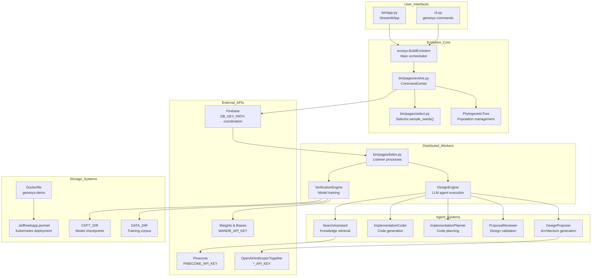
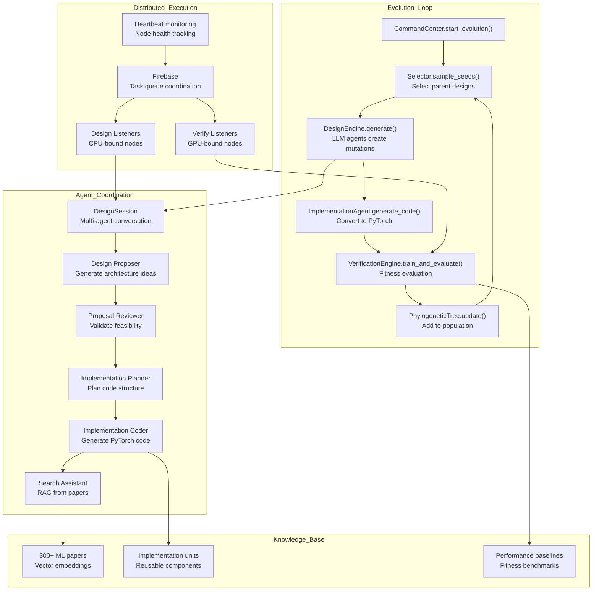
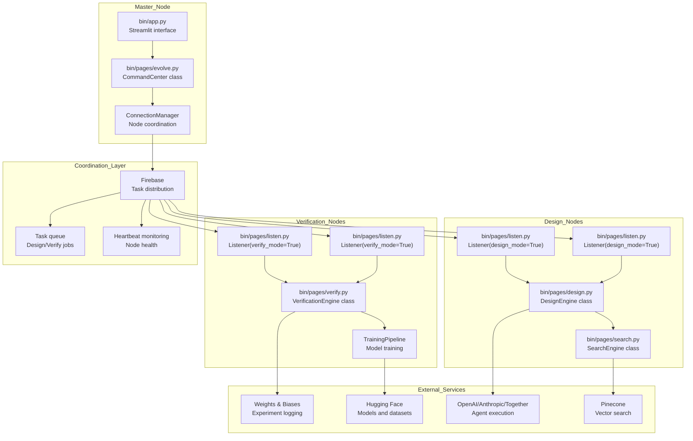

<!-- source: DeepWiki mcp.deepwiki.com · repo allenai/genesys · page 1 Genesys Overview · fetched 2026-10-26 -->

# Genesys Overview

Relevant source files

The following files were used as context for generating this wiki page:

- [LICENSE](LICENSE)
- [README.md](README.md)

## Purpose and Scope

Genesys (**Gene**tic discovery **sys**tem) is a distributed evolutionary framework for discovering novel language model architectures using LLM agents and genetic programming. The system employs automated genetic algorithms where LLM agents serve as genetic operators to generate, mutate, and evolve neural network architectures through iterative cycles of design, implementation, training, and evaluation.

The system orchestrates the complete machine learning research workflow from initial ideation through final performance validation, utilizing distributed compute resources and sophisticated coordination mechanisms. For detailed setup instructions, see [Getting Started](#2). For specific implementation details of individual components, refer to the relevant subsections under [Application Architecture](#3) and [User Interface Pages](#4).

**Core Innovation**: LLM agents function as intelligent genetic operators, replacing traditional random mutations with semantically-aware architectural modifications informed by machine learning research literature and code repositories.

## Core Concepts

Genesys implements genetic programming for neural architecture search through the following evolutionary cycle:

### Genetic Programming Loop

| Phase | Implementation | Core Classes/Functions |
|-------|---------------|------------------------|
| **Selection** | `Selector.sample_seeds()` - seeds chosen via performance metrics and phylogenetic diversity | `Selector`, `PhylogeneticTree` |
| **Design** | LLM agents generate architectural modifications through multi-agent conversations | `DesignEngine`, `BuildEvolution` |
| **Implementation** | Design specifications converted to executable PyTorch code | `ImplementationAgent`, `CodeValidator` |
| **Verification** | Model training and evaluation using distributed compute | `VerificationEngine`, `TrainingPipeline` |
| **Evolution** | Population updated based on fitness scores, maintaining phylogenetic relationships | `PhylogeneticTree.update()` |

### Distributed Architecture

The system employs specialized node types for optimal resource utilization:

| Node Type | Resource Profile | Primary Function | Key Components |
|-----------|------------------|------------------|----------------|
| **Design Nodes** | CPU-intensive, API rate-limited | LLM agent execution for design generation | `DesignEngine`, `SearchEngine` |
| **Verification Nodes** | GPU-intensive, compute-heavy | Model training and evaluation | `VerificationEngine`, `TrainingPipeline` |
| **Master Node** | Lightweight coordination | Orchestration and monitoring | `CommandCenter`, `ConnectionManager` |

### Knowledge Integration

The system integrates external knowledge sources through Retrieval-Augmented Generation (RAG):
- **Research Papers**: 300+ machine learning papers indexed in vector database
- **Code Units**: Reusable implementation components and architectural patterns
- **Baseline Models**: Performance benchmarks for fitness evaluation

## System Architecture

### Core System Components

**Sources**: [README.md:1-190](), [bin/app.py](), [cli.py](), [evosys/](), [bin/pages/](), [Dockerfile](), [.skiff/webapp.jsonnet]()

### Genetic Programming Workflow

**Sources**: [bin/pages/evolve.py](), [bin/pages/select.py](), [bin/pages/design.py](), [bin/pages/verify.py](), [bin/pages/listen.py](), [README.md:127-129]()

### Distributed Node Architecture

**Sources**: [bin/pages/evolve.py](), [bin/pages/listen.py](), [bin/pages/design.py](), [bin/pages/verify.py](), [bin/pages/search.py](), [README.md:127-129]()

## Key Components

### Core Evolution System

| Component | Implementation | Purpose | Key Methods |
|-----------|---------------|---------|------------|
| **BuildEvolution** | `evosys.BuildEvolution` | Central orchestrator for genetic programming | `run()`, `evolve()` |
| **CommandCenter** | `bin/pages/evolve.py` | Master node coordination and control | `start_evolution()`, `monitor_nodes()` |
| **Selector** | `bin/pages/select.py` | Seed selection using phylogenetic metrics | `sample_seeds()`, `rank_designs()` |
| **PhylogeneticTree** | `PhylogeneticTree` | Population management and lineage tracking | `update()`, `get_ancestors()` |

### LLM Agent Architecture

| Agent Type | Implementation | Role | Input/Output |
|-----------|---------------|------|-------------|
| **Design Proposer** | `DesignProposer` | Generate architectural proposals | Seed design → Architecture proposal |
| **Proposal Reviewer** | `ProposalReviewer` | Validate design feasibility | Architecture proposal → Feasibility assessment |
| **Implementation Planner** | `ImplementationPlanner` | Plan code structure | Architecture proposal → Implementation plan |
| **Implementation Coder** | `ImplementationCoder` | Generate PyTorch code | Implementation plan → Executable code |
| **Implementation Observer** | `ImplementationObserver` | Validate generated code | Code → Validation results |
| **Search Assistant** | `SearchAssistant` | Knowledge retrieval via RAG | Query → Relevant papers/code |

### Distributed Node Types

| Node Type | Resource Profile | Implementation | Primary Function |
|-----------|------------------|----------------|------------------|
| **Design Nodes** | CPU-intensive, API rate-limited | `bin/pages/listen.py` with `design_mode=True` | LLM agent execution, architecture generation |
| **Verification Nodes** | GPU-intensive, compute-heavy | `bin/pages/listen.py` with `verify_mode=True` | Model training, evaluation, fitness scoring |
| **Master Node** | Lightweight coordination | `bin/pages/evolve.py` | Orchestration, monitoring, population management |

### External Service Integration

| Service | Environment Variable | Implementation | Purpose |
|---------|---------------------|----------------|---------|
| **OpenAI** | `MY_OPENAI_KEY` | LLM API client | GPT-4 agent execution |
| **Anthropic** | `ANTHROPIC_API_KEY` | LLM API client | Claude agent execution |
| **Together AI** | `TOGETHER_API_KEY` | LLM API client | Open-source LLM access |
| **Weights & Biases** | `WANDB_API_KEY` | `wandb` integration | Experiment tracking, metrics logging |
| **Firebase** | `DB_KEY_PATH` | Database client | Distributed coordination, task queuing |
| **Pinecone** | `PINECONE_API_KEY` | Vector database | Research paper embeddings, RAG search |
| **Semantic Scholar** | `S2_API_KEY` | API client | Research paper metadata and content |
| **Hugging Face** | `HF_KEY` | `transformers` integration | Model hosting, dataset access |

**Sources**: [README.md:54-67](), [evosys/](), [bin/pages/]()

## Distributed Evolution Process

The genetic programming process operates through a continuous cycle managed by the `CommandCenter` class in [bin/pages/evolve.py](). The detailed workflow includes:

### Evolution Cycle Implementation

1. **Initialization**: `BuildEvolution.run()` initializes the system with configuration parameters and establishes connections to external services via environment variables
2. **Seed Selection**: `Selector.sample_seeds()` samples parent designs from the `PhylogeneticTree` based on performance metrics and phylogenetic diversity scores
3. **Design Generation**: Design nodes execute `DesignEngine.generate()` using multi-agent LLM conversations to create architectural mutations
4. **Implementation**: `ImplementationCoder.generate_code()` converts design specifications into executable PyTorch code, validated by `ImplementationObserver`
5. **Verification**: Verification nodes execute `VerificationEngine.train_and_evaluate()` to train models and compute fitness scores
6. **Population Update**: `PhylogeneticTree.update()` integrates results into the population, maintaining genetic lineage and performance rankings

### Distributed Coordination Mechanism

The system maintains coordination through Firebase real-time database:

| Component | Firebase Path | Purpose |
|-----------|---------------|---------|
| **Task Queue** | `/tasks/design/` | Design task distribution |
| **Task Queue** | `/tasks/verify/` | Verification task distribution |
| **Node Status** | `/nodes/{node_id}/` | Heartbeat and health monitoring |
| **Results** | `/results/{session_id}/` | Experiment results and metrics |
| **Population** | `/population/` | Current design population state |

### Fault Tolerance and Monitoring

- **Heartbeat System**: Nodes report status every 30 seconds via Firebase
- **Task Retry Logic**: Failed tasks automatically redistributed to healthy nodes
- **Node Recovery**: Crashed nodes automatically rejoin the cluster upon restart
- **Progress Tracking**: Real-time monitoring through Streamlit GUI and Weights & Biases integration

**Sources**: [README.md:127-129](), [bin/pages/evolve.py](), [bin/pages/listen.py](), [bin/pages/design.py](), [bin/pages/verify.py]()

## User Interfaces

Genesys provides multiple interfaces for system interaction and monitoring:

### Streamlit Web Interface

The primary interface accessed via `genesys gui` command, implemented in [bin/app.py](). The interface provides modular pages for different system functions:

| Page | Implementation | Purpose |
|------|---------------|---------|
| **Home** | `bin/pages/home.py` | System overview and navigation |
| **Evolve** | `bin/pages/evolve.py` | Evolution control and monitoring |
| **Design** | `bin/pages/design.py` | Design engine configuration |
| **Verify** | `bin/pages/verify.py` | Verification engine control |
| **Select** | `bin/pages/select.py` | Seed selection interface |
| **Search** | `bin/pages/search.py` | Knowledge base search |
| **Viewer** | `bin/pages/viewer.py` | Results visualization |
| **Listen** | `bin/pages/listen.py` | Distributed node management |
| **Config** | `bin/pages/config.py` | System configuration |

### Command Line Interface

Direct system control through `genesys` commands implemented in [cli.py]():

| Command | Implementation | Purpose |
|---------|---------------|---------|
| `genesys setup` | `cli.py:setup()` | Initialize system requirements and datasets |
| `genesys node` | `cli.py:node()` | Launch distributed worker nodes |
| `genesys gui` | `cli.py:gui()` | Start the Streamlit web interface |

### Configuration Management

System configuration managed through environment variables and the config interface:

| Configuration | Environment Variable | Purpose |
|---------------|---------------------|---------|
| **Data Directory** | `DATA_DIR` | Training corpus and evaluation data |
| **Checkpoint Directory** | `CKPT_DIR` | Model checkpoints and artifacts |
| **Database Key** | `DB_KEY_PATH` | Firebase authentication credentials |
| **API Keys** | `*_API_KEY` | External service authentication |

**Sources**: [README.md:84-91](), [bin/app.py](), [cli.py](), [bin/pages/]()

## Integration and Deployment

The system supports containerized deployment through Docker and Kubernetes orchestration. Configuration templates in [.skiff/]() directory provide infrastructure-as-code deployment patterns. For detailed deployment information, see [Deployment and Infrastructure](#6).

**Sources**: [README.md:39-91](), [.skiff/](), [Dockerfile]()

---

