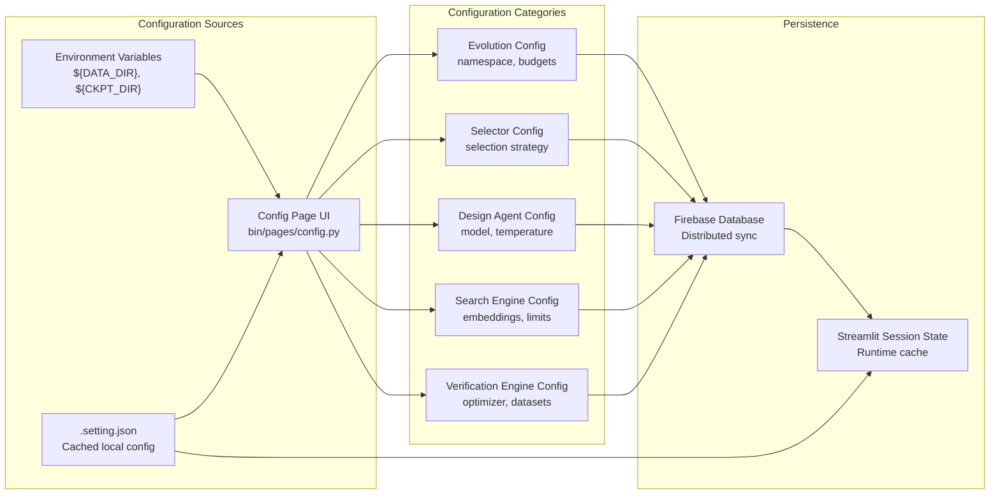
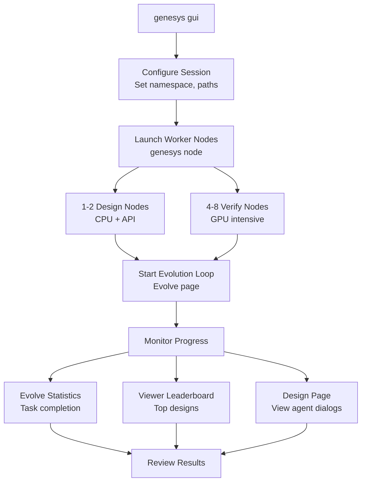
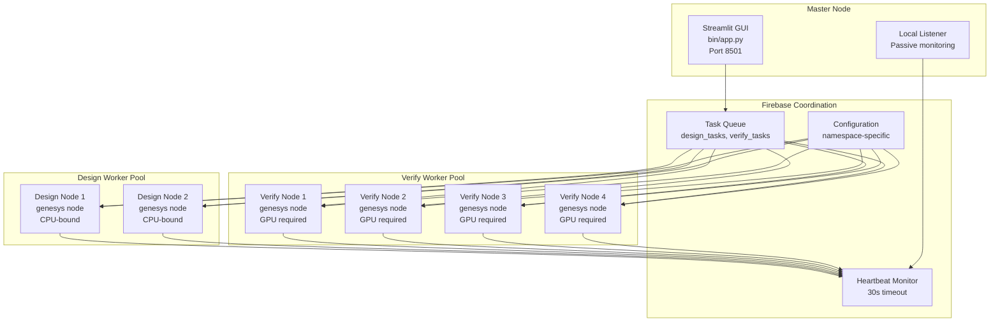

<!-- source: DeepWiki mcp.deepwiki.com · repo allenai/genesys · page 2 Getting Started · fetched 2026-10-26 -->

# Getting Started

<details>
<summary>Relevant source files</summary>

The following files were used as context for generating this wiki page:

- [.streamlit/config.toml](.streamlit/config.toml)
- [Dockerfile](Dockerfile)
- [README.md](README.md)

</details>


This guide walks through the installation, configuration, and initial setup of Genesys, enabling you to run your first distributed evolution experiment. It covers local development setup, environment variable configuration, system verification, and launching the Streamlit GUI.

For details on the evolution system architecture and components, see [Core Evolution System](#5). For deployment in production environments, see [Deployment and Infrastructure](#7).

---

## Overview

Genesys requires a multi-component setup consisting of:
- Python environment with PyTorch and dependencies
- API keys for LLM providers (OpenAI, Anthropic, Together, etc.)
- Firebase backend for distributed coordination
- Storage directories for datasets and model checkpoints
- Optional: Pinecone vectorstore for paper search functionality

The installation process follows a standard pattern: environment creation → dependency installation → configuration → verification.

---

## Prerequisites

Before beginning installation, ensure you have:

| Requirement | Purpose | Notes |
|------------|---------|-------|
| Python 3.12 | Runtime environment | Conda recommended |
| CUDA 11.8 | GPU acceleration | Required for verification nodes |
| Git | Repository cloning | - |
| 50+ GB disk space | Datasets and checkpoints | Expandable based on usage |
| Firebase account | Distributed coordination | **Required** for multi-node evolution |
| LLM API keys | Design agent inference | At minimum: OpenAI or Anthropic |

---

## Installation Process

### Step 1: Repository Setup

Clone the repository and navigate to it:

```bash
cd ~
git clone https://github.com/allenai/genesys.git
cd genesys
```

**Sources:** [README.md:45]()

### Step 2: Python Environment Creation

Create a conda environment with Python 3.12 and PyTorch with CUDA support:

```bash
conda create -n genesys python=3.12 -y
conda activate genesys
conda install pytorch==2.4.1 torchvision==0.19.1 torchaudio==2.4.1 pytorch-cuda=11.8 -c pytorch -c nvidia -y
```

Install the Genesys CLI in editable mode:

```bash
pip install -e .
```

This makes the `genesys` command available and installs core dependencies from `setup.py`.

**Sources:** [README.md:47-54]()

### Step 3: Environment Variables Configuration

Genesys requires multiple environment variables for API access and storage paths. Create a configuration script or add to your shell profile:

```bash
# LLM Provider API Keys (Required)
export MY_OPENAI_KEY=your_openai_key_here
export ANTHROPIC_API_KEY=your_anthropic_key_here
export TOGETHER_API_KEY=your_together_key_here

# Additional LLM Providers (Optional)
export COHERE_API_KEY=your_cohere_key_here
export PERPLEXITY_API_KEY=your_perplexity_key_here

# Supporting Services (Required)
export HF_KEY=your_huggingface_key_here
export WANDB_API_KEY=your_wandb_key_here
export S2_API_KEY=your_semantic_scholar_key_here

# Search Functionality (Optional)
export PINECONE_API_KEY=your_pinecone_key_here
export MATHPIX_API_ID=your_mathpix_id_here

# Storage Directories (Required)
export DATA_DIR=~/genesys/data
export CKPT_DIR=~/genesys/ckpt
export DB_KEY_PATH=~/genesys/secrets/db_key.json

# Configuration Flags
export HF_DATASETS_TRUST_REMOTE_CODE=1
```

Create the storage directories:

```bash
mkdir -p ${DATA_DIR} ${CKPT_DIR}
mkdir -p ~/genesys/secrets
```

**Sources:** [README.md:56-72](), [Dockerfile:26-28]()

#### Environment Variable Reference

```mermaid
graph TD
    subgraph "API Keys"
        OpenAI["MY_OPENAI_KEY<br/>GPT-4, GPT-3.5"]
        Anthropic["ANTHROPIC_API_KEY<br/>Claude models"]
        Together["TOGETHER_API_KEY<br/>Open source models"]
        Cohere["COHERE_API_KEY<br/>Embeddings"]
        Perplexity["PERPLEXITY_API_KEY<br/>Research queries"]
    end
    
    subgraph "Storage Paths"
        DataDir["DATA_DIR<br/>Evaluation datasets"]
        CkptDir["CKPT_DIR<br/>Model checkpoints"]
        DBKey["DB_KEY_PATH<br/>Firebase secret JSON"]
    end
    
    subgraph "Services"
        HF["HF_KEY<br/>Hugging Face datasets"]
        WandB["WANDB_API_KEY<br/>Experiment tracking"]
        S2["S2_API_KEY<br/>Semantic Scholar"]
        Pinecone["PINECONE_API_KEY<br/>Vector search"]
    end
    
    subgraph "Design Agent Usage"
        DA[Design Agent]
        OpenAI --> DA
        Anthropic --> DA
        Together --> DA
    end
    
    subgraph "Verification Engine Usage"
        VE[Verification Engine]
        DataDir --> VE
        CkptDir --> VE
        WandB --> VE
    end
    
    subgraph "Search Engine Usage"
        SE[Search Engine]
        Pinecone --> SE
        S2 --> SE
        HF --> SE
    end
    
    subgraph "Distributed Coordination"
        DC[CommandCenter]
        DBKey --> DC
    end
```



**Sources:** [README.md:58-72](), [Dockerfile:26-28]()

---

### Step 4: Firebase Backend Setup

Firebase provides the coordination layer for distributed evolution. This step is **mandatory** for running evolution experiments across multiple nodes.

1. Create a Firebase project at [console.firebase.google.com](https://console.firebase.google.com)
2. Enable Firestore Database in the project
3. Generate a service account key:
   - Navigate to Project Settings → Service Accounts
   - Click "Generate New Private Key"
   - Download the JSON file
4. Save the JSON file to the path specified in `DB_KEY_PATH`:

```bash
mv ~/Downloads/firebase-key.json ${DB_KEY_PATH}
chmod 600 ${DB_KEY_PATH}
```

The Firebase backend stores:
- Task queues for design and verification workloads
- Session metadata and evolution state
- Configuration synchronization across nodes
- Node heartbeat monitoring

**Sources:** [README.md:74]()

---

### Step 5: Pinecone Vectorstore Setup (Optional)

If you plan to use the search engine's vector similarity search over paper chunks:

1. Create a Pinecone account and project
2. Create an index with appropriate dimensions
3. Populate the vectorstore with paper chunks using the utilities in [model_discovery/agents/search_utils.py]()

This step is optional but enhances the design agent's ability to find relevant prior work.

**Sources:** [README.md:76]()

---

### Step 6: Dependency Installation and Dataset Download

Run the setup command to install additional dependencies and download evaluation datasets:

```bash
genesys setup
```

This command:
1. Installs packages from `requirements.txt`
2. Downloads the BabyLM evaluation data to `${DATA_DIR}`
3. Sets up the customized `lm_eval` harness
4. Prepares the smollm-12.5-corpus training data

For optional dependencies (extended functionality):

```bash
pip install -r requirements_optional.txt
```

**Sources:** [README.md:79-82]()

#### Verification Engine Setup

The verification engine requires specific datasets and the customized evaluation harness:

| Component | Location | Purpose |
|-----------|----------|---------|
| Training corpus | `smollm-12.5-corpus` on HF | Model training data |
| BabyLM evaluation | `${DATA_DIR}/blimp_*` | Evaluation tasks |
| Custom lm_eval | [chengjunyan1/lm-evaluation-harness](https://github.com/chengjunyan1/lm-evaluation-harness/tree/main) | Task runner |

The evaluation data structure should look like:
```
${DATA_DIR}/
├── blimp_filtered/
│   ├── adjunct_island.jsonl
│   ├── ...
└── blimp_supplement/
    ├── ...
```

**Sources:** [README.md:119-127]()

---

## System Verification

### Launch a Worker Node

Test your installation by starting a worker node in listener mode:

```bash
genesys node
```

This command starts a node that:
- Connects to Firebase using `DB_KEY_PATH`
- Listens for design and verification tasks
- Reports heartbeat status
- Displays connection diagnostics

Expected output:
```
Node started successfully
Listening for tasks...
Connected to Firebase project: <your-project-id>
Node ID: <generated-uuid>
```

If this succeeds, your environment is correctly configured.

**Sources:** [README.md:88-90]()

### Launch the Streamlit GUI

Start the web interface:

```bash
genesys gui
```

This launches the Streamlit application on `http://localhost:8501` by default. The GUI provides:
- **Home**: System overview and usage guide
- **Evolve**: Evolution loop control and monitoring
- **Design**: Design session inspection
- **Config**: Configuration management
- **Viewer**: Results visualization
- **Tester**: Component debugging

Navigate to the **Config** page first to verify your environment variables are detected.

**Sources:** [README.md:93-95]()

---

## Configuration Overview

After launching the GUI, configure the system through the **Config** page:



**Sources:** [README.md:56-72](), [Dockerfile:26-28]()

### Key Configuration Parameters

| Category | Parameter | Default | Description |
|----------|-----------|---------|-------------|
| Evolution | `namespace` | `"default"` | Session identifier for experiment isolation |
| Evolution | `design_scale` | `8` | Max parallel design tasks |
| Evolution | `verify_scale` | `32` | Max parallel verification tasks |
| Selector | `selector_method` | `"UtilityConfidenceSelector"` | Seed selection algorithm |
| Design Agent | `model` | `"gpt-4"` | LLM model for design generation |
| Design Agent | `temperature` | `0.7` | Sampling temperature |
| Verification | `optimizer` | `"AdamW"` | Training optimizer |
| Verification | `num_epochs` | `1` | Training epochs per design |

Configuration changes are automatically synced to Firebase for distributed nodes.

**Sources:** [README.md:56-72]()

---

## First Evolution Experiment

### Quick Start Workflow

Follow these steps to run your first evolution experiment:

1. **Launch the GUI**: `genesys gui`
2. **Configure the session**:
   - Navigate to **Config** page
   - Set a unique `namespace` (e.g., `"first_experiment"`)
   - Verify `DATA_DIR` and `CKPT_DIR` are set
   - Save configuration
3. **Start worker nodes**:
   - In separate terminals: `genesys node`
   - Launch 1-2 design nodes (CPU-bound)
   - Launch 4-8 verify nodes (GPU-intensive)
4. **Initialize evolution**:
   - Navigate to **Evolve** page
   - Click "Start Evolution Loop"
   - Monitor the **CommandCenter** status panel
5. **Observe progress**:
   - Watch design generation in **Design** page
   - Track verification status in **Evolve → Statistics**
   - View leaderboard in **Viewer → Design Leaderboard**



**Sources:** [README.md:88-95]()

---

## Docker Deployment (Alternative)

For containerized deployment, use the provided Dockerfile:

### Building the Docker Image

```bash
docker build -t genesys-demo .
```

The Dockerfile:
1. Uses `ghcr.io/allenai/cuda:11.8-cudnn8-dev-ubuntu20.04` base image
2. Sets up `DATA_DIR=/root/genesys/data` and `CKPT_DIR=/root/genesys/ckpt`
3. Installs PyTorch CPU-only (for design nodes) or GPU version (for verify nodes)
4. Downloads demo evaluation data via [scripts/demo_data_download.py]()
5. Exposes port 8501 for Streamlit
6. Sets entrypoint to `genesys gui`

**Sources:** [Dockerfile:1-57]()

### Running the Container

```bash
docker run -p 8501:8501 \
  -e MY_OPENAI_KEY=${MY_OPENAI_KEY} \
  -e ANTHROPIC_API_KEY=${ANTHROPIC_API_KEY} \
  -e DB_KEY_PATH=/root/genesys/secrets/db_key.json \
  -v ${DB_KEY_PATH}:/root/genesys/secrets/db_key.json \
  -v ${DATA_DIR}:/root/genesys/data \
  -v ${CKPT_DIR}:/root/genesys/ckpt \
  genesys-demo
```

This mounts your local credentials and storage directories into the container.

**Sources:** [Dockerfile:59-64]()

---

## Deployment Architecture for Distributed Evolution

The recommended deployment strategy separates design and verification workloads:



**Key Deployment Considerations:**

- **Design Nodes**: 1-2 nodes sufficient (API rate-limited, not compute-bound)
- **Verify Nodes**: 4-8+ nodes recommended (GPU-intensive training workloads)
- **Resource Conflict**: Design checkers require GPU; keep design nodes on CPU-only machines
- **Zombie Detection**: Heartbeat mechanism with 30-second timeout removes stalled nodes
- **Namespace Isolation**: Multiple experiments can run concurrently with different namespaces

**Sources:** [README.md:130-132]()

---

## Troubleshooting

### Common Issues

| Issue | Symptoms | Solution |
|-------|----------|----------|
| Firebase connection failure | "Failed to connect to Firebase" | Verify `DB_KEY_PATH` points to valid JSON file |
| API key not found | "OpenAI API key not set" | Check environment variable spelling and export |
| Dataset not found | "FileNotFoundError: blimp_filtered" | Re-run `genesys setup` to download datasets |
| GPU not detected | "No CUDA devices available" | Verify `torch.cuda.is_available()` returns `True` |
| Port already in use | "Address already in use: 8501" | Stop existing Streamlit instance or use `--server.port` |

### Verification Checklist

Before starting evolution, verify:
- [ ] `genesys node` connects successfully
- [ ] `genesys gui` launches without errors
- [ ] Config page shows all environment variables
- [ ] Firebase project ID appears in GUI
- [ ] `${DATA_DIR}/blimp_filtered` directory exists
- [ ] At least one LLM API key is configured

---

## Next Steps

After completing setup:

1. **Explore the GUI**: Familiarize yourself with the Streamlit interface and navigation. See [User Interface Pages](#4) for detailed documentation.

2. **Understand the Evolution System**: Review how the selector, design agents, and verification engine work together. See [Evolution System Components](#5).

3. **Configure Advanced Settings**: Adjust selector strategies, design agent parameters, and verification hyperparameters. See [Configuration Management Interface](#4.4).

4. **Review Example Designs**: Study the discovered designs in the demo at [genesys.allen.ai](https://genesys.allen.ai) under **Viewer → Design Artifacts**.

5. **Deploy at Scale**: Set up Kubernetes deployment for production evolution runs. See [Deployment and Infrastructure](#7).

**Sources:** [README.md:1-190]()

---

