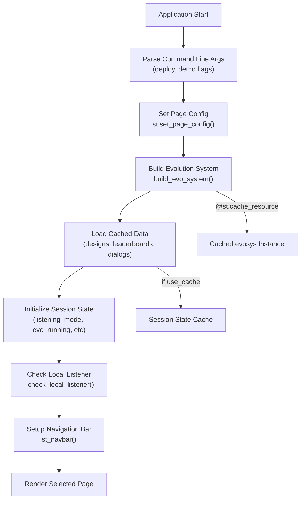
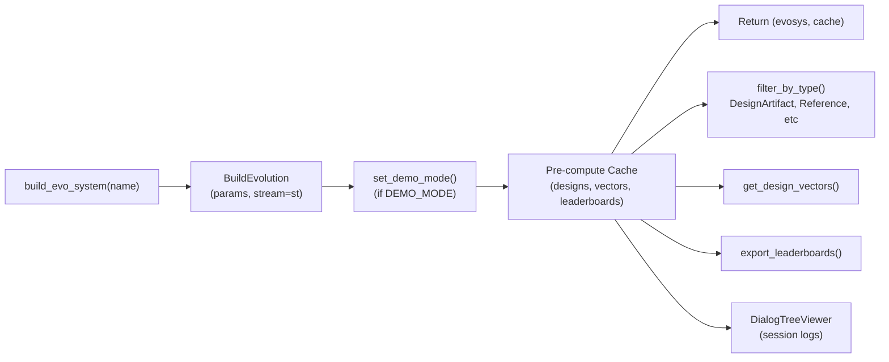
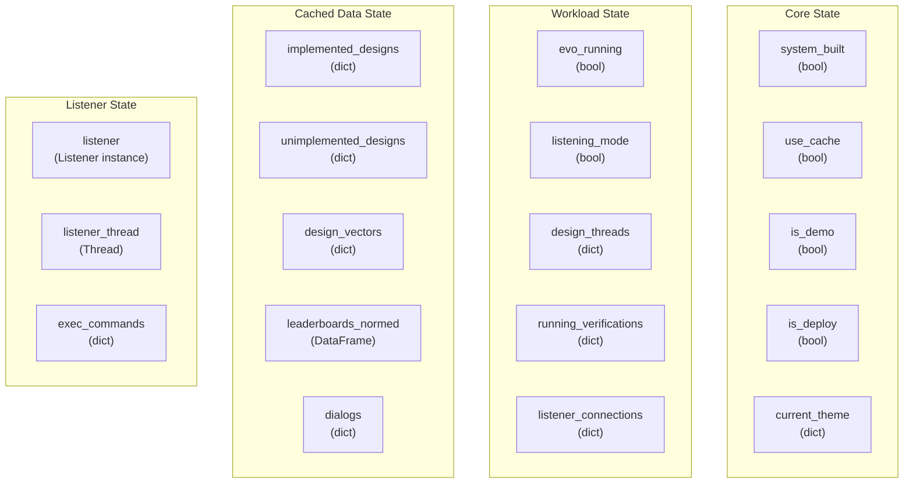
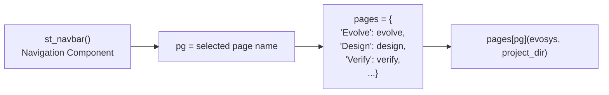
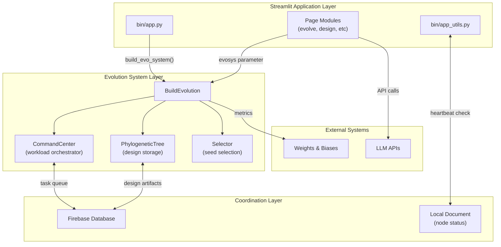
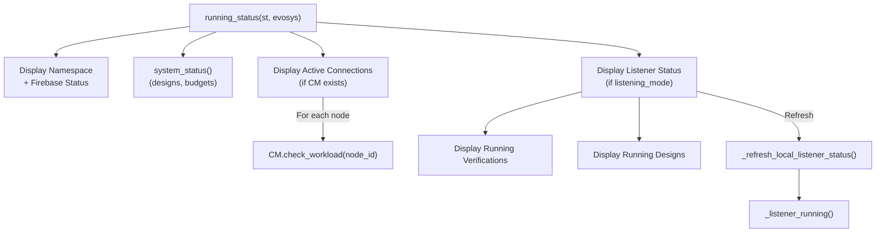
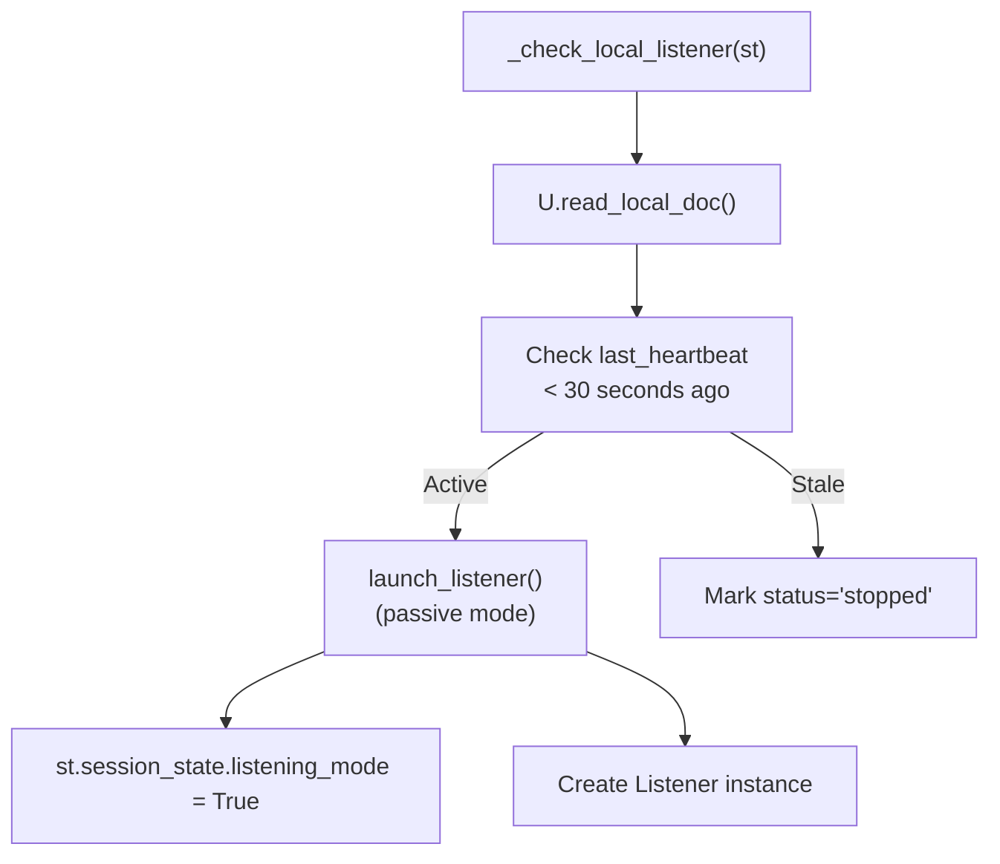
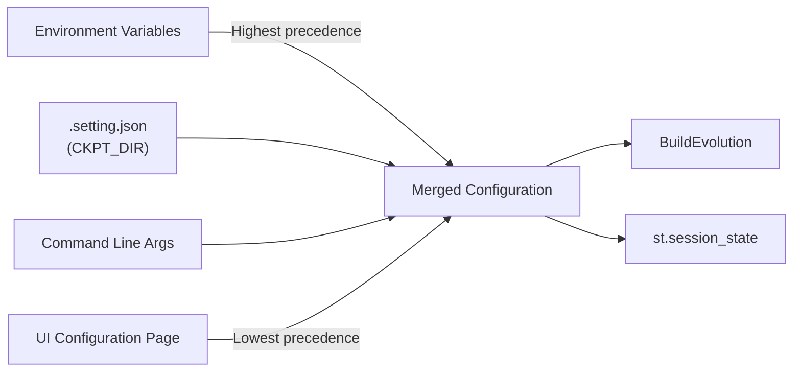

<!-- source: DeepWiki mcp.deepwiki.com · repo allenai/genesys · page 3 Core Application Architecture · fetched 2026-10-26 -->

# Core Application Architecture

<details>
<summary>Relevant source files</summary>

The following files were used as context for generating this wiki page:

- [bin/app.py](bin/app.py)
- [bin/app_utils.py](bin/app_utils.py)
- [bin/pages/__init__.py](bin/pages/__init__.py)

</details>


## Purpose and Scope

This document describes the high-level architecture of the Genesys Streamlit application, including its initialization flow, session state management, page navigation system, and integration with backend evolution components. It focuses on the structural organization and runtime behavior of the web application itself.

For detailed documentation of specific components:
- Main application entry point implementation: see [Main Application Entry Point](#3.1)
- Utility functions and status display: see [Application Utilities and Status Management](#3.2)
- Individual page implementations: see [User Interface Pages](#4)
- Backend evolution system components: see [Evolution System Components](#5)

---

## Application Overview

Genesys is built as a **Streamlit-based web application** that provides an interactive interface for managing evolutionary model discovery experiments. The application serves as the control plane for distributed workloads, offering real-time monitoring, configuration management, and experiment orchestration.

### Technology Stack

| Component | Technology | Purpose |
|-----------|-----------|---------|
| Web Framework | Streamlit | Interactive UI with reactive state management |
| Navigation | `streamlit-navigation-bar` | Multi-page application routing |
| Backend Integration | `BuildEvolution` class | Connection to evolution system |
| Coordination | Firebase Realtime Database | Distributed node synchronization |
| Visualization | Streamlit charts, custom components | Metrics and status displays |

### Application Entry Point

The application begins at [bin/app.py:1-314](), which handles:
- Environment configuration
- System initialization
- Page routing
- Session state setup

**Sources:** [bin/app.py](), README.md

---

## Application Initialization Flow

The initialization process follows a multi-stage bootstrap sequence that prepares the application for user interaction.

### Initialization Stages Diagram



**Sources:** [bin/app.py:23-257]()

### Mode Flags

The application supports three operational modes controlled by command-line arguments:

| Mode | Flag | Behavior |
|------|------|----------|
| **Development** | (default) | Full feature access, hot reloading enabled |
| **Deploy** | `--deploy`, `-d` | Production mode, reduced feature set |
| **Demo** | `--demo`, `-m` | Read-only mode, cached data, daily usage limits |

Mode detection occurs at [bin/app.py:23-32]():

```python
DEPLOY_MODE = 'deploy' in custom_args or '--deploy' in custom_args
DEMO_MODE = 'demo' in custom_args or '--demo' in custom_args
```

In demo mode, Firebase writes are restricted and pre-computed results are displayed to reduce API costs.

**Sources:** [bin/app.py:23-32](), [bin/app.py:85-87]()

---

## Evolution System Building

The core backend integration happens through the `build_evo_system()` function, which creates and configures a `BuildEvolution` instance.

### System Building Diagram



The `build_evo_system()` function at [bin/app.py:96-173]() is decorated with `@st.cache_resource()`, ensuring the expensive initialization happens only once per Streamlit session:

```python
@st.cache_resource()
def build_evo_system(name):
    evo_system = BuildEvolution(
        params={'evoname': name},
        do_cache=False,
        stream=st,
        demo_mode=DEMO_MODE,
    )
```

### Cached Data Structure

When `use_cache` is enabled, the following data structures are pre-computed and stored in session state:

| Cache Key | Type | Purpose |
|-----------|------|---------|
| `pre_filter` | list | Empty list for filter operations |
| `filter_by_types` | dict | Designs and references by type |
| `implemented_designs` | dict | Designs with code implementations |
| `unimplemented_designs` | dict | Designs without implementations |
| `design_vectors` | dict | Embeddings for similarity search |
| `baseline_vectors` | dict | Baseline model embeddings |
| `leaderboards_normed` | DataFrame | Normalized performance metrics |
| `leaderboards_unnormed_h/l` | DataFrame | Raw performance metrics (high/low is better) |
| `dialogs` | dict | Dialog trees by evolution session |

**Sources:** [bin/app.py:96-206](), [bin/app.py:134-172]()

---

## Session State Management

Streamlit's session state provides persistent storage across page reruns. Genesys uses session state extensively to track application state and running workloads.

### Session State Architecture



### Key Session State Variables

The following session state variables are initialized at [bin/app.py:82-242]():

| Variable | Type | Initialization | Purpose |
|----------|------|----------------|---------|
| `system_built` | bool | False | Tracks whether evolution system is initialized |
| `use_cache` | bool | False (True in demo) | Controls data caching strategy |
| `evo_running` | bool | False | Indicates active evolution loop |
| `listening_mode` | bool | False | Node is in passive listener mode |
| `design_threads` | dict | {} | Active design sessions by ID |
| `max_design_threads` | int | 5 | Maximum concurrent design threads |
| `running_verifications` | dict | {} | Active verification processes |
| `listener_connections` | dict | {} | Remote node connections |
| `listener` | Listener | None | Local listener instance |
| `daily_usage_limit` | float | 5.0 | Demo mode API cost limit |

**Sources:** [bin/app.py:82-242]()

---

## Page Navigation System

Genesys uses a custom navigation bar to provide access to different functional areas of the application.

### Page Registration and Routing



The navigation system is configured at [bin/app.py:286-313]():

```python
pages = {
    'Evolve': evolve,
    'Design': design,
    'Verify': verify,
    'Select': select,
    'Search': search,
    'Viewer': viewer,
    'Config': config,
}
```

Each page is implemented as a function that takes `(evosys, project_dir)` as parameters. The selected page is rendered by calling: `pages[pg](evosys, project_dir)`.

### Conditional Page Loading

In development mode, pages are dynamically reloaded on each change using [bin/app.py:56-73]():

```python
def import_and_reload(module_name):
    full_module_name = f'bin.pages.{module_name}'
    if full_module_name in sys.modules:
        return importlib.reload(sys.modules[full_module_name])
    return importlib.import_module(full_module_name)
```

In deploy/demo mode, pages are imported statically at [bin/app.py:75-78]() for better performance.

**Sources:** [bin/app.py:52-78](), [bin/app.py:286-313]()

---

## Integration with Backend Systems

The Streamlit application serves as a thin presentation layer over the core evolution system, with tight integration points for orchestration and monitoring.

### Backend Integration Architecture



### Key Integration Points

1. **BuildEvolution Instance**: Created once and passed to all pages via function parameter
   - Provides access to `ptree` (phylogenetic tree), `selector`, and `CM` (CommandCenter)
   - Manages Firebase connection if configured

2. **CommandCenter Integration**: Accessible via `evosys.CM` when initialized
   - Coordinates distributed workloads across nodes
   - Maintains connection registry and heartbeats
   - Assigns design and verification tasks

3. **Session Synchronization**: Uses Firebase and local documents
   - Remote nodes write heartbeats to Firebase
   - Local listener writes to `.local.json` document
   - Application polls both sources for status updates

**Sources:** [bin/app.py:96-173](), [bin/app_utils.py:103-126]()

---

## Status Monitoring and Display

The application provides real-time status monitoring through utility functions in `bin/app_utils.py`.

### Status Display Components



The `system_status()` function at [bin/app_utils.py:129-158]() displays:
- Experiment directory path
- Number of designs (total and implemented)
- Design budget consumption with progress bar
- Verification budgets by scale with progress bars
- Budget type configuration

The `running_status()` function at [bin/app_utils.py:167-242]() provides:
- Current namespace and Firebase connection status
- Active connections from CommandCenter (if distributed)
- Per-node workload status (designs/verifications running)
- Local listener status and running jobs
- Daily usage limits (demo mode only)

**Sources:** [bin/app_utils.py:129-242]()

---

## Local Listener Detection

The application automatically detects and integrates with locally running listener processes to enable passive monitoring mode.

### Listener Detection Flow



The listener detection logic at [bin/app.py:244-256]() and [bin/app_utils.py:103-116]() checks for:

1. **Local document existence**: Reads `.local.json` from data directory
2. **Recent heartbeat**: Last update within `NODE_ZOMBIE_THRESHOLD` (30 seconds)
3. **Status flag**: Document status != 'stopped'

If a valid listener is detected, the application launches in passive mode, allowing monitoring without active control.

**Sources:** [bin/app.py:244-256](), [bin/app_utils.py:103-126]()

---

## Configuration Management

Application settings are managed through multiple sources with a defined precedence hierarchy.

### Configuration Sources



### Settings Persistence

The `get_setting()` and `save_setting()` functions at [bin/app_utils.py:25-34]() manage persistent configuration:

```python
def get_setting(): 
    ckpt_dir = os.environ.get('CKPT_DIR')
    setting_dir = U.pjoin(ckpt_dir, '.setting.json')
    setting = U.load_json(setting_dir)
    return setting
```

Key persisted settings include:
- `default_namespace`: Last used evolution experiment name
- User preferences for UI display
- Default configuration values

**Sources:** [bin/app_utils.py:25-34](), [bin/app.py:177-180]()

---

## Theme and Visual Customization

The application supports light/dark theme detection and custom logo generation.

### Theme-Aware Components

The `theme_aware_options()` function at [bin/app_utils.py:36-40]() selects assets based on the current theme:

```python
def theme_aware_options(st, option_light, option_dark, default):
    if st.session_state.current_theme:
        return option_light if st.session_state.current_theme['base']=='light' else option_dark
    else:
        return default
```

This enables automatic logo switching and color scheme adjustments based on user preferences.

### Custom Logo Generation

The `square_logo()` function at [bin/app_utils.py:59-65]() generates SVG-based logos dynamically:
- Supports single-line or two-line text
- Customizable color
- Converts SVG to PNG for Streamlit compatibility

**Sources:** [bin/app_utils.py:36-70](), [bin/app.py:303]()

---

## Summary

The Genesys application architecture follows a **layered design** with clear separation of concerns:

1. **Presentation Layer**: Streamlit pages and navigation
2. **Application Layer**: Session management and status monitoring  
3. **Integration Layer**: Backend system connectivity
4. **Coordination Layer**: Firebase and local document synchronization

This architecture enables:
- **Scalable UI**: Multiple pages with hot-reloading in development
- **Distributed Coordination**: Multi-node orchestration through CommandCenter
- **Flexible Deployment**: Development, deploy, and demo modes
- **Real-time Monitoring**: Live status updates and workload tracking
- **Persistent State**: Cached data and session state management

The application serves as the control plane for evolutionary experiments while maintaining a responsive, interactive user experience.

**Sources:** [bin/app.py](), [bin/app_utils.py](), [bin/pages/__init__.py]()

---

