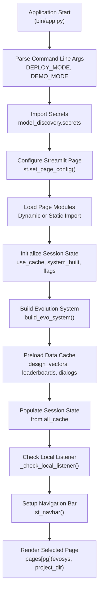
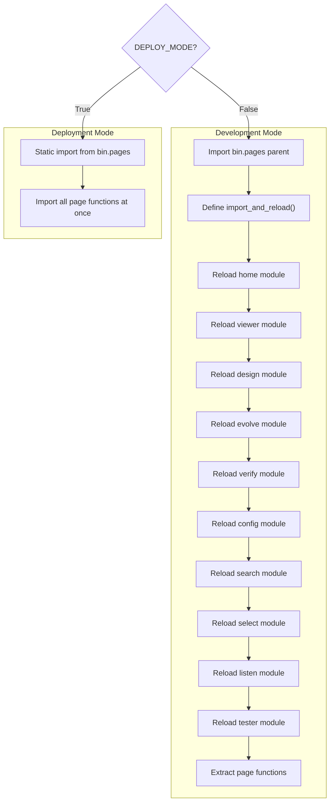
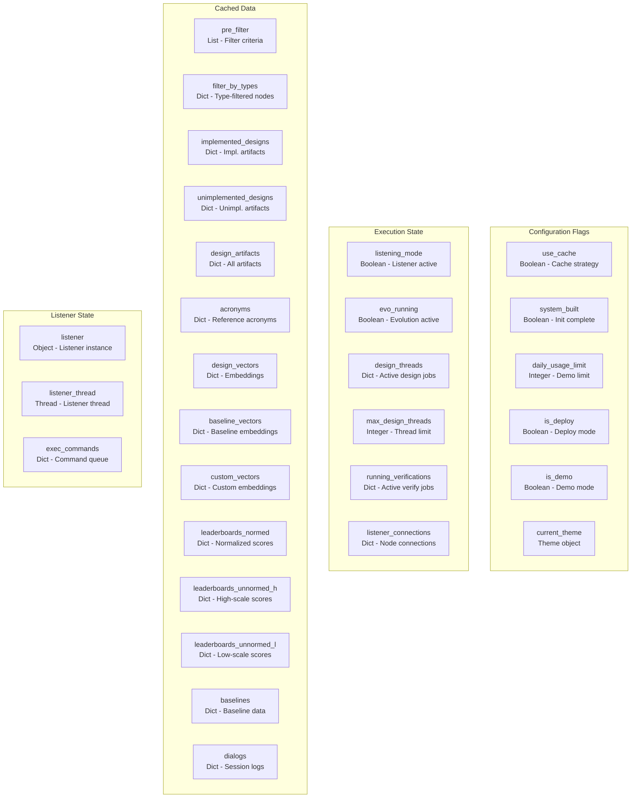
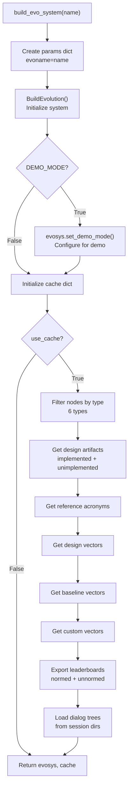
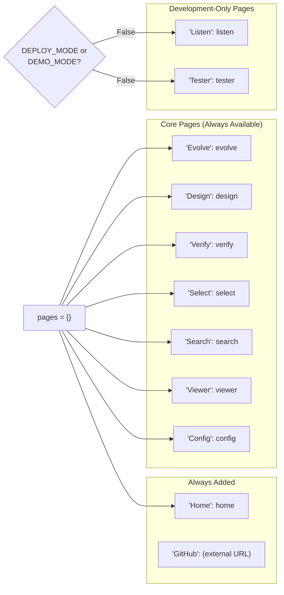
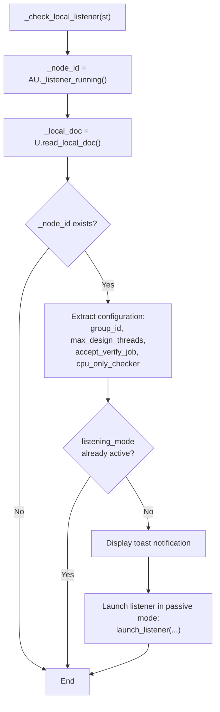

<!-- source: DeepWiki mcp.deepwiki.com · repo allenai/genesys · page 3.1 Main Application Entry Point · fetched 2026-10-26 -->

# Main Application Entry Point

<details>
<summary>Relevant source files</summary>

The following files were used as context for generating this wiki page:

- [bin/app.py](bin/app.py)
- [bin/pages/__init__.py](bin/pages/__init__.py)

</details>


## Purpose and Scope

This document details the main entry point of the Genesys Streamlit application, located at `bin/app.py`. It covers:

- Application initialization and configuration
- Module loading strategies for development and deployment modes
- Session state management and data caching architecture
- Evolution system setup and pre-loading
- Page routing and navigation system

For details on the individual UI pages themselves, see [User Interface Pages](#4). For information on the utility functions used by the application, see [Application Utilities and Status Management](#3.2). For deployment configuration, see [Deployment and Infrastructure](#7).

---

## Application Initialization Flow

The application follows a sequential initialization process that configures the environment, loads the evolution system, and establishes the UI.

### Initialization Sequence Diagram



**Sources:** [bin/app.py:1-313]()

---

## Deployment Mode Detection

The application supports three runtime modes controlled by command-line arguments:

| Mode | Trigger Args | Behavior |
|------|-------------|----------|
| **Development** | (default) | Hot module reloading, all pages enabled, no caching |
| **Deploy** | `deploy`, `--deploy`, `-d`, `d` | Static imports, production optimizations |
| **Demo** | `demo`, `--demo`, `-m`, `m` | Read-only mode, forced caching, limited namespace |

The mode detection logic is simple but critical for the application's behavior:

```python
DEPLOY_MODE = 'deploy' in custom_args or '--deploy' in custom_args or '-d' in custom_args or 'd' in custom_args
DEMO_MODE = 'demo' in custom_args or '--demo' in custom_args or '-m' in custom_args or 'm' in custom_args
```

**Key Implementation Details:**

- `DEMO_MODE` automatically sets `DEPLOY_MODE = True` [bin/app.py:28-31]()
- Demo mode restricts the namespace to `'evo_exp_full_a'` [bin/app.py:179-180]()
- Demo mode enables caching unconditionally [bin/app.py:85-86]()
- Daily usage limits are enforced in demo mode [bin/app.py:88]()

**Sources:** [bin/app.py:23-31](), [bin/app.py:85-88](), [bin/app.py:179-180]()

---

## Module Loading Strategies

The application uses different module loading strategies based on deployment mode to optimize for either developer experience or production stability.

### Module Loading Architecture



### Development Mode: Hot Reloading

In development mode, the application implements a hot-reload mechanism that allows developers to modify page code without restarting the entire application [bin/app.py:52-74]():

**Key Function: `import_and_reload()`**

```python
def import_and_reload(module_name):
    full_module_name = f'bin.pages.{module_name}'
    if full_module_name in sys.modules:
        return importlib.reload(sys.modules[full_module_name])
    return importlib.import_module(full_module_name)
```

This function checks if a module is already loaded and reloads it if so, otherwise imports it fresh. Each page module is reloaded individually, and the specific page function is extracted:

```python
home = import_and_reload('home').home
viewer = import_and_reload('viewer').viewer
design = import_and_reload('design').design
# ... etc
```

### Deployment Mode: Static Imports

In deployment mode, all modules are imported statically for better performance and reliability [bin/app.py:75-78]():

```python
from bin.pages import home,viewer,design,evolve,verify,config,search,select,listen
from bin.pages.listen import launch_listener
from bin.pages.viewer import export_leaderboards
```

This approach:
- Faster startup time (no reload logic overhead)
- Better for production stability
- Simpler error handling

**Sources:** [bin/app.py:52-78]()

---

## Session State Architecture

Streamlit's session state is used extensively to maintain application state across reruns. The application initializes multiple categories of session state variables.

### Session State Structure



### Session State Initialization Sequence

The session state is initialized in a specific order to ensure dependencies are met:

| Order | State Variable | Default Value | Purpose |
|-------|---------------|---------------|---------|
| 1 | `use_cache` | `False` (or `True` in demo) | Controls data caching strategy |
| 2 | `daily_usage_limit` | `5` | Rate limiting for demo mode |
| 3 | `system_built` | `False` | Tracks initialization completion |
| 4 | `listening_mode` | `False` | Worker node listener active |
| 5 | `evo_running` | `False` | Evolution loop active |
| 6 | `design_threads` | `{}` | Active design thread tracking |
| 7 | `max_design_threads` | `5` | Maximum concurrent designs |
| 8 | `running_verifications` | `{}` | Active verification tracking |
| 9 | `listener_connections` | `{}` | Connected worker nodes |
| 10 | `is_deploy` | `DEPLOY_MODE` | Deployment mode flag |
| 11 | `is_demo` | `DEMO_MODE` | Demo mode flag |
| 12 | `current_theme` | `st_theme()` | UI theme state |
| 13 | `listener` | `None` | Listener instance |
| 14 | `listener_thread` | `None` | Listener thread handle |
| 15 | `exec_commands` | `{}` | Command execution queue |

**Sources:** [bin/app.py:82-242]()

---

## Evolution System Setup and Caching

The core evolution system is initialized through the cached `build_evo_system()` function, which performs expensive operations once and caches the results.

### Build Process Flow



### Caching Strategy

The `build_evo_system()` function is decorated with `@st.cache_resource()` [bin/app.py:96](), which means:

- The function is called only once per Streamlit session
- Subsequent calls with the same `name` parameter return the cached result
- The cache persists across page navigation and reruns
- The cache is global to all users of the application

**Pre-loaded Cache Contents:**

When `use_cache=True`, the function pre-loads the following data structures:

| Cache Key | Data Type | Source | Purpose |
|-----------|-----------|--------|---------|
| `pre_filter` | `List` | Empty list | Filter criteria placeholder |
| `filter_by_types` | `Dict[str, Dict]` | `ptree.filter_by_type()` | Nodes grouped by type |
| `implemented_designs` | `Dict` | Filtered artifacts | Designs with code |
| `unimplemented_designs` | `Dict` | Filtered artifacts | Designs without code |
| `design_artifacts` | `Dict` | Merged dicts | All design artifacts |
| `acronyms` | `Dict` | Filtered references | Reference acronyms |
| `design_vectors` | `Dict` | `ptree.get_design_vectors()` | Design embeddings |
| `baseline_vectors` | `Dict` | `ptree.get_baseline_vectors()` | Baseline embeddings |
| `custom_vectors` | `Dict` | `ptree.get_custom_vectors()` | Custom embeddings |
| `leaderboards_normed` | `Dict` | `export_leaderboards()` | Normalized scores |
| `leaderboards_unnormed_h` | `Dict` | `export_leaderboards()` | High-scale raw scores |
| `leaderboards_unnormed_l` | `Dict` | `export_leaderboards()` | Low-scale raw scores |
| `baselines` | `Dict` | `export_leaderboards()` | Baseline metadata |
| `dialogs` | `Dict` | `DialogTreeViewer()` | Session dialog trees |

**Type Filtering:**

Six node types are filtered from the phylogenetic tree [bin/app.py:139-141]():

1. `ReferenceCoreWithTree` - Research papers with tree structure
2. `DesignArtifactImplemented` - Designs with working code
3. `DesignArtifact` - Designs without code
4. `ReferenceCore` - Core research references
5. `ReferenceWithCode` - References with code
6. `Reference` - Generic references

**Dialog Loading:**

For each evolution namespace, the function loads all session dialog trees from the checkpoint directory [bin/app.py:160-169]():

```
{ckpt_dir}/{evoname}/db/sessions/{session_id}/log
```

The `DialogTreeViewer` class is used to parse and load each dialog tree, with error handling for failed loads.

**Performance Notes:**

- Initial system build: ~variable seconds (depends on data size)
- Pre-loading cache: ~variable seconds (depends on number of artifacts)
- Total initialization time is logged to console [bin/app.py:132](), [bin/app.py:172]()

**Sources:** [bin/app.py:96-173](), [bin/app.py:186-206]()

---

## Page Configuration and Logo Setup

The application configures Streamlit's page settings early in the initialization process to establish branding and layout.

### Page Configuration Details

```python
st.set_page_config(page_title="Genesys", layout="wide", page_icon=logo)
```

**Configuration Parameters:**

| Parameter | Value | Purpose |
|-----------|-------|---------|
| `page_title` | `"Genesys"` | Browser tab title |
| `layout` | `"wide"` | Full-width layout |
| `page_icon` | `logo` (image) | Browser tab favicon |

**Logo Processing:**

The logo is loaded from an SVG file and converted to an image format [bin/app.py:33-36]():

1. Logo path constructed: `bin/assets/storm_logo.svg`
2. SVG converted to image via `AU.svg_to_image()`
3. Image used as page icon

The logo is also used in the navigation bar, with theme-aware selection [bin/app.py:303]():

```python
_logo = AU.theme_aware_options(st, "storm.svg", "storm_logo.svg", "storm_logo.svg")
```

**Sources:** [bin/app.py:33-37](), [bin/app.py:303]()

---

## Page Routing System

The application uses a custom navigation bar component to route between different functional pages.

### Page Dictionary Structure



### Navigation Bar Setup

The navigation bar is created using the `st_navbar` component [bin/app.py:305-310]():

```python
pg = st_navbar(
    titles,                              # List of page titles
    logo_path=...,                       # Path to logo file
    styles=styles,                       # CSS styling dict
    urls=urls                            # External URLs dict
)
```

**Styling Configuration:**

The `styles` dictionary [bin/app.py:264-282]() defines CSS for:
- `nav` - Navigation bar container
- `img` - Logo image padding
- `span` - Menu item spacing

**External URLs:**

The `urls` dictionary [bin/app.py:284]() maps page titles to external URLs:

```python
urls = {"GitHub": "https://github.com/allenai/model_discovery"}
```

### Page Rendering

After the navigation bar captures the selected page, the application renders it [bin/app.py:311-313]():

```python
pages['Home'] = home  # Home is added after navbar creation
pages[pg](evosys, project_dir)
```

Each page function receives two arguments:
1. `evosys` - The evolution system instance
2. `project_dir` - The project directory path

**Sources:** [bin/app.py:286-313]()

---

## Local Listener Detection and Passive Mode

The application includes logic to detect and interact with locally running worker nodes.

### Listener Detection Flow



### Passive Listener Mode

When a local listener is detected [bin/app.py:244-257](), the application:

1. Reads the local document to get configuration:
   - `group_id` - Worker group identifier
   - `max_design_threads` - Maximum concurrent design jobs
   - `accept_verify_job` - Whether to accept verification tasks
   - `cpu_only_checker` - CPU-only mode flag

2. Displays a toast notification to the user

3. Launches a passive listener that monitors but doesn't actively poll

**Key Implementation Detail:**

The passive listener connects to the existing worker node without interfering with its operation. This allows the GUI to observe the worker's status without causing conflicts.

**Sources:** [bin/app.py:244-257]()

---

## Module Import Structure

The application's module import structure is carefully organized to separate concerns and enable hot-reloading in development.

### Import Dependency Graph

```mermaid
graph TD
    AppPy["bin/app.py"]
    
    subgraph SystemLibs["System Libraries"]
        Sys["sys"]
        Os["os"]
        Time["time"]
        Pathlib["pathlib"]
        Functools["functools"]
        Multiprocessing["multiprocessing"]
    end
    
    subgraph ThirdParty["Third-Party Libraries"]
        Streamlit["streamlit"]
        Importlib["importlib"]
        PIL["PIL.Image"]
        StreamlitTheme["streamlit_theme.st_theme"]
        NavBar["streamlit_navigation_bar.st_navbar"]
    end
    
    subgraph ModelDiscovery["Model Discovery Core"]
        Secrets["model_discovery.secrets"]
        Utils["model_discovery.utils"]
        BuildEvolution["model_discovery.BuildEvolution"]
        DialogTreeViewer["model_discovery.agents.flow.alang.DialogTreeViewer"]
    end
    
    subgraph BinModules["Bin Modules"]
        AppUtils["bin.app_utils"]
        PagesInit["bin.pages.__init__"]
        HomePage["bin.pages.home"]
        ViewerPage["bin.pages.viewer"]
        DesignPage["bin.pages.design"]
        EvolvePage["bin.pages.evolve"]
        VerifyPage["bin.pages.verify"]
        ConfigPage["bin.pages.config"]
        SearchPage["bin.pages.search"]
        SelectPage["bin.pages.select"]
        ListenPage["bin.pages.listen"]
        TesterPage["bin.pages.tester"]
    end
    
    AppPy --> Sys
    AppPy --> Os
    AppPy --> Time
    AppPy --> Pathlib
    AppPy --> Functools
    AppPy --> Streamlit
    AppPy --> Importlib
    AppPy --> Multiprocessing
    AppPy --> PIL
    AppPy --> StreamlitTheme
    AppPy --> NavBar
    
    AppPy --> Secrets
    AppPy --> Utils
    AppPy --> BuildEvolution
    AppPy --> DialogTreeViewer
    
    AppPy --> AppUtils
    AppPy --> PagesInit
    
    PagesInit --> HomePage
    PagesInit --> ViewerPage
    PagesInit --> DesignPage
    PagesInit --> EvolvePage
    PagesInit --> VerifyPage
    PagesInit --> ConfigPage
    PagesInit --> SearchPage
    PagesInit --> SelectPage
    PagesInit --> ListenPage
    PagesInit --> TesterPage
```



### Critical Import Notes

**Secrets Import with Exception Handling:**

The application attempts to import secrets but gracefully handles failures [bin/app.py:4-7]():

```python
try:
    from model_discovery.secrets import *
except:
    pass
```

This pattern allows the application to run in environments where secrets aren't configured (e.g., local development).

**System Path Manipulation:**

The application adds the current directory to the Python path [bin/app.py:1-2](), [bin/app.py:48-49]() to enable imports from the project root:

```python
sys.path.append('.')
sys.path.append(project_root)
```

**Sources:** [bin/app.py:1-78]()

---

## Application Settings and Defaults

The application loads default settings from a persistent settings file and establishes default values.

### Settings Loading

```python
setting = AU.get_setting()
default_namespace = setting.get('default_namespace', 'test_evo_000')
```

The `get_setting()` function loads settings from `.setting.json` (see [Application Utilities and Status Management](#3.2) for details).

**Default Namespace Override:**

In demo mode, the default namespace is overridden [bin/app.py:179-180]():

```python
if DEMO_MODE:
    default_namespace = 'evo_exp_full_a'
```

This ensures demo users always work with the pre-configured demo evolution namespace.

**Sources:** [bin/app.py:177-180]()

---

## Summary

The `bin/app.py` file serves as the main orchestrator for the Genesys application, handling:

1. **Mode Detection** - Determines runtime mode (development, deploy, demo) from command-line arguments
2. **Module Loading** - Implements hot-reloading for development and static imports for production
3. **Session State** - Initializes and manages 15+ session state variables across multiple categories
4. **Evolution System** - Builds and caches the core evolution system with pre-loaded data
5. **Page Routing** - Configures navigation and routes to appropriate page functions
6. **Listener Integration** - Detects and connects to local worker nodes in passive mode

The architecture balances developer experience (hot-reloading) with production requirements (static imports, caching) through mode-specific code paths.

**Sources:** [bin/app.py:1-313]()

---

