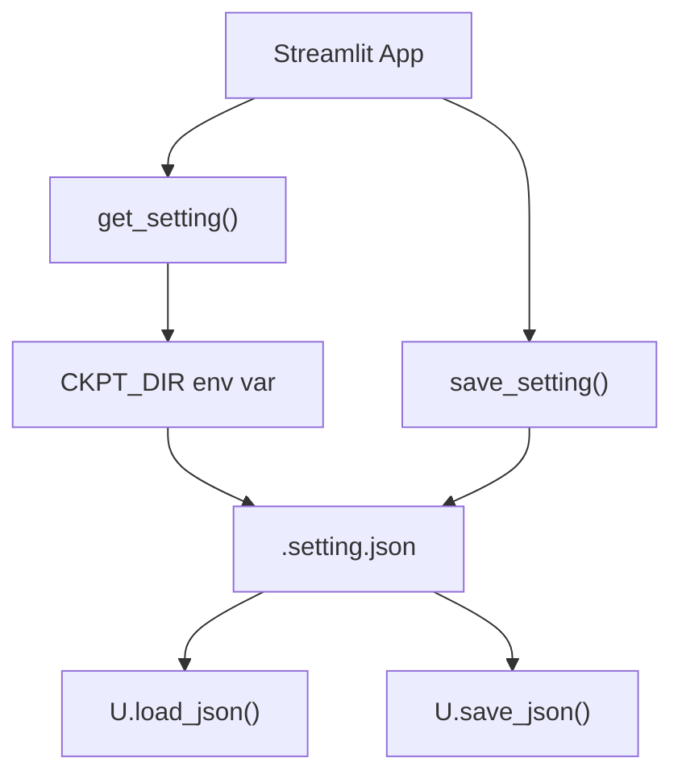
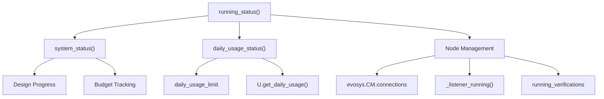
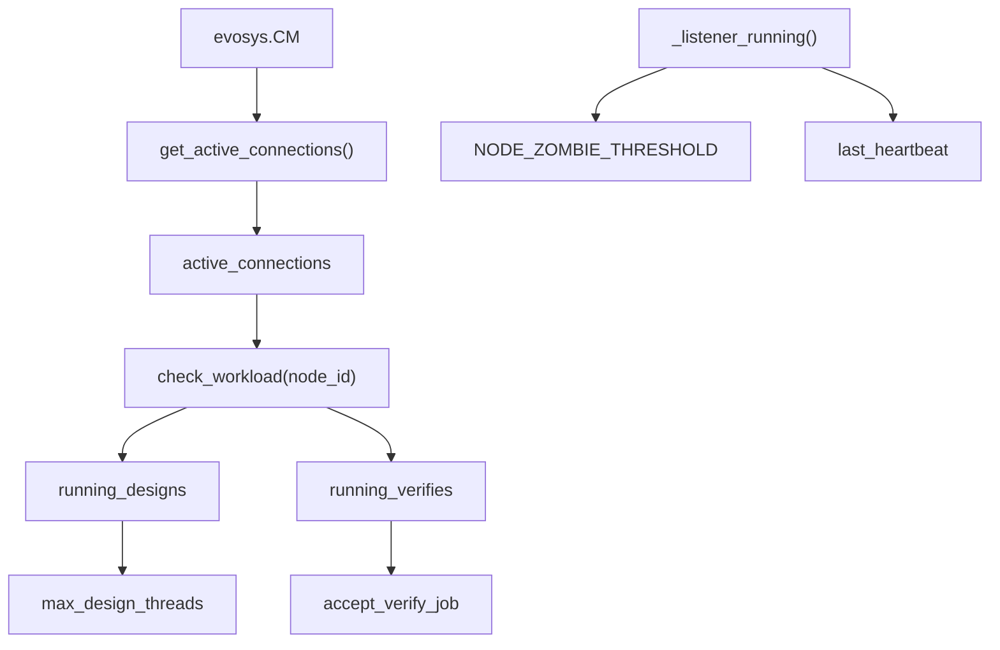
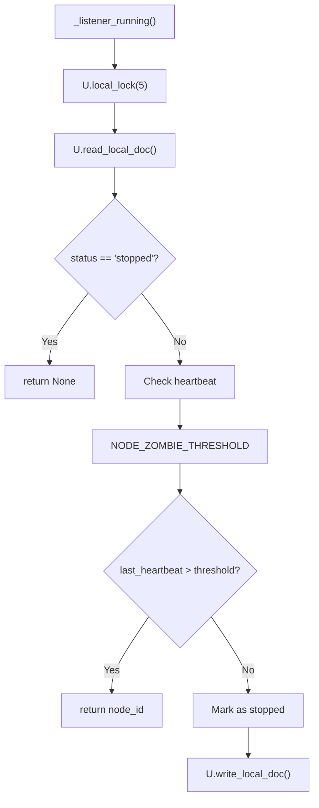

<!-- source: DeepWiki mcp.deepwiki.com · repo allenai/genesys · page 3.2 Application Utilities and Status Management · fetched 2026-10-26 -->

# Application Utilities and Status Management

Relevant source files

The following files were used as context for generating this wiki page:

- [bin/app_utils.py](bin/app_utils.py)

This document covers the utility functions and status management components that support the Genesys application's user interface and operational monitoring. The `bin/app_utils.py` module provides essential infrastructure for settings persistence, system status reporting, UI component generation, and distributed node management.

For information about the main application entry point, see [3.1](#3.1). For details about the CLI interface, see [3.3](#3.3).

## Settings Management

The application uses a JSON-based settings persistence system to store user preferences and configuration state across sessions. Settings are stored in the checkpoint directory specified by the `CKPT_DIR` environment variable.

### Settings Operations

| Function | Purpose | Location |
|----------|---------|----------|
| `get_setting()` | Loads settings from `.setting.json` | [bin/app_utils.py:25-29]() |
| `save_setting()` | Persists settings to `.setting.json` | [bin/app_utils.py:31-34]() |

The settings system uses the utility functions from `model_discovery.utils` to handle JSON serialization and file path operations. Settings are automatically loaded on application startup and saved when modified through the UI.

**Title:** Settings Management Flow

**Sources:** [bin/app_utils.py:25-34]()

## System Status Monitoring

The status monitoring system provides real-time visibility into the evolution system's state, including design progress, budget utilization, and distributed node connectivity.

### Status Components

The system status is displayed through several interconnected functions:

**Title:** Status Monitoring Architecture

**Sources:** [bin/app_utils.py:129-241]()

### Design Progress Tracking

The `system_status()` function displays comprehensive information about the evolution system's progress:

- **Design Counts**: Shows total designs and implemented designs from the phylogenetic tree
- **Budget Progress**: Displays design cost against budget limits with progress bars
- **Verification Budget**: Shows completion status for different training scales
- **Budget Type**: Indicates the current budget configuration

The function uses caching through `st.session_state.use_cache` to optimize performance when displaying large numbers of designs.

**Sources:** [bin/app_utils.py:129-158]()

### Connection Management Status

The distributed system status is managed through the `ConnectionManager` (CM) which tracks active listener nodes:

**Title:** Distributed Node Status Management

**Sources:** [bin/app_utils.py:186-241]()

## UI Utility Functions

The module provides several utility functions for enhancing the Streamlit user interface:

### Grid Layout System

The `grid_view()` function creates responsive grid layouts for displaying collections of items:

- **Flexible Layout**: Configurable items per row and spacing
- **Expandable Cards**: Each item is displayed in an expandable container
- **Button Integration**: Supports embedded buttons with callback functions
- **Icon Support**: Displays icons in expander headers

**Sources:** [bin/app_utils.py:73-100]()

### Theme Management

The `theme_aware_options()` function provides theme-sensitive UI options:

- **Light/Dark Detection**: Responds to Streamlit's theme settings
- **Conditional Styling**: Returns different options based on theme
- **Default Fallback**: Provides sensible defaults when theme is unavailable

**Sources:** [bin/app_utils.py:36-40]()

## Distributed Node Management

The application includes sophisticated management of distributed listener nodes that handle evolution workloads across multiple machines.

### Node Health Monitoring

**Title:** Node Health Check Process

The system uses a heartbeat mechanism to detect zombie nodes:

- **Zombie Detection**: Uses `NODE_ZOMBIE_THRESHOLD` from configuration
- **Automatic Cleanup**: Marks unresponsive nodes as stopped
- **Thread Safety**: Uses local locking to prevent race conditions

**Sources:** [bin/app_utils.py:103-116]()

### Listener Status Refresh

The `_refresh_local_listener_status()` function maintains consistency between the UI and actual listener state:

- **Node Validation**: Checks if reported running nodes are actually alive
- **State Synchronization**: Updates session state when nodes go offline
- **User Notification**: Provides toast notifications for state changes

**Sources:** [bin/app_utils.py:118-125]()

## Visual Components

The module includes utilities for generating visual elements used throughout the application:

### Logo Generation

The `square_logo()` function creates dynamic SVG logos:

- **Template-Based**: Uses SVG templates for consistent styling
- **Color Customization**: Supports custom color schemes
- **Text Rendering**: Handles single or dual-line text layouts
- **PNG Conversion**: Converts SVG to PNG using cairosvg

**Sources:** [bin/app_utils.py:43-65]()

### SVG Processing

The `svg_to_image()` function converts SVG files to PIL Images for display in Streamlit components.

**Sources:** [bin/app_utils.py:67-70]()

## CLI Integration

The module provides CLI-specific utilities:

### Title Display

The `print_cli_title()` function displays the application banner:

- **ASCII Art**: Uses the `art` library for stylized text
- **Welcome Message**: Provides user-friendly introduction
- **Consistent Branding**: Maintains visual identity across interfaces

**Sources:** [bin/app_utils.py:17-23]()

---

