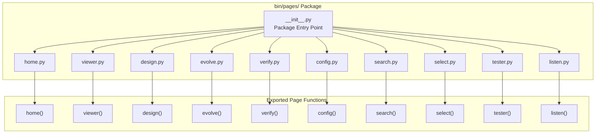
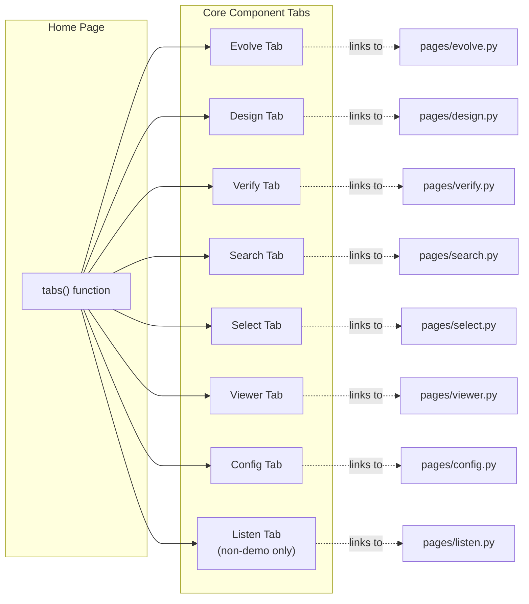
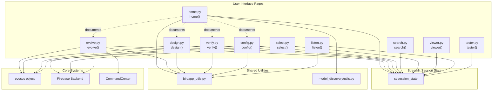

<!-- source: DeepWiki mcp.deepwiki.com · repo allenai/genesys · page 4 User Interface Pages · fetched 2026-10-26 -->

# User Interface Pages

<details>
<summary>Relevant source files</summary>

The following files were used as context for generating this wiki page:

- [bin/pages/__init__.py](bin/pages/__init__.py)
- [bin/pages/home.py](bin/pages/home.py)

</details>


## Purpose and Scope

This document provides an overview of the Streamlit-based user interface page system in Genesys. It explains the page module organization, navigation structure, and common UI patterns used across all interface components. For detailed documentation of specific pages, see:
- [Home Page and System Guide](#4.1)
- [Evolution Control Interface](#4.2)
- [Design Engine Interface](#4.3)
- [Configuration Management Interface](#4.4)
- [Testing and Debug Interface](#4.5)

For information about the main application entry point and session state management, see [Main Application Entry Point](#3.1). For application utilities and status management, see [Application Utilities and Status Management](#3.2).

## Page Module Organization

The Genesys UI consists of multiple Streamlit pages, each implemented as a separate Python module in the `bin/pages/` directory. The page system is organized through a centralized import structure that exposes all page functions through the package's `__init__.py`.

### Page Module Structure



**Sources:** [bin/pages/__init__.py:1-10]()

The `__init__.py` file provides a clean import interface for all page modules. Each imported function represents the entry point for a specific UI page:

| Function | Module | Purpose |
|----------|--------|---------|
| `home()` | `home.py` | Welcome page with system guide and navigation overview |
| `viewer()` | `viewer.py` | Multiple views of system states and results |
| `design()` | `design.py` | Design engine interface for sampling and managing designs |
| `evolve()` | `evolve.py` | Evolution loop control and monitoring |
| `verify()` | `verify.py` | Verification engine for training and evaluation |
| `config()` | `config.py` | Configuration management and synchronization |
| `search()` | `search.py` | Knowledge base search interface (RAG) |
| `select()` | `select.py` | Selector tuning and seed selection testing |
| `tester()` | `tester.py` | Debug utilities and component testing |
| `listen()` | `listen.py` | Node listener status and management |

**Sources:** [bin/pages/__init__.py:1-10]()

## Page Function Signature

Each page module exports a single function that serves as the page's entry point. The standard signature pattern follows this structure:

```python
def page_name(evosys, project_dir):
    # Page implementation
    pass
```

Where:
- `evosys`: The evolution system object containing the current state and configuration
- `project_dir`: Root directory path of the project for accessing assets and resources

**Sources:** [bin/pages/home.py:269]()

## Navigation and Tab Structure

The Genesys UI uses a combination of Streamlit's native sidebar navigation and custom tab-based navigation for organizing content hierarchically. The home page provides a central navigation hub with descriptions of all core components.

### Core Component Tabs



**Sources:** [bin/pages/home.py:29-82]()

The `tabs()` function in `home.py` creates an inline navigation guide that describes each page's purpose. The tab list is dynamically adjusted based on whether the application is running in demo mode:

```python
_tabs = ['Evolve','Design','Verify','Search','Select','Viewer','Config']
if not st.session_state.is_demo:
    _tabs.append('Listen')
```

**Sources:** [bin/pages/home.py:32-34]()

### Tab Descriptions

| Tab | Description | Purpose |
|-----|-------------|---------|
| **Evolve** | Main interface for Model Discovery System | Run full evolution loop with CommandCenter orchestration |
| **Design** | Sampler for single design generation | Sample designs based on seed inputs using design agents |
| **Verify** | Verification engine interface | Train a design under a specific scale and evaluate performance |
| **Search** | Knowledge base interface | RAG-powered search for papers, code, and library documentation |
| **Select** | Selector tuning interface | Test and tune seed selection strategies |
| **Viewer** | System state visualization | Multiple views of system states and results |
| **Config** | Configuration management | Set up experiment settings and synchronize with remote DB |
| **Listen** | Node listener (non-demo) | View running node status and accept commands from master |

**Sources:** [bin/pages/home.py:36-81]()

## Demo Mode vs. Production Mode

The UI adapts its interface based on the `st.session_state.is_demo` flag, which controls feature availability and content presentation:

### Demo Mode Differences

1. **Listen Tab**: Hidden in demo mode since users cannot launch worker nodes
2. **Welcome Header**: Displays "Welcome to Genesys *:orange[Demo]*" instead of "Welcome to Genesys"
3. **Sidebar Content**: Shows demo-specific hints directing users to key results pages

```python
if st.session_state.is_demo:
    st.markdown('# Welcome to Genesys *:orange[Demo]*')
else:
    st.markdown('# Welcome to Genesys')
```

**Sources:** [bin/pages/home.py:90-93](), [bin/pages/home.py:288-299]()

The demo mode sidebar provides navigation hints to key features:

```markdown
Find our results on these pages:
 - **Evolve - Evolution Statistics**
 - **Viewer - Design Artifacts**
 - **Viewer - Design Leaderboard**
```

**Sources:** [bin/pages/home.py:288-299]()

## Page Lifecycle and Session State

Each page function is called whenever Streamlit reruns the application, which happens on any user interaction. Pages rely on `st.session_state` for maintaining state across reruns. Key session state variables used across pages include:

| Session State Key | Type | Purpose |
|-------------------|------|---------|
| `is_demo` | `bool` | Controls demo mode vs. production features |
| `namespace` | `str` | Current experiment namespace |
| `evosys` | `object` | Evolution system instance |
| `firebase_connected` | `bool` | Remote database connection status |
| `listener_status` | `dict` | Node listener status information |

**Sources:** [bin/pages/home.py:33](), [bin/pages/home.py:77](), [bin/pages/home.py:90]()

## Common UI Components

The home page demonstrates several UI patterns that are used throughout the application:

### Sidebar Usage

Pages utilize Streamlit's sidebar for:
- Status information and metrics
- Quick navigation hints
- Context-specific controls
- Visual branding elements

```python
with st.sidebar:
    img_path = U.pjoin(current_dir,'..','assets','gene.PNG')
    st.image(img_path)
    st.caption(f"Today is :blue[{datetime.now().strftime('%b %d, %Y, %A')}].")
```

**Sources:** [bin/pages/home.py:271-286]()

### Icon Guidelines

The system uses consistent icon conventions across pages:

| Icon | Meaning | Usage Context |
|------|---------|---------------|
| 📶 | Online | Namespace connected to remote DB |
| 📴 | Offline | No remote DB connection |
| ♥️ | Emphasis | Highlighting important features or notes |

**Sources:** [bin/pages/home.py:234-239]()

### Theme-Aware Styling

Pages use the `AU.theme_aware_options()` utility function to adapt colors based on the Streamlit theme:

```python
title_color = AU.theme_aware_options(st, "rainbow", "violet", "violet")
st.markdown(f'## :{title_color}[How to launch the evolution?]')
```

**Sources:** [bin/pages/home.py:123-127]()

## Embedded Documentation

The home page embeds comprehensive usage documentation directly in the UI, including:

### Video Tutorials

Video content is embedded using Streamlit's `st.video()` component:

```python
st.video('https://youtu.be/YHBpzImL0vM')
```

**Sources:** [bin/pages/home.py:130]()

### Command-Line Interface Documentation

The home page provides detailed CLI usage instructions for launching nodes and running evolution:

**Node Launch Command:**
```bash
genesys node [-i <node_id>] [-g <group_id>] [-m <max_design_threads>] [-n] [-h]
```

**Evolution Launch Command:**
```bash
genesys evo [-e <evoname>] [-g <group_id>] [-r <design_to_verify_ratio>] [-h]
```

**Sources:** [bin/pages/home.py:149-171]()

### Pre-Flight Checklists

The home page includes interactive checklist items for users to verify before running experiments:

- Configure experiment settings in Config tab
- Estimate costs using Budget Tools
- Tune configs in playgrounds (Design, Verify, Search, Select)
- Upload config to remote DB
- Launch nodes with matching group ID
- Start evolution via CLI or Evolve tab

**Sources:** [bin/pages/home.py:178-198]()

## Page Interconnections

The following diagram shows how pages interact with each other and shared resources:



**Sources:** [bin/pages/__init__.py:1-10](), [bin/pages/home.py:1-305]()

## Asset Management

Pages access static assets stored in `bin/assets/` directory. The home page demonstrates the pattern for loading assets:

```python
current_dir = pathlib.Path(__file__).parent
logo_path = U.pjoin(current_dir, '..', 'assets', 'storm_logo.svg')
logo = AU.svg_to_image(logo_path)
```

Common asset types include:
- SVG logos (`storm_logo.svg`)
- PNG images (`gene.PNG`)
- Markdown documentation files (`howtouse.md`, `selector_notes.md`)

**Sources:** [bin/pages/home.py:16-19](), [bin/pages/home.py:276]()

## Page Communication Patterns

Pages communicate through several mechanisms:

### 1. Session State Variables
Pages read and write to `st.session_state` to share data across page navigation and reruns.

### 2. EvoSys Object
The `evosys` parameter passed to each page function provides access to the evolution system's state and methods.

### 3. Firebase Backend
Configuration and status information is synchronized through Firebase, enabling distributed coordination.

### 4. Project Directory
The `project_dir` parameter allows pages to access shared resources like configuration files, datasets, and checkpoints.

**Sources:** [bin/pages/home.py:269]()

---

This page provides the foundational overview of the UI page system. For implementation details of specific pages, refer to the child documentation pages ([4.1](#4.1) through [4.5](#4.5)).

---

