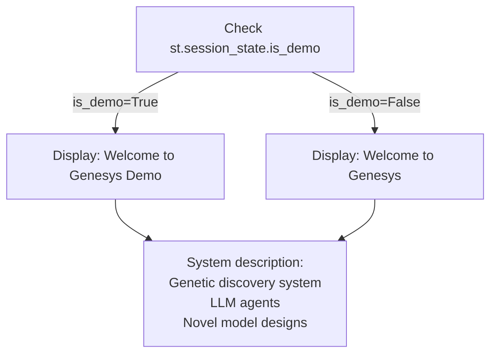
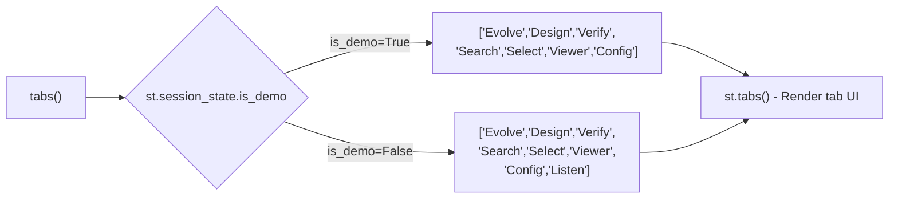
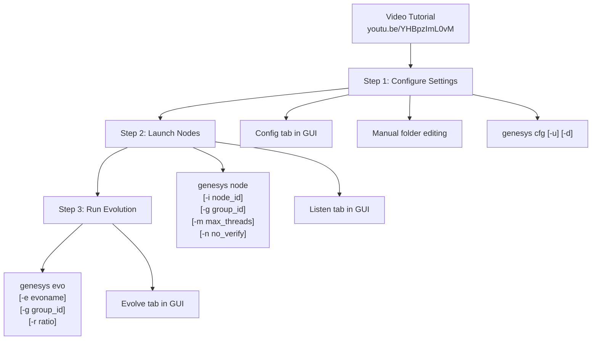
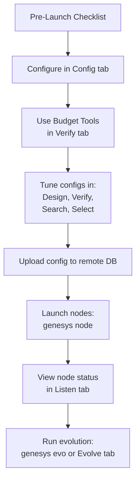
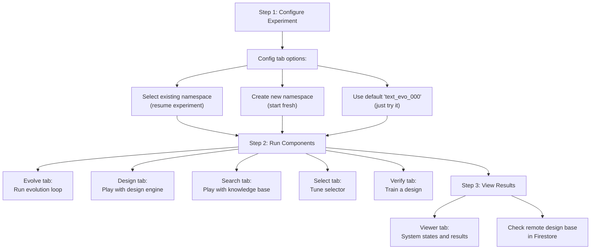
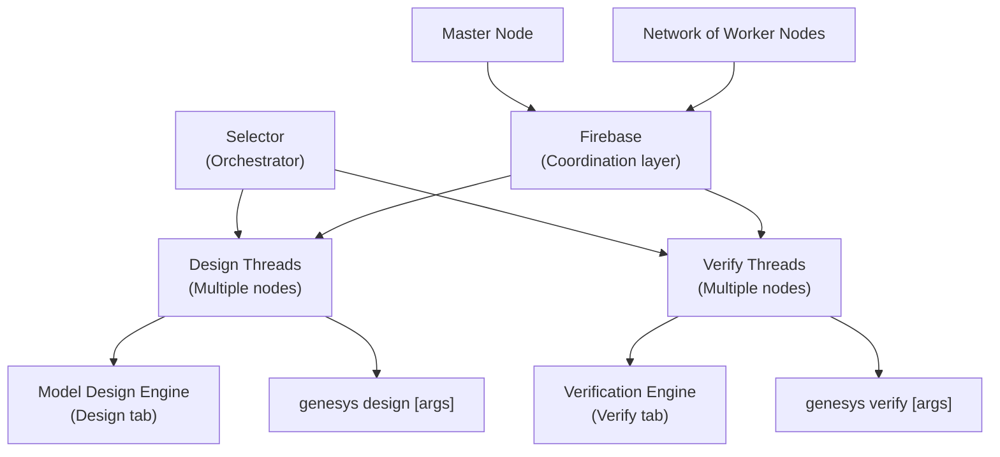
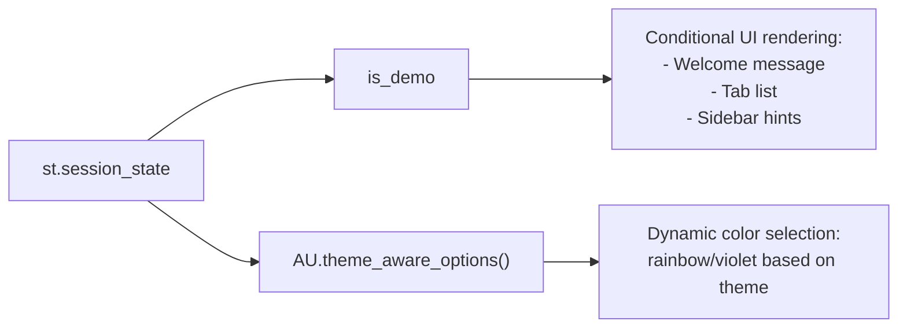
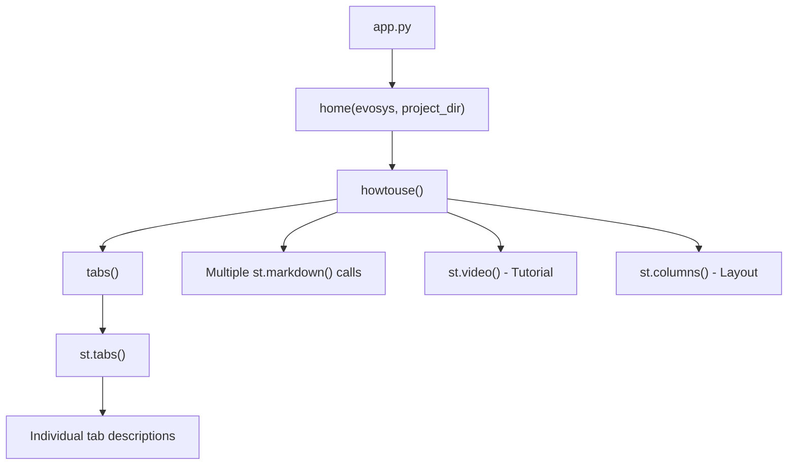

<!-- source: DeepWiki mcp.deepwiki.com · repo allenai/genesys · page 4.1 Home Page and System Guide · fetched 2026-10-26 -->

# Home Page and System Guide

<details>
<summary>Relevant source files</summary>

The following files were used as context for generating this wiki page:

- [bin/assets/howtouse.md](bin/assets/howtouse.md)
- [bin/pages/home.py](bin/pages/home.py)

</details>


## Purpose and Scope

This document describes the home page interface (`bin/pages/home.py`) and the integrated system usage guide that serves as the primary entry point for users of the Genesys GUI. The home page provides an overview of the system, navigation to core components, and step-by-step instructions for running evolution experiments.

For details on the overall Streamlit application architecture, see [Main Application Entry Point](#3.1). For documentation of individual functional pages (Evolve, Design, Config, etc.), see their respective sections under [User Interface Pages](#4).

**Sources:** bin/pages/home.py, bin/assets/howtouse.md

---

## Home Page Structure

The home page is implemented as a single-page Streamlit interface that combines informational content, usage instructions, and component overviews. It is rendered through the `home()` function which serves as the main entry point.

### Main Entry Point

```
home(evosys, project_dir)
```

The `home()` function is defined at [bin/pages/home.py:269-305]() and orchestrates the rendering of all home page elements. It accepts two parameters:
- `evosys`: The evolution system object containing experiment state
- `project_dir`: The root directory path for the project

**Sources:** bin/pages/home.py:269-305

### Page Layout Components

The home page consists of four major functional areas:

| Component | Function | Lines |
|-----------|----------|-------|
| `howtouse()` | Primary content area with instructions and system overview | 85-267 |
| `tabs()` | Component descriptions for navigation tabs | 29-82 |
| Sidebar content | Date display, demo hints, and visual branding | 271-300 |
| Welcome header | Dynamic title based on demo/production mode | 90-106 |

**Sources:** bin/pages/home.py:29-305

---

## System Overview and Welcome Interface

### Welcome Message and System Introduction

The home page begins with a context-aware welcome message that adapts based on deployment mode:



The welcome section [bin/pages/home.py:90-122]() explains:
1. Genesys is a **Gene**tic discovery **sys**tem
2. Uses LLM agents for genetic programming
3. Discovers novel autoregressive language model designs
4. GUI provides observability and manageability vs. CLI

**Sources:** bin/pages/home.py:90-122

### CLI vs. GUI Architecture Explanation

The home page addresses a critical architectural decision by explaining why the GUI exists alongside CLI functionality:

| Aspect | CLI Limitation | GUI Advantage |
|--------|----------------|---------------|
| Observability | Hard to monitor agent behaviors | Direct visualization of agent outputs |
| State Management | Difficult to track multiple threads | Centralized state display |
| Design Artifacts | Cannot display long markdown/python outputs | Integrated artifact viewers |
| Experiment Control | Sequential commands only | Parallel thread management UI |

**Sources:** bin/pages/home.py:109-121

---

## Navigation Tab System

### Component Tab Overview

The `tabs()` function [bin/pages/home.py:29-82]() provides descriptions for all major system components. This creates a quick-reference guide integrated into the home page.



**Sources:** bin/pages/home.py:29-35

### Tab Component Descriptions

Each tab includes a brief description rendered within collapsible sections:

| Tab | Description | Lines | Related Page |
|-----|-------------|-------|--------------|
| **Evolve** | Main interface for full evolution loop; requires Config setup first | 37-44 | [Evolution Control Interface](#4.2) |
| **Design** | Sampler for generating single designs based on inputs | 46-49 | [Design Engine Interface](#4.3) |
| **Verify** | Verification engine for training designs at specified scales | 51-54 | See verification documentation |
| **Search** | Knowledge base interface for RAG (Retrieval-Augmented Generation) | 56-59 | See search documentation |
| **Select** | Seed selection interface for tuning and testing the selector | 61-65 | See selector documentation |
| **Viewer** | Multiple views of system states and results | 67-70 | See viewer documentation |
| **Config** | Experiment settings configuration (must be set before running) | 72-75 | [Configuration Management Interface](#4.4) |
| **Listen** | Node listening mode (production only, not in demo) | 77-81 | See distributed coordination |

**Sources:** bin/pages/home.py:37-81

---

## Usage Instructions and Launch Workflow

### Evolution Launch Guide

The home page includes comprehensive instructions for launching distributed evolution, presented both as video tutorial and step-by-step text:



**Sources:** bin/pages/home.py:126-173

### Configuration Command-Line Interface

The home page documents the `genesys cfg` command for configuration management:

**Command:** `genesys cfg [-u] [-d] [-h]`

| Flag | Long Form | Description |
|------|-----------|-------------|
| `-u` | `--upload` | Upload all local configs to remote DB |
| `-d` | `--download` | Download all configs from remote DB |
| `-h` | `--help` | Display help message |

**Important Note:** The page emphasizes [bin/pages/home.py:147]() that users must "always remember to upload local configs, otherwise it will be overwritten by remote DB."

**Sources:** bin/pages/home.py:141-147

### Node Launch Command-Line Interface

**Command:** `genesys node [-i <node_id>] [-g <group_id>] [-m <max_design_threads>] [-n] [-c] [-s] [-h]`

| Flag | Long Form | Default | Description |
|------|-----------|---------|-------------|
| `-i` | `--node_id` | Random | Optional node identifier |
| `-g` | `--group_id` | `'default'` | Group for simultaneous experiments |
| `-m` | `--max_design_threads` | `5` | Maximum concurrent design threads |
| `-n` | `--no_verify` | False | Node will not accept verification jobs |
| `-c` | `--cpu_only` | False | Design threads run in CPU-only mode |
| `-s` | `--silent` | False | Silent mode (no screen output, check logs) |

**Sources:** bin/pages/home.py:149-159

### Evolution Command-Line Interface

**Command:** `genesys evo [-e <evoname>] [-g <group_id>] [-r <design_to_verify_ratio>] [-h]`

| Flag | Long Form | Default | Description |
|------|-----------|---------|-------------|
| `-e` | `--evoname` | `'text_evo_000'` | Evolution namespace name |
| `-g` | `--group_id` | `'default'` | Must match node group_id |
| `-r` | `--design_to_verify_ratio` | `4` | Ratio of design threads to verification nodes |

The default evolution name can be changed in the Config tab or by directly editing `CKPT_DIR/.setting.json: default_namespace`.

**Sources:** bin/pages/home.py:163-170

---

## Pre-Launch Checklist and Best Practices

The home page provides a comprehensive checklist [bin/pages/home.py:178-198]() to ensure proper system configuration:

### Configuration Checklist



**Sources:** bin/pages/home.py:178-198

### Critical Warnings

The page includes two important warnings:

1. **File Access Conflicts:** [bin/pages/home.py:172]() warns "Avoid running multiple nodes in the same user space to prevent file access conflicts. Instead, utilize all available GPUs in each node."

2. **Config Upload:** [bin/pages/home.py:147]() emphasizes uploading configs to prevent overwriting by the remote DB.

**Sources:** bin/pages/home.py:147, 172

---

## Simplified GUI Usage Guide

For users who want to interact primarily through the GUI (not CLI), the home page provides a simplified three-step workflow:

### Three-Step GUI Workflow



**Sources:** bin/pages/home.py:202-218, bin/assets/howtouse.md:1-24

---

## System Status Indicators and Icon Guidelines

The home page includes an icon guideline section [bin/pages/home.py:233-238]() that explains visual indicators used throughout the application:

### Icon Meanings

| Icon/Symbol | Meaning | Component |
|-------------|---------|-----------|
| 📶 | Online - remote DB connected | Namespace indicator |
| 📴 | Offline - no remote connection | Namespace indicator |
| Listening status | View running node status | Listen tab |

**Sources:** bin/pages/home.py:233-238

---

## Evolution Process Architecture Explanation

The home page concludes with a detailed explanation of the distributed evolution architecture [bin/pages/home.py:241-258]():

### Asynchronous Thread Model



**Sources:** bin/pages/home.py:241-258

### Thread Execution Model

The system continuously runs two types of threads asynchronously until budget exhaustion:

1. **Design Threads**
   - Sample new designs on selected nodes
   - CPU-bound operations
   - API rate-limited (LLM calls)
   - Can be run via Design tab or `genesys design [args]`
   - Location: [bin/pages/home.py:246-248]()

2. **Verify Threads**
   - Run verification on selected designs and scales
   - GPU-intensive operations
   - Can be run via Verify tab or `genesys verify [args]`
   - Location: [bin/pages/home.py:250-252]()

**Sources:** bin/pages/home.py:241-258

### Distributed Coordination Model

The architecture follows a master-worker pattern:

- **Master Node**: Runs the orchestration logic (CommandCenter)
- **Worker Nodes**: Execute design and verification tasks
- **Firebase**: Central coordination mechanism for task distribution
- **GPU Recommendation**: Nodes should run in GPU-available sessions
- **Dual Role**: The master node machine can also run as a worker node

**Sources:** bin/pages/home.py:254-258

---

## Sidebar Content and Contextual Information

### Visual Branding

The sidebar displays contextual imagery:
- Gene/DNA visual at [bin/pages/home.py:276-277]()
- Logo SVG loaded via `AU.svg_to_image()` at [bin/pages/home.py:17-19]()
- Source path: `bin/assets/storm_logo.svg`

**Sources:** bin/pages/home.py:17-19, 276-277

### Date and Context Display

The sidebar shows the current date using `datetime.now().strftime('%b %d, %Y, %A')` at [bin/pages/home.py:285]().

**Sources:** bin/pages/home.py:285

### Demo Mode Hints

When running in demo mode (`st.session_state.is_demo == True`), the sidebar displays special hints [bin/pages/home.py:288-299]() directing users to key result pages:

- **Evolve - Evolution Statistics**
- **Viewer - Design Artifacts**
- **Viewer - Design Leaderboard**

This provides a guided experience for demo users to quickly find interesting results.

**Sources:** bin/pages/home.py:288-299

---

## Integration with Application State

The home page integrates with the Streamlit session state and application utilities:

### Session State Dependencies



**Key State Variables:**
- `st.session_state.is_demo`: Boolean flag controlling demo vs. production UI [bin/pages/home.py:33, 77, 90, 288]()

**Theme Utilities:**
- `AU.theme_aware_options()`: Function from `bin.app_utils` for theme-aware color selection [bin/pages/home.py:123]()

**Sources:** bin/pages/home.py:13, 33, 77, 90, 123, 288

---

## File Structure and Dependencies

### Primary Files

| File Path | Purpose | Key Functions |
|-----------|---------|---------------|
| `bin/pages/home.py` | Main home page implementation | `home()`, `howtouse()`, `tabs()` |
| `bin/assets/howtouse.md` | Legacy usage instructions (now integrated into Python) | N/A (referenced but not actively used) |
| `bin/assets/storm_logo.svg` | Logo graphic for branding | N/A (asset) |
| `bin/assets/gene.PNG` | Sidebar visual | N/A (asset) |

**Sources:** bin/pages/home.py:1-305, bin/assets/howtouse.md

### Import Dependencies

The home page relies on several modules:

```python
import streamlit as st                    # UI framework
import model_discovery.utils as U         # Project utilities
import bin.app_utils as AU                # Application-specific utilities
```

Key utility functions used:
- `U.pjoin()`: Path joining utility
- `U.read_file()`: File reading utility (commented out)
- `AU.svg_to_image()`: SVG to image converter [bin/pages/home.py:19]()
- `AU.theme_aware_options()`: Theme-aware UI customization [bin/pages/home.py:123]()

**Sources:** bin/pages/home.py:5-13

---

## Code Organization Patterns

### Function Call Hierarchy



The home page follows a hierarchical structure where:
1. `home()` orchestrates sidebar and main content
2. `howtouse()` renders the primary instructional content
3. `tabs()` is called within `howtouse()` to provide component overview
4. Streamlit components are called throughout for rendering

**Sources:** bin/pages/home.py:29-305

---

