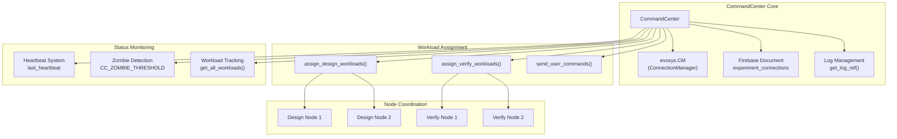
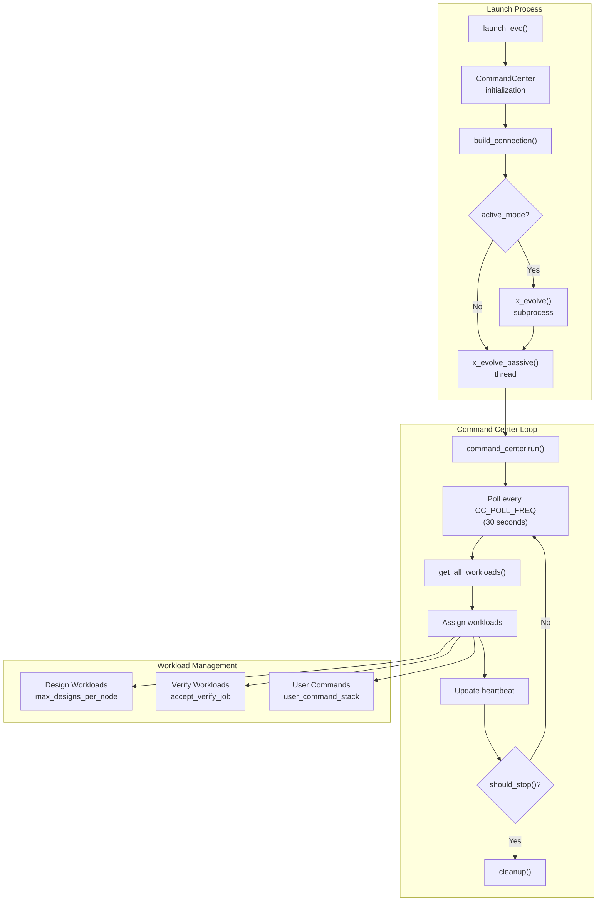
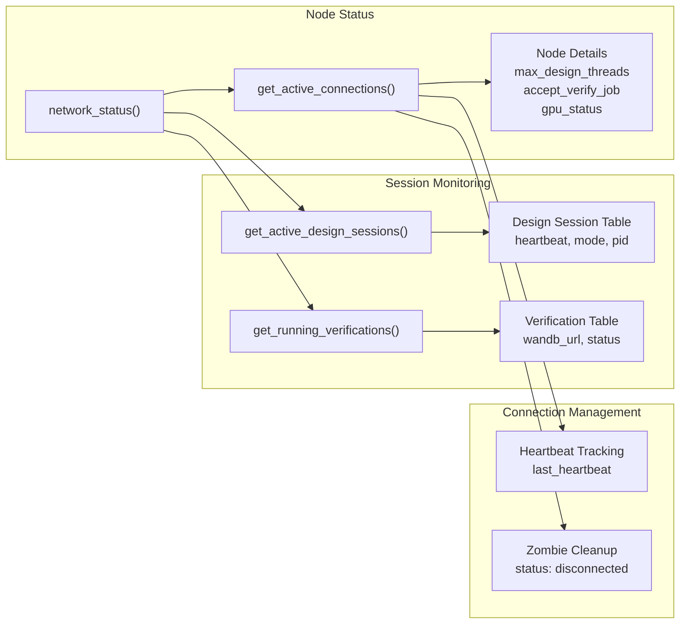
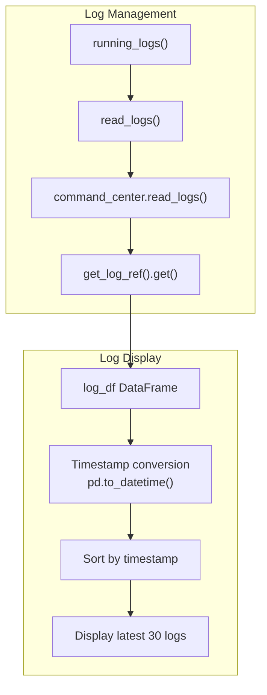
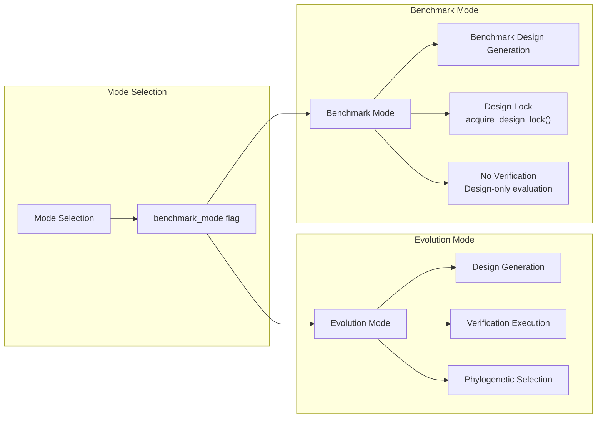

<!-- source: DeepWiki mcp.deepwiki.com · repo allenai/genesys · page 4.2 Evolution Control Interface · fetched 2026-10-26 -->

# Evolution System Control

Relevant source files

The following files were used as context for generating this wiki page:

- [bin/app_utils.py](bin/app_utils.py)
- [bin/pages/evolve.py](bin/pages/evolve.py)

This document covers the evolution system orchestration interface and CommandCenter functionality that controls the distributed evolution process. The system provides centralized coordination for design generation, verification scheduling, and network monitoring across multiple worker nodes.

For information about the worker nodes that execute the actual design and verification tasks, see [Distributed Node Management](#4.9). For details about the underlying evolution algorithms and phylogenetic tree management, see [Model Design Engine](#4.3).

## System Architecture

The evolution system control operates through a centralized CommandCenter that orchestrates distributed worker nodes via Firebase coordination. The system supports both active evolution mode and passive benchmark mode.

### CommandCenter Architecture

Sources: [bin/pages/evolve.py:66-316]()

### Evolution Control Flow

Sources: [bin/pages/evolve.py:346-368](), [bin/pages/evolve.py:207-248]()

## Core Components

### CommandCenter Class

The `CommandCenter` class serves as the central orchestrator for the evolution system, managing workload distribution and node coordination.

| Property | Type | Description |
|----------|------|-------------|
| `evosys` | BuildEvolution | Evolution system instance |
| `max_designs_per_node` | int | Maximum design threads per node |
| `max_designs_total` | int | Total maximum design threads |
| `doc_ref` | DocumentReference | Firebase document reference |
| `running` | bool | Command center running state |
| `poll_freq` | int | Polling frequency (30 seconds) |
| `zombie_threshold` | int | Node timeout threshold (60 seconds) |

Key methods include:
- `build_connection()` - Establishes Firebase connection
- `assign_design_workloads()` - Distributes design tasks
- `assign_verify_workloads()` - Distributes verification tasks
- `send_user_commands()` - Processes user commands
- `run()` - Main orchestration loop

Sources: [bin/pages/evolve.py:66-81](), [bin/pages/evolve.py:87-108]()

### Network Status Monitoring

The system provides comprehensive network monitoring through the `network_status()` function:

Sources: [bin/pages/evolve.py:405-505]()

### User Interface Components

The evolution control provides two primary UI modes:

#### Evolution Launch Pad

The `evolution_launch_pad()` function creates the main control interface:

| Control | Function | Description |
|---------|----------|-------------|
| Max Designs Per Node | `input_max_designs_per_node` | Global per-node design limit |
| Max Designs in Parallel | `input_max_designs_total` | System-wide parallel limit |
| Launch Evolution | `run_evo_btn` | Start evolution process |
| Stop Evolution | `stop_evo_btn` | Stop evolution process |
| Command Input | `user_command` | Send commands to nodes |

Sources: [bin/pages/evolve.py:518-617]()

#### Benchmark Launch Pad

The `benchmark_launch_pad()` function provides benchmark-specific controls with similar interface but adapted for agent benchmarking scenarios.

Sources: [bin/pages/evolve.py:620-687]()

## Monitoring and Logging

### Real-time Logs

The `running_logs()` function displays the latest system logs:

Sources: [bin/pages/evolve.py:689-701]()

### Phylogenetic Tree Monitor

The `ptree_monitor()` function provides visualization of the evolution tree:

| Parameter | Default | Description |
|-----------|---------|-------------|
| `max_nodes` | 300 | Maximum nodes to display |
| `export_height` | 900px | Visualization height |
| `evo_only` | Auto | Show only evolution nodes |
| `bgcolor` | #ffffff | Background color |

Sources: [bin/pages/evolve.py:704-767]()

## Command Processing

The system supports runtime command processing through the `process_user_command()` method:

### Command Types

| Command | Format | Description |
|---------|--------|-------------|
| `verify` | `verify` | Verify next design in queue |
| `verify` | `verify <design_id> <scale>` | Verify specific design |
| `design` | `design` | Generate new design |

Commands are queued in Firebase under `user_command_stack` and processed by the active command center.

Sources: [bin/pages/evolve.py:259-291]()

## System States and Modes

### Evolution vs Benchmark Mode

The system operates in two distinct modes:

Sources: [bin/pages/evolve.py:124-127](), [bin/pages/evolve.py:162-163]()

### Active vs Passive Operation

The CommandCenter supports both active orchestration and passive monitoring:

- **Active Mode**: Full orchestration with workload assignment and node management
- **Passive Mode**: Monitoring-only mode for observation and logging

Sources: [bin/pages/evolve.py:92-108](), [bin/pages/evolve.py:356-357]()

## Integration Points

The Evolution System Control integrates with several other system components:

- **ConnectionManager**: Node coordination and communication
- **Firebase**: Distributed state management and logging
- **PTree**: Phylogenetic tree updates and design selection
- **VerificationEngine**: Training job scheduling and monitoring
- **Streamlit**: User interface and real-time status display

Sources: [bin/pages/evolve.py:228-241](), [bin/pages/evolve.py:346-368]()

---

