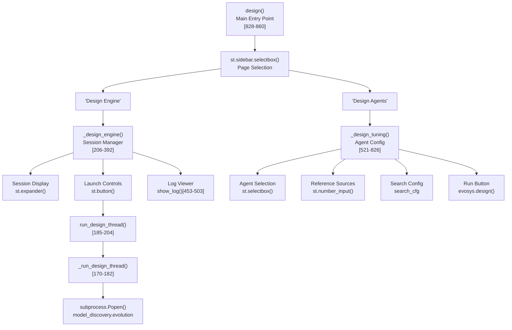
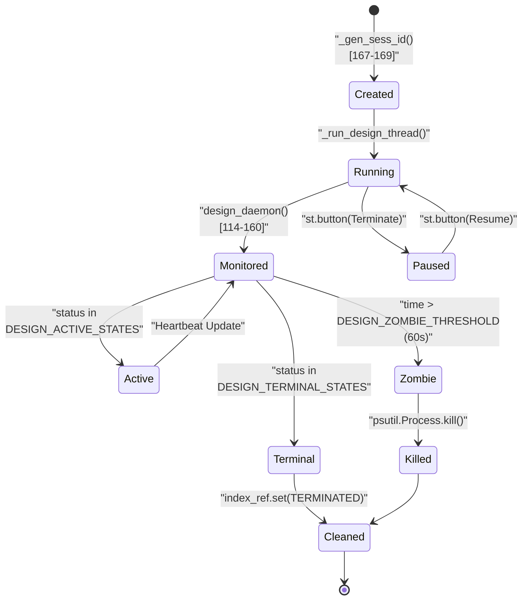
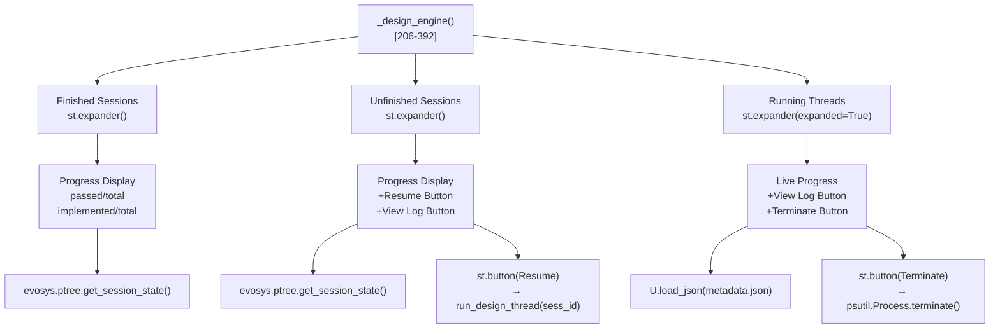
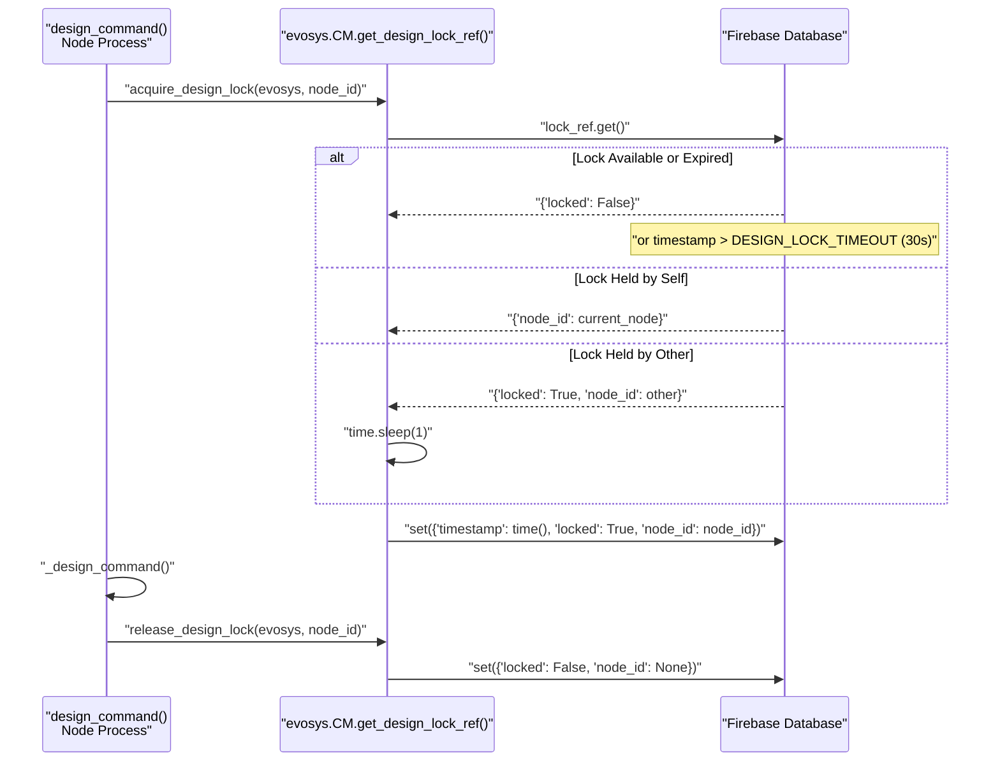
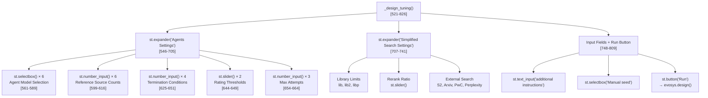
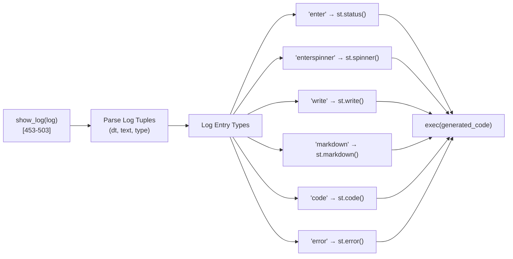
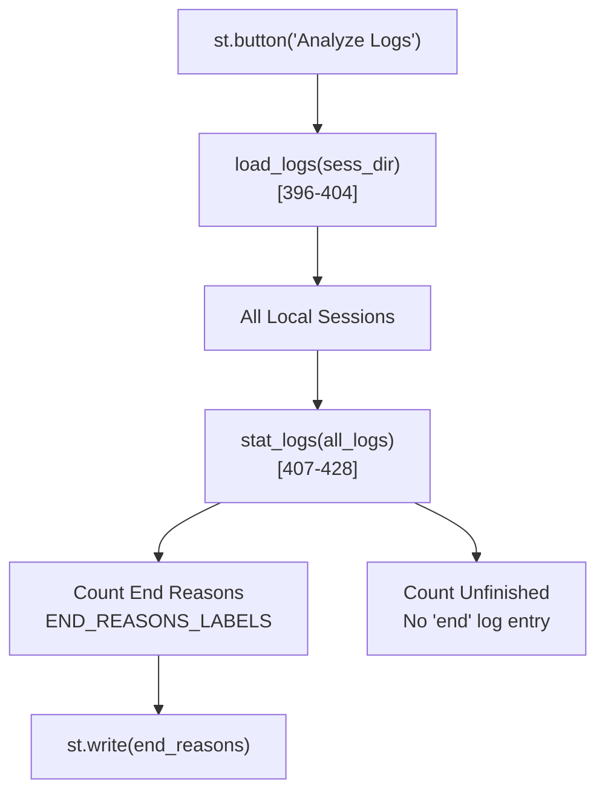
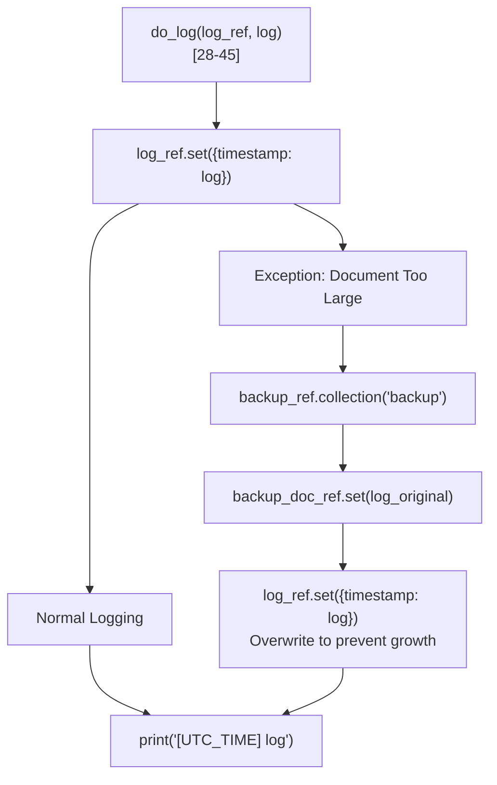
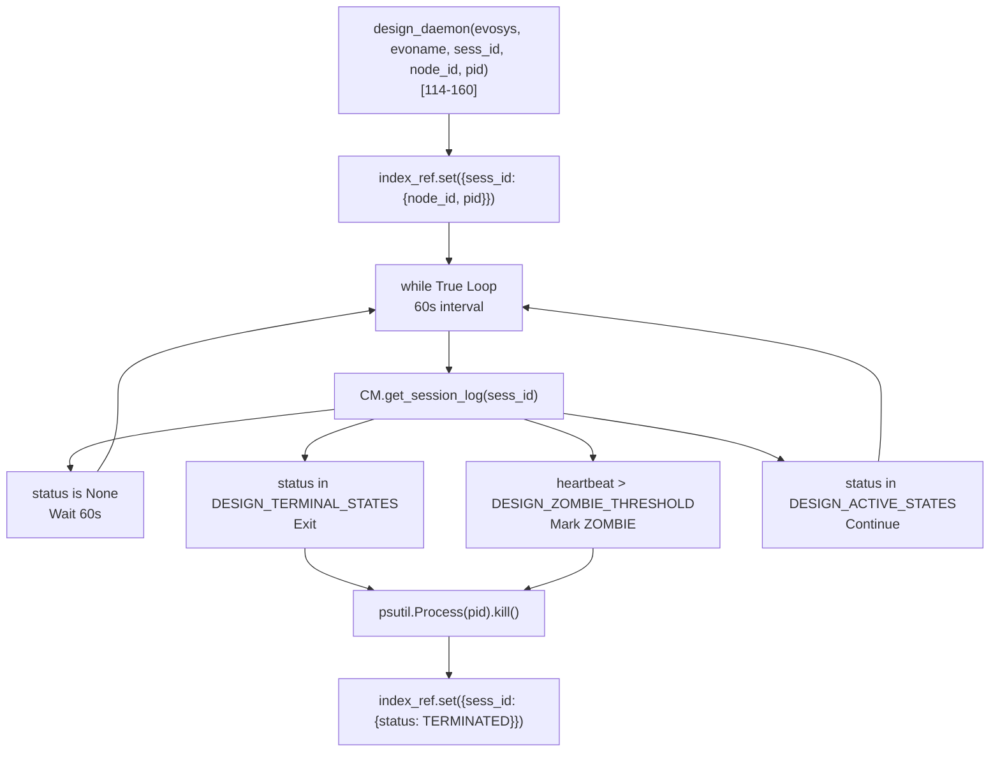

<!-- source: DeepWiki mcp.deepwiki.com · repo allenai/genesys · page 4.3 Design Engine Interface · fetched 2026-10-26 -->

# Design Engine Interface

<details>
<summary>Relevant source files</summary>

The following files were used as context for generating this wiki page:

- [README.md](README.md)
- [bin/pages/design.py](bin/pages/design.py)

</details>


## Purpose and Scope

The Design Engine Interface provides the Streamlit-based UI for configuring, launching, and monitoring design sessions within the Genesys evolution system. Located at [bin/pages/design.py](), this interface exposes controls for design thread management, agent configuration, and real-time session monitoring.

This page documents the user interface components, session lifecycle management, and configuration options exposed through the design page. For the underlying evolution orchestration logic, see page 4.2. For the actual agent implementations and algorithms, see page 5.2.

## Interface Architecture

The Design Engine Interface is implemented in [bin/pages/design.py]() and consists of two main UI modes accessible through a sidebar selector: **Design Engine** for session management and **Design Agents** for configuration.

### Page Structure and Navigation Flow



Sources: [bin/pages/design.py:828-860](), [bin/pages/design.py:206-392](), [bin/pages/design.py:521-826]()

### Design Session State Machine



Sources: [bin/pages/design.py:167-169](), [bin/pages/design.py:114-160](), [bin/pages/design.py:19-20]()

## Session Management Interface

### Session Lifecycle Functions

The interface manages design sessions through a hierarchy of functions:

| Function | Location | Purpose | Key Actions |
|----------|----------|---------|-------------|
| `_gen_sess_id()` | [167-169]() | Generate session ID | `f"{datetime.now()}-{uuid4()[:6]}"` |
| `run_design_thread()` | [185-204]() | UI thread launcher | Check `max_design_threads`, spawn process |
| `_run_design_thread()` | [170-182]() | Spawn subprocess | `subprocess.Popen(model_discovery.evolution)` |
| `design_command()` | [50-62]() | CLI/node launcher | Acquire lock, launch daemon monitor |
| `design_daemon()` | [114-160]() | Process monitor | Heartbeat check, zombie detection |

### Session Progress Display

The interface displays session progress through multiple UI components:



Sources: [bin/pages/design.py:226-277](), [bin/pages/design.py:308-350](), [bin/pages/design.py:254-256]()

### Distributed Lock Protocol

The interface implements a Firebase-based lock to serialize design operations across distributed nodes:



Sources: [bin/pages/design.py:64-88](), [bin/pages/design.py:25]()

## Agent Configuration Interface

### Agent Selection Controls

The `_design_tuning()` function provides UI controls for configuring the six specialized design agents:

| Agent Type | UI Label | Options Source | Optional |
|------------|----------|----------------|----------|
| `DESIGN_PROPOSER` | "Proposal Agent" | `AGENT_OPTIONS['DESIGN_PROPOSER']` | No |
| `PROPOSAL_REVIEWER` | "Proposal Reviewer" | `AGENT_OPTIONS['PROPOSAL_REVIEWER']` | No |
| `IMPLEMENTATION_PLANNER` | "Impl. Planner" | `AGENT_OPTIONS[...]` + `['None']` | Yes |
| `IMPLEMENTATION_CODER` | "Implementation Coder" | `AGENT_OPTIONS['IMPLEMENTATION_CODER']` | No |
| `IMPLEMENTATION_OBSERVER` | "Impl. Observer" | `AGENT_OPTIONS[...]` + `['None']` | Yes |
| `SEARCH_ASSISTANT` | "*Sep. Search Assistant*" | Disabled | N/A |

**Hybrid Agent Support**: All agents support `'hybrid'` option for weighted random model selection at runtime.

Sources: [bin/pages/design.py:561-589]()

### Configuration Form Structure

The interface organizes configuration into collapsible sections:



Sources: [bin/pages/design.py:546-741](), [bin/pages/design.py:748-809]()

## Session Monitoring Features

### Real-Time Status Display

The `_design_engine()` function displays three categories of sessions:

**Finished Sessions** [229-249]():
```
Session ID: `{sess_id[:32]}`
Proposal passed: `{len(passed)}/{num_samples[proposal]}` ✅/❌
Implementation succeed: `{len(implemented)+len(challenging)}({len(challenging)})/{num_samples[implementation]}` ✅/❌
[View Log] button
```

**Unfinished Sessions** [251-277]():
- Same display format as finished sessions
- Additional `[Resume]` button calls `run_design_thread(evosys, sess_id)`
- `[Delete]` button (disabled)

**Running Threads** [308-350]():
- Live progress with ⏩ indicator
- Real-time updates from `U.load_json(metadata.json)`
- `[View Log]` and `[Terminate]` buttons
- Termination uses `psutil.Process(pid).terminate()`

Sources: [bin/pages/design.py:229-277](), [bin/pages/design.py:308-350]()

### Log Viewer System

The log viewer renders session logs through a custom interpreter:



**Log Loading**: `load_log(log_file)` [505-514]() reads `.log` files from `sessions/{sess_id}/log/` and parses each line as a tuple.

Sources: [bin/pages/design.py:453-514]()

### Log Analysis Tools

The sidebar `[🔍 Analyze Logs]` button [383-391]() triggers `stat_logs()`:



Sources: [bin/pages/design.py:383-428]()

## Firebase Integration

### Logging and Coordination

The interface coordinates with Firebase through `do_log()` [28-45]():



**Firebase References Used**:
- `evosys.CM.get_log_ref()` - Experiment logs
- `evosys.CM.get_design_lock_ref()` - Distributed lock
- `evosys.CM.get_session_log(sess_id)` - Session status, heartbeat
- `evosys.CM.get_design_sessions_index()` - Session registry

Sources: [bin/pages/design.py:28-45](), [bin/pages/design.py:119-121]()

### Daemon Monitoring Process

The `design_daemon()` function [114-160]() monitors session health:



Sources: [bin/pages/design.py:114-160]()

### Evolution System Integration Points

The interface accesses evolution system components through `evosys`:

| Attribute | Purpose | Usage Example |
|-----------|---------|---------------|
| `evosys.ptree` | Phylogenetic tree | `get_unfinished_designs()`, `get_session_state()` |
| `evosys.CM` | Connection Manager | `get_log_ref()`, `get_design_lock_ref()` |
| `evosys.design_cfg` | Design config | Read default agent types, termination settings |
| `evosys.select_cfg` | Selection config | Pass to `evosys.design()` with `n_sources` |
| `evosys.search_cfg` | Search config | Default search limits, reranking |

Sources: [bin/pages/design.py:94-95](), [bin/pages/design.py:227-228](), [bin/pages/design.py:535-536]()

## Configuration Structure

### Design Configuration Dictionary

The `_design_tuning()` function builds a configuration dictionary from UI inputs:

```python
design_cfg = {
    'agent_types': {
        'DESIGN_PROPOSER': selected_model,      # st.selectbox
        'PROPOSAL_REVIEWER': selected_model,
        'IMPLEMENTATION_PLANNER': selected_model,
        'IMPLEMENTATION_CODER': selected_model,
        'IMPLEMENTATION_OBSERVER': selected_model,
        'SEARCH_ASSISTANT': 'disabled'
    },
    'termination': {
        'max_failed_rounds': int,     # st.number_input
        'max_total_budget': float,
        'max_debug_budget': float
    },
    'threshold': {
        'proposal_rating': int,        # st.slider [0-5]
        'implementation_rating': int
    },
    'max_attemps': {                   # Note: typo in original
        'design_proposal': int,        # st.number_input
        'implementation_debug': int,
        'post_refinement': int,
        'max_search_rounds': int
    },
    'crossover_no_ref': bool,         # st.checkbox
    'mutation_no_tree': bool,
    'scratch_no_tree': bool,
    'use_unlimited_prompt': bool,
    'unittest_pass_required': bool,
    'no_f_checkers': bool,
    'flow_type': 'naive' or 'gau'     # st.checkbox
}
```

### Search Configuration Dictionary

```python
search_cfg = {
    'result_limits': {
        'lib': int,      # Library Primary (st.number_input)
        'lib2': int,     # Library Secondary
        'libp': int,     # Library Plus
        's2': int,       # Semantic Scholar
        'arxiv': int,    # ArXiv papers
        'pwc': int       # Papers With Code
    },
    'rerank_ratio': float,  # st.slider [0.0-1.0]
    'proposal_search_cfg': {
        'top_k': int,       # st.number_input
        'cutoff': float     # st.slider [0.0-1.0]
    },
    'perplexity_settings': {
        'model_size': str,  # st.selectbox ['none','small','large','huge']
        'max_tokens': int   # st.number_input
    }
}
```

### Selection Configuration (n_sources)

Reference sampling configuration built from UI:

```python
n_sources = {
    'ReferenceCoreWithTree': int,       # st.number_input (default: 0)
    'DesignArtifactImplemented': int,   # st.number_input (default: 0)
    'DesignArtifact': int,              # st.number_input (default: 1)
    'ReferenceCore': int,               # st.number_input (default: 1)
    'ReferenceWithCode': int,           # st.number_input (default: 1)
    'Reference': int                    # st.number_input (default: 1)
}
```

Sources: [bin/pages/design.py:535-536](), [bin/pages/design.py:599-664](), [bin/pages/design.py:708-740]()

### Demo Mode Restrictions

When `st.session_state.is_demo` is `True` [209-210]():

- Most agent selections disabled at `'gpt-4.1-nano'`
- `IMPLEMENTATION_PLANNER` and `OBSERVER` can be `'None'`
- Search settings disabled (lib=0, rerank=0.0)
- `max_total_budget` forced to `0.05`
- `max_failed_rounds` forced to `3`
- Daily usage limit check before allowing runs

Sources: [bin/pages/design.py:209-210](), [bin/pages/design.py:580-586](), [bin/pages/design.py:766-769]()

## Command Line Interface

The Design Engine provides CLI access through command-line arguments:

```bash
python -m bin.pages.design --evoname <namespace> --resume --daemon --sess_id <id> --node_id <id> --pid <pid>
```

**CLI Parameters:**
- `--evoname`: Evolution namespace identifier
- `--resume`: Resume existing unfinished sessions
- `--daemon`: Run in daemon mode for process monitoring
- `--sess_id`: Specific session identifier
- `--node_id`: Distributed node identifier
- `--pid`: Process ID for monitoring

Sources: [bin/pages/design.py:863-898]()

---

