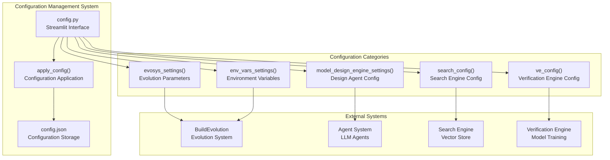
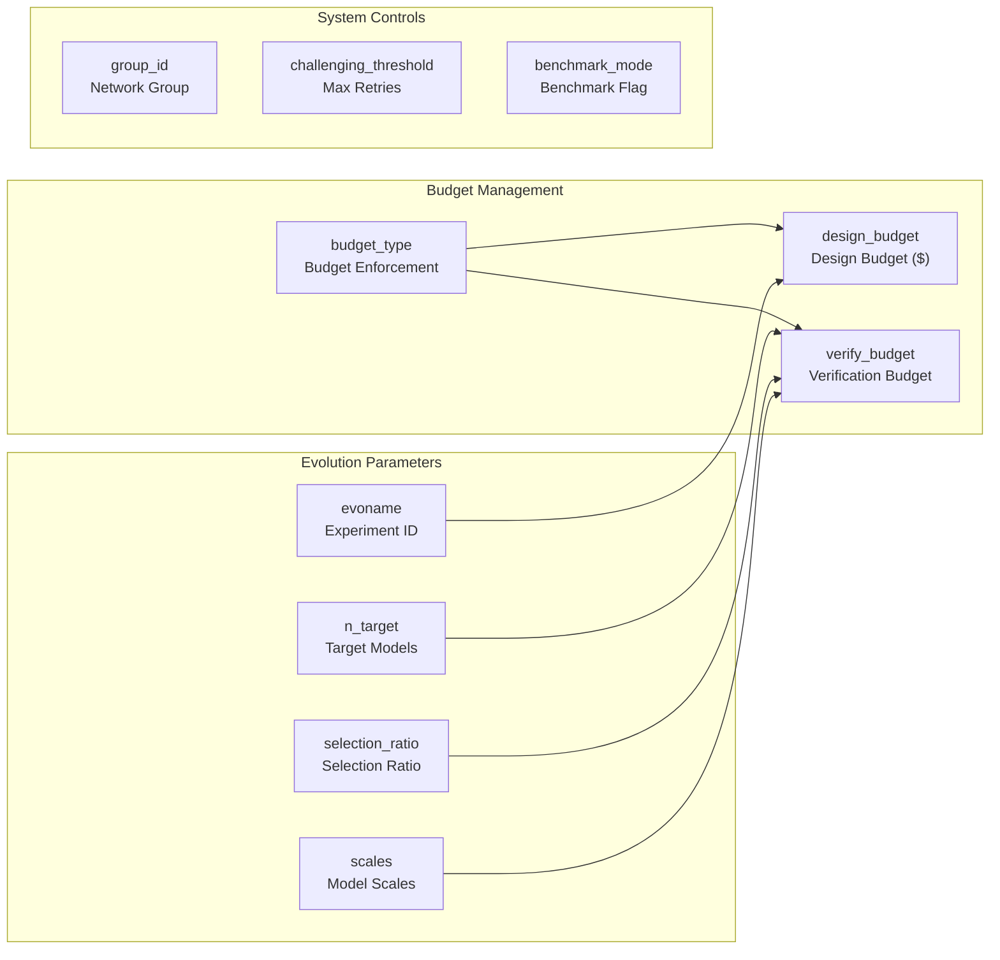
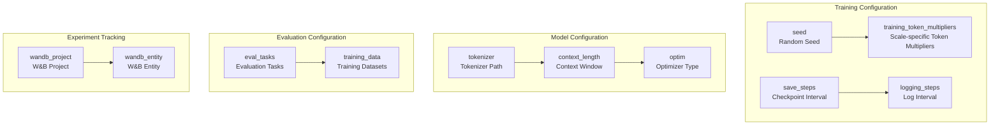
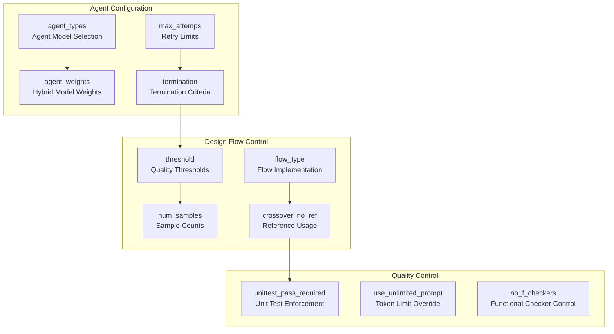
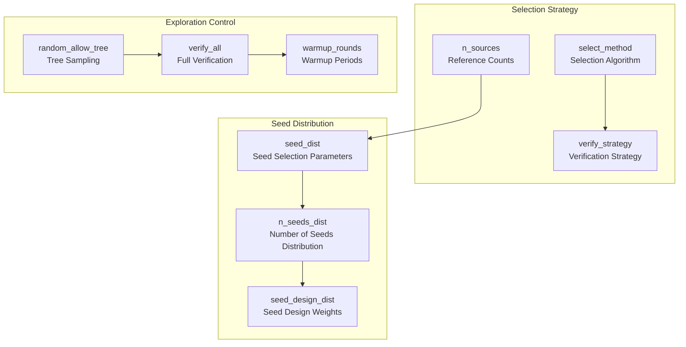
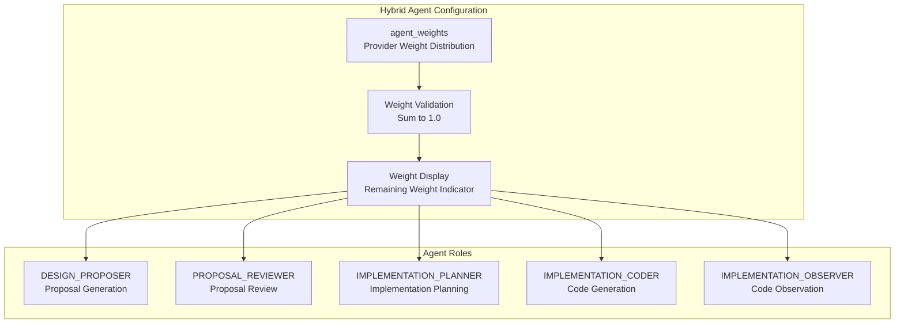

<!-- source: DeepWiki mcp.deepwiki.com · repo allenai/genesys · page 4.4 Configuration Management Interface · fetched 2026-10-26 -->

# System Configuration Management

<details>
<summary>Relevant source files</summary>

The following files were used as context for generating this wiki page:

- [README.md](README.md)
- [bin/pages/config.py](bin/pages/config.py)

</details>


This document covers the comprehensive configuration management system for Genesys experiments, including evolution parameters, design agents, search engines, verification settings, and environment variables. The configuration system provides both web-based and CLI interfaces for managing experiment settings and distributed system parameters.

For information about the user interface for configuration management, see [Evolution System Control](#4.2). For deployment-specific configuration, see [Container Configuration](#6.1).

## Overview

The system configuration management is implemented through a modular configuration system that handles five main categories of settings:

1. **Evolution System Parameters** - Core evolution settings like budgets, scales, and termination criteria
2. **Design Engine Configuration** - Agent types, termination conditions, and design flow settings  
3. **Search Engine Configuration** - Vector databases, embedding models, and search parameters
4. **Verification Engine Configuration** - Training parameters, evaluation tasks, and model settings
5. **Environment Variables** - API keys, file paths, and external service connections



**Sources:** [bin/pages/config.py:1-50]()

## Evolution System Configuration

The evolution system configuration manages the core parameters that control the evolutionary process, including budget allocation, model scales, and termination criteria.

### Core Evolution Parameters

The system supports several key configuration parameters:

| Parameter | Type | Description |
|-----------|------|-------------|
| `evoname` | String | Experiment namespace identifier |
| `scales` | String | Comma-separated list of model scales (e.g., "14M,35M,70M") |
| `selection_ratio` | Float | Ratio of designs to keep from lower scales |
| `n_target` | Integer | Number of models to train at target scale |
| `design_budget` | Float | Budget limit for design operations ($) |
| `verify_budget` | Dict | Per-scale verification budget allocation |
| `budget_type` | String | Budget enforcement type ("design_bound" or "verify_bound") |



The `evosys_config()` function provides a Streamlit form interface for configuring these parameters, with validation and automatic budget calculation based on the selection ratio and target models.

**Sources:** [bin/pages/config.py:114-224](), [bin/pages/config.py:20-33]()

### Verification Engine Configuration

The verification engine configuration controls model training and evaluation parameters:



The `ve_config()` function manages these settings through a dedicated form interface that supports scale-specific token multipliers and dataset configuration.

**Sources:** [bin/pages/config.py:308-360]()

## Design Engine Configuration

The design engine configuration manages the LLM agents responsible for generating and implementing model designs.

### Agent Type Configuration

The system supports six different agent roles, each configurable with different LLM providers:

| Agent Role | Function | Available Models |
|------------|----------|------------------|
| `DESIGN_PROPOSER` | Generate design proposals | OpenAI, Anthropic, Together |
| `PROPOSAL_REVIEWER` | Review and score proposals | OpenAI, Anthropic, Together |
| `IMPLEMENTATION_PLANNER` | Plan implementation steps | OpenAI, Anthropic, Together |
| `IMPLEMENTATION_CODER` | Generate implementation code | OpenAI, Anthropic, Together |
| `IMPLEMENTATION_OBSERVER` | Observe and debug implementations | OpenAI, Anthropic, Together |
| `SEARCH_ASSISTANT` | Perform knowledge search | OpenAI, Anthropic, Together |



The `design_config()` function provides comprehensive configuration for agent behavior, including termination conditions, quality thresholds, and design flow parameters.

**Sources:** [bin/pages/config.py:499-637](), [bin/pages/config.py:363-370]()

### Selector Configuration

The selector configuration manages how seed designs are chosen for evolution:



The `select_config()` function manages these parameters through a multi-section form that includes reference source configuration, seed distribution settings, and exploration parameters.

**Sources:** [bin/pages/config.py:379-496]()

## Search Engine Configuration

The search engine configuration manages vector databases, embedding models, and search parameters for knowledge retrieval.

### Vector Store Configuration

```mermaid
graph TB
    subgraph "Internal Library Search"
        LibResults["result_limits.lib<br/>Primary Library Results"]
        Lib2Results["result_limits.lib2<br/>Secondary Library Results"]
        LibPResults["result_limits.libp<br/>Library Plus Results"]
        RerankRatio["rerank_ratio<br/>Reranking Scale"]
    end
    
    subgraph "External Search Services"
        S2Results["result_limits.s2<br/>Semantic Scholar Results"]
        ArxivResults["result_limits.arxiv<br/>ArXiv Results"]
        PWCResults["result_limits.pwc<br/>Papers with Code Results"]
        PerplexityConfig["perplexity_settings<br/>Perplexity API Config"]
    end
    
    subgraph "Embedding Configuration"
        VectorstoreEmbedding["embedding_models.vectorstore<br/>Vector Store Embeddings"]
        ProposalEmbedding["embedding_models.proposal<br/>Proposal Search Embeddings"]
        UnitEmbedding["embedding_models.unitcode<br/>Unit Code Embeddings"]
    end
    
    subgraph "Search Parameters"
        ProposalSearch["proposal_search<br/>Proposal Search Config"]
        UnitSearch["unit_search<br/>Unit Search Config"]
        IndexName["index_name<br/>Vector Store Index"]
    end
    
    LibResults --> RerankRatio
    S2Results --> PerplexityConfig
    VectorstoreEmbedding --> ProposalEmbedding
    ProposalEmbedding --> UnitEmbedding
    ProposalSearch --> UnitSearch
    UnitSearch --> IndexName
```



The search configuration supports multiple embedding providers including OpenAI, Cohere, and Together, with configurable distance metrics and search parameters.

**Sources:** [bin/pages/config.py:646-781](), [bin/pages/config.py:640-644]()

## Environment Variable Management

The system manages API keys and system paths through environment variable configuration:

### API Key Configuration

| Service | Environment Variable | Purpose |
|---------|---------------------|---------|
| OpenAI | `MY_OPENAI_KEY` | OpenAI API access |
| Anthropic | `ANTHROPIC_API_KEY` | Anthropic API access |
| Together | `TOGETHER_API_KEY` | Together API access |
| Weights & Biases | `WANDB_API_KEY` | Experiment tracking |
| Pinecone | `PINECONE_API_KEY` | Vector database access |
| Semantic Scholar | `S2_API_KEY` | Academic paper search |
| Cohere | `COHERE_API_KEY` | Cohere API access |
| Perplexity | `PERPLEXITY_API_KEY` | Perplexity API access |

### System Path Configuration

| Variable | Purpose |
|----------|---------|
| `CKPT_DIR` | Checkpoint storage directory |
| `DATA_DIR` | Training data directory |
| `DB_KEY_PATH` | Database key file path |
| `HF_KEY` | Hugging Face API key |

The `env_vars_settings()` function provides a secure form interface for managing these sensitive configuration values.

**Sources:** [bin/pages/config.py:937-967]()

## Advanced Configuration Options

The system provides advanced configuration options for fine-tuning system behavior:

### Hybrid Agent Weights

For agents configured as "hybrid", the system allows specification of probability weights for different LLM providers:



### Selector Ranking Configuration

The selector supports advanced ranking and exploration configurations:

- **Ranking Methods**: Multiple ranking algorithms including Markov chain methods
- **Exploration Parameters**: Probability-based exploration with scheduler control
- **Quadrant Analysis**: Design and confidence quantile-based selection
- **Filtering Thresholds**: Metric filtering based on performance thresholds

**Sources:** [bin/pages/config.py:816-933]()

## Configuration Application and Persistence

The configuration system provides multiple mechanisms for applying and persisting settings:

### Application Functions

| Function | Purpose |
|----------|---------|
| `apply_config()` | Apply complete configuration set |
| `apply_select_config()` | Apply selector-specific configuration |
| `apply_design_config()` | Apply design agent configuration |
| `apply_search_config()` | Apply search engine configuration |
| `apply_ve_config()` | Apply verification engine configuration |
| `apply_env_vars()` | Apply environment variable changes |

### Configuration Storage

Configurations are stored in JSON format within each experiment directory:

```
{experiment_dir}/
├── config.json          # Main configuration file
├── select_cfg/          # Selector configuration
├── design_cfg/          # Design agent configuration
├── search_cfg/          # Search engine configuration
└── ve_cfg/              # Verification engine configuration
```

### Remote Configuration Management

The system supports remote configuration synchronization through Firebase:

- `sync_exps_to_db()` - Upload local configurations to remote database
- `sync_exps_from_db()` - Download configurations from remote database
- `delete_exp_from_db()` - Remove experiment from remote database

**Sources:** [bin/pages/config.py:38-113](), [bin/pages/config.py:784-814]()

## CLI Configuration Interface

The system provides a command-line interface for configuration management:

```bash
# Upload all local configurations to remote database
python bin/pages/config.py --upload

# Download all configurations from remote database
python bin/pages/config.py --download
```

This CLI interface enables automated configuration synchronization for distributed deployments and backup operations.

**Sources:** [bin/pages/config.py:1178-1207]()

---

