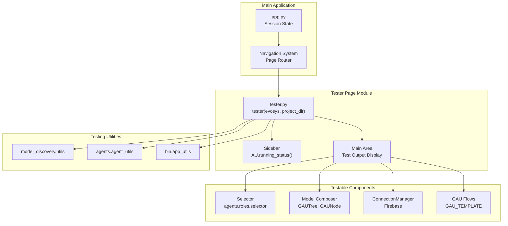
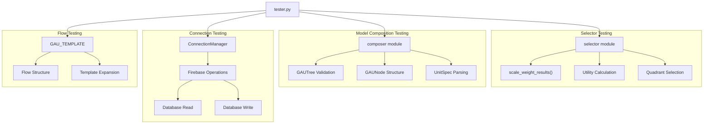
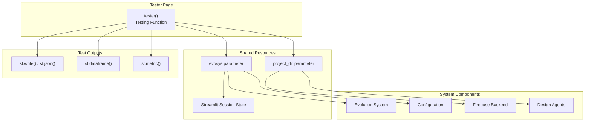

<!-- source: DeepWiki mcp.deepwiki.com · repo allenai/genesys · page 4.5 Testing and Debug Interface · fetched 2026-10-26 -->

# Testing and Debug Interface

<details>
<summary>Relevant source files</summary>

The following files were used as context for generating this wiki page:

- [bin/pages/tester.py](bin/pages/tester.py)

</details>


## Purpose and Scope

The Testing and Debug Interface provides a dedicated environment within the Streamlit application for debugging and testing individual system components. This page enables developers to verify component functionality, inspect state, and troubleshoot issues without running full evolution experiments. It serves as a sandbox for rapid iteration and validation of system components.

For operational monitoring of running evolution sessions, see [Evolution Control Interface](#4.2). For design agent debugging, see [Design Engine Interface](#4.3). For configuration inspection, see [Configuration Management Interface](#4.4).

**Sources:** [bin/pages/tester.py:1-45]()

---

## Page Architecture

The tester page is implemented as a Streamlit page module that integrates with the main application navigation system. It provides a minimal interface focused on displaying test results and debugging information.



**Sources:** [bin/pages/tester.py:1-45]()

---

## Page Implementation

### Function Signature

The tester page is implemented through the `tester()` function, which follows the standard Streamlit page function pattern used throughout the application:

```python
def tester(evosys, project_dir)
```

| Parameter | Type | Description |
|-----------|------|-------------|
| `evosys` | Evolution System | The main evolution system instance containing session state and configuration |
| `project_dir` | str | Root directory path for the project |

**Sources:** [bin/pages/tester.py:34-35]()

### Current UI Elements

The page currently implements a minimal interface with two primary components:

1. **Sidebar Status Display**: Uses `AU.running_status()` to show current evolution system status
2. **Main Title**: Displays "Testing page (for debugging)" as the page header

```mermaid
graph LR
    subgraph "Tester Page Layout"
        Sidebar["Sidebar<br/>running_status()"]
        MainArea["Main Area<br/>st.title()"]
    end
    
    EvosysState["evosys<br/>Evolution System State"] --> Sidebar
    
    Sidebar -.-> "Node Status"
    Sidebar -.-> "Workload Info"
    Sidebar -.-> "Session Metadata"
    
    MainArea --> TestOutput["Test Output Area<br/>(Extensible)"]
```

**Sources:** [bin/pages/tester.py:36-40]()

---

## Available Testing Utilities

The tester page imports a comprehensive set of utilities for component testing. These imports define the scope of testable components.

### Core Utilities

| Import | Module Path | Purpose |
|--------|-------------|---------|
| `U` | `model_discovery.utils` | General utility functions for the evolution system |
| `AU` | `bin.app_utils` | Application-specific utilities and UI components |

**Sources:** [bin/pages/tester.py:10-11]()

### Component Testing Imports

| Component | Import Path | Testable Classes/Functions |
|-----------|-------------|---------------------------|
| **Evolution Coordination** | `model_discovery.evolution.ConnectionManager` | Firebase connection testing, database operations |
| **Selector System** | `model_discovery.agents.roles.selector` | Selection algorithms, utility metrics, `scale_weight_results()` |
| **Model Composition** | `model_discovery.model.composer` | `GAUTree`, `GAUNode`, `UnitSpec` structure validation |
| **Agent Flows** | `model_discovery.agents.flow.gau_flows` | `GAU_TEMPLATE` testing, flow validation |
| **Agent Utilities** | `model_discovery.agents.agent_utils` | Agent helper functions and utilities |

**Sources:** [bin/pages/tester.py:13-29]()

### External Library Testing

The page also imports libraries for testing specific functionality:

- **`tiktoken`**: Token counting and encoding validation [bin/pages/tester.py:25]()
- **`anthropic`**: Claude API integration testing [bin/pages/tester.py:26]()
- **`pandas`**: DataFrame operations and data manipulation [bin/pages/tester.py:21]()

---

## Component Testing Capabilities



**Sources:** [bin/pages/tester.py:13-29]()

---

## Debugging Workflows

The tester page enables several debugging workflows based on its imported components:

### Selector Algorithm Debugging

Test selector behavior including:
- **Weight Scaling**: Validate `scale_weight_results()` function with various input distributions
- **Utility Calculation**: Verify utility metrics computation for design candidates
- **Selection Logic**: Test quadrant-based selection strategy (see [Selector and Selection Strategy](#5.1))

### Model Composition Validation

Test model structure creation:
- **GAUTree Construction**: Validate tree structure building and traversal
- **GAUNode Properties**: Test node creation, parent-child relationships, and attributes
- **UnitSpec Parsing**: Verify specification parsing and validation logic

### Database Connection Testing

Test Firebase integration:
- **ConnectionManager**: Validate connection establishment and authentication
- **Read Operations**: Test fetching configurations, session data, and design metadata
- **Write Operations**: Test saving test results and temporary data
- **Connection Resilience**: Verify retry logic and error handling

### Agent Flow Testing

Test agent workflow templates:
- **GAU_TEMPLATE**: Validate template structure and parameter substitution
- **Flow Execution**: Test individual flow steps in isolation
- **Error Scenarios**: Verify error handling in agent conversations

**Sources:** [bin/pages/tester.py:13-29]()

---

## Integration with System Components

The tester page integrates with the broader Genesys system through several interfaces:



**Sources:** [bin/pages/tester.py:34-45]()

---

## Available Test Utilities Summary

The following table summarizes the key testing utilities available through the imported modules:

| Category | Utility | Source Module | Use Case |
|----------|---------|---------------|----------|
| **Status Display** | `running_status()` | `bin.app_utils` | Display current evolution system state |
| **Selector** | `scale_weight_results()` | `model_discovery.agents.roles.selector` | Test result normalization and scaling |
| **Time Utilities** | `time`, `datetime` | Standard library | Timestamp operations and duration testing |
| **Randomization** | `random` | Standard library | Test stochastic components |
| **Data Manipulation** | `pandas` | External library | Test data transformations |
| **Token Counting** | `tiktoken` | External library | Validate token limits and encoding |
| **API Testing** | `anthropic` | External library | Test Claude API integration |
| **File Operations** | `shutil`, `os` | Standard library | Test file system operations |

**Sources:** [bin/pages/tester.py:2-28]()

---

## Extensibility and Future Development

The tester page is designed as an extensible framework for adding new debugging capabilities. The minimal current implementation ([bin/pages/tester.py:40-44]()) provides a foundation for developers to add:

### Potential Enhancements

1. **Component Test Suites**: Add interactive test runners for each major component
2. **State Inspection Tools**: Display detailed evolution system state and configuration
3. **Performance Profiling**: Add timing and resource usage measurements
4. **Mock Data Generators**: Create test fixtures for various scenarios
5. **Regression Testing**: Automated test execution and result comparison
6. **Log Viewers**: Display and filter system logs and error messages
7. **API Test Harness**: Interactive testing of LLM API calls with custom prompts

### Development Pattern

To add new testing functionality, developers can extend the `tester()` function with additional Streamlit components:

```python
def tester(evosys, project_dir):
    # Existing sidebar
    with st.sidebar:
        AU.running_status(st, evosys)
    
    st.title('Testing page (for debugging)')
    
    # Add new testing sections here
    # Example: st.button("Test Selector"), st.expander("Component Tests"), etc.
```

**Sources:** [bin/pages/tester.py:34-45]()

---

## Access and Navigation

The tester page is accessible through the main application navigation system when the Streamlit app is running. It appears as a page option in the application's page selector alongside other interface pages like Evolution, Design, and Config.

For information about:
- **Running the application**: See [Getting Started](#2)
- **Page navigation structure**: See [User Interface Pages](#4)
- **Session state management**: See [Main Application Entry Point](#3.1)

**Sources:** [bin/pages/tester.py:1-45]()

---

