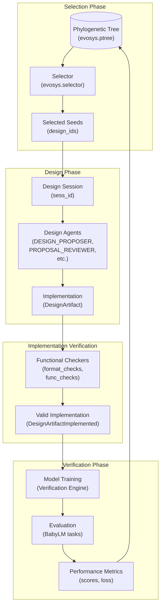
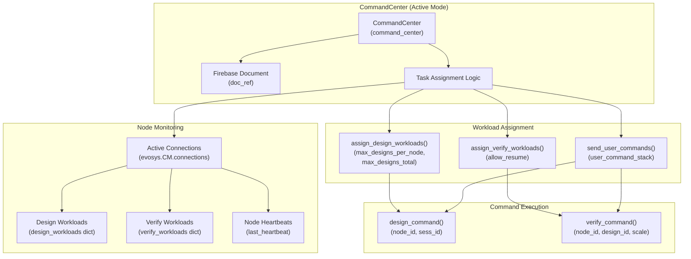
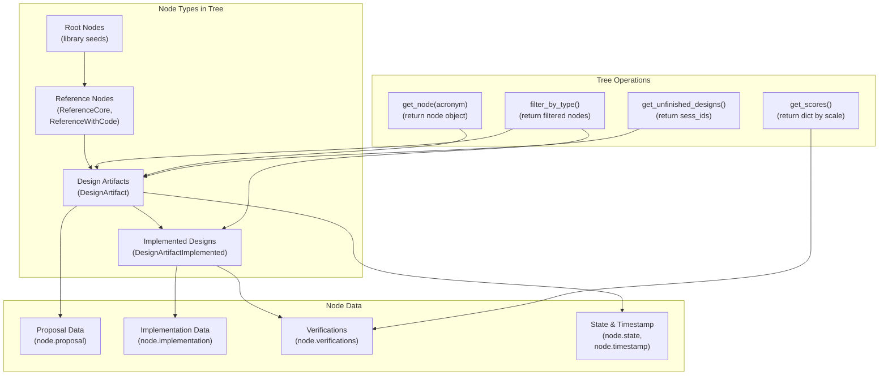
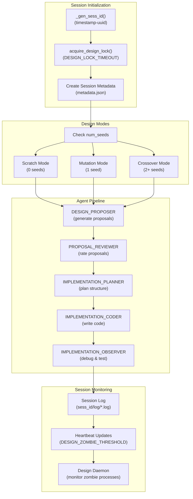
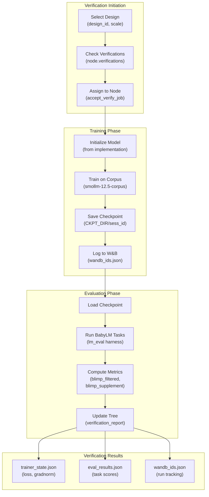
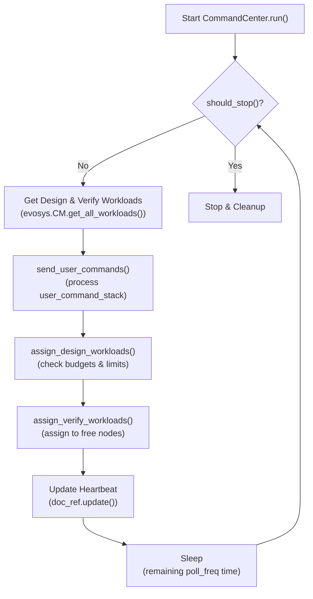
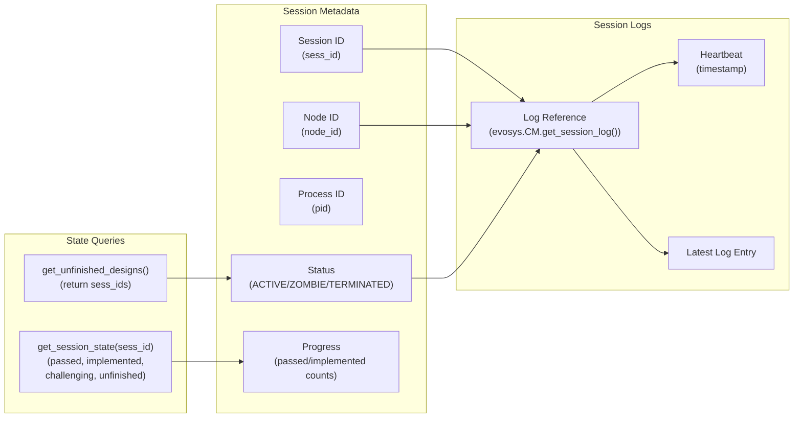
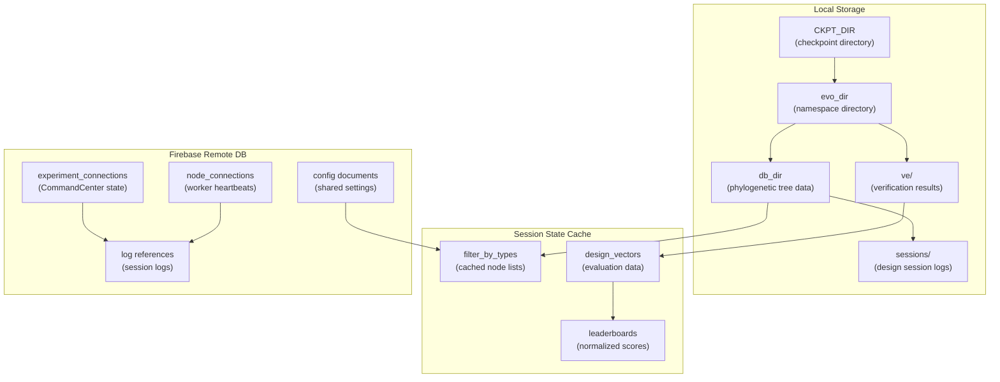
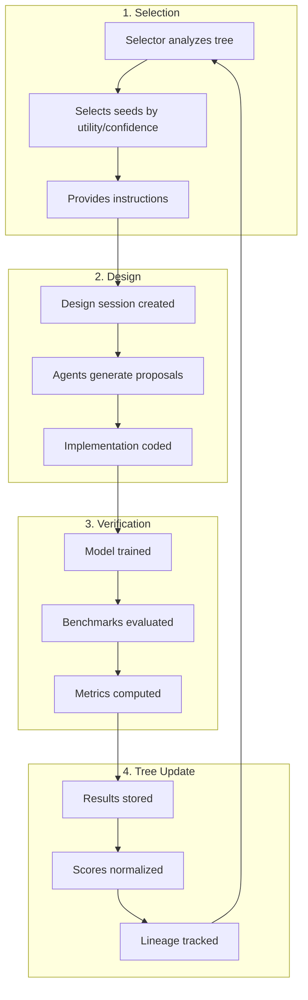

<!-- source: DeepWiki mcp.deepwiki.com · repo allenai/genesys · page 5 Evolution System Components · fetched 2026-10-26 -->

# Evolution System Components

<details>
<summary>Relevant source files</summary>

The following files were used as context for generating this wiki page:

- [README.md](README.md)
- [bin/pages/design.py](bin/pages/design.py)
- [bin/pages/evolve.py](bin/pages/evolve.py)

</details>


## Purpose and Scope

This page provides a comprehensive overview of the core subsystems that drive Genesys's evolutionary model discovery process. It covers the main evolution loop, the `CommandCenter` orchestrator, the phylogenetic tree data structure, and how design and verification phases interact.

For details on specific subsystems:
- Selection algorithms and seed selection strategies: see [Selector and Selection Strategy](#5.1)
- Design agent workflow and implementation pipeline: see [Design Agents and Workflow](#5.2)
- Training and evaluation processes: see [Verification Engine](#5.3)
- Distributed node coordination: see [Distributed Coordination](#5.4)

---

## Evolution System Architecture

The evolution system implements a genetic programming paradigm where language models iteratively discover better language model architectures. The system operates through four main phases that form a closed feedback loop.

### High-Level Evolution Loop



**Sources:** [README.md:1-190](), [bin/pages/evolve.py:1-2491]()

---

## CommandCenter: Workload Orchestration

The `CommandCenter` class is the master orchestrator that manages the evolution process across distributed nodes. It operates in two modes: **active mode** (orchestrating workloads) and **passive mode** (monitoring only).

### CommandCenter Architecture



**Sources:** [bin/pages/evolve.py:66-257]()

### Key CommandCenter Methods

| Method | Purpose | Key Parameters |
|--------|---------|----------------|
| `run()` | Main orchestration loop | Poll frequency, zombie threshold |
| `assign_design_workloads()` | Distribute design tasks to nodes | `max_designs_per_node`, `max_designs_total` |
| `assign_verify_workloads()` | Distribute verification tasks | `allow_resume` |
| `send_user_commands()` | Process manual commands | `user_command_stack` |
| `build_connection()` | Establish coordination with Firebase | `active_mode` |
| `stop()` | Terminate orchestration | Updates Firebase status |

**Sources:** [bin/pages/evolve.py:66-257]()

### CommandCenter Configuration

```python
# Key constants from evolve.py
CC_POLL_FREQ = 30           # Poll frequency in seconds
CC_ZOMBIE_THRESHOLD = 60    # Node heartbeat timeout
CC_COMMAND_DELAY = 2        # Delay between command assignments
```

**Sources:** [bin/pages/evolve.py:42-44]()

---

## Phylogenetic Tree: Central State Management

The phylogenetic tree (`evosys.ptree`) is the central data structure that maintains the complete lineage of all designs, their relationships, verification results, and metadata.

### Phylogenetic Tree Structure



**Sources:** [bin/pages/evolve.py:704-767]()

### Node States

Design nodes in the phylogenetic tree track their state through the implementation and verification process:

| State | Meaning | Transition |
|-------|---------|------------|
| `"proposed (unimplemented)"` | Proposal created, implementation pending | → implementing |
| `"implementing"` | Active implementation in progress | → implemented/failed |
| `"implemented (unverified)"` | Implementation complete, verification pending | → verified |
| `"implemented (verified)"` | Verification complete | Terminal state |
| `"failed"` | Proposal rejected by reviewer | Terminal state |
| `"unfinished (failed)"` | Implementation attempts exhausted | Terminal state |

**Sources:** [bin/pages/evolve.py:1264-1333]()

---

## Design Sessions: Implementation Pipeline

Design sessions manage the complete process of generating and implementing a model architecture from selected seeds through specialized LLM agents.

### Design Session Workflow



**Sources:** [bin/pages/design.py:50-161](), [bin/pages/design.py:167-204]()

### Design Session Functions

| Function | Purpose | Key Behavior |
|----------|---------|--------------|
| `design_command()` | Launch design session | Spawns subprocess + daemon monitor |
| `_design_command()` | Internal session runner | Acquires lock, resumes if unfinished |
| `design_daemon()` | Monitor session health | Detects zombies via heartbeat |
| `acquire_design_lock()` | Prevent concurrent sessions | Timeout-based lock mechanism |
| `run_design_thread()` | Execute design process | Calls `model_discovery.evolution --mode design` |

**Sources:** [bin/pages/design.py:50-204]()

### Design Lock Mechanism

```python
DESIGN_LOCK_TIMEOUT = 30  # seconds

# Lock prevents race conditions when resuming unfinished designs
# Located at: evosys.CM.get_design_lock_ref()
```

**Sources:** [bin/pages/design.py:25]()

---

## Verification Sessions: Model Training and Evaluation

Verification sessions train implemented designs and evaluate them on benchmark tasks to compute fitness scores.

### Verification Workflow



**Sources:** [bin/pages/evolve.py:466-504](), [README.md:116-127]()

### Verification Monitoring

Active verification sessions are tracked through Firebase and displayed in the network status:

| Field | Description | Source |
|-------|-------------|--------|
| `status` | Current training stage | Firebase log |
| `heartbeat` | Last update timestamp | Converted to datetime |
| `wandb_url` | W&B run URL | Constructed from `wandb_ids.json` |
| `node_id` | Executing node identifier | Firebase connection |
| `pid` | Process ID | System process |

**Sources:** [bin/pages/evolve.py:466-504]()

---

## Evolution Control Flow

The complete evolution cycle is managed through the `CommandCenter`'s `run()` method, which continuously polls for work and assigns tasks.

### Main Evolution Loop



**Sources:** [bin/pages/evolve.py:207-248]()

### Budget and Limit Checks

The evolution system respects multiple constraints:

```python
# From CommandCenter.assign_design_workloads()
if evosys.remaining_verify_budget <= 0:
    # Stop assigning designs if no verification budget
    
if evosys.max_samples > 0 and evosys.finished_designs >= evosys.max_samples:
    # Stop if max designs reached
    
if total_design_workloads == max_designs_total:
    # Stop if parallel design limit reached
```

**Sources:** [bin/pages/evolve.py:113-156]()

---

## Session State Management

Both design and verification sessions maintain state through Firebase for distributed coordination.

### Design Session State Tracking



**Sources:** [bin/pages/design.py:114-161](), [bin/pages/design.py:226-278]()

### Session State Constants

```python
# From model_discovery.agents.flow.gau_flows
DESIGN_ACTIVE_STATES = [...]          # States indicating active session
DESIGN_TERMINAL_STATES = [...]        # States indicating completion
DESIGN_ZOMBIE_THRESHOLD = 60          # Heartbeat timeout in seconds
```

**Sources:** [bin/pages/design.py:19-20]()

---

## Data Persistence and Synchronization

The evolution system maintains state in three layers: local filesystem, session state cache, and Firebase remote database.

### Data Storage Architecture



**Sources:** [bin/pages/evolve.py:689-702](), [README.md:56-67]()

---

## Benchmark Mode

The evolution system supports a special benchmark mode for agent evaluation, where design implementations are checked but not verified through training.

### Benchmark vs Evolution Mode

| Aspect | Evolution Mode | Benchmark Mode |
|--------|----------------|----------------|
| Verification | Full training + eval | Skipped (functional checks only) |
| Design Lock | None | Acquired per design attempt |
| Target | Discover better models | Evaluate agent capabilities |
| Stopping Condition | Budget/sample limits | All benchmarks attempted |
| Settings | `evosys.benchmark_mode = False` | `evosys.benchmark_mode = True` |

**Sources:** [bin/pages/evolve.py:620-687](), [bin/pages/evolve.py:861-1001]()

### Benchmark Design Lock

In benchmark mode, designs can only be attempted once at a time:

```python
# From CommandCenter.assign_design_workloads()
if evosys.benchmark_mode:
    if not evosys.ptree.acquire_design_lock():
        # Skip design assignment if lock held
        return
```

**Sources:** [bin/pages/evolve.py:124-127]()

---

## Component Integration Summary

The evolution system integrates four major subsystems into a cohesive feedback loop:



**Sources:** [README.md:30-42](), [bin/pages/evolve.py:1-2491]()

For detailed information about each subsystem, refer to the dedicated sub-pages:
- [Selector and Selection Strategy](#5.1)
- [Design Agents and Workflow](#5.2)  
- [Verification Engine](#5.3)
- [Distributed Coordination](#5.4)

---

