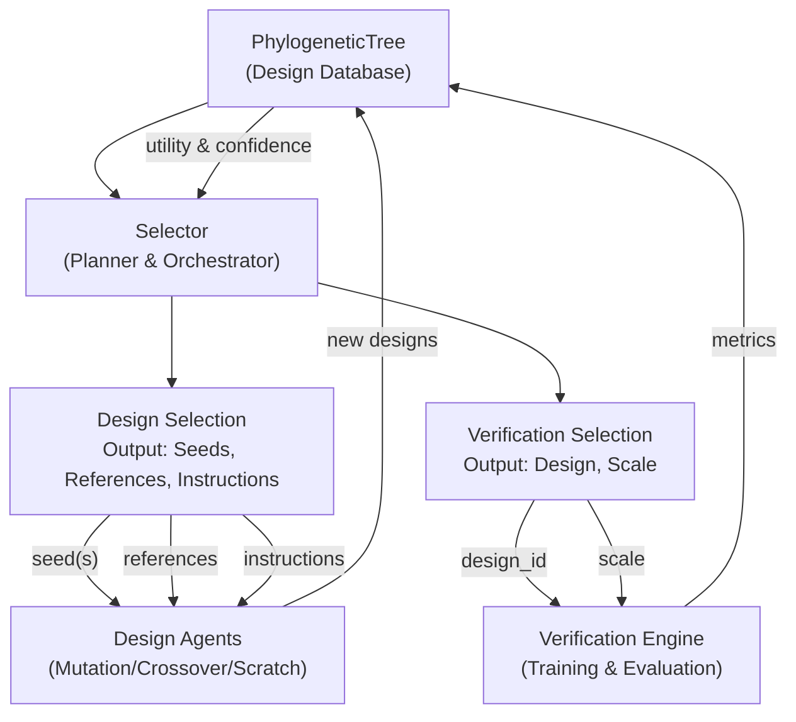
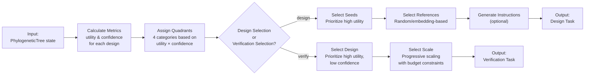
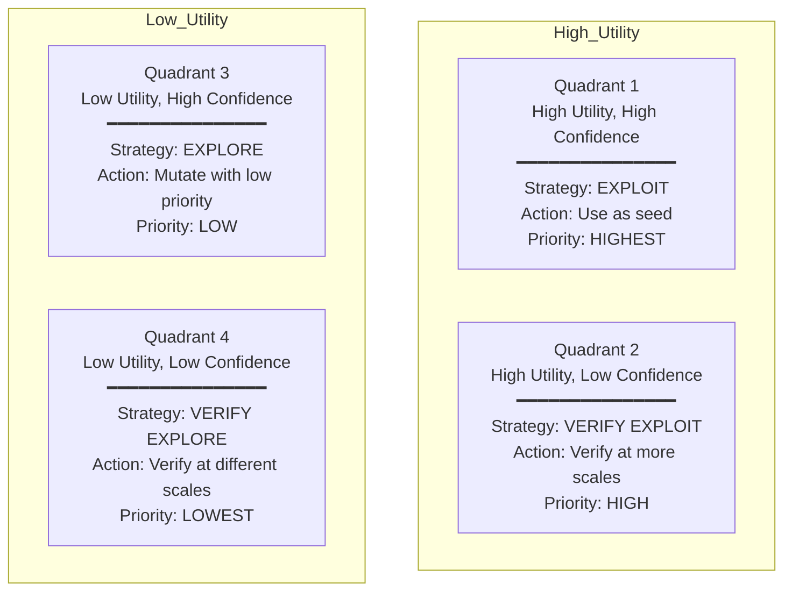
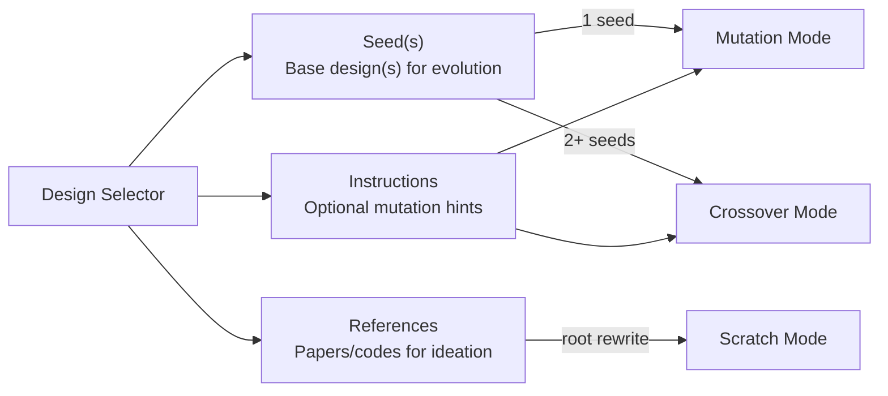
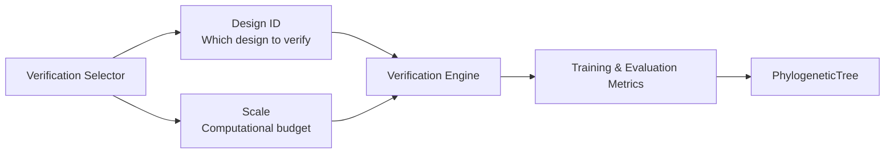
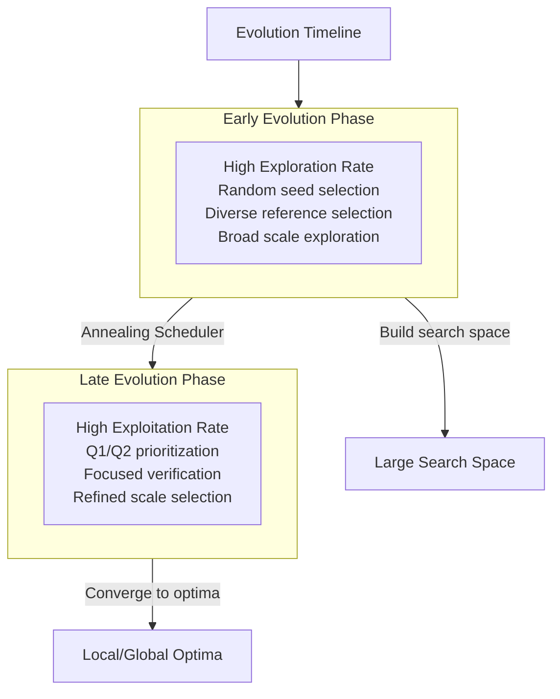
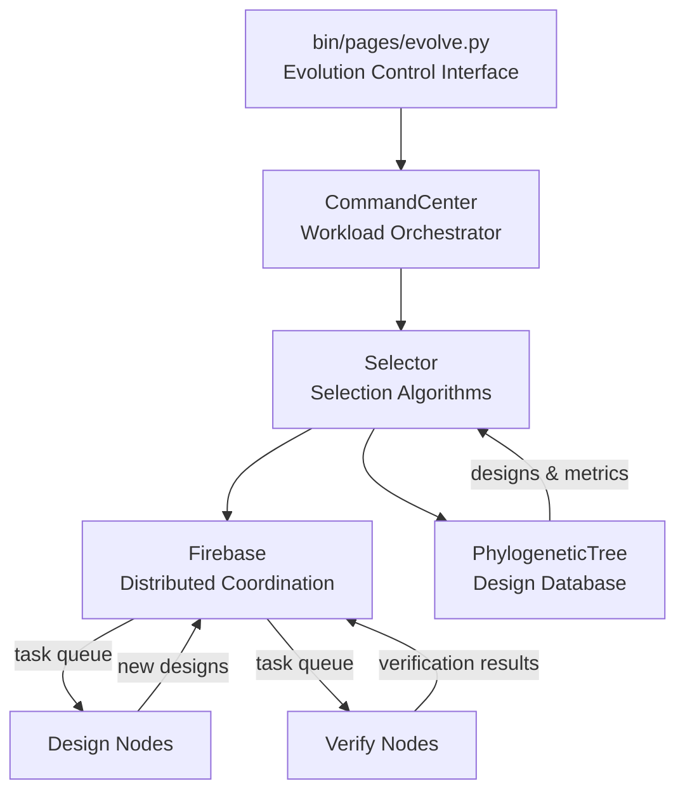

<!-- source: DeepWiki mcp.deepwiki.com · repo allenai/genesys · page 5.1 Selector and Selection Strategy · fetched 2026-10-26 -->

# Selector and Selection Strategy

Relevant source files

The following files were used as context for generating this wiki page:

- [README.md](README.md)
- [bin/assets/selector_notes.md](bin/assets/selector_notes.md)

## Purpose and Scope

This document explains the Selector component and its selection strategies within the Genesys evolution system. The Selector functions as the central planner and orchestrator, making decisions about which designs to evolve and verify based on utility and confidence metrics. It implements a quadrant-based selection framework to balance exploration and exploitation in the search for optimal language model architectures.

For information about:
- How the selector is controlled through the UI, see [Evolution Control Interface](#4.2)
- How selected seeds are used by design agents, see [Design Agents and Workflow](#5.2)
- How selected designs are verified, see [Verification Engine](#5.3)
- How selection tasks are distributed across nodes, see [Distributed Coordination](#5.4)

**Sources:** [bin/assets/selector_notes.md](), [README.md]()

## Overview: The Selector's Role

The Selector serves as the evolution system's decision-making core, guiding the search for optimal language model designs through strategic sampling. Unlike traditional evolutionary algorithms that rely on high-volume random mutations, Genesys operates under the constraint that **verification cost >> sampling cost**, making each design decision critical.

The Selector addresses two fundamental challenges:

1. **Scale Forecasting**: Predict design performance at larger computational scales based on limited small-scale evaluations
2. **Uncertainty Reduction**: Increase confidence in performance forecasts through strategic verification

The Selector orchestrates two other core pillars of the evolution system:
- **Model Design Agents**: Generate new designs based on selector-provided seeds, references, and instructions
- **Distributed V/D Engine**: Execute design and verification tasks selected by the selector

**Sources:** [bin/assets/selector_notes.md:1-36]()

## System Architecture

### Selector in the Evolution Loop

**Diagram: Selector's Position in the Evolution System**

**Sources:** [bin/assets/selector_notes.md:22-36](), [README.md:33-36]()

### Selector Decision Flow

**Diagram: Selector Decision-Making Process**

**Sources:** [bin/assets/selector_notes.md:38-58](), [bin/assets/selector_notes.md:98-117]()

## Utility and Confidence Metrics

The Selector evaluates each design using two complementary metrics that together characterize its value and reliability.

### Utility: Scale-Normalized Performance Potential

**Utility** measures a design's potential to perform well at larger computational scales. Ideally, utility represents the area under the curve (AUC) of the design's scaling curve.

| Aspect | Description |
|--------|-------------|
| **Goal** | Forecast performance at unforeseen computational scales |
| **Challenge** | Limited verification budget prevents exhaustive scale exploration |
| **Estimation Sources** | Design artifacts (proposals, implementation, GAU tree structure) + Verification results (training/eval metrics at various scales) |
| **Use Case** | Computational budgets may allow training a 130B model once but smaller models frequently; design choices at small scales must generalize to large scales |

The utility calculation involves:
1. Normalizing performance metrics across different scales
2. Analyzing the design's structural properties from its artifact tree
3. Incorporating verified performance data when available

**Sources:** [bin/assets/selector_notes.md:60-69]()

### Confidence: Information Availability

**Confidence** quantifies the certainty of utility estimates based on available information. It serves as a proxy for how well the scaling curve is characterized.

| Confidence Level | Information State | Implications |
|-----------------|-------------------|--------------|
| **Low** | Newly created design, only design artifacts available | Uncertain scaling behavior, requires verification |
| **Medium** | Verified at some scales | Partial scaling curve known |
| **High** | Verified at multiple scales, consistent results | Well-characterized scaling behavior |

Confidence increases through:
1. **Available information**: More verification results at different scales
2. **Prior knowledge** (future work): Learned scaling characteristics for design families (e.g., Transformer scaling laws)

**Sources:** [bin/assets/selector_notes.md:71-80]()

## Four-Quadrant Selection Framework

The Selector partitions the design space into four quadrants based on utility and confidence, implementing different strategies for each.

**Diagram: Four-Quadrant Selection Framework**

### Quadrant Strategies

| Quadrant | Utility | Confidence | Strategy Type | Primary Action | Selector Type |
|----------|---------|------------|---------------|----------------|---------------|
| **Q1** | High | High | Exploit | Use as seed for new designs | Design Selection |
| **Q2** | High | Low | Verify-Exploit | Verify at additional scales | Verification Selection |
| **Q3** | Low | High | Explore | Mutate to find improvements | Design Selection |
| **Q4** | Low | Low | Verify-Explore | Verify to characterize scaling | Verification Selection |

The framework balances:
- **Exploitation**: Focus on proven high-utility designs (Q1, Q2)
- **Exploration**: Investigate uncertain or underperforming designs (Q3, Q4)

**Sources:** [bin/assets/selector_notes.md:82-97]()

## Design Selection

Design selection generates the inputs required by design agents to create new designs through mutation, crossover, or scratch modes.

### Design Selection Outputs

**Diagram: Design Selection Outputs and Design Modes**

### Seed Selection Algorithm

The seed selection process prioritizes designs based on their quadrant assignment:

1. **Primary Strategy** (Exploit): Select from Quadrant 1 (high utility, high confidence)
   - These are proven designs worth building upon
   
2. **Secondary Strategy** (Explore): Select from Quadrant 3 (low utility, high confidence)
   - These are well-characterized designs that may benefit from mutation
   
3. **Random Exploration**: Apply annealing scheduler
   - Early evolution: Higher random exploration rate
   - Late evolution: Lower random exploration rate
   - Prevents premature convergence to local optima

### Reference Selection

References provide starting points for the design agent's ideation process:

| Selection Method | Status | Description |
|-----------------|--------|-------------|
| **Random** | Current | Randomly select papers/code from knowledge base |
| **Embedding-based** | Future Work | Use semantic similarity to select relevant references |
| **Graph-based** | Future Work | Select based on citation/usage graphs |

### Instruction Generation

Instructions guide the mutation process with specific hints:

| Component | Status | Purpose |
|-----------|--------|---------|
| **User Instructions** | Supported | Manual guidance from user interface |
| **Selector Instructions** | Future Work | Automated hints from selector analysis |
| **Planner Agent** | Future Work | Dedicated planning agent for instruction generation |

**Sources:** [bin/assets/selector_notes.md:42-58](), [bin/assets/selector_notes.md:98-107](), [bin/assets/selector_notes.md:119-124]()

## Verification Selection

Verification selection determines which designs to evaluate and at what computational scales, balancing resource allocation between exploitation and exploration.

### Verification Selection Outputs

**Diagram: Verification Selection Outputs**

### Design Selection for Verification

Prioritizes designs based on quadrant assignment:

1. **Primary Strategy** (Verify-Exploit): Select from Quadrant 2 (high utility, low confidence)
   - Promising designs that need more characterization
   - Allocate more resources here
   
2. **Secondary Strategy** (Verify-Explore): Select from Quadrant 4 (low utility, low confidence)
   - Uncertain designs that might perform well at larger scales
   - Allocate fewer resources here

3. **Guarantee**: All designs are verified at least at the smallest scale
   - Ensures minimum information for utility/confidence calculation

### Scale Selection Strategy

Scale selection follows a progressive approach with resource preservation:

| Strategy Component | Description |
|-------------------|-------------|
| **Progressive Scaling** | Begin at lower scales, gradually increase for promising designs |
| **Resource Allocation** | More resources to exploitation, fewer to exploration |
| **Budget Constraints** | Computational budget limits total verification capacity |
| **Preservation** | Avoid wasting resources on designs that fail at small scales |

### Scale Selection Algorithm

1. **Initial Verification**: All new designs verified at minimum scale
2. **Performance Threshold**: Designs exceeding threshold eligible for larger scales
3. **Priority Queue**: Higher utility designs verified at larger scales first
4. **Budget Management**: Stop when computational budget exhausted

**Future Work:**
- **Scaling Characteristic Exploration**: Learn scaling behavior of design families to improve scale selection efficiency
- **Adaptive Budgeting**: Dynamically allocate more resources to promising design families

**Sources:** [bin/assets/selector_notes.md:109-117](), [bin/assets/selector_notes.md:125-129]()

## Selection Strategy Summary

### Design Selection vs Verification Selection

| Aspect | Design Selection | Verification Selection |
|--------|-----------------|------------------------|
| **Purpose** | Choose what to evolve | Choose what to evaluate |
| **Outputs** | Seeds, references, instructions | Design ID, scale |
| **Exploit Strategy** | Use Q1 seeds (high utility, high confidence) | Verify Q2 designs (high utility, low confidence) |
| **Explore Strategy** | Mutate Q3 seeds (low utility, high confidence) | Verify Q4 designs (low utility, low confidence) |
| **Resource Focus** | High-quality local sampling | Throughput and distributed robustness |
| **Cost Constraint** | Implementation cost > proposal cost | Verification cost >> sampling cost |

### Exploration vs Exploitation Balance

**Diagram: Evolution Phase Transition**

**Sources:** [bin/assets/selector_notes.md:119-129]()

## Future Enhancements

The Selector roadmap includes several planned improvements:

### 1. RL/Tuning of Design Agents

Design agents can use utility as a reinforcement learning signal to improve their mutation quality over the evolution process.

| Component | Enhancement |
|-----------|-------------|
| **Utility Signal** | Use as reward for design agent actions |
| **Agent Learning** | Improve proposal/implementation quality over time |
| **Feedback Loop** | Verified utility informs agent parameter updates |

### 2. Online Learning of Scaling Curves

The selector can learn scaling characteristics to improve forecasting accuracy.

| Learning Target | Benefit |
|----------------|---------|
| **Design Family Scaling** | Predict performance at unseen scales for similar architectures |
| **Cross-Family Patterns** | Transfer knowledge between design families |
| **Prior Knowledge Integration** | Leverage existing scaling laws (e.g., Transformer scaling) |

### 3. Enhanced Reference Selection

Move from random to intelligent reference selection.

| Method | Approach |
|--------|----------|
| **Embedding-based** | Use semantic similarity to find relevant papers/code |
| **Graph-based** | Leverage citation and usage graphs |
| **Utility-guided** | Select references that led to high-utility mutations historically |

### 4. Automated Instruction Generation

Implement a planner agent for generating mutation instructions.

| Component | Capability |
|-----------|-----------|
| **Planner Agent** | Analyze design gaps and generate targeted instructions |
| **Mutation Guidance** | Provide specific hints for promising mutation directions |
| **Adaptive Planning** | Adjust instructions based on mutation success rates |

**Sources:** [bin/assets/selector_notes.md:131-137]()

## Implementation Notes

### Key Implementation Files

The Selector is implemented across several modules in the Genesys codebase:

| Component | Location | Description |
|-----------|----------|-------------|
| **Selector Interface** | [bin/pages/evolve.py]() | UI controls and CommandCenter integration |
| **Selection Logic** | [model_discovery/]() | Core selection algorithms |
| **Utility Calculation** | [model_discovery/]() | Utility metric computation |
| **Confidence Calculation** | [model_discovery/]() | Confidence metric computation |
| **Quadrant Assignment** | [model_discovery/]() | Four-quadrant classification logic |

### Integration Points

**Diagram: Selector Integration with System Components**

**Sources:** [bin/pages/evolve.py](), [README.md:130-133]()

---

This documentation describes the Selector's role as the central planning and orchestration component of the Genesys evolution system. The quadrant-based selection framework balances exploration and exploitation to efficiently search for optimal language model designs under strict computational constraints.

---

