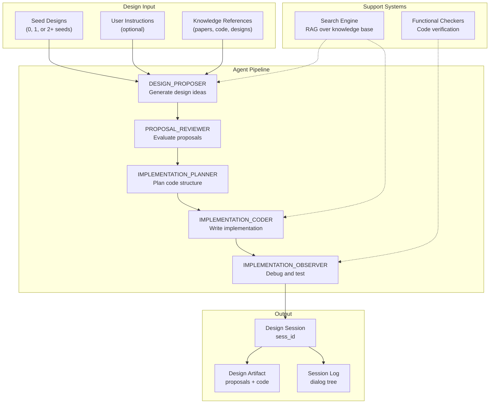
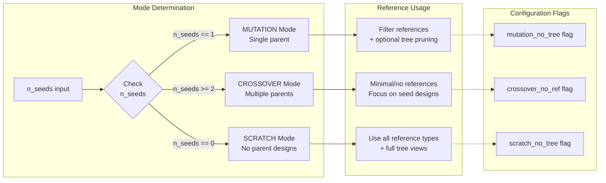
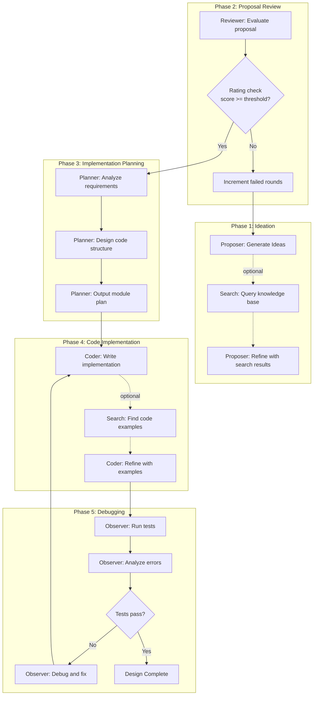
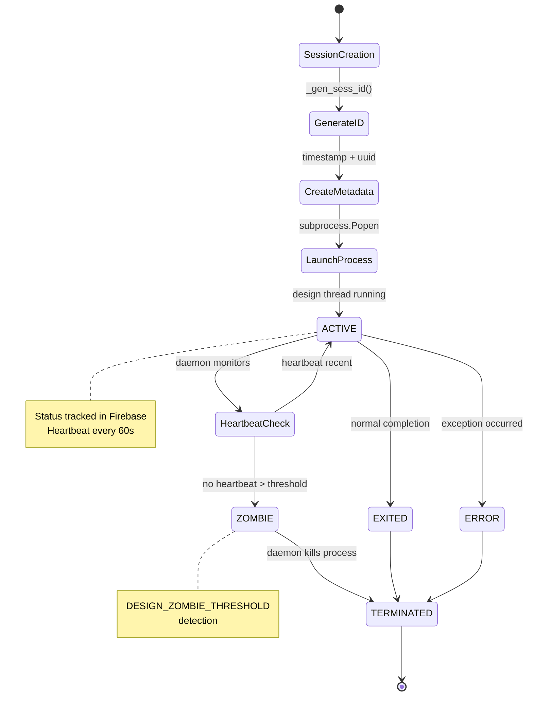
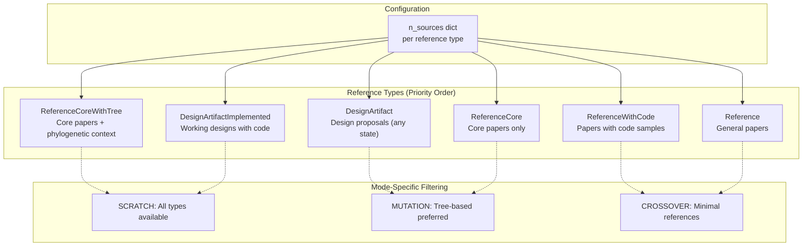
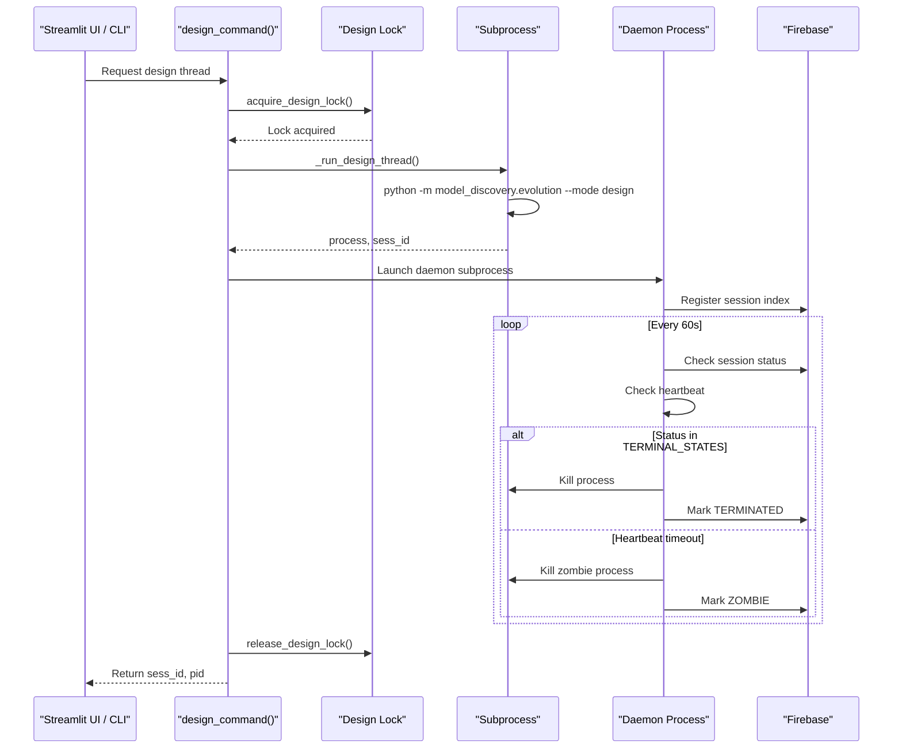

<!-- source: DeepWiki mcp.deepwiki.com · repo allenai/genesys · page 5.2 Design Agents and Workflow · fetched 2026-10-26 -->

# Design Agents and Workflow

<details>
<summary>Relevant source files</summary>

The following files were used as context for generating this wiki page:

- [README.md](README.md)
- [bin/assets/howtouse.md](bin/assets/howtouse.md)
- [bin/pages/design.py](bin/pages/design.py)

</details>


## Purpose and Scope

This document describes the design agent system and workflow in Genesys, which implements the "ideate → implement → verify" cycle using LLM-based agents. The design agents are responsible for generating novel language model architectures by either creating designs from scratch, mutating existing designs, or combining multiple designs through crossover.

For information about how designs are selected for evolution, see [Selector and Selection Strategy](#5.1). For information about how designs are trained and evaluated, see [Verification Engine](#5.3). For information about distributed execution of design workloads, see [Distributed Coordination](#5.4).

**Sources:** [README.md:30-36](), [bin/assets/howtouse.md:16-22]()

---

## System Overview

The design system consists of six specialized LLM agents that collaborate sequentially to produce implementable model designs. Each agent has a specific role in the pipeline, from initial ideation through code implementation and debugging.



**Sources:** [bin/pages/design.py:19-21](), [bin/pages/design.py:562-567](), [README.md:30-36]()

---

## Design Modes

The design system operates in three distinct modes determined by the number of seed designs provided:

### Mode Selection Logic

| Number of Seeds | Design Mode | Description |
|----------------|-------------|-------------|
| 0 | `DesignModes.SCRATCH` | Generate novel design from scratch using only knowledge base |
| 1 | `DesignModes.MUTATION` | Mutate a single parent design |
| 2+ | `DesignModes.CROSSOVER` | Combine features from multiple parent designs |



**Sources:** [bin/pages/design.py:550-557](), [bin/pages/design.py:618-623]()

### Mode-Specific Behavior

**SCRATCH Mode** (`n_seeds=0`):
- Agents generate completely novel designs without parent influence
- Full access to knowledge base references
- Longest context windows (can include full phylogenetic trees)
- Configuration: `scratch_no_tree` flag controls tree inclusion

**MUTATION Mode** (`n_seeds=1`):
- Single parent design provided as seed
- Agents modify/improve the parent design
- Recommended: set `mutation_no_tree=True` to avoid excessive context length
- Balances innovation with inheritance

**CROSSOVER Mode** (`n_seeds>=2`):
- Multiple parent designs provided as seeds
- Agents combine beneficial features from parents
- Recommended: set `crossover_no_ref=True` (seeds provide sufficient context)
- Focus on recombination rather than cold-start exploration

**Sources:** [bin/pages/design.py:618-623]()

---

## Agent Types and Roles

### Agent Roster

The design pipeline employs six specialized agents, each configurable with different LLM backends:

| Agent Identifier | Display Name | Primary Role | Optional |
|-----------------|--------------|--------------|----------|
| `DESIGN_PROPOSER` | Proposal Agent | Generate initial design ideas | No |
| `PROPOSAL_REVIEWER` | Proposal Reviewer | Evaluate and score proposals | No |
| `IMPLEMENTATION_PLANNER` | Implementation Planner | Plan code structure and modules | Yes |
| `IMPLEMENTATION_CODER` | Implementation Coder | Write actual implementation code | No |
| `IMPLEMENTATION_OBSERVER` | Implementation Observer | Debug and test implementation | Yes |
| `SEARCH_ASSISTANT` | Search Assistant | Assist with knowledge retrieval | Yes (rarely used) |

```mermaid
stateDiagram-v2
    [*] --> DESIGN_PROPOSER
    
    DESIGN_PROPOSER --> PROPOSAL_REVIEWER: proposal ideas
    
    PROPOSAL_REVIEWER --> CheckRating{Rating >= threshold?}
    CheckRating --> DESIGN_PROPOSER: No, retry
    CheckRating --> IMPLEMENTATION_PLANNER: Yes, proceed
    
    IMPLEMENTATION_PLANNER --> IMPLEMENTATION_CODER: code plan
    note right of IMPLEMENTATION_PLANNER: Optional agent<br/>Can be "None"
    
    IMPLEMENTATION_CODER --> IMPLEMENTATION_OBSERVER: implementation code
    
    IMPLEMENTATION_OBSERVER --> CheckTests{Tests pass?}
    note right of IMPLEMENTATION_OBSERVER: Optional agent<br/>Can be "None"
    
    CheckTests --> IMPLEMENTATION_CODER: No, debug
    CheckTests --> [*]: Yes, complete
```

**Sources:** [bin/pages/design.py:562-567](), [bin/pages/design.py:574-577]()

### Agent Configuration

Each agent can be configured with different LLM backends from `AGENT_OPTIONS`. The system supports:

- **Individual LLM selection**: Assign specific models to each agent
- **"None" option**: For `IMPLEMENTATION_PLANNER` and `IMPLEMENTATION_OBSERVER` (skips that phase)
- **"hybrid" option**: Weighted random selection from available models at runtime

Available LLM backends include models from OpenAI (GPT-4o, GPT-4o-mini), Anthropic (Claude 3.5 Sonnet), Together AI, and Cohere.

**Sources:** [bin/pages/design.py:569-589]()

---

## Design Workflow Pipeline

### Sequential Agent Execution



**Sources:** [bin/pages/design.py:170-183](), [README.md:30-36]()

### Workflow Termination Conditions

The design workflow can terminate under several conditions:

| Condition | Parameter | Description |
|-----------|-----------|-------------|
| Max failed rounds | `max_failed_rounds` | Proposal review failures exceed limit |
| Total budget exceeded | `max_total_budget` | Cumulative API cost exceeds threshold |
| Debug budget exceeded | `max_debug_budget` | Debugging cost exceeds threshold |
| Proposal attempts exceeded | `design_proposal` (max_attempts) | Too many proposal generation attempts |
| Debug attempts exceeded | `implementation_debug` (max_attempts) | Too many debugging iterations |
| Success | - | All proposals passed and implementations successful |

**Sources:** [bin/pages/design.py:625-651]()

---

## Session Management

### Session Lifecycle

Each design run is encapsulated in a session with a unique identifier:



**Sources:** [bin/pages/design.py:167-168](), [bin/pages/design.py:114-160]()

### Session Identification

Session IDs are generated using the format:
```
{YYYY-MM-DD-HH-MM-SS}-{6-char-uuid}
```

Example: `2024-01-15-14-30-45-a3f9c2`

**Sources:** [bin/pages/design.py:167-168]()

### Session State Tracking

Design sessions track multiple state dimensions:

| State Component | Storage Location | Purpose |
|----------------|------------------|---------|
| Proposals passed | `sessions/{sess_id}/` | Count of accepted proposals |
| Implementations succeeded | `sessions/{sess_id}/` | Count of working implementations |
| Challenging implementations | `sessions/{sess_id}/` | Implementations given up on |
| Session logs | `sessions/{sess_id}/log/` | Dialog trees for replay |
| Session metadata | `sessions/{sess_id}/metadata.json` | Configuration and targets |

**Sources:** [bin/pages/design.py:226-278]()

---

## Knowledge Reference System

### Reference Type Hierarchy

The design agents can access six types of knowledge references, ranked by specificity:



**Sources:** [bin/pages/design.py:593-615]()

### Reference Sampling Configuration

References are sampled according to `n_sources` configuration:

```python
# Example configuration
n_sources = {
    'ReferenceCoreWithTree': 0,        # Usually disabled (large context)
    'DesignArtifactImplemented': 0,    # Usually disabled (large context)
    'DesignArtifact': 0,               # Design-specific
    'ReferenceCore': 1,                # Core papers (default: 1)
    'ReferenceWithCode': 1,            # Papers with code (default: 1)
    'Reference': 1                     # General papers (default: 1)
}
```

**Sources:** [bin/pages/design.py:593-615]()

---

## Design Thread Execution

### Thread Launch Process



**Sources:** [bin/pages/design.py:50-111](), [bin/pages/design.py:114-160](), [bin/pages/design.py:170-183]()

### Zombie Detection and Cleanup

The daemon process monitors design threads for zombie states:

- **Heartbeat interval**: 60 seconds
- **Zombie threshold**: `DESIGN_ZOMBIE_THRESHOLD` (configured in `gau_flows`)
- **Detection**: Compare `time.time() - heartbeat > threshold`
- **Action**: Force-kill process via `psutil.Process.kill()`

**Sources:** [bin/pages/design.py:114-160](), [bin/pages/design.py:19-20]()

### Design Lock Mechanism

To prevent race conditions when selecting unfinished sessions:

- **Lock timeout**: 30 seconds (`DESIGN_LOCK_TIMEOUT`)
- **Lock document**: Stored in Firebase at design lock reference
- **Lock data**: `{timestamp, locked, node_id}`
- **Acquisition**: Spin-wait until lock is available or owned by same node

**Sources:** [bin/pages/design.py:25](), [bin/pages/design.py:64-88]()

---

## Configuration Parameters

### Agent Configuration

| Parameter Category | Parameters | Default/Range | Description |
|-------------------|------------|---------------|-------------|
| `agent_types` | 6 agent assignments | Model-specific | LLM backend for each agent |
| `flow_type` | `"gau"` or `"naive"` | `"gau"` | Agent workflow implementation |
| `use_unlimited_prompt` | Boolean | `False` | Remove prompt length limits |
| `unittest_pass_required` | Boolean | `False` | Require unit tests to pass |
| `no_f_checkers` | Boolean | `False` | Disable functional checkers |

**Sources:** [bin/pages/design.py:668-673](), [bin/pages/design.py:779-780]()

### Termination and Budget Configuration

| Parameter | Type | Default | Description |
|-----------|------|---------|-------------|
| `max_failed_rounds` | Integer | 1 | Max consecutive proposal failures |
| `max_total_budget` | Float | 0.0 | Max total API cost (0 = unlimited) |
| `max_debug_budget` | Float | 0.0 | Max debugging API cost (0 = unlimited) |
| `max_search_rounds` | Integer | 3 | Max knowledge base search attempts |

**Sources:** [bin/pages/design.py:625-642]()

### Threshold Configuration

| Parameter | Type | Range | Description |
|-----------|------|-------|-------------|
| `proposal_rating` | Integer | 0-5 | Minimum acceptable proposal rating |
| `implementation_rating` | Integer | 0-5 | Minimum acceptable implementation rating |

**Sources:** [bin/pages/design.py:644-649]()

### Attempt Limits

| Parameter | Type | Default | Description |
|-----------|------|---------|-------------|
| `design_proposal` | Integer | 3 | Max proposal generation attempts |
| `implementation_debug` | Integer | 3 | Max debugging iterations |
| `post_refinement` | Integer | 0 | Optional post-implementation refinements |

**Sources:** [bin/pages/design.py:654-664]()

### Search Engine Integration

| Parameter Category | Parameters | Default | Description |
|-------------------|------------|---------|-------------|
| `result_limits` | `lib`, `lib2`, `libp` | 5, 0, 0 | Library search result counts |
| `result_limits` | `s2`, `arxiv`, `pwc` | 5, 3, 3 | External search result counts |
| `rerank_ratio` | Float (0-1) | 0.2 | Reranking scale (0 = disabled) |
| `proposal_search_cfg` | `top_k`, `cutoff` | 3, 0.5 | Proposal search parameters |
| `perplexity_settings` | `model_size`, `max_tokens` | "large", 4000 | Perplexity API config |

**Sources:** [bin/pages/design.py:707-741]()

---

## Design Session Output

### Session Directory Structure

```
{ckpt_dir}/{evoname}/db/sessions/{sess_id}/
├── metadata.json              # Session configuration
├── log/                       # Session logs
│   ├── {timestamp_1}.log
│   ├── {timestamp_2}.log
│   └── ...
├── proposals/                 # Generated proposals
├── implementations/           # Code implementations
└── artifacts/                 # Design artifacts
```

**Sources:** [bin/pages/design.py:356-378](), [bin/pages/design.py:226-249]()

### Session Metadata Schema

```json
{
  "sess_id": "2024-01-15-14-30-45-a3f9c2",
  "evoname": "text_evo_000",
  "design_mode": "MUTATION",
  "num_samples": {
    "proposal": 3,
    "implementation": 3
  },
  "agent_types": {
    "DESIGN_PROPOSER": "claude3.5_sonnet",
    "PROPOSAL_REVIEWER": "gpt4o_0806",
    "IMPLEMENTATION_PLANNER": "None",
    "IMPLEMENTATION_CODER": "gpt4o_0806",
    "IMPLEMENTATION_OBSERVER": "gpt-4.1-nano"
  },
  "termination": {...},
  "threshold": {...}
}
```

**Sources:** [bin/pages/design.py:314-324]()

---

## Integration Points

### Integration with Selector

The design system receives inputs from the selector:

- **Seed selection**: Selector chooses seed designs based on utility/confidence
- **User instructions**: Selector can provide guidance strings
- **Reference recommendations**: Selector suggests relevant papers/designs

**Sources:** [bin/pages/design.py:750](), [bin/pages/design.py:800-803]()

### Integration with Verification Engine

Design outputs flow to verification:

- **Design artifacts**: Completed implementations become candidates for training
- **Phylogenetic tree**: Design lineage tracked for evolutionary selection
- **Session logs**: Available for debugging and analysis

**Sources:** [bin/pages/design.py:356-378]()

### Integration with Firebase

Firebase serves as the coordination layer:

- **Design lock**: Prevents concurrent session creation conflicts
- **Session index**: Tracks active sessions across nodes
- **Session logs**: Remote storage for distributed monitoring
- **Heartbeat tracking**: Zombie detection across nodes

**Sources:** [bin/pages/design.py:64-88](), [bin/pages/design.py:114-160]()

---

## Command-Line Interface

### Running Design from CLI

```bash
# Run design with default settings (resume if unfinished sessions exist)
python -m bin.pages.design --evoname text_evo_000 --resume

# Run design daemon for specific session
python -m bin.pages.design --daemon --evoname text_evo_000 \
    --sess_id 2024-01-15-14-30-45-a3f9c2 --node_id abc123 --pid 12345
```

**Sources:** [bin/pages/design.py:863-898]()

### Programmatic Execution

```python
from model_discovery.evolution import BuildEvolution

# Initialize evolution system
evosys = BuildEvolution(params={'evoname': 'text_evo_000'})

# Launch design thread
sess_id, pid = run_design_thread(
    evosys=evosys,
    sess_id=None,      # Generate new session
    params=None,       # Use default params
    cpu_only=False,    # Use GPU for checkers
    silent=False       # Show output
)
```

**Sources:** [bin/pages/design.py:185-204](), [bin/pages/design.py:863-898]()

---

## Monitoring and Debugging

### Session Log Format

Logs are stored as tuples: `(timestamp, text, log_type)`

Log types include:
- `"enter"` / `"exit"`: Status context entry/exit
- `"enterspinner"`: Spinner context entry
- `"write"`: Standard output
- `"warning"` / `"error"`: Alerts
- `"markdown"` / `"code"`: Formatted output
- `"end"`: Session termination with reason
- `"balloons"` / `"snow"`: Success indicators

**Sources:** [bin/pages/design.py:453-503]()

### Viewing Session Logs

The UI provides log replay functionality that reconstructs the original Streamlit output:

```python
# Load and display log
log = load_log('path/to/session.log')
show_log(log)  # Executes Streamlit commands dynamically
```

**Sources:** [bin/pages/design.py:505-514](), [bin/pages/design.py:453-503]()

### Session State Queries

```python
# Get session progress
passed, implemented, challenging, unfinished = \
    evosys.ptree.get_session_state(sess_id)

# Check completion
session_data = evosys.ptree.get_design_session(sess_id)
is_proposal_complete = len(passed) >= session_data["num_samples"]["proposal"]
is_impl_complete = (len(implemented) + len(challenging)) >= \
    session_data["num_samples"]["implementation"]
```

**Sources:** [bin/pages/design.py:233-243](), [bin/pages/design.py:255-265]()

---

