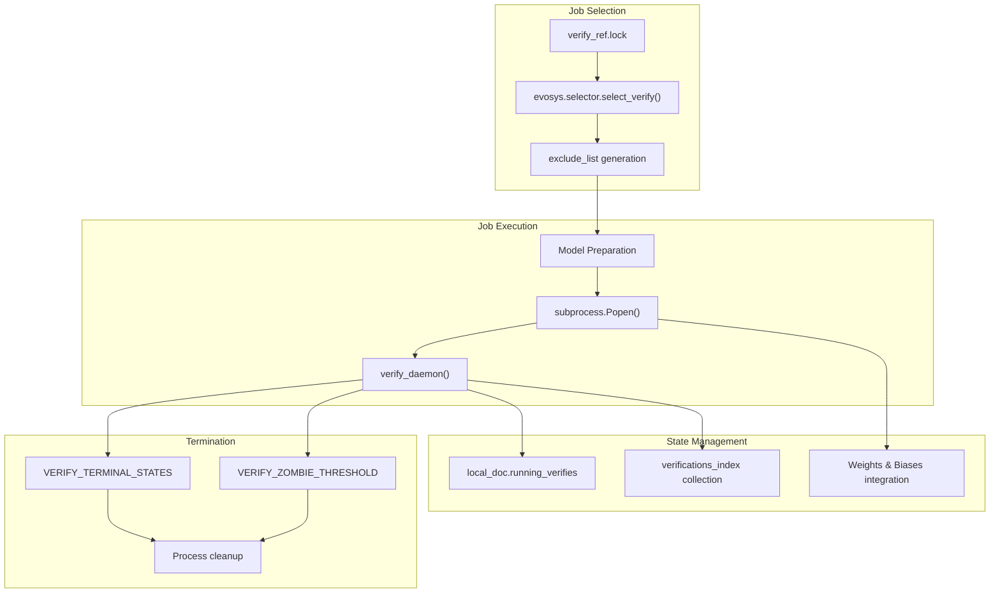
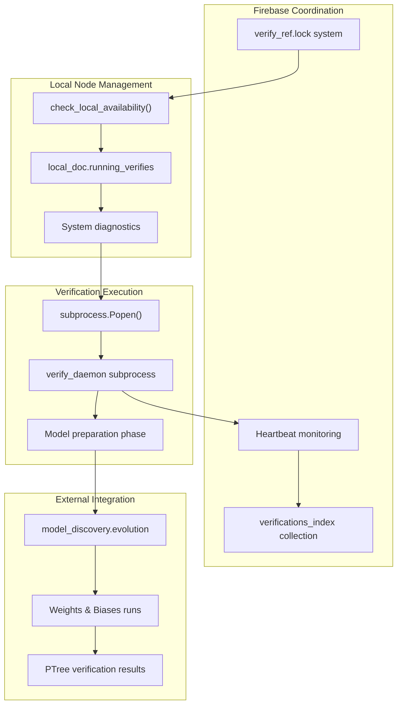
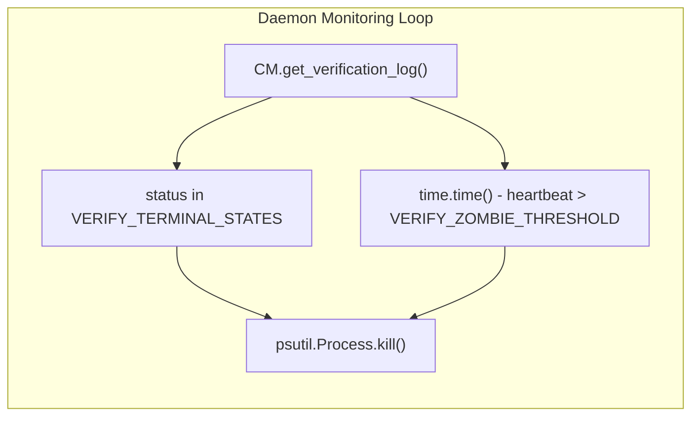
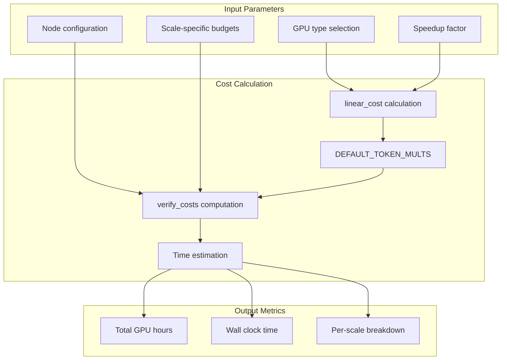
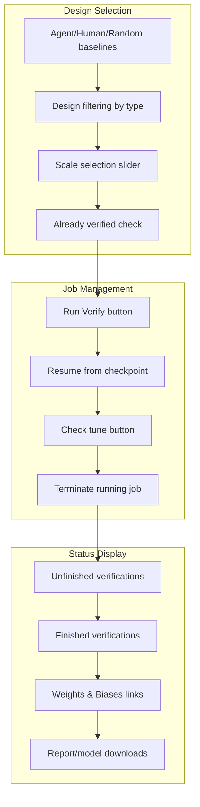

<!-- source: DeepWiki mcp.deepwiki.com · repo allenai/genesys · page 5.3 Verification Engine · fetched 2026-10-26 -->

# Verification System

<details>
<summary>Relevant source files</summary>

The following files were used as context for generating this wiki page:

- [README.md](README.md)
- [bin/pages/evolve.py](bin/pages/evolve.py)

</details>


The Verification System is responsible for training and evaluating language model designs discovered by the evolution process. It manages distributed verification jobs across GPU-enabled nodes, provides budget estimation tools for planning verification campaigns, and integrates with external services for experiment tracking and coordination.

For information about the design generation process, see [Model Design Engine](#4.3). For details about the selection algorithms that determine which designs to verify, see [Selection System](#4.6).

## System Architecture

The verification system operates as a distributed job execution framework with centralized coordination through Firebase and local resource management on each verification node.

### Verification Job Lifecycle



Sources: [bin/pages/verify.py:95-247]()

### Distributed Node Coordination



Sources: [bin/pages/verify.py:66-94](), [bin/pages/verify.py:249-325]()

## Core Components

### Verification Command Interface

The `verify_command()` function serves as the primary entry point for launching verification jobs. It handles node availability checking, job selection, and daemon process spawning.

| Function | Purpose | Key Parameters |
|----------|---------|----------------|
| `verify_command()` | Main verification entry point | `node_id`, `evosys`, `design_id`, `scale`, `resume` |
| `_verify_command()` | Internal verification logic | `exclude_list`, `accept_baselines`, `free_verifier` |
| `run_verification()` | Process execution wrapper | `params`, `prep_only`, `RANDOM_TESTING` |

The verification system maintains exclusive execution through local availability checking:

```python
def check_local_availability():
    with U.local_lock():
        local_doc = U.read_local_doc()
        running_verifies = local_doc.get('running_verifies',{})
        # Cleanup zombie processes based on VERIFY_ZOMBIE_THRESHOLD
```

Sources: [bin/pages/verify.py:80-94](), [bin/pages/verify.py:95-126]()

### Daemon Process Management

The `verify_daemon()` function runs as a separate process to monitor verification job health and handle cleanup. It tracks job status through Firebase and manages process lifecycle.



The daemon updates both local and remote state:
- Local state: `update_local_doc(sess_id, status)`
- Remote state: `index_ref.set({sess_id: {'status': status}})`

Sources: [bin/pages/verify.py:249-325]()

### System Diagnostics

The verification system provides comprehensive system monitoring through `get_system_info()` and GPU monitoring via `nvidia-smi` integration.

| Component | Function | Information Provided |
|-----------|----------|---------------------|
| CPU Info | `platform` module | Processor, architecture, OS details |
| GPU Info | `torch.cuda` | Device count, memory, capabilities |
| Memory Info | `psutil` | Total, available, used memory |
| NVIDIA SMI | `subprocess` | Real-time GPU utilization |

Sources: [bin/pages/verify.py:330-361](), [bin/pages/verify.py:508-518]()

## Budget Estimation Tools

### Verification Budget Tool

The `verify_budget_tool()` provides cost estimation for verification campaigns based on linear scaling assumptions and hardware specifications.



The tool uses predefined cost matrices for different GPU types:
- `COSTS_LOWER` and `COSTS_UPPER` for A6000 baselines
- `SPEEDUP` dictionary for GPU type adjustments
- `DEFAULT_TOKEN_MULTS` for training token scaling

Sources: [bin/pages/verify.py:862-976](), [bin/pages/verify.py:825-860]()

### Design Budget Tool

The `design_budget_tool()` estimates costs for LLM agent interactions during the design phase using the `dialog_cost_estimator()` function.

| Parameter | Purpose | Impact |
|-----------|---------|--------|
| `system_prompt_token_length` | Base context size | Initial cost baseline |
| `avg_input_token_per_round` | Per-round input tokens | Incremental cost |
| `avg_output_token_per_round` | Per-round output tokens | Generation cost |
| `n_rounds` | Dialog length | Total interaction cost |

The estimator supports both standard pricing and prompt caching:
- Standard: Input/output token pricing
- Cached: Cache creation/read pricing for reduced costs

Sources: [bin/pages/verify.py:1020-1158](), [bin/pages/verify.py:979-1016]()

## User Interface Components

### Verification Engine Interface

The `verify_engine()` function provides the main Streamlit interface for verification management, including:

1. **System Diagnostics Panel**: CPU, GPU, memory monitoring
2. **Design Selection Interface**: Choose designs and scales for verification
3. **Verification Status Tracking**: Monitor running, finished, and failed jobs
4. **Process Management**: Start, stop, and resume verification jobs



Sources: [bin/pages/verify.py:447-775]()

### Budget Tools Interface

The budget tools interface provides two main estimation modes accessible through `budget_tools()`:

1. **Verify Budget Tool**: Hardware-based cost estimation for model training
2. **Design Budget Tool**: LLM API cost estimation for agent interactions

The interface includes:
- Parameter input forms for both estimation types
- Real-time cost calculations and breakdowns
- Saved estimation management for comparison
- Export functionality for budget planning

Sources: [bin/pages/verify.py:1166-1175]()

## Integration Points

### External Service Integration

The verification system integrates with multiple external services:

| Service | Integration Point | Purpose |
|---------|-------------------|---------|
| **Weights & Biases** | `wandb_ids.json` files | Experiment tracking and metrics |
| **Firebase** | `verifications_index` collection | Distributed coordination |
| **Model Discovery** | `model_discovery.evolution` | Core training execution |
| **PTree** | `evosys.ptree` | Design artifact storage |

### Command Line Interface

The verification system supports CLI execution through argument parsing:

```bash
# Run verification with specific design and scale
python -m bin.pages.verify --design_id ghanet --scale 31M --resume

# Run daemon monitoring process
python -m bin.pages.verify --daemon --sess_id design_scale --node_id node123 --pid 12345

# Preparation-only mode for testing
python -m bin.pages.verify --prep_only --design_id ghanet --scale 31M
```

Sources: [bin/pages/verify.py:1190-1237]()

## Error Handling and Recovery

The verification system implements comprehensive error handling:

1. **Zombie Process Detection**: Automatic cleanup of stalled processes based on `VERIFY_ZOMBIE_THRESHOLD`
2. **Lock Management**: Distributed lock acquisition with timeout handling
3. **Resource Availability**: Local node capacity checking before job acceptance
4. **Process Monitoring**: Daemon-based health monitoring and cleanup

The system maintains state consistency through:
- Local document updates with file locking
- Firebase transaction-based state updates
- Graceful degradation when external services are unavailable

Sources: [bin/pages/verify.py:268-276](), [bin/pages/verify.py:301-324]()

---

