<!-- source: DeepWiki mcp.deepwiki.com · repo allenai/genesys · page 5.4 Distributed Coordination · fetched 2026-10-26 -->

# Distributed Coordination

<details>
<summary>Relevant source files</summary>

The following files were used as context for generating this wiki page:

- [README.md](README.md)
- [bin/app_utils.py](bin/app_utils.py)
- [bin/pages/evolve.py](bin/pages/evolve.py)

</details>


This document explains the distributed master-worker architecture that enables Genesys to parallelize the evolution process across multiple compute nodes. It covers Firebase-based coordination, the `CommandCenter` orchestrator, node lifecycle management, heartbeat mechanisms, and workload assignment strategies.

For information about individual node execution (design and verification workers), see the Design Agents and Workflow ([5.2](#5.2)) and Verification Engine ([5.3](#5.3)) pages. For the overall evolution loop, see Evolution Control Interface ([4.2](#4.2)).

## Architecture Overview

Genesys implements a distributed evolution system where a single **master node** (running the `CommandCenter`) coordinates multiple **worker nodes** that execute design and verification tasks asynchronously. All coordination happens through Firebase as a central database, eliminating the need for direct network connections between nodes.

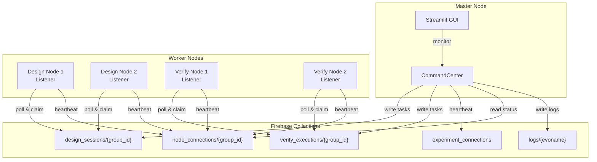

**Sources:** [bin/pages/evolve.py:66-296](), [README.md:74](), [README.md:132-133]()

## Firebase Coordination Layer

Firebase serves as the central coordination mechanism, providing five main collections for distributed state management:

| Collection | Document Key | Purpose |
|------------|--------------|---------|
| `experiment_connections` | `{evoname}` | Tracks active CommandCenter instances |
| `node_connections/{group_id}` | `{node_id}` | Stores node metadata and heartbeats |
| `design_sessions/{group_id}` | `{session_id}` | Manages design task queue and status |
| `verify_executions/{group_id}` | `{verify_id}` | Manages verification task queue |
| `logs/{evoname}` | `{timestamp}` | Centralized logging for debugging |

### Experiment Connections Schema

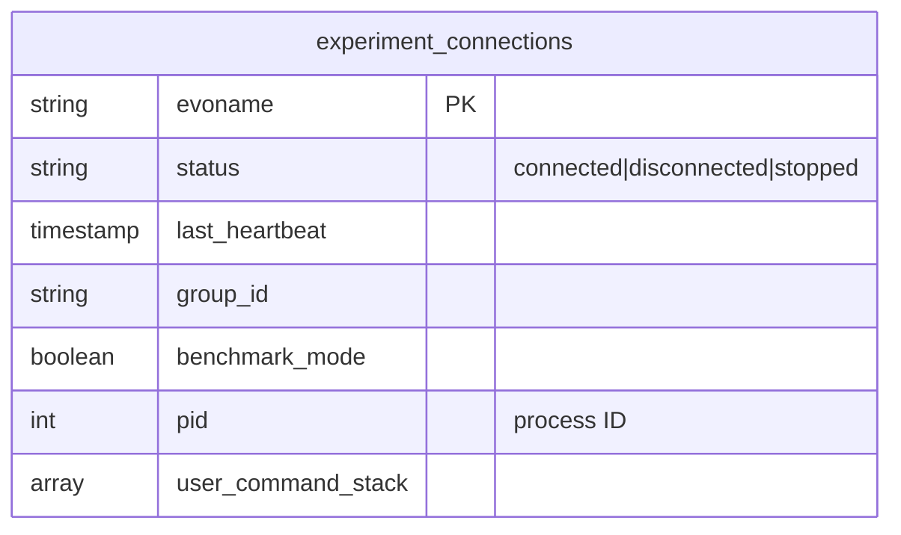

The `experiment_connections` document tracks the master node's CommandCenter instance. Only one active CommandCenter per namespace is allowed to prevent conflicts.

**Sources:** [bin/pages/evolve.py:74-77](), [bin/pages/evolve.py:99-106]()

### Node Connections Schema

Each worker node maintains a document in `node_connections/{group_id}/{node_id}` with the following structure:

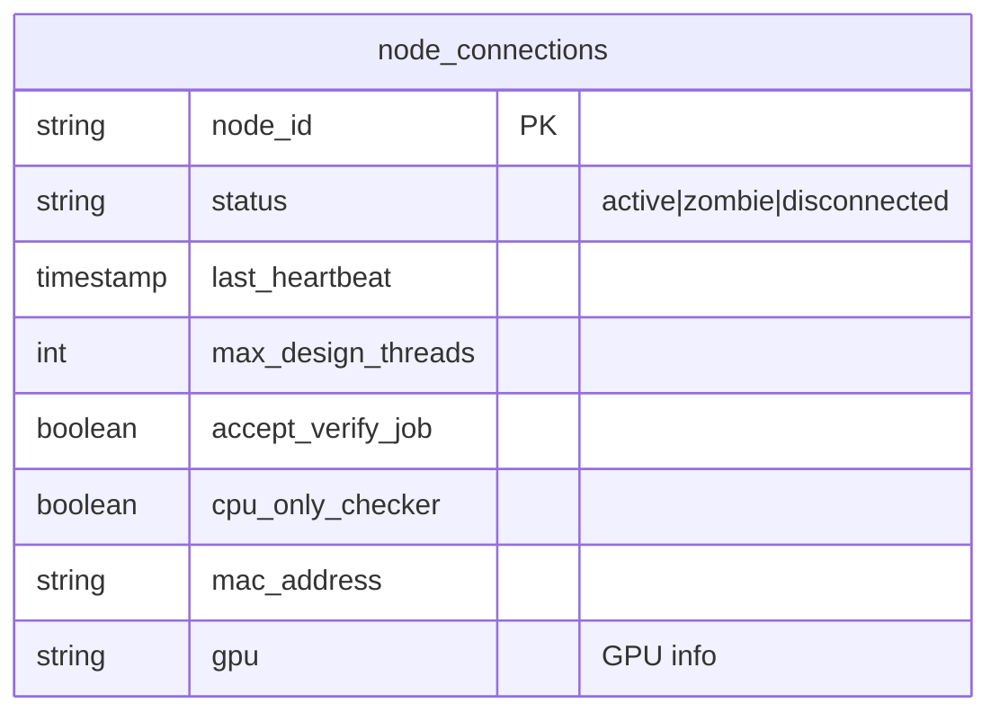

**Sources:** [bin/pages/evolve.py:418-432](), [bin/app_utils.py:103-116]()

## CommandCenter Orchestration

The `CommandCenter` class is the core orchestrator that runs on the master node, managing workload distribution and node health monitoring.

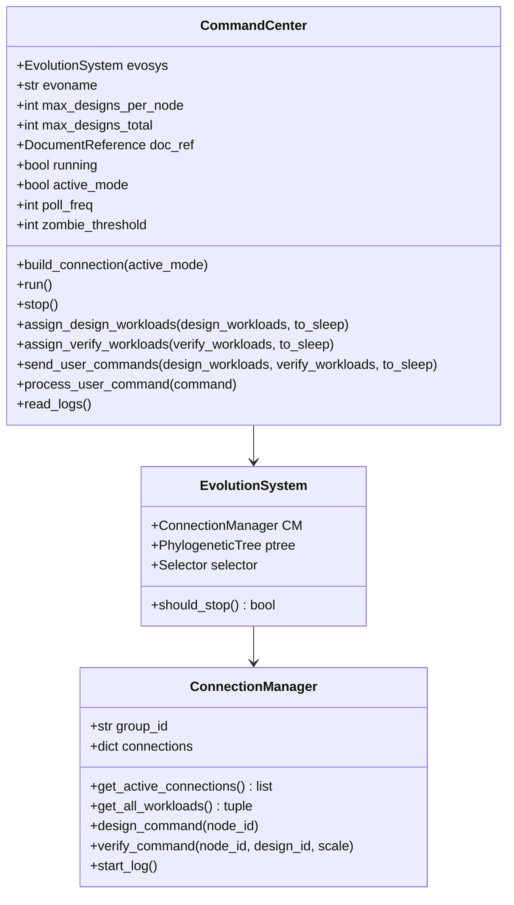

**Sources:** [bin/pages/evolve.py:66-257]()

### CommandCenter Execution Loop

The `CommandCenter.run()` method implements the main orchestration loop:

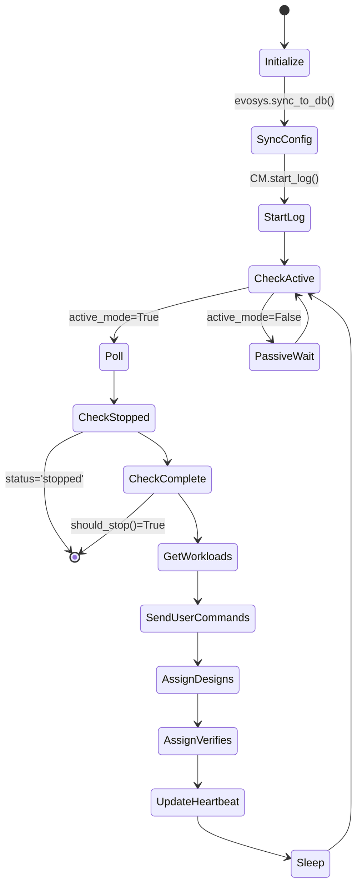

The loop runs with a configurable poll frequency (`CC_POLL_FREQ = 30` seconds by default) and manages three types of workload assignment in order:
1. User commands (manual interventions)
2. Design workloads (LLM-based design generation)
3. Verify workloads (model training and evaluation)

**Sources:** [bin/pages/evolve.py:207-257](), [bin/pages/evolve.py:42-44]()

## Node Management & Heartbeats

Worker nodes run **Listener** processes that periodically update heartbeats and poll for tasks. The system uses heartbeat timestamps to detect stalled or crashed nodes.

### Heartbeat Mechanism

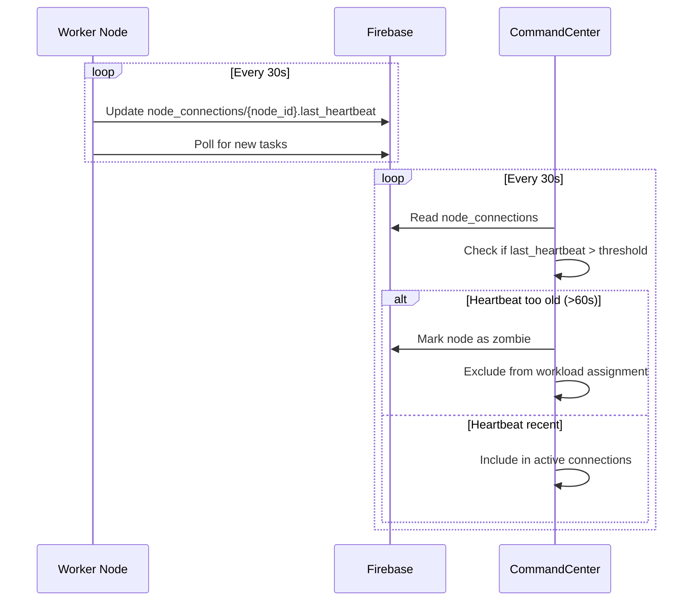

**Constants:**
- `NODE_ZOMBIE_THRESHOLD = 30` seconds - For local listener detection
- `CC_ZOMBIE_THRESHOLD = 60` seconds - For network node detection
- `CC_COMMAND_DELAY = 2` seconds - Delay between consecutive command assignments

**Sources:** [bin/pages/evolve.py:42-44](), [model_discovery/configs/const.py](), [bin/app_utils.py:103-116]()

### Zombie Detection

The `_is_running()` function checks for zombie CommandCenter instances:

```python
# From bin/pages/evolve.py:47-64
def _is_running(evosys):
    collection = evosys.remote_db.collection('experiment_connections')
    docs = collection.get()
    for doc in docs:
        if doc.to_dict().get('status','n/a') == 'connected':
            last_heartbeat = doc.to_dict().get('last_heartbeat')
            threshold_time = datetime.now(pytz.UTC) - timedelta(seconds=CC_ZOMBIE_THRESHOLD)
            is_zombie = last_heartbeat < threshold_time
            if is_zombie:
                doc.reference.update({'status':'disconnected'})
                continue
            # Check group_id and evoname...
```

If a CommandCenter's heartbeat exceeds `CC_ZOMBIE_THRESHOLD`, it's marked as `disconnected`, allowing a new master to take over.

**Sources:** [bin/pages/evolve.py:47-64]()

## Workload Assignment

The CommandCenter assigns tasks based on node capacity and availability, separating CPU-bound design work from GPU-intensive verification.

### Design Workload Assignment

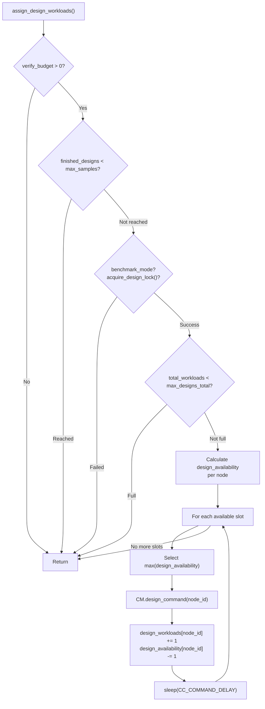

Key constraints:
- **Global limit:** `max_designs_total` across all nodes
- **Per-node limit:** `max_designs_per_node` for each worker
- **Budget check:** Stops if no remaining verification budget
- **Benchmark lock:** In benchmark mode, only one design at a time

**Sources:** [bin/pages/evolve.py:113-156]()

### Verify Workload Assignment

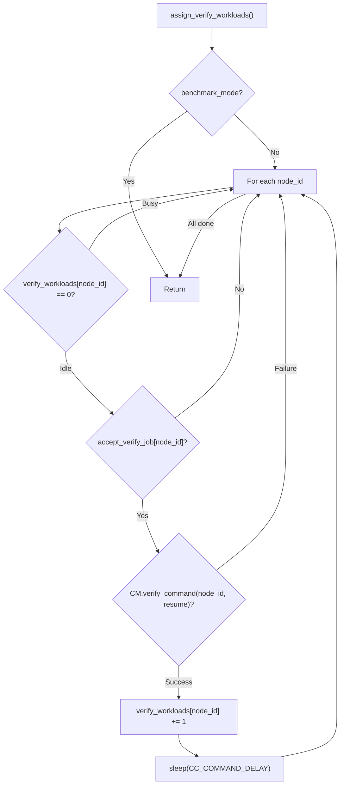

Verify assignments use a simpler strategy:
- Only assign if node is **idle** (no running verification)
- Only assign to nodes with `accept_verify_job=True`
- Verification is **not used** in benchmark mode
- Supports resume from checkpoints if `allow_resume=True`

**Sources:** [bin/pages/evolve.py:158-174]()

### Load Balancing Strategy

The system uses a **greedy load balancing** approach:

```python
# From bin/pages/evolve.py:138-143
for _ in range(max(0, available_design_threads)):
    node_id = max(design_availability, key=design_availability.get)
    if design_availability[node_id] > 0:
        if design_workloads[node_id] < self.max_designs_per_node or self.max_designs_per_node == 0:
            self.evosys.CM.design_command(node_id)
            design_availability[node_id] -= 1
```

The algorithm always assigns to the node with the **highest availability**, calculated as:
```
design_availability[node_id] = max_design_threads[node_id] - current_workloads[node_id]
```

**Sources:** [bin/pages/evolve.py:133-153]()

## Connection Modes

The CommandCenter supports two operational modes to handle different deployment scenarios.

### Active Mode vs Passive Mode

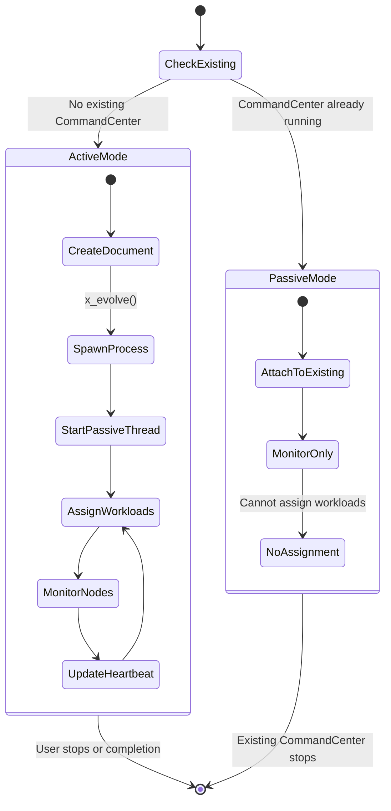

**Active Mode** (`active_mode=True`):
- Creates `experiment_connections` document
- Spawns detached process for persistence
- Assigns workloads to nodes
- Updates heartbeat every poll cycle

**Passive Mode** (`active_mode=False`):
- Connects to existing CommandCenter
- Monitors status and logs
- **Cannot** assign workloads
- Used for GUI observation when another instance is running

**Sources:** [bin/pages/evolve.py:87-108](), [bin/pages/evolve.py:346-368]()

### Launch Mechanisms

Two launch functions handle different execution contexts:

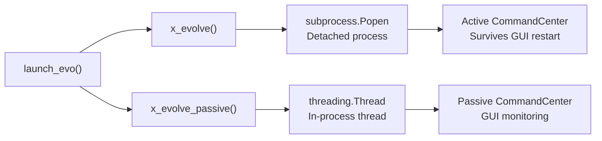

**`x_evolve()`** - Detached subprocess for production:
```python
# From bin/pages/evolve.py:318-343
def x_evolve(command_center):
    cmd = f'python -m bin.pages.evolve --evoname {command_center.evosys.evoname} ...'
    if os.name == 'nt':  # Windows
        process = subprocess.Popen(cmd, shell=True, 
            creationflags=subprocess.DETACH_PROCESS | subprocess.CREATE_NEW_PROCESS_GROUP)
    else:  # Unix-like
        process = subprocess.Popen(cmd, shell=True, start_new_session=True)
    command_center.doc_ref.set({'pid': process.pid}, merge=True)
    return process.pid
```

**`x_evolve_passive()`** - In-process thread for monitoring:
```python
# From bin/pages/evolve.py:307-316
def x_evolve_passive(command_center, cli=False):
    thread = threading.Thread(target=command_center.run)
    if not cli:
        add_script_run_ctx(thread)  # Add Streamlit context
    thread.start()
    doc = command_center.doc_ref.get()
    pid = doc.to_dict().get('pid') if doc.exists else None
    return thread, pid
```

**Sources:** [bin/pages/evolve.py:307-368]()

## User Command System

Users can manually inject commands into the evolution process through the GUI's command center panel.

### Command Queue Processing

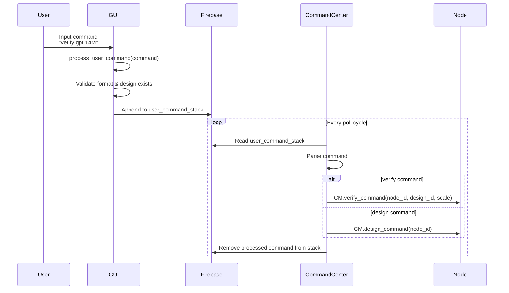

Supported commands:

| Command | Format | Description |
|---------|--------|-------------|
| `verify` | `verify` | Verify next selected design at all scales |
| `verify` | `verify {design_id} {scale}` | Verify specific design at specific scale |
| `design` | `design` | Trigger design generation |

**Sources:** [bin/pages/evolve.py:176-205](), [bin/pages/evolve.py:259-290]()

### Command Validation

```python
# From bin/pages/evolve.py:259-290
def process_user_command(self, command):
    _command = command.lower().strip().split()
    cmd = _command[0]
    
    if cmd == 'verify':
        if len(_command) == 3:
            design_id, scale = _command[1:]
            # Validate design_id exists
            models = self.evosys.ptree.filter_by_type(['DesignArtifactImplemented', 'ReferenceCoreWithTree'])
            if design_id not in models:
                st.toast(f'Design {design_id} not found.', icon='🚨')
                return
            # Validate scale
            if scale.upper() not in self.evosys.target_scales:
                st.toast(f'Scale {scale} not in target scales: {self.evosys.target_scales}.', icon='🚨')
                return
    
    # Append to stack
    user_commands = self.doc_ref.get().to_dict().get('user_command_stack', [])
    user_commands.append(command)
    self.doc_ref.set({'user_command_stack': user_commands}, merge=True)
```

**Sources:** [bin/pages/evolve.py:259-290]()

## Workload Monitoring

The system provides real-time monitoring of distributed workloads through Firebase queries and GUI displays.

### Active Workload Tracking

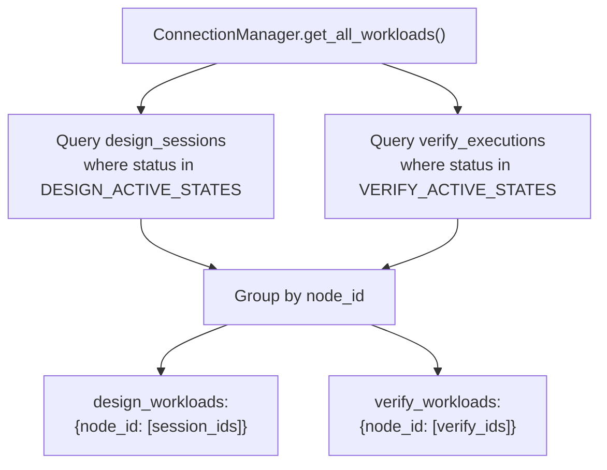

Active states for design sessions:
```python
# From bin/pages/listen.py
DESIGN_ACTIVE_STATES = [
    'planning', 'implementing', 'checking', 'proposing', 'reviewing'
]
```

Active states for verify executions:
```python
# From bin/pages/listen.py  
VERIFY_ACTIVE_STATES = [
    'training', 'evaluating', 'preparing'
]
```

**Sources:** [bin/pages/evolve.py:228-231](), [bin/pages/listen.py]()

### Network Status Display

The GUI's `network_status()` function displays comprehensive node and workload information:

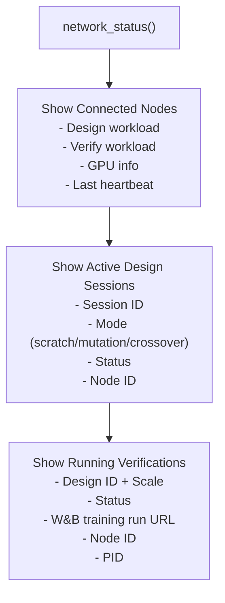

The display includes node-specific configuration:
- `max_design_threads` - Maximum concurrent design sessions
- `accept_verify_job` - Whether node accepts verification tasks
- `cpu_only_checker` - Whether to use GPU for design checking

**Sources:** [bin/pages/evolve.py:405-504]()

## Stopping & Cleanup

Graceful shutdown involves stopping both the active CommandCenter process and the passive monitoring thread.

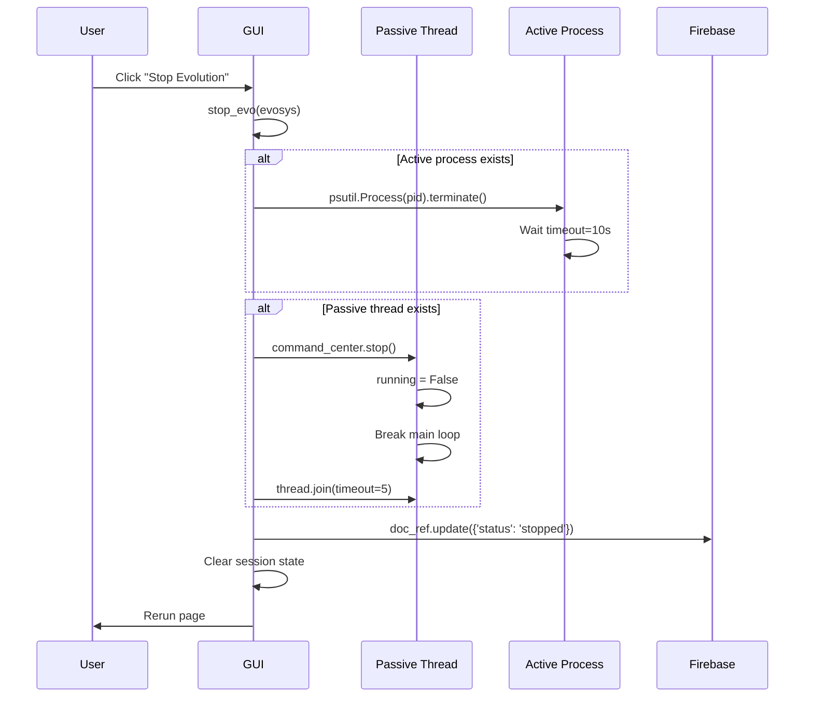

**Cleanup sequence:**
1. Terminate active subprocess if `evo_process_pid` exists
2. Stop passive thread by setting `command_center.running = False`
3. Update Firebase document status to `'stopped'`
4. Clear session state variables
5. Trigger Streamlit page rerun

**Sources:** [bin/pages/evolve.py:370-402]()

## Design vs Verify Separation

The README emphasizes separating design and verify nodes to avoid resource conflicts:

> "Better separate the design nodes and verification nodes, design checkers need to use GPUs, so may cause conflicts. It is recommended to deploy few design nodes and many verification nodes as design nodes are mostly bounded by CPU and API rate limits."

**Design Nodes:**
- CPU-bound (LLM API calls)
- Rate-limited by API providers
- Can use GPU for code checking (optional via `cpu_only_checker=False`)
- Typically deploy **few** nodes (2-5)

**Verify Nodes:**
- GPU-intensive (model training)
- Not rate-limited
- Each node runs one verification at a time
- Typically deploy **many** nodes (10+)

This asymmetric deployment strategy maximizes throughput while avoiding GPU contention between design checking and verification training.

**Sources:** [README.md:132-133]()

---

