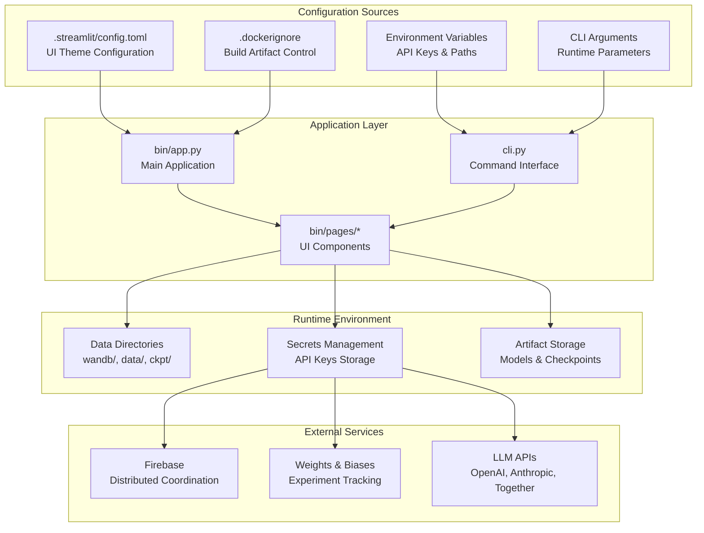
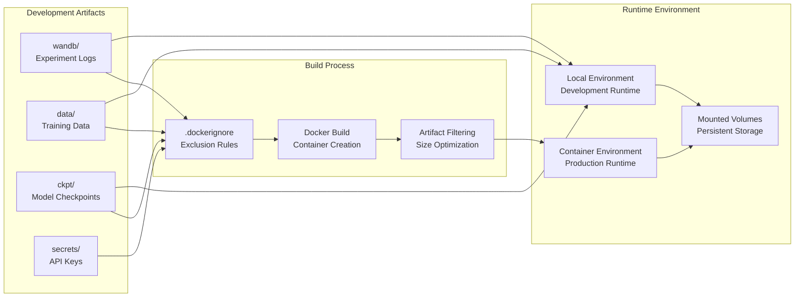
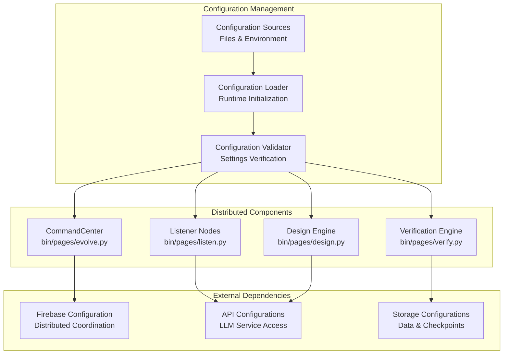

<!-- source: DeepWiki mcp.deepwiki.com · repo allenai/genesys · page 6 Configuration and Environment · fetched 2026-10-26 -->

# Configuration and Environment

Relevant source files

The following files were used as context for generating this wiki page:

- [README.md](README.md)
- [bin/pages/config.py](bin/pages/config.py)

This document covers the configuration management and environment setup for the Genesys system. It details how the system manages its runtime configuration, environment variables, artifact storage, and deployment settings across development and production environments.

For deployment infrastructure details, see [Deployment and Infrastructure](#6). For Streamlit-specific UI configuration, see [Streamlit Configuration](#5.1).

## System Configuration Architecture

The Genesys system employs a multi-layered configuration approach that separates concerns between user interface theming, environment management, and artifact handling. The configuration system supports both local development and distributed deployment scenarios.

### Configuration Flow

Sources: [.streamlit/config.toml:1-4](), [.dockerignore:1-187]()

## Environment Management Strategy

The system implements a comprehensive environment management strategy that handles sensitive data, artifact storage, and build optimization through multiple configuration layers.

### Artifact Management and Build Optimization

Sources: [.dockerignore:1-11](), [.dockerignore:144-151]()

## Configuration Categories

### User Interface Configuration

The system uses Streamlit's configuration system to provide a consistent dark theme optimized for technical users working with complex ML visualizations.

| Configuration Key | Value | Purpose |
|------------------|-------|---------|
| `theme.base` | `"dark"` | Base theme for reduced eye strain |
| `theme.primaryColor` | `"#8D4BBB"` | Purple accent color for UI elements |
| `theme.font` | `"serif"` | Serif font for improved readability |

The configuration supports the system's technical interface requirements while maintaining visual consistency across all pages and components.

Sources: [.streamlit/config.toml:1-4]()

### Build and Deployment Configuration

The Docker ignore configuration implements a comprehensive exclusion strategy that optimizes container build performance and security:

#### Data and Artifact Exclusions
- **Experiment Data**: `wandb/`, `data/`, `ckpt/` directories containing large training datasets and model checkpoints
- **Security**: `secrets/` directory and API key files
- **Development Files**: `quicknote.md`, `README.md`, and other documentation

#### Python Environment Exclusions
- **Bytecode**: `__pycache__/`, `*.py[cod]`, `*$py.class` files
- **Virtual Environments**: `.env`, `.venv`, `env/`, `venv/` directories
- **Package Management**: `*.egg-info/`, `dist/`, `build/` directories

#### Development Tool Exclusions
- **Testing**: `.pytest_cache/`, `coverage.xml`, `htmlcov/` directories
- **IDE Files**: `.idea/`, `.vscode/`, `.DS_Store` files
- **Version Control**: Git-related temporary files and directories

Sources: [.dockerignore:1-11](), [.dockerignore:18-46](), [.dockerignore:144-151]()

### Environment Variable Management

The system relies on environment variables for configuration of external service integrations and runtime parameters. Key categories include:

- **API Authentication**: Keys for OpenAI, Anthropic, Together AI, and other LLM providers
- **Database Configuration**: Firebase connection parameters and authentication
- **Storage Paths**: Data directory locations and checkpoint storage paths
- **Experiment Tracking**: Weights & Biases project configuration

The environment variable system supports both development and production deployments through flexible configuration inheritance.

Sources: [.dockerignore:144-151]()

## Integration with System Components

The configuration system integrates tightly with the distributed evolution architecture, providing consistent settings across all nodes and components in the system.

### Configuration Distribution Pattern

Sources: [.streamlit/config.toml:1-4](), [.dockerignore:1-187]()

The configuration system ensures that all components of the distributed evolution system maintain consistent settings and can communicate effectively across the network of nodes participating in the evolutionary process.

---

