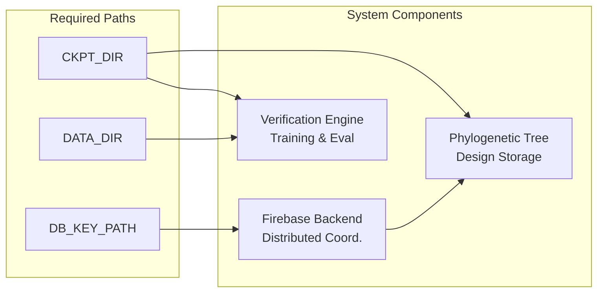
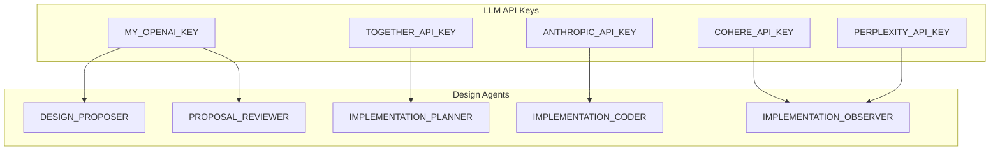
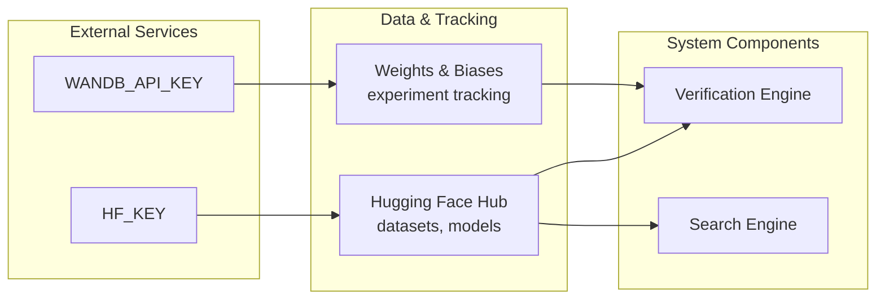
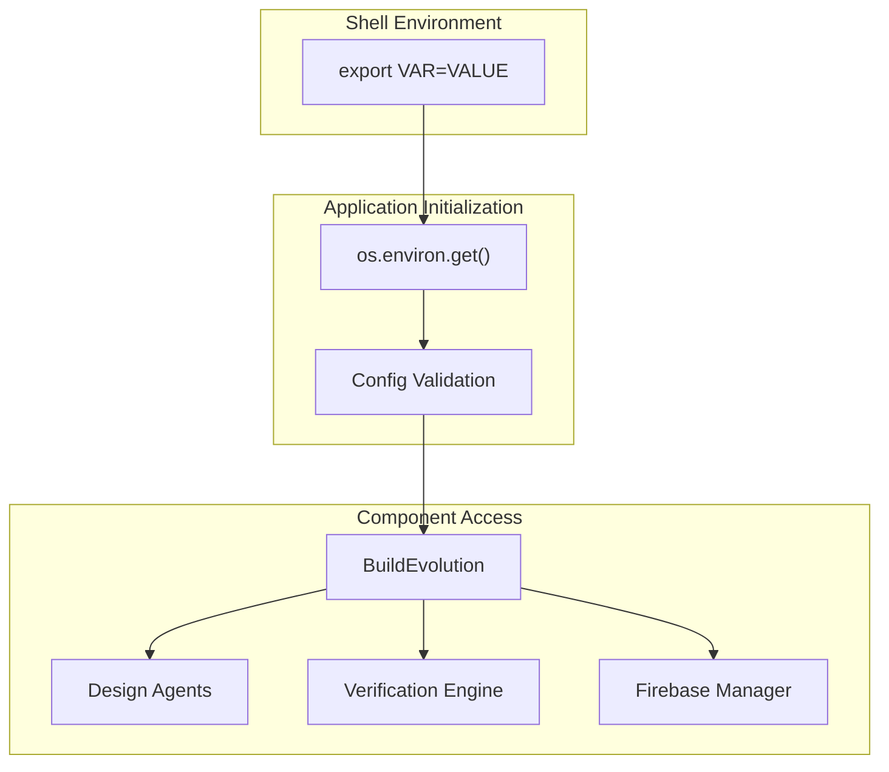
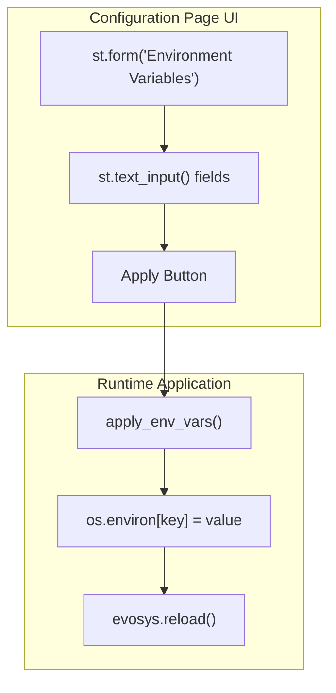

<!-- source: DeepWiki mcp.deepwiki.com · repo allenai/genesys · page 6.1 Environment Variables and Secrets · fetched 2026-10-26 -->

# Environment Variables and Secrets

<details>
<summary>Relevant source files</summary>

The following files were used as context for generating this wiki page:

- [README.md](README.md)
- [bin/pages/config.py](bin/pages/config.py)

</details>


This document describes all environment variables and secrets required or optional for running Genesys, including API keys, storage paths, and feature flags. For runtime configuration management through the GUI, see [Configuration Management Interface](#4.4). For deployment-specific environment configuration, see [Docker Containerization](#7.1).

## Overview

Genesys requires environment variables for three primary purposes:

1. **API Authentication**: Credentials for LLM providers, experiment tracking, and external search services
2. **Storage Paths**: Directories for model checkpoints, evaluation data, and Firebase credentials
3. **Feature Flags**: Optional settings to enable/disable specific capabilities

These variables must be exported in the shell environment before launching Genesys components. The system reads them at initialization and uses them throughout the evolution workflow.

**Sources**: [README.md:56-72](), [bin/pages/config.py:938-967]()

## Required Environment Variables

### Core Storage Paths



**Diagram: Required Storage Path Environment Variables**

| Variable | Purpose | Example Value | Used By |
|----------|---------|---------------|---------|
| `CKPT_DIR` | Root directory for experiment checkpoints and phylogenetic tree data | `~/genesys/ckpt` | Evolution system, Verification Engine |
| `DATA_DIR` | Directory containing evaluation datasets (BabyLM, BLIMP) | `~/genesys/data` | Verification Engine, lm-evaluation-harness |
| `DB_KEY_PATH` | Path to Firebase service account JSON credential file | `~/genesys/secrets/db_key.json` | Firebase coordination, distributed nodes |

**Sources**: [README.md:64-66](), [bin/pages/config.py:946-948]()

### Firebase Backend Setup

The `DB_KEY_PATH` must point to a valid Firebase service account key JSON file. This is **required** for distributed evolution across multiple nodes.

```bash
export DB_KEY_PATH=~/genesys/secrets/db_key.json
```

The Firebase backend enables:
- Task queue coordination between master and worker nodes
- Session metadata synchronization
- Remote experiment configuration storage
- Node heartbeat monitoring

**Sources**: [README.md:74]()

## LLM API Keys

### Primary LLM Providers

Genesys uses multiple LLM providers for design agents. At minimum, one provider API key is required.



**Diagram: LLM API Keys Usage in Design Agents**

| Variable | Provider | Models Available | Agent Role |
|----------|----------|------------------|------------|
| `MY_OPENAI_KEY` | OpenAI | GPT-4, GPT-4 Turbo, GPT-3.5 | All design agent roles |
| `ANTHROPIC_API_KEY` | Anthropic | Claude 3 Opus, Sonnet, Haiku | All design agent roles |
| `TOGETHER_API_KEY` | Together AI | Mixtral, Llama, Qwen | All design agent roles |
| `COHERE_API_KEY` | Cohere | Command R+, Command R | Embedding, reranking |
| `PERPLEXITY_API_KEY` | Perplexity | Sonar models | Search assistant (optional) |

**Configuration Example**:
```bash
export MY_OPENAI_KEY=sk-proj-...
export ANTHROPIC_API_KEY=sk-ant-...
export TOGETHER_API_KEY=...
export COHERE_API_KEY=...
export PERPLEXITY_API_KEY=pplx-...
```

**Sources**: [README.md:58-63](), [README.md:69-71](), [bin/pages/config.py:954-960]()

### Agent Type Configuration

Design agents can be configured to use specific LLM providers. The system checks for available API keys and enables corresponding agent options. See [Design Agents and Workflow](#5.2) for agent configuration details.

**Sources**: [bin/pages/config.py:521-546]()

## External Service Integration

### Hugging Face and Experiment Tracking



**Diagram: External Service API Keys**

| Variable | Service | Purpose | Required |
|----------|---------|---------|----------|
| `HF_KEY` | Hugging Face | Download datasets, upload models, access gated content | Yes |
| `WANDB_API_KEY` | Weights & Biases | Log training metrics, track experiments | Yes |
| `S2_API_KEY` | Semantic Scholar | Search academic papers for design inspiration | Optional |
| `PINECONE_API_KEY` | Pinecone | Vector search for paper chunks | Optional |

**Sources**: [README.md:61-63](), [README.md:68-69](), [bin/pages/config.py:950-952](), [bin/pages/config.py:958-959]()

### Search Engine Configuration

The optional `PINECONE_API_KEY` enables vector search capabilities in the search engine. If not provided, search falls back to local library search only.

The optional `S2_API_KEY` enables Semantic Scholar paper search. The system can function without it but with reduced search capabilities.

**Sources**: [README.md:76](), [bin/pages/config.py:952](), [bin/pages/config.py:958]()

## Feature Flags

### Hugging Face Datasets Trust

```bash
export HF_DATASETS_TRUST_REMOTE_CODE=1
```

This flag allows Hugging Face datasets library to execute remote code in dataset loading scripts. Required for certain datasets that include custom processing logic.

**Sources**: [README.md:67]()

### Optional Services

```bash
export MATHPIX_API_ID=...  # Optional PDF-to-text conversion service
```

The `MATHPIX_API_ID` enables PDF-to-text conversion for processing papers from arXiv URLs. This is **not used in the published paper** but available for custom workflows.

**Sources**: [README.md:71]()

## Environment Variable Loading Pattern



**Diagram: Environment Variable Loading Flow**

The system reads environment variables at initialization using `os.environ.get()` throughout the codebase. There is no centralized configuration file for secrets.

**Sources**: [bin/pages/config.py:946-960]()

## GUI Configuration Interface

The configuration page provides a UI for viewing and temporarily setting environment variables, but **these settings do not persist across sessions**.



**Diagram: GUI Environment Variable Application Flow**

The GUI environment configuration is located at:
- **Function**: `env_vars_settings()` [bin/pages/config.py:937-967]()
- **Apply Handler**: `apply_env_vars()` [bin/pages/config.py:51-68]()

### Important Notes

1. **Not Persistent**: Changes made via GUI only affect the current session
2. **Best Practice**: Export variables in shell before launching `genesys gui`
3. **Security**: Password-type fields mask input but do not encrypt storage
4. **Demo Mode**: Environment variable changes are disabled in demo mode

**Sources**: [bin/pages/config.py:937-967](), [bin/pages/config.py:51-68]()

## Complete Environment Setup Example

```bash
# Required: Storage Paths
export CKPT_DIR=~/genesys/ckpt
export DATA_DIR=~/genesys/data
export DB_KEY_PATH=~/genesys/secrets/db_key.json

# Required: Primary LLM Provider (choose at least one)
export MY_OPENAI_KEY=sk-proj-...
export ANTHROPIC_API_KEY=sk-ant-...
export TOGETHER_API_KEY=...

# Required: Data and Experiment Tracking
export HF_KEY=hf_...
export WANDB_API_KEY=...

# Required: Feature Flag
export HF_DATASETS_TRUST_REMOTE_CODE=1

# Optional: Additional LLM Providers
export COHERE_API_KEY=...
export PERPLEXITY_API_KEY=pplx-...

# Optional: Search Services
export S2_API_KEY=...
export PINECONE_API_KEY=...

# Optional: Utilities
export MATHPIX_API_ID=...
```

**Sources**: [README.md:56-72]()

## Environment Variables Reference Table

| Category | Variable | Required | Default | Description |
|----------|----------|----------|---------|-------------|
| **Storage** | `CKPT_DIR` | Yes | None | Experiment checkpoints and phylogenetic tree storage |
| **Storage** | `DATA_DIR` | Yes | None | Evaluation datasets directory |
| **Storage** | `DB_KEY_PATH` | Yes* | None | Firebase service account JSON path (*required for distributed) |
| **LLM** | `MY_OPENAI_KEY` | One of | None | OpenAI API authentication |
| **LLM** | `ANTHROPIC_API_KEY` | LLM keys | None | Anthropic API authentication |
| **LLM** | `TOGETHER_API_KEY` | required | None | Together AI API authentication |
| **LLM** | `COHERE_API_KEY` | No | None | Cohere API for embeddings and reranking |
| **LLM** | `PERPLEXITY_API_KEY` | No | None | Perplexity API for search |
| **Tracking** | `HF_KEY` | Yes | None | Hugging Face Hub authentication |
| **Tracking** | `WANDB_API_KEY` | Yes | None | Weights & Biases experiment tracking |
| **Search** | `S2_API_KEY` | No | None | Semantic Scholar paper search |
| **Search** | `PINECONE_API_KEY` | No | None | Pinecone vector store for paper chunks |
| **Feature** | `HF_DATASETS_TRUST_REMOTE_CODE` | Yes | None | Enable remote code execution for datasets |
| **Utility** | `MATHPIX_API_ID` | No | None | PDF-to-text conversion service |

**Sources**: [README.md:56-72](), [bin/pages/config.py:938-961]()

## Secrets Management Best Practices

### Local Development

1. **Shell Profile**: Add exports to `~/.bashrc` or `~/.zshrc`
2. **Environment Files**: Use `.env` files with a loader (ensure they're in `.gitignore`)
3. **Secret Managers**: Use OS keychain or secret management tools

### Production Deployment

For Kubernetes/cloud deployments, secrets are managed through:
- **Kubernetes Secrets**: For API keys and credentials
- **ConfigMaps**: For non-sensitive configuration
- **Cloud Secret Managers**: For production environments

See [Kubernetes Deployment Configuration](#7.2) for deployment-specific secret management.

**Sources**: [README.md:56-72]()

## Verification and Troubleshooting

### Checking Environment Variables

The GUI provides visibility into current environment variable values:
```python
# Located in config page
env_vars['DB_KEY_PATH'] = st.text_input('Database Key Path', 
                                         value=os.environ.get("DB_KEY_PATH", None))
```

### Common Issues

| Issue | Symptom | Solution |
|-------|---------|----------|
| Missing `DB_KEY_PATH` | Firebase connection errors | Verify JSON file exists and path is correct |
| Invalid API key | Authentication failures | Check key format and validity with provider |
| Missing `CKPT_DIR` | Cannot save experiments | Create directory and export path |
| Missing `DATA_DIR` | Evaluation data not found | Run `genesys setup` and export path |
| No LLM keys | Design agents fail | Export at least one LLM provider API key |

### Testing Setup

After setting environment variables, verify setup with:
```bash
genesys node  # Test node initialization
genesys gui   # Launch GUI to verify configuration page
```

**Sources**: [README.md:87-95](), [bin/pages/config.py:940-967]()

## Related Configuration

- **Runtime Configuration**: See [Configuration Management Interface](#4.4)
- **Verification Engine Settings**: See [Verification Engine](#5.3)
- **Search Engine Configuration**: See [Design Agents and Workflow](#5.2)
- **Deployment Configuration**: See [Kubernetes Deployment Configuration](#7.2)

**Sources**: [bin/pages/config.py:1-1210]()

---

