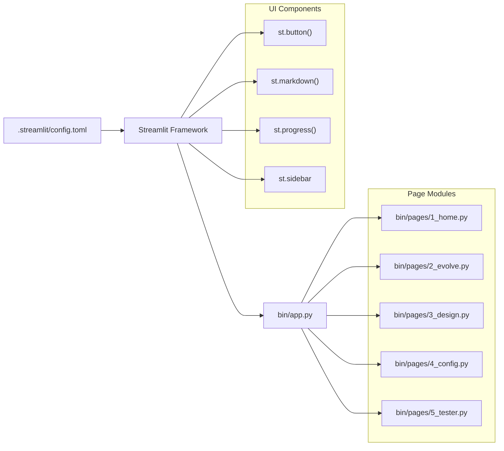
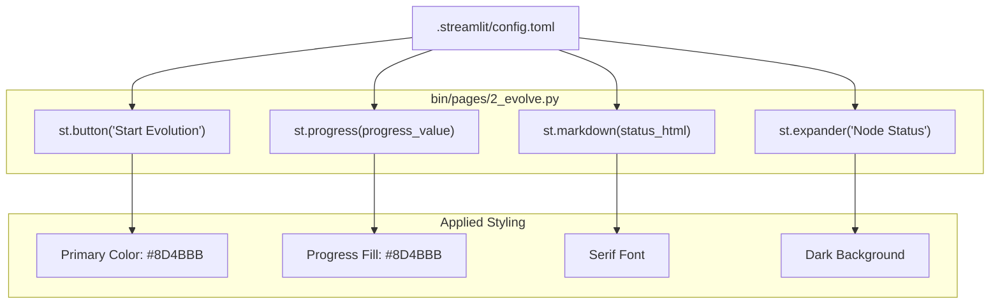
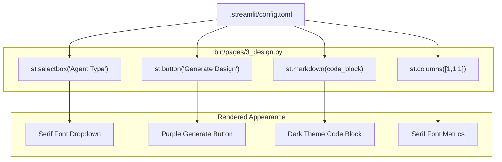

<!-- source: DeepWiki mcp.deepwiki.com · repo allenai/genesys · page 6.2 Streamlit Configuration · fetched 2026-10-26 -->

# Streamlit Configuration

<details>
<summary>Relevant source files</summary>

The following files were used as context for generating this wiki page:

- [.streamlit/config.toml](.streamlit/config.toml)

</details>


## Purpose and Scope

This document covers the Streamlit framework configuration for the Genesys web interface. The `.streamlit/config.toml` file defines the visual theme applied globally to all pages in the Streamlit application, including `bin/app.py` and all page modules in `bin/pages/`.

For the main application entry point, see page 3.1. For page-specific UI components, see page 4.

## Configuration File Structure

The Streamlit configuration is located at `.streamlit/config.toml` and follows the TOML format. Streamlit automatically loads this file at application startup and applies the theme settings to all UI components rendered by `st.*` functions.

### Configuration Loading Mechanism



**Diagram: Streamlit Configuration Loading and Application**

The configuration is loaded by the Streamlit framework before `bin/app.py` executes, ensuring theme consistency across all rendered components.

Sources: [.streamlit/config.toml:1-4]()

## Theme Parameters

The `[theme]` section contains three configuration parameters:

### base

```toml
base="dark"
```

Sets the base theme to `"dark"`, which configures the default background, text colors, and component styling. This is one of Streamlit's predefined base themes (`"light"` or `"dark"`).

Sources: [.streamlit/config.toml:2]()

### primaryColor

```toml
primaryColor="#8D4BBB"
```

Defines the primary accent color as `#8D4BBB` (purple). This hex color value is applied to:
- `st.button()` components in default state
- `st.checkbox()` and `st.radio()` selection indicators  
- `st.progress()` bar fill color
- `st.slider()` handle and track
- Hyperlinks in `st.markdown()` output

Sources: [.streamlit/config.toml:3]()

### font

```toml
font="serif"
```

Sets the font family to `"serif"`. Streamlit's font options are `"sans serif"`, `"serif"`, and `"monospace"`. This applies to all text rendered by Streamlit components including `st.text()`, `st.markdown()`, `st.write()`, and data display functions.

Sources: [.streamlit/config.toml:4]()

## Parameter Reference Table

| Parameter | Type | Value | Affected Components |
|-----------|------|-------|---------------------|
| `base` | String | `"dark"` | All Streamlit UI components |
| `primaryColor` | Hex Color | `"#8D4BBB"` | `st.button()`, `st.checkbox()`, `st.radio()`, `st.progress()`, `st.slider()` |
| `font` | String | `"serif"` | `st.text()`, `st.markdown()`, `st.write()`, `st.dataframe()`, `st.table()` |

Sources: [.streamlit/config.toml:1-4]()

## Application in UI Components

The theme configuration is applied to all Streamlit UI elements used throughout the application. Below are examples of how the configuration affects specific code constructs:

### Evolution Control Interface (`bin/pages/2_evolve.py`)



**Diagram: Theme Application to Evolution Page Components**

Sources: [.streamlit/config.toml:1-4]()

### Design Engine Interface (`bin/pages/3_design.py`)



**Diagram: Theme Application to Design Page Components**

Sources: [.streamlit/config.toml:1-4]()

## Visual Identity and Branding

The configuration choices reflect the technical nature of the Genesys system while maintaining professional aesthetics:

- **Dark Theme**: Reduces eye strain during extended monitoring sessions and provides a modern, technical appearance appropriate for distributed systems management
- **Purple Primary Color**: Creates a distinctive brand identity that differentiates Genesys from other ML platforms while maintaining high contrast and accessibility
- **Serif Typography**: Enhances readability of complex technical content, design proposals, and numerical data displays common in evolutionary algorithm interfaces

This configuration supports the system's role as a sophisticated research platform for automated machine learning model discovery and evolution.

Sources: [.streamlit/config.toml:1-4]()

---

