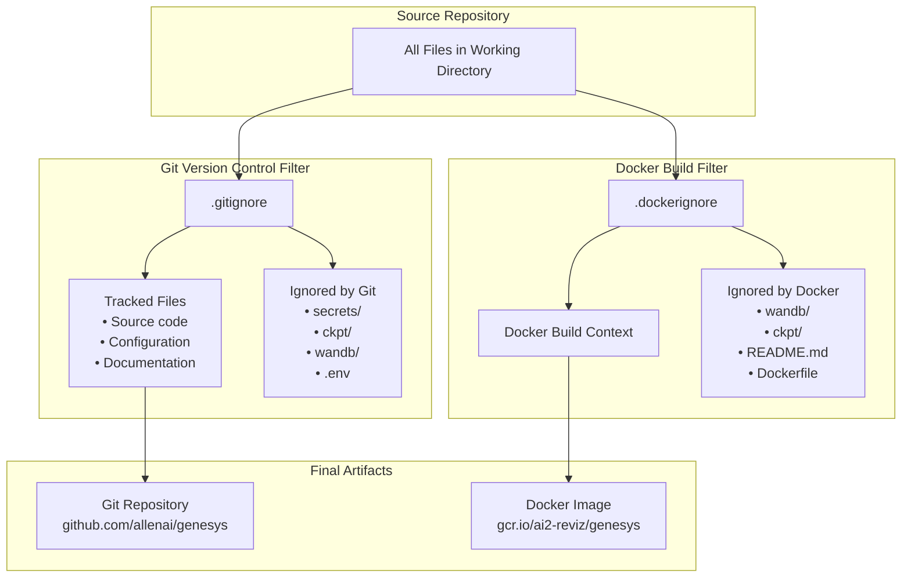
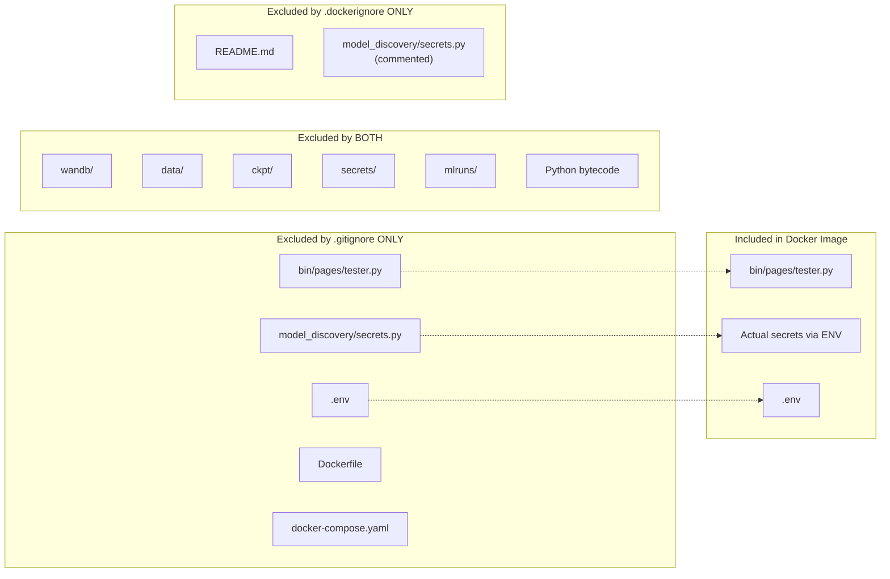
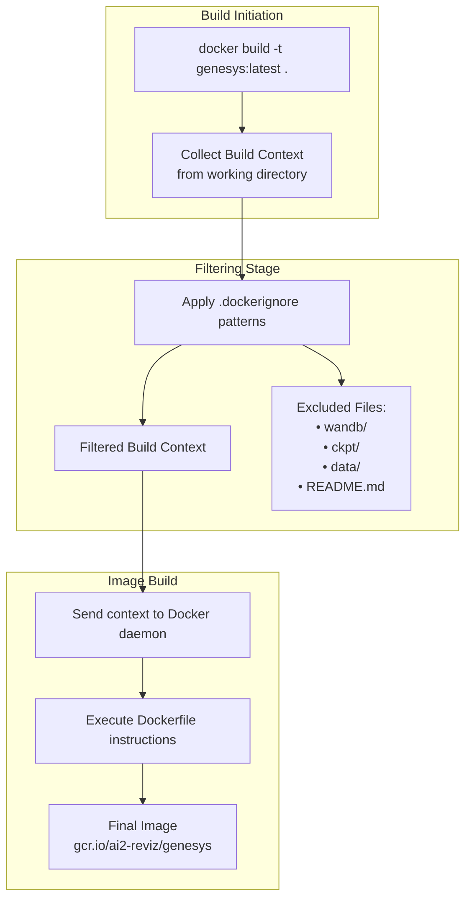
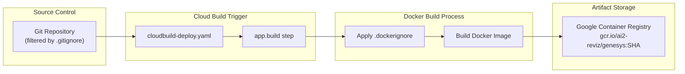

<!-- source: DeepWiki mcp.deepwiki.com · repo allenai/genesys · page 6.3 Build and Version Control Configuration · fetched 2026-10-26 -->

# Build and Version Control Configuration

<details>
<summary>Relevant source files</summary>

The following files were used as context for generating this wiki page:

- [.dockerignore](.dockerignore)
- [.gitignore](.gitignore)

</details>


## Purpose and Scope

This document details the build and version control exclusion patterns defined in [.dockerignore]() and [.gitignore](). These configuration files specify which files and directories should be excluded from Docker image builds and Git version control, respectively. Understanding these patterns is essential for maintaining clean builds, reducing image sizes, and preventing sensitive or generated files from entering version control.

For Docker containerization details, see [Docker Containerization](#7.1). For deployment pipeline information, see [CI/CD Pipeline](#7.3). For environment variable configuration, see [Environment Variables and Secrets](#6.1).

**Sources:** [.dockerignore](), [.gitignore]()

---

## Overview

The Genesys repository uses two exclusion configuration files that serve different purposes in the development and deployment workflow:

| File | Purpose | Context | Impact |
|------|---------|---------|--------|
| `.gitignore` | Excludes files from Git version control | Development environment | Prevents committing generated files, secrets, and local artifacts |
| `.dockerignore` | Excludes files from Docker build context | Docker image building | Reduces image size and build time by excluding unnecessary files |

While both files share similar patterns (both are based on standard Python `.gitignore` templates), they have distinct differences in which project-specific files they exclude.

**Sources:** [.gitignore](), [.dockerignore]()

---

## Exclusion Pattern Architecture

The following diagram illustrates how these two files filter content at different stages of the development and deployment pipeline:



**Sources:** [.gitignore](), [.dockerignore]()

---

## Git Version Control Exclusions (.gitignore)

The [.gitignore]() file prevents specified files and directories from being tracked by Git. This ensures that generated artifacts, local configurations, and sensitive data do not enter the repository.

### Project-Specific Exclusions

The following table categorizes the Genesys-specific exclusions defined at the top of [.gitignore:1-18]():

| Pattern | Type | Purpose | Storage Location |
|---------|------|---------|------------------|
| `wandb` | Directory | Weights & Biases experiment logs | Local artifact storage |
| `data` | Directory | Evaluation datasets | Referenced by `DATA_DIR` env var |
| `data.zip` | Archive | Compressed dataset archive | Local cache |
| `ckpt` | Directory | Model checkpoints | Referenced by `CKPT_DIR` env var |
| `ckpt.zip` | Archive | Compressed checkpoint archive | Local cache |
| `quicknote.md` | File | Developer scratch notes | Local working directory |
| `model_discovery/secrets.py` | File | API keys and credentials | Sensitive configuration |
| `model_discovery/model/gab.py` | File | Experimental/debug code | Development artifact |
| `model_discovery/model/library/files` | Directory | Library file cache | Generated content |
| `model_discovery/model/library/library_files.zip` | Archive | Compressed library cache | Generated content |
| `bin/pages/tester.py` | File | Debug interface | Development tool |
| `secrets` | Directory | Credential storage | Sensitive data |
| `Docker.beaker` | File | Beaker experiment configuration | Alternative deployment |
| `mlruns` | Directory | MLflow experiment tracking | Alternative to W&B |
| `.env` | File | Local environment variables | Sensitive configuration |
| `Dockerfile` | File | Docker build instructions | Build artifact |
| `docker-compose.yaml` | File | Docker compose configuration | Build artifact |

**Sources:** [.gitignore:1-18]()

### Standard Python Exclusions

The remainder of the `.gitignore` file ([.gitignore:20-189]()) follows the standard Python `.gitignore` template from GitHub, which excludes:

| Category | Examples | Purpose |
|----------|----------|---------|
| Bytecode | `__pycache__/`, `*.pyc`, `*.pyo` | Compiled Python files |
| Distribution | `build/`, `dist/`, `*.egg-info/` | Package build artifacts |
| Virtual Environments | `.venv`, `venv/`, `ENV/` | Isolated Python environments |
| IDE Files | `.idea/`, `.vscode/` | Editor-specific configurations |
| Test Coverage | `.coverage`, `htmlcov/`, `.pytest_cache/` | Testing artifacts |
| Documentation | `docs/_build/`, `/site` | Generated documentation |
| OS Files | `*.DS_Store`, `*~` | Operating system metadata |

**Sources:** [.gitignore:20-189]()

---

## Docker Build Exclusions (.dockerignore)

The [.dockerignore]() file prevents specified files from being sent to the Docker daemon during image builds. This reduces build context size and prevents unnecessary files from being included in the final image.

### Key Differences from .gitignore

The following diagram highlights the critical differences between `.gitignore` and `.dockerignore`:



**Sources:** [.gitignore](), [.dockerignore]()

### Project-Specific Docker Exclusions

The Docker-specific exclusions at [.dockerignore:1-17]() include:

| Pattern | Line | Reason for Exclusion |
|---------|------|---------------------|
| `wandb` | 1 | Experiment logs (regenerated at runtime) |
| `data` | 2 | Large datasets (mounted or downloaded at runtime) |
| `data.zip` | 3 | Compressed datasets (not needed in image) |
| `ckpt` | 4 | Model checkpoints (too large for image) |
| `ckpt.zip` | 5 | Compressed checkpoints (not needed in image) |
| `quicknote.md` | 6 | Developer notes (not needed in production) |
| `# model_discovery/secrets.py` | 7 | **Commented out** - secrets handled via environment variables |
| `model_discovery/model/gab.py` | 8 | Experimental code (not used in production) |
| `model_discovery/model/library/files` | 9 | Generated library cache (regenerated if needed) |
| `model_discovery/model/library/library_files.zip` | 10 | Compressed library cache (not needed) |
| `secrets` | 11 | Secret files directory (credentials via env vars) |
| `Docker.beaker` | 12 | Alternative deployment config (not needed) |
| `mlruns` | 13 | MLflow tracking (uses W&B instead) |
| `Dockerfile` | 14 | Build instructions (not needed in final image) |
| `docker-compose.yaml` | 15 | Compose config (not needed in K8s deployment) |
| `README.md` | 16 | Documentation (not needed in production image) |

**Important Note:** The pattern `model_discovery/secrets.py` is commented out at [.dockerignore:7](), meaning this file **is included** in Docker builds if it exists. However, in production deployments, secrets are provided via environment variables (see [Environment Variables and Secrets](#6.1)) rather than committed files.

**Sources:** [.dockerignore:1-17]()

---

## Pattern Comparison and Build Optimization

### Size Impact Analysis

The following table quantifies the impact of key exclusion patterns on build artifacts:

| Excluded Item | Typical Size | Performance Impact |
|---------------|--------------|-------------------|
| `ckpt/` directory | 500 MB - 5 GB | Massive reduction in image size and upload time |
| `data/` directory | 100 MB - 1 GB | Significant reduction; data mounted at runtime via `DATA_DIR` |
| `wandb/` directory | 50 MB - 500 MB | Prevents including experiment history in images |
| `__pycache__/` | 10 MB - 50 MB | Reduces image size; bytecode regenerated in container |
| `README.md` | < 50 KB | Minimal impact; excluded for principle of minimal images |

**Sources:** [.dockerignore](), [Dockerfile]()

### Build Context Workflow

The following diagram shows how `.dockerignore` integrates with the Docker build process:



**Sources:** [.dockerignore](), [Dockerfile]()

---

## Critical Exclusion Patterns

### Security-Critical Exclusions

These patterns prevent sensitive information from entering version control or Docker images:

```
# Git version control exclusions (MUST NOT commit)
model_discovery/secrets.py    # API keys, credentials
.env                          # Local environment variables
secrets/                      # Secret files directory

# Docker build exclusions (handled differently)
# model_discovery/secrets.py  # COMMENTED - secrets via ENV vars
secrets/                      # Excluded from builds
```

**Security Note:** In production deployments, API keys are injected via Kubernetes secrets and environment variables defined in [webapp.jsonnet]() (see [Kubernetes Deployment Configuration](#7.2)), not through files in the Docker image.

**Sources:** [.gitignore:7-15](), [.dockerignore:7-11]()

### Storage-Critical Exclusions

These patterns prevent large artifacts from bloating the repository or Docker images:

```
# Large directories excluded from both Git and Docker
ckpt/        # Model checkpoints (GBs)
ckpt.zip     # Compressed checkpoints
data/        # Evaluation datasets (100s of MBs)
data.zip     # Compressed datasets
wandb/       # Experiment logs (can grow to GBs)
mlruns/      # MLflow tracking data
```

These artifacts are:
- **For Git:** Never committed; managed locally or on shared storage
- **For Docker:** Excluded from image; mounted at runtime via `CKPT_DIR` and `DATA_DIR` environment variables

**Sources:** [.gitignore:1-14](), [.dockerignore:1-13]()

---

## Development vs. Production Patterns

### Files Excluded from Git but Included in Docker

The following files are tracked in Git but excluded from Docker builds:

```
README.md                     # Documentation (not needed in production)
Dockerfile                    # Build instructions (self-referential)
docker-compose.yaml           # Development orchestration
```

**Sources:** [.dockerignore:14-17]()

### Files Excluded from Docker but Tracked in Git

The following files are version-controlled but not included in production images:

```
bin/pages/tester.py           # Debug interface (gitignored)
.env                          # Local config (gitignored)
```

Note: `bin/pages/tester.py` is tracked in the repository for development purposes but gitignored to prevent accidental commits of local modifications. In Docker builds, it would be included unless explicitly excluded.

**Sources:** [.gitignore:11](), [.dockerignore]()

---

## Maintenance Guidelines

### Adding New Exclusion Patterns

When adding new patterns, consider the following decision matrix:

| Scenario | .gitignore | .dockerignore | Rationale |
|----------|-----------|---------------|-----------|
| Generated code/artifacts | ✓ | ✓ | Reproducible from source |
| Large datasets | ✓ | ✓ | Managed externally |
| Secrets/credentials | ✓ | ✓ | Security risk |
| Development tools | ✓ | ✓ | Not needed in production |
| Documentation | ✗ | ✓ | Track changes, but exclude from images |
| Build configurations | ✗ | ✓ | Version control needed |
| IDE configurations | ✓ | ✓ | User-specific |

### Common Patterns to Avoid

Do **not** exclude the following from `.dockerignore`:
- `bin/` directory (contains application code)
- `model_discovery/` directory (core library)
- `.streamlit/` directory (UI configuration)
- `requirements.txt` (dependencies)

These are essential for the application to function in the Docker container.

**Sources:** [.dockerignore](), [.gitignore]()

---

## Pattern Syntax Reference

Both files use similar pattern syntax:

| Pattern | Meaning | Example |
|---------|---------|---------|
| `filename` | Exact filename match | `README.md` |
| `dirname/` | Directory and all contents | `wandb/` |
| `*.ext` | Wildcard for extensions | `*.pyc` |
| `**/pattern` | Match in any subdirectory | `**/__pycache__/` |
| `# comment` | Comment line | `# Secrets` |
| `!pattern` | Negation (include exception) | Not used in Genesys |

**Sources:** [.gitignore](), [.dockerignore]()

---

## Integration with CI/CD Pipeline

The exclusion patterns interact with the deployment pipeline defined in [cloudbuild-deploy.yaml]():



The `.dockerignore` patterns ensure that only necessary files are included in the Docker build context sent to Cloud Build, reducing build times and network transfer costs.

**Sources:** [.dockerignore](), [.skiff/cloudbuild-deploy.yaml]()

---

