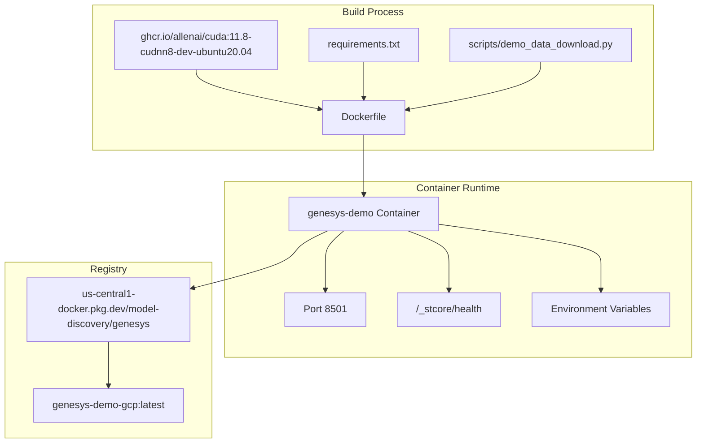
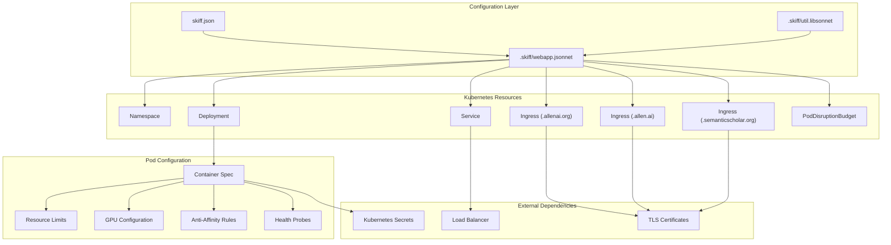
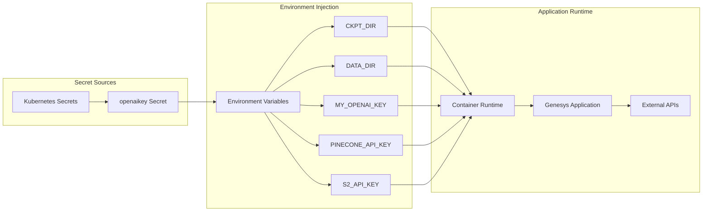
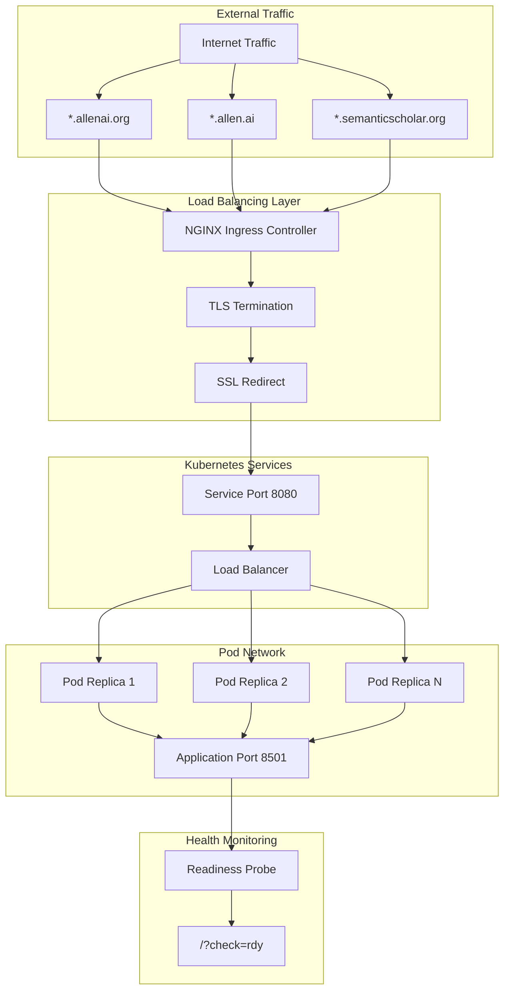

<!-- source: DeepWiki mcp.deepwiki.com · repo allenai/genesys · page 7 Deployment and Infrastructure · fetched 2026-10-26 -->

# Deployment and Infrastructure

<details>
<summary>Relevant source files</summary>

The following files were used as context for generating this wiki page:

- [.skiff/cloudbuild-deploy.yaml](.skiff/cloudbuild-deploy.yaml)
- [.skiff/webapp.jsonnet](.skiff/webapp.jsonnet)
- [Dockerfile](Dockerfile)

</details>


This document provides a comprehensive guide to containerization, Kubernetes deployment, and CI/CD pipeline for the Genesys system. It covers Docker container build process, Kubernetes resource templates, and the automated deployment workflow using Google Cloud Build.

For application-specific configuration management, see page 6 (Configuration and Environment). For distributed node coordination, see page 5.4 (Distributed Coordination).

## 7.1 Docker Containerization

The Genesys system is containerized using Docker with GPU support for machine learning workloads. The container configuration is defined in the root `Dockerfile`.

### Base Image and Dependencies

The container uses a CUDA-enabled base image to support GPU-accelerated training and inference operations:

```dockerfile
FROM ghcr.io/allenai/cuda:11.8-cudnn8-dev-ubuntu20.04
```

The build process installs PyTorch with CPU-only dependencies initially, then adds the full requirements stack:

- PyTorch 2.4.1 for deep learning operations
- Hugging Face transformers and datasets
- Streamlit for the web interface
- Custom dependencies including `paperswithcode-client` and `hf_xet`

### Environment Setup

The container establishes standard directory structures and environment variables:

| Variable | Default Path | Purpose |
|----------|--------------|---------|
| `DATA_DIR` | `/root/genesys/data` | Training data and datasets |
| `CKPT_DIR` | `/root/genesys/ckpt` | Model checkpoints and artifacts |
| `WORKDIR` | `/root/genesys` | Application root directory |

### Container Lifecycle

The container exposes port 8501 for the Streamlit application and includes health checks via the `/_stcore/health` endpoint. The default entrypoint runs `genesys gui` to start the web interface.

**Container Build and Deployment Architecture**



Sources: [Dockerfile:1-74]()

## 7.2 Kubernetes Deployment Configuration

The Kubernetes deployment is managed through Jsonnet templates that generate environment-specific configurations. The main template is `webapp.jsonnet` which uses utility functions from `util.libsonnet`.

### Resource Configuration

The deployment creates several Kubernetes resources:

**Core Resources:**
- `Namespace`: Isolates application resources
- `Deployment`: Manages pod replicas and rolling updates
- `Service`: Provides internal load balancing
- `Ingress`: Handles external traffic routing
- `PodDisruptionBudget`: Ensures availability during updates

**Multi-Domain Support:**
The system supports multiple TLD configurations:
- `.allenai.org` domains (primary)
- `.allen.ai` domains (secondary)
- `.semanticscholar.org` domains (conditional)

### GPU and Resource Management

The deployment template includes sophisticated GPU configuration:

```jsonnet
local gpuLimits = if gpuInConfig then
    if config.gpu == "a100-40gbx2" then
        { 'nvidia.com/gpu': 2 }
    else if config.gpu == "t4x4" then
        { 'nvidia.com/gpu': 4 }
    else
        { 'nvidia.com/gpu': 1 }
else {};
```

**Resource Allocation:**
- CPU: 8 cores requested
- Memory: 16GB requested
- GPU: Dynamic allocation based on configuration

### High Availability Configuration

The deployment implements pod anti-affinity rules to ensure instances are distributed across nodes:

```jsonnet
local antiAffinityLabels = {
    onlyOneOfPerNode: config.appName + '-' + env
};
```

**Kubernetes Deployment Architecture**



Sources: [.skiff/webapp.jsonnet:1-512]()

## Environment and Secret Management

The deployment manages sensitive configuration through Kubernetes secrets. All API keys and paths are injected as environment variables:

### Secret Configuration

| Environment Variable | Secret Key | Purpose |
|---------------------|------------|---------|
| `CKPT_DIR` | `openaikey.CKPT_DIR` | Model checkpoint storage path |
| `DATA_DIR` | `openaikey.DATA_DIR` | Training data storage path |
| `MY_OPENAI_KEY` | `openaikey.MY_OPENAI_KEY` | OpenAI API authentication |
| `PINECONE_API_KEY` | `openaikey.PINECONE_API_KEY` | Pinecone vector search |
| `S2_API_KEY` | `openaikey.S2_API_KEY` | Semantic Scholar API |

### Network and Security

The deployment enforces HTTPS through automatic SSL redirect and supports authentication annotations for different domains. Health checks are implemented at both the proxy level (port 8080) and application level (port 8501).

**Environment and Secret Management Flow**



Sources: [.skiff/webapp.jsonnet:377-454]()

## Network Configuration and Load Balancing

The system implements sophisticated networking with multiple ingress configurations for different domains and TLS termination.

### Port Configuration

| Service | Port | Purpose |
|---------|------|---------|
| Proxy | 8080 | NGINX proxy endpoint |
| Application | 8501 | Streamlit application |
| Health Check | 8501 | Application health monitoring |

### Ingress and TLS

The deployment creates separate ingress resources for each supported domain with automated TLS certificate management through Let's Encrypt integration.

**Network Architecture and Traffic Flow**



Sources: [.skiff/webapp.jsonnet:125-190](), [.skiff/webapp.jsonnet:462-481]()

## Scaling and Replica Management

The deployment implements environment-specific scaling policies with production deployments running multiple replicas for high availability.

### Replica Configuration

```jsonnet
local numReplicas = if env == 'prod' then config.replicas.prod else 1;
```

### Rolling Update Strategy

The deployment uses a rolling update strategy with `maxSurge` set to `numReplicas` to enable faster deployments while maintaining availability.

### Pod Disruption Budget

A `PodDisruptionBudget` ensures at least one replica remains available during maintenance operations when multiple replicas are running.

Sources: [.skiff/webapp.jsonnet:52-53](), [.skiff/webapp.jsonnet:280-285](), [.skiff/webapp.jsonnet:483-497]()

---

