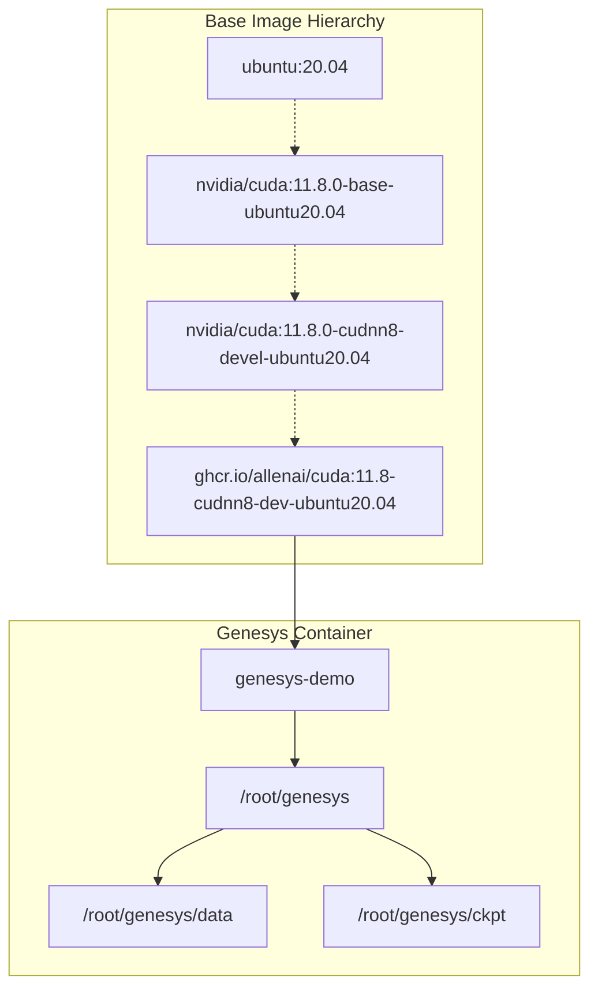
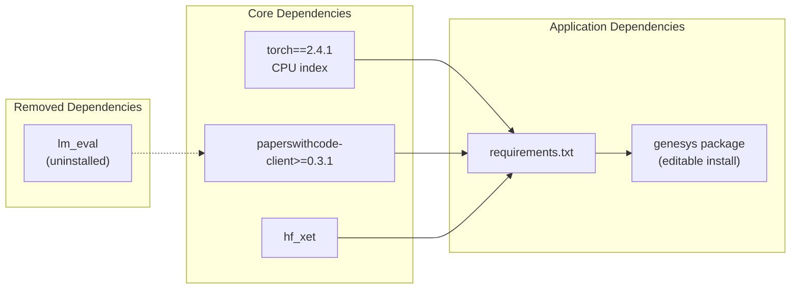
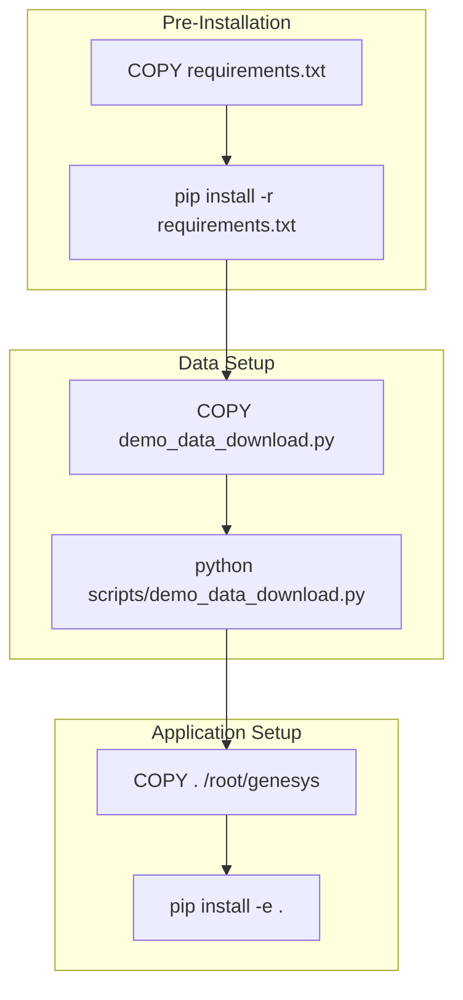
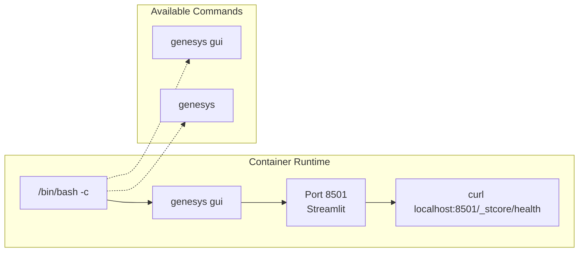
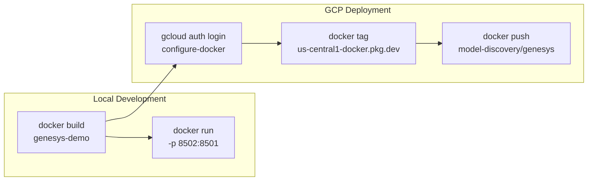

<!-- source: DeepWiki mcp.deepwiki.com · repo allenai/genesys · page 7.1 Docker Containerization · fetched 2026-10-26 -->

# Container Configuration

<details>
<summary>Relevant source files</summary>

The following files were used as context for generating this wiki page:

- [.dockerignore](.dockerignore)
- [Dockerfile](Dockerfile)

</details>


This document covers the Docker containerization strategy for the Genesys distributed evolutionary system. It details the container build process, environment setup, dependency management, and runtime configuration used to deploy the Streamlit-based GUI application.

For Kubernetes orchestration and deployment manifests, see [Kubernetes Deployment](#6.2). For the complete CI/CD pipeline configuration, see [CI/CD Pipeline](#6.3).

## Base Image and System Setup

The Genesys container is built on the AllenAI CUDA-enabled Ubuntu base image to support GPU workloads while maintaining compatibility with both CPU and GPU execution environments.

### Base Image Selection

The container uses `ghcr.io/allenai/cuda:11.8-cudnn8-dev-ubuntu20.04` as its foundation [Dockerfile:3](). This image provides:

- Ubuntu 20.04 LTS operating system
- CUDA 11.8 runtime and development tools
- cuDNN 8 for deep learning operations
- Pre-configured build tools and dependencies

Alternative base images are documented but commented out, including standard NVIDIA CUDA images and plain Ubuntu [Dockerfile:4-6]().



**Container Directory Structure**

Sources: [Dockerfile:24-30]()

## Environment Configuration

The container establishes a structured environment with specific directory layouts and environment variables required for Genesys operation.

### Directory Structure

| Directory | Environment Variable | Purpose |
|-----------|---------------------|---------|
| `/root/genesys` | `WORKDIR` | Application root directory |
| `/root/genesys/data` | `DATA_DIR` | Training data and datasets |
| `/root/genesys/ckpt` | `CKPT_DIR` | Model checkpoints and artifacts |

The directories are created during the build process [Dockerfile:26-28]() and accessible throughout the container lifecycle.

### Working Directory Setup

The container sets `/root/genesys` as the working directory [Dockerfile:30](), with a specific note that the home directory (`~`) resolves to `/root` in the container environment [Dockerfile:25]().

Sources: [Dockerfile:24-30]()

## Dependency Management

The container follows a multi-stage dependency installation process, handling system packages, Python libraries, and application-specific requirements.

### Core Python Dependencies



### PyTorch Installation

PyTorch is installed with CPU-only support despite the CUDA base image [Dockerfile:34]():
```bash
pip install torch==2.4.1 --index-url https://download.pytorch.org/whl/cpu
```

This configuration suggests the container may run in environments where GPU access is controlled separately or where CPU execution is preferred for certain workloads.

### Package Management Strategy

1. **Specific package installations** - Critical packages installed individually [Dockerfile:39-41]()
2. **Requirements file** - Bulk dependencies from `requirements.txt` [Dockerfile:43-44]()
3. **Editable installation** - The Genesys package itself installed in development mode [Dockerfile:50]()

The `lm_eval` package is explicitly uninstalled [Dockerfile:40](), likely to avoid conflicts with newer evaluation frameworks.

Sources: [Dockerfile:34-44, 50]()

## Application Installation Process

The container build process follows a specific sequence to optimize layer caching and ensure proper dependency resolution.

### Build Sequence



### Demo Data Download

The container includes a pre-installation step that downloads demonstration data [Dockerfile:46-47]():
- Copies the download script: `scripts/demo_data_download.py`
- Executes the script during build time to populate initial data

This ensures the container has baseline data available immediately upon startup.

### Editable Installation

The Genesys package is installed in editable mode [Dockerfile:50](), allowing for development and debugging scenarios where code changes can be reflected without rebuilding the container.

Sources: [Dockerfile:43-50]()

## Runtime Configuration

The container is configured to run the Streamlit GUI application with proper health monitoring and port exposure.

### Network Configuration

| Port | Purpose | Health Check |
|------|---------|--------------|
| 8501 | Streamlit GUI | `/_stcore/health` endpoint |

The container exposes port 8501 [Dockerfile:52]() and includes a health check using curl [Dockerfile:53]().

### Startup Command

The container uses a flexible entrypoint configuration:
- **Entrypoint**: `/bin/bash -c` [Dockerfile:55]()
- **Default command**: `genesys gui` [Dockerfile:56]()

This allows the container to run other Genesys commands by overriding the CMD parameter while maintaining bash execution context.



Sources: [Dockerfile:52-56]()

## Build and Deployment Process

The Dockerfile includes comprehensive documentation for building and deploying the container to various environments.

### Local Build Process

```bash
# Build with GitHub token (commented out)
docker build --build-arg GITHUB_TOKEN=your_github_token -t genesys-demo .

# Run locally
docker run -p 8502:8501 genesys-demo
```

### Google Cloud Platform Deployment

The container supports deployment to Google Cloud Platform with the following workflow [Dockerfile:66-71]():

1. **Authentication**: `gcloud auth login` and configure Docker
2. **Tagging**: Tag image for GCP Artifact Registry
3. **Push**: Deploy to `us-central1-docker.pkg.dev/model-discovery/genesys`

### Registry Configuration

Target registry: `us-central1-docker.pkg.dev/model-discovery/genesys/genesys-demo-gcp:latest`

This suggests the container is designed for deployment in the `model-discovery` GCP project with regional hosting in `us-central1`.



Sources: [Dockerfile:59-72]()

---

