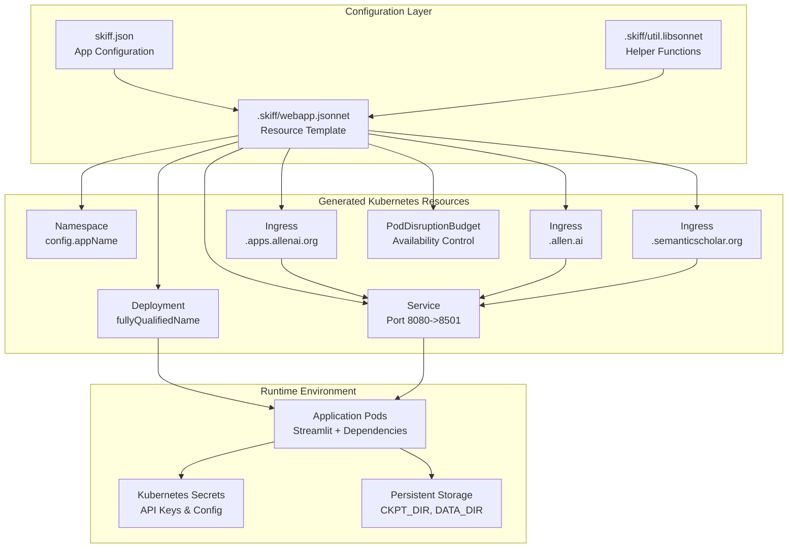
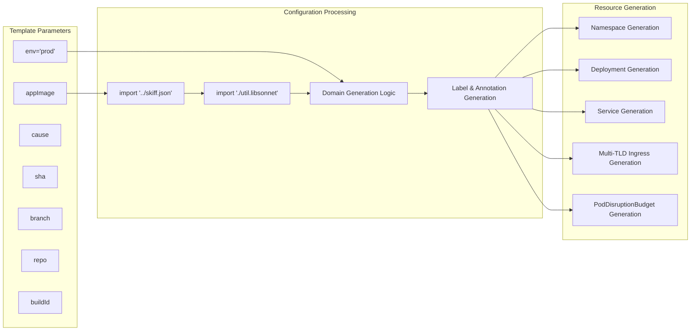
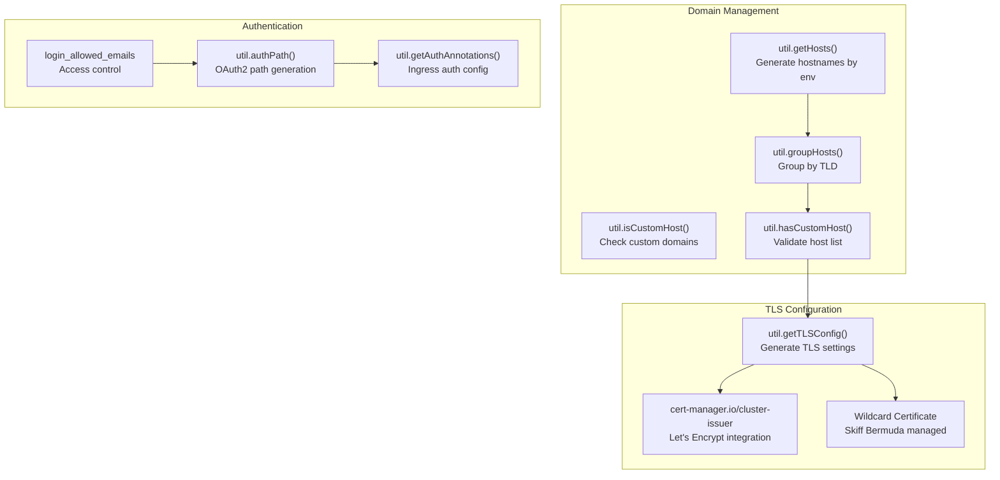
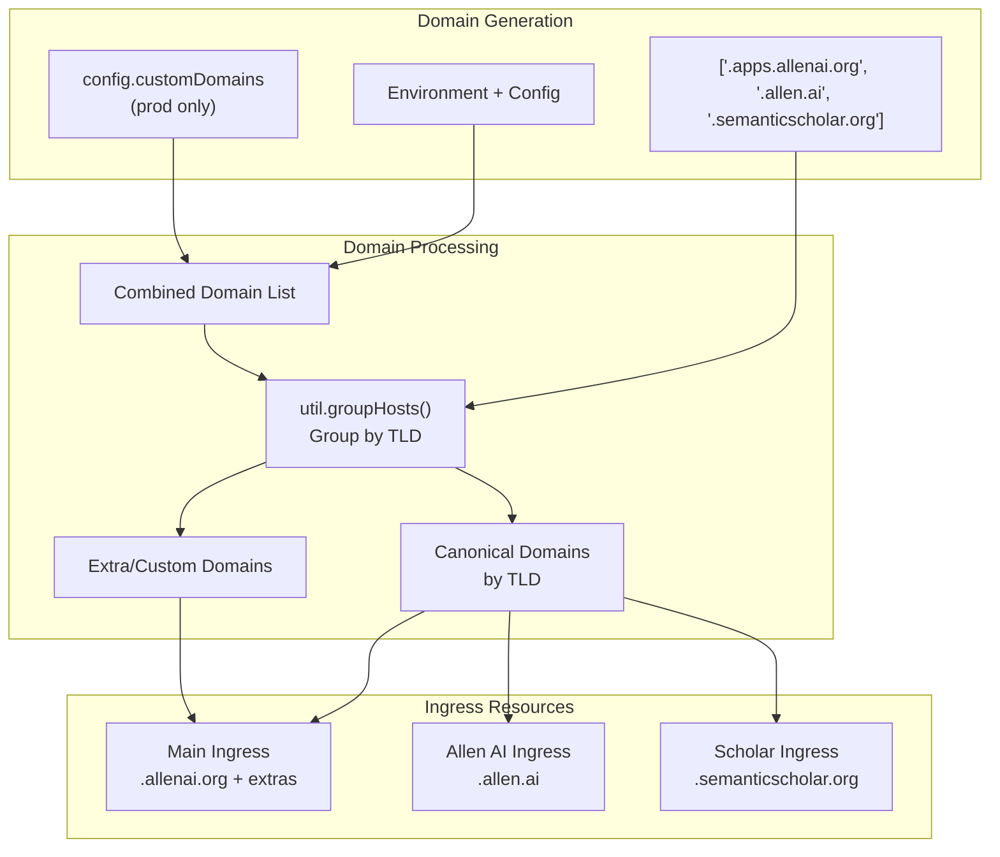
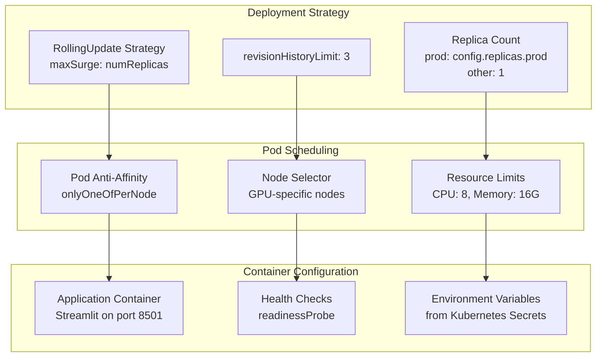
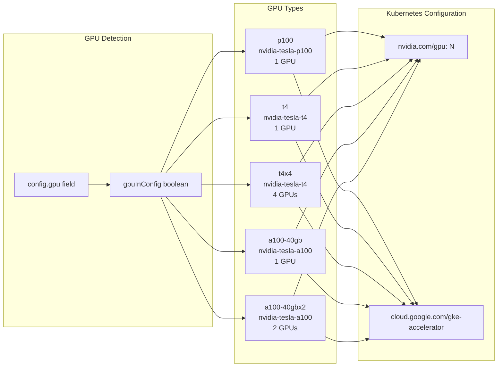
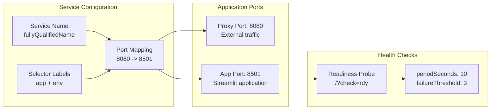
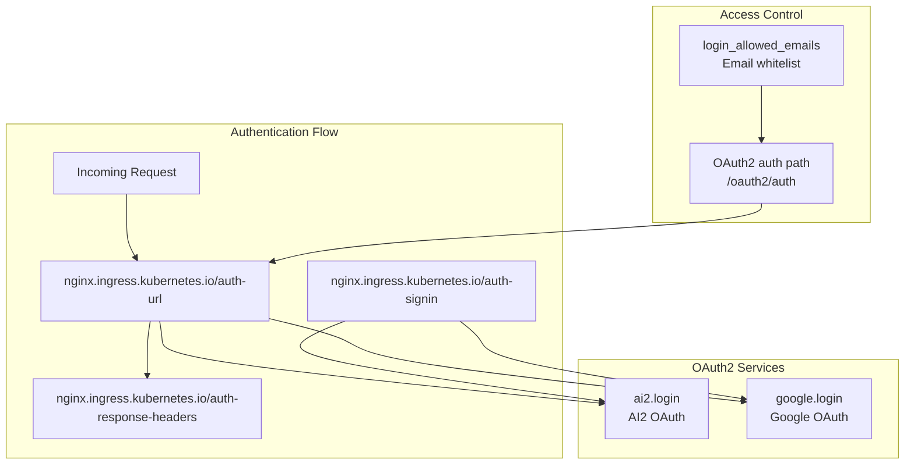

<!-- source: DeepWiki mcp.deepwiki.com · repo allenai/genesys · page 7.2 Kubernetes Deployment Configuration · fetched 2026-10-26 -->

# Kubernetes Deployment

Relevant source files

The following files were used as context for generating this wiki page:

- [.skiff/util.libsonnet](.skiff/util.libsonnet)
- [.skiff/webapp.jsonnet](.skiff/webapp.jsonnet)

This document covers the Kubernetes deployment configuration and infrastructure templates used to deploy the Genesys application in production environments. The deployment system uses Jsonnet templating to generate Kubernetes manifests that support multi-domain hosting, authentication, GPU resources, and scalable container orchestration.

For information about the container configuration and Docker setup, see [Container Configuration](#6.1). For details about the CI/CD pipeline that builds and deploys these resources, see [CI/CD Pipeline](#6.3).

## Deployment Architecture Overview

The Genesys Kubernetes deployment architecture follows a template-driven approach using Jsonnet to generate standard Kubernetes resources. The system supports multiple deployment environments, TLD-specific ingress configurations, and flexible resource allocation including GPU support.

Sources: [.skiff/webapp.jsonnet:1-512](), [.skiff/util.libsonnet:1-104]()

## Jsonnet Template System

### Main Template Structure

The core deployment template is implemented in `webapp.jsonnet` which accepts parameters for application image, environment, and build metadata. The template generates a complete set of Kubernetes resources based on configuration.

The template function signature and key variables are defined as:

| Parameter | Purpose | Default |
|-----------|---------|---------|
| `appImage` | Container image to deploy | Required |
| `cause` | Deployment reason/description | Required |
| `sha` | Git commit SHA | Required |
| `env` | Target environment | `'prod'` |
| `branch` | Git branch name | `''` |
| `repo` | Repository identifier | `''` |
| `buildId` | Build system identifier | `''` |

Sources: [.skiff/webapp.jsonnet:14-17](), [.skiff/webapp.jsonnet:92-97]()

### Utility Functions

The `util.libsonnet` library provides helper functions for domain management, TLS configuration, and authentication setup:

Key utility functions include:
- **`getHosts(env, config, tld)`**: Generates hostnames for different environments [.skiff/util.libsonnet:46-50]()
- **`getTLSConfig(fqn, hosts)`**: Configures TLS certificates and annotations [.skiff/util.libsonnet:57-69]()
- **`getAuthAnnotations(config, tld)`**: Sets up OAuth2 proxy authentication [.skiff/util.libsonnet:85-101]()

Sources: [.skiff/util.libsonnet:6-104]()

## Multi-Domain Ingress Configuration

### Domain Grouping Strategy

The deployment supports three primary TLDs with automatic grouping and TLS certificate management:

The domain configuration logic handles:
- **Production domains**: `config.appName + tld` [.skiff/webapp.jsonnet:47-48]()
- **Non-production domains**: `config.appName + '-' + env + tld` [.skiff/webapp.jsonnet:49-50]()
- **Custom domains**: Added only in production environment [.skiff/webapp.jsonnet:23-25]()

Sources: [.skiff/webapp.jsonnet:20-32](), [.skiff/util.libsonnet:34-37]()

### TLS Certificate Management

TLS certificates are automatically provisioned based on domain requirements:

| Domain Type | Certificate Source | Configuration |
|-------------|-------------------|---------------|
| `*.apps.allenai.org` | Wildcard certificate (Skiff Bermuda) | No additional config |
| Custom domains | Let's Encrypt (cert-manager) | `cert-manager.io/cluster-issuer: letsencrypt-prod` |
| Multiple TLDs | Per-TLD certificates | Separate ingress resources |

Sources: [.skiff/util.libsonnet:57-69](), [.skiff/webapp.jsonnet:154-190]()

## Resource Configuration

### Deployment Specification

The Kubernetes Deployment resource is configured with advanced features for reliability and scalability:

Key deployment features:
- **Anti-affinity rules**: Each pod scheduled on different nodes [.skiff/webapp.jsonnet:303-320]()
- **Rolling update strategy**: `maxSurge` set to `numReplicas` for faster deployments [.skiff/webapp.jsonnet:282-284]()
- **Resource requests**: 8 CPU cores and 16G memory [.skiff/webapp.jsonnet:370-373]()

Sources: [.skiff/webapp.jsonnet:268-460]()

### GPU Support Configuration

The system supports multiple GPU configurations with automatic node selection:

GPU configuration mapping:
- **P100**: `nvidia-tesla-p100` nodes, 1 GPU limit [.skiff/webapp.jsonnet:114-115]()
- **T4**: `nvidia-tesla-t4` nodes, 1 GPU limit [.skiff/webapp.jsonnet:116-117]()
- **T4x4**: `nvidia-tesla-t4` nodes, 4 GPU limit [.skiff/webapp.jsonnet:107-108]()
- **A100**: `nvidia-tesla-a100` nodes, 1-2 GPU limit [.skiff/webapp.jsonnet:105-106](), [.skiff/webapp.jsonnet:118-119]()

Sources: [.skiff/webapp.jsonnet:101-123]()

### Environment Variables and Secrets

The deployment injects environment variables from Kubernetes secrets for external service integration:

| Environment Variable | Secret Key | Purpose |
|---------------------|------------|---------|
| `CKPT_DIR` | `CKPT_DIR` | Model checkpoint storage path |
| `DATA_DIR` | `DATA_DIR` | Data storage directory |
| `MY_OPENAI_KEY` | `MY_OPENAI_KEY` | OpenAI API authentication |
| `PINECONE_API_KEY` | `PINECONE_API_KEY` | Pinecone vector database access |
| `S2_API_KEY` | `S2_API_KEY` | Semantic Scholar API access |

All secrets are stored in the `openaikey` Kubernetes secret resource and injected as environment variables into the application container.

Sources: [.skiff/webapp.jsonnet:377-454]()

## Service and Health Check Configuration

### Service Definition

The Kubernetes Service provides load balancing and service discovery:

Service configuration details:
- **External port**: 8080 for ingress traffic [.skiff/webapp.jsonnet:126]()
- **Target port**: 8501 for Streamlit application [.skiff/webapp.jsonnet:129]()
- **Health check path**: `/?check=rdy` for readiness verification [.skiff/webapp.jsonnet:349-351]()

Sources: [.skiff/webapp.jsonnet:462-481](), [.skiff/webapp.jsonnet:348-354]()

### Pod Disruption Budget

The system includes a PodDisruptionBudget to maintain availability during cluster maintenance:

- **Minimum available**: 1 pod when `numReplicas > 1`, otherwise 0 [.skiff/webapp.jsonnet:492]()
- **Selector**: Matches deployment pods using `selectorLabels` [.skiff/webapp.jsonnet:493-495]()

Sources: [.skiff/webapp.jsonnet:483-497]()

## Authentication and Security

### OAuth2 Proxy Integration

The deployment integrates with Skiff's OAuth2 proxy system for authentication:

Authentication configuration:
- **AI2 login**: Uses `ai2.login<tld>` service [.skiff/util.libsonnet:90-92]()
- **Google login**: Uses `google.login<tld>` service [.skiff/util.libsonnet:95-98]()
- **Email restrictions**: Optional whitelist via `login_allowed_emails` [.skiff/util.libsonnet:77-80]()

Sources: [.skiff/util.libsonnet:76-101](), [.skiff/webapp.jsonnet:162](), [.skiff/webapp.jsonnet:200]()

## Deployment Output

The template generates a list of Kubernetes resources that are conditionally included based on configuration:

| Resource Type | Always Included | Conditional |
|---------------|----------------|-------------|
| Namespace | ✓ | |
| Main Ingress | ✓ | |
| Allen AI Ingress | ✓ | |
| Deployment | ✓ | |
| Service | ✓ | |
| PodDisruptionBudget | ✓ | |
| Scholar Ingress | | Only if `scholarHosts` exist |

The final resource list is returned as an array of Kubernetes objects, with the Scholar ingress conditionally added when Scholar domain hosts are configured.

Sources: [.skiff/webapp.jsonnet:499-511]()

---

