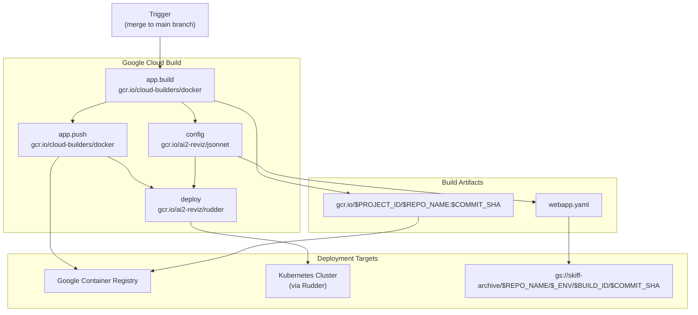
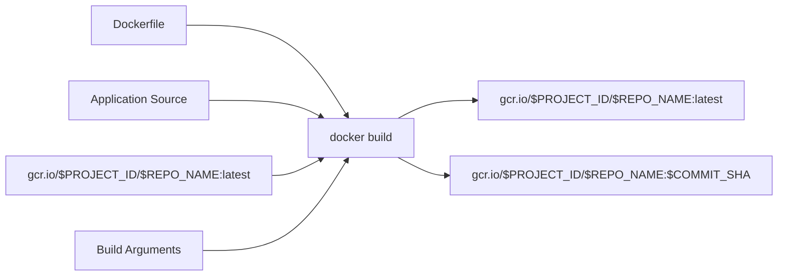
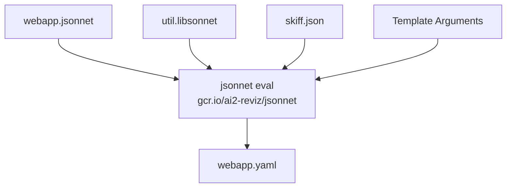
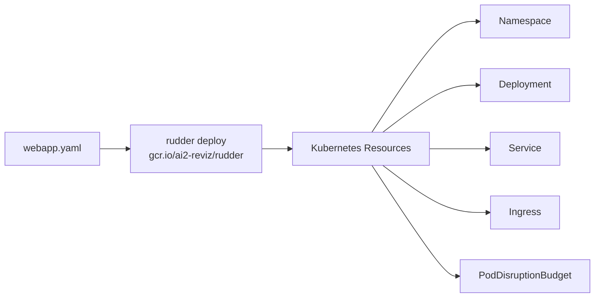
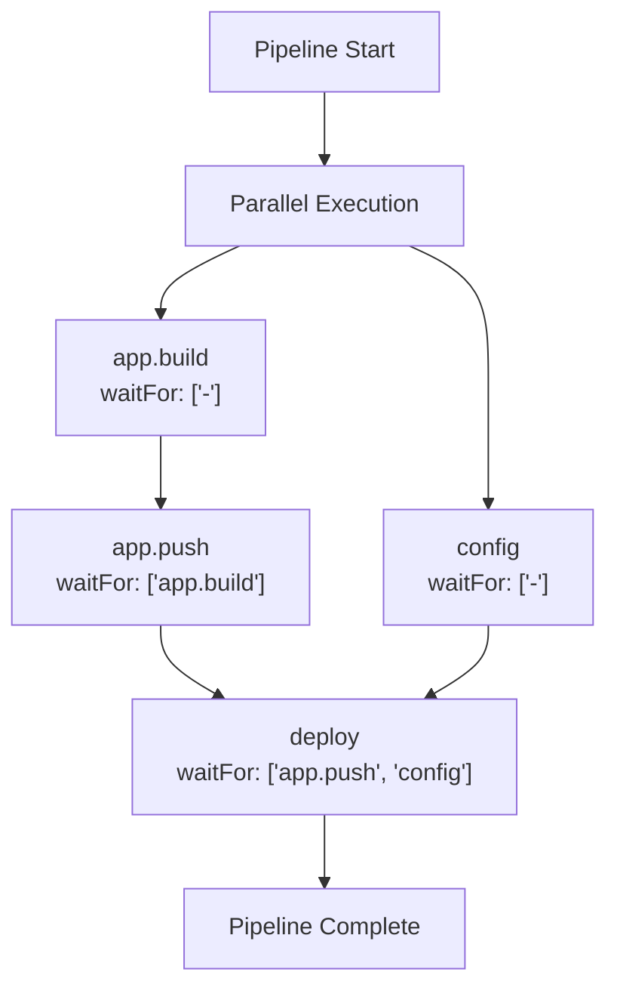

<!-- source: DeepWiki mcp.deepwiki.com · repo allenai/genesys · page 7.3 CI/CD Pipeline · fetched 2026-10-26 -->

# CI/CD Pipeline

<details>
<summary>Relevant source files</summary>

The following files were used as context for generating this wiki page:

- [.skiff/cloudbuild-deploy.yaml](.skiff/cloudbuild-deploy.yaml)

</details>


## Purpose and Scope

This document explains the continuous integration and continuous deployment (CI/CD) pipeline used to build, configure, and deploy the Genesys application to production infrastructure. The pipeline is implemented using Google Cloud Build and automates the process of containerizing the application, generating Kubernetes manifests, and deploying to a Kubernetes cluster.

For information about the Docker image itself, see [Docker Containerization](#7.1). For details on the generated Kubernetes resources, see [Kubernetes Deployment Configuration](#7.2).

---

## Pipeline Architecture

The CI/CD workflow is defined in [.skiff/cloudbuild-deploy.yaml:1-66]() and consists of four sequential build steps that transform source code into a running Kubernetes deployment.

### Pipeline Flow



**Sources:** [.skiff/cloudbuild-deploy.yaml:4-51]()

---

## Build Steps

### Step 1: Docker Image Build (app.build)

The first step builds the Docker container image using the `gcr.io/cloud-builders/docker` builder.



The build step executes with the following configuration:

| Parameter | Value | Purpose |
|-----------|-------|---------|
| **Step ID** | `app.build` | Identifier for the build step |
| **Builder Image** | `gcr.io/cloud-builders/docker` | Official Google Cloud Docker builder |
| **Working Directory** | `.` | Root of repository |
| **Wait Dependencies** | `['-']` | No dependencies (runs immediately) |

**Build Arguments:**

- `-t gcr.io/$PROJECT_ID/$REPO_NAME:latest` - Tags image with `latest`
- `-t gcr.io/$PROJECT_ID/$REPO_NAME:$COMMIT_SHA` - Tags image with commit SHA for immutability
- `--cache-from gcr.io/$PROJECT_ID/$REPO_NAME:latest` - Uses previous build as cache to speed up builds
- `--build-arg BUILDKIT_INLINE_CACHE=1` - Enables BuildKit inline cache for layer reuse
- `.` - Build context is the repository root

The use of `DOCKER_BUILDKIT=1` environment variable ([.skiff/cloudbuild-deploy.yaml:63-64]()) enables Docker BuildKit for improved build performance and caching.

**Sources:** [.skiff/cloudbuild-deploy.yaml:5-16]()

---

### Step 2: Docker Image Push (app.push)

After building, the image is pushed to Google Container Registry (GCR).

| Parameter | Value | Purpose |
|-----------|-------|---------|
| **Step ID** | `app.push` | Identifier for the push step |
| **Builder Image** | `gcr.io/cloud-builders/docker` | Official Google Cloud Docker builder |
| **Wait Dependencies** | `['app.build']` | Waits for build to complete |

**Push Arguments:**

- `push gcr.io/$PROJECT_ID/$REPO_NAME:$COMMIT_SHA` - Pushes the SHA-tagged image

The pipeline also declares both image tags in the `images` section ([.skiff/cloudbuild-deploy.yaml:54-57]()), which ensures both `latest` and the commit-specific tag are pushed to the registry.

**Sources:** [.skiff/cloudbuild-deploy.yaml:17-23](), [.skiff/cloudbuild-deploy.yaml:54-57]()

---

### Step 3: Kubernetes Configuration Generation (config)

This step generates the Kubernetes manifest file by evaluating the Jsonnet template with environment-specific parameters.



| Parameter | Value | Purpose |
|-----------|-------|---------|
| **Step ID** | `config` | Identifier for config generation |
| **Builder Image** | `gcr.io/ai2-reviz/jsonnet` | Jsonnet evaluation tool |
| **Working Directory** | `.skiff` | Directory containing templates |
| **Wait Dependencies** | `['-']` | No dependencies (runs in parallel with build) |

**Jsonnet Evaluation Arguments:**

The `jsonnet eval` command ([.skiff/cloudbuild-deploy.yaml:26-40]()) takes multiple template arguments (TLA) that parameterize the Kubernetes manifest:

| TLA Parameter | Variable | Description |
|---------------|----------|-------------|
| `env` | `$_ENV` | Environment name (e.g., `prod`) |
| `appImage` | `gcr.io/$PROJECT_ID/$REPO_NAME:$COMMIT_SHA` | Docker image reference |
| `sha` | `$COMMIT_SHA` | Git commit SHA for tracking |
| `cause` | `"Automated Skiff Deploy SHA:..."` | Deployment reason string |
| `branch` | `$BRANCH_NAME` | Git branch being deployed |
| `repo` | `$REPO_NAME` | Repository name |
| `buildId` | `$BUILD_ID` | Cloud Build ID for tracing |

These parameters are passed to `webapp.jsonnet` to generate a fully-configured Kubernetes manifest written to `webapp.yaml`.

**Sources:** [.skiff/cloudbuild-deploy.yaml:25-41]()

---

### Step 4: Kubernetes Deployment (deploy)

The final step deploys the generated Kubernetes manifest to the cluster using Rudder, AI2's deployment tool.



| Parameter | Value | Purpose |
|-----------|-------|---------|
| **Step ID** | `deploy` | Identifier for deployment step |
| **Builder Image** | `gcr.io/ai2-reviz/rudder` | AI2's Kubernetes deployment tool |
| **Working Directory** | `.skiff` | Directory containing webapp.yaml |
| **Wait Dependencies** | `['app.push', 'config']` | Waits for both image push and config generation |

The `rudder deploy` command ([.skiff/cloudbuild-deploy.yaml:43-51]()) applies the `webapp.yaml` manifest to the Kubernetes cluster, creating or updating all resources defined in the manifest (see [Kubernetes Deployment Configuration](#7.2) for resource details).

**Sources:** [.skiff/cloudbuild-deploy.yaml:43-51]()

---

## Pipeline Configuration

### Substitutions

The pipeline defines substitution variables that can be overridden when triggering builds:

```yaml
substitutions:
  _ENV: prod
```

| Substitution | Default Value | Purpose |
|--------------|---------------|---------|
| `_ENV` | `prod` | Target environment (production) |

User-defined substitutions (prefixed with `_`) allow different environments to be targeted by the same pipeline configuration.

**Sources:** [.skiff/cloudbuild-deploy.yaml:52-53]()

---

### Built-in Variables

Cloud Build automatically provides several variables used throughout the pipeline:

| Variable | Description | Usage |
|----------|-------------|-------|
| `$PROJECT_ID` | Google Cloud project ID | Image registry path |
| `$REPO_NAME` | Repository name | Image name, archival paths |
| `$COMMIT_SHA` | Git commit SHA | Immutable image tag, traceability |
| `$BRANCH_NAME` | Git branch name | Passed to Kubernetes labels |
| `$BUILD_ID` | Unique build identifier | Archival paths, deployment tracking |

**Sources:** [.skiff/cloudbuild-deploy.yaml:9-10,32-37]()

---

## Artifact Management

### Container Image Registry

The pipeline publishes two tagged versions of the Docker image to Google Container Registry:

```
gcr.io/$PROJECT_ID/$REPO_NAME:$COMMIT_SHA  (immutable)
gcr.io/$PROJECT_ID/$REPO_NAME:latest       (rolling)
```

The SHA-tagged image ensures immutable deployments—the exact image deployed can always be traced back to a specific commit. The `latest` tag provides a cache source for subsequent builds.

**Sources:** [.skiff/cloudbuild-deploy.yaml:54-57]()

---

### Kubernetes Manifest Archive

The generated `webapp.yaml` file is archived to Google Cloud Storage for audit and rollback purposes:

```
gs://skiff-archive/$REPO_NAME/$_ENV/$BUILD_ID/$COMMIT_SHA/webapp.yaml
```

This archival structure organizes artifacts by:
- Repository name
- Environment (prod/dev/staging)
- Build ID (unique per pipeline run)
- Commit SHA (source code version)

**Sources:** [.skiff/cloudbuild-deploy.yaml:58-61]()

---

## Pipeline Execution

### Timeout Configuration

The pipeline has a maximum execution timeout of 30 minutes:

```yaml
timeout: 30m
```

This prevents builds from hanging indefinitely and ensures build queue throughput.

**Sources:** [.skiff/cloudbuild-deploy.yaml:65]()

---

### Trigger Configuration

The pipeline configuration file can be attached to various Google Cloud Build triggers. The default trigger fires on:
- Merges to the `main` branch
- Manual invocations via Cloud Build console or API

The comment at [.skiff/cloudbuild-deploy.yaml:1-3]() indicates the pipeline is designed for automated deployment on main branch updates.

**Sources:** [.skiff/cloudbuild-deploy.yaml:1-3]()

---

### Execution Flow and Parallelization



The pipeline optimizes execution time through parallelization:
- `app.build` and `config` run in parallel (both have `waitFor: ['-']`)
- `app.push` waits only for `app.build`
- `deploy` waits for both `app.push` and `config` to complete

This design minimizes total pipeline execution time while respecting dependencies.

**Sources:** [.skiff/cloudbuild-deploy.yaml:15,23,41,51]()

---

## Integration with Related Systems

### Docker Containerization

The pipeline builds the Docker image defined in the repository's Dockerfile. For details on the image contents, base layers, and build arguments, see [Docker Containerization](#7.1).

### Kubernetes Configuration

The `config` step generates Kubernetes manifests from Jsonnet templates. For details on the resource definitions, ingress configuration, and TLS setup, see [Kubernetes Deployment Configuration](#7.2).

### Environment Variables

The deployed container requires specific environment variables for runtime operation. These are configured in the Kubernetes manifest and documented in [Environment Variables and Secrets](#6.1).

**Sources:** [.skiff/cloudbuild-deploy.yaml:1-66]()

---

