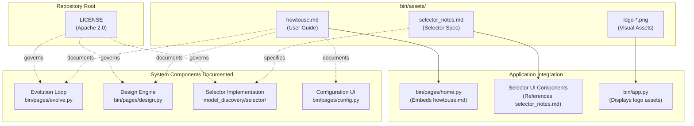
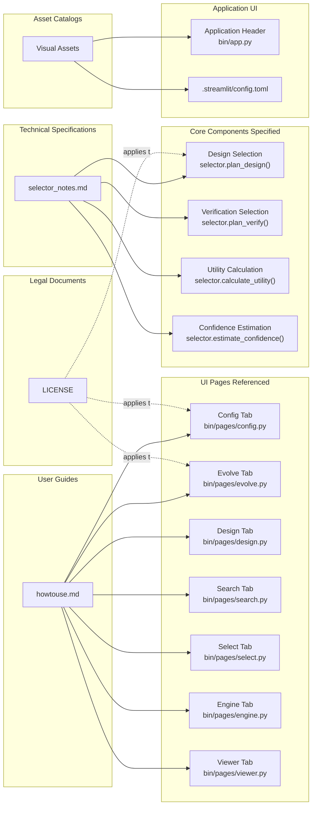

<!-- source: DeepWiki mcp.deepwiki.com · repo allenai/genesys · page 8 Reference Documentation · fetched 2026-10-26 -->

# Reference Documentation

Relevant source files

The following files were used as context for generating this wiki page:

- [LICENSE](LICENSE)
- [bin/assets/howtouse.md](bin/assets/howtouse.md)
- [bin/assets/selector_notes.md](bin/assets/selector_notes.md)

## Purpose and Scope

This section provides supplementary reference materials that support the Genesys system. It includes user guides, technical specifications, visual assets, and licensing information. These documents complement the architectural documentation covered in sections [3](#3) through [7](#7) by providing operational guides, detailed component specifications, and supporting materials.

For information about configuring and deploying the system, see [Configuration and Environment](#6) and [Deployment and Infrastructure](#7). For details on the core evolution system implementation, see [Evolution System Components](#5).

## Reference Materials Overview

The reference documentation is organized into four categories of supporting materials:

| Document Type | Location | Purpose | Primary Audience |
|--------------|----------|---------|------------------|
| System Usage Guide | [8.1](#8.1) | Step-by-step instructions for operating the evolution loop, design engine, and configuration workflow | End users and operators |
| Selector Specification | [8.2](#8.2) | Detailed technical specification of the selector's planning and orchestration algorithms | Developers and researchers |
| Visual Assets | [8.3](#8.3) | Catalog of logos, graphics, and branding elements used in the application | UI developers and designers |
| License Information | [8.4](#8.4) | Apache License 2.0 terms and conditions | Legal and compliance |

## Documentation Artifacts Structure

The following diagram shows how reference documentation artifacts are organized within the codebase and their relationships to system components:

**Sources**: [bin/assets/howtouse.md](), [bin/assets/selector_notes.md](), [LICENSE]()

## Documentation Categories and Code Mappings

The reference materials map to specific code components and user workflows as shown below:

**Sources**: [bin/assets/howtouse.md](), [bin/assets/selector_notes.md](), [bin/pages/home.py](), [bin/pages/evolve.py]()

## Reference Document Summaries

### System Usage Guide ([8.1](#8.1))

The usage guide provides operational instructions for running the Genesys system. It is embedded directly into the home page interface at [bin/pages/home.py]() and covers:

- **Configuration Workflow**: Creating or selecting namespaces, configuring experiment settings
- **Evolution Loop Operation**: Running automated evolution cycles
- **Component-Level Testing**: Interacting with individual components (Select, Design, Search, Engine)
- **Results Viewing**: Monitoring system state and viewing evolution outcomes

The guide defines a standard workflow: configure in the Config tab → run evolution in the Evolve tab → view results in the Viewer tab. Alternative workflows for testing individual components are also documented.

**Sources**: [bin/assets/howtouse.md:1-24]()

### Selector Component Specification ([8.2](#8.2))

The selector specification provides technical details on the planning and orchestration algorithms. It is referenced by selector UI components and covers:

- **Selector Role**: Planner and orchestrator that guides the evolution process toward global optimal designs
- **Utility and Confidence Metrics**: Scale-normalized utility based on design artifacts and verification results; confidence based on available information
- **Quadrant-Based Selection**: Four selection strategies based on high/low utility and confidence
- **Design Selection**: Outputs seeds, references, and optional instructions for design agents
- **Verification Selection**: Determines which designs to verify at which scales

The specification emphasizes the selector's relationship with design agents (high-quality local sampling) and the distributed verification/design engine (throughput and robustness).

**Sources**: [bin/assets/selector_notes.md:1-137]()

### Visual Assets and Branding ([8.3](#8.3))

The visual assets catalog documents logo files and graphics used throughout the application. Assets are stored in [bin/assets/]() and include:

- Logo files in PNG format at various resolutions
- Graphics referenced in the Streamlit application header
- Icons and visual elements used in the UI

These assets are integrated into the application via [bin/app.py]() and theme configuration in [.streamlit/config.toml]().

**Sources**: [bin/assets/](), [bin/app.py]()

### License Information ([8.4](#8.4))

The Apache License 2.0 governs the use, reproduction, and distribution of the Genesys codebase. The license is located at [LICENSE:1-202]() and provides:

- **Grant of Copyright License**: Perpetual, worldwide, royalty-free license to reproduce, prepare derivative works, and distribute
- **Grant of Patent License**: License to make, use, and transfer the work, with termination clauses for patent litigation
- **Redistribution Requirements**: Must include license copy, mark modified files, retain attribution notices, and include NOTICE file content
- **Disclaimer of Warranty**: Work provided "AS IS" without warranties of any kind
- **Limitation of Liability**: No contributor liable for damages arising from use of the work

The license applies to all source code, documentation, and configuration files in the repository.

**Sources**: [LICENSE:1-202]()

## Integration with Application

The following table shows how reference documentation is integrated into the Streamlit application:

| Reference Document | Integration Point | Code Location | Display Method |
|-------------------|-------------------|---------------|----------------|
| `howtouse.md` | Home page "How to use" section | [bin/pages/home.py]() | Markdown rendering via `st.markdown()` |
| `selector_notes.md` | Selector UI tooltips and help text | [bin/pages/select.py]() | Referenced in UI components |
| Logo assets | Application header and favicon | [bin/app.py]() | Image display via `st.image()` |
| `LICENSE` | Not directly displayed | Repository root | Available for reference |

The documentation is designed to be accessible both within the application UI and as standalone reference materials for developers and operators working with the codebase directly.

**Sources**: [bin/pages/home.py](), [bin/pages/select.py](), [bin/app.py](), [bin/assets/howtouse.md](), [bin/assets/selector_notes.md]()

---

