<!-- source: DeepWiki mcp.deepwiki.com · repo allenai/genesys · page 8.1 System Usage Guide · fetched 2026-10-26 -->

# System Usage Guide

Relevant source files

The following files were used as context for generating this wiki page:

- [bin/assets/howtouse.md](bin/assets/howtouse.md)

## Purpose and Scope

This guide provides comprehensive instructions for using the Genesys system to discover novel language model architectures through genetic programming. It covers the complete workflow from configuration setup through running evolution experiments and monitoring results.

This is a **practical usage guide** focused on operational workflows. For technical implementation details of individual components, see [Evolution System Components](#5). For UI page implementation, see [User Interface Pages](#4). For deployment and infrastructure, see [Deployment and Infrastructure](#7).

**Sources:** [bin/assets/howtouse.md:1-24]()

---

## System Overview

Genesys operates through five interconnected components that form a complete evolutionary discovery pipeline:

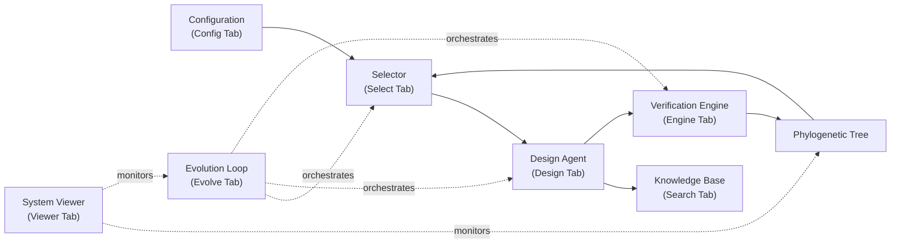

**Diagram: Component Interaction Flow**

**Sources:** [bin/assets/howtouse.md:16-24]()

---

## Getting Started Workflow

### Initial Setup

Before running experiments, you must complete the following setup steps:

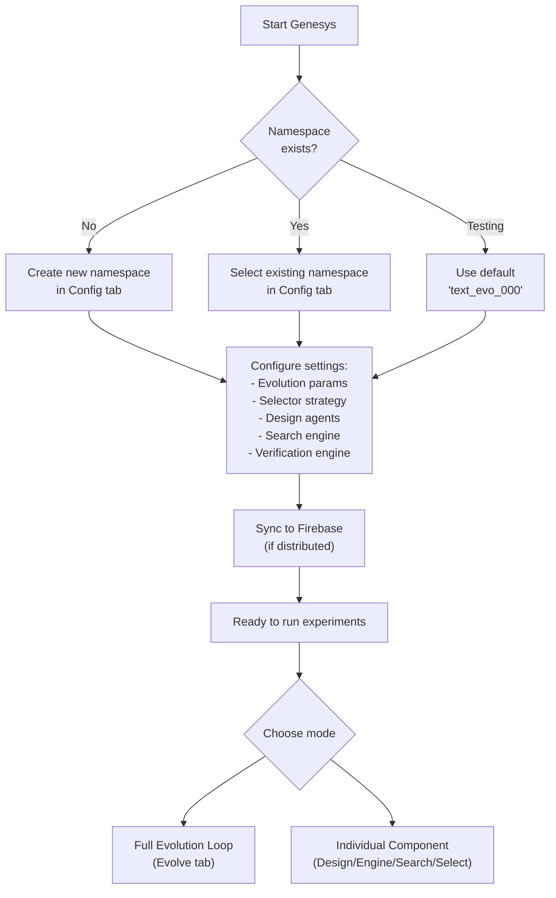

**Diagram: Initial Configuration Workflow**

| Step | Tab | Action | Key Files |
|------|-----|--------|-----------|
| 1 | Config | Select or create namespace | [bin/pages/config.py]() |
| 2 | Config | Configure evolution parameters | [bin/pages/config.py]() |
| 3 | Config | Set selector strategy | [bin/pages/config.py]() |
| 4 | Config | Configure design agents | [bin/pages/config.py]() |
| 5 | Config | Set search engine parameters | [bin/pages/config.py]() |
| 6 | Config | Configure verification engine | [bin/pages/config.py]() |
| 7 | Config | Sync to Firebase (distributed mode) | [bin/pages/config.py]() |

**Sources:** [bin/assets/howtouse.md:1-7]()

---

## Core Operational Workflows

### Workflow 1: Running Full Evolution

The primary use case is running the complete evolutionary loop orchestrated by the `CommandCenter`:

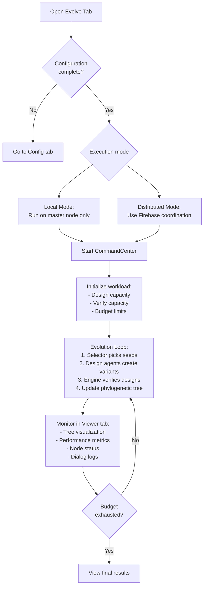

**Diagram: Full Evolution Loop Workflow**

The `CommandCenter` class orchestrates this workflow through these key methods:

| Method | Purpose | Location |
|--------|---------|----------|
| `run()` | Main loop executor | [bin/pages/evolve.py]() |
| `assign_workload()` | Distribute tasks to nodes | [bin/pages/evolve.py]() |
| `get_design_capacity()` | Calculate available design slots | [bin/pages/evolve.py]() |
| `get_verify_capacity()` | Calculate available verify slots | [bin/pages/evolve.py]() |

**Sources:** [bin/assets/howtouse.md:8-9](), [bin/pages/evolve.py]()

---

### Workflow 2: Standalone Design Exploration

Use the Design tab to explore individual design iterations without full evolution:

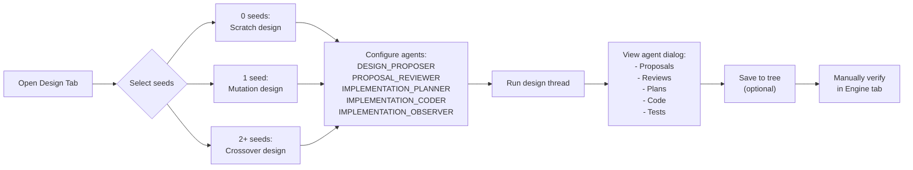

**Diagram: Standalone Design Workflow**

**Key Design Agent Types:**

| Agent | Role | Configuration |
|-------|------|---------------|
| `DESIGN_PROPOSER` | Generate architecture ideas | [bin/pages/design.py]() |
| `PROPOSAL_REVIEWER` | Evaluate proposals | [bin/pages/design.py]() |
| `IMPLEMENTATION_PLANNER` | Plan code structure | [bin/pages/design.py]() |
| `IMPLEMENTATION_CODER` | Write implementation | [bin/pages/design.py]() |
| `IMPLEMENTATION_OBSERVER` | Debug and test | [bin/pages/design.py]() |

**Sources:** [bin/assets/howtouse.md:9-10](), [bin/pages/design.py]()

---

### Workflow 3: Knowledge Base Search

The Search tab provides RAG (Retrieval-Augmented Generation) capabilities for design agents:

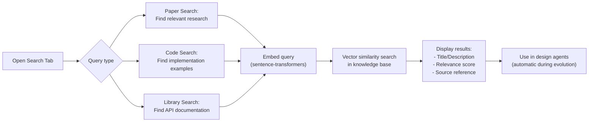

**Diagram: Knowledge Base Search Workflow**

The search engine uses these key components:

- **Embeddings:** Sentence transformers for semantic search
- **Knowledge Sources:** Papers, code snippets, library documentation
- **Integration:** Automatically invoked by design agents during ideation

**Sources:** [bin/assets/howtouse.md:10](), [bin/pages/design.py]()

---

### Workflow 4: Selector Configuration and Testing

The Select tab allows tuning the selection strategy:

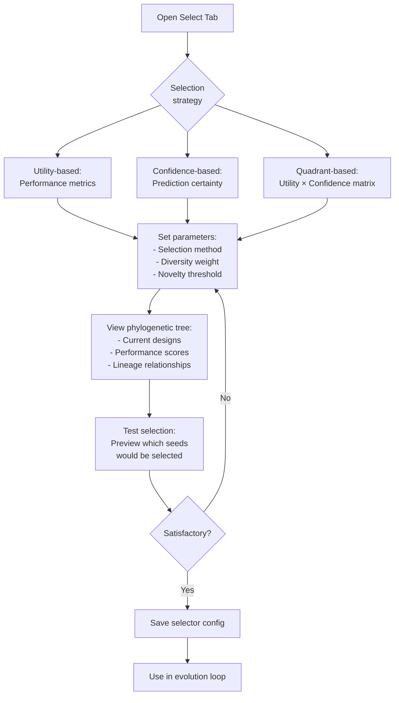

**Diagram: Selector Configuration Workflow**

**Key Selector Components:**

| Component | Purpose | Location |
|-----------|---------|----------|
| Utility calculation | Score designs by performance | See [Selector Component Specification](#8.2) |
| Confidence estimation | Measure prediction certainty | See [Selector Component Specification](#8.2) |
| Quadrant selection | Balance exploration/exploitation | See [Selector Component Specification](#8.2) |

**Sources:** [bin/assets/howtouse.md:11]()

---

### Workflow 5: Manual Verification

The Engine tab allows manual training and evaluation of specific designs:

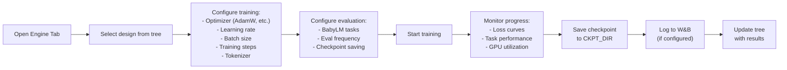

**Diagram: Manual Verification Workflow**

**Key Verification Parameters:**

| Parameter | Purpose | Default |
|-----------|---------|---------|
| Corpus | Training data | smollm-12.5-corpus |
| Optimizer | Training algorithm | AdamW |
| Tasks | Evaluation benchmarks | BabyLM tasks |
| Checkpoint frequency | Model saving rate | Per config |

**Sources:** [bin/assets/howtouse.md:12]()

---

## Distributed Deployment Usage

### Setting Up Distributed Nodes

For scaling evolution across multiple machines:

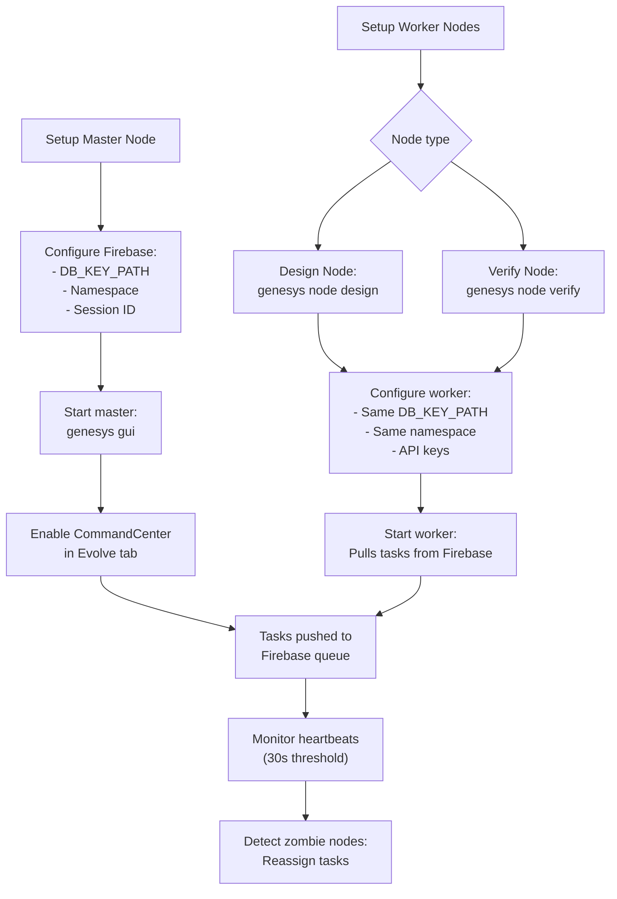

**Diagram: Distributed Deployment Setup**

**Node Types and Commands:**

| Node Type | Command | Resource Requirements | Purpose |
|-----------|---------|----------------------|---------|
| Master | `genesys gui` | CPU, Web UI | Orchestration and monitoring |
| Design Worker | `genesys node design` | CPU, LLM API access | Run design agents |
| Verify Worker | `genesys node verify` | GPU, Storage | Train and evaluate models |
| Listener | `genesys node listen` | Minimal | Passive monitoring |

**Sources:** [bin/pages/evolve.py](), [bin/app_utils.py]()

---

### Monitoring Distributed Execution

Use the Viewer tab and Listener system to monitor distributed workloads:

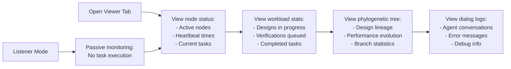

**Diagram: Distributed Monitoring Workflow**

**Key Monitoring Components:**

| Component | Data Source | Update Frequency |
|-----------|-------------|------------------|
| Node heartbeats | Firebase `/nodes/{node_id}/heartbeat` | 30 seconds |
| Workload stats | Firebase `/sessions/{session_id}/workload` | Real-time |
| Tree updates | Firebase `/sessions/{session_id}/tree` | Per design |
| Dialog logs | Firebase `/sessions/{session_id}/dialogs` | Per message |

**Sources:** [bin/app_utils.py](), [bin/pages/evolve.py]()

---

## Common Usage Patterns

### Pattern 1: Quick Test with Default Namespace

For immediate experimentation without configuration:

1. **Start Genesys:** `genesys gui`
2. **Use default namespace:** "text_evo_000" (auto-configured)
3. **Go to Evolve tab:** Click "Start Evolution"
4. **Monitor in Viewer tab:** Watch real-time progress

**Sources:** [bin/assets/howtouse.md:6-7]()

---

### Pattern 2: Resume Existing Experiment

To continue a previous evolution run:

1. **Go to Config tab**
2. **Select existing namespace** from dropdown
3. **Click "Load Configuration"** to restore settings
4. **Verify settings** in Config tab
5. **Go to Evolve tab** and resume

**Sources:** [bin/assets/howtouse.md:4]()

---

### Pattern 3: Multi-Scale Evolution

To evolve designs at different computational scales:

1. **Configure multiple verification scales** in Config tab:
   - Small: Fast iteration, lower performance
   - Medium: Balanced
   - Large: Slow, higher performance
2. **Set scale-specific budgets**
3. **Start evolution** - designs automatically verified at appropriate scales
4. **Monitor scale progression** in Viewer tab

---

### Pattern 4: Manual Design + Automated Verification

For controlled design with automated evaluation:

1. **Design tab:** Manually create/modify designs
2. **Save to tree** without verification
3. **Evolve tab:** Enable CommandCenter
4. **CommandCenter automatically verifies** saved designs
5. **View results** in Viewer tab

---

## Configuration File Management

Genesys uses multiple configuration layers:

### Configuration Hierarchy

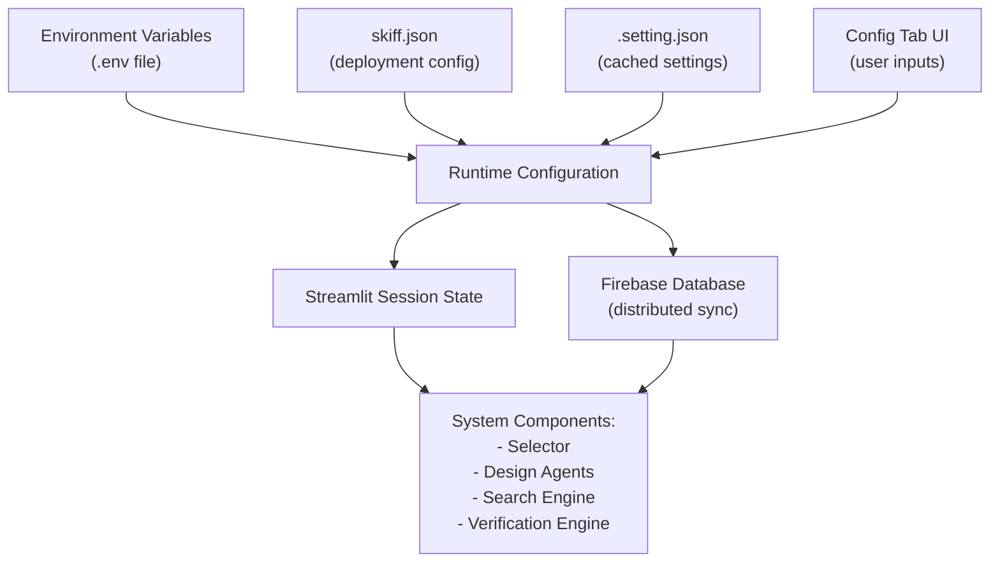

**Diagram: Configuration Data Flow**

### Environment Variables

Essential variables for system operation:

| Variable | Purpose | Required | Default |
|----------|---------|----------|---------|
| `DB_KEY_PATH` | Firebase credentials | For distributed | None |
| `CKPT_DIR` | Model checkpoint storage | Yes | `./checkpoints` |
| `DATA_DIR` | Evaluation data path | Yes | `./data` |
| `OPENAI_API_KEY` | OpenAI API access | For design | None |
| `ANTHROPIC_API_KEY` | Anthropic API access | For design | None |
| `TOGETHER_API_KEY` | Together API access | For design | None |
| `COHERE_API_KEY` | Cohere API access | For design | None |
| `WANDB_API_KEY` | W&B experiment tracking | Optional | None |

**Sources:** [bin/pages/config.py](), [bin/app_utils.py]()

---

### Configuration Persistence

Settings are persisted through three mechanisms:

1. **Session State** (in-memory, current session only)
   - Location: Streamlit session state
   - Scope: Single user session
   - Cleared on: Page refresh

2. **Local Cache** (`.setting.json`)
   - Location: Root directory
   - Scope: Local machine
   - Cleared on: Manual deletion

3. **Firebase Database** (distributed)
   - Location: Remote database
   - Scope: All nodes in namespace
   - Cleared on: Namespace deletion

**Sources:** [bin/app_utils.py](), [bin/pages/config.py]()

---

## Viewer Tab Usage

The Viewer tab provides comprehensive system observability:

### Tree Visualization

View the phylogenetic tree of evolved designs:

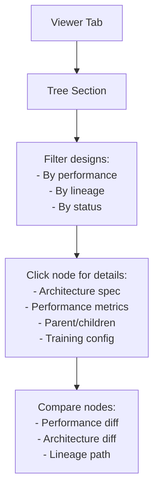

**Diagram: Tree Viewer Navigation**

### Leaderboard Views

Monitor top-performing designs:

| Leaderboard Type | Metrics | Sorting |
|-----------------|---------|---------|
| Raw Performance | Absolute scores | By task |
| Normalized | Scaled 0-1 | By task |
| Aggregate | Combined score | Overall |
| Per-Scale | Scale-specific | By scale |

### Dialog Logs

Debug design agent conversations:

- **Filter by session:** View specific design threads
- **Filter by agent:** Focus on specific agent types
- **Search messages:** Find specific exchanges
- **Export logs:** Download for analysis

**Sources:** [bin/pages/evolve.py]()

---

## Troubleshooting Common Issues

### Firebase Connection Issues

**Symptom:** "Firebase initialization failed"

**Solution:**
1. Verify `DB_KEY_PATH` points to valid credentials
2. Check Firebase project permissions
3. Ensure network connectivity
4. Validate JSON key file format

### Zombie Node Detection

**Symptom:** Nodes marked as "zombie" in Viewer

**Solution:**
1. Check node heartbeat logs
2. Verify network connectivity
3. Restart affected nodes
4. Reassign tasks manually if needed

### Design Agent Failures

**Symptom:** Design thread crashes or produces errors

**Solution:**
1. Check API key validity
2. Verify rate limits not exceeded
3. Review agent dialog logs for errors
4. Adjust agent configuration (temperature, max tokens)

### Verification Failures

**Symptom:** Training fails or produces NaN losses

**Solution:**
1. Check GPU memory availability
2. Verify dataset paths in `DATA_DIR`
3. Adjust learning rate/batch size
4. Review design code for bugs

**Sources:** [bin/app_utils.py](), [bin/pages/evolve.py]()

---

## Best Practices

### Resource Management

1. **Design Nodes:** 1-3 nodes sufficient (API rate-limited)
2. **Verify Nodes:** Scale based on GPU availability
3. **Budget Allocation:** Start with small budgets for testing
4. **Checkpoint Frequency:** Balance storage vs. recovery granularity

### Experiment Organization

1. **Namespace Naming:** Use descriptive prefixes (e.g., `transformer_variants_001`)
2. **Session IDs:** Include date/experiment description
3. **Configuration Versioning:** Document config changes between runs
4. **Result Archival:** Export leaderboards and logs regularly

### Performance Optimization

1. **Parallel Design:** Enable multiple design threads
2. **Asynchronous Verification:** Don't wait for verification to start next design
3. **Selective Verification:** Use selector to prioritize promising designs
4. **Scale Progression:** Start small, promote successful designs to larger scales

**Sources:** [bin/assets/howtouse.md:1-24]()

---

## Command-Line Interface

For non-GUI usage, Genesys provides CLI commands:

| Command | Purpose | Example |
|---------|---------|---------|
| `genesys setup` | Initialize environment | `genesys setup --data-dir ./data` |
| `genesys gui` | Launch Streamlit GUI | `genesys gui --port 8501` |
| `genesys node design` | Start design worker | `genesys node design --namespace exp_001` |
| `genesys node verify` | Start verify worker | `genesys node verify --gpu-id 0` |
| `genesys node listen` | Start passive listener | `genesys node listen --namespace exp_001` |

**Sources:** [bin/app.py]()

---

## Summary

The Genesys system provides a comprehensive evolutionary framework for language model discovery. Key usage workflows include:

1. **Configuration:** Set up namespaces and parameters in Config tab
2. **Evolution:** Run full evolutionary loop via Evolve tab with CommandCenter
3. **Design:** Manually explore designs in Design tab
4. **Search:** Query knowledge base for inspiration
5. **Selection:** Tune selector strategy in Select tab  
6. **Verification:** Train specific designs in Engine tab
7. **Monitoring:** Observe system state in Viewer tab

For distributed deployment, coordinate master and worker nodes through Firebase. Monitor distributed execution using the Viewer tab and listener system.

**Sources:** [bin/assets/howtouse.md:1-24]()

---

