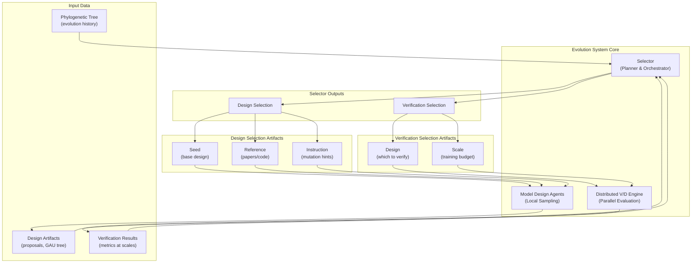
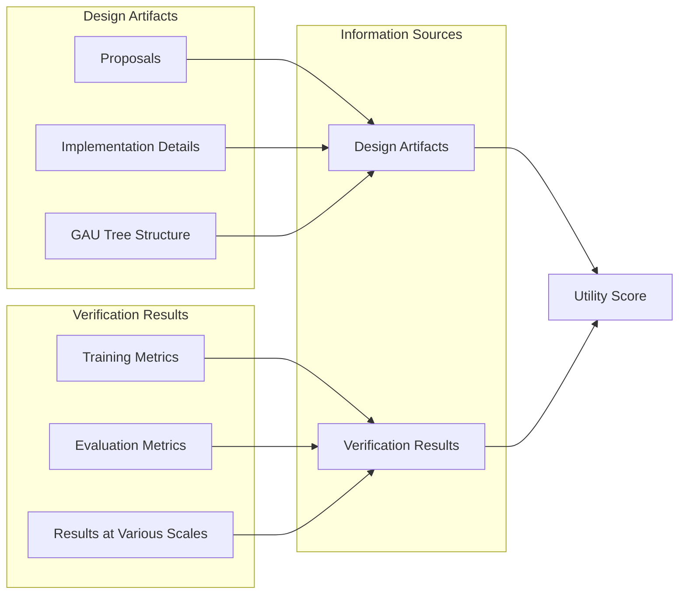
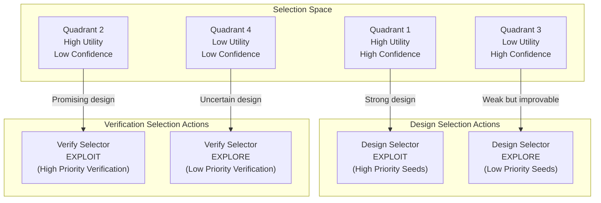
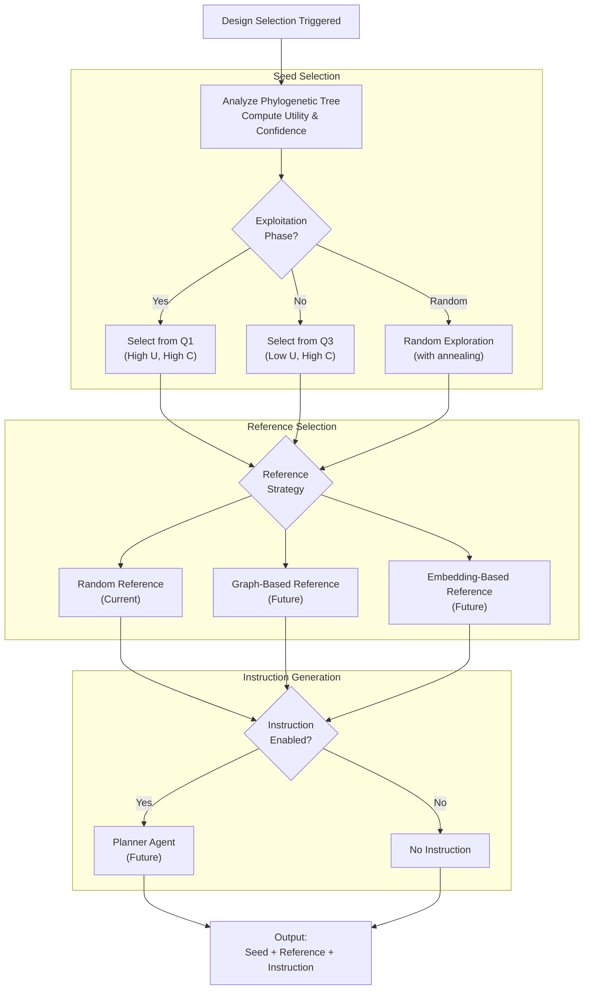
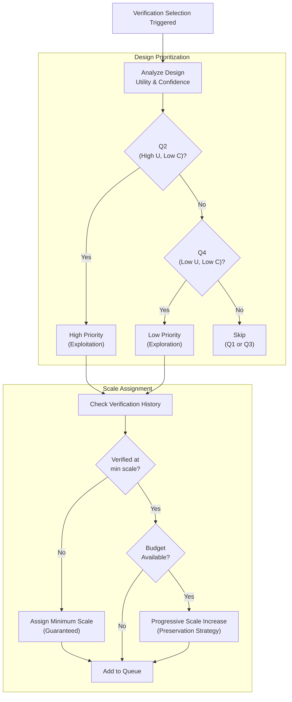
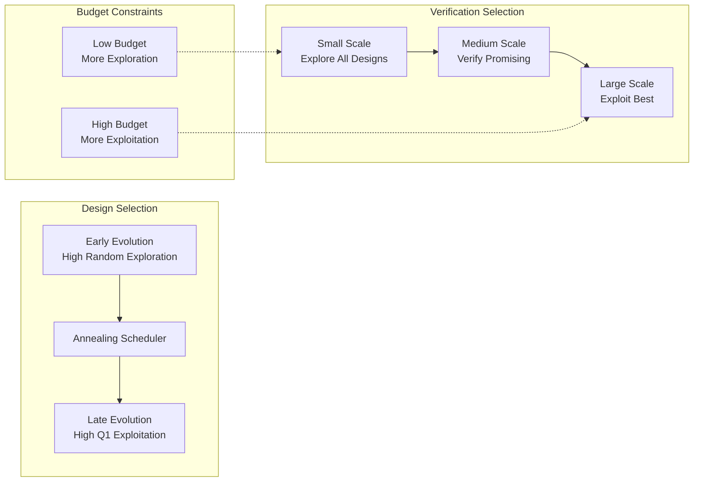

<!-- source: DeepWiki mcp.deepwiki.com · repo allenai/genesys · page 8.2 Selector Component Specification · fetched 2026-10-26 -->

# Selector Component Specification

Relevant source files

The following files were used as context for generating this wiki page:

- [bin/assets/selector_notes.md](bin/assets/selector_notes.md)

## Purpose and Scope

This document provides detailed technical specification of the **Selector** component, which serves as the central planner and orchestrator in Genesys's evolutionary system. The Selector is responsible for guiding the search process by making intelligent decisions about which designs to evolve and which designs/scales to verify.

For high-level overview of the selector's role in the evolution loop, see [Selector and Selection Strategy](#5.1). For information about how the selector interacts with design agents, see [Design Agents and Workflow](#5.2). For verification engine integration, see [Verification Engine](#5.3).

This specification covers:
- The selector's objectives and constraints
- Utility and confidence valuation metrics
- Design selection algorithm (seed/reference/instruction generation)
- Verification selection algorithm (design/scale prioritization)
- Four-quadrant selection framework
- Exploration vs. exploitation strategies

**Sources:** [bin/assets/selector_notes.md:1-137]()

---

## Selector Role and Objectives

### Primary Objective

The selector's goal is to find the **global optimal design** by exploring the evolution tree. Each node's utility represents its *potential* to be the optimal language model design at larger, unforeseen computational scales.

The fundamental challenge: computational budgets may only allow training a 130B model once, but smaller models more frequently. The selector must make design choices at smaller scales that will succeed when applied to larger scales—a problem common across scientific exploration domains.

### Core Capabilities

To address this scaling challenge, the selector must:

1. **Forecast the performance of a design at larger scales**
2. **Increase the certainty of this forecast**

These capabilities are achieved through two complementary selection mechanisms:
- **Design selection**: Chooses which designs to evolve further
- **Verification selection**: Determines which designs/scales to evaluate

**Sources:** [bin/assets/selector_notes.md:1-20]()

---

## System Architecture Position

### Selector as Central Orchestrator

**Diagram: Selector's Position in Evolution System**

The selector is one of three core pillars:

1. **Model Design Agents**: Generate new designs based on selector-provided seeds, references, and instructions. Optimized for high-quality *local* sampling to address the high cost of language model evaluation.

2. **Distributed V/D Engine**: Execute design threads and evaluate designs/scales selected by the selector. Prioritizes throughput, parallelism, and robustness to improve sampling efficiency.

3. **Selector**: Orchestrates the other two components by making strategic decisions about what to design and what to verify.

**Sources:** [bin/assets/selector_notes.md:22-36]()

---

## Selection Responsibilities

### Design Selection

**Purpose**: Generate inputs for the design agent to create new model architectures.

**Outputs:**

| Output | Description | Current Implementation |
|--------|-------------|----------------------|
| **Seed** | Base design from which a new design is evolved by mutating one unit | Selected from phylogenetic tree based on utility/confidence |
| **Reference** | Recommended papers or codes to cold-start ideation process | Currently random; future: graph/embedding-based |
| **Instruction** | *Optional* hints for guiding mutation | Not yet implemented; requires planner agent |

**Modes Supported:**
- **Mutation**: Operates on single seed (primary mode)
- **Crossover**: Can reuse units from references
- **Scratch**: Rewrites root nodes without seeds

**Sources:** [bin/assets/selector_notes.md:42-56]()

### Verification Selection

**Purpose**: Determine which designs and at which scales to run training/evaluation.

**Outputs:**

| Output | Description | Strategy |
|--------|-------------|----------|
| **Design** | The design to be verified | Prioritize high-utility designs with low confidence |
| **Scale** | The computational budget/model size | Start small, gradually increase; all designs verified at minimum scale |

**Resource Allocation**: More resources allocated to exploitation (promising designs), fewer to exploration (uncertain designs).

**Sources:** [bin/assets/selector_notes.md:50-53](), [bin/assets/selector_notes.md:109-116]()

---

## Design Valuation Framework

### Utility Metric

**Definition**: A scale-normalized metric indicating a design's potential to perform better at larger scales.

**Ideal Measure**: Area Under Curve (AUC) of the scaling curve.

**Main Challenge**: Forecasting the scaling curve, which may require online learning.

**Estimation Sources:**

**Diagram: Utility Score Computation Inputs**

**Sources:** [bin/assets/selector_notes.md:60-69]()

### Confidence Metric

**Definition**: Indicates certainty about a design's performance, serving as a proxy for the completeness of the scaling curve.

**Determination Factors:**

1. **Available Information**
   - Newly created designs: Only have design artifacts → **low confidence**
   - Verified designs: Have evaluation results at multiple scales → **higher confidence**

2. **Prior Knowledge** *(future work)*
   - Leverage known scaling characteristics (e.g., Transformer scaling laws)
   - Selector learns scaling behavior of architecture families over time

**Confidence Growth**: Increases through verification at additional scales.

**Sources:** [bin/assets/selector_notes.md:71-80]()

---

## Four-Quadrant Selection Framework

### Quadrant Definitions

The selector divides all designs in the phylogenetic tree into four quadrants based on utility and confidence thresholds:

**Diagram: Four-Quadrant Selection Strategy**

### Quadrant Strategy Table

| Quadrant | Utility | Confidence | Interpretation | Design Selection | Verification Selection |
|----------|---------|------------|----------------|------------------|----------------------|
| **Q1** | High | High | Strong, proven design | **Exploit**: High priority seed | Low priority (already verified) |
| **Q2** | High | Low | Promising but unproven | Medium priority seed | **Exploit**: High priority verification |
| **Q3** | Low | High | Weak but understood | **Explore**: Low priority seed | Low priority (confirmed weak) |
| **Q4** | Low | Low | Uncertain potential | Low priority seed | **Explore**: Low priority verification |

**Sources:** [bin/assets/selector_notes.md:82-97]()

---

## Design Selection Algorithm

### Decision Process Flow

**Diagram: Design Selection Decision Flow**

### Additional Considerations

Beyond seed selection, the design selector addresses:

1. **Reference Selection**
   - **Current**: Random selection from knowledge base
   - **Future Enhancement**: Graph-based or embedding-based strategies to choose references that lead to promising mutations

2. **Instruction Generation**
   - **Current**: Not implemented
   - **Future**: Planner agent could generate targeted hints to guide mutations toward unexplored regions or address known weaknesses

**Sources:** [bin/assets/selector_notes.md:98-107]()

---

## Verification Selection Algorithm

### Scale Selection Strategy

**Diagram: Verification Selection and Scale Assignment**

### Verification Priorities

**Exploitation Focus:**
- Designs in Q2 (high utility, low confidence)
- Allocate more resources to promising designs
- Verify at progressively larger scales to build confidence

**Exploration Focus:**
- Designs in Q4 (low utility, low confidence)
- Allocate fewer resources to uncertain designs
- May reveal unexpected scaling behavior

**Preservation Strategy:**
1. All designs guaranteed verification at minimum scale
2. Scale selection begins small and gradually increases
3. Ensures efficient resource allocation
4. Prevents wasting compute on designs that fail early

**Future Work**: Explore scaling characteristics of new/unfamiliar design families, which may require additional exploration resources.

**Sources:** [bin/assets/selector_notes.md:109-128]()

---

## Exploration Strategies

### Random Exploration

The selector employs different exploration strategies for design and verification selection:

#### Design Selection Exploration

**Strategy**: Random exploration with annealing scheduler

**Mechanism:**
- Initially high probability of random seed selection
- Probability decreases over evolution iterations
- Balances exploration (early) with exploitation (late)

**Future Enhancement**: Bandit-based exploration strategies

#### Verification Selection Exploration

**Strategy**: Progressive scale verification with preservation

**Mechanism:**
1. All models verified at smallest scale (preservation)
2. Successful designs progress to larger scales
3. Failed designs eliminated early (compute efficiency)

**Resource Allocation:**
- More budget → exploitation (verify promising designs at larger scales)
- Less budget → exploration (verify uncertain designs at small scales)

**Sources:** [bin/assets/selector_notes.md:119-128]()

### Exploration-Exploitation Balance

**Diagram: Exploration-Exploitation Dynamics**

**Sources:** [bin/assets/selector_notes.md:119-128]()

---

## Future Work and Extensions

### Planned Enhancements

The selector component has identified areas for future development:

#### 1. RL/Tuning of Design Agents

**Objective**: Use utility as a reward signal to improve design quality over evolution.

**Mechanism:**
- Design agents learn from utility feedback
- Gradually improve mutation strategies
- Optimize toward higher-utility design patterns

**Integration Point**: Utility scores from verified designs feed back to design agent training

#### 2. Online Learning of Selector/Scaling Curves

**Objective**: Selector learns scaling curve characteristics over time.

**Benefits:**
- Improved forecasting accuracy
- More efficient exploration
- Better confidence estimation

**Mechanism:**
- Accumulate scaling data across design families
- Train predictive models for scaling behavior
- Use predictions to guide selection decisions

**Knowledge Transfer**: Leverage prior knowledge of architecture families (e.g., Transformer scaling laws) to bootstrap learning for new architectures.

#### 3. Advanced Reference Selection

**Current Limitation**: Random reference selection

**Proposed Enhancements:**
- Graph-based strategies (exploit phylogenetic tree structure)
- Embedding-based strategies (semantic similarity in design space)
- Diversity-aware selection (avoid redundant references)

#### 4. Instruction Generation via Planner Agent

**Current Limitation**: No automated instruction generation

**Proposed Enhancement:**
- Planner agent analyzes selection context
- Generates targeted hints for design agents
- Guides exploration toward promising regions
- Addresses identified weaknesses in design lineage

**Sources:** [bin/assets/selector_notes.md:131-137]()

---

## Summary

The Selector component serves as the central intelligence in Genesys's evolutionary system. Through its dual design/verification selection mechanisms and four-quadrant framework, it balances exploration and exploitation to efficiently discover optimal language model designs across scales.

**Key Design Principles:**

| Principle | Implementation |
|-----------|----------------|
| **Scale Forecasting** | Utility metric estimates performance at larger scales |
| **Uncertainty Quantification** | Confidence metric guides verification priorities |
| **Resource Efficiency** | Preservation strategy (small→large scale progression) |
| **Strategic Exploration** | Four-quadrant framework balances exploration/exploitation |
| **Adaptive Learning** | Future: online learning of scaling curves and design patterns |

The selector's architecture enables Genesys to make principled decisions about which designs to evolve and verify, maximizing the probability of discovering globally optimal designs under computational constraints.

**Sources:** [bin/assets/selector_notes.md:1-137]()

---

