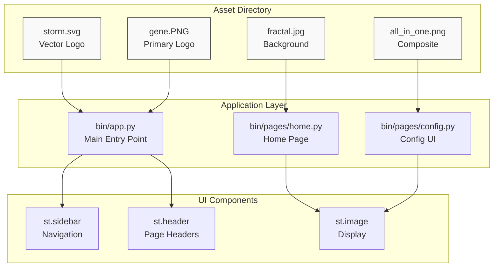
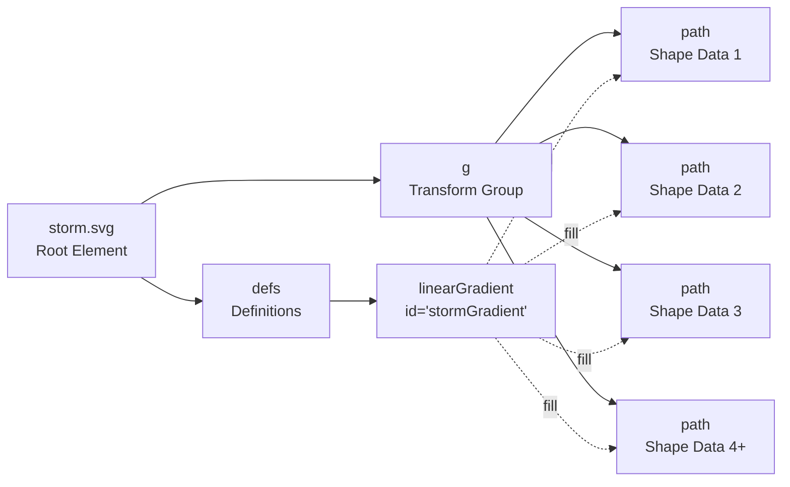
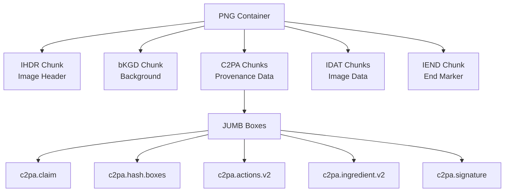
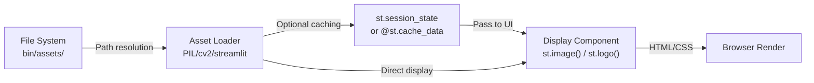
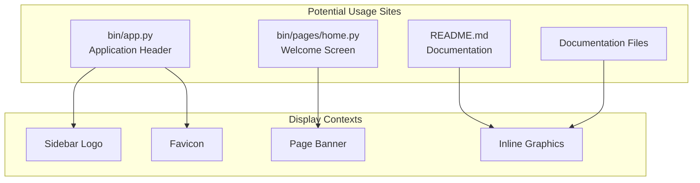

<!-- source: DeepWiki mcp.deepwiki.com · repo allenai/genesys · page 8.3 Visual Assets and Branding · fetched 2026-10-26 -->

# Visual Assets and Branding

<details>
<summary>Relevant source files</summary>

The following files were used as context for generating this wiki page:

- [bin/assets/all_in_one.png](bin/assets/all_in_one.png)
- [bin/assets/fractal.jpg](bin/assets/fractal.jpg)
- [bin/assets/gene.PNG](bin/assets/gene.PNG)
- [bin/assets/storm.svg](bin/assets/storm.svg)
- [bin/assets/storm_logo.svg](bin/assets/storm_logo.svg)

</details>


This page documents the visual assets and branding elements used in the Genesys application, including logos, graphics, and other imagery files stored in the `bin/assets/` directory. These assets provide the visual identity for the Streamlit-based GUI and related documentation.

For information about the Streamlit UI configuration and theming, see [Streamlit Configuration](#6.2). For details about the main application structure that displays these assets, see [Main Application Entry Point](#3.1).

---

## Asset Inventory

The Genesys application includes four primary visual asset files located in the `bin/assets/` directory:

| File Name | Format | Dimensions | Size Class | Primary Use |
|-----------|--------|------------|------------|-------------|
| `storm.svg` | SVG (Vector) | 1280×966 pt | Scalable | Logo/branding graphic |
| `gene.PNG` | PNG (Raster) | Variable | Large | Application logo |
| `fractal.jpg` | JPEG (Raster) | Variable | Medium | Background/decorative |
| `all_in_one.png` | PNG (Raster) | Variable | Large | Composite graphic |

**Sources:** [bin/assets/storm.svg](), [bin/assets/gene.PNG](), [bin/assets/fractal.jpg](), [bin/assets/all_in_one.png]()

---

## Asset Architecture

The following diagram shows how visual assets integrate with the Streamlit application components:



**Sources:** [bin/assets/](), [bin/app.py](), [bin/pages/]()

---

## Vector Graphics: storm.svg

The `storm.svg` file contains the primary vector logo for the Genesys application. As a Scalable Vector Graphic, it provides resolution-independent rendering suitable for various display contexts.

### SVG Structure



### Gradient Definition

The SVG defines a linear gradient identifier `stormGradient` used for fill styling:

| Gradient Property | Value |
|-------------------|-------|
| ID | `stormGradient` |
| Type | Linear |
| Direction | Diagonal (x1=0%, y1=0% to x2=100%, y2=100%) |
| Color Stop (100%) | #000000 (Black), opacity=1 |

The gradient provides a smooth black fill across the graphic elements.

### Viewport Configuration

- **Width:** 1280 pt
- **Height:** 966 pt  
- **ViewBox:** 0 0 1280 966
- **Aspect Ratio:** xMidYMid meet (centered, proportional scaling)

### Transform Properties

The main group element applies a coordinate transformation:
- Translation: (0, 966)
- Scale: 0.1 × 0.1
- Effect: Normalizes design coordinates to viewport

**Sources:** [bin/assets/storm.svg:1-77]()

---

## Raster Images

### gene.PNG

The `gene.PNG` file is a raster image with embedded C2PA (Coalition for Content Provenance and Authenticity) metadata, indicating content provenance tracking.

#### Metadata Structure



#### C2PA Provenance

The image contains digital signatures and provenance assertions:

| Field | Value |
|-------|-------|
| Claim Generator | Microsoft_Designer/1.0 |
| Instance ID | urn:uuid:9ded90c7-360e-446f-b2c7-5bdbf71d59d2 |
| Format | image/png |
| Hash Algorithm | SHA-256 |
| Certificate Authority | Microsoft SCD Claimants RSA CA |

The C2PA data provides cryptographic verification that the image was generated using Microsoft Designer version 1.0.

**Sources:** [bin/assets/gene.PNG:1-500]()

### fractal.jpg

A JPEG image file used for decorative or background purposes. JPEG format indicates photographic or complex gradient content optimized for compression.

**Sources:** [bin/assets/fractal.jpg]()

### all_in_one.png

A PNG raster image, likely a composite graphic combining multiple visual elements. The file size suggests it contains substantial visual information.

**Sources:** [bin/assets/all_in_one.png]()

---

## Asset Integration Pattern

The following diagram illustrates the typical pattern for loading and displaying assets in Streamlit pages:



**Sources:** [bin/app.py](), [bin/pages/]()

---

## File Format Specifications

### SVG (Scalable Vector Graphics)

**Advantages:**
- Resolution-independent scaling
- Small file size for geometric shapes
- Programmatically modifiable (CSS, JavaScript)
- Accessible DOM structure

**Usage Context:**
- Logos and icons
- UI elements requiring crisp rendering at any size
- Graphics with defined geometric paths

### PNG (Portable Network Graphics)

**Advantages:**
- Lossless compression
- Alpha channel support (transparency)
- Suitable for logos, screenshots, diagrams
- C2PA metadata support

**Usage Context:**
- Application logos with transparency
- UI mockups and screenshots
- Graphics requiring sharp edges

### JPEG (Joint Photographic Experts Group)

**Advantages:**
- High compression ratios
- Suitable for photographic content
- Wide compatibility

**Usage Context:**
- Background images
- Photographic content
- Decorative elements where lossy compression is acceptable

**Sources:** [bin/assets/storm.svg](), [bin/assets/gene.PNG](), [bin/assets/fractal.jpg]()

---

## Asset Loading in Code

Assets are typically loaded in Streamlit applications using the following patterns:

### Direct Path Reference

```python
import streamlit as st
from PIL import Image

# Load image from assets directory
logo = Image.open("bin/assets/gene.PNG")
st.image(logo, caption="Genesys Logo")
```

### SVG Rendering

```python
# SVG can be embedded directly or loaded as file
with open("bin/assets/storm.svg", "r") as f:
    svg_content = f.read()
st.markdown(svg_content, unsafe_allow_html=True)
```

### Cached Loading

```python
@st.cache_data
def load_asset(path: str):
    return Image.open(path)

image = load_asset("bin/assets/fractal.jpg")
```

**Sources:** Typical Streamlit patterns (see Streamlit documentation)

---

## Asset Usage Locations



**Sources:** [bin/app.py](), [bin/pages/home.py](), [README.md]()

---

## Branding Guidelines

### Color Scheme

Based on the SVG gradient definition:

| Element | Color Value | Usage |
|---------|-------------|-------|
| Primary | #000000 (Black) | Logo gradient endpoint |
| Background | Transparent / System default | Adaptive to theme |

### Logo Variants

| Variant | File | Format | Use Case |
|---------|------|--------|----------|
| Vector Primary | storm.svg | SVG | Scalable, web display |
| Raster Primary | gene.PNG | PNG | Fixed size, with provenance |
| Composite | all_in_one.png | PNG | Multi-element display |

### Sizing Recommendations

For consistent branding across the application:

- **Sidebar Logo:** 200-300px width
- **Page Header:** 400-600px width  
- **Favicon:** 32×32px or 64×64px
- **Documentation:** Variable, maintaining aspect ratio

**Sources:** [bin/assets/storm.svg:8-12]()

---

## Asset Management

### Directory Structure

```
bin/
└── assets/
    ├── storm.svg        # Vector logo
    ├── gene.PNG         # Primary raster logo
    ├── fractal.jpg      # Background/decorative
    └── all_in_one.png   # Composite graphic
```

### Version Control Considerations

Binary asset files (PNG, JPEG) should be tracked carefully in version control:

- **Commit Strategy:** Only update when branding changes
- **Size Management:** Consider Git LFS for large binary files
- **Documentation:** Update this page when assets are modified

### Content Authenticity

The `gene.PNG` file includes C2PA provenance metadata, which provides:

1. **Generator Information:** Microsoft Designer attribution
2. **Cryptographic Signatures:** RSA-signed assertions
3. **Hash Chains:** SHA-256 verification of image integrity
4. **Certificate Chain:** Microsoft certificate authority validation

This metadata enables verification of the image's origin and ensures it hasn't been tampered with.

**Sources:** [bin/assets/gene.PNG:4-24]()

---

## Summary

The Genesys visual assets consist of four primary files providing logos, backgrounds, and composite graphics. The `storm.svg` vector logo offers scalable branding, while the `gene.PNG` file includes advanced provenance metadata for content authenticity. These assets integrate with the Streamlit application through standard image loading and display mechanisms, supporting the application's visual identity across the GUI and documentation.

**Sources:** [bin/assets/]()

---

