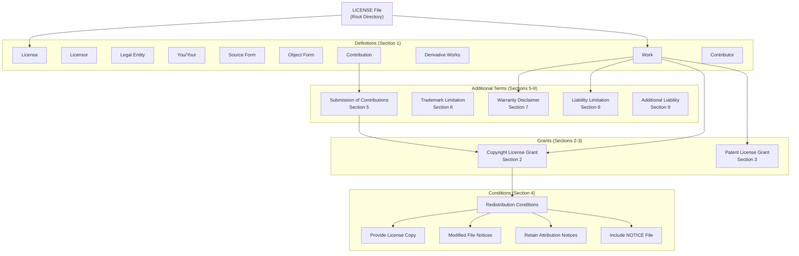
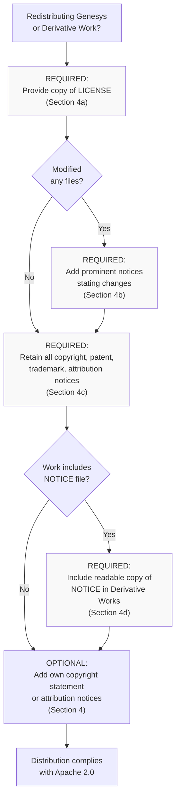
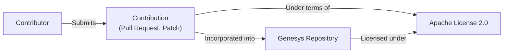
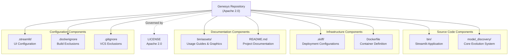

<!-- source: DeepWiki mcp.deepwiki.com · repo allenai/genesys · page 8.4 License Information · fetched 2026-10-26 -->

# License Information

<details>
<summary>Relevant source files</summary>

The following files were used as context for generating this wiki page:

- [LICENSE](LICENSE)

</details>


## Purpose and Scope

This page documents the licensing terms for the Genesys codebase. Genesys is distributed under the Apache License 2.0, a permissive open-source license that allows broad use, modification, and distribution of the software. This page summarizes the key terms, conditions, and obligations for users and contributors.

For information about system configuration and environment setup, see [Configuration and Environment](#6). For deployment-related considerations, see [Deployment and Infrastructure](#7).

**Sources:** [LICENSE:1-202]()

---

## License Overview

Genesys is licensed under the **Apache License, Version 2.0** (January 2004). This license provides users with significant freedoms while protecting contributors from liability and requiring attribution to be maintained.

### License Characteristics

| Characteristic | Description |
|---------------|-------------|
| **License Type** | Permissive open-source |
| **Version** | 2.0 (January 2004) |
| **Full Text Location** | [LICENSE:1-202]() |
| **Official URL** | http://www.apache.org/licenses/ |
| **Commercial Use** | Permitted |
| **Modification** | Permitted |
| **Distribution** | Permitted |
| **Patent Grant** | Yes (Section 3) |
| **Trademark Rights** | Not granted (Section 6) |
| **Warranty** | None (AS IS) |

**Sources:** [LICENSE:1-6]()

---

## License Structure

The following diagram illustrates the organization of the Apache License 2.0 and how its components relate to usage scenarios:



**Sources:** [LICENSE:1-176]()

---

## Key Definitions

The Apache License 2.0 defines several precise terms that govern its application. These definitions are critical for understanding the scope of permissions and obligations.

### Core Terminology

| Term | Definition (from LICENSE) | Relevance to Genesys |
|------|---------------------------|---------------------|
| **License** | The terms and conditions for use, reproduction, and distribution | Governs all use of the Genesys codebase |
| **Licensor** | The copyright owner or entity authorized by the copyright owner | Allen Institute for AI |
| **Work** | The work of authorship made available under the License | The entire Genesys repository |
| **Source** | Preferred form for making modifications (source code, documentation, configuration files) | All `.py` files, `.jsonnet` files, documentation, etc. |
| **Object** | Form resulting from mechanical transformation (compiled code, generated docs) | Docker images, generated configurations |
| **Derivative Works** | Works based on or derived from the Work | Any modifications or extensions to Genesys |
| **Contribution** | Work intentionally submitted for inclusion in the Work | Pull requests, patches submitted to the repository |
| **Contributor** | Licensor and any individual or Legal Entity whose Contribution has been incorporated | Original authors and accepted contributors |

**Sources:** [LICENSE:7-65]()

---

## Permissions Granted

### Copyright License (Section 2)

The license grants users a **perpetual, worldwide, non-exclusive, no-charge, royalty-free, irrevocable** copyright license to:

- **Reproduce** the Work
- **Prepare Derivative Works** of the Work
- **Publicly display** the Work
- **Publicly perform** the Work
- **Sublicense** the Work
- **Distribute** the Work and Derivative Works in Source or Object form

This applies to all components of Genesys, including:
- Python source code in [model_discovery/]()
- Streamlit application files in [bin/]()
- Configuration templates in [.skiff/]()
- Documentation and assets in [bin/assets/]()
- Deployment infrastructure definitions

**Sources:** [LICENSE:66-72]()

### Patent License (Section 3)

The license grants a **perpetual, worldwide, non-exclusive, no-charge, royalty-free, irrevocable** patent license to:

- Make, have made, use, offer to sell, sell, import, and otherwise transfer the Work

**Patent Termination Clause:** If you institute patent litigation alleging that the Work or a Contribution constitutes patent infringement, any patent licenses granted under this License terminate as of the filing date of such litigation.

**Sources:** [LICENSE:73-87]()

---

## Conditions for Use and Distribution

### Redistribution Requirements

The following flowchart illustrates the conditions that must be met when redistributing Genesys or derivative works:



**Sources:** [LICENSE:89-129]()

### Specific Requirements

#### 4(a): License Copy

Any redistribution must include a copy of the Apache License 2.0. This file is located at [LICENSE:1-202]().

#### 4(b): Modification Notices

If you modify any files in the Genesys codebase, you must:
- Add prominent notices indicating which files were changed
- Include the nature of the changes made

#### 4(c): Attribution Retention

When distributing derivative works in Source form, retain:
- All copyright notices
- Patent notices
- Trademark notices
- Attribution notices from the original Source

Exclude notices that do not pertain to any part of the Derivative Works.

#### 4(d): NOTICE File Handling

If the Work includes a NOTICE text file, any Derivative Works must include a readable copy of the attribution notices. The NOTICE file can be placed:
- Within a NOTICE text file distributed with the Derivative Works
- Within the Source form or documentation
- Within a display generated by the Derivative Works where third-party notices normally appear

**Note:** Genesys does not currently include a NOTICE file in the repository root.

**Sources:** [LICENSE:89-122]()

---

## Contributions and Submissions

### Contribution Terms (Section 5)

Unless explicitly stated otherwise, any Contribution intentionally submitted for inclusion in Genesys is governed by the Apache License 2.0 without additional terms or conditions.



This means:
- Pull requests to the Genesys repository are submitted under Apache 2.0
- No additional contributor license agreement (CLA) is required
- Contributors retain copyright to their contributions
- The license grants necessary rights to the project

**Sources:** [LICENSE:130-136]()

---

## Limitations and Disclaimers

### Trademarks (Section 6)

The Apache License 2.0 **does not grant permission** to use:
- Trade names
- Trademarks
- Service marks
- Product names of the Licensor

Exception: Reasonable and customary use in describing the origin of the Work and reproducing the content of the NOTICE file.

This means the "Genesys" name and any Allen Institute for AI trademarks are not licensed for independent use.

**Sources:** [LICENSE:138-142]()

### Warranty Disclaimer (Section 7)

```
┌─────────────────────────────────────────────────────┐
│   THE WORK IS PROVIDED "AS IS" WITHOUT WARRANTY     │
│                                                     │
│   NO WARRANTIES OF:                                 │
│   • Title                                          │
│   • Non-infringement                               │
│   • Merchantability                                │
│   • Fitness for a particular purpose               │
│                                                     │
│   Users assume all risks associated with use       │
└─────────────────────────────────────────────────────┘
```

The Genesys codebase is provided without any warranties, express or implied. Users are solely responsible for:
- Determining appropriateness of using or redistributing the Work
- Assuming any risks associated with exercise of permissions under the License

**Sources:** [LICENSE:143-152]()

### Limitation of Liability (Section 8)

Under **no legal theory** (tort, contract, or otherwise) shall any Contributor be liable for damages, including:

| Damage Type | Coverage |
|-------------|----------|
| Direct damages | Not covered |
| Indirect damages | Not covered |
| Special damages | Not covered |
| Incidental damages | Not covered |
| Consequential damages | Not covered |
| Loss of goodwill | Not covered |
| Work stoppage | Not covered |
| Computer failure | Not covered |
| Commercial damages/losses | Not covered |

Exception: Deliberate and grossly negligent acts, or as required by applicable law.

**Sources:** [LICENSE:153-164]()

### Accepting Additional Liability (Section 9)

When redistributing Genesys or Derivative Works, you may **choose to offer**:
- Support
- Warranty
- Indemnity
- Other liability obligations

**Requirements if you do so:**
- Act only on your own behalf and sole responsibility
- Not on behalf of any other Contributor
- Agree to indemnify, defend, and hold each Contributor harmless for any liability incurred

**Sources:** [LICENSE:165-175]()

---

## Application to Genesys Codebase

### License File Location

The complete Apache License 2.0 text is located at the repository root:

```
genesys/
└── LICENSE          # Apache License 2.0 full text
```

**File:** [LICENSE:1-202]()

### Components Covered

The Apache License 2.0 applies to all components of the Genesys repository:



### Derivative Works Examples

Under Apache 2.0, the following are considered **Derivative Works** and must comply with the redistribution conditions:

| Modification Type | Example | Requirements |
|-------------------|---------|--------------|
| Modified source code | Changing design agent logic in [bin/pages/design.py]() | Include LICENSE, add modification notices, retain attribution |
| Extended functionality | Adding new selection strategies to selector | Include LICENSE, add modification notices, retain attribution |
| Configuration changes | Modifying Kubernetes templates in [.skiff/webapp.jsonnet]() | Include LICENSE, add modification notices |
| Docker image builds | Building custom container with modified [Dockerfile]() | Include LICENSE in image |
| Combined works | Integrating Genesys into a larger system | Include LICENSE, may add own license for additions |

**Sources:** [LICENSE:40-46](), [LICENSE:89-129]()

---

## Practical Compliance Checklist

### For Users

- ✓ You may use Genesys for any purpose, including commercial use
- ✓ You may modify the code
- ✓ You may distribute original or modified versions
- ✓ No need to open-source your modifications (permissive license)
- ✓ No royalty or licensing fees required

### For Redistributors

- ✓ Include the [LICENSE]() file with any distribution
- ✓ If you modified files, add prominent notices stating the changes
- ✓ Retain all copyright, patent, trademark, and attribution notices
- ✓ Do not use "Genesys" or Allen Institute trademarks without permission
- ✓ Provide the software "AS IS" without warranty
- ✓ Include attribution to original authors

### For Contributors

- ✓ Contributions are submitted under Apache 2.0 terms
- ✓ No additional CLA required
- ✓ You retain copyright to your contributions
- ✓ You grant the necessary rights to the project

**Sources:** [LICENSE:1-202]()

---

## External Resources

- **Full License Text:** [LICENSE:1-202]()
- **Official Apache License 2.0:** http://www.apache.org/licenses/LICENSE-2.0
- **Apache Foundation License FAQ:** https://www.apache.org/foundation/license-faq.html
- **SPDX License Identifier:** `Apache-2.0`

**Sources:** [LICENSE:1-6](), [LICENSE:195]()