# Page: Genesys Overview

# Genesys Overview

<details>
<summary>Relevant source files</summary>

The following files were used as context for generating this wiki page:

- [LICENSE](LICENSE)
- [README.md](README.md)

</details>


## Purpose and Scope

Genesys (**Gene**tic discovery **sys**tem) is a distributed evolutionary framework for discovering novel language model architectures using LLM agents and genetic programming. The system employs automated genetic algorithms where LLM agents serve as genetic operators to generate, mutate, and evolve neural network architectures through iterative cycles of design, implementation, training, and evaluation.

The system orchestrates the complete machine learning research workflow from initial ideation through final performance validation, utilizing distributed compute resources and sophisticated coordination mechanisms. For detailed setup instructions, see [Getting Started](#2). For specific implementation details of individual components, refer to the relevant subsections under [Application Architecture](#3) and [User Interface Pages](#4).

**Core Innovation**: LLM agents function as intelligent genetic operators, replacing traditional random mutations with semantically-aware architectural modifications informed by machine learning research literature and code repositories.

## Core Concepts

Genesys implements genetic programming for neural architecture search through the following evolutionary cycle:

### Genetic Programming Loop

| Phase | Implementation | Core Classes/Functions |
|-------|---------------|------------------------|
| **Selection** | `Selector.sample_seeds()` - seeds chosen via performance metrics and phylogenetic diversity | `Selector`, `PhylogeneticTree` |
| **Design** | LLM agents generate architectural modifications through multi-agent conversations | `DesignEngine`, `BuildEvolution` |
| **Implementation** | Design specifications converted to executable PyTorch code | `ImplementationAgent`, `CodeValidator` |
| **Verification** | Model training and evaluation using distributed compute | `VerificationEngine`, `TrainingPipeline` |
| **Evolution** | Population updated based on fitness scores, maintaining phylogenetic relationships | `PhylogeneticTree.update()` |

### Distributed Architecture

The system employs specialized node types for optimal resource utilization:

| Node Type | Resource Profile | Primary Function | Key Components |
|-----------|------------------|------------------|----------------|
| **Design Nodes** | CPU-intensive, API rate-limited | LLM agent execution for design generation | `DesignEngine`, `SearchEngine` |
| **Verification Nodes** | GPU-intensive, compute-heavy | Model training and evaluation | `VerificationEngine`, `TrainingPipeline` |
| **Master Node** | Lightweight coordination | Orchestration and monitoring | `CommandCenter`, `ConnectionManager` |

### Knowledge Integration

The system integrates external knowledge sources through Retrieval-Augmented Generation (RAG):
- **Research Papers**: 300+ machine learning papers indexed in vector database
- **Code Units**: Reusable implementation components and architectural patterns
- **Baseline Models**: Performance benchmarks for fitness evaluation

## System Architecture

### Core System Components

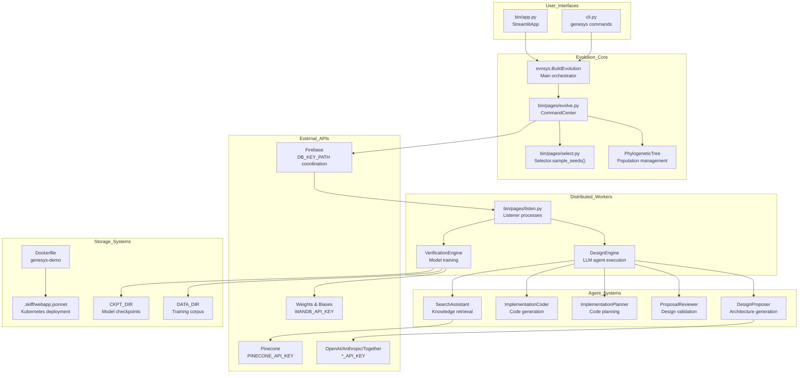

**Sources**: [README.md:1-190](), [bin/app.py](), [cli.py](), [evosys/](), [bin/pages/](), [Dockerfile](), [.skiff/webapp.jsonnet]()

### Genetic Programming Workflow

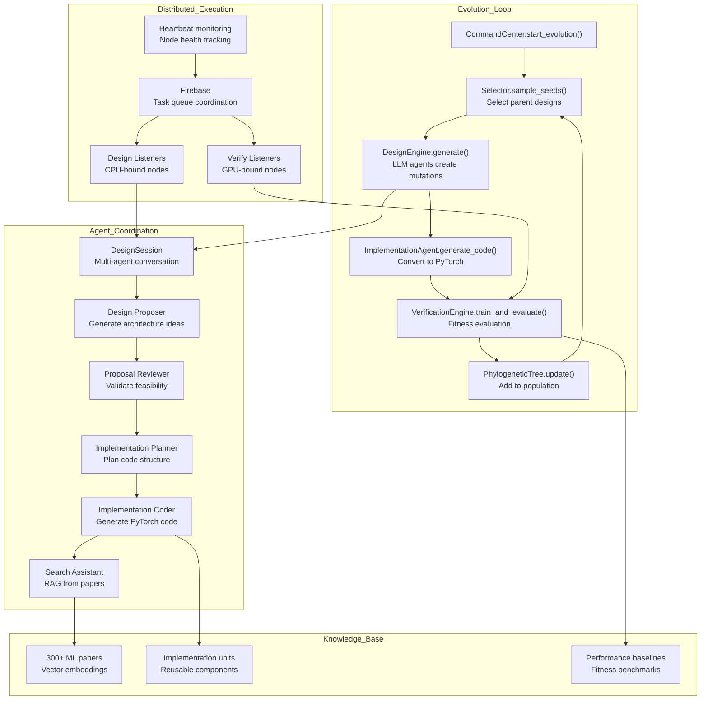

**Sources**: [bin/pages/evolve.py](), [bin/pages/select.py](), [bin/pages/design.py](), [bin/pages/verify.py](), [bin/pages/listen.py](), [README.md:127-129]()

### Distributed Node Architecture

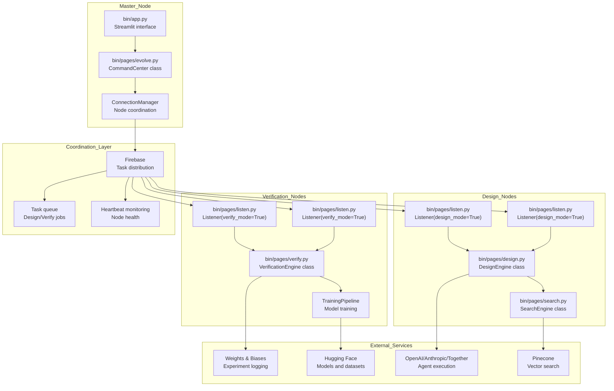

**Sources**: [bin/pages/evolve.py](), [bin/pages/listen.py](), [bin/pages/design.py](), [bin/pages/verify.py](), [bin/pages/search.py](), [README.md:127-129]()

## Key Components

### Core Evolution System

| Component | Implementation | Purpose | Key Methods |
|-----------|---------------|---------|------------|
| **BuildEvolution** | `evosys.BuildEvolution` | Central orchestrator for genetic programming | `run()`, `evolve()` |
| **CommandCenter** | `bin/pages/evolve.py` | Master node coordination and control | `start_evolution()`, `monitor_nodes()` |
| **Selector** | `bin/pages/select.py` | Seed selection using phylogenetic metrics | `sample_seeds()`, `rank_designs()` |
| **PhylogeneticTree** | `PhylogeneticTree` | Population management and lineage tracking | `update()`, `get_ancestors()` |

### LLM Agent Architecture

| Agent Type | Implementation | Role | Input/Output |
|-----------|---------------|------|-------------|
| **Design Proposer** | `DesignProposer` | Generate architectural proposals | Seed design → Architecture proposal |
| **Proposal Reviewer** | `ProposalReviewer` | Validate design feasibility | Architecture proposal → Feasibility assessment |
| **Implementation Planner** | `ImplementationPlanner` | Plan code structure | Architecture proposal → Implementation plan |
| **Implementation Coder** | `ImplementationCoder` | Generate PyTorch code | Implementation plan → Executable code |
| **Implementation Observer** | `ImplementationObserver` | Validate generated code | Code → Validation results |
| **Search Assistant** | `SearchAssistant` | Knowledge retrieval via RAG | Query → Relevant papers/code |

### Distributed Node Types

| Node Type | Resource Profile | Implementation | Primary Function |
|-----------|------------------|----------------|------------------|
| **Design Nodes** | CPU-intensive, API rate-limited | `bin/pages/listen.py` with `design_mode=True` | LLM agent execution, architecture generation |
| **Verification Nodes** | GPU-intensive, compute-heavy | `bin/pages/listen.py` with `verify_mode=True` | Model training, evaluation, fitness scoring |
| **Master Node** | Lightweight coordination | `bin/pages/evolve.py` | Orchestration, monitoring, population management |

### External Service Integration

| Service | Environment Variable | Implementation | Purpose |
|---------|---------------------|----------------|---------|
| **OpenAI** | `MY_OPENAI_KEY` | LLM API client | GPT-4 agent execution |
| **Anthropic** | `ANTHROPIC_API_KEY` | LLM API client | Claude agent execution |
| **Together AI** | `TOGETHER_API_KEY` | LLM API client | Open-source LLM access |
| **Weights & Biases** | `WANDB_API_KEY` | `wandb` integration | Experiment tracking, metrics logging |
| **Firebase** | `DB_KEY_PATH` | Database client | Distributed coordination, task queuing |
| **Pinecone** | `PINECONE_API_KEY` | Vector database | Research paper embeddings, RAG search |
| **Semantic Scholar** | `S2_API_KEY` | API client | Research paper metadata and content |
| **Hugging Face** | `HF_KEY` | `transformers` integration | Model hosting, dataset access |

**Sources**: [README.md:54-67](), [evosys/](), [bin/pages/]()

## Distributed Evolution Process

The genetic programming process operates through a continuous cycle managed by the `CommandCenter` class in [bin/pages/evolve.py](). The detailed workflow includes:

### Evolution Cycle Implementation

1. **Initialization**: `BuildEvolution.run()` initializes the system with configuration parameters and establishes connections to external services via environment variables
2. **Seed Selection**: `Selector.sample_seeds()` samples parent designs from the `PhylogeneticTree` based on performance metrics and phylogenetic diversity scores
3. **Design Generation**: Design nodes execute `DesignEngine.generate()` using multi-agent LLM conversations to create architectural mutations
4. **Implementation**: `ImplementationCoder.generate_code()` converts design specifications into executable PyTorch code, validated by `ImplementationObserver`
5. **Verification**: Verification nodes execute `VerificationEngine.train_and_evaluate()` to train models and compute fitness scores
6. **Population Update**: `PhylogeneticTree.update()` integrates results into the population, maintaining genetic lineage and performance rankings

### Distributed Coordination Mechanism

The system maintains coordination through Firebase real-time database:

| Component | Firebase Path | Purpose |
|-----------|---------------|---------|
| **Task Queue** | `/tasks/design/` | Design task distribution |
| **Task Queue** | `/tasks/verify/` | Verification task distribution |
| **Node Status** | `/nodes/{node_id}/` | Heartbeat and health monitoring |
| **Results** | `/results/{session_id}/` | Experiment results and metrics |
| **Population** | `/population/` | Current design population state |

### Fault Tolerance and Monitoring

- **Heartbeat System**: Nodes report status every 30 seconds via Firebase
- **Task Retry Logic**: Failed tasks automatically redistributed to healthy nodes
- **Node Recovery**: Crashed nodes automatically rejoin the cluster upon restart
- **Progress Tracking**: Real-time monitoring through Streamlit GUI and Weights & Biases integration

**Sources**: [README.md:127-129](), [bin/pages/evolve.py](), [bin/pages/listen.py](), [bin/pages/design.py](), [bin/pages/verify.py]()

## User Interfaces

Genesys provides multiple interfaces for system interaction and monitoring:

### Streamlit Web Interface

The primary interface accessed via `genesys gui` command, implemented in [bin/app.py](). The interface provides modular pages for different system functions:

| Page | Implementation | Purpose |
|------|---------------|---------|
| **Home** | `bin/pages/home.py` | System overview and navigation |
| **Evolve** | `bin/pages/evolve.py` | Evolution control and monitoring |
| **Design** | `bin/pages/design.py` | Design engine configuration |
| **Verify** | `bin/pages/verify.py` | Verification engine control |
| **Select** | `bin/pages/select.py` | Seed selection interface |
| **Search** | `bin/pages/search.py` | Knowledge base search |
| **Viewer** | `bin/pages/viewer.py` | Results visualization |
| **Listen** | `bin/pages/listen.py` | Distributed node management |
| **Config** | `bin/pages/config.py` | System configuration |

### Command Line Interface

Direct system control through `genesys` commands implemented in [cli.py]():

| Command | Implementation | Purpose |
|---------|---------------|---------|
| `genesys setup` | `cli.py:setup()` | Initialize system requirements and datasets |
| `genesys node` | `cli.py:node()` | Launch distributed worker nodes |
| `genesys gui` | `cli.py:gui()` | Start the Streamlit web interface |

### Configuration Management

System configuration managed through environment variables and the config interface:

| Configuration | Environment Variable | Purpose |
|---------------|---------------------|---------|
| **Data Directory** | `DATA_DIR` | Training corpus and evaluation data |
| **Checkpoint Directory** | `CKPT_DIR` | Model checkpoints and artifacts |
| **Database Key** | `DB_KEY_PATH` | Firebase authentication credentials |
| **API Keys** | `*_API_KEY` | External service authentication |

**Sources**: [README.md:84-91](), [bin/app.py](), [cli.py](), [bin/pages/]()

## Integration and Deployment

The system supports containerized deployment through Docker and Kubernetes orchestration. Configuration templates in [.skiff/]() directory provide infrastructure-as-code deployment patterns. For detailed deployment information, see [Deployment and Infrastructure](#6).

**Sources**: [README.md:39-91](), [.skiff/](), [Dockerfile]()

---

# Page: Getting Started

# Getting Started

<details>
<summary>Relevant source files</summary>

The following files were used as context for generating this wiki page:

- [.streamlit/config.toml](.streamlit/config.toml)
- [Dockerfile](Dockerfile)
- [README.md](README.md)

</details>


This guide walks through the installation, configuration, and initial setup of Genesys, enabling you to run your first distributed evolution experiment. It covers local development setup, environment variable configuration, system verification, and launching the Streamlit GUI.

For details on the evolution system architecture and components, see [Core Evolution System](#5). For deployment in production environments, see [Deployment and Infrastructure](#7).

---

## Overview

Genesys requires a multi-component setup consisting of:
- Python environment with PyTorch and dependencies
- API keys for LLM providers (OpenAI, Anthropic, Together, etc.)
- Firebase backend for distributed coordination
- Storage directories for datasets and model checkpoints
- Optional: Pinecone vectorstore for paper search functionality

The installation process follows a standard pattern: environment creation → dependency installation → configuration → verification.

---

## Prerequisites

Before beginning installation, ensure you have:

| Requirement | Purpose | Notes |
|------------|---------|-------|
| Python 3.12 | Runtime environment | Conda recommended |
| CUDA 11.8 | GPU acceleration | Required for verification nodes |
| Git | Repository cloning | - |
| 50+ GB disk space | Datasets and checkpoints | Expandable based on usage |
| Firebase account | Distributed coordination | **Required** for multi-node evolution |
| LLM API keys | Design agent inference | At minimum: OpenAI or Anthropic |

---

## Installation Process

### Step 1: Repository Setup

Clone the repository and navigate to it:

```bash
cd ~
git clone https://github.com/allenai/genesys.git
cd genesys
```

**Sources:** [README.md:45]()

### Step 2: Python Environment Creation

Create a conda environment with Python 3.12 and PyTorch with CUDA support:

```bash
conda create -n genesys python=3.12 -y
conda activate genesys
conda install pytorch==2.4.1 torchvision==0.19.1 torchaudio==2.4.1 pytorch-cuda=11.8 -c pytorch -c nvidia -y
```

Install the Genesys CLI in editable mode:

```bash
pip install -e .
```

This makes the `genesys` command available and installs core dependencies from `setup.py`.

**Sources:** [README.md:47-54]()

### Step 3: Environment Variables Configuration

Genesys requires multiple environment variables for API access and storage paths. Create a configuration script or add to your shell profile:

```bash
# LLM Provider API Keys (Required)
export MY_OPENAI_KEY=your_openai_key_here
export ANTHROPIC_API_KEY=your_anthropic_key_here
export TOGETHER_API_KEY=your_together_key_here

# Additional LLM Providers (Optional)
export COHERE_API_KEY=your_cohere_key_here
export PERPLEXITY_API_KEY=your_perplexity_key_here

# Supporting Services (Required)
export HF_KEY=your_huggingface_key_here
export WANDB_API_KEY=your_wandb_key_here
export S2_API_KEY=your_semantic_scholar_key_here

# Search Functionality (Optional)
export PINECONE_API_KEY=your_pinecone_key_here
export MATHPIX_API_ID=your_mathpix_id_here

# Storage Directories (Required)
export DATA_DIR=~/genesys/data
export CKPT_DIR=~/genesys/ckpt
export DB_KEY_PATH=~/genesys/secrets/db_key.json

# Configuration Flags
export HF_DATASETS_TRUST_REMOTE_CODE=1
```

Create the storage directories:

```bash
mkdir -p ${DATA_DIR} ${CKPT_DIR}
mkdir -p ~/genesys/secrets
```

**Sources:** [README.md:56-72](), [Dockerfile:26-28]()

#### Environment Variable Reference

```mermaid
graph TD
    subgraph "API Keys"
        OpenAI["MY_OPENAI_KEY<br/>GPT-4, GPT-3.5"]
        Anthropic["ANTHROPIC_API_KEY<br/>Claude models"]
        Together["TOGETHER_API_KEY<br/>Open source models"]
        Cohere["COHERE_API_KEY<br/>Embeddings"]
        Perplexity["PERPLEXITY_API_KEY<br/>Research queries"]
    end
    
    subgraph "Storage Paths"
        DataDir["DATA_DIR<br/>Evaluation datasets"]
        CkptDir["CKPT_DIR<br/>Model checkpoints"]
        DBKey["DB_KEY_PATH<br/>Firebase secret JSON"]
    end
    
    subgraph "Services"
        HF["HF_KEY<br/>Hugging Face datasets"]
        WandB["WANDB_API_KEY<br/>Experiment tracking"]
        S2["S2_API_KEY<br/>Semantic Scholar"]
        Pinecone["PINECONE_API_KEY<br/>Vector search"]
    end
    
    subgraph "Design Agent Usage"
        DA[Design Agent]
        OpenAI --> DA
        Anthropic --> DA
        Together --> DA
    end
    
    subgraph "Verification Engine Usage"
        VE[Verification Engine]
        DataDir --> VE
        CkptDir --> VE
        WandB --> VE
    end
    
    subgraph "Search Engine Usage"
        SE[Search Engine]
        Pinecone --> SE
        S2 --> SE
        HF --> SE
    end
    
    subgraph "Distributed Coordination"
        DC[CommandCenter]
        DBKey --> DC
    end
```

**Sources:** [README.md:58-72](), [Dockerfile:26-28]()

---

### Step 4: Firebase Backend Setup

Firebase provides the coordination layer for distributed evolution. This step is **mandatory** for running evolution experiments across multiple nodes.

1. Create a Firebase project at [console.firebase.google.com](https://console.firebase.google.com)
2. Enable Firestore Database in the project
3. Generate a service account key:
   - Navigate to Project Settings → Service Accounts
   - Click "Generate New Private Key"
   - Download the JSON file
4. Save the JSON file to the path specified in `DB_KEY_PATH`:

```bash
mv ~/Downloads/firebase-key.json ${DB_KEY_PATH}
chmod 600 ${DB_KEY_PATH}
```

The Firebase backend stores:
- Task queues for design and verification workloads
- Session metadata and evolution state
- Configuration synchronization across nodes
- Node heartbeat monitoring

**Sources:** [README.md:74]()

---

### Step 5: Pinecone Vectorstore Setup (Optional)

If you plan to use the search engine's vector similarity search over paper chunks:

1. Create a Pinecone account and project
2. Create an index with appropriate dimensions
3. Populate the vectorstore with paper chunks using the utilities in [model_discovery/agents/search_utils.py]()

This step is optional but enhances the design agent's ability to find relevant prior work.

**Sources:** [README.md:76]()

---

### Step 6: Dependency Installation and Dataset Download

Run the setup command to install additional dependencies and download evaluation datasets:

```bash
genesys setup
```

This command:
1. Installs packages from `requirements.txt`
2. Downloads the BabyLM evaluation data to `${DATA_DIR}`
3. Sets up the customized `lm_eval` harness
4. Prepares the smollm-12.5-corpus training data

For optional dependencies (extended functionality):

```bash
pip install -r requirements_optional.txt
```

**Sources:** [README.md:79-82]()

#### Verification Engine Setup

The verification engine requires specific datasets and the customized evaluation harness:

| Component | Location | Purpose |
|-----------|----------|---------|
| Training corpus | `smollm-12.5-corpus` on HF | Model training data |
| BabyLM evaluation | `${DATA_DIR}/blimp_*` | Evaluation tasks |
| Custom lm_eval | [chengjunyan1/lm-evaluation-harness](https://github.com/chengjunyan1/lm-evaluation-harness/tree/main) | Task runner |

The evaluation data structure should look like:
```
${DATA_DIR}/
├── blimp_filtered/
│   ├── adjunct_island.jsonl
│   ├── ...
└── blimp_supplement/
    ├── ...
```

**Sources:** [README.md:119-127]()

---

## System Verification

### Launch a Worker Node

Test your installation by starting a worker node in listener mode:

```bash
genesys node
```

This command starts a node that:
- Connects to Firebase using `DB_KEY_PATH`
- Listens for design and verification tasks
- Reports heartbeat status
- Displays connection diagnostics

Expected output:
```
Node started successfully
Listening for tasks...
Connected to Firebase project: <your-project-id>
Node ID: <generated-uuid>
```

If this succeeds, your environment is correctly configured.

**Sources:** [README.md:88-90]()

### Launch the Streamlit GUI

Start the web interface:

```bash
genesys gui
```

This launches the Streamlit application on `http://localhost:8501` by default. The GUI provides:
- **Home**: System overview and usage guide
- **Evolve**: Evolution loop control and monitoring
- **Design**: Design session inspection
- **Config**: Configuration management
- **Viewer**: Results visualization
- **Tester**: Component debugging

Navigate to the **Config** page first to verify your environment variables are detected.

**Sources:** [README.md:93-95]()

---

## Configuration Overview

After launching the GUI, configure the system through the **Config** page:

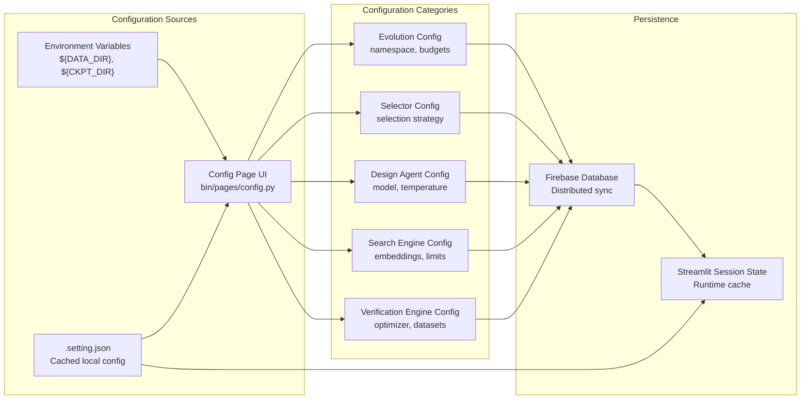

**Sources:** [README.md:56-72](), [Dockerfile:26-28]()

### Key Configuration Parameters

| Category | Parameter | Default | Description |
|----------|-----------|---------|-------------|
| Evolution | `namespace` | `"default"` | Session identifier for experiment isolation |
| Evolution | `design_scale` | `8` | Max parallel design tasks |
| Evolution | `verify_scale` | `32` | Max parallel verification tasks |
| Selector | `selector_method` | `"UtilityConfidenceSelector"` | Seed selection algorithm |
| Design Agent | `model` | `"gpt-4"` | LLM model for design generation |
| Design Agent | `temperature` | `0.7` | Sampling temperature |
| Verification | `optimizer` | `"AdamW"` | Training optimizer |
| Verification | `num_epochs` | `1` | Training epochs per design |

Configuration changes are automatically synced to Firebase for distributed nodes.

**Sources:** [README.md:56-72]()

---

## First Evolution Experiment

### Quick Start Workflow

Follow these steps to run your first evolution experiment:

1. **Launch the GUI**: `genesys gui`
2. **Configure the session**:
   - Navigate to **Config** page
   - Set a unique `namespace` (e.g., `"first_experiment"`)
   - Verify `DATA_DIR` and `CKPT_DIR` are set
   - Save configuration
3. **Start worker nodes**:
   - In separate terminals: `genesys node`
   - Launch 1-2 design nodes (CPU-bound)
   - Launch 4-8 verify nodes (GPU-intensive)
4. **Initialize evolution**:
   - Navigate to **Evolve** page
   - Click "Start Evolution Loop"
   - Monitor the **CommandCenter** status panel
5. **Observe progress**:
   - Watch design generation in **Design** page
   - Track verification status in **Evolve → Statistics**
   - View leaderboard in **Viewer → Design Leaderboard**

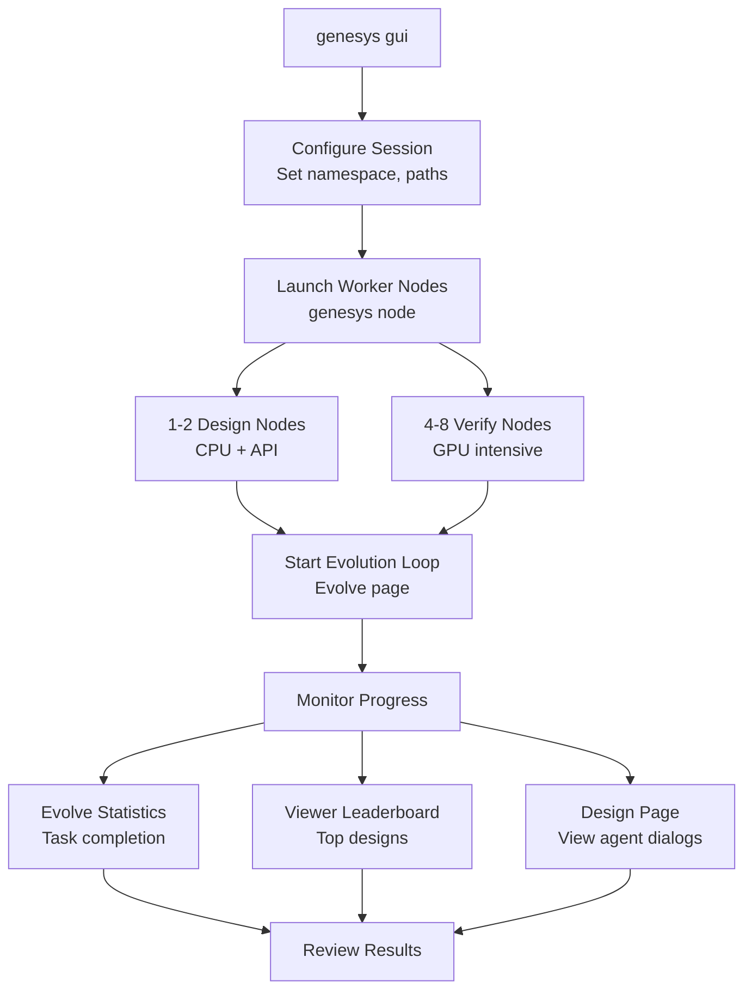

**Sources:** [README.md:88-95]()

---

## Docker Deployment (Alternative)

For containerized deployment, use the provided Dockerfile:

### Building the Docker Image

```bash
docker build -t genesys-demo .
```

The Dockerfile:
1. Uses `ghcr.io/allenai/cuda:11.8-cudnn8-dev-ubuntu20.04` base image
2. Sets up `DATA_DIR=/root/genesys/data` and `CKPT_DIR=/root/genesys/ckpt`
3. Installs PyTorch CPU-only (for design nodes) or GPU version (for verify nodes)
4. Downloads demo evaluation data via [scripts/demo_data_download.py]()
5. Exposes port 8501 for Streamlit
6. Sets entrypoint to `genesys gui`

**Sources:** [Dockerfile:1-57]()

### Running the Container

```bash
docker run -p 8501:8501 \
  -e MY_OPENAI_KEY=${MY_OPENAI_KEY} \
  -e ANTHROPIC_API_KEY=${ANTHROPIC_API_KEY} \
  -e DB_KEY_PATH=/root/genesys/secrets/db_key.json \
  -v ${DB_KEY_PATH}:/root/genesys/secrets/db_key.json \
  -v ${DATA_DIR}:/root/genesys/data \
  -v ${CKPT_DIR}:/root/genesys/ckpt \
  genesys-demo
```

This mounts your local credentials and storage directories into the container.

**Sources:** [Dockerfile:59-64]()

---

## Deployment Architecture for Distributed Evolution

The recommended deployment strategy separates design and verification workloads:

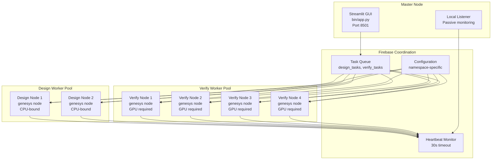

**Key Deployment Considerations:**

- **Design Nodes**: 1-2 nodes sufficient (API rate-limited, not compute-bound)
- **Verify Nodes**: 4-8+ nodes recommended (GPU-intensive training workloads)
- **Resource Conflict**: Design checkers require GPU; keep design nodes on CPU-only machines
- **Zombie Detection**: Heartbeat mechanism with 30-second timeout removes stalled nodes
- **Namespace Isolation**: Multiple experiments can run concurrently with different namespaces

**Sources:** [README.md:130-132]()

---

## Troubleshooting

### Common Issues

| Issue | Symptoms | Solution |
|-------|----------|----------|
| Firebase connection failure | "Failed to connect to Firebase" | Verify `DB_KEY_PATH` points to valid JSON file |
| API key not found | "OpenAI API key not set" | Check environment variable spelling and export |
| Dataset not found | "FileNotFoundError: blimp_filtered" | Re-run `genesys setup` to download datasets |
| GPU not detected | "No CUDA devices available" | Verify `torch.cuda.is_available()` returns `True` |
| Port already in use | "Address already in use: 8501" | Stop existing Streamlit instance or use `--server.port` |

### Verification Checklist

Before starting evolution, verify:
- [ ] `genesys node` connects successfully
- [ ] `genesys gui` launches without errors
- [ ] Config page shows all environment variables
- [ ] Firebase project ID appears in GUI
- [ ] `${DATA_DIR}/blimp_filtered` directory exists
- [ ] At least one LLM API key is configured

---

## Next Steps

After completing setup:

1. **Explore the GUI**: Familiarize yourself with the Streamlit interface and navigation. See [User Interface Pages](#4) for detailed documentation.

2. **Understand the Evolution System**: Review how the selector, design agents, and verification engine work together. See [Evolution System Components](#5).

3. **Configure Advanced Settings**: Adjust selector strategies, design agent parameters, and verification hyperparameters. See [Configuration Management Interface](#4.4).

4. **Review Example Designs**: Study the discovered designs in the demo at [genesys.allen.ai](https://genesys.allen.ai) under **Viewer → Design Artifacts**.

5. **Deploy at Scale**: Set up Kubernetes deployment for production evolution runs. See [Deployment and Infrastructure](#7).

**Sources:** [README.md:1-190]()

---

# Page: Core Application Architecture

# Core Application Architecture

<details>
<summary>Relevant source files</summary>

The following files were used as context for generating this wiki page:

- [bin/app.py](bin/app.py)
- [bin/app_utils.py](bin/app_utils.py)
- [bin/pages/__init__.py](bin/pages/__init__.py)

</details>


## Purpose and Scope

This document describes the high-level architecture of the Genesys Streamlit application, including its initialization flow, session state management, page navigation system, and integration with backend evolution components. It focuses on the structural organization and runtime behavior of the web application itself.

For detailed documentation of specific components:
- Main application entry point implementation: see [Main Application Entry Point](#3.1)
- Utility functions and status display: see [Application Utilities and Status Management](#3.2)
- Individual page implementations: see [User Interface Pages](#4)
- Backend evolution system components: see [Evolution System Components](#5)

---

## Application Overview

Genesys is built as a **Streamlit-based web application** that provides an interactive interface for managing evolutionary model discovery experiments. The application serves as the control plane for distributed workloads, offering real-time monitoring, configuration management, and experiment orchestration.

### Technology Stack

| Component | Technology | Purpose |
|-----------|-----------|---------|
| Web Framework | Streamlit | Interactive UI with reactive state management |
| Navigation | `streamlit-navigation-bar` | Multi-page application routing |
| Backend Integration | `BuildEvolution` class | Connection to evolution system |
| Coordination | Firebase Realtime Database | Distributed node synchronization |
| Visualization | Streamlit charts, custom components | Metrics and status displays |

### Application Entry Point

The application begins at [bin/app.py:1-314](), which handles:
- Environment configuration
- System initialization
- Page routing
- Session state setup

**Sources:** [bin/app.py](), README.md

---

## Application Initialization Flow

The initialization process follows a multi-stage bootstrap sequence that prepares the application for user interaction.

### Initialization Stages Diagram

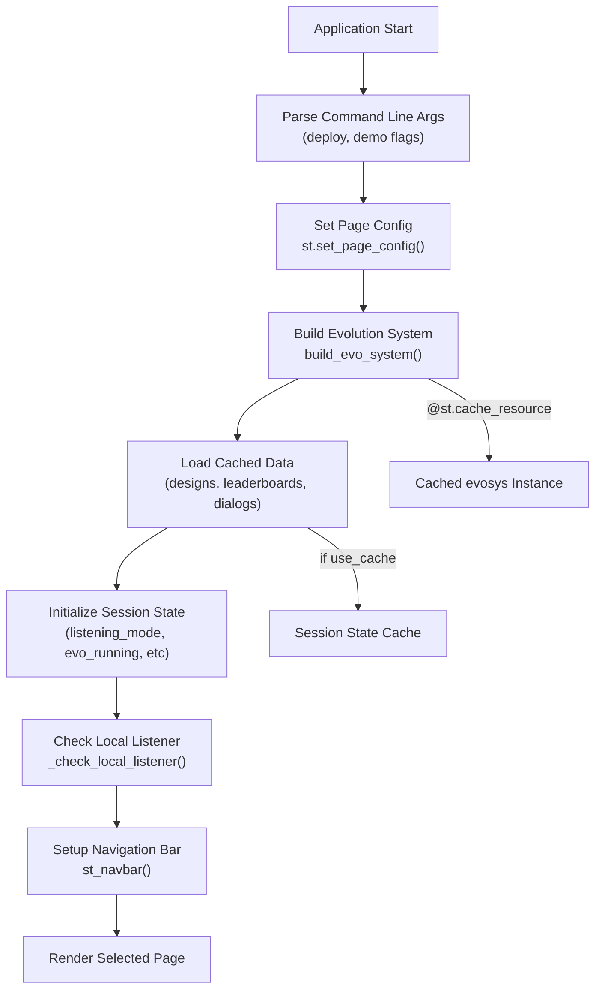

**Sources:** [bin/app.py:23-257]()

### Mode Flags

The application supports three operational modes controlled by command-line arguments:

| Mode | Flag | Behavior |
|------|------|----------|
| **Development** | (default) | Full feature access, hot reloading enabled |
| **Deploy** | `--deploy`, `-d` | Production mode, reduced feature set |
| **Demo** | `--demo`, `-m` | Read-only mode, cached data, daily usage limits |

Mode detection occurs at [bin/app.py:23-32]():

```python
DEPLOY_MODE = 'deploy' in custom_args or '--deploy' in custom_args
DEMO_MODE = 'demo' in custom_args or '--demo' in custom_args
```

In demo mode, Firebase writes are restricted and pre-computed results are displayed to reduce API costs.

**Sources:** [bin/app.py:23-32](), [bin/app.py:85-87]()

---

## Evolution System Building

The core backend integration happens through the `build_evo_system()` function, which creates and configures a `BuildEvolution` instance.

### System Building Diagram

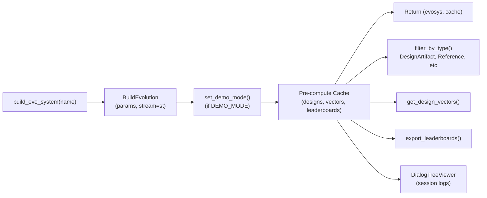

The `build_evo_system()` function at [bin/app.py:96-173]() is decorated with `@st.cache_resource()`, ensuring the expensive initialization happens only once per Streamlit session:

```python
@st.cache_resource()
def build_evo_system(name):
    evo_system = BuildEvolution(
        params={'evoname': name},
        do_cache=False,
        stream=st,
        demo_mode=DEMO_MODE,
    )
```

### Cached Data Structure

When `use_cache` is enabled, the following data structures are pre-computed and stored in session state:

| Cache Key | Type | Purpose |
|-----------|------|---------|
| `pre_filter` | list | Empty list for filter operations |
| `filter_by_types` | dict | Designs and references by type |
| `implemented_designs` | dict | Designs with code implementations |
| `unimplemented_designs` | dict | Designs without implementations |
| `design_vectors` | dict | Embeddings for similarity search |
| `baseline_vectors` | dict | Baseline model embeddings |
| `leaderboards_normed` | DataFrame | Normalized performance metrics |
| `leaderboards_unnormed_h/l` | DataFrame | Raw performance metrics (high/low is better) |
| `dialogs` | dict | Dialog trees by evolution session |

**Sources:** [bin/app.py:96-206](), [bin/app.py:134-172]()

---

## Session State Management

Streamlit's session state provides persistent storage across page reruns. Genesys uses session state extensively to track application state and running workloads.

### Session State Architecture

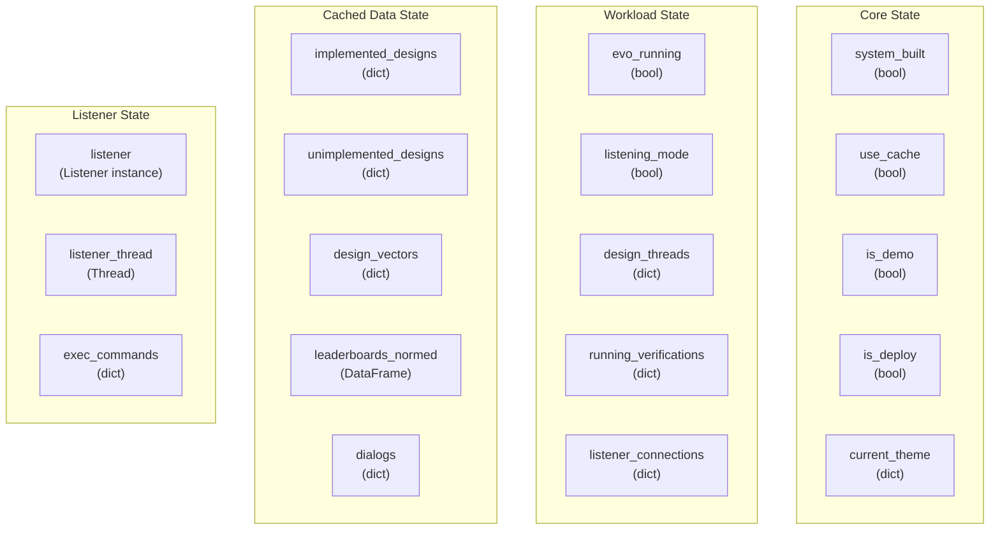

### Key Session State Variables

The following session state variables are initialized at [bin/app.py:82-242]():

| Variable | Type | Initialization | Purpose |
|----------|------|----------------|---------|
| `system_built` | bool | False | Tracks whether evolution system is initialized |
| `use_cache` | bool | False (True in demo) | Controls data caching strategy |
| `evo_running` | bool | False | Indicates active evolution loop |
| `listening_mode` | bool | False | Node is in passive listener mode |
| `design_threads` | dict | {} | Active design sessions by ID |
| `max_design_threads` | int | 5 | Maximum concurrent design threads |
| `running_verifications` | dict | {} | Active verification processes |
| `listener_connections` | dict | {} | Remote node connections |
| `listener` | Listener | None | Local listener instance |
| `daily_usage_limit` | float | 5.0 | Demo mode API cost limit |

**Sources:** [bin/app.py:82-242]()

---

## Page Navigation System

Genesys uses a custom navigation bar to provide access to different functional areas of the application.

### Page Registration and Routing

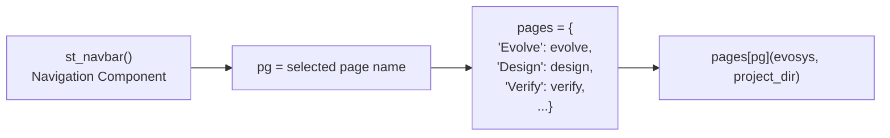

The navigation system is configured at [bin/app.py:286-313]():

```python
pages = {
    'Evolve': evolve,
    'Design': design,
    'Verify': verify,
    'Select': select,
    'Search': search,
    'Viewer': viewer,
    'Config': config,
}
```

Each page is implemented as a function that takes `(evosys, project_dir)` as parameters. The selected page is rendered by calling: `pages[pg](evosys, project_dir)`.

### Conditional Page Loading

In development mode, pages are dynamically reloaded on each change using [bin/app.py:56-73]():

```python
def import_and_reload(module_name):
    full_module_name = f'bin.pages.{module_name}'
    if full_module_name in sys.modules:
        return importlib.reload(sys.modules[full_module_name])
    return importlib.import_module(full_module_name)
```

In deploy/demo mode, pages are imported statically at [bin/app.py:75-78]() for better performance.

**Sources:** [bin/app.py:52-78](), [bin/app.py:286-313]()

---

## Integration with Backend Systems

The Streamlit application serves as a thin presentation layer over the core evolution system, with tight integration points for orchestration and monitoring.

### Backend Integration Architecture

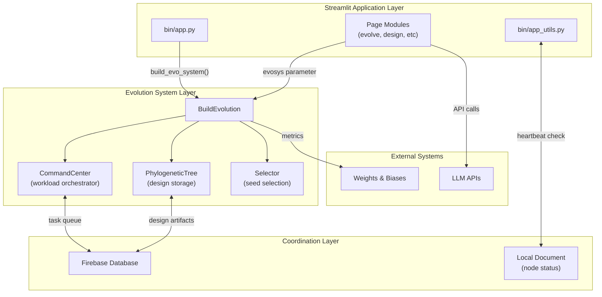

### Key Integration Points

1. **BuildEvolution Instance**: Created once and passed to all pages via function parameter
   - Provides access to `ptree` (phylogenetic tree), `selector`, and `CM` (CommandCenter)
   - Manages Firebase connection if configured

2. **CommandCenter Integration**: Accessible via `evosys.CM` when initialized
   - Coordinates distributed workloads across nodes
   - Maintains connection registry and heartbeats
   - Assigns design and verification tasks

3. **Session Synchronization**: Uses Firebase and local documents
   - Remote nodes write heartbeats to Firebase
   - Local listener writes to `.local.json` document
   - Application polls both sources for status updates

**Sources:** [bin/app.py:96-173](), [bin/app_utils.py:103-126]()

---

## Status Monitoring and Display

The application provides real-time status monitoring through utility functions in `bin/app_utils.py`.

### Status Display Components

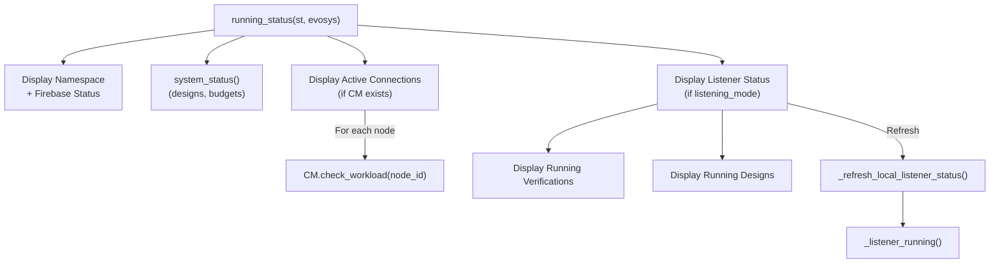

The `system_status()` function at [bin/app_utils.py:129-158]() displays:
- Experiment directory path
- Number of designs (total and implemented)
- Design budget consumption with progress bar
- Verification budgets by scale with progress bars
- Budget type configuration

The `running_status()` function at [bin/app_utils.py:167-242]() provides:
- Current namespace and Firebase connection status
- Active connections from CommandCenter (if distributed)
- Per-node workload status (designs/verifications running)
- Local listener status and running jobs
- Daily usage limits (demo mode only)

**Sources:** [bin/app_utils.py:129-242]()

---

## Local Listener Detection

The application automatically detects and integrates with locally running listener processes to enable passive monitoring mode.

### Listener Detection Flow

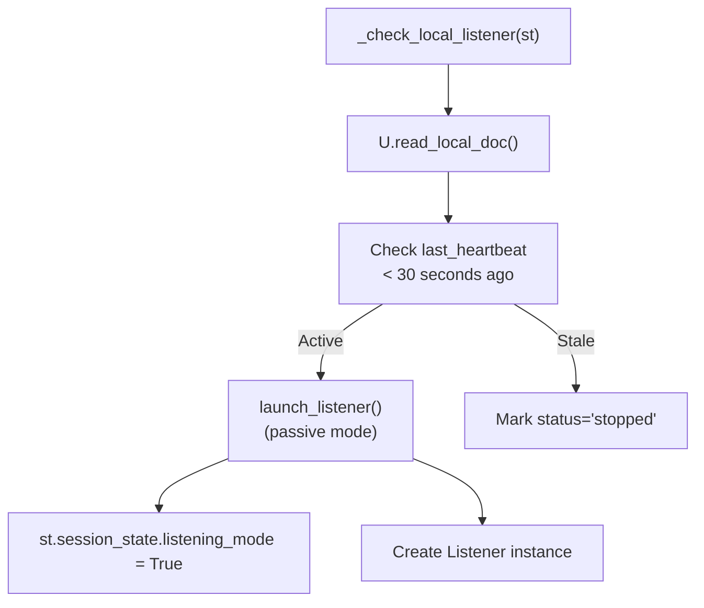

The listener detection logic at [bin/app.py:244-256]() and [bin/app_utils.py:103-116]() checks for:

1. **Local document existence**: Reads `.local.json` from data directory
2. **Recent heartbeat**: Last update within `NODE_ZOMBIE_THRESHOLD` (30 seconds)
3. **Status flag**: Document status != 'stopped'

If a valid listener is detected, the application launches in passive mode, allowing monitoring without active control.

**Sources:** [bin/app.py:244-256](), [bin/app_utils.py:103-126]()

---

## Configuration Management

Application settings are managed through multiple sources with a defined precedence hierarchy.

### Configuration Sources

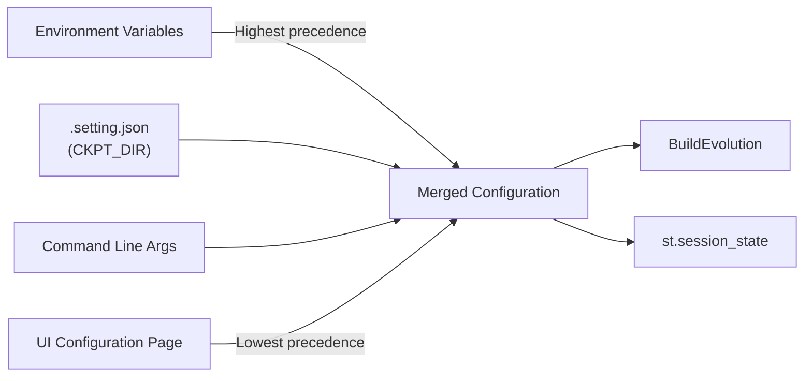

### Settings Persistence

The `get_setting()` and `save_setting()` functions at [bin/app_utils.py:25-34]() manage persistent configuration:

```python
def get_setting(): 
    ckpt_dir = os.environ.get('CKPT_DIR')
    setting_dir = U.pjoin(ckpt_dir, '.setting.json')
    setting = U.load_json(setting_dir)
    return setting
```

Key persisted settings include:
- `default_namespace`: Last used evolution experiment name
- User preferences for UI display
- Default configuration values

**Sources:** [bin/app_utils.py:25-34](), [bin/app.py:177-180]()

---

## Theme and Visual Customization

The application supports light/dark theme detection and custom logo generation.

### Theme-Aware Components

The `theme_aware_options()` function at [bin/app_utils.py:36-40]() selects assets based on the current theme:

```python
def theme_aware_options(st, option_light, option_dark, default):
    if st.session_state.current_theme:
        return option_light if st.session_state.current_theme['base']=='light' else option_dark
    else:
        return default
```

This enables automatic logo switching and color scheme adjustments based on user preferences.

### Custom Logo Generation

The `square_logo()` function at [bin/app_utils.py:59-65]() generates SVG-based logos dynamically:
- Supports single-line or two-line text
- Customizable color
- Converts SVG to PNG for Streamlit compatibility

**Sources:** [bin/app_utils.py:36-70](), [bin/app.py:303]()

---

## Summary

The Genesys application architecture follows a **layered design** with clear separation of concerns:

1. **Presentation Layer**: Streamlit pages and navigation
2. **Application Layer**: Session management and status monitoring  
3. **Integration Layer**: Backend system connectivity
4. **Coordination Layer**: Firebase and local document synchronization

This architecture enables:
- **Scalable UI**: Multiple pages with hot-reloading in development
- **Distributed Coordination**: Multi-node orchestration through CommandCenter
- **Flexible Deployment**: Development, deploy, and demo modes
- **Real-time Monitoring**: Live status updates and workload tracking
- **Persistent State**: Cached data and session state management

The application serves as the control plane for evolutionary experiments while maintaining a responsive, interactive user experience.

**Sources:** [bin/app.py](), [bin/app_utils.py](), [bin/pages/__init__.py]()

---

# Page: Main Application Entry Point

# Main Application Entry Point

<details>
<summary>Relevant source files</summary>

The following files were used as context for generating this wiki page:

- [bin/app.py](bin/app.py)
- [bin/pages/__init__.py](bin/pages/__init__.py)

</details>


## Purpose and Scope

This document details the main entry point of the Genesys Streamlit application, located at `bin/app.py`. It covers:

- Application initialization and configuration
- Module loading strategies for development and deployment modes
- Session state management and data caching architecture
- Evolution system setup and pre-loading
- Page routing and navigation system

For details on the individual UI pages themselves, see [User Interface Pages](#4). For information on the utility functions used by the application, see [Application Utilities and Status Management](#3.2). For deployment configuration, see [Deployment and Infrastructure](#7).

---

## Application Initialization Flow

The application follows a sequential initialization process that configures the environment, loads the evolution system, and establishes the UI.

### Initialization Sequence Diagram

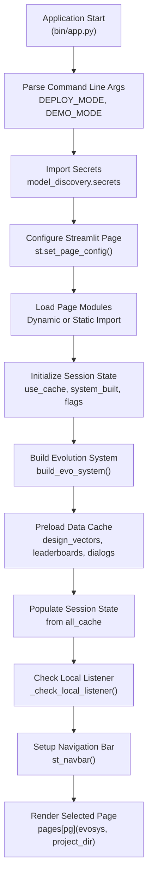

**Sources:** [bin/app.py:1-313]()

---

## Deployment Mode Detection

The application supports three runtime modes controlled by command-line arguments:

| Mode | Trigger Args | Behavior |
|------|-------------|----------|
| **Development** | (default) | Hot module reloading, all pages enabled, no caching |
| **Deploy** | `deploy`, `--deploy`, `-d`, `d` | Static imports, production optimizations |
| **Demo** | `demo`, `--demo`, `-m`, `m` | Read-only mode, forced caching, limited namespace |

The mode detection logic is simple but critical for the application's behavior:

```python
DEPLOY_MODE = 'deploy' in custom_args or '--deploy' in custom_args or '-d' in custom_args or 'd' in custom_args
DEMO_MODE = 'demo' in custom_args or '--demo' in custom_args or '-m' in custom_args or 'm' in custom_args
```

**Key Implementation Details:**

- `DEMO_MODE` automatically sets `DEPLOY_MODE = True` [bin/app.py:28-31]()
- Demo mode restricts the namespace to `'evo_exp_full_a'` [bin/app.py:179-180]()
- Demo mode enables caching unconditionally [bin/app.py:85-86]()
- Daily usage limits are enforced in demo mode [bin/app.py:88]()

**Sources:** [bin/app.py:23-31](), [bin/app.py:85-88](), [bin/app.py:179-180]()

---

## Module Loading Strategies

The application uses different module loading strategies based on deployment mode to optimize for either developer experience or production stability.

### Module Loading Architecture

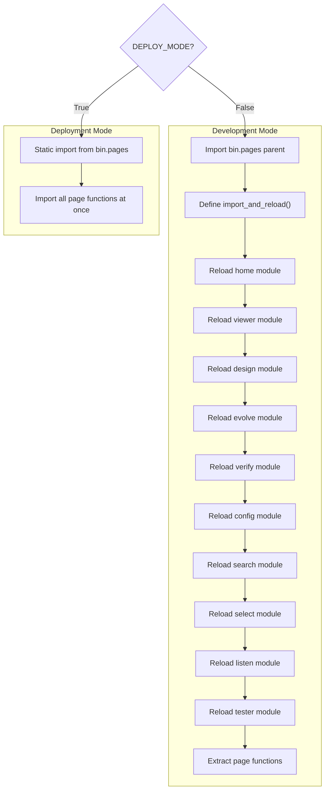

### Development Mode: Hot Reloading

In development mode, the application implements a hot-reload mechanism that allows developers to modify page code without restarting the entire application [bin/app.py:52-74]():

**Key Function: `import_and_reload()`**

```python
def import_and_reload(module_name):
    full_module_name = f'bin.pages.{module_name}'
    if full_module_name in sys.modules:
        return importlib.reload(sys.modules[full_module_name])
    return importlib.import_module(full_module_name)
```

This function checks if a module is already loaded and reloads it if so, otherwise imports it fresh. Each page module is reloaded individually, and the specific page function is extracted:

```python
home = import_and_reload('home').home
viewer = import_and_reload('viewer').viewer
design = import_and_reload('design').design
# ... etc
```

### Deployment Mode: Static Imports

In deployment mode, all modules are imported statically for better performance and reliability [bin/app.py:75-78]():

```python
from bin.pages import home,viewer,design,evolve,verify,config,search,select,listen
from bin.pages.listen import launch_listener
from bin.pages.viewer import export_leaderboards
```

This approach:
- Faster startup time (no reload logic overhead)
- Better for production stability
- Simpler error handling

**Sources:** [bin/app.py:52-78]()

---

## Session State Architecture

Streamlit's session state is used extensively to maintain application state across reruns. The application initializes multiple categories of session state variables.

### Session State Structure

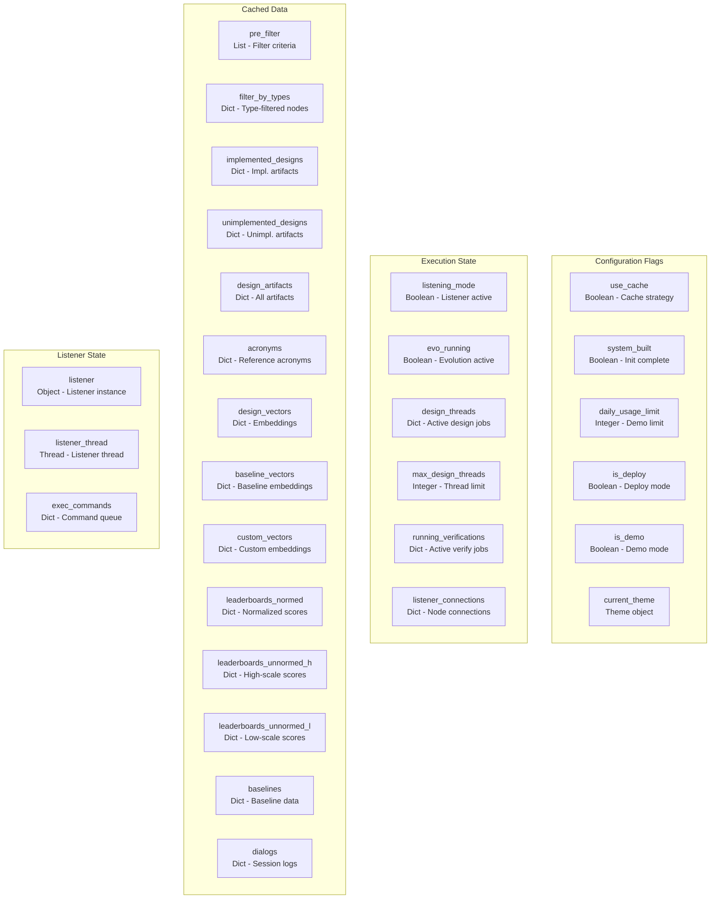

### Session State Initialization Sequence

The session state is initialized in a specific order to ensure dependencies are met:

| Order | State Variable | Default Value | Purpose |
|-------|---------------|---------------|---------|
| 1 | `use_cache` | `False` (or `True` in demo) | Controls data caching strategy |
| 2 | `daily_usage_limit` | `5` | Rate limiting for demo mode |
| 3 | `system_built` | `False` | Tracks initialization completion |
| 4 | `listening_mode` | `False` | Worker node listener active |
| 5 | `evo_running` | `False` | Evolution loop active |
| 6 | `design_threads` | `{}` | Active design thread tracking |
| 7 | `max_design_threads` | `5` | Maximum concurrent designs |
| 8 | `running_verifications` | `{}` | Active verification tracking |
| 9 | `listener_connections` | `{}` | Connected worker nodes |
| 10 | `is_deploy` | `DEPLOY_MODE` | Deployment mode flag |
| 11 | `is_demo` | `DEMO_MODE` | Demo mode flag |
| 12 | `current_theme` | `st_theme()` | UI theme state |
| 13 | `listener` | `None` | Listener instance |
| 14 | `listener_thread` | `None` | Listener thread handle |
| 15 | `exec_commands` | `{}` | Command execution queue |

**Sources:** [bin/app.py:82-242]()

---

## Evolution System Setup and Caching

The core evolution system is initialized through the cached `build_evo_system()` function, which performs expensive operations once and caches the results.

### Build Process Flow

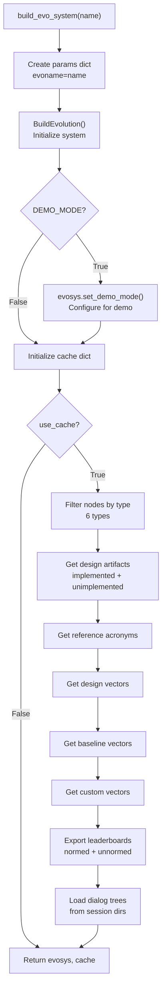

### Caching Strategy

The `build_evo_system()` function is decorated with `@st.cache_resource()` [bin/app.py:96](), which means:

- The function is called only once per Streamlit session
- Subsequent calls with the same `name` parameter return the cached result
- The cache persists across page navigation and reruns
- The cache is global to all users of the application

**Pre-loaded Cache Contents:**

When `use_cache=True`, the function pre-loads the following data structures:

| Cache Key | Data Type | Source | Purpose |
|-----------|-----------|--------|---------|
| `pre_filter` | `List` | Empty list | Filter criteria placeholder |
| `filter_by_types` | `Dict[str, Dict]` | `ptree.filter_by_type()` | Nodes grouped by type |
| `implemented_designs` | `Dict` | Filtered artifacts | Designs with code |
| `unimplemented_designs` | `Dict` | Filtered artifacts | Designs without code |
| `design_artifacts` | `Dict` | Merged dicts | All design artifacts |
| `acronyms` | `Dict` | Filtered references | Reference acronyms |
| `design_vectors` | `Dict` | `ptree.get_design_vectors()` | Design embeddings |
| `baseline_vectors` | `Dict` | `ptree.get_baseline_vectors()` | Baseline embeddings |
| `custom_vectors` | `Dict` | `ptree.get_custom_vectors()` | Custom embeddings |
| `leaderboards_normed` | `Dict` | `export_leaderboards()` | Normalized scores |
| `leaderboards_unnormed_h` | `Dict` | `export_leaderboards()` | High-scale raw scores |
| `leaderboards_unnormed_l` | `Dict` | `export_leaderboards()` | Low-scale raw scores |
| `baselines` | `Dict` | `export_leaderboards()` | Baseline metadata |
| `dialogs` | `Dict` | `DialogTreeViewer()` | Session dialog trees |

**Type Filtering:**

Six node types are filtered from the phylogenetic tree [bin/app.py:139-141]():

1. `ReferenceCoreWithTree` - Research papers with tree structure
2. `DesignArtifactImplemented` - Designs with working code
3. `DesignArtifact` - Designs without code
4. `ReferenceCore` - Core research references
5. `ReferenceWithCode` - References with code
6. `Reference` - Generic references

**Dialog Loading:**

For each evolution namespace, the function loads all session dialog trees from the checkpoint directory [bin/app.py:160-169]():

```
{ckpt_dir}/{evoname}/db/sessions/{session_id}/log
```

The `DialogTreeViewer` class is used to parse and load each dialog tree, with error handling for failed loads.

**Performance Notes:**

- Initial system build: ~variable seconds (depends on data size)
- Pre-loading cache: ~variable seconds (depends on number of artifacts)
- Total initialization time is logged to console [bin/app.py:132](), [bin/app.py:172]()

**Sources:** [bin/app.py:96-173](), [bin/app.py:186-206]()

---

## Page Configuration and Logo Setup

The application configures Streamlit's page settings early in the initialization process to establish branding and layout.

### Page Configuration Details

```python
st.set_page_config(page_title="Genesys", layout="wide", page_icon=logo)
```

**Configuration Parameters:**

| Parameter | Value | Purpose |
|-----------|-------|---------|
| `page_title` | `"Genesys"` | Browser tab title |
| `layout` | `"wide"` | Full-width layout |
| `page_icon` | `logo` (image) | Browser tab favicon |

**Logo Processing:**

The logo is loaded from an SVG file and converted to an image format [bin/app.py:33-36]():

1. Logo path constructed: `bin/assets/storm_logo.svg`
2. SVG converted to image via `AU.svg_to_image()`
3. Image used as page icon

The logo is also used in the navigation bar, with theme-aware selection [bin/app.py:303]():

```python
_logo = AU.theme_aware_options(st, "storm.svg", "storm_logo.svg", "storm_logo.svg")
```

**Sources:** [bin/app.py:33-37](), [bin/app.py:303]()

---

## Page Routing System

The application uses a custom navigation bar component to route between different functional pages.

### Page Dictionary Structure

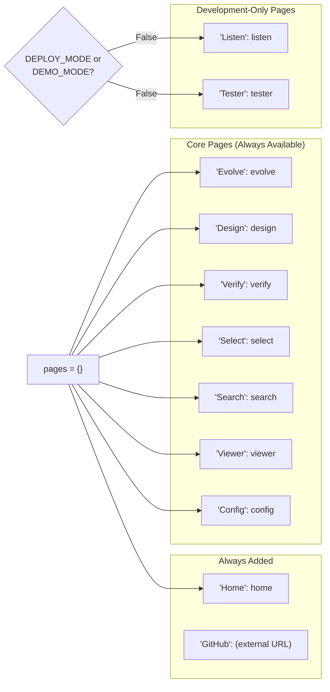

### Navigation Bar Setup

The navigation bar is created using the `st_navbar` component [bin/app.py:305-310]():

```python
pg = st_navbar(
    titles,                              # List of page titles
    logo_path=...,                       # Path to logo file
    styles=styles,                       # CSS styling dict
    urls=urls                            # External URLs dict
)
```

**Styling Configuration:**

The `styles` dictionary [bin/app.py:264-282]() defines CSS for:
- `nav` - Navigation bar container
- `img` - Logo image padding
- `span` - Menu item spacing

**External URLs:**

The `urls` dictionary [bin/app.py:284]() maps page titles to external URLs:

```python
urls = {"GitHub": "https://github.com/allenai/model_discovery"}
```

### Page Rendering

After the navigation bar captures the selected page, the application renders it [bin/app.py:311-313]():

```python
pages['Home'] = home  # Home is added after navbar creation
pages[pg](evosys, project_dir)
```

Each page function receives two arguments:
1. `evosys` - The evolution system instance
2. `project_dir` - The project directory path

**Sources:** [bin/app.py:286-313]()

---

## Local Listener Detection and Passive Mode

The application includes logic to detect and interact with locally running worker nodes.

### Listener Detection Flow

```mermaid
graph TD
    CheckStart["_check_local_listener(st)"]
    CheckRunning["_node_id = AU._listener_running()"]
    ReadDoc["_local_doc = U.read_local_doc()"]
    NodeExists{"_node_id exists?"}
    ExtractConfig["Extract configuration:<br/>group_id, max_design_threads,<br/>accept_verify_job, cpu_only_checker"]
    CheckMode{"listening_mode<br/>already active?"}
    Toast["Display toast notification"]
    LaunchPassive["Launch listener in passive mode:<br/>launch_listener(...)"]
    End["End"]
    
    CheckStart --> CheckRunning
    CheckRunning --> ReadDoc
    ReadDoc --> NodeExists
    NodeExists -->|No| End
    NodeExists -->|Yes| ExtractConfig
    ExtractConfig --> CheckMode
    CheckMode -->|Yes| End
    CheckMode -->|No| Toast
    Toast --> LaunchPassive
    LaunchPassive --> End
```

### Passive Listener Mode

When a local listener is detected [bin/app.py:244-257](), the application:

1. Reads the local document to get configuration:
   - `group_id` - Worker group identifier
   - `max_design_threads` - Maximum concurrent design jobs
   - `accept_verify_job` - Whether to accept verification tasks
   - `cpu_only_checker` - CPU-only mode flag

2. Displays a toast notification to the user

3. Launches a passive listener that monitors but doesn't actively poll

**Key Implementation Detail:**

The passive listener connects to the existing worker node without interfering with its operation. This allows the GUI to observe the worker's status without causing conflicts.

**Sources:** [bin/app.py:244-257]()

---

## Module Import Structure

The application's module import structure is carefully organized to separate concerns and enable hot-reloading in development.

### Import Dependency Graph

```mermaid
graph TD
    AppPy["bin/app.py"]
    
    subgraph SystemLibs["System Libraries"]
        Sys["sys"]
        Os["os"]
        Time["time"]
        Pathlib["pathlib"]
        Functools["functools"]
        Multiprocessing["multiprocessing"]
    end
    
    subgraph ThirdParty["Third-Party Libraries"]
        Streamlit["streamlit"]
        Importlib["importlib"]
        PIL["PIL.Image"]
        StreamlitTheme["streamlit_theme.st_theme"]
        NavBar["streamlit_navigation_bar.st_navbar"]
    end
    
    subgraph ModelDiscovery["Model Discovery Core"]
        Secrets["model_discovery.secrets"]
        Utils["model_discovery.utils"]
        BuildEvolution["model_discovery.BuildEvolution"]
        DialogTreeViewer["model_discovery.agents.flow.alang.DialogTreeViewer"]
    end
    
    subgraph BinModules["Bin Modules"]
        AppUtils["bin.app_utils"]
        PagesInit["bin.pages.__init__"]
        HomePage["bin.pages.home"]
        ViewerPage["bin.pages.viewer"]
        DesignPage["bin.pages.design"]
        EvolvePage["bin.pages.evolve"]
        VerifyPage["bin.pages.verify"]
        ConfigPage["bin.pages.config"]
        SearchPage["bin.pages.search"]
        SelectPage["bin.pages.select"]
        ListenPage["bin.pages.listen"]
        TesterPage["bin.pages.tester"]
    end
    
    AppPy --> Sys
    AppPy --> Os
    AppPy --> Time
    AppPy --> Pathlib
    AppPy --> Functools
    AppPy --> Streamlit
    AppPy --> Importlib
    AppPy --> Multiprocessing
    AppPy --> PIL
    AppPy --> StreamlitTheme
    AppPy --> NavBar
    
    AppPy --> Secrets
    AppPy --> Utils
    AppPy --> BuildEvolution
    AppPy --> DialogTreeViewer
    
    AppPy --> AppUtils
    AppPy --> PagesInit
    
    PagesInit --> HomePage
    PagesInit --> ViewerPage
    PagesInit --> DesignPage
    PagesInit --> EvolvePage
    PagesInit --> VerifyPage
    PagesInit --> ConfigPage
    PagesInit --> SearchPage
    PagesInit --> SelectPage
    PagesInit --> ListenPage
    PagesInit --> TesterPage
```

### Critical Import Notes

**Secrets Import with Exception Handling:**

The application attempts to import secrets but gracefully handles failures [bin/app.py:4-7]():

```python
try:
    from model_discovery.secrets import *
except:
    pass
```

This pattern allows the application to run in environments where secrets aren't configured (e.g., local development).

**System Path Manipulation:**

The application adds the current directory to the Python path [bin/app.py:1-2](), [bin/app.py:48-49]() to enable imports from the project root:

```python
sys.path.append('.')
sys.path.append(project_root)
```

**Sources:** [bin/app.py:1-78]()

---

## Application Settings and Defaults

The application loads default settings from a persistent settings file and establishes default values.

### Settings Loading

```python
setting = AU.get_setting()
default_namespace = setting.get('default_namespace', 'test_evo_000')
```

The `get_setting()` function loads settings from `.setting.json` (see [Application Utilities and Status Management](#3.2) for details).

**Default Namespace Override:**

In demo mode, the default namespace is overridden [bin/app.py:179-180]():

```python
if DEMO_MODE:
    default_namespace = 'evo_exp_full_a'
```

This ensures demo users always work with the pre-configured demo evolution namespace.

**Sources:** [bin/app.py:177-180]()

---

## Summary

The `bin/app.py` file serves as the main orchestrator for the Genesys application, handling:

1. **Mode Detection** - Determines runtime mode (development, deploy, demo) from command-line arguments
2. **Module Loading** - Implements hot-reloading for development and static imports for production
3. **Session State** - Initializes and manages 15+ session state variables across multiple categories
4. **Evolution System** - Builds and caches the core evolution system with pre-loaded data
5. **Page Routing** - Configures navigation and routes to appropriate page functions
6. **Listener Integration** - Detects and connects to local worker nodes in passive mode

The architecture balances developer experience (hot-reloading) with production requirements (static imports, caching) through mode-specific code paths.

**Sources:** [bin/app.py:1-313]()

---

# Page: Application Utilities and Status Management

# Application Utilities and Status Management

<details>
<summary>Relevant source files</summary>

The following files were used as context for generating this wiki page:

- [bin/app_utils.py](bin/app_utils.py)

</details>


This document covers the utility functions and status management components that support the Genesys application's user interface and operational monitoring. The `bin/app_utils.py` module provides essential infrastructure for settings persistence, system status reporting, UI component generation, and distributed node management.

For information about the main application entry point, see [3.1](#3.1). For details about the CLI interface, see [3.3](#3.3).

## Settings Management

The application uses a JSON-based settings persistence system to store user preferences and configuration state across sessions. Settings are stored in the checkpoint directory specified by the `CKPT_DIR` environment variable.

### Settings Operations

| Function | Purpose | Location |
|----------|---------|----------|
| `get_setting()` | Loads settings from `.setting.json` | [bin/app_utils.py:25-29]() |
| `save_setting()` | Persists settings to `.setting.json` | [bin/app_utils.py:31-34]() |

The settings system uses the utility functions from `model_discovery.utils` to handle JSON serialization and file path operations. Settings are automatically loaded on application startup and saved when modified through the UI.

```mermaid
graph TD
    APP["Streamlit App"] --> GET_SETTING["get_setting()"]
    GET_SETTING --> CKPT_DIR["CKPT_DIR env var"]
    CKPT_DIR --> SETTING_FILE[".setting.json"]
    
    APP --> SAVE_SETTING["save_setting()"]
    SAVE_SETTING --> SETTING_FILE
    
    SETTING_FILE --> U_LOAD["U.load_json()"]
    SETTING_FILE --> U_SAVE["U.save_json()"]
```

**Title:** Settings Management Flow

**Sources:** [bin/app_utils.py:25-34]()

## System Status Monitoring

The status monitoring system provides real-time visibility into the evolution system's state, including design progress, budget utilization, and distributed node connectivity.

### Status Components

The system status is displayed through several interconnected functions:

```mermaid
graph TD
    RUNNING_STATUS["running_status()"] --> SYSTEM_STATUS["system_status()"]
    RUNNING_STATUS --> DAILY_USAGE["daily_usage_status()"]
    RUNNING_STATUS --> NODE_MANAGEMENT["Node Management"]
    
    SYSTEM_STATUS --> DESIGN_PROGRESS["Design Progress"]
    SYSTEM_STATUS --> BUDGET_TRACKING["Budget Tracking"]
    
    NODE_MANAGEMENT --> CONNECTION_MANAGER["evosys.CM.connections"]
    NODE_MANAGEMENT --> LISTENER_STATUS["_listener_running()"]
    NODE_MANAGEMENT --> VERIFICATION_STATUS["running_verifications"]
    
    DAILY_USAGE --> USAGE_LIMIT["daily_usage_limit"]
    DAILY_USAGE --> U_GET_DAILY["U.get_daily_usage()"]
```

**Title:** Status Monitoring Architecture

**Sources:** [bin/app_utils.py:129-241]()

### Design Progress Tracking

The `system_status()` function displays comprehensive information about the evolution system's progress:

- **Design Counts**: Shows total designs and implemented designs from the phylogenetic tree
- **Budget Progress**: Displays design cost against budget limits with progress bars
- **Verification Budget**: Shows completion status for different training scales
- **Budget Type**: Indicates the current budget configuration

The function uses caching through `st.session_state.use_cache` to optimize performance when displaying large numbers of designs.

**Sources:** [bin/app_utils.py:129-158]()

### Connection Management Status

The distributed system status is managed through the `ConnectionManager` (CM) which tracks active listener nodes:

```mermaid
graph TD
    CM["evosys.CM"] --> GET_ACTIVE["get_active_connections()"]
    GET_ACTIVE --> CONNECTIONS["active_connections"]
    
    CONNECTIONS --> CHECK_WORKLOAD["check_workload(node_id)"]
    CHECK_WORKLOAD --> DESIGN_THREADS["running_designs"]
    CHECK_WORKLOAD --> VERIFY_THREADS["running_verifies"]
    
    DESIGN_THREADS --> MAX_DESIGNS["max_design_threads"]
    VERIFY_THREADS --> ACCEPT_VERIFY["accept_verify_job"]
    
    LOCAL_LISTENER["_listener_running()"] --> NODE_ZOMBIE["NODE_ZOMBIE_THRESHOLD"]
    LOCAL_LISTENER --> HEARTBEAT["last_heartbeat"]
```

**Title:** Distributed Node Status Management

**Sources:** [bin/app_utils.py:186-241]()

## UI Utility Functions

The module provides several utility functions for enhancing the Streamlit user interface:

### Grid Layout System

The `grid_view()` function creates responsive grid layouts for displaying collections of items:

- **Flexible Layout**: Configurable items per row and spacing
- **Expandable Cards**: Each item is displayed in an expandable container
- **Button Integration**: Supports embedded buttons with callback functions
- **Icon Support**: Displays icons in expander headers

**Sources:** [bin/app_utils.py:73-100]()

### Theme Management

The `theme_aware_options()` function provides theme-sensitive UI options:

- **Light/Dark Detection**: Responds to Streamlit's theme settings
- **Conditional Styling**: Returns different options based on theme
- **Default Fallback**: Provides sensible defaults when theme is unavailable

**Sources:** [bin/app_utils.py:36-40]()

## Distributed Node Management

The application includes sophisticated management of distributed listener nodes that handle evolution workloads across multiple machines.

### Node Health Monitoring

```mermaid
graph TD
    LISTENER_RUNNING["_listener_running()"] --> LOCAL_LOCK["U.local_lock(5)"]
    LOCAL_LOCK --> READ_LOCAL["U.read_local_doc()"]
    
    READ_LOCAL --> STATUS_CHECK{"status == 'stopped'?"}
    STATUS_CHECK -->|Yes| RETURN_NONE["return None"]
    STATUS_CHECK -->|No| HEARTBEAT_CHECK["Check heartbeat"]
    
    HEARTBEAT_CHECK --> THRESHOLD["NODE_ZOMBIE_THRESHOLD"]
    THRESHOLD --> ZOMBIE_CHECK{"last_heartbeat > threshold?"}
    
    ZOMBIE_CHECK -->|Yes| RETURN_NODE["return node_id"]
    ZOMBIE_CHECK -->|No| MARK_STOPPED["Mark as stopped"]
    MARK_STOPPED --> WRITE_LOCAL["U.write_local_doc()"]
```

**Title:** Node Health Check Process

The system uses a heartbeat mechanism to detect zombie nodes:

- **Zombie Detection**: Uses `NODE_ZOMBIE_THRESHOLD` from configuration
- **Automatic Cleanup**: Marks unresponsive nodes as stopped
- **Thread Safety**: Uses local locking to prevent race conditions

**Sources:** [bin/app_utils.py:103-116]()

### Listener Status Refresh

The `_refresh_local_listener_status()` function maintains consistency between the UI and actual listener state:

- **Node Validation**: Checks if reported running nodes are actually alive
- **State Synchronization**: Updates session state when nodes go offline
- **User Notification**: Provides toast notifications for state changes

**Sources:** [bin/app_utils.py:118-125]()

## Visual Components

The module includes utilities for generating visual elements used throughout the application:

### Logo Generation

The `square_logo()` function creates dynamic SVG logos:

- **Template-Based**: Uses SVG templates for consistent styling
- **Color Customization**: Supports custom color schemes
- **Text Rendering**: Handles single or dual-line text layouts
- **PNG Conversion**: Converts SVG to PNG using cairosvg

**Sources:** [bin/app_utils.py:43-65]()

### SVG Processing

The `svg_to_image()` function converts SVG files to PIL Images for display in Streamlit components.

**Sources:** [bin/app_utils.py:67-70]()

## CLI Integration

The module provides CLI-specific utilities:

### Title Display

The `print_cli_title()` function displays the application banner:

- **ASCII Art**: Uses the `art` library for stylized text
- **Welcome Message**: Provides user-friendly introduction
- **Consistent Branding**: Maintains visual identity across interfaces

**Sources:** [bin/app_utils.py:17-23]()

---

# Page: User Interface Pages

# User Interface Pages

<details>
<summary>Relevant source files</summary>

The following files were used as context for generating this wiki page:

- [bin/pages/__init__.py](bin/pages/__init__.py)
- [bin/pages/home.py](bin/pages/home.py)

</details>


## Purpose and Scope

This document provides an overview of the Streamlit-based user interface page system in Genesys. It explains the page module organization, navigation structure, and common UI patterns used across all interface components. For detailed documentation of specific pages, see:
- [Home Page and System Guide](#4.1)
- [Evolution Control Interface](#4.2)
- [Design Engine Interface](#4.3)
- [Configuration Management Interface](#4.4)
- [Testing and Debug Interface](#4.5)

For information about the main application entry point and session state management, see [Main Application Entry Point](#3.1). For application utilities and status management, see [Application Utilities and Status Management](#3.2).

## Page Module Organization

The Genesys UI consists of multiple Streamlit pages, each implemented as a separate Python module in the `bin/pages/` directory. The page system is organized through a centralized import structure that exposes all page functions through the package's `__init__.py`.

### Page Module Structure

```mermaid
graph TB
    subgraph PagesPackage["bin/pages/ Package"]
        Init["__init__.py<br/>Package Entry Point"]
        HomeModule["home.py"]
        ViewerModule["viewer.py"]
        DesignModule["design.py"]
        EvolveModule["evolve.py"]
        VerifyModule["verify.py"]
        ConfigModule["config.py"]
        SearchModule["search.py"]
        SelectModule["select.py"]
        TesterModule["tester.py"]
        ListenModule["listen.py"]
    end
    
    subgraph ExportedFunctions["Exported Page Functions"]
        HomeFunc["home()"]
        ViewerFunc["viewer()"]
        DesignFunc["design()"]
        EvolveFunc["evolve()"]
        VerifyFunc["verify()"]
        ConfigFunc["config()"]
        SearchFunc["search()"]
        SelectFunc["select()"]
        TesterFunc["tester()"]
        ListenFunc["listen()"]
    end
    
    Init --> HomeModule
    Init --> ViewerModule
    Init --> DesignModule
    Init --> EvolveModule
    Init --> VerifyModule
    Init --> ConfigModule
    Init --> SearchModule
    Init --> SelectModule
    Init --> TesterModule
    Init --> ListenModule
    
    HomeModule --> HomeFunc
    ViewerModule --> ViewerFunc
    DesignModule --> DesignFunc
    EvolveModule --> EvolveFunc
    VerifyModule --> VerifyFunc
    ConfigModule --> ConfigFunc
    SearchModule --> SearchFunc
    SelectModule --> SelectFunc
    TesterModule --> TesterFunc
    ListenModule --> ListenFunc
```

**Sources:** [bin/pages/__init__.py:1-10]()

The `__init__.py` file provides a clean import interface for all page modules. Each imported function represents the entry point for a specific UI page:

| Function | Module | Purpose |
|----------|--------|---------|
| `home()` | `home.py` | Welcome page with system guide and navigation overview |
| `viewer()` | `viewer.py` | Multiple views of system states and results |
| `design()` | `design.py` | Design engine interface for sampling and managing designs |
| `evolve()` | `evolve.py` | Evolution loop control and monitoring |
| `verify()` | `verify.py` | Verification engine for training and evaluation |
| `config()` | `config.py` | Configuration management and synchronization |
| `search()` | `search.py` | Knowledge base search interface (RAG) |
| `select()` | `select.py` | Selector tuning and seed selection testing |
| `tester()` | `tester.py` | Debug utilities and component testing |
| `listen()` | `listen.py` | Node listener status and management |

**Sources:** [bin/pages/__init__.py:1-10]()

## Page Function Signature

Each page module exports a single function that serves as the page's entry point. The standard signature pattern follows this structure:

```python
def page_name(evosys, project_dir):
    # Page implementation
    pass
```

Where:
- `evosys`: The evolution system object containing the current state and configuration
- `project_dir`: Root directory path of the project for accessing assets and resources

**Sources:** [bin/pages/home.py:269]()

## Navigation and Tab Structure

The Genesys UI uses a combination of Streamlit's native sidebar navigation and custom tab-based navigation for organizing content hierarchically. The home page provides a central navigation hub with descriptions of all core components.

### Core Component Tabs

```mermaid
graph LR
    subgraph HomePage["Home Page"]
        TabsFunc["tabs() function"]
    end
    
    subgraph CoreTabs["Core Component Tabs"]
        EvolveTab["Evolve Tab"]
        DesignTab["Design Tab"]
        VerifyTab["Verify Tab"]
        SearchTab["Search Tab"]
        SelectTab["Select Tab"]
        ViewerTab["Viewer Tab"]
        ConfigTab["Config Tab"]
        ListenTab["Listen Tab<br/>(non-demo only)"]
    end
    
    TabsFunc --> EvolveTab
    TabsFunc --> DesignTab
    TabsFunc --> VerifyTab
    TabsFunc --> SearchTab
    TabsFunc --> SelectTab
    TabsFunc --> ViewerTab
    TabsFunc --> ConfigTab
    TabsFunc --> ListenTab
    
    EvolveTab -.->|"links to"| EvolvePage["pages/evolve.py"]
    DesignTab -.->|"links to"| DesignPage["pages/design.py"]
    VerifyTab -.->|"links to"| VerifyPage["pages/verify.py"]
    SearchTab -.->|"links to"| SearchPage["pages/search.py"]
    SelectTab -.->|"links to"| SelectPage["pages/select.py"]
    ViewerTab -.->|"links to"| ViewerPage["pages/viewer.py"]
    ConfigTab -.->|"links to"| ConfigPage["pages/config.py"]
    ListenTab -.->|"links to"| ListenPage["pages/listen.py"]
```

**Sources:** [bin/pages/home.py:29-82]()

The `tabs()` function in `home.py` creates an inline navigation guide that describes each page's purpose. The tab list is dynamically adjusted based on whether the application is running in demo mode:

```python
_tabs = ['Evolve','Design','Verify','Search','Select','Viewer','Config']
if not st.session_state.is_demo:
    _tabs.append('Listen')
```

**Sources:** [bin/pages/home.py:32-34]()

### Tab Descriptions

| Tab | Description | Purpose |
|-----|-------------|---------|
| **Evolve** | Main interface for Model Discovery System | Run full evolution loop with CommandCenter orchestration |
| **Design** | Sampler for single design generation | Sample designs based on seed inputs using design agents |
| **Verify** | Verification engine interface | Train a design under a specific scale and evaluate performance |
| **Search** | Knowledge base interface | RAG-powered search for papers, code, and library documentation |
| **Select** | Selector tuning interface | Test and tune seed selection strategies |
| **Viewer** | System state visualization | Multiple views of system states and results |
| **Config** | Configuration management | Set up experiment settings and synchronize with remote DB |
| **Listen** | Node listener (non-demo) | View running node status and accept commands from master |

**Sources:** [bin/pages/home.py:36-81]()

## Demo Mode vs. Production Mode

The UI adapts its interface based on the `st.session_state.is_demo` flag, which controls feature availability and content presentation:

### Demo Mode Differences

1. **Listen Tab**: Hidden in demo mode since users cannot launch worker nodes
2. **Welcome Header**: Displays "Welcome to Genesys *:orange[Demo]*" instead of "Welcome to Genesys"
3. **Sidebar Content**: Shows demo-specific hints directing users to key results pages

```python
if st.session_state.is_demo:
    st.markdown('# Welcome to Genesys *:orange[Demo]*')
else:
    st.markdown('# Welcome to Genesys')
```

**Sources:** [bin/pages/home.py:90-93](), [bin/pages/home.py:288-299]()

The demo mode sidebar provides navigation hints to key features:

```markdown
Find our results on these pages:
 - **Evolve - Evolution Statistics**
 - **Viewer - Design Artifacts**
 - **Viewer - Design Leaderboard**
```

**Sources:** [bin/pages/home.py:288-299]()

## Page Lifecycle and Session State

Each page function is called whenever Streamlit reruns the application, which happens on any user interaction. Pages rely on `st.session_state` for maintaining state across reruns. Key session state variables used across pages include:

| Session State Key | Type | Purpose |
|-------------------|------|---------|
| `is_demo` | `bool` | Controls demo mode vs. production features |
| `namespace` | `str` | Current experiment namespace |
| `evosys` | `object` | Evolution system instance |
| `firebase_connected` | `bool` | Remote database connection status |
| `listener_status` | `dict` | Node listener status information |

**Sources:** [bin/pages/home.py:33](), [bin/pages/home.py:77](), [bin/pages/home.py:90]()

## Common UI Components

The home page demonstrates several UI patterns that are used throughout the application:

### Sidebar Usage

Pages utilize Streamlit's sidebar for:
- Status information and metrics
- Quick navigation hints
- Context-specific controls
- Visual branding elements

```python
with st.sidebar:
    img_path = U.pjoin(current_dir,'..','assets','gene.PNG')
    st.image(img_path)
    st.caption(f"Today is :blue[{datetime.now().strftime('%b %d, %Y, %A')}].")
```

**Sources:** [bin/pages/home.py:271-286]()

### Icon Guidelines

The system uses consistent icon conventions across pages:

| Icon | Meaning | Usage Context |
|------|---------|---------------|
| 📶 | Online | Namespace connected to remote DB |
| 📴 | Offline | No remote DB connection |
| ♥️ | Emphasis | Highlighting important features or notes |

**Sources:** [bin/pages/home.py:234-239]()

### Theme-Aware Styling

Pages use the `AU.theme_aware_options()` utility function to adapt colors based on the Streamlit theme:

```python
title_color = AU.theme_aware_options(st, "rainbow", "violet", "violet")
st.markdown(f'## :{title_color}[How to launch the evolution?]')
```

**Sources:** [bin/pages/home.py:123-127]()

## Embedded Documentation

The home page embeds comprehensive usage documentation directly in the UI, including:

### Video Tutorials

Video content is embedded using Streamlit's `st.video()` component:

```python
st.video('https://youtu.be/YHBpzImL0vM')
```

**Sources:** [bin/pages/home.py:130]()

### Command-Line Interface Documentation

The home page provides detailed CLI usage instructions for launching nodes and running evolution:

**Node Launch Command:**
```bash
genesys node [-i <node_id>] [-g <group_id>] [-m <max_design_threads>] [-n] [-h]
```

**Evolution Launch Command:**
```bash
genesys evo [-e <evoname>] [-g <group_id>] [-r <design_to_verify_ratio>] [-h]
```

**Sources:** [bin/pages/home.py:149-171]()

### Pre-Flight Checklists

The home page includes interactive checklist items for users to verify before running experiments:

- Configure experiment settings in Config tab
- Estimate costs using Budget Tools
- Tune configs in playgrounds (Design, Verify, Search, Select)
- Upload config to remote DB
- Launch nodes with matching group ID
- Start evolution via CLI or Evolve tab

**Sources:** [bin/pages/home.py:178-198]()

## Page Interconnections

The following diagram shows how pages interact with each other and shared resources:

```mermaid
graph TB
    subgraph UserPages["User Interface Pages"]
        Home["home.py<br/>home()"]
        Evolve["evolve.py<br/>evolve()"]
        Design["design.py<br/>design()"]
        Verify["verify.py<br/>verify()"]
        Config["config.py<br/>config()"]
        Search["search.py<br/>search()"]
        Select["select.py<br/>select()"]
        Viewer["viewer.py<br/>viewer()"]
        Listen["listen.py<br/>listen()"]
        Tester["tester.py<br/>tester()"]
    end
    
    subgraph SharedState["Streamlit Session State"]
        SessionState["st.session_state"]
    end
    
    subgraph SharedUtilities["Shared Utilities"]
        AppUtils["bin/app_utils.py"]
        ModelUtils["model_discovery/utils.py"]
    end
    
    subgraph CoreSystems["Core Systems"]
        EvoSys["evosys object"]
        Firebase["Firebase Backend"]
        CommandCenter["CommandCenter"]
    end
    
    Home --> SessionState
    Evolve --> SessionState
    Design --> SessionState
    Verify --> SessionState
    Config --> SessionState
    Search --> SessionState
    Select --> SessionState
    Viewer --> SessionState
    Listen --> SessionState
    Tester --> SessionState
    
    Home --> AppUtils
    Evolve --> AppUtils
    Design --> AppUtils
    Verify --> AppUtils
    Config --> AppUtils
    Listen --> AppUtils
    
    Home --> ModelUtils
    
    Evolve --> EvoSys
    Design --> EvoSys
    Verify --> EvoSys
    Select --> EvoSys
    
    Evolve --> CommandCenter
    
    Config --> Firebase
    Listen --> Firebase
    Evolve --> Firebase
    
    Home -.->|"documents"| Evolve
    Home -.->|"documents"| Design
    Home -.->|"documents"| Verify
    Home -.->|"documents"| Config
```

**Sources:** [bin/pages/__init__.py:1-10](), [bin/pages/home.py:1-305]()

## Asset Management

Pages access static assets stored in `bin/assets/` directory. The home page demonstrates the pattern for loading assets:

```python
current_dir = pathlib.Path(__file__).parent
logo_path = U.pjoin(current_dir, '..', 'assets', 'storm_logo.svg')
logo = AU.svg_to_image(logo_path)
```

Common asset types include:
- SVG logos (`storm_logo.svg`)
- PNG images (`gene.PNG`)
- Markdown documentation files (`howtouse.md`, `selector_notes.md`)

**Sources:** [bin/pages/home.py:16-19](), [bin/pages/home.py:276]()

## Page Communication Patterns

Pages communicate through several mechanisms:

### 1. Session State Variables
Pages read and write to `st.session_state` to share data across page navigation and reruns.

### 2. EvoSys Object
The `evosys` parameter passed to each page function provides access to the evolution system's state and methods.

### 3. Firebase Backend
Configuration and status information is synchronized through Firebase, enabling distributed coordination.

### 4. Project Directory
The `project_dir` parameter allows pages to access shared resources like configuration files, datasets, and checkpoints.

**Sources:** [bin/pages/home.py:269]()

---

This page provides the foundational overview of the UI page system. For implementation details of specific pages, refer to the child documentation pages ([4.1](#4.1) through [4.5](#4.5)).

---

# Page: Home Page and System Guide

# Home Page and System Guide

<details>
<summary>Relevant source files</summary>

The following files were used as context for generating this wiki page:

- [bin/assets/howtouse.md](bin/assets/howtouse.md)
- [bin/pages/home.py](bin/pages/home.py)

</details>


## Purpose and Scope

This document describes the home page interface (`bin/pages/home.py`) and the integrated system usage guide that serves as the primary entry point for users of the Genesys GUI. The home page provides an overview of the system, navigation to core components, and step-by-step instructions for running evolution experiments.

For details on the overall Streamlit application architecture, see [Main Application Entry Point](#3.1). For documentation of individual functional pages (Evolve, Design, Config, etc.), see their respective sections under [User Interface Pages](#4).

**Sources:** bin/pages/home.py, bin/assets/howtouse.md

---

## Home Page Structure

The home page is implemented as a single-page Streamlit interface that combines informational content, usage instructions, and component overviews. It is rendered through the `home()` function which serves as the main entry point.

### Main Entry Point

```
home(evosys, project_dir)
```

The `home()` function is defined at [bin/pages/home.py:269-305]() and orchestrates the rendering of all home page elements. It accepts two parameters:
- `evosys`: The evolution system object containing experiment state
- `project_dir`: The root directory path for the project

**Sources:** bin/pages/home.py:269-305

### Page Layout Components

The home page consists of four major functional areas:

| Component | Function | Lines |
|-----------|----------|-------|
| `howtouse()` | Primary content area with instructions and system overview | 85-267 |
| `tabs()` | Component descriptions for navigation tabs | 29-82 |
| Sidebar content | Date display, demo hints, and visual branding | 271-300 |
| Welcome header | Dynamic title based on demo/production mode | 90-106 |

**Sources:** bin/pages/home.py:29-305

---

## System Overview and Welcome Interface

### Welcome Message and System Introduction

The home page begins with a context-aware welcome message that adapts based on deployment mode:

```mermaid
graph TD
    CheckDemo["Check st.session_state.is_demo"]
    DemoMode["Display: Welcome to Genesys Demo"]
    ProdMode["Display: Welcome to Genesys"]
    Description["System description:<br/>Genetic discovery system<br/>LLM agents<br/>Novel model designs"]
    
    CheckDemo -->|is_demo=True| DemoMode
    CheckDemo -->|is_demo=False| ProdMode
    DemoMode --> Description
    ProdMode --> Description
```

The welcome section [bin/pages/home.py:90-122]() explains:
1. Genesys is a **Gene**tic discovery **sys**tem
2. Uses LLM agents for genetic programming
3. Discovers novel autoregressive language model designs
4. GUI provides observability and manageability vs. CLI

**Sources:** bin/pages/home.py:90-122

### CLI vs. GUI Architecture Explanation

The home page addresses a critical architectural decision by explaining why the GUI exists alongside CLI functionality:

| Aspect | CLI Limitation | GUI Advantage |
|--------|----------------|---------------|
| Observability | Hard to monitor agent behaviors | Direct visualization of agent outputs |
| State Management | Difficult to track multiple threads | Centralized state display |
| Design Artifacts | Cannot display long markdown/python outputs | Integrated artifact viewers |
| Experiment Control | Sequential commands only | Parallel thread management UI |

**Sources:** bin/pages/home.py:109-121

---

## Navigation Tab System

### Component Tab Overview

The `tabs()` function [bin/pages/home.py:29-82]() provides descriptions for all major system components. This creates a quick-reference guide integrated into the home page.

```mermaid
graph LR
    TabsFunction["tabs()"]
    CheckMode{"st.session_state.is_demo"}
    TabList7["['Evolve','Design','Verify',<br/>'Search','Select','Viewer','Config']"]
    TabList8["['Evolve','Design','Verify',<br/>'Search','Select','Viewer',<br/>'Config','Listen']"]
    RenderTabs["st.tabs() - Render tab UI"]
    
    TabsFunction --> CheckMode
    CheckMode -->|is_demo=True| TabList7
    CheckMode -->|is_demo=False| TabList8
    TabList7 --> RenderTabs
    TabList8 --> RenderTabs
```

**Sources:** bin/pages/home.py:29-35

### Tab Component Descriptions

Each tab includes a brief description rendered within collapsible sections:

| Tab | Description | Lines | Related Page |
|-----|-------------|-------|--------------|
| **Evolve** | Main interface for full evolution loop; requires Config setup first | 37-44 | [Evolution Control Interface](#4.2) |
| **Design** | Sampler for generating single designs based on inputs | 46-49 | [Design Engine Interface](#4.3) |
| **Verify** | Verification engine for training designs at specified scales | 51-54 | See verification documentation |
| **Search** | Knowledge base interface for RAG (Retrieval-Augmented Generation) | 56-59 | See search documentation |
| **Select** | Seed selection interface for tuning and testing the selector | 61-65 | See selector documentation |
| **Viewer** | Multiple views of system states and results | 67-70 | See viewer documentation |
| **Config** | Experiment settings configuration (must be set before running) | 72-75 | [Configuration Management Interface](#4.4) |
| **Listen** | Node listening mode (production only, not in demo) | 77-81 | See distributed coordination |

**Sources:** bin/pages/home.py:37-81

---

## Usage Instructions and Launch Workflow

### Evolution Launch Guide

The home page includes comprehensive instructions for launching distributed evolution, presented both as video tutorial and step-by-step text:

```mermaid
graph TB
    VideoTutorial["Video Tutorial<br/>youtu.be/YHBpzImL0vM"]
    Step1["Step 1: Configure Settings"]
    Step2["Step 2: Launch Nodes"]
    Step3["Step 3: Run Evolution"]
    
    ConfigUI["Config tab in GUI"]
    ManualEdit["Manual folder editing"]
    ConfigCLI["genesys cfg [-u] [-d]"]
    
    NodeCLI["genesys node<br/>[-i node_id]<br/>[-g group_id]<br/>[-m max_threads]<br/>[-n no_verify]"]
    ListenTab["Listen tab in GUI"]
    
    EvolveCLI["genesys evo<br/>[-e evoname]<br/>[-g group_id]<br/>[-r ratio]"]
    EvolveTab["Evolve tab in GUI"]
    
    VideoTutorial --> Step1
    Step1 --> ConfigUI
    Step1 --> ManualEdit
    Step1 --> ConfigCLI
    
    Step1 --> Step2
    Step2 --> NodeCLI
    Step2 --> ListenTab
    
    Step2 --> Step3
    Step3 --> EvolveCLI
    Step3 --> EvolveTab
```

**Sources:** bin/pages/home.py:126-173

### Configuration Command-Line Interface

The home page documents the `genesys cfg` command for configuration management:

**Command:** `genesys cfg [-u] [-d] [-h]`

| Flag | Long Form | Description |
|------|-----------|-------------|
| `-u` | `--upload` | Upload all local configs to remote DB |
| `-d` | `--download` | Download all configs from remote DB |
| `-h` | `--help` | Display help message |

**Important Note:** The page emphasizes [bin/pages/home.py:147]() that users must "always remember to upload local configs, otherwise it will be overwritten by remote DB."

**Sources:** bin/pages/home.py:141-147

### Node Launch Command-Line Interface

**Command:** `genesys node [-i <node_id>] [-g <group_id>] [-m <max_design_threads>] [-n] [-c] [-s] [-h]`

| Flag | Long Form | Default | Description |
|------|-----------|---------|-------------|
| `-i` | `--node_id` | Random | Optional node identifier |
| `-g` | `--group_id` | `'default'` | Group for simultaneous experiments |
| `-m` | `--max_design_threads` | `5` | Maximum concurrent design threads |
| `-n` | `--no_verify` | False | Node will not accept verification jobs |
| `-c` | `--cpu_only` | False | Design threads run in CPU-only mode |
| `-s` | `--silent` | False | Silent mode (no screen output, check logs) |

**Sources:** bin/pages/home.py:149-159

### Evolution Command-Line Interface

**Command:** `genesys evo [-e <evoname>] [-g <group_id>] [-r <design_to_verify_ratio>] [-h]`

| Flag | Long Form | Default | Description |
|------|-----------|---------|-------------|
| `-e` | `--evoname` | `'text_evo_000'` | Evolution namespace name |
| `-g` | `--group_id` | `'default'` | Must match node group_id |
| `-r` | `--design_to_verify_ratio` | `4` | Ratio of design threads to verification nodes |

The default evolution name can be changed in the Config tab or by directly editing `CKPT_DIR/.setting.json: default_namespace`.

**Sources:** bin/pages/home.py:163-170

---

## Pre-Launch Checklist and Best Practices

The home page provides a comprehensive checklist [bin/pages/home.py:178-198]() to ensure proper system configuration:

### Configuration Checklist

```mermaid
graph TD
    Start["Pre-Launch Checklist"]
    ConfigTab["Configure in Config tab"]
    BudgetEstimate["Use Budget Tools<br/>in Verify tab"]
    TunePlaygrounds["Tune configs in:<br/>Design, Verify,<br/>Search, Select"]
    UploadConfig["Upload config to remote DB"]
    LaunchNodes["Launch nodes:<br/>genesys node"]
    CheckStatus["View node status<br/>in Listen tab"]
    RunEvo["Run evolution:<br/>genesys evo or Evolve tab"]
    
    Start --> ConfigTab
    ConfigTab --> BudgetEstimate
    BudgetEstimate --> TunePlaygrounds
    TunePlaygrounds --> UploadConfig
    UploadConfig --> LaunchNodes
    LaunchNodes --> CheckStatus
    CheckStatus --> RunEvo
```

**Sources:** bin/pages/home.py:178-198

### Critical Warnings

The page includes two important warnings:

1. **File Access Conflicts:** [bin/pages/home.py:172]() warns "Avoid running multiple nodes in the same user space to prevent file access conflicts. Instead, utilize all available GPUs in each node."

2. **Config Upload:** [bin/pages/home.py:147]() emphasizes uploading configs to prevent overwriting by the remote DB.

**Sources:** bin/pages/home.py:147, 172

---

## Simplified GUI Usage Guide

For users who want to interact primarily through the GUI (not CLI), the home page provides a simplified three-step workflow:

### Three-Step GUI Workflow

```mermaid
graph TD
    Step1["Step 1: Configure Experiment"]
    ConfigOptions["Config tab options:"]
    ExistingNS["Select existing namespace<br/>(resume experiment)"]
    NewNS["Create new namespace<br/>(start fresh)"]
    DefaultNS["Use default 'text_evo_000'<br/>(just try it)"]
    
    Step2["Step 2: Run Components"]
    EvolveTab["Evolve tab:<br/>Run evolution loop"]
    DesignTab["Design tab:<br/>Play with design engine"]
    SearchTab["Search tab:<br/>Play with knowledge base"]
    SelectTab["Select tab:<br/>Tune selector"]
    VerifyTab["Verify tab:<br/>Train a design"]
    
    Step3["Step 3: View Results"]
    ViewerTab["Viewer tab:<br/>System states and results"]
    Firestore["Check remote design base<br/>in Firestore"]
    
    Step1 --> ConfigOptions
    ConfigOptions --> ExistingNS
    ConfigOptions --> NewNS
    ConfigOptions --> DefaultNS
    
    ExistingNS --> Step2
    NewNS --> Step2
    DefaultNS --> Step2
    
    Step2 --> EvolveTab
    Step2 --> DesignTab
    Step2 --> SearchTab
    Step2 --> SelectTab
    Step2 --> VerifyTab
    
    Step2 --> Step3
    Step3 --> ViewerTab
    Step3 --> Firestore
```

**Sources:** bin/pages/home.py:202-218, bin/assets/howtouse.md:1-24

---

## System Status Indicators and Icon Guidelines

The home page includes an icon guideline section [bin/pages/home.py:233-238]() that explains visual indicators used throughout the application:

### Icon Meanings

| Icon/Symbol | Meaning | Component |
|-------------|---------|-----------|
| 📶 | Online - remote DB connected | Namespace indicator |
| 📴 | Offline - no remote connection | Namespace indicator |
| Listening status | View running node status | Listen tab |

**Sources:** bin/pages/home.py:233-238

---

## Evolution Process Architecture Explanation

The home page concludes with a detailed explanation of the distributed evolution architecture [bin/pages/home.py:241-258]():

### Asynchronous Thread Model

```mermaid
graph TB
    Selector["Selector<br/>(Orchestrator)"]
    DesignThreads["Design Threads<br/>(Multiple nodes)"]
    VerifyThreads["Verify Threads<br/>(Multiple nodes)"]
    
    DesignEngine["Model Design Engine<br/>(Design tab)"]
    DesignCLI["genesys design [args]"]
    
    VerifyEngine["Verification Engine<br/>(Verify tab)"]
    VerifyCLI["genesys verify [args]"]
    
    Firebase["Firebase<br/>(Coordination layer)"]
    
    MasterNode["Master Node"]
    WorkerNodes["Network of Worker Nodes"]
    
    Selector --> DesignThreads
    Selector --> VerifyThreads
    
    DesignThreads --> DesignEngine
    DesignThreads --> DesignCLI
    
    VerifyThreads --> VerifyEngine
    VerifyThreads --> VerifyCLI
    
    MasterNode --> Firebase
    WorkerNodes --> Firebase
    
    Firebase --> DesignThreads
    Firebase --> VerifyThreads
```

**Sources:** bin/pages/home.py:241-258

### Thread Execution Model

The system continuously runs two types of threads asynchronously until budget exhaustion:

1. **Design Threads**
   - Sample new designs on selected nodes
   - CPU-bound operations
   - API rate-limited (LLM calls)
   - Can be run via Design tab or `genesys design [args]`
   - Location: [bin/pages/home.py:246-248]()

2. **Verify Threads**
   - Run verification on selected designs and scales
   - GPU-intensive operations
   - Can be run via Verify tab or `genesys verify [args]`
   - Location: [bin/pages/home.py:250-252]()

**Sources:** bin/pages/home.py:241-258

### Distributed Coordination Model

The architecture follows a master-worker pattern:

- **Master Node**: Runs the orchestration logic (CommandCenter)
- **Worker Nodes**: Execute design and verification tasks
- **Firebase**: Central coordination mechanism for task distribution
- **GPU Recommendation**: Nodes should run in GPU-available sessions
- **Dual Role**: The master node machine can also run as a worker node

**Sources:** bin/pages/home.py:254-258

---

## Sidebar Content and Contextual Information

### Visual Branding

The sidebar displays contextual imagery:
- Gene/DNA visual at [bin/pages/home.py:276-277]()
- Logo SVG loaded via `AU.svg_to_image()` at [bin/pages/home.py:17-19]()
- Source path: `bin/assets/storm_logo.svg`

**Sources:** bin/pages/home.py:17-19, 276-277

### Date and Context Display

The sidebar shows the current date using `datetime.now().strftime('%b %d, %Y, %A')` at [bin/pages/home.py:285]().

**Sources:** bin/pages/home.py:285

### Demo Mode Hints

When running in demo mode (`st.session_state.is_demo == True`), the sidebar displays special hints [bin/pages/home.py:288-299]() directing users to key result pages:

- **Evolve - Evolution Statistics**
- **Viewer - Design Artifacts**
- **Viewer - Design Leaderboard**

This provides a guided experience for demo users to quickly find interesting results.

**Sources:** bin/pages/home.py:288-299

---

## Integration with Application State

The home page integrates with the Streamlit session state and application utilities:

### Session State Dependencies

```mermaid
graph LR
    SessionState["st.session_state"]
    IsDemoFlag["is_demo"]
    ThemeAware["AU.theme_aware_options()"]
    
    SessionState --> IsDemoFlag
    IsDemoFlag --> ConditionalUI["Conditional UI rendering:<br/>- Welcome message<br/>- Tab list<br/>- Sidebar hints"]
    
    SessionState --> ThemeAware
    ThemeAware --> ColorSelection["Dynamic color selection:<br/>rainbow/violet based on theme"]
```

**Key State Variables:**
- `st.session_state.is_demo`: Boolean flag controlling demo vs. production UI [bin/pages/home.py:33, 77, 90, 288]()

**Theme Utilities:**
- `AU.theme_aware_options()`: Function from `bin.app_utils` for theme-aware color selection [bin/pages/home.py:123]()

**Sources:** bin/pages/home.py:13, 33, 77, 90, 123, 288

---

## File Structure and Dependencies

### Primary Files

| File Path | Purpose | Key Functions |
|-----------|---------|---------------|
| `bin/pages/home.py` | Main home page implementation | `home()`, `howtouse()`, `tabs()` |
| `bin/assets/howtouse.md` | Legacy usage instructions (now integrated into Python) | N/A (referenced but not actively used) |
| `bin/assets/storm_logo.svg` | Logo graphic for branding | N/A (asset) |
| `bin/assets/gene.PNG` | Sidebar visual | N/A (asset) |

**Sources:** bin/pages/home.py:1-305, bin/assets/howtouse.md

### Import Dependencies

The home page relies on several modules:

```python
import streamlit as st                    # UI framework
import model_discovery.utils as U         # Project utilities
import bin.app_utils as AU                # Application-specific utilities
```

Key utility functions used:
- `U.pjoin()`: Path joining utility
- `U.read_file()`: File reading utility (commented out)
- `AU.svg_to_image()`: SVG to image converter [bin/pages/home.py:19]()
- `AU.theme_aware_options()`: Theme-aware UI customization [bin/pages/home.py:123]()

**Sources:** bin/pages/home.py:5-13

---

## Code Organization Patterns

### Function Call Hierarchy

```mermaid
graph TD
    MainApp["app.py"]
    Home["home(evosys, project_dir)"]
    HowToUse["howtouse()"]
    Tabs["tabs()"]
    
    MainApp --> Home
    Home --> HowToUse
    HowToUse --> Tabs
    
    HowToUse --> Markdown["Multiple st.markdown() calls"]
    HowToUse --> Video["st.video() - Tutorial"]
    HowToUse --> Columns["st.columns() - Layout"]
    
    Tabs --> TabsUI["st.tabs()"]
    TabsUI --> TabContent["Individual tab descriptions"]
```

The home page follows a hierarchical structure where:
1. `home()` orchestrates sidebar and main content
2. `howtouse()` renders the primary instructional content
3. `tabs()` is called within `howtouse()` to provide component overview
4. Streamlit components are called throughout for rendering

**Sources:** bin/pages/home.py:29-305

---

# Page: Evolution Control Interface

# Evolution System Control

<details>
<summary>Relevant source files</summary>

The following files were used as context for generating this wiki page:

- [bin/app_utils.py](bin/app_utils.py)
- [bin/pages/evolve.py](bin/pages/evolve.py)

</details>


This document covers the evolution system orchestration interface and CommandCenter functionality that controls the distributed evolution process. The system provides centralized coordination for design generation, verification scheduling, and network monitoring across multiple worker nodes.

For information about the worker nodes that execute the actual design and verification tasks, see [Distributed Node Management](#4.9). For details about the underlying evolution algorithms and phylogenetic tree management, see [Model Design Engine](#4.3).

## System Architecture

The evolution system control operates through a centralized CommandCenter that orchestrates distributed worker nodes via Firebase coordination. The system supports both active evolution mode and passive benchmark mode.

### CommandCenter Architecture

```mermaid
graph TD
    subgraph "CommandCenter Core"
        CC[CommandCenter] --> CM["evosys.CM<br/>(ConnectionManager)"]
        CC --> FB["Firebase Document<br/>experiment_connections"]
        CC --> LOG["Log Management<br/>get_log_ref()"]
    end
    
    subgraph "Workload Assignment"
        CC --> DWA["assign_design_workloads()"]
        CC --> VWA["assign_verify_workloads()"]
        CC --> UCA["send_user_commands()"]
    end
    
    subgraph "Node Coordination"
        DWA --> DN1["Design Node 1"]
        DWA --> DN2["Design Node 2"]
        VWA --> VN1["Verify Node 1"]
        VWA --> VN2["Verify Node 2"]
    end
    
    subgraph "Status Monitoring"
        CC --> HB["Heartbeat System<br/>last_heartbeat"]
        CC --> ZD["Zombie Detection<br/>CC_ZOMBIE_THRESHOLD"]
        CC --> WL["Workload Tracking<br/>get_all_workloads()"]
    end
```

Sources: [bin/pages/evolve.py:66-316]()

### Evolution Control Flow

```mermaid
graph TD
    subgraph "Launch Process"
        LP["launch_evo()"] --> CC["CommandCenter<br/>initialization"]
        CC --> BC["build_connection()"]
        BC --> AM{"active_mode?"}
        AM -->|Yes| XE["x_evolve()<br/>subprocess"]
        AM -->|No| XEP["x_evolve_passive()<br/>thread"]
        XE --> XEP
    end
    
    subgraph "Command Center Loop"
        XEP --> CCRUN["command_center.run()"]
        CCRUN --> POLL["Poll every CC_POLL_FREQ<br/>(30 seconds)"]
        POLL --> GW["get_all_workloads()"]
        GW --> AWA["Assign workloads"]
        AWA --> HB["Update heartbeat"]
        HB --> STOP{"should_stop()?"}
        STOP -->|No| POLL
        STOP -->|Yes| CLEANUP["cleanup()"]
    end
    
    subgraph "Workload Management"
        AWA --> DWL["Design Workloads<br/>max_designs_per_node"]
        AWA --> VWL["Verify Workloads<br/>accept_verify_job"]
        AWA --> UCL["User Commands<br/>user_command_stack"]
    end
```

Sources: [bin/pages/evolve.py:346-368](), [bin/pages/evolve.py:207-248]()

## Core Components

### CommandCenter Class

The `CommandCenter` class serves as the central orchestrator for the evolution system, managing workload distribution and node coordination.

| Property | Type | Description |
|----------|------|-------------|
| `evosys` | BuildEvolution | Evolution system instance |
| `max_designs_per_node` | int | Maximum design threads per node |
| `max_designs_total` | int | Total maximum design threads |
| `doc_ref` | DocumentReference | Firebase document reference |
| `running` | bool | Command center running state |
| `poll_freq` | int | Polling frequency (30 seconds) |
| `zombie_threshold` | int | Node timeout threshold (60 seconds) |

Key methods include:
- `build_connection()` - Establishes Firebase connection
- `assign_design_workloads()` - Distributes design tasks
- `assign_verify_workloads()` - Distributes verification tasks
- `send_user_commands()` - Processes user commands
- `run()` - Main orchestration loop

Sources: [bin/pages/evolve.py:66-81](), [bin/pages/evolve.py:87-108]()

### Network Status Monitoring

The system provides comprehensive network monitoring through the `network_status()` function:

```mermaid
graph LR
    subgraph "Node Status"
        NS["network_status()"] --> AC["get_active_connections()"]
        AC --> ND["Node Details<br/>max_design_threads<br/>accept_verify_job<br/>gpu_status"]
    end
    
    subgraph "Session Monitoring"
        NS --> DS["get_active_design_sessions()"]
        NS --> RV["get_running_verifications()"]
        DS --> DST["Design Session Table<br/>heartbeat, mode, pid"]
        RV --> RVT["Verification Table<br/>wandb_url, status"]
    end
    
    subgraph "Connection Management"
        AC --> HBT["Heartbeat Tracking<br/>last_heartbeat"]
        AC --> ZC["Zombie Cleanup<br/>status: disconnected"]
    end
```

Sources: [bin/pages/evolve.py:405-505]()

### User Interface Components

The evolution control provides two primary UI modes:

#### Evolution Launch Pad

The `evolution_launch_pad()` function creates the main control interface:

| Control | Function | Description |
|---------|----------|-------------|
| Max Designs Per Node | `input_max_designs_per_node` | Global per-node design limit |
| Max Designs in Parallel | `input_max_designs_total` | System-wide parallel limit |
| Launch Evolution | `run_evo_btn` | Start evolution process |
| Stop Evolution | `stop_evo_btn` | Stop evolution process |
| Command Input | `user_command` | Send commands to nodes |

Sources: [bin/pages/evolve.py:518-617]()

#### Benchmark Launch Pad

The `benchmark_launch_pad()` function provides benchmark-specific controls with similar interface but adapted for agent benchmarking scenarios.

Sources: [bin/pages/evolve.py:620-687]()

## Monitoring and Logging

### Real-time Logs

The `running_logs()` function displays the latest system logs:

```mermaid
graph TD
    subgraph "Log Management"
        RL["running_logs()"] --> RD["read_logs()"]
        RD --> CM["command_center.read_logs()"]
        CM --> LR["get_log_ref().get()"]
    end
    
    subgraph "Log Display"
        LR --> LD["log_df DataFrame"]
        LD --> TS["Timestamp conversion<br/>pd.to_datetime()"]
        TS --> ST["Sort by timestamp"]
        ST --> DSP["Display latest 30 logs"]
    end
```

Sources: [bin/pages/evolve.py:689-701]()

### Phylogenetic Tree Monitor

The `ptree_monitor()` function provides visualization of the evolution tree:

| Parameter | Default | Description |
|-----------|---------|-------------|
| `max_nodes` | 300 | Maximum nodes to display |
| `export_height` | 900px | Visualization height |
| `evo_only` | Auto | Show only evolution nodes |
| `bgcolor` | #ffffff | Background color |

Sources: [bin/pages/evolve.py:704-767]()

## Command Processing

The system supports runtime command processing through the `process_user_command()` method:

### Command Types

| Command | Format | Description |
|---------|--------|-------------|
| `verify` | `verify` | Verify next design in queue |
| `verify` | `verify <design_id> <scale>` | Verify specific design |
| `design` | `design` | Generate new design |

Commands are queued in Firebase under `user_command_stack` and processed by the active command center.

Sources: [bin/pages/evolve.py:259-291]()

## System States and Modes

### Evolution vs Benchmark Mode

The system operates in two distinct modes:

```mermaid
graph LR
    subgraph "Evolution Mode"
        EM["Evolution Mode"] --> DG["Design Generation"]
        EM --> VE["Verification Execution"]
        EM --> PS["Phylogenetic Selection"]
    end
    
    subgraph "Benchmark Mode"
        BM["Benchmark Mode"] --> BDG["Benchmark Design Generation"]
        BM --> DL["Design Lock<br/>acquire_design_lock()"]
        BM --> NV["No Verification<br/>Design-only evaluation"]
    end
    
    subgraph "Mode Selection"
        MS["Mode Selection"] --> BMS["benchmark_mode flag"]
        BMS --> EM
        BMS --> BM
    end
```

Sources: [bin/pages/evolve.py:124-127](), [bin/pages/evolve.py:162-163]()

### Active vs Passive Operation

The CommandCenter supports both active orchestration and passive monitoring:

- **Active Mode**: Full orchestration with workload assignment and node management
- **Passive Mode**: Monitoring-only mode for observation and logging

Sources: [bin/pages/evolve.py:92-108](), [bin/pages/evolve.py:356-357]()

## Integration Points

The Evolution System Control integrates with several other system components:

- **ConnectionManager**: Node coordination and communication
- **Firebase**: Distributed state management and logging
- **PTree**: Phylogenetic tree updates and design selection
- **VerificationEngine**: Training job scheduling and monitoring
- **Streamlit**: User interface and real-time status display

Sources: [bin/pages/evolve.py:228-241](), [bin/pages/evolve.py:346-368]()

---

# Page: Design Engine Interface

# Design Engine Interface

<details>
<summary>Relevant source files</summary>

The following files were used as context for generating this wiki page:

- [README.md](README.md)
- [bin/pages/design.py](bin/pages/design.py)

</details>


## Purpose and Scope

The Design Engine Interface provides the Streamlit-based UI for configuring, launching, and monitoring design sessions within the Genesys evolution system. Located at [bin/pages/design.py](), this interface exposes controls for design thread management, agent configuration, and real-time session monitoring.

This page documents the user interface components, session lifecycle management, and configuration options exposed through the design page. For the underlying evolution orchestration logic, see page 4.2. For the actual agent implementations and algorithms, see page 5.2.

## Interface Architecture

The Design Engine Interface is implemented in [bin/pages/design.py]() and consists of two main UI modes accessible through a sidebar selector: **Design Engine** for session management and **Design Agents** for configuration.

### Page Structure and Navigation Flow

```mermaid
graph TB
    design["design()<br/>Main Entry Point<br/>[828-860]"] --> sidebar["st.sidebar.selectbox()<br/>Page Selection"]
    sidebar --> mode1["'Design Engine'"]
    sidebar --> mode2["'Design Agents'"]
    
    mode1 --> engine["_design_engine()<br/>Session Manager<br/>[206-392]"]
    mode2 --> agents["_design_tuning()<br/>Agent Config<br/>[521-826]"]
    
    engine --> sessions["Session Display<br/>st.expander()"]
    engine --> controls["Launch Controls<br/>st.button()"]
    engine --> logs["Log Viewer<br/>show_log()[453-503]"]
    
    agents --> agentsel["Agent Selection<br/>st.selectbox()"]
    agents --> sources["Reference Sources<br/>st.number_input()"]
    agents --> search["Search Config<br/>search_cfg"]
    agents --> submit["Run Button<br/>evosys.design()"]
    
    controls --> thread["run_design_thread()<br/>[185-204]"]
    thread --> spawn["_run_design_thread()<br/>[170-182]"]
    spawn --> subprocess["subprocess.Popen()<br/>model_discovery.evolution"]
```

Sources: [bin/pages/design.py:828-860](), [bin/pages/design.py:206-392](), [bin/pages/design.py:521-826]()

### Design Session State Machine

```mermaid
stateDiagram-v2
    [*] --> Created: "_gen_sess_id()<br/>[167-169]"
    Created --> Running: "_run_design_thread()"
    Running --> Monitored: "design_daemon()<br/>[114-160]"
    Monitored --> Active: "status in<br/>DESIGN_ACTIVE_STATES"
    Monitored --> Terminal: "status in<br/>DESIGN_TERMINAL_STATES"
    Monitored --> Zombie: "time > DESIGN_ZOMBIE_THRESHOLD<br/>(60s)"
    
    Active --> Monitored: "Heartbeat Update"
    Zombie --> Killed: "psutil.Process.kill()"
    Terminal --> Cleaned: "index_ref.set(TERMINATED)"
    Killed --> Cleaned
    Cleaned --> [*]
    
    Running --> Paused: "st.button(Terminate)"
    Paused --> Running: "st.button(Resume)"
```

Sources: [bin/pages/design.py:167-169](), [bin/pages/design.py:114-160](), [bin/pages/design.py:19-20]()

## Session Management Interface

### Session Lifecycle Functions

The interface manages design sessions through a hierarchy of functions:

| Function | Location | Purpose | Key Actions |
|----------|----------|---------|-------------|
| `_gen_sess_id()` | [167-169]() | Generate session ID | `f"{datetime.now()}-{uuid4()[:6]}"` |
| `run_design_thread()` | [185-204]() | UI thread launcher | Check `max_design_threads`, spawn process |
| `_run_design_thread()` | [170-182]() | Spawn subprocess | `subprocess.Popen(model_discovery.evolution)` |
| `design_command()` | [50-62]() | CLI/node launcher | Acquire lock, launch daemon monitor |
| `design_daemon()` | [114-160]() | Process monitor | Heartbeat check, zombie detection |

### Session Progress Display

The interface displays session progress through multiple UI components:

```mermaid
graph TB
    UI["_design_engine()<br/>[206-392]"] --> finished["Finished Sessions<br/>st.expander()"]
    UI --> unfinished["Unfinished Sessions<br/>st.expander()"]
    UI --> running["Running Threads<br/>st.expander(expanded=True)"]
    
    finished --> fstatus["Progress Display<br/>passed/total<br/>implemented/total"]
    unfinished --> ustatus["Progress Display<br/>+Resume Button<br/>+View Log Button"]
    running --> rstatus["Live Progress<br/>+View Log Button<br/>+Terminate Button"]
    
    fstatus --> ptree1["evosys.ptree.get_session_state()"]
    ustatus --> ptree2["evosys.ptree.get_session_state()"]
    rstatus --> meta["U.load_json(metadata.json)"]
    
    ustatus --> resume["st.button(Resume)<br/>→ run_design_thread(sess_id)"]
    rstatus --> term["st.button(Terminate)<br/>→ psutil.Process.terminate()"]
```

Sources: [bin/pages/design.py:226-277](), [bin/pages/design.py:308-350](), [bin/pages/design.py:254-256]()

### Distributed Lock Protocol

The interface implements a Firebase-based lock to serialize design operations across distributed nodes:

```mermaid
sequenceDiagram
    participant Node as "design_command()<br/>Node Process"
    participant Lock as "evosys.CM.get_design_lock_ref()"
    participant FB as "Firebase Database"
    
    Node->>Lock: "acquire_design_lock(evosys, node_id)"
    Lock->>FB: "lock_ref.get()"
    alt Lock Available or Expired
        FB-->>Lock: "{'locked': False}"
        Note over FB: "or timestamp > DESIGN_LOCK_TIMEOUT (30s)"
    else Lock Held by Self
        FB-->>Lock: "{'node_id': current_node}"
    else Lock Held by Other
        FB-->>Lock: "{'locked': True, 'node_id': other}"
        Lock->>Lock: "time.sleep(1)"
    end
    Lock->>FB: "set({'timestamp': time(), 'locked': True, 'node_id': node_id})"
    Node->>Node: "_design_command()"
    Node->>Lock: "release_design_lock(evosys, node_id)"
    Lock->>FB: "set({'locked': False, 'node_id': None})"
```

Sources: [bin/pages/design.py:64-88](), [bin/pages/design.py:25]()

## Agent Configuration Interface

### Agent Selection Controls

The `_design_tuning()` function provides UI controls for configuring the six specialized design agents:

| Agent Type | UI Label | Options Source | Optional |
|------------|----------|----------------|----------|
| `DESIGN_PROPOSER` | "Proposal Agent" | `AGENT_OPTIONS['DESIGN_PROPOSER']` | No |
| `PROPOSAL_REVIEWER` | "Proposal Reviewer" | `AGENT_OPTIONS['PROPOSAL_REVIEWER']` | No |
| `IMPLEMENTATION_PLANNER` | "Impl. Planner" | `AGENT_OPTIONS[...]` + `['None']` | Yes |
| `IMPLEMENTATION_CODER` | "Implementation Coder" | `AGENT_OPTIONS['IMPLEMENTATION_CODER']` | No |
| `IMPLEMENTATION_OBSERVER` | "Impl. Observer" | `AGENT_OPTIONS[...]` + `['None']` | Yes |
| `SEARCH_ASSISTANT` | "*Sep. Search Assistant*" | Disabled | N/A |

**Hybrid Agent Support**: All agents support `'hybrid'` option for weighted random model selection at runtime.

Sources: [bin/pages/design.py:561-589]()

### Configuration Form Structure

The interface organizes configuration into collapsible sections:

```mermaid
graph TB
    tuning["_design_tuning()<br/>[521-826]"] --> agentsec["st.expander('Agents Settings')<br/>[546-705]"]
    tuning --> searchsec["st.expander('Simplified Search Settings')<br/>[707-741]"]
    tuning --> runsec["Input Fields + Run Button<br/>[748-809]"]
    
    agentsec --> agenttypes["st.selectbox() × 6<br/>Agent Model Selection<br/>[561-589]"]
    agentsec --> sources["st.number_input() × 6<br/>Reference Source Counts<br/>[599-616]"]
    agentsec --> termination["st.number_input() × 4<br/>Termination Conditions<br/>[625-651]"]
    agentsec --> threshold["st.slider() × 2<br/>Rating Thresholds<br/>[644-649]"]
    agentsec --> attempts["st.number_input() × 3<br/>Max Attempts<br/>[654-664]"]
    
    searchsec --> libs["Library Limits<br/>lib, lib2, libp"]
    searchsec --> rerank["Rerank Ratio<br/>st.slider()"]
    searchsec --> external["External Search<br/>S2, Arxiv, PwC, Perplexity"]
    
    runsec --> userinput["st.text_input('additional instructions')"]
    runsec --> manualseed["st.selectbox('Manual seed')"]
    runsec --> runbtn["st.button('Run')<br/>→ evosys.design()"]
```

Sources: [bin/pages/design.py:546-741](), [bin/pages/design.py:748-809]()

## Session Monitoring Features

### Real-Time Status Display

The `_design_engine()` function displays three categories of sessions:

**Finished Sessions** [229-249]():
```
Session ID: `{sess_id[:32]}`
Proposal passed: `{len(passed)}/{num_samples[proposal]}` ✅/❌
Implementation succeed: `{len(implemented)+len(challenging)}({len(challenging)})/{num_samples[implementation]}` ✅/❌
[View Log] button
```

**Unfinished Sessions** [251-277]():
- Same display format as finished sessions
- Additional `[Resume]` button calls `run_design_thread(evosys, sess_id)`
- `[Delete]` button (disabled)

**Running Threads** [308-350]():
- Live progress with ⏩ indicator
- Real-time updates from `U.load_json(metadata.json)`
- `[View Log]` and `[Terminate]` buttons
- Termination uses `psutil.Process(pid).terminate()`

Sources: [bin/pages/design.py:229-277](), [bin/pages/design.py:308-350]()

### Log Viewer System

The log viewer renders session logs through a custom interpreter:

```mermaid
graph LR
    view["show_log(log)<br/>[453-503]"] --> parse["Parse Log Tuples<br/>(dt, text, type)"]
    parse --> types["Log Entry Types"]
    
    types --> enter["'enter' → st.status()"]
    types --> spinner["'enterspinner' → st.spinner()"]
    types --> write["'write' → st.write()"]
    types --> markdown["'markdown' → st.markdown()"]
    types --> code["'code' → st.code()"]
    types --> error["'error' → st.error()"]
    
    enter --> exec["exec(generated_code)"]
    spinner --> exec
    write --> exec
    markdown --> exec
    code --> exec
    error --> exec
```

**Log Loading**: `load_log(log_file)` [505-514]() reads `.log` files from `sessions/{sess_id}/log/` and parses each line as a tuple.

Sources: [bin/pages/design.py:453-514]()

### Log Analysis Tools

The sidebar `[🔍 Analyze Logs]` button [383-391]() triggers `stat_logs()`:

```mermaid
graph TB
    analyze["st.button('Analyze Logs')"] --> load["load_logs(sess_dir)<br/>[396-404]"]
    load --> sessions["All Local Sessions"]
    sessions --> stat["stat_logs(all_logs)<br/>[407-428]"]
    
    stat --> reasons["Count End Reasons<br/>END_REASONS_LABELS"]
    stat --> unfinished["Count Unfinished<br/>No 'end' log entry"]
    reasons --> display["st.write(end_reasons)"]
```

Sources: [bin/pages/design.py:383-428]()

## Firebase Integration

### Logging and Coordination

The interface coordinates with Firebase through `do_log()` [28-45]():

```mermaid
graph TB
    dolog["do_log(log_ref, log)<br/>[28-45]"] --> setmain["log_ref.set({timestamp: log})"]
    setmain --> success["Normal Logging"]
    setmain --> exception["Exception: Document Too Large"]
    
    exception --> backup["backup_ref.collection('backup')"]
    backup --> saveorig["backup_doc_ref.set(log_original)"]
    saveorig --> overwrite["log_ref.set({timestamp: log})<br/>Overwrite to prevent growth"]
    
    success --> print["print('[UTC_TIME] log')"]
    overwrite --> print
```

**Firebase References Used**:
- `evosys.CM.get_log_ref()` - Experiment logs
- `evosys.CM.get_design_lock_ref()` - Distributed lock
- `evosys.CM.get_session_log(sess_id)` - Session status, heartbeat
- `evosys.CM.get_design_sessions_index()` - Session registry

Sources: [bin/pages/design.py:28-45](), [bin/pages/design.py:119-121]()

### Daemon Monitoring Process

The `design_daemon()` function [114-160]() monitors session health:

```mermaid
graph TB
    daemon["design_daemon(evosys, evoname, sess_id, node_id, pid)<br/>[114-160]"] --> register["index_ref.set({sess_id: {node_id, pid}})"]
    register --> loop["while True Loop<br/>60s interval"]
    
    loop --> check["CM.get_session_log(sess_id)"]
    check --> notseen["status is None<br/>Wait 60s"]
    check --> terminal["status in DESIGN_TERMINAL_STATES<br/>Exit"]
    check --> zombie["heartbeat > DESIGN_ZOMBIE_THRESHOLD<br/>Mark ZOMBIE"]
    check --> active["status in DESIGN_ACTIVE_STATES<br/>Continue"]
    
    notseen --> loop
    active --> loop
    terminal --> kill["psutil.Process(pid).kill()"]
    zombie --> kill
    kill --> cleanup["index_ref.set({sess_id: {status: TERMINATED}})"]
```

Sources: [bin/pages/design.py:114-160]()

### Evolution System Integration Points

The interface accesses evolution system components through `evosys`:

| Attribute | Purpose | Usage Example |
|-----------|---------|---------------|
| `evosys.ptree` | Phylogenetic tree | `get_unfinished_designs()`, `get_session_state()` |
| `evosys.CM` | Connection Manager | `get_log_ref()`, `get_design_lock_ref()` |
| `evosys.design_cfg` | Design config | Read default agent types, termination settings |
| `evosys.select_cfg` | Selection config | Pass to `evosys.design()` with `n_sources` |
| `evosys.search_cfg` | Search config | Default search limits, reranking |

Sources: [bin/pages/design.py:94-95](), [bin/pages/design.py:227-228](), [bin/pages/design.py:535-536]()

## Configuration Structure

### Design Configuration Dictionary

The `_design_tuning()` function builds a configuration dictionary from UI inputs:

```python
design_cfg = {
    'agent_types': {
        'DESIGN_PROPOSER': selected_model,      # st.selectbox
        'PROPOSAL_REVIEWER': selected_model,
        'IMPLEMENTATION_PLANNER': selected_model,
        'IMPLEMENTATION_CODER': selected_model,
        'IMPLEMENTATION_OBSERVER': selected_model,
        'SEARCH_ASSISTANT': 'disabled'
    },
    'termination': {
        'max_failed_rounds': int,     # st.number_input
        'max_total_budget': float,
        'max_debug_budget': float
    },
    'threshold': {
        'proposal_rating': int,        # st.slider [0-5]
        'implementation_rating': int
    },
    'max_attemps': {                   # Note: typo in original
        'design_proposal': int,        # st.number_input
        'implementation_debug': int,
        'post_refinement': int,
        'max_search_rounds': int
    },
    'crossover_no_ref': bool,         # st.checkbox
    'mutation_no_tree': bool,
    'scratch_no_tree': bool,
    'use_unlimited_prompt': bool,
    'unittest_pass_required': bool,
    'no_f_checkers': bool,
    'flow_type': 'naive' or 'gau'     # st.checkbox
}
```

### Search Configuration Dictionary

```python
search_cfg = {
    'result_limits': {
        'lib': int,      # Library Primary (st.number_input)
        'lib2': int,     # Library Secondary
        'libp': int,     # Library Plus
        's2': int,       # Semantic Scholar
        'arxiv': int,    # ArXiv papers
        'pwc': int       # Papers With Code
    },
    'rerank_ratio': float,  # st.slider [0.0-1.0]
    'proposal_search_cfg': {
        'top_k': int,       # st.number_input
        'cutoff': float     # st.slider [0.0-1.0]
    },
    'perplexity_settings': {
        'model_size': str,  # st.selectbox ['none','small','large','huge']
        'max_tokens': int   # st.number_input
    }
}
```

### Selection Configuration (n_sources)

Reference sampling configuration built from UI:

```python
n_sources = {
    'ReferenceCoreWithTree': int,       # st.number_input (default: 0)
    'DesignArtifactImplemented': int,   # st.number_input (default: 0)
    'DesignArtifact': int,              # st.number_input (default: 1)
    'ReferenceCore': int,               # st.number_input (default: 1)
    'ReferenceWithCode': int,           # st.number_input (default: 1)
    'Reference': int                    # st.number_input (default: 1)
}
```

Sources: [bin/pages/design.py:535-536](), [bin/pages/design.py:599-664](), [bin/pages/design.py:708-740]()

### Demo Mode Restrictions

When `st.session_state.is_demo` is `True` [209-210]():

- Most agent selections disabled at `'gpt-4.1-nano'`
- `IMPLEMENTATION_PLANNER` and `OBSERVER` can be `'None'`
- Search settings disabled (lib=0, rerank=0.0)
- `max_total_budget` forced to `0.05`
- `max_failed_rounds` forced to `3`
- Daily usage limit check before allowing runs

Sources: [bin/pages/design.py:209-210](), [bin/pages/design.py:580-586](), [bin/pages/design.py:766-769]()

## Command Line Interface

The Design Engine provides CLI access through command-line arguments:

```bash
python -m bin.pages.design --evoname <namespace> --resume --daemon --sess_id <id> --node_id <id> --pid <pid>
```

**CLI Parameters:**
- `--evoname`: Evolution namespace identifier
- `--resume`: Resume existing unfinished sessions
- `--daemon`: Run in daemon mode for process monitoring
- `--sess_id`: Specific session identifier
- `--node_id`: Distributed node identifier
- `--pid`: Process ID for monitoring

Sources: [bin/pages/design.py:863-898]()

---

# Page: Configuration Management Interface

# System Configuration Management

<details>
<summary>Relevant source files</summary>

The following files were used as context for generating this wiki page:

- [README.md](README.md)
- [bin/pages/config.py](bin/pages/config.py)

</details>


This document covers the comprehensive configuration management system for Genesys experiments, including evolution parameters, design agents, search engines, verification settings, and environment variables. The configuration system provides both web-based and CLI interfaces for managing experiment settings and distributed system parameters.

For information about the user interface for configuration management, see [Evolution System Control](#4.2). For deployment-specific configuration, see [Container Configuration](#6.1).

## Overview

The system configuration management is implemented through a modular configuration system that handles five main categories of settings:

1. **Evolution System Parameters** - Core evolution settings like budgets, scales, and termination criteria
2. **Design Engine Configuration** - Agent types, termination conditions, and design flow settings  
3. **Search Engine Configuration** - Vector databases, embedding models, and search parameters
4. **Verification Engine Configuration** - Training parameters, evaluation tasks, and model settings
5. **Environment Variables** - API keys, file paths, and external service connections

```mermaid
graph TB
    subgraph "Configuration Management System"
        ConfigUI["config.py<br/>Streamlit Interface"]
        ConfigApply["apply_config()<br/>Configuration Application"]
        ConfigStore["config.json<br/>Configuration Storage"]
    end
    
    subgraph "Configuration Categories"
        EvoSettings["evosys_settings()<br/>Evolution Parameters"]
        DesignSettings["model_design_engine_settings()<br/>Design Agent Config"]
        SearchSettings["search_config()<br/>Search Engine Config"]
        VESettings["ve_config()<br/>Verification Engine Config"]
        EnvSettings["env_vars_settings()<br/>Environment Variables"]
    end
    
    subgraph "External Systems"
        BuildEvolution["BuildEvolution<br/>Evolution System"]
        Agents["Agent System<br/>LLM Agents"]
        SearchEngine["Search Engine<br/>Vector Store"]
        VerificationEngine["Verification Engine<br/>Model Training"]
    end
    
    ConfigUI --> ConfigApply
    ConfigApply --> ConfigStore
    
    ConfigUI --> EvoSettings
    ConfigUI --> DesignSettings
    ConfigUI --> SearchSettings
    ConfigUI --> VESettings
    ConfigUI --> EnvSettings
    
    EvoSettings --> BuildEvolution
    DesignSettings --> Agents
    SearchSettings --> SearchEngine
    VESettings --> VerificationEngine
    EnvSettings --> BuildEvolution
```

**Sources:** [bin/pages/config.py:1-50]()

## Evolution System Configuration

The evolution system configuration manages the core parameters that control the evolutionary process, including budget allocation, model scales, and termination criteria.

### Core Evolution Parameters

The system supports several key configuration parameters:

| Parameter | Type | Description |
|-----------|------|-------------|
| `evoname` | String | Experiment namespace identifier |
| `scales` | String | Comma-separated list of model scales (e.g., "14M,35M,70M") |
| `selection_ratio` | Float | Ratio of designs to keep from lower scales |
| `n_target` | Integer | Number of models to train at target scale |
| `design_budget` | Float | Budget limit for design operations ($) |
| `verify_budget` | Dict | Per-scale verification budget allocation |
| `budget_type` | String | Budget enforcement type ("design_bound" or "verify_bound") |

```mermaid
graph LR
    subgraph "Evolution Parameters"
        EvoName["evoname<br/>Experiment ID"]
        Scales["scales<br/>Model Scales"]
        SelectionRatio["selection_ratio<br/>Selection Ratio"]
        NTarget["n_target<br/>Target Models"]
    end
    
    subgraph "Budget Management"
        DesignBudget["design_budget<br/>Design Budget ($)"]
        VerifyBudget["verify_budget<br/>Verification Budget"]
        BudgetType["budget_type<br/>Budget Enforcement"]
    end
    
    subgraph "System Controls"
        GroupID["group_id<br/>Network Group"]
        ChallengingThreshold["challenging_threshold<br/>Max Retries"]
        BenchmarkMode["benchmark_mode<br/>Benchmark Flag"]
    end
    
    EvoName --> DesignBudget
    Scales --> VerifyBudget
    SelectionRatio --> VerifyBudget
    NTarget --> VerifyBudget
    BudgetType --> DesignBudget
    BudgetType --> VerifyBudget
```

The `evosys_config()` function provides a Streamlit form interface for configuring these parameters, with validation and automatic budget calculation based on the selection ratio and target models.

**Sources:** [bin/pages/config.py:114-224](), [bin/pages/config.py:20-33]()

### Verification Engine Configuration

The verification engine configuration controls model training and evaluation parameters:

```mermaid
graph TB
    subgraph "Training Configuration"
        RandomSeed["seed<br/>Random Seed"]
        SaveSteps["save_steps<br/>Checkpoint Interval"]
        LogSteps["logging_steps<br/>Log Interval"]
        TokenMults["training_token_multipliers<br/>Scale-specific Token Multipliers"]
    end
    
    subgraph "Model Configuration"
        Tokenizer["tokenizer<br/>Tokenizer Path"]
        ContextLength["context_length<br/>Context Window"]
        Optimizer["optim<br/>Optimizer Type"]
    end
    
    subgraph "Evaluation Configuration"
        EvalTasks["eval_tasks<br/>Evaluation Tasks"]
        TrainingData["training_data<br/>Training Datasets"]
    end
    
    subgraph "Experiment Tracking"
        WandbProject["wandb_project<br/>W&B Project"]
        WandbEntity["wandb_entity<br/>W&B Entity"]
    end
    
    RandomSeed --> TokenMults
    SaveSteps --> LogSteps
    Tokenizer --> ContextLength
    ContextLength --> Optimizer
    EvalTasks --> TrainingData
    WandbProject --> WandbEntity
```

The `ve_config()` function manages these settings through a dedicated form interface that supports scale-specific token multipliers and dataset configuration.

**Sources:** [bin/pages/config.py:308-360]()

## Design Engine Configuration

The design engine configuration manages the LLM agents responsible for generating and implementing model designs.

### Agent Type Configuration

The system supports six different agent roles, each configurable with different LLM providers:

| Agent Role | Function | Available Models |
|------------|----------|------------------|
| `DESIGN_PROPOSER` | Generate design proposals | OpenAI, Anthropic, Together |
| `PROPOSAL_REVIEWER` | Review and score proposals | OpenAI, Anthropic, Together |
| `IMPLEMENTATION_PLANNER` | Plan implementation steps | OpenAI, Anthropic, Together |
| `IMPLEMENTATION_CODER` | Generate implementation code | OpenAI, Anthropic, Together |
| `IMPLEMENTATION_OBSERVER` | Observe and debug implementations | OpenAI, Anthropic, Together |
| `SEARCH_ASSISTANT` | Perform knowledge search | OpenAI, Anthropic, Together |

```mermaid
graph TB
    subgraph "Agent Configuration"
        AgentTypes["agent_types<br/>Agent Model Selection"]
        AgentWeights["agent_weights<br/>Hybrid Model Weights"]
        MaxAttempts["max_attemps<br/>Retry Limits"]
        Termination["termination<br/>Termination Criteria"]
    end
    
    subgraph "Design Flow Control"
        Threshold["threshold<br/>Quality Thresholds"]
        NumSamples["num_samples<br/>Sample Counts"]
        FlowType["flow_type<br/>Flow Implementation"]
        CrossoverNoRef["crossover_no_ref<br/>Reference Usage"]
    end
    
    subgraph "Quality Control"
        UnittestRequired["unittest_pass_required<br/>Unit Test Enforcement"]
        UnlimitedPrompt["use_unlimited_prompt<br/>Token Limit Override"]
        NoFCheckers["no_f_checkers<br/>Functional Checker Control"]
    end
    
    AgentTypes --> AgentWeights
    MaxAttempts --> Termination
    Termination --> Threshold
    Threshold --> NumSamples
    FlowType --> CrossoverNoRef
    CrossoverNoRef --> UnittestRequired
```

The `design_config()` function provides comprehensive configuration for agent behavior, including termination conditions, quality thresholds, and design flow parameters.

**Sources:** [bin/pages/config.py:499-637](), [bin/pages/config.py:363-370]()

### Selector Configuration

The selector configuration manages how seed designs are chosen for evolution:

```mermaid
graph TB
    subgraph "Selection Strategy"
        SelectMethod["select_method<br/>Selection Algorithm"]
        VerifyStrategy["verify_strategy<br/>Verification Strategy"]
        NSources["n_sources<br/>Reference Counts"]
    end
    
    subgraph "Seed Distribution"
        SeedDist["seed_dist<br/>Seed Selection Parameters"]
        NSeedsDist["n_seeds_dist<br/>Number of Seeds Distribution"]
        SeedDesignDist["seed_design_dist<br/>Seed Design Weights"]
    end
    
    subgraph "Exploration Control"
        RandomAllowTree["random_allow_tree<br/>Tree Sampling"]
        VerifyAll["verify_all<br/>Full Verification"]
        WarmupRounds["warmup_rounds<br/>Warmup Periods"]
    end
    
    SelectMethod --> VerifyStrategy
    NSources --> SeedDist
    SeedDist --> NSeedsDist
    NSeedsDist --> SeedDesignDist
    RandomAllowTree --> VerifyAll
    VerifyAll --> WarmupRounds
```

The `select_config()` function manages these parameters through a multi-section form that includes reference source configuration, seed distribution settings, and exploration parameters.

**Sources:** [bin/pages/config.py:379-496]()

## Search Engine Configuration

The search engine configuration manages vector databases, embedding models, and search parameters for knowledge retrieval.

### Vector Store Configuration

```mermaid
graph TB
    subgraph "Internal Library Search"
        LibResults["result_limits.lib<br/>Primary Library Results"]
        Lib2Results["result_limits.lib2<br/>Secondary Library Results"]
        LibPResults["result_limits.libp<br/>Library Plus Results"]
        RerankRatio["rerank_ratio<br/>Reranking Scale"]
    end
    
    subgraph "External Search Services"
        S2Results["result_limits.s2<br/>Semantic Scholar Results"]
        ArxivResults["result_limits.arxiv<br/>ArXiv Results"]
        PWCResults["result_limits.pwc<br/>Papers with Code Results"]
        PerplexityConfig["perplexity_settings<br/>Perplexity API Config"]
    end
    
    subgraph "Embedding Configuration"
        VectorstoreEmbedding["embedding_models.vectorstore<br/>Vector Store Embeddings"]
        ProposalEmbedding["embedding_models.proposal<br/>Proposal Search Embeddings"]
        UnitEmbedding["embedding_models.unitcode<br/>Unit Code Embeddings"]
    end
    
    subgraph "Search Parameters"
        ProposalSearch["proposal_search<br/>Proposal Search Config"]
        UnitSearch["unit_search<br/>Unit Search Config"]
        IndexName["index_name<br/>Vector Store Index"]
    end
    
    LibResults --> RerankRatio
    S2Results --> PerplexityConfig
    VectorstoreEmbedding --> ProposalEmbedding
    ProposalEmbedding --> UnitEmbedding
    ProposalSearch --> UnitSearch
    UnitSearch --> IndexName
```

The search configuration supports multiple embedding providers including OpenAI, Cohere, and Together, with configurable distance metrics and search parameters.

**Sources:** [bin/pages/config.py:646-781](), [bin/pages/config.py:640-644]()

## Environment Variable Management

The system manages API keys and system paths through environment variable configuration:

### API Key Configuration

| Service | Environment Variable | Purpose |
|---------|---------------------|---------|
| OpenAI | `MY_OPENAI_KEY` | OpenAI API access |
| Anthropic | `ANTHROPIC_API_KEY` | Anthropic API access |
| Together | `TOGETHER_API_KEY` | Together API access |
| Weights & Biases | `WANDB_API_KEY` | Experiment tracking |
| Pinecone | `PINECONE_API_KEY` | Vector database access |
| Semantic Scholar | `S2_API_KEY` | Academic paper search |
| Cohere | `COHERE_API_KEY` | Cohere API access |
| Perplexity | `PERPLEXITY_API_KEY` | Perplexity API access |

### System Path Configuration

| Variable | Purpose |
|----------|---------|
| `CKPT_DIR` | Checkpoint storage directory |
| `DATA_DIR` | Training data directory |
| `DB_KEY_PATH` | Database key file path |
| `HF_KEY` | Hugging Face API key |

The `env_vars_settings()` function provides a secure form interface for managing these sensitive configuration values.

**Sources:** [bin/pages/config.py:937-967]()

## Advanced Configuration Options

The system provides advanced configuration options for fine-tuning system behavior:

### Hybrid Agent Weights

For agents configured as "hybrid", the system allows specification of probability weights for different LLM providers:

```mermaid
graph TB
    subgraph "Hybrid Agent Configuration"
        AgentWeights["agent_weights<br/>Provider Weight Distribution"]
        WeightValidation["Weight Validation<br/>Sum to 1.0"]
        WeightDisplay["Weight Display<br/>Remaining Weight Indicator"]
    end
    
    subgraph "Agent Roles"
        DesignProposer["DESIGN_PROPOSER<br/>Proposal Generation"]
        ProposalReviewer["PROPOSAL_REVIEWER<br/>Proposal Review"]
        ImplPlanner["IMPLEMENTATION_PLANNER<br/>Implementation Planning"]
        ImplCoder["IMPLEMENTATION_CODER<br/>Code Generation"]
        ImplObserver["IMPLEMENTATION_OBSERVER<br/>Code Observation"]
    end
    
    AgentWeights --> WeightValidation
    WeightValidation --> WeightDisplay
    WeightDisplay --> DesignProposer
    WeightDisplay --> ProposalReviewer
    WeightDisplay --> ImplPlanner
    WeightDisplay --> ImplCoder
    WeightDisplay --> ImplObserver
```

### Selector Ranking Configuration

The selector supports advanced ranking and exploration configurations:

- **Ranking Methods**: Multiple ranking algorithms including Markov chain methods
- **Exploration Parameters**: Probability-based exploration with scheduler control
- **Quadrant Analysis**: Design and confidence quantile-based selection
- **Filtering Thresholds**: Metric filtering based on performance thresholds

**Sources:** [bin/pages/config.py:816-933]()

## Configuration Application and Persistence

The configuration system provides multiple mechanisms for applying and persisting settings:

### Application Functions

| Function | Purpose |
|----------|---------|
| `apply_config()` | Apply complete configuration set |
| `apply_select_config()` | Apply selector-specific configuration |
| `apply_design_config()` | Apply design agent configuration |
| `apply_search_config()` | Apply search engine configuration |
| `apply_ve_config()` | Apply verification engine configuration |
| `apply_env_vars()` | Apply environment variable changes |

### Configuration Storage

Configurations are stored in JSON format within each experiment directory:

```
{experiment_dir}/
├── config.json          # Main configuration file
├── select_cfg/          # Selector configuration
├── design_cfg/          # Design agent configuration
├── search_cfg/          # Search engine configuration
└── ve_cfg/              # Verification engine configuration
```

### Remote Configuration Management

The system supports remote configuration synchronization through Firebase:

- `sync_exps_to_db()` - Upload local configurations to remote database
- `sync_exps_from_db()` - Download configurations from remote database
- `delete_exp_from_db()` - Remove experiment from remote database

**Sources:** [bin/pages/config.py:38-113](), [bin/pages/config.py:784-814]()

## CLI Configuration Interface

The system provides a command-line interface for configuration management:

```bash
# Upload all local configurations to remote database
python bin/pages/config.py --upload

# Download all configurations from remote database
python bin/pages/config.py --download
```

This CLI interface enables automated configuration synchronization for distributed deployments and backup operations.

**Sources:** [bin/pages/config.py:1178-1207]()

---

# Page: Testing and Debug Interface

# Testing and Debug Interface

<details>
<summary>Relevant source files</summary>

The following files were used as context for generating this wiki page:

- [bin/pages/tester.py](bin/pages/tester.py)

</details>


## Purpose and Scope

The Testing and Debug Interface provides a dedicated environment within the Streamlit application for debugging and testing individual system components. This page enables developers to verify component functionality, inspect state, and troubleshoot issues without running full evolution experiments. It serves as a sandbox for rapid iteration and validation of system components.

For operational monitoring of running evolution sessions, see [Evolution Control Interface](#4.2). For design agent debugging, see [Design Engine Interface](#4.3). For configuration inspection, see [Configuration Management Interface](#4.4).

**Sources:** [bin/pages/tester.py:1-45]()

---

## Page Architecture

The tester page is implemented as a Streamlit page module that integrates with the main application navigation system. It provides a minimal interface focused on displaying test results and debugging information.

```mermaid
graph TB
    subgraph "Main Application"
        AppPy["app.py<br/>Session State"]
        NavSystem["Navigation System<br/>Page Router"]
    end
    
    subgraph "Tester Page Module"
        TesterPy["tester.py<br/>tester(evosys, project_dir)"]
        Sidebar["Sidebar<br/>AU.running_status()"]
        TestArea["Main Area<br/>Test Output Display"]
    end
    
    subgraph "Testing Utilities"
        EvolutionUtils["model_discovery.utils"]
        AgentUtils["agents.agent_utils"]
        AppUtils["bin.app_utils"]
    end
    
    subgraph "Testable Components"
        Selector["Selector<br/>agents.roles.selector"]
        Composer["Model Composer<br/>GAUTree, GAUNode"]
        ConnectionMgr["ConnectionManager<br/>Firebase"]
        GAUFlows["GAU Flows<br/>GAU_TEMPLATE"]
    end
    
    AppPy --> NavSystem
    NavSystem --> TesterPy
    TesterPy --> Sidebar
    TesterPy --> TestArea
    
    TesterPy --> EvolutionUtils
    TesterPy --> AgentUtils
    TesterPy --> AppUtils
    
    TestArea --> Selector
    TestArea --> Composer
    TestArea --> ConnectionMgr
    TestArea --> GAUFlows
```

**Sources:** [bin/pages/tester.py:1-45]()

---

## Page Implementation

### Function Signature

The tester page is implemented through the `tester()` function, which follows the standard Streamlit page function pattern used throughout the application:

```python
def tester(evosys, project_dir)
```

| Parameter | Type | Description |
|-----------|------|-------------|
| `evosys` | Evolution System | The main evolution system instance containing session state and configuration |
| `project_dir` | str | Root directory path for the project |

**Sources:** [bin/pages/tester.py:34-35]()

### Current UI Elements

The page currently implements a minimal interface with two primary components:

1. **Sidebar Status Display**: Uses `AU.running_status()` to show current evolution system status
2. **Main Title**: Displays "Testing page (for debugging)" as the page header

```mermaid
graph LR
    subgraph "Tester Page Layout"
        Sidebar["Sidebar<br/>running_status()"]
        MainArea["Main Area<br/>st.title()"]
    end
    
    EvosysState["evosys<br/>Evolution System State"] --> Sidebar
    
    Sidebar -.-> "Node Status"
    Sidebar -.-> "Workload Info"
    Sidebar -.-> "Session Metadata"
    
    MainArea --> TestOutput["Test Output Area<br/>(Extensible)"]
```

**Sources:** [bin/pages/tester.py:36-40]()

---

## Available Testing Utilities

The tester page imports a comprehensive set of utilities for component testing. These imports define the scope of testable components.

### Core Utilities

| Import | Module Path | Purpose |
|--------|-------------|---------|
| `U` | `model_discovery.utils` | General utility functions for the evolution system |
| `AU` | `bin.app_utils` | Application-specific utilities and UI components |

**Sources:** [bin/pages/tester.py:10-11]()

### Component Testing Imports

| Component | Import Path | Testable Classes/Functions |
|-----------|-------------|---------------------------|
| **Evolution Coordination** | `model_discovery.evolution.ConnectionManager` | Firebase connection testing, database operations |
| **Selector System** | `model_discovery.agents.roles.selector` | Selection algorithms, utility metrics, `scale_weight_results()` |
| **Model Composition** | `model_discovery.model.composer` | `GAUTree`, `GAUNode`, `UnitSpec` structure validation |
| **Agent Flows** | `model_discovery.agents.flow.gau_flows` | `GAU_TEMPLATE` testing, flow validation |
| **Agent Utilities** | `model_discovery.agents.agent_utils` | Agent helper functions and utilities |

**Sources:** [bin/pages/tester.py:13-29]()

### External Library Testing

The page also imports libraries for testing specific functionality:

- **`tiktoken`**: Token counting and encoding validation [bin/pages/tester.py:25]()
- **`anthropic`**: Claude API integration testing [bin/pages/tester.py:26]()
- **`pandas`**: DataFrame operations and data manipulation [bin/pages/tester.py:21]()

---

## Component Testing Capabilities

```mermaid
graph TB
    subgraph "Selector Testing"
        SelectorModule["selector module"]
        ScaleWeights["scale_weight_results()"]
        UtilityMetrics["Utility Calculation"]
        QuadrantLogic["Quadrant Selection"]
    end
    
    subgraph "Model Composition Testing"
        ComposerModule["composer module"]
        GAUTreeTest["GAUTree Validation"]
        GAUNodeTest["GAUNode Structure"]
        UnitSpecTest["UnitSpec Parsing"]
    end
    
    subgraph "Connection Testing"
        ConnMgr["ConnectionManager"]
        FirebaseOps["Firebase Operations"]
        DBRead["Database Read"]
        DBWrite["Database Write"]
    end
    
    subgraph "Flow Testing"
        GAUFlows["GAU_TEMPLATE"]
        FlowValidation["Flow Structure"]
        TemplateExpansion["Template Expansion"]
    end
    
    TesterPage["tester.py"] --> SelectorModule
    TesterPage --> ComposerModule
    TesterPage --> ConnMgr
    TesterPage --> GAUFlows
    
    SelectorModule --> ScaleWeights
    SelectorModule --> UtilityMetrics
    SelectorModule --> QuadrantLogic
    
    ComposerModule --> GAUTreeTest
    ComposerModule --> GAUNodeTest
    ComposerModule --> UnitSpecTest
    
    ConnMgr --> FirebaseOps
    FirebaseOps --> DBRead
    FirebaseOps --> DBWrite
    
    GAUFlows --> FlowValidation
    GAUFlows --> TemplateExpansion
```

**Sources:** [bin/pages/tester.py:13-29]()

---

## Debugging Workflows

The tester page enables several debugging workflows based on its imported components:

### Selector Algorithm Debugging

Test selector behavior including:
- **Weight Scaling**: Validate `scale_weight_results()` function with various input distributions
- **Utility Calculation**: Verify utility metrics computation for design candidates
- **Selection Logic**: Test quadrant-based selection strategy (see [Selector and Selection Strategy](#5.1))

### Model Composition Validation

Test model structure creation:
- **GAUTree Construction**: Validate tree structure building and traversal
- **GAUNode Properties**: Test node creation, parent-child relationships, and attributes
- **UnitSpec Parsing**: Verify specification parsing and validation logic

### Database Connection Testing

Test Firebase integration:
- **ConnectionManager**: Validate connection establishment and authentication
- **Read Operations**: Test fetching configurations, session data, and design metadata
- **Write Operations**: Test saving test results and temporary data
- **Connection Resilience**: Verify retry logic and error handling

### Agent Flow Testing

Test agent workflow templates:
- **GAU_TEMPLATE**: Validate template structure and parameter substitution
- **Flow Execution**: Test individual flow steps in isolation
- **Error Scenarios**: Verify error handling in agent conversations

**Sources:** [bin/pages/tester.py:13-29]()

---

## Integration with System Components

The tester page integrates with the broader Genesys system through several interfaces:

```mermaid
graph TB
    subgraph "Tester Page"
        TesterFunc["tester()<br/>Testing Function"]
    end
    
    subgraph "Shared Resources"
        EvosysParam["evosys parameter"]
        ProjectDirParam["project_dir parameter"]
        SessionState["Streamlit Session State"]
    end
    
    subgraph "System Components"
        Evolution["Evolution System"]
        Config["Configuration"]
        Firebase["Firebase Backend"]
        Agents["Design Agents"]
    end
    
    subgraph "Test Outputs"
        STDisplay["st.write() / st.json()"]
        STDataframe["st.dataframe()"]
        STMetric["st.metric()"]
    end
    
    TesterFunc --> EvosysParam
    TesterFunc --> ProjectDirParam
    
    EvosysParam --> Evolution
    EvosysParam --> Config
    EvosysParam --> SessionState
    
    ProjectDirParam --> Firebase
    ProjectDirParam --> Agents
    
    TesterFunc --> STDisplay
    TesterFunc --> STDataframe
    TesterFunc --> STMetric
```

**Sources:** [bin/pages/tester.py:34-45]()

---

## Available Test Utilities Summary

The following table summarizes the key testing utilities available through the imported modules:

| Category | Utility | Source Module | Use Case |
|----------|---------|---------------|----------|
| **Status Display** | `running_status()` | `bin.app_utils` | Display current evolution system state |
| **Selector** | `scale_weight_results()` | `model_discovery.agents.roles.selector` | Test result normalization and scaling |
| **Time Utilities** | `time`, `datetime` | Standard library | Timestamp operations and duration testing |
| **Randomization** | `random` | Standard library | Test stochastic components |
| **Data Manipulation** | `pandas` | External library | Test data transformations |
| **Token Counting** | `tiktoken` | External library | Validate token limits and encoding |
| **API Testing** | `anthropic` | External library | Test Claude API integration |
| **File Operations** | `shutil`, `os` | Standard library | Test file system operations |

**Sources:** [bin/pages/tester.py:2-28]()

---

## Extensibility and Future Development

The tester page is designed as an extensible framework for adding new debugging capabilities. The minimal current implementation ([bin/pages/tester.py:40-44]()) provides a foundation for developers to add:

### Potential Enhancements

1. **Component Test Suites**: Add interactive test runners for each major component
2. **State Inspection Tools**: Display detailed evolution system state and configuration
3. **Performance Profiling**: Add timing and resource usage measurements
4. **Mock Data Generators**: Create test fixtures for various scenarios
5. **Regression Testing**: Automated test execution and result comparison
6. **Log Viewers**: Display and filter system logs and error messages
7. **API Test Harness**: Interactive testing of LLM API calls with custom prompts

### Development Pattern

To add new testing functionality, developers can extend the `tester()` function with additional Streamlit components:

```python
def tester(evosys, project_dir):
    # Existing sidebar
    with st.sidebar:
        AU.running_status(st, evosys)
    
    st.title('Testing page (for debugging)')
    
    # Add new testing sections here
    # Example: st.button("Test Selector"), st.expander("Component Tests"), etc.
```

**Sources:** [bin/pages/tester.py:34-45]()

---

## Access and Navigation

The tester page is accessible through the main application navigation system when the Streamlit app is running. It appears as a page option in the application's page selector alongside other interface pages like Evolution, Design, and Config.

For information about:
- **Running the application**: See [Getting Started](#2)
- **Page navigation structure**: See [User Interface Pages](#4)
- **Session state management**: See [Main Application Entry Point](#3.1)

**Sources:** [bin/pages/tester.py:1-45]()

---

# Page: Evolution System Components

# Evolution System Components

<details>
<summary>Relevant source files</summary>

The following files were used as context for generating this wiki page:

- [README.md](README.md)
- [bin/pages/design.py](bin/pages/design.py)
- [bin/pages/evolve.py](bin/pages/evolve.py)

</details>


## Purpose and Scope

This page provides a comprehensive overview of the core subsystems that drive Genesys's evolutionary model discovery process. It covers the main evolution loop, the `CommandCenter` orchestrator, the phylogenetic tree data structure, and how design and verification phases interact.

For details on specific subsystems:
- Selection algorithms and seed selection strategies: see [Selector and Selection Strategy](#5.1)
- Design agent workflow and implementation pipeline: see [Design Agents and Workflow](#5.2)
- Training and evaluation processes: see [Verification Engine](#5.3)
- Distributed node coordination: see [Distributed Coordination](#5.4)

---

## Evolution System Architecture

The evolution system implements a genetic programming paradigm where language models iteratively discover better language model architectures. The system operates through four main phases that form a closed feedback loop.

### High-Level Evolution Loop

```mermaid
graph TB
    subgraph "Selection Phase"
        PTree[("Phylogenetic Tree<br/>(evosys.ptree)")]
        Selector["Selector<br/>(evosys.selector)"]
        Seeds["Selected Seeds<br/>(design_ids)"]
    end
    
    subgraph "Design Phase"
        DesignSession["Design Session<br/>(sess_id)"]
        DesignAgents["Design Agents<br/>(DESIGN_PROPOSER,<br/>PROPOSAL_REVIEWER,<br/>etc.)"]
        Implementation["Implementation<br/>(DesignArtifact)"]
    end
    
    subgraph "Implementation Verification"
        FuncCheckers["Functional Checkers<br/>(format_checks,<br/>func_checks)"]
        ValidImpl["Valid Implementation<br/>(DesignArtifactImplemented)"]
    end
    
    subgraph "Verification Phase"
        Training["Model Training<br/>(Verification Engine)"]
        Evaluation["Evaluation<br/>(BabyLM tasks)"]
        Metrics["Performance Metrics<br/>(scores, loss)"]
    end
    
    PTree --> Selector
    Selector --> Seeds
    Seeds --> DesignSession
    DesignSession --> DesignAgents
    DesignAgents --> Implementation
    Implementation --> FuncCheckers
    FuncCheckers --> ValidImpl
    ValidImpl --> Training
    Training --> Evaluation
    Evaluation --> Metrics
    Metrics --> PTree
```

**Sources:** [README.md:1-190](), [bin/pages/evolve.py:1-2491]()

---

## CommandCenter: Workload Orchestration

The `CommandCenter` class is the master orchestrator that manages the evolution process across distributed nodes. It operates in two modes: **active mode** (orchestrating workloads) and **passive mode** (monitoring only).

### CommandCenter Architecture

```mermaid
graph TB
    subgraph "CommandCenter (Active Mode)"
        CC["CommandCenter<br/>(command_center)"]
        DocRef["Firebase Document<br/>(doc_ref)"]
        TaskQueue["Task Assignment Logic"]
    end
    
    subgraph "Node Monitoring"
        Connections["Active Connections<br/>(evosys.CM.connections)"]
        DesignWorkloads["Design Workloads<br/>(design_workloads dict)"]
        VerifyWorkloads["Verify Workloads<br/>(verify_workloads dict)"]
        Heartbeats["Node Heartbeats<br/>(last_heartbeat)"]
    end
    
    subgraph "Workload Assignment"
        AssignDesign["assign_design_workloads()<br/>(max_designs_per_node,<br/>max_designs_total)"]
        AssignVerify["assign_verify_workloads()<br/>(allow_resume)"]
        UserCommands["send_user_commands()<br/>(user_command_stack)"]
    end
    
    subgraph "Command Execution"
        DesignCmd["design_command()<br/>(node_id, sess_id)"]
        VerifyCmd["verify_command()<br/>(node_id, design_id, scale)"]
    end
    
    CC --> DocRef
    CC --> TaskQueue
    TaskQueue --> Connections
    Connections --> DesignWorkloads
    Connections --> VerifyWorkloads
    Connections --> Heartbeats
    
    TaskQueue --> AssignDesign
    TaskQueue --> AssignVerify
    TaskQueue --> UserCommands
    
    AssignDesign --> DesignCmd
    AssignVerify --> VerifyCmd
    UserCommands --> DesignCmd
    UserCommands --> VerifyCmd
```

**Sources:** [bin/pages/evolve.py:66-257]()

### Key CommandCenter Methods

| Method | Purpose | Key Parameters |
|--------|---------|----------------|
| `run()` | Main orchestration loop | Poll frequency, zombie threshold |
| `assign_design_workloads()` | Distribute design tasks to nodes | `max_designs_per_node`, `max_designs_total` |
| `assign_verify_workloads()` | Distribute verification tasks | `allow_resume` |
| `send_user_commands()` | Process manual commands | `user_command_stack` |
| `build_connection()` | Establish coordination with Firebase | `active_mode` |
| `stop()` | Terminate orchestration | Updates Firebase status |

**Sources:** [bin/pages/evolve.py:66-257]()

### CommandCenter Configuration

```python
# Key constants from evolve.py
CC_POLL_FREQ = 30           # Poll frequency in seconds
CC_ZOMBIE_THRESHOLD = 60    # Node heartbeat timeout
CC_COMMAND_DELAY = 2        # Delay between command assignments
```

**Sources:** [bin/pages/evolve.py:42-44]()

---

## Phylogenetic Tree: Central State Management

The phylogenetic tree (`evosys.ptree`) is the central data structure that maintains the complete lineage of all designs, their relationships, verification results, and metadata.

### Phylogenetic Tree Structure

```mermaid
graph TB
    subgraph "Node Types in Tree"
        Root["Root Nodes<br/>(library seeds)"]
        Ref["Reference Nodes<br/>(ReferenceCore,<br/>ReferenceWithCode)"]
        Design["Design Artifacts<br/>(DesignArtifact)"]
        Impl["Implemented Designs<br/>(DesignArtifactImplemented)"]
    end
    
    subgraph "Node Data"
        Proposal["Proposal Data<br/>(node.proposal)"]
        Implementation["Implementation Data<br/>(node.implementation)"]
        Verifications["Verifications<br/>(node.verifications)"]
        State["State & Timestamp<br/>(node.state,<br/>node.timestamp)"]
    end
    
    subgraph "Tree Operations"
        FilterByType["filter_by_type()<br/>(return filtered nodes)"]
        GetNode["get_node(acronym)<br/>(return node object)"]
        GetUnfinished["get_unfinished_designs()<br/>(return sess_ids)"]
        GetScores["get_scores()<br/>(return dict by scale)"]
    end
    
    Root --> Ref
    Ref --> Design
    Design --> Impl
    
    Design --> Proposal
    Impl --> Implementation
    Impl --> Verifications
    Design --> State
    
    FilterByType --> Design
    FilterByType --> Impl
    GetNode --> Design
    GetUnfinished --> Design
    GetScores --> Verifications
```

**Sources:** [bin/pages/evolve.py:704-767]()

### Node States

Design nodes in the phylogenetic tree track their state through the implementation and verification process:

| State | Meaning | Transition |
|-------|---------|------------|
| `"proposed (unimplemented)"` | Proposal created, implementation pending | → implementing |
| `"implementing"` | Active implementation in progress | → implemented/failed |
| `"implemented (unverified)"` | Implementation complete, verification pending | → verified |
| `"implemented (verified)"` | Verification complete | Terminal state |
| `"failed"` | Proposal rejected by reviewer | Terminal state |
| `"unfinished (failed)"` | Implementation attempts exhausted | Terminal state |

**Sources:** [bin/pages/evolve.py:1264-1333]()

---

## Design Sessions: Implementation Pipeline

Design sessions manage the complete process of generating and implementing a model architecture from selected seeds through specialized LLM agents.

### Design Session Workflow

```mermaid
graph TB
    subgraph "Session Initialization"
        GenSessId["_gen_sess_id()<br/>(timestamp-uuid)"]
        AcquireLock["acquire_design_lock()<br/>(DESIGN_LOCK_TIMEOUT)"]
        CreateSession["Create Session Metadata<br/>(metadata.json)"]
    end
    
    subgraph "Design Modes"
        CheckSeeds["Check num_seeds"]
        Scratch["Scratch Mode<br/>(0 seeds)"]
        Mutation["Mutation Mode<br/>(1 seed)"]
        Crossover["Crossover Mode<br/>(2+ seeds)"]
    end
    
    subgraph "Agent Pipeline"
        Proposer["DESIGN_PROPOSER<br/>(generate proposals)"]
        Reviewer["PROPOSAL_REVIEWER<br/>(rate proposals)"]
        Planner["IMPLEMENTATION_PLANNER<br/>(plan structure)"]
        Coder["IMPLEMENTATION_CODER<br/>(write code)"]
        Observer["IMPLEMENTATION_OBSERVER<br/>(debug & test)"]
    end
    
    subgraph "Session Monitoring"
        SessionLog["Session Log<br/>(sess_id/log/*.log)"]
        Heartbeat["Heartbeat Updates<br/>(DESIGN_ZOMBIE_THRESHOLD)"]
        Daemon["Design Daemon<br/>(monitor zombie processes)"]
    end
    
    GenSessId --> AcquireLock
    AcquireLock --> CreateSession
    CreateSession --> CheckSeeds
    
    CheckSeeds --> Scratch
    CheckSeeds --> Mutation
    CheckSeeds --> Crossover
    
    Scratch --> Proposer
    Mutation --> Proposer
    Crossover --> Proposer
    
    Proposer --> Reviewer
    Reviewer --> Planner
    Planner --> Coder
    Coder --> Observer
    
    Observer --> SessionLog
    SessionLog --> Heartbeat
    Heartbeat --> Daemon
```

**Sources:** [bin/pages/design.py:50-161](), [bin/pages/design.py:167-204]()

### Design Session Functions

| Function | Purpose | Key Behavior |
|----------|---------|--------------|
| `design_command()` | Launch design session | Spawns subprocess + daemon monitor |
| `_design_command()` | Internal session runner | Acquires lock, resumes if unfinished |
| `design_daemon()` | Monitor session health | Detects zombies via heartbeat |
| `acquire_design_lock()` | Prevent concurrent sessions | Timeout-based lock mechanism |
| `run_design_thread()` | Execute design process | Calls `model_discovery.evolution --mode design` |

**Sources:** [bin/pages/design.py:50-204]()

### Design Lock Mechanism

```python
DESIGN_LOCK_TIMEOUT = 30  # seconds

# Lock prevents race conditions when resuming unfinished designs
# Located at: evosys.CM.get_design_lock_ref()
```

**Sources:** [bin/pages/design.py:25]()

---

## Verification Sessions: Model Training and Evaluation

Verification sessions train implemented designs and evaluate them on benchmark tasks to compute fitness scores.

### Verification Workflow

```mermaid
graph TB
    subgraph "Verification Initiation"
        SelectDesign["Select Design<br/>(design_id, scale)"]
        CheckUnverified["Check Verifications<br/>(node.verifications)"]
        AssignNode["Assign to Node<br/>(accept_verify_job)"]
    end
    
    subgraph "Training Phase"
        InitModel["Initialize Model<br/>(from implementation)"]
        TrainCorpus["Train on Corpus<br/>(smollm-12.5-corpus)"]
        SaveCkpt["Save Checkpoint<br/>(CKPT_DIR/sess_id)"]
        LogWandB["Log to W&B<br/>(wandb_ids.json)"]
    end
    
    subgraph "Evaluation Phase"
        LoadCkpt["Load Checkpoint"]
        RunEval["Run BabyLM Tasks<br/>(lm_eval harness)"]
        ComputeMetrics["Compute Metrics<br/>(blimp_filtered,<br/>blimp_supplement)"]
        UpdateTree["Update Tree<br/>(verification_report)"]
    end
    
    subgraph "Verification Results"
        TrainerState["trainer_state.json<br/>(loss, gradnorm)"]
        EvalResults["eval_results.json<br/>(task scores)"]
        WandBIds["wandb_ids.json<br/>(run tracking)"]
    end
    
    SelectDesign --> CheckUnverified
    CheckUnverified --> AssignNode
    AssignNode --> InitModel
    
    InitModel --> TrainCorpus
    TrainCorpus --> SaveCkpt
    SaveCkpt --> LogWandB
    
    LogWandB --> LoadCkpt
    LoadCkpt --> RunEval
    RunEval --> ComputeMetrics
    ComputeMetrics --> UpdateTree
    
    UpdateTree --> TrainerState
    UpdateTree --> EvalResults
    UpdateTree --> WandBIds
```

**Sources:** [bin/pages/evolve.py:466-504](), [README.md:116-127]()

### Verification Monitoring

Active verification sessions are tracked through Firebase and displayed in the network status:

| Field | Description | Source |
|-------|-------------|--------|
| `status` | Current training stage | Firebase log |
| `heartbeat` | Last update timestamp | Converted to datetime |
| `wandb_url` | W&B run URL | Constructed from `wandb_ids.json` |
| `node_id` | Executing node identifier | Firebase connection |
| `pid` | Process ID | System process |

**Sources:** [bin/pages/evolve.py:466-504]()

---

## Evolution Control Flow

The complete evolution cycle is managed through the `CommandCenter`'s `run()` method, which continuously polls for work and assigns tasks.

### Main Evolution Loop

```mermaid
graph TB
    Start["Start CommandCenter.run()"]
    
    CheckStop{"should_stop()?"}
    
    GetWorkloads["Get Design & Verify Workloads<br/>(evosys.CM.get_all_workloads())"]
    
    ProcessUserCmd["send_user_commands()<br/>(process user_command_stack)"]
    
    AssignDesign["assign_design_workloads()<br/>(check budgets & limits)"]
    
    AssignVerify["assign_verify_workloads()<br/>(assign to free nodes)"]
    
    UpdateHeartbeat["Update Heartbeat<br/>(doc_ref.update())"]
    
    Sleep["Sleep<br/>(remaining poll_freq time)"]
    
    Stop["Stop & Cleanup"]
    
    Start --> CheckStop
    CheckStop -->|"Yes"| Stop
    CheckStop -->|"No"| GetWorkloads
    
    GetWorkloads --> ProcessUserCmd
    ProcessUserCmd --> AssignDesign
    AssignDesign --> AssignVerify
    AssignVerify --> UpdateHeartbeat
    UpdateHeartbeat --> Sleep
    Sleep --> CheckStop
```

**Sources:** [bin/pages/evolve.py:207-248]()

### Budget and Limit Checks

The evolution system respects multiple constraints:

```python
# From CommandCenter.assign_design_workloads()
if evosys.remaining_verify_budget <= 0:
    # Stop assigning designs if no verification budget
    
if evosys.max_samples > 0 and evosys.finished_designs >= evosys.max_samples:
    # Stop if max designs reached
    
if total_design_workloads == max_designs_total:
    # Stop if parallel design limit reached
```

**Sources:** [bin/pages/evolve.py:113-156]()

---

## Session State Management

Both design and verification sessions maintain state through Firebase for distributed coordination.

### Design Session State Tracking

```mermaid
graph LR
    subgraph "Session Metadata"
        SessId["Session ID<br/>(sess_id)"]
        NodeId["Node ID<br/>(node_id)"]
        Pid["Process ID<br/>(pid)"]
        Status["Status<br/>(ACTIVE/ZOMBIE/TERMINATED)"]
        Progress["Progress<br/>(passed/implemented counts)"]
    end
    
    subgraph "Session Logs"
        LogRef["Log Reference<br/>(evosys.CM.get_session_log())"]
        Heartbeat["Heartbeat<br/>(timestamp)"]
        LatestLog["Latest Log Entry"]
    end
    
    subgraph "State Queries"
        GetSessionState["get_session_state(sess_id)<br/>(passed, implemented,<br/>challenging, unfinished)"]
        GetUnfinished["get_unfinished_designs()<br/>(return sess_ids)"]
    end
    
    SessId --> LogRef
    NodeId --> LogRef
    Status --> LogRef
    
    LogRef --> Heartbeat
    LogRef --> LatestLog
    
    GetSessionState --> Progress
    GetUnfinished --> Status
```

**Sources:** [bin/pages/design.py:114-161](), [bin/pages/design.py:226-278]()

### Session State Constants

```python
# From model_discovery.agents.flow.gau_flows
DESIGN_ACTIVE_STATES = [...]          # States indicating active session
DESIGN_TERMINAL_STATES = [...]        # States indicating completion
DESIGN_ZOMBIE_THRESHOLD = 60          # Heartbeat timeout in seconds
```

**Sources:** [bin/pages/design.py:19-20]()

---

## Data Persistence and Synchronization

The evolution system maintains state in three layers: local filesystem, session state cache, and Firebase remote database.

### Data Storage Architecture

```mermaid
graph TB
    subgraph "Local Storage"
        CkptDir["CKPT_DIR<br/>(checkpoint directory)"]
        EvoDir["evo_dir<br/>(namespace directory)"]
        DbDir["db_dir<br/>(phylogenetic tree data)"]
        SessionsDir["sessions/<br/>(design session logs)"]
        VeDir["ve/<br/>(verification results)"]
    end
    
    subgraph "Session State Cache"
        FilterByTypes["filter_by_types<br/>(cached node lists)"]
        DesignVectors["design_vectors<br/>(evaluation data)"]
        Leaderboards["leaderboards<br/>(normalized scores)"]
    end
    
    subgraph "Firebase Remote DB"
        ExpConnections["experiment_connections<br/>(CommandCenter state)"]
        NodeConnections["node_connections<br/>(worker heartbeats)"]
        ConfigDocs["config documents<br/>(shared settings)"]
        LogRefs["log references<br/>(session logs)"]
    end
    
    CkptDir --> EvoDir
    EvoDir --> DbDir
    EvoDir --> VeDir
    DbDir --> SessionsDir
    
    DbDir --> FilterByTypes
    VeDir --> DesignVectors
    DesignVectors --> Leaderboards
    
    ConfigDocs --> FilterByTypes
    ExpConnections --> LogRefs
    NodeConnections --> LogRefs
```

**Sources:** [bin/pages/evolve.py:689-702](), [README.md:56-67]()

---

## Benchmark Mode

The evolution system supports a special benchmark mode for agent evaluation, where design implementations are checked but not verified through training.

### Benchmark vs Evolution Mode

| Aspect | Evolution Mode | Benchmark Mode |
|--------|----------------|----------------|
| Verification | Full training + eval | Skipped (functional checks only) |
| Design Lock | None | Acquired per design attempt |
| Target | Discover better models | Evaluate agent capabilities |
| Stopping Condition | Budget/sample limits | All benchmarks attempted |
| Settings | `evosys.benchmark_mode = False` | `evosys.benchmark_mode = True` |

**Sources:** [bin/pages/evolve.py:620-687](), [bin/pages/evolve.py:861-1001]()

### Benchmark Design Lock

In benchmark mode, designs can only be attempted once at a time:

```python
# From CommandCenter.assign_design_workloads()
if evosys.benchmark_mode:
    if not evosys.ptree.acquire_design_lock():
        # Skip design assignment if lock held
        return
```

**Sources:** [bin/pages/evolve.py:124-127]()

---

## Component Integration Summary

The evolution system integrates four major subsystems into a cohesive feedback loop:

```mermaid
graph TB
    subgraph "1. Selection"
        S1["Selector analyzes tree"]
        S2["Selects seeds by utility/confidence"]
        S3["Provides instructions"]
    end
    
    subgraph "2. Design"
        D1["Design session created"]
        D2["Agents generate proposals"]
        D3["Implementation coded"]
    end
    
    subgraph "3. Verification"
        V1["Model trained"]
        V2["Benchmarks evaluated"]
        V3["Metrics computed"]
    end
    
    subgraph "4. Tree Update"
        T1["Results stored"]
        T2["Scores normalized"]
        T3["Lineage tracked"]
    end
    
    S1 --> S2
    S2 --> S3
    S3 --> D1
    
    D1 --> D2
    D2 --> D3
    D3 --> V1
    
    V1 --> V2
    V2 --> V3
    V3 --> T1
    
    T1 --> T2
    T2 --> T3
    T3 --> S1
```

**Sources:** [README.md:30-42](), [bin/pages/evolve.py:1-2491]()

For detailed information about each subsystem, refer to the dedicated sub-pages:
- [Selector and Selection Strategy](#5.1)
- [Design Agents and Workflow](#5.2)  
- [Verification Engine](#5.3)
- [Distributed Coordination](#5.4)

---

# Page: Selector and Selection Strategy

# Selector and Selection Strategy

<details>
<summary>Relevant source files</summary>

The following files were used as context for generating this wiki page:

- [README.md](README.md)
- [bin/assets/selector_notes.md](bin/assets/selector_notes.md)

</details>


## Purpose and Scope

This document explains the Selector component and its selection strategies within the Genesys evolution system. The Selector functions as the central planner and orchestrator, making decisions about which designs to evolve and verify based on utility and confidence metrics. It implements a quadrant-based selection framework to balance exploration and exploitation in the search for optimal language model architectures.

For information about:
- How the selector is controlled through the UI, see [Evolution Control Interface](#4.2)
- How selected seeds are used by design agents, see [Design Agents and Workflow](#5.2)
- How selected designs are verified, see [Verification Engine](#5.3)
- How selection tasks are distributed across nodes, see [Distributed Coordination](#5.4)

**Sources:** [bin/assets/selector_notes.md](), [README.md]()

## Overview: The Selector's Role

The Selector serves as the evolution system's decision-making core, guiding the search for optimal language model designs through strategic sampling. Unlike traditional evolutionary algorithms that rely on high-volume random mutations, Genesys operates under the constraint that **verification cost >> sampling cost**, making each design decision critical.

The Selector addresses two fundamental challenges:

1. **Scale Forecasting**: Predict design performance at larger computational scales based on limited small-scale evaluations
2. **Uncertainty Reduction**: Increase confidence in performance forecasts through strategic verification

The Selector orchestrates two other core pillars of the evolution system:
- **Model Design Agents**: Generate new designs based on selector-provided seeds, references, and instructions
- **Distributed V/D Engine**: Execute design and verification tasks selected by the selector

**Sources:** [bin/assets/selector_notes.md:1-36]()

## System Architecture

### Selector in the Evolution Loop

```mermaid
graph TB
    PTree["PhylogeneticTree<br/>(Design Database)"]
    Selector["Selector<br/>(Planner & Orchestrator)"]
    DesignSelection["Design Selection<br/>Output: Seeds, References, Instructions"]
    VerifySelection["Verification Selection<br/>Output: Design, Scale"]
    DesignAgents["Design Agents<br/>(Mutation/Crossover/Scratch)"]
    VEngine["Verification Engine<br/>(Training & Evaluation)"]
    
    PTree --> Selector
    Selector --> DesignSelection
    Selector --> VerifySelection
    
    DesignSelection --> |"seed(s)"| DesignAgents
    DesignSelection --> |"references"| DesignAgents
    DesignSelection --> |"instructions"| DesignAgents
    
    VerifySelection --> |"design_id"| VEngine
    VerifySelection --> |"scale"| VEngine
    
    DesignAgents --> |"new designs"| PTree
    VEngine --> |"metrics"| PTree
    
    PTree --> |"utility & confidence"| Selector
```

**Diagram: Selector's Position in the Evolution System**

**Sources:** [bin/assets/selector_notes.md:22-36](), [README.md:33-36]()

### Selector Decision Flow

```mermaid
graph LR
    Input["Input:<br/>PhylogeneticTree state"]
    CalcMetrics["Calculate Metrics<br/>utility & confidence<br/>for each design"]
    Quadrants["Assign Quadrants<br/>4 categories based on<br/>utility × confidence"]
    DesignDecision{"Design Selection<br/>or<br/>Verification Selection?"}
    
    SeedSelect["Select Seeds<br/>Prioritize high utility"]
    RefSelect["Select References<br/>Random/embedding-based"]
    InstrGen["Generate Instructions<br/>(optional)"]
    
    DesignSelect["Select Design<br/>Prioritize high utility,<br/>low confidence"]
    ScaleSelect["Select Scale<br/>Progressive scaling<br/>with budget constraints"]
    
    Output1["Output:<br/>Design Task"]
    Output2["Output:<br/>Verification Task"]
    
    Input --> CalcMetrics
    CalcMetrics --> Quadrants
    Quadrants --> DesignDecision
    
    DesignDecision --> |"design"| SeedSelect
    SeedSelect --> RefSelect
    RefSelect --> InstrGen
    InstrGen --> Output1
    
    DesignDecision --> |"verify"| DesignSelect
    DesignSelect --> ScaleSelect
    ScaleSelect --> Output2
```

**Diagram: Selector Decision-Making Process**

**Sources:** [bin/assets/selector_notes.md:38-58](), [bin/assets/selector_notes.md:98-117]()

## Utility and Confidence Metrics

The Selector evaluates each design using two complementary metrics that together characterize its value and reliability.

### Utility: Scale-Normalized Performance Potential

**Utility** measures a design's potential to perform well at larger computational scales. Ideally, utility represents the area under the curve (AUC) of the design's scaling curve.

| Aspect | Description |
|--------|-------------|
| **Goal** | Forecast performance at unforeseen computational scales |
| **Challenge** | Limited verification budget prevents exhaustive scale exploration |
| **Estimation Sources** | Design artifacts (proposals, implementation, GAU tree structure) + Verification results (training/eval metrics at various scales) |
| **Use Case** | Computational budgets may allow training a 130B model once but smaller models frequently; design choices at small scales must generalize to large scales |

The utility calculation involves:
1. Normalizing performance metrics across different scales
2. Analyzing the design's structural properties from its artifact tree
3. Incorporating verified performance data when available

**Sources:** [bin/assets/selector_notes.md:60-69]()

### Confidence: Information Availability

**Confidence** quantifies the certainty of utility estimates based on available information. It serves as a proxy for how well the scaling curve is characterized.

| Confidence Level | Information State | Implications |
|-----------------|-------------------|--------------|
| **Low** | Newly created design, only design artifacts available | Uncertain scaling behavior, requires verification |
| **Medium** | Verified at some scales | Partial scaling curve known |
| **High** | Verified at multiple scales, consistent results | Well-characterized scaling behavior |

Confidence increases through:
1. **Available information**: More verification results at different scales
2. **Prior knowledge** (future work): Learned scaling characteristics for design families (e.g., Transformer scaling laws)

**Sources:** [bin/assets/selector_notes.md:71-80]()

## Four-Quadrant Selection Framework

The Selector partitions the design space into four quadrants based on utility and confidence, implementing different strategies for each.

```mermaid
graph TD
    subgraph High_Utility
        Q1["Quadrant 1<br/>High Utility, High Confidence<br/>━━━━━━━━━━━━━━━<br/>Strategy: EXPLOIT<br/>Action: Use as seed<br/>Priority: HIGHEST"]
        Q2["Quadrant 2<br/>High Utility, Low Confidence<br/>━━━━━━━━━━━━━━━<br/>Strategy: VERIFY EXPLOIT<br/>Action: Verify at more scales<br/>Priority: HIGH"]
    end
    
    subgraph Low_Utility
        Q3["Quadrant 3<br/>Low Utility, High Confidence<br/>━━━━━━━━━━━━━━━<br/>Strategy: EXPLORE<br/>Action: Mutate with low priority<br/>Priority: LOW"]
        Q4["Quadrant 4<br/>Low Utility, Low Confidence<br/>━━━━━━━━━━━━━━━<br/>Strategy: VERIFY EXPLORE<br/>Action: Verify at different scales<br/>Priority: LOWEST"]
    end
```

**Diagram: Four-Quadrant Selection Framework**

### Quadrant Strategies

| Quadrant | Utility | Confidence | Strategy Type | Primary Action | Selector Type |
|----------|---------|------------|---------------|----------------|---------------|
| **Q1** | High | High | Exploit | Use as seed for new designs | Design Selection |
| **Q2** | High | Low | Verify-Exploit | Verify at additional scales | Verification Selection |
| **Q3** | Low | High | Explore | Mutate to find improvements | Design Selection |
| **Q4** | Low | Low | Verify-Explore | Verify to characterize scaling | Verification Selection |

The framework balances:
- **Exploitation**: Focus on proven high-utility designs (Q1, Q2)
- **Exploration**: Investigate uncertain or underperforming designs (Q3, Q4)

**Sources:** [bin/assets/selector_notes.md:82-97]()

## Design Selection

Design selection generates the inputs required by design agents to create new designs through mutation, crossover, or scratch modes.

### Design Selection Outputs

```mermaid
graph LR
    DesignSelector["Design Selector"]
    
    SeedOut["Seed(s)<br/>Base design(s) for evolution"]
    RefOut["References<br/>Papers/codes for ideation"]
    InstrOut["Instructions<br/>Optional mutation hints"]
    
    DesignSelector --> SeedOut
    DesignSelector --> RefOut
    DesignSelector --> InstrOut
    
    SeedOut --> |"1 seed"| Mutation["Mutation Mode"]
    SeedOut --> |"2+ seeds"| Crossover["Crossover Mode"]
    RefOut --> |"root rewrite"| Scratch["Scratch Mode"]
    InstrOut --> Mutation
    InstrOut --> Crossover
```

**Diagram: Design Selection Outputs and Design Modes**

### Seed Selection Algorithm

The seed selection process prioritizes designs based on their quadrant assignment:

1. **Primary Strategy** (Exploit): Select from Quadrant 1 (high utility, high confidence)
   - These are proven designs worth building upon
   
2. **Secondary Strategy** (Explore): Select from Quadrant 3 (low utility, high confidence)
   - These are well-characterized designs that may benefit from mutation
   
3. **Random Exploration**: Apply annealing scheduler
   - Early evolution: Higher random exploration rate
   - Late evolution: Lower random exploration rate
   - Prevents premature convergence to local optima

### Reference Selection

References provide starting points for the design agent's ideation process:

| Selection Method | Status | Description |
|-----------------|--------|-------------|
| **Random** | Current | Randomly select papers/code from knowledge base |
| **Embedding-based** | Future Work | Use semantic similarity to select relevant references |
| **Graph-based** | Future Work | Select based on citation/usage graphs |

### Instruction Generation

Instructions guide the mutation process with specific hints:

| Component | Status | Purpose |
|-----------|--------|---------|
| **User Instructions** | Supported | Manual guidance from user interface |
| **Selector Instructions** | Future Work | Automated hints from selector analysis |
| **Planner Agent** | Future Work | Dedicated planning agent for instruction generation |

**Sources:** [bin/assets/selector_notes.md:42-58](), [bin/assets/selector_notes.md:98-107](), [bin/assets/selector_notes.md:119-124]()

## Verification Selection

Verification selection determines which designs to evaluate and at what computational scales, balancing resource allocation between exploitation and exploration.

### Verification Selection Outputs

```mermaid
graph LR
    VerifySelector["Verification Selector"]
    
    DesignOut["Design ID<br/>Which design to verify"]
    ScaleOut["Scale<br/>Computational budget"]
    
    VerifySelector --> DesignOut
    VerifySelector --> ScaleOut
    
    DesignOut --> VEngine["Verification Engine"]
    ScaleOut --> VEngine
    
    VEngine --> Metrics["Training & Evaluation Metrics"]
    Metrics --> PTree["PhylogeneticTree"]
```

**Diagram: Verification Selection Outputs**

### Design Selection for Verification

Prioritizes designs based on quadrant assignment:

1. **Primary Strategy** (Verify-Exploit): Select from Quadrant 2 (high utility, low confidence)
   - Promising designs that need more characterization
   - Allocate more resources here
   
2. **Secondary Strategy** (Verify-Explore): Select from Quadrant 4 (low utility, low confidence)
   - Uncertain designs that might perform well at larger scales
   - Allocate fewer resources here

3. **Guarantee**: All designs are verified at least at the smallest scale
   - Ensures minimum information for utility/confidence calculation

### Scale Selection Strategy

Scale selection follows a progressive approach with resource preservation:

| Strategy Component | Description |
|-------------------|-------------|
| **Progressive Scaling** | Begin at lower scales, gradually increase for promising designs |
| **Resource Allocation** | More resources to exploitation, fewer to exploration |
| **Budget Constraints** | Computational budget limits total verification capacity |
| **Preservation** | Avoid wasting resources on designs that fail at small scales |

### Scale Selection Algorithm

1. **Initial Verification**: All new designs verified at minimum scale
2. **Performance Threshold**: Designs exceeding threshold eligible for larger scales
3. **Priority Queue**: Higher utility designs verified at larger scales first
4. **Budget Management**: Stop when computational budget exhausted

**Future Work:**
- **Scaling Characteristic Exploration**: Learn scaling behavior of design families to improve scale selection efficiency
- **Adaptive Budgeting**: Dynamically allocate more resources to promising design families

**Sources:** [bin/assets/selector_notes.md:109-117](), [bin/assets/selector_notes.md:125-129]()

## Selection Strategy Summary

### Design Selection vs Verification Selection

| Aspect | Design Selection | Verification Selection |
|--------|-----------------|------------------------|
| **Purpose** | Choose what to evolve | Choose what to evaluate |
| **Outputs** | Seeds, references, instructions | Design ID, scale |
| **Exploit Strategy** | Use Q1 seeds (high utility, high confidence) | Verify Q2 designs (high utility, low confidence) |
| **Explore Strategy** | Mutate Q3 seeds (low utility, high confidence) | Verify Q4 designs (low utility, low confidence) |
| **Resource Focus** | High-quality local sampling | Throughput and distributed robustness |
| **Cost Constraint** | Implementation cost > proposal cost | Verification cost >> sampling cost |

### Exploration vs Exploitation Balance

```mermaid
graph TB
    Evolution["Evolution Timeline"]
    
    subgraph Early_Phase["Early Evolution Phase"]
        EarlyExplore["High Exploration Rate<br/>Random seed selection<br/>Diverse reference selection<br/>Broad scale exploration"]
    end
    
    subgraph Late_Phase["Late Evolution Phase"]
        LateExploit["High Exploitation Rate<br/>Q1/Q2 prioritization<br/>Focused verification<br/>Refined scale selection"]
    end
    
    Evolution --> Early_Phase
    Early_Phase --> |"Annealing Scheduler"| Late_Phase
    
    Early_Phase --> |"Build search space"| SearchSpace["Large Search Space"]
    Late_Phase --> |"Converge to optima"| Optima["Local/Global Optima"]
```

**Diagram: Evolution Phase Transition**

**Sources:** [bin/assets/selector_notes.md:119-129]()

## Future Enhancements

The Selector roadmap includes several planned improvements:

### 1. RL/Tuning of Design Agents

Design agents can use utility as a reinforcement learning signal to improve their mutation quality over the evolution process.

| Component | Enhancement |
|-----------|-------------|
| **Utility Signal** | Use as reward for design agent actions |
| **Agent Learning** | Improve proposal/implementation quality over time |
| **Feedback Loop** | Verified utility informs agent parameter updates |

### 2. Online Learning of Scaling Curves

The selector can learn scaling characteristics to improve forecasting accuracy.

| Learning Target | Benefit |
|----------------|---------|
| **Design Family Scaling** | Predict performance at unseen scales for similar architectures |
| **Cross-Family Patterns** | Transfer knowledge between design families |
| **Prior Knowledge Integration** | Leverage existing scaling laws (e.g., Transformer scaling) |

### 3. Enhanced Reference Selection

Move from random to intelligent reference selection.

| Method | Approach |
|--------|----------|
| **Embedding-based** | Use semantic similarity to find relevant papers/code |
| **Graph-based** | Leverage citation and usage graphs |
| **Utility-guided** | Select references that led to high-utility mutations historically |

### 4. Automated Instruction Generation

Implement a planner agent for generating mutation instructions.

| Component | Capability |
|-----------|-----------|
| **Planner Agent** | Analyze design gaps and generate targeted instructions |
| **Mutation Guidance** | Provide specific hints for promising mutation directions |
| **Adaptive Planning** | Adjust instructions based on mutation success rates |

**Sources:** [bin/assets/selector_notes.md:131-137]()

## Implementation Notes

### Key Implementation Files

The Selector is implemented across several modules in the Genesys codebase:

| Component | Location | Description |
|-----------|----------|-------------|
| **Selector Interface** | [bin/pages/evolve.py]() | UI controls and CommandCenter integration |
| **Selection Logic** | [model_discovery/]() | Core selection algorithms |
| **Utility Calculation** | [model_discovery/]() | Utility metric computation |
| **Confidence Calculation** | [model_discovery/]() | Confidence metric computation |
| **Quadrant Assignment** | [model_discovery/]() | Four-quadrant classification logic |

### Integration Points

```mermaid
graph TB
    EvolveUI["bin/pages/evolve.py<br/>Evolution Control Interface"]
    CommandCenter["CommandCenter<br/>Workload Orchestrator"]
    Selector["Selector<br/>Selection Algorithms"]
    Firebase["Firebase<br/>Distributed Coordination"]
    PTree["PhylogeneticTree<br/>Design Database"]
    
    EvolveUI --> CommandCenter
    CommandCenter --> Selector
    Selector --> Firebase
    Selector --> PTree
    Firebase --> |"task queue"| DesignNodes["Design Nodes"]
    Firebase --> |"task queue"| VerifyNodes["Verify Nodes"]
    
    PTree --> |"designs & metrics"| Selector
    DesignNodes --> |"new designs"| Firebase
    VerifyNodes --> |"verification results"| Firebase
```

**Diagram: Selector Integration with System Components**

**Sources:** [bin/pages/evolve.py](), [README.md:130-133]()

---

This documentation describes the Selector's role as the central planning and orchestration component of the Genesys evolution system. The quadrant-based selection framework balances exploration and exploitation to efficiently search for optimal language model designs under strict computational constraints.

---

# Page: Design Agents and Workflow

# Design Agents and Workflow

<details>
<summary>Relevant source files</summary>

The following files were used as context for generating this wiki page:

- [README.md](README.md)
- [bin/assets/howtouse.md](bin/assets/howtouse.md)
- [bin/pages/design.py](bin/pages/design.py)

</details>


## Purpose and Scope

This document describes the design agent system and workflow in Genesys, which implements the "ideate → implement → verify" cycle using LLM-based agents. The design agents are responsible for generating novel language model architectures by either creating designs from scratch, mutating existing designs, or combining multiple designs through crossover.

For information about how designs are selected for evolution, see [Selector and Selection Strategy](#5.1). For information about how designs are trained and evaluated, see [Verification Engine](#5.3). For information about distributed execution of design workloads, see [Distributed Coordination](#5.4).

**Sources:** [README.md:30-36](), [bin/assets/howtouse.md:16-22]()

---

## System Overview

The design system consists of six specialized LLM agents that collaborate sequentially to produce implementable model designs. Each agent has a specific role in the pipeline, from initial ideation through code implementation and debugging.

```mermaid
graph TB
    subgraph "Design Input"
        Seeds["Seed Designs<br/>(0, 1, or 2+ seeds)"]
        UserInput["User Instructions<br/>(optional)"]
        References["Knowledge References<br/>(papers, code, designs)"]
    end
    
    subgraph "Agent Pipeline"
        Proposer["DESIGN_PROPOSER<br/>Generate design ideas"]
        Reviewer["PROPOSAL_REVIEWER<br/>Evaluate proposals"]
        Planner["IMPLEMENTATION_PLANNER<br/>Plan code structure"]
        Coder["IMPLEMENTATION_CODER<br/>Write implementation"]
        Observer["IMPLEMENTATION_OBSERVER<br/>Debug and test"]
    end
    
    subgraph "Support Systems"
        SearchEngine["Search Engine<br/>RAG over knowledge base"]
        FCheckers["Functional Checkers<br/>Code verification"]
    end
    
    subgraph "Output"
        DesignSession["Design Session<br/>sess_id"]
        DesignArtifact["Design Artifact<br/>proposals + code"]
        SessionLog["Session Log<br/>dialog tree"]
    end
    
    Seeds --> Proposer
    UserInput --> Proposer
    References --> Proposer
    
    Proposer --> Reviewer
    Reviewer --> Planner
    Planner --> Coder
    Coder --> Observer
    
    SearchEngine -.-> Proposer
    SearchEngine -.-> Coder
    
    FCheckers -.-> Observer
    
    Observer --> DesignSession
    DesignSession --> DesignArtifact
    DesignSession --> SessionLog
```

**Sources:** [bin/pages/design.py:19-21](), [bin/pages/design.py:562-567](), [README.md:30-36]()

---

## Design Modes

The design system operates in three distinct modes determined by the number of seed designs provided:

### Mode Selection Logic

| Number of Seeds | Design Mode | Description |
|----------------|-------------|-------------|
| 0 | `DesignModes.SCRATCH` | Generate novel design from scratch using only knowledge base |
| 1 | `DesignModes.MUTATION` | Mutate a single parent design |
| 2+ | `DesignModes.CROSSOVER` | Combine features from multiple parent designs |

```mermaid
graph LR
    subgraph "Mode Determination"
        Input["n_seeds input"]
        Check{Check<br/>n_seeds}
        
        Input --> Check
        Check -->|n_seeds == 0| Scratch["SCRATCH Mode<br/>No parent designs"]
        Check -->|n_seeds == 1| Mutation["MUTATION Mode<br/>Single parent"]
        Check -->|n_seeds >= 2| Crossover["CROSSOVER Mode<br/>Multiple parents"]
    end
    
    subgraph "Reference Usage"
        Scratch --> RefFull["Use all reference types<br/>+ full tree views"]
        Mutation --> RefFiltered["Filter references<br/>+ optional tree pruning"]
        Crossover --> RefMinimal["Minimal/no references<br/>Focus on seed designs"]
    end
    
    subgraph "Configuration Flags"
        RefFiltered -.-> MutNoTree["mutation_no_tree flag"]
        RefMinimal -.-> CrossNoRef["crossover_no_ref flag"]
        RefFull -.-> ScratchNoTree["scratch_no_tree flag"]
    end
```

**Sources:** [bin/pages/design.py:550-557](), [bin/pages/design.py:618-623]()

### Mode-Specific Behavior

**SCRATCH Mode** (`n_seeds=0`):
- Agents generate completely novel designs without parent influence
- Full access to knowledge base references
- Longest context windows (can include full phylogenetic trees)
- Configuration: `scratch_no_tree` flag controls tree inclusion

**MUTATION Mode** (`n_seeds=1`):
- Single parent design provided as seed
- Agents modify/improve the parent design
- Recommended: set `mutation_no_tree=True` to avoid excessive context length
- Balances innovation with inheritance

**CROSSOVER Mode** (`n_seeds>=2`):
- Multiple parent designs provided as seeds
- Agents combine beneficial features from parents
- Recommended: set `crossover_no_ref=True` (seeds provide sufficient context)
- Focus on recombination rather than cold-start exploration

**Sources:** [bin/pages/design.py:618-623]()

---

## Agent Types and Roles

### Agent Roster

The design pipeline employs six specialized agents, each configurable with different LLM backends:

| Agent Identifier | Display Name | Primary Role | Optional |
|-----------------|--------------|--------------|----------|
| `DESIGN_PROPOSER` | Proposal Agent | Generate initial design ideas | No |
| `PROPOSAL_REVIEWER` | Proposal Reviewer | Evaluate and score proposals | No |
| `IMPLEMENTATION_PLANNER` | Implementation Planner | Plan code structure and modules | Yes |
| `IMPLEMENTATION_CODER` | Implementation Coder | Write actual implementation code | No |
| `IMPLEMENTATION_OBSERVER` | Implementation Observer | Debug and test implementation | Yes |
| `SEARCH_ASSISTANT` | Search Assistant | Assist with knowledge retrieval | Yes (rarely used) |

```mermaid
stateDiagram-v2
    [*] --> DESIGN_PROPOSER
    
    DESIGN_PROPOSER --> PROPOSAL_REVIEWER: proposal ideas
    
    PROPOSAL_REVIEWER --> CheckRating{Rating >= threshold?}
    CheckRating --> DESIGN_PROPOSER: No, retry
    CheckRating --> IMPLEMENTATION_PLANNER: Yes, proceed
    
    IMPLEMENTATION_PLANNER --> IMPLEMENTATION_CODER: code plan
    note right of IMPLEMENTATION_PLANNER: Optional agent<br/>Can be "None"
    
    IMPLEMENTATION_CODER --> IMPLEMENTATION_OBSERVER: implementation code
    
    IMPLEMENTATION_OBSERVER --> CheckTests{Tests pass?}
    note right of IMPLEMENTATION_OBSERVER: Optional agent<br/>Can be "None"
    
    CheckTests --> IMPLEMENTATION_CODER: No, debug
    CheckTests --> [*]: Yes, complete
```

**Sources:** [bin/pages/design.py:562-567](), [bin/pages/design.py:574-577]()

### Agent Configuration

Each agent can be configured with different LLM backends from `AGENT_OPTIONS`. The system supports:

- **Individual LLM selection**: Assign specific models to each agent
- **"None" option**: For `IMPLEMENTATION_PLANNER` and `IMPLEMENTATION_OBSERVER` (skips that phase)
- **"hybrid" option**: Weighted random selection from available models at runtime

Available LLM backends include models from OpenAI (GPT-4o, GPT-4o-mini), Anthropic (Claude 3.5 Sonnet), Together AI, and Cohere.

**Sources:** [bin/pages/design.py:569-589]()

---

## Design Workflow Pipeline

### Sequential Agent Execution

```mermaid
graph TB
    subgraph "Phase 1: Ideation"
        P1["Proposer: Generate Ideas"]
        P2["Search: Query knowledge base"]
        P3["Proposer: Refine with search results"]
        
        P1 -.->|optional| P2
        P2 -.-> P3
    end
    
    subgraph "Phase 2: Proposal Review"
        R1["Reviewer: Evaluate proposal"]
        R2{"Rating check<br/>score >= threshold?"}
        R3["Increment failed rounds"]
        
        R1 --> R2
        R2 -->|No| R3
        R3 --> P1
    end
    
    subgraph "Phase 3: Implementation Planning"
        PL1["Planner: Analyze requirements"]
        PL2["Planner: Design code structure"]
        PL3["Planner: Output module plan"]
        
        R2 -->|Yes| PL1
        PL1 --> PL2
        PL2 --> PL3
    end
    
    subgraph "Phase 4: Code Implementation"
        C1["Coder: Write implementation"]
        C2["Search: Find code examples"]
        C3["Coder: Refine with examples"]
        
        PL3 --> C1
        C1 -.->|optional| C2
        C2 -.-> C3
    end
    
    subgraph "Phase 5: Debugging"
        O1["Observer: Run tests"]
        O2["Observer: Analyze errors"]
        O3{"Tests pass?"}
        O4["Observer: Debug and fix"]
        
        C3 --> O1
        O1 --> O2
        O2 --> O3
        O3 -->|No| O4
        O4 --> C1
        O3 -->|Yes| Done["Design Complete"]
    end
```

**Sources:** [bin/pages/design.py:170-183](), [README.md:30-36]()

### Workflow Termination Conditions

The design workflow can terminate under several conditions:

| Condition | Parameter | Description |
|-----------|-----------|-------------|
| Max failed rounds | `max_failed_rounds` | Proposal review failures exceed limit |
| Total budget exceeded | `max_total_budget` | Cumulative API cost exceeds threshold |
| Debug budget exceeded | `max_debug_budget` | Debugging cost exceeds threshold |
| Proposal attempts exceeded | `design_proposal` (max_attempts) | Too many proposal generation attempts |
| Debug attempts exceeded | `implementation_debug` (max_attempts) | Too many debugging iterations |
| Success | - | All proposals passed and implementations successful |

**Sources:** [bin/pages/design.py:625-651]()

---

## Session Management

### Session Lifecycle

Each design run is encapsulated in a session with a unique identifier:

```mermaid
stateDiagram-v2
    [*] --> SessionCreation
    
    SessionCreation --> GenerateID: _gen_sess_id()
    GenerateID --> CreateMetadata: timestamp + uuid
    CreateMetadata --> LaunchProcess: subprocess.Popen
    
    LaunchProcess --> ACTIVE: design thread running
    
    ACTIVE --> HeartbeatCheck: daemon monitors
    HeartbeatCheck --> ACTIVE: heartbeat recent
    HeartbeatCheck --> ZOMBIE: no heartbeat > threshold
    
    ACTIVE --> EXITED: normal completion
    ACTIVE --> ERROR: exception occurred
    
    ZOMBIE --> TERMINATED: daemon kills process
    EXITED --> TERMINATED
    ERROR --> TERMINATED
    
    TERMINATED --> [*]
    
    note right of ACTIVE: Status tracked in Firebase<br/>Heartbeat every 60s
    note right of ZOMBIE: DESIGN_ZOMBIE_THRESHOLD<br/>detection
```

**Sources:** [bin/pages/design.py:167-168](), [bin/pages/design.py:114-160]()

### Session Identification

Session IDs are generated using the format:
```
{YYYY-MM-DD-HH-MM-SS}-{6-char-uuid}
```

Example: `2024-01-15-14-30-45-a3f9c2`

**Sources:** [bin/pages/design.py:167-168]()

### Session State Tracking

Design sessions track multiple state dimensions:

| State Component | Storage Location | Purpose |
|----------------|------------------|---------|
| Proposals passed | `sessions/{sess_id}/` | Count of accepted proposals |
| Implementations succeeded | `sessions/{sess_id}/` | Count of working implementations |
| Challenging implementations | `sessions/{sess_id}/` | Implementations given up on |
| Session logs | `sessions/{sess_id}/log/` | Dialog trees for replay |
| Session metadata | `sessions/{sess_id}/metadata.json` | Configuration and targets |

**Sources:** [bin/pages/design.py:226-278]()

---

## Knowledge Reference System

### Reference Type Hierarchy

The design agents can access six types of knowledge references, ranked by specificity:

```mermaid
graph TB
    subgraph "Reference Types (Priority Order)"
        T1["ReferenceCoreWithTree<br/>Core papers + phylogenetic context"]
        T2["DesignArtifactImplemented<br/>Working designs with code"]
        T3["DesignArtifact<br/>Design proposals (any state)"]
        T4["ReferenceCore<br/>Core papers only"]
        T5["ReferenceWithCode<br/>Papers with code samples"]
        T6["Reference<br/>General papers"]
    end
    
    subgraph "Configuration"
        Config["n_sources dict<br/>per reference type"]
    end
    
    subgraph "Mode-Specific Filtering"
        Scratch["SCRATCH: All types available"]
        Mutation["MUTATION: Tree-based preferred"]
        Crossover["CROSSOVER: Minimal references"]
    end
    
    Config --> T1
    Config --> T2
    Config --> T3
    Config --> T4
    Config --> T5
    Config --> T6
    
    T1 -.-> Scratch
    T2 -.-> Scratch
    T3 -.-> Mutation
    T4 -.-> Mutation
    T5 -.-> Crossover
    T6 -.-> Crossover
```

**Sources:** [bin/pages/design.py:593-615]()

### Reference Sampling Configuration

References are sampled according to `n_sources` configuration:

```python
# Example configuration
n_sources = {
    'ReferenceCoreWithTree': 0,        # Usually disabled (large context)
    'DesignArtifactImplemented': 0,    # Usually disabled (large context)
    'DesignArtifact': 0,               # Design-specific
    'ReferenceCore': 1,                # Core papers (default: 1)
    'ReferenceWithCode': 1,            # Papers with code (default: 1)
    'Reference': 1                     # General papers (default: 1)
}
```

**Sources:** [bin/pages/design.py:593-615]()

---

## Design Thread Execution

### Thread Launch Process

```mermaid
sequenceDiagram
    participant UI as "Streamlit UI / CLI"
    participant CMD as "design_command()"
    participant LOCK as "Design Lock"
    participant PROC as "Subprocess"
    participant DAEMON as "Daemon Process"
    participant FB as "Firebase"
    
    UI->>CMD: Request design thread
    CMD->>LOCK: acquire_design_lock()
    LOCK-->>CMD: Lock acquired
    
    CMD->>PROC: _run_design_thread()
    PROC->>PROC: python -m model_discovery.evolution --mode design
    PROC-->>CMD: process, sess_id
    
    CMD->>DAEMON: Launch daemon subprocess
    DAEMON->>FB: Register session index
    
    loop Every 60s
        DAEMON->>FB: Check session status
        DAEMON->>DAEMON: Check heartbeat
        alt Status in TERMINAL_STATES
            DAEMON->>PROC: Kill process
            DAEMON->>FB: Mark TERMINATED
        else Heartbeat timeout
            DAEMON->>PROC: Kill zombie process
            DAEMON->>FB: Mark ZOMBIE
        end
    end
    
    CMD->>LOCK: release_design_lock()
    CMD-->>UI: Return sess_id, pid
```

**Sources:** [bin/pages/design.py:50-111](), [bin/pages/design.py:114-160](), [bin/pages/design.py:170-183]()

### Zombie Detection and Cleanup

The daemon process monitors design threads for zombie states:

- **Heartbeat interval**: 60 seconds
- **Zombie threshold**: `DESIGN_ZOMBIE_THRESHOLD` (configured in `gau_flows`)
- **Detection**: Compare `time.time() - heartbeat > threshold`
- **Action**: Force-kill process via `psutil.Process.kill()`

**Sources:** [bin/pages/design.py:114-160](), [bin/pages/design.py:19-20]()

### Design Lock Mechanism

To prevent race conditions when selecting unfinished sessions:

- **Lock timeout**: 30 seconds (`DESIGN_LOCK_TIMEOUT`)
- **Lock document**: Stored in Firebase at design lock reference
- **Lock data**: `{timestamp, locked, node_id}`
- **Acquisition**: Spin-wait until lock is available or owned by same node

**Sources:** [bin/pages/design.py:25](), [bin/pages/design.py:64-88]()

---

## Configuration Parameters

### Agent Configuration

| Parameter Category | Parameters | Default/Range | Description |
|-------------------|------------|---------------|-------------|
| `agent_types` | 6 agent assignments | Model-specific | LLM backend for each agent |
| `flow_type` | `"gau"` or `"naive"` | `"gau"` | Agent workflow implementation |
| `use_unlimited_prompt` | Boolean | `False` | Remove prompt length limits |
| `unittest_pass_required` | Boolean | `False` | Require unit tests to pass |
| `no_f_checkers` | Boolean | `False` | Disable functional checkers |

**Sources:** [bin/pages/design.py:668-673](), [bin/pages/design.py:779-780]()

### Termination and Budget Configuration

| Parameter | Type | Default | Description |
|-----------|------|---------|-------------|
| `max_failed_rounds` | Integer | 1 | Max consecutive proposal failures |
| `max_total_budget` | Float | 0.0 | Max total API cost (0 = unlimited) |
| `max_debug_budget` | Float | 0.0 | Max debugging API cost (0 = unlimited) |
| `max_search_rounds` | Integer | 3 | Max knowledge base search attempts |

**Sources:** [bin/pages/design.py:625-642]()

### Threshold Configuration

| Parameter | Type | Range | Description |
|-----------|------|-------|-------------|
| `proposal_rating` | Integer | 0-5 | Minimum acceptable proposal rating |
| `implementation_rating` | Integer | 0-5 | Minimum acceptable implementation rating |

**Sources:** [bin/pages/design.py:644-649]()

### Attempt Limits

| Parameter | Type | Default | Description |
|-----------|------|---------|-------------|
| `design_proposal` | Integer | 3 | Max proposal generation attempts |
| `implementation_debug` | Integer | 3 | Max debugging iterations |
| `post_refinement` | Integer | 0 | Optional post-implementation refinements |

**Sources:** [bin/pages/design.py:654-664]()

### Search Engine Integration

| Parameter Category | Parameters | Default | Description |
|-------------------|------------|---------|-------------|
| `result_limits` | `lib`, `lib2`, `libp` | 5, 0, 0 | Library search result counts |
| `result_limits` | `s2`, `arxiv`, `pwc` | 5, 3, 3 | External search result counts |
| `rerank_ratio` | Float (0-1) | 0.2 | Reranking scale (0 = disabled) |
| `proposal_search_cfg` | `top_k`, `cutoff` | 3, 0.5 | Proposal search parameters |
| `perplexity_settings` | `model_size`, `max_tokens` | "large", 4000 | Perplexity API config |

**Sources:** [bin/pages/design.py:707-741]()

---

## Design Session Output

### Session Directory Structure

```
{ckpt_dir}/{evoname}/db/sessions/{sess_id}/
├── metadata.json              # Session configuration
├── log/                       # Session logs
│   ├── {timestamp_1}.log
│   ├── {timestamp_2}.log
│   └── ...
├── proposals/                 # Generated proposals
├── implementations/           # Code implementations
└── artifacts/                 # Design artifacts
```

**Sources:** [bin/pages/design.py:356-378](), [bin/pages/design.py:226-249]()

### Session Metadata Schema

```json
{
  "sess_id": "2024-01-15-14-30-45-a3f9c2",
  "evoname": "text_evo_000",
  "design_mode": "MUTATION",
  "num_samples": {
    "proposal": 3,
    "implementation": 3
  },
  "agent_types": {
    "DESIGN_PROPOSER": "claude3.5_sonnet",
    "PROPOSAL_REVIEWER": "gpt4o_0806",
    "IMPLEMENTATION_PLANNER": "None",
    "IMPLEMENTATION_CODER": "gpt4o_0806",
    "IMPLEMENTATION_OBSERVER": "gpt-4.1-nano"
  },
  "termination": {...},
  "threshold": {...}
}
```

**Sources:** [bin/pages/design.py:314-324]()

---

## Integration Points

### Integration with Selector

The design system receives inputs from the selector:

- **Seed selection**: Selector chooses seed designs based on utility/confidence
- **User instructions**: Selector can provide guidance strings
- **Reference recommendations**: Selector suggests relevant papers/designs

**Sources:** [bin/pages/design.py:750](), [bin/pages/design.py:800-803]()

### Integration with Verification Engine

Design outputs flow to verification:

- **Design artifacts**: Completed implementations become candidates for training
- **Phylogenetic tree**: Design lineage tracked for evolutionary selection
- **Session logs**: Available for debugging and analysis

**Sources:** [bin/pages/design.py:356-378]()

### Integration with Firebase

Firebase serves as the coordination layer:

- **Design lock**: Prevents concurrent session creation conflicts
- **Session index**: Tracks active sessions across nodes
- **Session logs**: Remote storage for distributed monitoring
- **Heartbeat tracking**: Zombie detection across nodes

**Sources:** [bin/pages/design.py:64-88](), [bin/pages/design.py:114-160]()

---

## Command-Line Interface

### Running Design from CLI

```bash
# Run design with default settings (resume if unfinished sessions exist)
python -m bin.pages.design --evoname text_evo_000 --resume

# Run design daemon for specific session
python -m bin.pages.design --daemon --evoname text_evo_000 \
    --sess_id 2024-01-15-14-30-45-a3f9c2 --node_id abc123 --pid 12345
```

**Sources:** [bin/pages/design.py:863-898]()

### Programmatic Execution

```python
from model_discovery.evolution import BuildEvolution

# Initialize evolution system
evosys = BuildEvolution(params={'evoname': 'text_evo_000'})

# Launch design thread
sess_id, pid = run_design_thread(
    evosys=evosys,
    sess_id=None,      # Generate new session
    params=None,       # Use default params
    cpu_only=False,    # Use GPU for checkers
    silent=False       # Show output
)
```

**Sources:** [bin/pages/design.py:185-204](), [bin/pages/design.py:863-898]()

---

## Monitoring and Debugging

### Session Log Format

Logs are stored as tuples: `(timestamp, text, log_type)`

Log types include:
- `"enter"` / `"exit"`: Status context entry/exit
- `"enterspinner"`: Spinner context entry
- `"write"`: Standard output
- `"warning"` / `"error"`: Alerts
- `"markdown"` / `"code"`: Formatted output
- `"end"`: Session termination with reason
- `"balloons"` / `"snow"`: Success indicators

**Sources:** [bin/pages/design.py:453-503]()

### Viewing Session Logs

The UI provides log replay functionality that reconstructs the original Streamlit output:

```python
# Load and display log
log = load_log('path/to/session.log')
show_log(log)  # Executes Streamlit commands dynamically
```

**Sources:** [bin/pages/design.py:505-514](), [bin/pages/design.py:453-503]()

### Session State Queries

```python
# Get session progress
passed, implemented, challenging, unfinished = \
    evosys.ptree.get_session_state(sess_id)

# Check completion
session_data = evosys.ptree.get_design_session(sess_id)
is_proposal_complete = len(passed) >= session_data["num_samples"]["proposal"]
is_impl_complete = (len(implemented) + len(challenging)) >= \
    session_data["num_samples"]["implementation"]
```

**Sources:** [bin/pages/design.py:233-243](), [bin/pages/design.py:255-265]()

---

# Page: Verification Engine

# Verification System

<details>
<summary>Relevant source files</summary>

The following files were used as context for generating this wiki page:

- [README.md](README.md)
- [bin/pages/evolve.py](bin/pages/evolve.py)

</details>


The Verification System is responsible for training and evaluating language model designs discovered by the evolution process. It manages distributed verification jobs across GPU-enabled nodes, provides budget estimation tools for planning verification campaigns, and integrates with external services for experiment tracking and coordination.

For information about the design generation process, see [Model Design Engine](#4.3). For details about the selection algorithms that determine which designs to verify, see [Selection System](#4.6).

## System Architecture

The verification system operates as a distributed job execution framework with centralized coordination through Firebase and local resource management on each verification node.

### Verification Job Lifecycle

```mermaid
graph TB
    subgraph "Job Selection"
        SELECT_LOCK["verify_ref.lock"]
        SELECT_LOGIC["evosys.selector.select_verify()"]
        EXCLUDE_LIST["exclude_list generation"]
    end
    
    subgraph "Job Execution"
        PREP_MODEL["Model Preparation"]
        SPAWN_PROCESS["subprocess.Popen()"]
        DAEMON_MONITOR["verify_daemon()"]
    end
    
    subgraph "State Management"
        LOCAL_DOC["local_doc.running_verifies"]
        FIREBASE_INDEX["verifications_index collection"]
        WANDB_TRACKING["Weights & Biases integration"]
    end
    
    subgraph "Termination"
        TERMINAL_STATES["VERIFY_TERMINAL_STATES"]
        ZOMBIE_DETECTION["VERIFY_ZOMBIE_THRESHOLD"]
        CLEANUP["Process cleanup"]
    end
    
    SELECT_LOCK --> SELECT_LOGIC
    SELECT_LOGIC --> EXCLUDE_LIST
    EXCLUDE_LIST --> PREP_MODEL
    PREP_MODEL --> SPAWN_PROCESS
    SPAWN_PROCESS --> DAEMON_MONITOR
    DAEMON_MONITOR --> LOCAL_DOC
    DAEMON_MONITOR --> FIREBASE_INDEX
    SPAWN_PROCESS --> WANDB_TRACKING
    DAEMON_MONITOR --> TERMINAL_STATES
    DAEMON_MONITOR --> ZOMBIE_DETECTION
    TERMINAL_STATES --> CLEANUP
    ZOMBIE_DETECTION --> CLEANUP
```

Sources: [bin/pages/verify.py:95-247]()

### Distributed Node Coordination

```mermaid
graph TB
    subgraph "Firebase Coordination"
        LOCK_SYSTEM["verify_ref.lock system"]
        VERIFICATION_INDEX["verifications_index collection"]
        HEARTBEAT_TRACKING["Heartbeat monitoring"]
    end
    
    subgraph "Local Node Management"
        AVAILABILITY_CHECK["check_local_availability()"]
        LOCAL_STATE["local_doc.running_verifies"]
        RESOURCE_MONITOR["System diagnostics"]
    end
    
    subgraph "Verification Execution"
        PROCESS_SPAWN["subprocess.Popen()"]
        DAEMON_PROCESS["verify_daemon subprocess"]
        MODEL_PREP["Model preparation phase"]
    end
    
    subgraph "External Integration"
        WANDB_RUNS["Weights & Biases runs"]
        MODEL_TRAINING["model_discovery.evolution"]
        PTREE_UPDATE["PTree verification results"]
    end
    
    LOCK_SYSTEM --> AVAILABILITY_CHECK
    AVAILABILITY_CHECK --> LOCAL_STATE
    LOCAL_STATE --> RESOURCE_MONITOR
    RESOURCE_MONITOR --> PROCESS_SPAWN
    PROCESS_SPAWN --> DAEMON_PROCESS
    DAEMON_PROCESS --> MODEL_PREP
    MODEL_PREP --> MODEL_TRAINING
    MODEL_TRAINING --> WANDB_RUNS
    WANDB_RUNS --> PTREE_UPDATE
    DAEMON_PROCESS --> HEARTBEAT_TRACKING
    HEARTBEAT_TRACKING --> VERIFICATION_INDEX
```

Sources: [bin/pages/verify.py:66-94](), [bin/pages/verify.py:249-325]()

## Core Components

### Verification Command Interface

The `verify_command()` function serves as the primary entry point for launching verification jobs. It handles node availability checking, job selection, and daemon process spawning.

| Function | Purpose | Key Parameters |
|----------|---------|----------------|
| `verify_command()` | Main verification entry point | `node_id`, `evosys`, `design_id`, `scale`, `resume` |
| `_verify_command()` | Internal verification logic | `exclude_list`, `accept_baselines`, `free_verifier` |
| `run_verification()` | Process execution wrapper | `params`, `prep_only`, `RANDOM_TESTING` |

The verification system maintains exclusive execution through local availability checking:

```python
def check_local_availability():
    with U.local_lock():
        local_doc = U.read_local_doc()
        running_verifies = local_doc.get('running_verifies',{})
        # Cleanup zombie processes based on VERIFY_ZOMBIE_THRESHOLD
```

Sources: [bin/pages/verify.py:80-94](), [bin/pages/verify.py:95-126]()

### Daemon Process Management

The `verify_daemon()` function runs as a separate process to monitor verification job health and handle cleanup. It tracks job status through Firebase and manages process lifecycle.

```mermaid
graph LR
    subgraph "Daemon Monitoring Loop"
        STATUS_CHECK["CM.get_verification_log()"]
        TERMINAL_CHECK["status in VERIFY_TERMINAL_STATES"]
        ZOMBIE_CHECK["time.time() - heartbeat > VERIFY_ZOMBIE_THRESHOLD"]
        CLEANUP_PROCESS["psutil.Process.kill()"]
    end
    
    STATUS_CHECK --> TERMINAL_CHECK
    STATUS_CHECK --> ZOMBIE_CHECK
    TERMINAL_CHECK --> CLEANUP_PROCESS
    ZOMBIE_CHECK --> CLEANUP_PROCESS
```

The daemon updates both local and remote state:
- Local state: `update_local_doc(sess_id, status)`
- Remote state: `index_ref.set({sess_id: {'status': status}})`

Sources: [bin/pages/verify.py:249-325]()

### System Diagnostics

The verification system provides comprehensive system monitoring through `get_system_info()` and GPU monitoring via `nvidia-smi` integration.

| Component | Function | Information Provided |
|-----------|----------|---------------------|
| CPU Info | `platform` module | Processor, architecture, OS details |
| GPU Info | `torch.cuda` | Device count, memory, capabilities |
| Memory Info | `psutil` | Total, available, used memory |
| NVIDIA SMI | `subprocess` | Real-time GPU utilization |

Sources: [bin/pages/verify.py:330-361](), [bin/pages/verify.py:508-518]()

## Budget Estimation Tools

### Verification Budget Tool

The `verify_budget_tool()` provides cost estimation for verification campaigns based on linear scaling assumptions and hardware specifications.

```mermaid
graph TB
    subgraph "Input Parameters"
        GPU_TYPE["GPU type selection"]
        SPEEDUP["Speedup factor"]
        NODE_CONFIG["Node configuration"]
        SCALE_BUDGET["Scale-specific budgets"]
    end
    
    subgraph "Cost Calculation"
        LINEAR_COST["linear_cost calculation"]
        TOKEN_MULTS["DEFAULT_TOKEN_MULTS"]
        VERIFY_COSTS["verify_costs computation"]
        TIME_ESTIMATE["Time estimation"]
    end
    
    subgraph "Output Metrics"
        GPU_HOURS["Total GPU hours"]
        WALL_TIME["Wall clock time"]
        COST_BREAKDOWN["Per-scale breakdown"]
    end
    
    GPU_TYPE --> LINEAR_COST
    SPEEDUP --> LINEAR_COST
    NODE_CONFIG --> VERIFY_COSTS
    SCALE_BUDGET --> VERIFY_COSTS
    LINEAR_COST --> TOKEN_MULTS
    TOKEN_MULTS --> VERIFY_COSTS
    VERIFY_COSTS --> TIME_ESTIMATE
    TIME_ESTIMATE --> GPU_HOURS
    TIME_ESTIMATE --> WALL_TIME
    TIME_ESTIMATE --> COST_BREAKDOWN
```

The tool uses predefined cost matrices for different GPU types:
- `COSTS_LOWER` and `COSTS_UPPER` for A6000 baselines
- `SPEEDUP` dictionary for GPU type adjustments
- `DEFAULT_TOKEN_MULTS` for training token scaling

Sources: [bin/pages/verify.py:862-976](), [bin/pages/verify.py:825-860]()

### Design Budget Tool

The `design_budget_tool()` estimates costs for LLM agent interactions during the design phase using the `dialog_cost_estimator()` function.

| Parameter | Purpose | Impact |
|-----------|---------|--------|
| `system_prompt_token_length` | Base context size | Initial cost baseline |
| `avg_input_token_per_round` | Per-round input tokens | Incremental cost |
| `avg_output_token_per_round` | Per-round output tokens | Generation cost |
| `n_rounds` | Dialog length | Total interaction cost |

The estimator supports both standard pricing and prompt caching:
- Standard: Input/output token pricing
- Cached: Cache creation/read pricing for reduced costs

Sources: [bin/pages/verify.py:1020-1158](), [bin/pages/verify.py:979-1016]()

## User Interface Components

### Verification Engine Interface

The `verify_engine()` function provides the main Streamlit interface for verification management, including:

1. **System Diagnostics Panel**: CPU, GPU, memory monitoring
2. **Design Selection Interface**: Choose designs and scales for verification
3. **Verification Status Tracking**: Monitor running, finished, and failed jobs
4. **Process Management**: Start, stop, and resume verification jobs

```mermaid
graph TB
    subgraph "Design Selection"
        NODE_TYPE["Agent/Human/Random baselines"]
        DESIGN_FILTER["Design filtering by type"]
        SCALE_SELECTOR["Scale selection slider"]
        VERIFICATION_STATUS["Already verified check"]
    end
    
    subgraph "Job Management"
        RUN_BUTTON["Run Verify button"]
        RESUME_CHECKBOX["Resume from checkpoint"]
        CHECK_BUTTON["Check tune button"]
        TERMINATE_BUTTON["Terminate running job"]
    end
    
    subgraph "Status Display"
        UNFINISHED_RUNS["Unfinished verifications"]
        FINISHED_RUNS["Finished verifications"]
        WANDB_LINKS["Weights & Biases links"]
        DOWNLOAD_BUTTONS["Report/model downloads"]
    end
    
    NODE_TYPE --> DESIGN_FILTER
    DESIGN_FILTER --> SCALE_SELECTOR
    SCALE_SELECTOR --> VERIFICATION_STATUS
    VERIFICATION_STATUS --> RUN_BUTTON
    RUN_BUTTON --> RESUME_CHECKBOX
    RESUME_CHECKBOX --> CHECK_BUTTON
    CHECK_BUTTON --> TERMINATE_BUTTON
    TERMINATE_BUTTON --> UNFINISHED_RUNS
    UNFINISHED_RUNS --> FINISHED_RUNS
    FINISHED_RUNS --> WANDB_LINKS
    WANDB_LINKS --> DOWNLOAD_BUTTONS
```

Sources: [bin/pages/verify.py:447-775]()

### Budget Tools Interface

The budget tools interface provides two main estimation modes accessible through `budget_tools()`:

1. **Verify Budget Tool**: Hardware-based cost estimation for model training
2. **Design Budget Tool**: LLM API cost estimation for agent interactions

The interface includes:
- Parameter input forms for both estimation types
- Real-time cost calculations and breakdowns
- Saved estimation management for comparison
- Export functionality for budget planning

Sources: [bin/pages/verify.py:1166-1175]()

## Integration Points

### External Service Integration

The verification system integrates with multiple external services:

| Service | Integration Point | Purpose |
|---------|-------------------|---------|
| **Weights & Biases** | `wandb_ids.json` files | Experiment tracking and metrics |
| **Firebase** | `verifications_index` collection | Distributed coordination |
| **Model Discovery** | `model_discovery.evolution` | Core training execution |
| **PTree** | `evosys.ptree` | Design artifact storage |

### Command Line Interface

The verification system supports CLI execution through argument parsing:

```bash
# Run verification with specific design and scale
python -m bin.pages.verify --design_id ghanet --scale 31M --resume

# Run daemon monitoring process
python -m bin.pages.verify --daemon --sess_id design_scale --node_id node123 --pid 12345

# Preparation-only mode for testing
python -m bin.pages.verify --prep_only --design_id ghanet --scale 31M
```

Sources: [bin/pages/verify.py:1190-1237]()

## Error Handling and Recovery

The verification system implements comprehensive error handling:

1. **Zombie Process Detection**: Automatic cleanup of stalled processes based on `VERIFY_ZOMBIE_THRESHOLD`
2. **Lock Management**: Distributed lock acquisition with timeout handling
3. **Resource Availability**: Local node capacity checking before job acceptance
4. **Process Monitoring**: Daemon-based health monitoring and cleanup

The system maintains state consistency through:
- Local document updates with file locking
- Firebase transaction-based state updates
- Graceful degradation when external services are unavailable

Sources: [bin/pages/verify.py:268-276](), [bin/pages/verify.py:301-324]()

---

# Page: Distributed Coordination

# Distributed Coordination

<details>
<summary>Relevant source files</summary>

The following files were used as context for generating this wiki page:

- [README.md](README.md)
- [bin/app_utils.py](bin/app_utils.py)
- [bin/pages/evolve.py](bin/pages/evolve.py)

</details>


This document explains the distributed master-worker architecture that enables Genesys to parallelize the evolution process across multiple compute nodes. It covers Firebase-based coordination, the `CommandCenter` orchestrator, node lifecycle management, heartbeat mechanisms, and workload assignment strategies.

For information about individual node execution (design and verification workers), see the Design Agents and Workflow ([5.2](#5.2)) and Verification Engine ([5.3](#5.3)) pages. For the overall evolution loop, see Evolution Control Interface ([4.2](#4.2)).

## Architecture Overview

Genesys implements a distributed evolution system where a single **master node** (running the `CommandCenter`) coordinates multiple **worker nodes** that execute design and verification tasks asynchronously. All coordination happens through Firebase as a central database, eliminating the need for direct network connections between nodes.

```mermaid
graph TB
    subgraph "Master Node"
        CC["CommandCenter"]
        GUI["Streamlit GUI"]
    end
    
    subgraph "Firebase Collections"
        EC["experiment_connections"]
        NC["node_connections/{group_id}"]
        DS["design_sessions/{group_id}"]
        VE["verify_executions/{group_id}"]
        LOG["logs/{evoname}"]
    end
    
    subgraph "Worker Nodes"
        DN1["Design Node 1<br/>Listener"]
        DN2["Design Node 2<br/>Listener"]
        VN1["Verify Node 1<br/>Listener"]
        VN2["Verify Node 2<br/>Listener"]
    end
    
    CC -->|"write tasks"| DS
    CC -->|"write tasks"| VE
    CC -->|"heartbeat"| EC
    CC -->|"read status"| NC
    CC -->|"write logs"| LOG
    
    DN1 -->|"poll & claim"| DS
    DN2 -->|"poll & claim"| DS
    VN1 -->|"poll & claim"| VE
    VN2 -->|"poll & claim"| VE
    
    DN1 -->|"heartbeat"| NC
    DN2 -->|"heartbeat"| NC
    VN1 -->|"heartbeat"| NC
    VN2 -->|"heartbeat"| NC
    
    GUI -->|"monitor"| CC
```

**Sources:** [bin/pages/evolve.py:66-296](), [README.md:74](), [README.md:132-133]()

## Firebase Coordination Layer

Firebase serves as the central coordination mechanism, providing five main collections for distributed state management:

| Collection | Document Key | Purpose |
|------------|--------------|---------|
| `experiment_connections` | `{evoname}` | Tracks active CommandCenter instances |
| `node_connections/{group_id}` | `{node_id}` | Stores node metadata and heartbeats |
| `design_sessions/{group_id}` | `{session_id}` | Manages design task queue and status |
| `verify_executions/{group_id}` | `{verify_id}` | Manages verification task queue |
| `logs/{evoname}` | `{timestamp}` | Centralized logging for debugging |

### Experiment Connections Schema

```mermaid
erDiagram
    experiment_connections {
        string evoname PK
        string status "connected|disconnected|stopped"
        timestamp last_heartbeat
        string group_id
        boolean benchmark_mode
        int pid "process ID"
        array user_command_stack
    }
```

The `experiment_connections` document tracks the master node's CommandCenter instance. Only one active CommandCenter per namespace is allowed to prevent conflicts.

**Sources:** [bin/pages/evolve.py:74-77](), [bin/pages/evolve.py:99-106]()

### Node Connections Schema

Each worker node maintains a document in `node_connections/{group_id}/{node_id}` with the following structure:

```mermaid
erDiagram
    node_connections {
        string node_id PK
        string status "active|zombie|disconnected"
        timestamp last_heartbeat
        int max_design_threads
        boolean accept_verify_job
        boolean cpu_only_checker
        string mac_address
        string gpu "GPU info"
    }
```

**Sources:** [bin/pages/evolve.py:418-432](), [bin/app_utils.py:103-116]()

## CommandCenter Orchestration

The `CommandCenter` class is the core orchestrator that runs on the master node, managing workload distribution and node health monitoring.

```mermaid
classDiagram
    class CommandCenter {
        +EvolutionSystem evosys
        +str evoname
        +int max_designs_per_node
        +int max_designs_total
        +DocumentReference doc_ref
        +bool running
        +bool active_mode
        +int poll_freq
        +int zombie_threshold
        +build_connection(active_mode)
        +run()
        +stop()
        +assign_design_workloads(design_workloads, to_sleep)
        +assign_verify_workloads(verify_workloads, to_sleep)
        +send_user_commands(design_workloads, verify_workloads, to_sleep)
        +process_user_command(command)
        +read_logs()
    }
    
    class EvolutionSystem {
        +ConnectionManager CM
        +PhylogeneticTree ptree
        +Selector selector
        +should_stop() bool
    }
    
    class ConnectionManager {
        +str group_id
        +dict connections
        +get_active_connections() list
        +get_all_workloads() tuple
        +design_command(node_id)
        +verify_command(node_id, design_id, scale)
        +start_log()
    }
    
    CommandCenter --> EvolutionSystem
    EvolutionSystem --> ConnectionManager
```

**Sources:** [bin/pages/evolve.py:66-257]()

### CommandCenter Execution Loop

The `CommandCenter.run()` method implements the main orchestration loop:

```mermaid
stateDiagram-v2
    [*] --> Initialize
    Initialize --> SyncConfig: evosys.sync_to_db()
    SyncConfig --> StartLog: CM.start_log()
    StartLog --> CheckActive
    
    CheckActive --> Poll: active_mode=True
    CheckActive --> PassiveWait: active_mode=False
    
    Poll --> CheckStopped
    CheckStopped --> [*]: status='stopped'
    CheckStopped --> CheckComplete
    CheckComplete --> [*]: should_stop()=True
    CheckComplete --> GetWorkloads
    
    GetWorkloads --> SendUserCommands
    SendUserCommands --> AssignDesigns
    AssignDesigns --> AssignVerifies
    AssignVerifies --> UpdateHeartbeat
    UpdateHeartbeat --> Sleep
    Sleep --> CheckActive
    
    PassiveWait --> CheckActive
```

The loop runs with a configurable poll frequency (`CC_POLL_FREQ = 30` seconds by default) and manages three types of workload assignment in order:
1. User commands (manual interventions)
2. Design workloads (LLM-based design generation)
3. Verify workloads (model training and evaluation)

**Sources:** [bin/pages/evolve.py:207-257](), [bin/pages/evolve.py:42-44]()

## Node Management & Heartbeats

Worker nodes run **Listener** processes that periodically update heartbeats and poll for tasks. The system uses heartbeat timestamps to detect stalled or crashed nodes.

### Heartbeat Mechanism

```mermaid
sequenceDiagram
    participant WN as Worker Node
    participant FB as Firebase
    participant CC as CommandCenter
    
    loop Every 30s
        WN->>FB: Update node_connections/{node_id}.last_heartbeat
        WN->>FB: Poll for new tasks
    end
    
    loop Every 30s
        CC->>FB: Read node_connections
        CC->>CC: Check if last_heartbeat > threshold
        alt Heartbeat too old (>60s)
            CC->>FB: Mark node as zombie
            CC->>CC: Exclude from workload assignment
        else Heartbeat recent
            CC->>CC: Include in active connections
        end
    end
```

**Constants:**
- `NODE_ZOMBIE_THRESHOLD = 30` seconds - For local listener detection
- `CC_ZOMBIE_THRESHOLD = 60` seconds - For network node detection
- `CC_COMMAND_DELAY = 2` seconds - Delay between consecutive command assignments

**Sources:** [bin/pages/evolve.py:42-44](), [model_discovery/configs/const.py](), [bin/app_utils.py:103-116]()

### Zombie Detection

The `_is_running()` function checks for zombie CommandCenter instances:

```python
# From bin/pages/evolve.py:47-64
def _is_running(evosys):
    collection = evosys.remote_db.collection('experiment_connections')
    docs = collection.get()
    for doc in docs:
        if doc.to_dict().get('status','n/a') == 'connected':
            last_heartbeat = doc.to_dict().get('last_heartbeat')
            threshold_time = datetime.now(pytz.UTC) - timedelta(seconds=CC_ZOMBIE_THRESHOLD)
            is_zombie = last_heartbeat < threshold_time
            if is_zombie:
                doc.reference.update({'status':'disconnected'})
                continue
            # Check group_id and evoname...
```

If a CommandCenter's heartbeat exceeds `CC_ZOMBIE_THRESHOLD`, it's marked as `disconnected`, allowing a new master to take over.

**Sources:** [bin/pages/evolve.py:47-64]()

## Workload Assignment

The CommandCenter assigns tasks based on node capacity and availability, separating CPU-bound design work from GPU-intensive verification.

### Design Workload Assignment

```mermaid
flowchart TD
    Start["assign_design_workloads()"]
    CheckBudget{"verify_budget > 0?"}
    CheckMaxSamples{"finished_designs < max_samples?"}
    CheckBenchLock{"benchmark_mode?<br/>acquire_design_lock()?"}
    CheckFull{"total_workloads < max_designs_total?"}
    GetAvailability["Calculate design_availability<br/>per node"]
    AssignLoop["For each available slot"]
    SelectNode["Select max(design_availability)"]
    SendCommand["CM.design_command(node_id)"]
    UpdateCounts["design_workloads[node_id] += 1<br/>design_availability[node_id] -= 1"]
    Sleep["sleep(CC_COMMAND_DELAY)"]
    Done["Return"]
    
    Start --> CheckBudget
    CheckBudget -->|No| Done
    CheckBudget -->|Yes| CheckMaxSamples
    CheckMaxSamples -->|Reached| Done
    CheckMaxSamples -->|Not reached| CheckBenchLock
    CheckBenchLock -->|Failed| Done
    CheckBenchLock -->|Success| CheckFull
    CheckFull -->|Full| Done
    CheckFull -->|Not full| GetAvailability
    GetAvailability --> AssignLoop
    AssignLoop --> SelectNode
    SelectNode --> SendCommand
    SendCommand --> UpdateCounts
    UpdateCounts --> Sleep
    Sleep --> AssignLoop
    AssignLoop -->|No more slots| Done
```

Key constraints:
- **Global limit:** `max_designs_total` across all nodes
- **Per-node limit:** `max_designs_per_node` for each worker
- **Budget check:** Stops if no remaining verification budget
- **Benchmark lock:** In benchmark mode, only one design at a time

**Sources:** [bin/pages/evolve.py:113-156]()

### Verify Workload Assignment

```mermaid
flowchart TD
    Start["assign_verify_workloads()"]
    CheckBench{"benchmark_mode?"}
    IterateNodes["For each node_id"]
    CheckIdle{"verify_workloads[node_id] == 0?"}
    CheckAccept{"accept_verify_job[node_id]?"}
    TryCommand{"CM.verify_command(node_id, resume)?"}
    UpdateCount["verify_workloads[node_id] += 1"]
    Sleep["sleep(CC_COMMAND_DELAY)"]
    Done["Return"]
    
    Start --> CheckBench
    CheckBench -->|Yes| Done
    CheckBench -->|No| IterateNodes
    IterateNodes --> CheckIdle
    CheckIdle -->|Busy| IterateNodes
    CheckIdle -->|Idle| CheckAccept
    CheckAccept -->|No| IterateNodes
    CheckAccept -->|Yes| TryCommand
    TryCommand -->|Success| UpdateCount
    TryCommand -->|Failure| IterateNodes
    UpdateCount --> Sleep
    Sleep --> IterateNodes
    IterateNodes -->|All done| Done
```

Verify assignments use a simpler strategy:
- Only assign if node is **idle** (no running verification)
- Only assign to nodes with `accept_verify_job=True`
- Verification is **not used** in benchmark mode
- Supports resume from checkpoints if `allow_resume=True`

**Sources:** [bin/pages/evolve.py:158-174]()

### Load Balancing Strategy

The system uses a **greedy load balancing** approach:

```python
# From bin/pages/evolve.py:138-143
for _ in range(max(0, available_design_threads)):
    node_id = max(design_availability, key=design_availability.get)
    if design_availability[node_id] > 0:
        if design_workloads[node_id] < self.max_designs_per_node or self.max_designs_per_node == 0:
            self.evosys.CM.design_command(node_id)
            design_availability[node_id] -= 1
```

The algorithm always assigns to the node with the **highest availability**, calculated as:
```
design_availability[node_id] = max_design_threads[node_id] - current_workloads[node_id]
```

**Sources:** [bin/pages/evolve.py:133-153]()

## Connection Modes

The CommandCenter supports two operational modes to handle different deployment scenarios.

### Active Mode vs Passive Mode

```mermaid
stateDiagram-v2
    [*] --> CheckExisting
    CheckExisting --> ActiveMode: No existing CommandCenter
    CheckExisting --> PassiveMode: CommandCenter already running
    
    state ActiveMode {
        [*] --> CreateDocument
        CreateDocument --> SpawnProcess: x_evolve()
        SpawnProcess --> StartPassiveThread
        StartPassiveThread --> AssignWorkloads
        AssignWorkloads --> MonitorNodes
        MonitorNodes --> UpdateHeartbeat
        UpdateHeartbeat --> AssignWorkloads
    }
    
    state PassiveMode {
        [*] --> AttachToExisting
        AttachToExisting --> MonitorOnly
        MonitorOnly --> NoAssignment: Cannot assign workloads
    }
    
    ActiveMode --> [*]: User stops or completion
    PassiveMode --> [*]: Existing CommandCenter stops
```

**Active Mode** (`active_mode=True`):
- Creates `experiment_connections` document
- Spawns detached process for persistence
- Assigns workloads to nodes
- Updates heartbeat every poll cycle

**Passive Mode** (`active_mode=False`):
- Connects to existing CommandCenter
- Monitors status and logs
- **Cannot** assign workloads
- Used for GUI observation when another instance is running

**Sources:** [bin/pages/evolve.py:87-108](), [bin/pages/evolve.py:346-368]()

### Launch Mechanisms

Two launch functions handle different execution contexts:

```mermaid
graph LR
    A["launch_evo()"] --> B["x_evolve()"]
    A --> C["x_evolve_passive()"]
    
    B --> D["subprocess.Popen<br/>Detached process"]
    C --> E["threading.Thread<br/>In-process thread"]
    
    D --> F["Active CommandCenter<br/>Survives GUI restart"]
    E --> G["Passive CommandCenter<br/>GUI monitoring"]
```

**`x_evolve()`** - Detached subprocess for production:
```python
# From bin/pages/evolve.py:318-343
def x_evolve(command_center):
    cmd = f'python -m bin.pages.evolve --evoname {command_center.evosys.evoname} ...'
    if os.name == 'nt':  # Windows
        process = subprocess.Popen(cmd, shell=True, 
            creationflags=subprocess.DETACH_PROCESS | subprocess.CREATE_NEW_PROCESS_GROUP)
    else:  # Unix-like
        process = subprocess.Popen(cmd, shell=True, start_new_session=True)
    command_center.doc_ref.set({'pid': process.pid}, merge=True)
    return process.pid
```

**`x_evolve_passive()`** - In-process thread for monitoring:
```python
# From bin/pages/evolve.py:307-316
def x_evolve_passive(command_center, cli=False):
    thread = threading.Thread(target=command_center.run)
    if not cli:
        add_script_run_ctx(thread)  # Add Streamlit context
    thread.start()
    doc = command_center.doc_ref.get()
    pid = doc.to_dict().get('pid') if doc.exists else None
    return thread, pid
```

**Sources:** [bin/pages/evolve.py:307-368]()

## User Command System

Users can manually inject commands into the evolution process through the GUI's command center panel.

### Command Queue Processing

```mermaid
sequenceDiagram
    participant User
    participant GUI
    participant FB as Firebase
    participant CC as CommandCenter
    participant Node
    
    User->>GUI: Input command<br/>"verify gpt 14M"
    GUI->>GUI: process_user_command(command)
    GUI->>GUI: Validate format & design exists
    GUI->>FB: Append to user_command_stack
    
    loop Every poll cycle
        CC->>FB: Read user_command_stack
        CC->>CC: Parse command
        alt verify command
            CC->>Node: CM.verify_command(node_id, design_id, scale)
        else design command
            CC->>Node: CM.design_command(node_id)
        end
        CC->>FB: Remove processed command from stack
    end
```

Supported commands:

| Command | Format | Description |
|---------|--------|-------------|
| `verify` | `verify` | Verify next selected design at all scales |
| `verify` | `verify {design_id} {scale}` | Verify specific design at specific scale |
| `design` | `design` | Trigger design generation |

**Sources:** [bin/pages/evolve.py:176-205](), [bin/pages/evolve.py:259-290]()

### Command Validation

```python
# From bin/pages/evolve.py:259-290
def process_user_command(self, command):
    _command = command.lower().strip().split()
    cmd = _command[0]
    
    if cmd == 'verify':
        if len(_command) == 3:
            design_id, scale = _command[1:]
            # Validate design_id exists
            models = self.evosys.ptree.filter_by_type(['DesignArtifactImplemented', 'ReferenceCoreWithTree'])
            if design_id not in models:
                st.toast(f'Design {design_id} not found.', icon='🚨')
                return
            # Validate scale
            if scale.upper() not in self.evosys.target_scales:
                st.toast(f'Scale {scale} not in target scales: {self.evosys.target_scales}.', icon='🚨')
                return
    
    # Append to stack
    user_commands = self.doc_ref.get().to_dict().get('user_command_stack', [])
    user_commands.append(command)
    self.doc_ref.set({'user_command_stack': user_commands}, merge=True)
```

**Sources:** [bin/pages/evolve.py:259-290]()

## Workload Monitoring

The system provides real-time monitoring of distributed workloads through Firebase queries and GUI displays.

### Active Workload Tracking

```mermaid
graph TB
    CM["ConnectionManager.get_all_workloads()"]
    
    DS["Query design_sessions<br/>where status in DESIGN_ACTIVE_STATES"]
    VE["Query verify_executions<br/>where status in VERIFY_ACTIVE_STATES"]
    
    Map["Group by node_id"]
    
    DesignWL["design_workloads:<br/>{node_id: [session_ids]}"]
    VerifyWL["verify_workloads:<br/>{node_id: [verify_ids]}"]
    
    CM --> DS
    CM --> VE
    DS --> Map
    VE --> Map
    Map --> DesignWL
    Map --> VerifyWL
```

Active states for design sessions:
```python
# From bin/pages/listen.py
DESIGN_ACTIVE_STATES = [
    'planning', 'implementing', 'checking', 'proposing', 'reviewing'
]
```

Active states for verify executions:
```python
# From bin/pages/listen.py  
VERIFY_ACTIVE_STATES = [
    'training', 'evaluating', 'preparing'
]
```

**Sources:** [bin/pages/evolve.py:228-231](), [bin/pages/listen.py]()

### Network Status Display

The GUI's `network_status()` function displays comprehensive node and workload information:

```mermaid
graph TD
    Start["network_status()"]
    
    ShowNodes["Show Connected Nodes<br/>- Design workload<br/>- Verify workload<br/>- GPU info<br/>- Last heartbeat"]
    
    ShowDesigns["Show Active Design Sessions<br/>- Session ID<br/>- Mode (scratch/mutation/crossover)<br/>- Status<br/>- Node ID"]
    
    ShowVerifies["Show Running Verifications<br/>- Design ID + Scale<br/>- Status<br/>- W&B training run URL<br/>- Node ID<br/>- PID"]
    
    Start --> ShowNodes
    ShowNodes --> ShowDesigns
    ShowDesigns --> ShowVerifies
```

The display includes node-specific configuration:
- `max_design_threads` - Maximum concurrent design sessions
- `accept_verify_job` - Whether node accepts verification tasks
- `cpu_only_checker` - Whether to use GPU for design checking

**Sources:** [bin/pages/evolve.py:405-504]()

## Stopping & Cleanup

Graceful shutdown involves stopping both the active CommandCenter process and the passive monitoring thread.

```mermaid
sequenceDiagram
    participant User
    participant GUI
    participant PT as Passive Thread
    participant AP as Active Process
    participant FB as Firebase
    
    User->>GUI: Click "Stop Evolution"
    GUI->>GUI: stop_evo(evosys)
    
    alt Active process exists
        GUI->>AP: psutil.Process(pid).terminate()
        AP->>AP: Wait timeout=10s
    end
    
    alt Passive thread exists
        GUI->>PT: command_center.stop()
        PT->>PT: running = False
        PT->>PT: Break main loop
        GUI->>PT: thread.join(timeout=5)
    end
    
    GUI->>FB: doc_ref.update({'status': 'stopped'})
    GUI->>GUI: Clear session state
    GUI->>User: Rerun page
```

**Cleanup sequence:**
1. Terminate active subprocess if `evo_process_pid` exists
2. Stop passive thread by setting `command_center.running = False`
3. Update Firebase document status to `'stopped'`
4. Clear session state variables
5. Trigger Streamlit page rerun

**Sources:** [bin/pages/evolve.py:370-402]()

## Design vs Verify Separation

The README emphasizes separating design and verify nodes to avoid resource conflicts:

> "Better separate the design nodes and verification nodes, design checkers need to use GPUs, so may cause conflicts. It is recommended to deploy few design nodes and many verification nodes as design nodes are mostly bounded by CPU and API rate limits."

**Design Nodes:**
- CPU-bound (LLM API calls)
- Rate-limited by API providers
- Can use GPU for code checking (optional via `cpu_only_checker=False`)
- Typically deploy **few** nodes (2-5)

**Verify Nodes:**
- GPU-intensive (model training)
- Not rate-limited
- Each node runs one verification at a time
- Typically deploy **many** nodes (10+)

This asymmetric deployment strategy maximizes throughput while avoiding GPU contention between design checking and verification training.

**Sources:** [README.md:132-133]()

---

# Page: Configuration and Environment

# Configuration and Environment

<details>
<summary>Relevant source files</summary>

The following files were used as context for generating this wiki page:

- [README.md](README.md)
- [bin/pages/config.py](bin/pages/config.py)

</details>


This document covers the configuration management and environment setup for the Genesys system. It details how the system manages its runtime configuration, environment variables, artifact storage, and deployment settings across development and production environments.

For deployment infrastructure details, see [Deployment and Infrastructure](#6). For Streamlit-specific UI configuration, see [Streamlit Configuration](#5.1).

## System Configuration Architecture

The Genesys system employs a multi-layered configuration approach that separates concerns between user interface theming, environment management, and artifact handling. The configuration system supports both local development and distributed deployment scenarios.

### Configuration Flow

```mermaid
graph TB
    subgraph "Configuration Sources"
        STREAMLIT_CONFIG[".streamlit/config.toml<br/>UI Theme Configuration"]
        DOCKERIGNORE[".dockerignore<br/>Build Artifact Control"]
        ENV_VARS["Environment Variables<br/>API Keys & Paths"]
        CLI_ARGS["CLI Arguments<br/>Runtime Parameters"]
    end
    
    subgraph "Application Layer"
        STREAMLIT_APP["bin/app.py<br/>Main Application"]
        CLI_INTERFACE["cli.py<br/>Command Interface"]
        PAGE_COMPONENTS["bin/pages/*<br/>UI Components"]
    end
    
    subgraph "Runtime Environment"
        DATA_DIRS["Data Directories<br/>wandb/, data/, ckpt/"]
        SECRETS_MGMT["Secrets Management<br/>API Keys Storage"]
        ARTIFACT_STORAGE["Artifact Storage<br/>Models & Checkpoints"]
    end
    
    subgraph "External Services"
        FIREBASE["Firebase<br/>Distributed Coordination"]
        WANDB["Weights & Biases<br/>Experiment Tracking"]
        LLM_APIS["LLM APIs<br/>OpenAI, Anthropic, Together"]
    end
    
    STREAMLIT_CONFIG --> STREAMLIT_APP
    DOCKERIGNORE --> STREAMLIT_APP
    ENV_VARS --> CLI_INTERFACE
    CLI_ARGS --> CLI_INTERFACE
    
    STREAMLIT_APP --> PAGE_COMPONENTS
    CLI_INTERFACE --> PAGE_COMPONENTS
    
    PAGE_COMPONENTS --> DATA_DIRS
    PAGE_COMPONENTS --> SECRETS_MGMT
    PAGE_COMPONENTS --> ARTIFACT_STORAGE
    
    SECRETS_MGMT --> FIREBASE
    SECRETS_MGMT --> WANDB
    SECRETS_MGMT --> LLM_APIS
```

Sources: [.streamlit/config.toml:1-4](), [.dockerignore:1-187]()

## Environment Management Strategy

The system implements a comprehensive environment management strategy that handles sensitive data, artifact storage, and build optimization through multiple configuration layers.

### Artifact Management and Build Optimization

```mermaid
graph LR
    subgraph "Development Artifacts"
        WANDB_DIR["wandb/<br/>Experiment Logs"]
        DATA_DIR["data/<br/>Training Data"]
        CKPT_DIR["ckpt/<br/>Model Checkpoints"]
        SECRETS_DIR["secrets/<br/>API Keys"]
    end
    
    subgraph "Build Process"
        DOCKERIGNORE_RULES[".dockerignore<br/>Exclusion Rules"]
        DOCKER_BUILD["Docker Build<br/>Container Creation"]
        ARTIFACT_FILTER["Artifact Filtering<br/>Size Optimization"]
    end
    
    subgraph "Runtime Environment"
        CONTAINER_ENV["Container Environment<br/>Production Runtime"]
        LOCAL_ENV["Local Environment<br/>Development Runtime"]
        MOUNTED_VOLUMES["Mounted Volumes<br/>Persistent Storage"]
    end
    
    WANDB_DIR --> DOCKERIGNORE_RULES
    DATA_DIR --> DOCKERIGNORE_RULES
    CKPT_DIR --> DOCKERIGNORE_RULES
    SECRETS_DIR --> DOCKERIGNORE_RULES
    
    DOCKERIGNORE_RULES --> DOCKER_BUILD
    DOCKER_BUILD --> ARTIFACT_FILTER
    ARTIFACT_FILTER --> CONTAINER_ENV
    
    WANDB_DIR --> LOCAL_ENV
    DATA_DIR --> LOCAL_ENV
    CKPT_DIR --> LOCAL_ENV
    
    CONTAINER_ENV --> MOUNTED_VOLUMES
    LOCAL_ENV --> MOUNTED_VOLUMES
```

Sources: [.dockerignore:1-11](), [.dockerignore:144-151]()

## Configuration Categories

### User Interface Configuration

The system uses Streamlit's configuration system to provide a consistent dark theme optimized for technical users working with complex ML visualizations.

| Configuration Key | Value | Purpose |
|------------------|-------|---------|
| `theme.base` | `"dark"` | Base theme for reduced eye strain |
| `theme.primaryColor` | `"#8D4BBB"` | Purple accent color for UI elements |
| `theme.font` | `"serif"` | Serif font for improved readability |

The configuration supports the system's technical interface requirements while maintaining visual consistency across all pages and components.

Sources: [.streamlit/config.toml:1-4]()

### Build and Deployment Configuration

The Docker ignore configuration implements a comprehensive exclusion strategy that optimizes container build performance and security:

#### Data and Artifact Exclusions
- **Experiment Data**: `wandb/`, `data/`, `ckpt/` directories containing large training datasets and model checkpoints
- **Security**: `secrets/` directory and API key files
- **Development Files**: `quicknote.md`, `README.md`, and other documentation

#### Python Environment Exclusions
- **Bytecode**: `__pycache__/`, `*.py[cod]`, `*$py.class` files
- **Virtual Environments**: `.env`, `.venv`, `env/`, `venv/` directories
- **Package Management**: `*.egg-info/`, `dist/`, `build/` directories

#### Development Tool Exclusions
- **Testing**: `.pytest_cache/`, `coverage.xml`, `htmlcov/` directories
- **IDE Files**: `.idea/`, `.vscode/`, `.DS_Store` files
- **Version Control**: Git-related temporary files and directories

Sources: [.dockerignore:1-11](), [.dockerignore:18-46](), [.dockerignore:144-151]()

### Environment Variable Management

The system relies on environment variables for configuration of external service integrations and runtime parameters. Key categories include:

- **API Authentication**: Keys for OpenAI, Anthropic, Together AI, and other LLM providers
- **Database Configuration**: Firebase connection parameters and authentication
- **Storage Paths**: Data directory locations and checkpoint storage paths
- **Experiment Tracking**: Weights & Biases project configuration

The environment variable system supports both development and production deployments through flexible configuration inheritance.

Sources: [.dockerignore:144-151]()

## Integration with System Components

The configuration system integrates tightly with the distributed evolution architecture, providing consistent settings across all nodes and components in the system.

### Configuration Distribution Pattern

```mermaid
graph TB
    subgraph "Configuration Management"
        CONFIG_SOURCE["Configuration Sources<br/>Files & Environment"]
        CONFIG_LOADER["Configuration Loader<br/>Runtime Initialization"]
        CONFIG_VALIDATOR["Configuration Validator<br/>Settings Verification"]
    end
    
    subgraph "Distributed Components"
        COMMAND_CENTER["CommandCenter<br/>bin/pages/evolve.py"]
        LISTENER_NODES["Listener Nodes<br/>bin/pages/listen.py"]
        DESIGN_ENGINE["Design Engine<br/>bin/pages/design.py"]
        VERIFY_ENGINE["Verification Engine<br/>bin/pages/verify.py"]
    end
    
    subgraph "External Dependencies"
        FIREBASE_CONFIG["Firebase Configuration<br/>Distributed Coordination"]
        API_CONFIGS["API Configurations<br/>LLM Service Access"]
        STORAGE_CONFIGS["Storage Configurations<br/>Data & Checkpoints"]
    end
    
    CONFIG_SOURCE --> CONFIG_LOADER
    CONFIG_LOADER --> CONFIG_VALIDATOR
    CONFIG_VALIDATOR --> COMMAND_CENTER
    CONFIG_VALIDATOR --> LISTENER_NODES
    CONFIG_VALIDATOR --> DESIGN_ENGINE
    CONFIG_VALIDATOR --> VERIFY_ENGINE
    
    COMMAND_CENTER --> FIREBASE_CONFIG
    LISTENER_NODES --> API_CONFIGS
    DESIGN_ENGINE --> API_CONFIGS
    VERIFY_ENGINE --> STORAGE_CONFIGS
```

Sources: [.streamlit/config.toml:1-4](), [.dockerignore:1-187]()

The configuration system ensures that all components of the distributed evolution system maintain consistent settings and can communicate effectively across the network of nodes participating in the evolutionary process.

---

# Page: Environment Variables and Secrets

# Environment Variables and Secrets

<details>
<summary>Relevant source files</summary>

The following files were used as context for generating this wiki page:

- [README.md](README.md)
- [bin/pages/config.py](bin/pages/config.py)

</details>


This document describes all environment variables and secrets required or optional for running Genesys, including API keys, storage paths, and feature flags. For runtime configuration management through the GUI, see [Configuration Management Interface](#4.4). For deployment-specific environment configuration, see [Docker Containerization](#7.1).

## Overview

Genesys requires environment variables for three primary purposes:

1. **API Authentication**: Credentials for LLM providers, experiment tracking, and external search services
2. **Storage Paths**: Directories for model checkpoints, evaluation data, and Firebase credentials
3. **Feature Flags**: Optional settings to enable/disable specific capabilities

These variables must be exported in the shell environment before launching Genesys components. The system reads them at initialization and uses them throughout the evolution workflow.

**Sources**: [README.md:56-72](), [bin/pages/config.py:938-967]()

## Required Environment Variables

### Core Storage Paths

```mermaid
graph LR
    subgraph "Required Paths"
        CKPTDIR["CKPT_DIR"]
        DATADIR["DATA_DIR"]
        DBKEYPATH["DB_KEY_PATH"]
    end
    
    subgraph "System Components"
        VE["Verification Engine<br/>Training & Eval"]
        FB["Firebase Backend<br/>Distributed Coord."]
        PTREE["Phylogenetic Tree<br/>Design Storage"]
    end
    
    CKPTDIR --> VE
    CKPTDIR --> PTREE
    DATADIR --> VE
    DBKEYPATH --> FB
    FB --> PTREE
```

**Diagram: Required Storage Path Environment Variables**

| Variable | Purpose | Example Value | Used By |
|----------|---------|---------------|---------|
| `CKPT_DIR` | Root directory for experiment checkpoints and phylogenetic tree data | `~/genesys/ckpt` | Evolution system, Verification Engine |
| `DATA_DIR` | Directory containing evaluation datasets (BabyLM, BLIMP) | `~/genesys/data` | Verification Engine, lm-evaluation-harness |
| `DB_KEY_PATH` | Path to Firebase service account JSON credential file | `~/genesys/secrets/db_key.json` | Firebase coordination, distributed nodes |

**Sources**: [README.md:64-66](), [bin/pages/config.py:946-948]()

### Firebase Backend Setup

The `DB_KEY_PATH` must point to a valid Firebase service account key JSON file. This is **required** for distributed evolution across multiple nodes.

```bash
export DB_KEY_PATH=~/genesys/secrets/db_key.json
```

The Firebase backend enables:
- Task queue coordination between master and worker nodes
- Session metadata synchronization
- Remote experiment configuration storage
- Node heartbeat monitoring

**Sources**: [README.md:74]()

## LLM API Keys

### Primary LLM Providers

Genesys uses multiple LLM providers for design agents. At minimum, one provider API key is required.

```mermaid
graph TB
    subgraph "LLM API Keys"
        OPENAI["MY_OPENAI_KEY"]
        ANTHROPIC["ANTHROPIC_API_KEY"]
        TOGETHER["TOGETHER_API_KEY"]
        COHERE["COHERE_API_KEY"]
        PERPLEXITY["PERPLEXITY_API_KEY"]
    end
    
    subgraph "Design Agents"
        PROPOSER["DESIGN_PROPOSER"]
        REVIEWER["PROPOSAL_REVIEWER"]
        PLANNER["IMPLEMENTATION_PLANNER"]
        CODER["IMPLEMENTATION_CODER"]
        OBSERVER["IMPLEMENTATION_OBSERVER"]
    end
    
    OPENAI --> PROPOSER
    OPENAI --> REVIEWER
    ANTHROPIC --> CODER
    TOGETHER --> PLANNER
    COHERE --> OBSERVER
    PERPLEXITY --> OBSERVER
```

**Diagram: LLM API Keys Usage in Design Agents**

| Variable | Provider | Models Available | Agent Role |
|----------|----------|------------------|------------|
| `MY_OPENAI_KEY` | OpenAI | GPT-4, GPT-4 Turbo, GPT-3.5 | All design agent roles |
| `ANTHROPIC_API_KEY` | Anthropic | Claude 3 Opus, Sonnet, Haiku | All design agent roles |
| `TOGETHER_API_KEY` | Together AI | Mixtral, Llama, Qwen | All design agent roles |
| `COHERE_API_KEY` | Cohere | Command R+, Command R | Embedding, reranking |
| `PERPLEXITY_API_KEY` | Perplexity | Sonar models | Search assistant (optional) |

**Configuration Example**:
```bash
export MY_OPENAI_KEY=sk-proj-...
export ANTHROPIC_API_KEY=sk-ant-...
export TOGETHER_API_KEY=...
export COHERE_API_KEY=...
export PERPLEXITY_API_KEY=pplx-...
```

**Sources**: [README.md:58-63](), [README.md:69-71](), [bin/pages/config.py:954-960]()

### Agent Type Configuration

Design agents can be configured to use specific LLM providers. The system checks for available API keys and enables corresponding agent options. See [Design Agents and Workflow](#5.2) for agent configuration details.

**Sources**: [bin/pages/config.py:521-546]()

## External Service Integration

### Hugging Face and Experiment Tracking

```mermaid
graph LR
    subgraph "External Services"
        HFKEY["HF_KEY"]
        WANDBKEY["WANDB_API_KEY"]
    end
    
    subgraph "Data & Tracking"
        HF["Hugging Face Hub<br/>datasets, models"]
        WANDB["Weights & Biases<br/>experiment tracking"]
    end
    
    subgraph "System Components"
        VE["Verification Engine"]
        SEARCH["Search Engine"]
    end
    
    HFKEY --> HF
    WANDBKEY --> WANDB
    HF --> VE
    HF --> SEARCH
    WANDB --> VE
```

**Diagram: External Service API Keys**

| Variable | Service | Purpose | Required |
|----------|---------|---------|----------|
| `HF_KEY` | Hugging Face | Download datasets, upload models, access gated content | Yes |
| `WANDB_API_KEY` | Weights & Biases | Log training metrics, track experiments | Yes |
| `S2_API_KEY` | Semantic Scholar | Search academic papers for design inspiration | Optional |
| `PINECONE_API_KEY` | Pinecone | Vector search for paper chunks | Optional |

**Sources**: [README.md:61-63](), [README.md:68-69](), [bin/pages/config.py:950-952](), [bin/pages/config.py:958-959]()

### Search Engine Configuration

The optional `PINECONE_API_KEY` enables vector search capabilities in the search engine. If not provided, search falls back to local library search only.

The optional `S2_API_KEY` enables Semantic Scholar paper search. The system can function without it but with reduced search capabilities.

**Sources**: [README.md:76](), [bin/pages/config.py:952](), [bin/pages/config.py:958]()

## Feature Flags

### Hugging Face Datasets Trust

```bash
export HF_DATASETS_TRUST_REMOTE_CODE=1
```

This flag allows Hugging Face datasets library to execute remote code in dataset loading scripts. Required for certain datasets that include custom processing logic.

**Sources**: [README.md:67]()

### Optional Services

```bash
export MATHPIX_API_ID=...  # Optional PDF-to-text conversion service
```

The `MATHPIX_API_ID` enables PDF-to-text conversion for processing papers from arXiv URLs. This is **not used in the published paper** but available for custom workflows.

**Sources**: [README.md:71]()

## Environment Variable Loading Pattern

```mermaid
graph TD
    subgraph "Shell Environment"
        EXPORT["export VAR=VALUE"]
    end
    
    subgraph "Application Initialization"
        OSENV["os.environ.get()"]
        CONFIG["Config Validation"]
    end
    
    subgraph "Component Access"
        EVOSYS["BuildEvolution"]
        AGENTS["Design Agents"]
        VE["Verification Engine"]
        FB["Firebase Manager"]
    end
    
    EXPORT --> OSENV
    OSENV --> CONFIG
    CONFIG --> EVOSYS
    EVOSYS --> AGENTS
    EVOSYS --> VE
    EVOSYS --> FB
```

**Diagram: Environment Variable Loading Flow**

The system reads environment variables at initialization using `os.environ.get()` throughout the codebase. There is no centralized configuration file for secrets.

**Sources**: [bin/pages/config.py:946-960]()

## GUI Configuration Interface

The configuration page provides a UI for viewing and temporarily setting environment variables, but **these settings do not persist across sessions**.

```mermaid
graph TB
    subgraph "Configuration Page UI"
        FORM["st.form('Environment Variables')"]
        INPUTS["st.text_input() fields"]
        APPLY["Apply Button"]
    end
    
    subgraph "Runtime Application"
        APPLYFN["apply_env_vars()"]
        OSENV["os.environ[key] = value"]
        RELOAD["evosys.reload()"]
    end
    
    FORM --> INPUTS
    INPUTS --> APPLY
    APPLY --> APPLYFN
    APPLYFN --> OSENV
    OSENV --> RELOAD
```

**Diagram: GUI Environment Variable Application Flow**

The GUI environment configuration is located at:
- **Function**: `env_vars_settings()` [bin/pages/config.py:937-967]()
- **Apply Handler**: `apply_env_vars()` [bin/pages/config.py:51-68]()

### Important Notes

1. **Not Persistent**: Changes made via GUI only affect the current session
2. **Best Practice**: Export variables in shell before launching `genesys gui`
3. **Security**: Password-type fields mask input but do not encrypt storage
4. **Demo Mode**: Environment variable changes are disabled in demo mode

**Sources**: [bin/pages/config.py:937-967](), [bin/pages/config.py:51-68]()

## Complete Environment Setup Example

```bash
# Required: Storage Paths
export CKPT_DIR=~/genesys/ckpt
export DATA_DIR=~/genesys/data
export DB_KEY_PATH=~/genesys/secrets/db_key.json

# Required: Primary LLM Provider (choose at least one)
export MY_OPENAI_KEY=sk-proj-...
export ANTHROPIC_API_KEY=sk-ant-...
export TOGETHER_API_KEY=...

# Required: Data and Experiment Tracking
export HF_KEY=hf_...
export WANDB_API_KEY=...

# Required: Feature Flag
export HF_DATASETS_TRUST_REMOTE_CODE=1

# Optional: Additional LLM Providers
export COHERE_API_KEY=...
export PERPLEXITY_API_KEY=pplx-...

# Optional: Search Services
export S2_API_KEY=...
export PINECONE_API_KEY=...

# Optional: Utilities
export MATHPIX_API_ID=...
```

**Sources**: [README.md:56-72]()

## Environment Variables Reference Table

| Category | Variable | Required | Default | Description |
|----------|----------|----------|---------|-------------|
| **Storage** | `CKPT_DIR` | Yes | None | Experiment checkpoints and phylogenetic tree storage |
| **Storage** | `DATA_DIR` | Yes | None | Evaluation datasets directory |
| **Storage** | `DB_KEY_PATH` | Yes* | None | Firebase service account JSON path (*required for distributed) |
| **LLM** | `MY_OPENAI_KEY` | One of | None | OpenAI API authentication |
| **LLM** | `ANTHROPIC_API_KEY` | LLM keys | None | Anthropic API authentication |
| **LLM** | `TOGETHER_API_KEY` | required | None | Together AI API authentication |
| **LLM** | `COHERE_API_KEY` | No | None | Cohere API for embeddings and reranking |
| **LLM** | `PERPLEXITY_API_KEY` | No | None | Perplexity API for search |
| **Tracking** | `HF_KEY` | Yes | None | Hugging Face Hub authentication |
| **Tracking** | `WANDB_API_KEY` | Yes | None | Weights & Biases experiment tracking |
| **Search** | `S2_API_KEY` | No | None | Semantic Scholar paper search |
| **Search** | `PINECONE_API_KEY` | No | None | Pinecone vector store for paper chunks |
| **Feature** | `HF_DATASETS_TRUST_REMOTE_CODE` | Yes | None | Enable remote code execution for datasets |
| **Utility** | `MATHPIX_API_ID` | No | None | PDF-to-text conversion service |

**Sources**: [README.md:56-72](), [bin/pages/config.py:938-961]()

## Secrets Management Best Practices

### Local Development

1. **Shell Profile**: Add exports to `~/.bashrc` or `~/.zshrc`
2. **Environment Files**: Use `.env` files with a loader (ensure they're in `.gitignore`)
3. **Secret Managers**: Use OS keychain or secret management tools

### Production Deployment

For Kubernetes/cloud deployments, secrets are managed through:
- **Kubernetes Secrets**: For API keys and credentials
- **ConfigMaps**: For non-sensitive configuration
- **Cloud Secret Managers**: For production environments

See [Kubernetes Deployment Configuration](#7.2) for deployment-specific secret management.

**Sources**: [README.md:56-72]()

## Verification and Troubleshooting

### Checking Environment Variables

The GUI provides visibility into current environment variable values:
```python
# Located in config page
env_vars['DB_KEY_PATH'] = st.text_input('Database Key Path', 
                                         value=os.environ.get("DB_KEY_PATH", None))
```

### Common Issues

| Issue | Symptom | Solution |
|-------|---------|----------|
| Missing `DB_KEY_PATH` | Firebase connection errors | Verify JSON file exists and path is correct |
| Invalid API key | Authentication failures | Check key format and validity with provider |
| Missing `CKPT_DIR` | Cannot save experiments | Create directory and export path |
| Missing `DATA_DIR` | Evaluation data not found | Run `genesys setup` and export path |
| No LLM keys | Design agents fail | Export at least one LLM provider API key |

### Testing Setup

After setting environment variables, verify setup with:
```bash
genesys node  # Test node initialization
genesys gui   # Launch GUI to verify configuration page
```

**Sources**: [README.md:87-95](), [bin/pages/config.py:940-967]()

## Related Configuration

- **Runtime Configuration**: See [Configuration Management Interface](#4.4)
- **Verification Engine Settings**: See [Verification Engine](#5.3)
- **Search Engine Configuration**: See [Design Agents and Workflow](#5.2)
- **Deployment Configuration**: See [Kubernetes Deployment Configuration](#7.2)

**Sources**: [bin/pages/config.py:1-1210]()

---

# Page: Streamlit Configuration

# Streamlit Configuration

<details>
<summary>Relevant source files</summary>

The following files were used as context for generating this wiki page:

- [.streamlit/config.toml](.streamlit/config.toml)

</details>


## Purpose and Scope

This document covers the Streamlit framework configuration for the Genesys web interface. The `.streamlit/config.toml` file defines the visual theme applied globally to all pages in the Streamlit application, including `bin/app.py` and all page modules in `bin/pages/`.

For the main application entry point, see page 3.1. For page-specific UI components, see page 4.

## Configuration File Structure

The Streamlit configuration is located at `.streamlit/config.toml` and follows the TOML format. Streamlit automatically loads this file at application startup and applies the theme settings to all UI components rendered by `st.*` functions.

### Configuration Loading Mechanism

```mermaid
graph LR
    ConfigFile[".streamlit/config.toml"]
    StreamlitFramework["Streamlit Framework"]
    AppEntry["bin/app.py"]
    
    subgraph "Page Modules"
        HomeModule["bin/pages/1_home.py"]
        EvolveModule["bin/pages/2_evolve.py"]
        DesignModule["bin/pages/3_design.py"]
        ConfigModule["bin/pages/4_config.py"]
        TesterModule["bin/pages/5_tester.py"]
    end
    
    subgraph "UI Components"
        st_button["st.button()"]
        st_markdown["st.markdown()"]
        st_progress["st.progress()"]
        st_sidebar["st.sidebar"]
    end
    
    ConfigFile --> StreamlitFramework
    StreamlitFramework --> AppEntry
    AppEntry --> HomeModule
    AppEntry --> EvolveModule
    AppEntry --> DesignModule
    AppEntry --> ConfigModule
    AppEntry --> TesterModule
    
    StreamlitFramework --> st_button
    StreamlitFramework --> st_markdown
    StreamlitFramework --> st_progress
    StreamlitFramework --> st_sidebar
```

**Diagram: Streamlit Configuration Loading and Application**

The configuration is loaded by the Streamlit framework before `bin/app.py` executes, ensuring theme consistency across all rendered components.

Sources: [.streamlit/config.toml:1-4]()

## Theme Parameters

The `[theme]` section contains three configuration parameters:

### base

```toml
base="dark"
```

Sets the base theme to `"dark"`, which configures the default background, text colors, and component styling. This is one of Streamlit's predefined base themes (`"light"` or `"dark"`).

Sources: [.streamlit/config.toml:2]()

### primaryColor

```toml
primaryColor="#8D4BBB"
```

Defines the primary accent color as `#8D4BBB` (purple). This hex color value is applied to:
- `st.button()` components in default state
- `st.checkbox()` and `st.radio()` selection indicators  
- `st.progress()` bar fill color
- `st.slider()` handle and track
- Hyperlinks in `st.markdown()` output

Sources: [.streamlit/config.toml:3]()

### font

```toml
font="serif"
```

Sets the font family to `"serif"`. Streamlit's font options are `"sans serif"`, `"serif"`, and `"monospace"`. This applies to all text rendered by Streamlit components including `st.text()`, `st.markdown()`, `st.write()`, and data display functions.

Sources: [.streamlit/config.toml:4]()

## Parameter Reference Table

| Parameter | Type | Value | Affected Components |
|-----------|------|-------|---------------------|
| `base` | String | `"dark"` | All Streamlit UI components |
| `primaryColor` | Hex Color | `"#8D4BBB"` | `st.button()`, `st.checkbox()`, `st.radio()`, `st.progress()`, `st.slider()` |
| `font` | String | `"serif"` | `st.text()`, `st.markdown()`, `st.write()`, `st.dataframe()`, `st.table()` |

Sources: [.streamlit/config.toml:1-4]()

## Application in UI Components

The theme configuration is applied to all Streamlit UI elements used throughout the application. Below are examples of how the configuration affects specific code constructs:

### Evolution Control Interface (`bin/pages/2_evolve.py`)

```mermaid
graph TB
    ThemeConfig[".streamlit/config.toml"]
    
    subgraph "bin/pages/2_evolve.py"
        start_button["st.button('Start Evolution')"]
        progress_bar["st.progress(progress_value)"]
        status_markdown["st.markdown(status_html)"]
        node_expander["st.expander('Node Status')"]
    end
    
    subgraph "Applied Styling"
        purple_button["Primary Color: #8D4BBB"]
        purple_progress["Progress Fill: #8D4BBB"]
        serif_text["Serif Font"]
        dark_bg["Dark Background"]
    end
    
    ThemeConfig --> start_button
    ThemeConfig --> progress_bar
    ThemeConfig --> status_markdown
    ThemeConfig --> node_expander
    
    start_button --> purple_button
    progress_bar --> purple_progress
    status_markdown --> serif_text
    node_expander --> dark_bg
```

**Diagram: Theme Application to Evolution Page Components**

Sources: [.streamlit/config.toml:1-4]()

### Design Engine Interface (`bin/pages/3_design.py`)

```mermaid
graph TB
    ThemeConfig[".streamlit/config.toml"]
    
    subgraph "bin/pages/3_design.py"
        agent_selector["st.selectbox('Agent Type')"]
        design_button["st.button('Generate Design')"]
        code_markdown["st.markdown(code_block)"]
        metrics_columns["st.columns([1,1,1])"]
    end
    
    subgraph "Rendered Appearance"
        serif_dropdown["Serif Font Dropdown"]
        purple_generate["Purple Generate Button"]
        dark_code["Dark Theme Code Block"]
        serif_metrics["Serif Font Metrics"]
    end
    
    ThemeConfig --> agent_selector
    ThemeConfig --> design_button
    ThemeConfig --> code_markdown
    ThemeConfig --> metrics_columns
    
    agent_selector --> serif_dropdown
    design_button --> purple_generate
    code_markdown --> dark_code
    metrics_columns --> serif_metrics
```

**Diagram: Theme Application to Design Page Components**

Sources: [.streamlit/config.toml:1-4]()

## Visual Identity and Branding

The configuration choices reflect the technical nature of the Genesys system while maintaining professional aesthetics:

- **Dark Theme**: Reduces eye strain during extended monitoring sessions and provides a modern, technical appearance appropriate for distributed systems management
- **Purple Primary Color**: Creates a distinctive brand identity that differentiates Genesys from other ML platforms while maintaining high contrast and accessibility
- **Serif Typography**: Enhances readability of complex technical content, design proposals, and numerical data displays common in evolutionary algorithm interfaces

This configuration supports the system's role as a sophisticated research platform for automated machine learning model discovery and evolution.

Sources: [.streamlit/config.toml:1-4]()

---

# Page: Build and Version Control Configuration

# Build and Version Control Configuration

<details>
<summary>Relevant source files</summary>

The following files were used as context for generating this wiki page:

- [.dockerignore](.dockerignore)
- [.gitignore](.gitignore)

</details>


## Purpose and Scope

This document details the build and version control exclusion patterns defined in [.dockerignore]() and [.gitignore](). These configuration files specify which files and directories should be excluded from Docker image builds and Git version control, respectively. Understanding these patterns is essential for maintaining clean builds, reducing image sizes, and preventing sensitive or generated files from entering version control.

For Docker containerization details, see [Docker Containerization](#7.1). For deployment pipeline information, see [CI/CD Pipeline](#7.3). For environment variable configuration, see [Environment Variables and Secrets](#6.1).

**Sources:** [.dockerignore](), [.gitignore]()

---

## Overview

The Genesys repository uses two exclusion configuration files that serve different purposes in the development and deployment workflow:

| File | Purpose | Context | Impact |
|------|---------|---------|--------|
| `.gitignore` | Excludes files from Git version control | Development environment | Prevents committing generated files, secrets, and local artifacts |
| `.dockerignore` | Excludes files from Docker build context | Docker image building | Reduces image size and build time by excluding unnecessary files |

While both files share similar patterns (both are based on standard Python `.gitignore` templates), they have distinct differences in which project-specific files they exclude.

**Sources:** [.gitignore](), [.dockerignore]()

---

## Exclusion Pattern Architecture

The following diagram illustrates how these two files filter content at different stages of the development and deployment pipeline:

```mermaid
graph TB
    subgraph "Source Repository"
        AllFiles["All Files in Working Directory"]
    end
    
    subgraph "Git Version Control Filter"
        GitIgnore[".gitignore"]
        TrackedFiles["Tracked Files<br/>• Source code<br/>• Configuration<br/>• Documentation"]
        IgnoredGit["Ignored by Git<br/>• secrets/<br/>• ckpt/<br/>• wandb/<br/>• .env"]
    end
    
    subgraph "Docker Build Filter"
        DockerIgnore[".dockerignore"]
        DockerContext["Docker Build Context"]
        IgnoredDocker["Ignored by Docker<br/>• wandb/<br/>• ckpt/<br/>• README.md<br/>• Dockerfile"]
    end
    
    subgraph "Final Artifacts"
        GitRepo["Git Repository<br/>github.com/allenai/genesys"]
        DockerImage["Docker Image<br/>gcr.io/ai2-reviz/genesys"]
    end
    
    AllFiles --> GitIgnore
    GitIgnore --> TrackedFiles
    GitIgnore --> IgnoredGit
    
    AllFiles --> DockerIgnore
    DockerIgnore --> DockerContext
    DockerIgnore --> IgnoredDocker
    
    TrackedFiles --> GitRepo
    DockerContext --> DockerImage
```

**Sources:** [.gitignore](), [.dockerignore]()

---

## Git Version Control Exclusions (.gitignore)

The [.gitignore]() file prevents specified files and directories from being tracked by Git. This ensures that generated artifacts, local configurations, and sensitive data do not enter the repository.

### Project-Specific Exclusions

The following table categorizes the Genesys-specific exclusions defined at the top of [.gitignore:1-18]():

| Pattern | Type | Purpose | Storage Location |
|---------|------|---------|------------------|
| `wandb` | Directory | Weights & Biases experiment logs | Local artifact storage |
| `data` | Directory | Evaluation datasets | Referenced by `DATA_DIR` env var |
| `data.zip` | Archive | Compressed dataset archive | Local cache |
| `ckpt` | Directory | Model checkpoints | Referenced by `CKPT_DIR` env var |
| `ckpt.zip` | Archive | Compressed checkpoint archive | Local cache |
| `quicknote.md` | File | Developer scratch notes | Local working directory |
| `model_discovery/secrets.py` | File | API keys and credentials | Sensitive configuration |
| `model_discovery/model/gab.py` | File | Experimental/debug code | Development artifact |
| `model_discovery/model/library/files` | Directory | Library file cache | Generated content |
| `model_discovery/model/library/library_files.zip` | Archive | Compressed library cache | Generated content |
| `bin/pages/tester.py` | File | Debug interface | Development tool |
| `secrets` | Directory | Credential storage | Sensitive data |
| `Docker.beaker` | File | Beaker experiment configuration | Alternative deployment |
| `mlruns` | Directory | MLflow experiment tracking | Alternative to W&B |
| `.env` | File | Local environment variables | Sensitive configuration |
| `Dockerfile` | File | Docker build instructions | Build artifact |
| `docker-compose.yaml` | File | Docker compose configuration | Build artifact |

**Sources:** [.gitignore:1-18]()

### Standard Python Exclusions

The remainder of the `.gitignore` file ([.gitignore:20-189]()) follows the standard Python `.gitignore` template from GitHub, which excludes:

| Category | Examples | Purpose |
|----------|----------|---------|
| Bytecode | `__pycache__/`, `*.pyc`, `*.pyo` | Compiled Python files |
| Distribution | `build/`, `dist/`, `*.egg-info/` | Package build artifacts |
| Virtual Environments | `.venv`, `venv/`, `ENV/` | Isolated Python environments |
| IDE Files | `.idea/`, `.vscode/` | Editor-specific configurations |
| Test Coverage | `.coverage`, `htmlcov/`, `.pytest_cache/` | Testing artifacts |
| Documentation | `docs/_build/`, `/site` | Generated documentation |
| OS Files | `*.DS_Store`, `*~` | Operating system metadata |

**Sources:** [.gitignore:20-189]()

---

## Docker Build Exclusions (.dockerignore)

The [.dockerignore]() file prevents specified files from being sent to the Docker daemon during image builds. This reduces build context size and prevents unnecessary files from being included in the final image.

### Key Differences from .gitignore

The following diagram highlights the critical differences between `.gitignore` and `.dockerignore`:

```mermaid
graph LR
    subgraph "Excluded by .gitignore ONLY"
        GitOnly1["bin/pages/tester.py"]
        GitOnly2["model_discovery/secrets.py"]
        GitOnly3[".env"]
        GitOnly4["Dockerfile"]
        GitOnly5["docker-compose.yaml"]
    end
    
    subgraph "Excluded by BOTH"
        Both1["wandb/"]
        Both2["data/"]
        Both3["ckpt/"]
        Both4["secrets/"]
        Both5["mlruns/"]
        Both6["Python bytecode"]
    end
    
    subgraph "Excluded by .dockerignore ONLY"
        DockerOnly1["README.md"]
        DockerOnly2["model_discovery/secrets.py<br/>(commented)"]
    end
    
    subgraph "Included in Docker Image"
        Included1["bin/pages/tester.py"]
        Included2["Actual secrets via ENV"]
        Included3[".env"]
    end
    
    GitOnly1 -.-> Included1
    GitOnly2 -.-> Included2
    GitOnly3 -.-> Included3
```

**Sources:** [.gitignore](), [.dockerignore]()

### Project-Specific Docker Exclusions

The Docker-specific exclusions at [.dockerignore:1-17]() include:

| Pattern | Line | Reason for Exclusion |
|---------|------|---------------------|
| `wandb` | 1 | Experiment logs (regenerated at runtime) |
| `data` | 2 | Large datasets (mounted or downloaded at runtime) |
| `data.zip` | 3 | Compressed datasets (not needed in image) |
| `ckpt` | 4 | Model checkpoints (too large for image) |
| `ckpt.zip` | 5 | Compressed checkpoints (not needed in image) |
| `quicknote.md` | 6 | Developer notes (not needed in production) |
| `# model_discovery/secrets.py` | 7 | **Commented out** - secrets handled via environment variables |
| `model_discovery/model/gab.py` | 8 | Experimental code (not used in production) |
| `model_discovery/model/library/files` | 9 | Generated library cache (regenerated if needed) |
| `model_discovery/model/library/library_files.zip` | 10 | Compressed library cache (not needed) |
| `secrets` | 11 | Secret files directory (credentials via env vars) |
| `Docker.beaker` | 12 | Alternative deployment config (not needed) |
| `mlruns` | 13 | MLflow tracking (uses W&B instead) |
| `Dockerfile` | 14 | Build instructions (not needed in final image) |
| `docker-compose.yaml` | 15 | Compose config (not needed in K8s deployment) |
| `README.md` | 16 | Documentation (not needed in production image) |

**Important Note:** The pattern `model_discovery/secrets.py` is commented out at [.dockerignore:7](), meaning this file **is included** in Docker builds if it exists. However, in production deployments, secrets are provided via environment variables (see [Environment Variables and Secrets](#6.1)) rather than committed files.

**Sources:** [.dockerignore:1-17]()

---

## Pattern Comparison and Build Optimization

### Size Impact Analysis

The following table quantifies the impact of key exclusion patterns on build artifacts:

| Excluded Item | Typical Size | Performance Impact |
|---------------|--------------|-------------------|
| `ckpt/` directory | 500 MB - 5 GB | Massive reduction in image size and upload time |
| `data/` directory | 100 MB - 1 GB | Significant reduction; data mounted at runtime via `DATA_DIR` |
| `wandb/` directory | 50 MB - 500 MB | Prevents including experiment history in images |
| `__pycache__/` | 10 MB - 50 MB | Reduces image size; bytecode regenerated in container |
| `README.md` | < 50 KB | Minimal impact; excluded for principle of minimal images |

**Sources:** [.dockerignore](), [Dockerfile]()

### Build Context Workflow

The following diagram shows how `.dockerignore` integrates with the Docker build process:

```mermaid
graph TB
    subgraph "Build Initiation"
        BuildCmd["docker build -t genesys:latest ."]
        BuildContext["Collect Build Context<br/>from working directory"]
    end
    
    subgraph "Filtering Stage"
        ApplyIgnore["Apply .dockerignore patterns"]
        FilteredContext["Filtered Build Context"]
        ExcludedFiles["Excluded Files:<br/>• wandb/<br/>• ckpt/<br/>• data/<br/>• README.md"]
    end
    
    subgraph "Image Build"
        SendContext["Send context to Docker daemon"]
        ExecuteSteps["Execute Dockerfile instructions"]
        FinalImage["Final Image<br/>gcr.io/ai2-reviz/genesys"]
    end
    
    BuildCmd --> BuildContext
    BuildContext --> ApplyIgnore
    ApplyIgnore --> FilteredContext
    ApplyIgnore --> ExcludedFiles
    FilteredContext --> SendContext
    SendContext --> ExecuteSteps
    ExecuteSteps --> FinalImage
```

**Sources:** [.dockerignore](), [Dockerfile]()

---

## Critical Exclusion Patterns

### Security-Critical Exclusions

These patterns prevent sensitive information from entering version control or Docker images:

```
# Git version control exclusions (MUST NOT commit)
model_discovery/secrets.py    # API keys, credentials
.env                          # Local environment variables
secrets/                      # Secret files directory

# Docker build exclusions (handled differently)
# model_discovery/secrets.py  # COMMENTED - secrets via ENV vars
secrets/                      # Excluded from builds
```

**Security Note:** In production deployments, API keys are injected via Kubernetes secrets and environment variables defined in [webapp.jsonnet]() (see [Kubernetes Deployment Configuration](#7.2)), not through files in the Docker image.

**Sources:** [.gitignore:7-15](), [.dockerignore:7-11]()

### Storage-Critical Exclusions

These patterns prevent large artifacts from bloating the repository or Docker images:

```
# Large directories excluded from both Git and Docker
ckpt/        # Model checkpoints (GBs)
ckpt.zip     # Compressed checkpoints
data/        # Evaluation datasets (100s of MBs)
data.zip     # Compressed datasets
wandb/       # Experiment logs (can grow to GBs)
mlruns/      # MLflow tracking data
```

These artifacts are:
- **For Git:** Never committed; managed locally or on shared storage
- **For Docker:** Excluded from image; mounted at runtime via `CKPT_DIR` and `DATA_DIR` environment variables

**Sources:** [.gitignore:1-14](), [.dockerignore:1-13]()

---

## Development vs. Production Patterns

### Files Excluded from Git but Included in Docker

The following files are tracked in Git but excluded from Docker builds:

```
README.md                     # Documentation (not needed in production)
Dockerfile                    # Build instructions (self-referential)
docker-compose.yaml           # Development orchestration
```

**Sources:** [.dockerignore:14-17]()

### Files Excluded from Docker but Tracked in Git

The following files are version-controlled but not included in production images:

```
bin/pages/tester.py           # Debug interface (gitignored)
.env                          # Local config (gitignored)
```

Note: `bin/pages/tester.py` is tracked in the repository for development purposes but gitignored to prevent accidental commits of local modifications. In Docker builds, it would be included unless explicitly excluded.

**Sources:** [.gitignore:11](), [.dockerignore]()

---

## Maintenance Guidelines

### Adding New Exclusion Patterns

When adding new patterns, consider the following decision matrix:

| Scenario | .gitignore | .dockerignore | Rationale |
|----------|-----------|---------------|-----------|
| Generated code/artifacts | ✓ | ✓ | Reproducible from source |
| Large datasets | ✓ | ✓ | Managed externally |
| Secrets/credentials | ✓ | ✓ | Security risk |
| Development tools | ✓ | ✓ | Not needed in production |
| Documentation | ✗ | ✓ | Track changes, but exclude from images |
| Build configurations | ✗ | ✓ | Version control needed |
| IDE configurations | ✓ | ✓ | User-specific |

### Common Patterns to Avoid

Do **not** exclude the following from `.dockerignore`:
- `bin/` directory (contains application code)
- `model_discovery/` directory (core library)
- `.streamlit/` directory (UI configuration)
- `requirements.txt` (dependencies)

These are essential for the application to function in the Docker container.

**Sources:** [.dockerignore](), [.gitignore]()

---

## Pattern Syntax Reference

Both files use similar pattern syntax:

| Pattern | Meaning | Example |
|---------|---------|---------|
| `filename` | Exact filename match | `README.md` |
| `dirname/` | Directory and all contents | `wandb/` |
| `*.ext` | Wildcard for extensions | `*.pyc` |
| `**/pattern` | Match in any subdirectory | `**/__pycache__/` |
| `# comment` | Comment line | `# Secrets` |
| `!pattern` | Negation (include exception) | Not used in Genesys |

**Sources:** [.gitignore](), [.dockerignore]()

---

## Integration with CI/CD Pipeline

The exclusion patterns interact with the deployment pipeline defined in [cloudbuild-deploy.yaml]():

```mermaid
graph LR
    subgraph "Source Control"
        GitRepo["Git Repository<br/>(filtered by .gitignore)"]
    end
    
    subgraph "Cloud Build Trigger"
        CloudBuild["cloudbuild-deploy.yaml"]
        BuildStep["app.build step"]
    end
    
    subgraph "Docker Build Process"
        ApplyDockerIgnore["Apply .dockerignore"]
        BuildImage["Build Docker Image"]
    end
    
    subgraph "Artifact Storage"
        GCR["Google Container Registry<br/>gcr.io/ai2-reviz/genesys:SHA"]
    end
    
    GitRepo --> CloudBuild
    CloudBuild --> BuildStep
    BuildStep --> ApplyDockerIgnore
    ApplyDockerIgnore --> BuildImage
    BuildImage --> GCR
```

The `.dockerignore` patterns ensure that only necessary files are included in the Docker build context sent to Cloud Build, reducing build times and network transfer costs.

**Sources:** [.dockerignore](), [.skiff/cloudbuild-deploy.yaml]()

---

# Page: Deployment and Infrastructure

# Deployment and Infrastructure

<details>
<summary>Relevant source files</summary>

The following files were used as context for generating this wiki page:

- [.skiff/cloudbuild-deploy.yaml](.skiff/cloudbuild-deploy.yaml)
- [.skiff/webapp.jsonnet](.skiff/webapp.jsonnet)
- [Dockerfile](Dockerfile)

</details>


This document provides a comprehensive guide to containerization, Kubernetes deployment, and CI/CD pipeline for the Genesys system. It covers Docker container build process, Kubernetes resource templates, and the automated deployment workflow using Google Cloud Build.

For application-specific configuration management, see page 6 (Configuration and Environment). For distributed node coordination, see page 5.4 (Distributed Coordination).

## 7.1 Docker Containerization

The Genesys system is containerized using Docker with GPU support for machine learning workloads. The container configuration is defined in the root `Dockerfile`.

### Base Image and Dependencies

The container uses a CUDA-enabled base image to support GPU-accelerated training and inference operations:

```dockerfile
FROM ghcr.io/allenai/cuda:11.8-cudnn8-dev-ubuntu20.04
```

The build process installs PyTorch with CPU-only dependencies initially, then adds the full requirements stack:

- PyTorch 2.4.1 for deep learning operations
- Hugging Face transformers and datasets
- Streamlit for the web interface
- Custom dependencies including `paperswithcode-client` and `hf_xet`

### Environment Setup

The container establishes standard directory structures and environment variables:

| Variable | Default Path | Purpose |
|----------|--------------|---------|
| `DATA_DIR` | `/root/genesys/data` | Training data and datasets |
| `CKPT_DIR` | `/root/genesys/ckpt` | Model checkpoints and artifacts |
| `WORKDIR` | `/root/genesys` | Application root directory |

### Container Lifecycle

The container exposes port 8501 for the Streamlit application and includes health checks via the `/_stcore/health` endpoint. The default entrypoint runs `genesys gui` to start the web interface.

**Container Build and Deployment Architecture**

```mermaid
graph TB
    subgraph "Build Process"
        DOCKERFILE["Dockerfile"]
        BASE_IMAGE["ghcr.io/allenai/cuda:11.8-cudnn8-dev-ubuntu20.04"]
        REQUIREMENTS["requirements.txt"]
        DEMO_DATA["scripts/demo_data_download.py"]
    end
    
    subgraph "Container Runtime"
        CONTAINER["genesys-demo Container"]
        STREAMLIT_PORT["Port 8501"]
        HEALTH_CHECK["/_stcore/health"]
        ENV_VARS["Environment Variables"]
    end
    
    subgraph "Registry"
        GCP_REGISTRY["us-central1-docker.pkg.dev/model-discovery/genesys"]
        IMAGE_TAG["genesys-demo-gcp:latest"]
    end
    
    BASE_IMAGE --> DOCKERFILE
    REQUIREMENTS --> DOCKERFILE
    DEMO_DATA --> DOCKERFILE
    DOCKERFILE --> CONTAINER
    
    CONTAINER --> STREAMLIT_PORT
    CONTAINER --> HEALTH_CHECK
    CONTAINER --> ENV_VARS
    
    CONTAINER --> GCP_REGISTRY
    GCP_REGISTRY --> IMAGE_TAG
```

Sources: [Dockerfile:1-74]()

## 7.2 Kubernetes Deployment Configuration

The Kubernetes deployment is managed through Jsonnet templates that generate environment-specific configurations. The main template is `webapp.jsonnet` which uses utility functions from `util.libsonnet`.

### Resource Configuration

The deployment creates several Kubernetes resources:

**Core Resources:**
- `Namespace`: Isolates application resources
- `Deployment`: Manages pod replicas and rolling updates
- `Service`: Provides internal load balancing
- `Ingress`: Handles external traffic routing
- `PodDisruptionBudget`: Ensures availability during updates

**Multi-Domain Support:**
The system supports multiple TLD configurations:
- `.allenai.org` domains (primary)
- `.allen.ai` domains (secondary)
- `.semanticscholar.org` domains (conditional)

### GPU and Resource Management

The deployment template includes sophisticated GPU configuration:

```jsonnet
local gpuLimits = if gpuInConfig then
    if config.gpu == "a100-40gbx2" then
        { 'nvidia.com/gpu': 2 }
    else if config.gpu == "t4x4" then
        { 'nvidia.com/gpu': 4 }
    else
        { 'nvidia.com/gpu': 1 }
else {};
```

**Resource Allocation:**
- CPU: 8 cores requested
- Memory: 16GB requested
- GPU: Dynamic allocation based on configuration

### High Availability Configuration

The deployment implements pod anti-affinity rules to ensure instances are distributed across nodes:

```jsonnet
local antiAffinityLabels = {
    onlyOneOfPerNode: config.appName + '-' + env
};
```

**Kubernetes Deployment Architecture**

```mermaid
graph TB
    subgraph "Configuration Layer"
        CONFIG["skiff.json"]
        WEBAPP_JSONNET[".skiff/webapp.jsonnet"]
        UTIL_LIBSONNET[".skiff/util.libsonnet"]
    end
    
    subgraph "Kubernetes Resources"
        NAMESPACE["Namespace"]
        DEPLOYMENT["Deployment"]
        SERVICE["Service"]
        INGRESS_ALLENAI["Ingress (.allenai.org)"]
        INGRESS_ALLEN["Ingress (.allen.ai)"]
        INGRESS_SCHOLAR["Ingress (.semanticscholar.org)"]
        PDB["PodDisruptionBudget"]
    end
    
    subgraph "Pod Configuration"
        CONTAINER_SPEC["Container Spec"]
        RESOURCE_LIMITS["Resource Limits"]
        GPU_CONFIG["GPU Configuration"]
        ANTI_AFFINITY["Anti-Affinity Rules"]
        HEALTH_PROBES["Health Probes"]
    end
    
    subgraph "External Dependencies"
        TLS_CERTS["TLS Certificates"]
        SECRETS["Kubernetes Secrets"]
        LOAD_BALANCER["Load Balancer"]
    end
    
    CONFIG --> WEBAPP_JSONNET
    UTIL_LIBSONNET --> WEBAPP_JSONNET
    WEBAPP_JSONNET --> NAMESPACE
    WEBAPP_JSONNET --> DEPLOYMENT
    WEBAPP_JSONNET --> SERVICE
    WEBAPP_JSONNET --> INGRESS_ALLENAI
    WEBAPP_JSONNET --> INGRESS_ALLEN
    WEBAPP_JSONNET --> INGRESS_SCHOLAR
    WEBAPP_JSONNET --> PDB
    
    DEPLOYMENT --> CONTAINER_SPEC
    CONTAINER_SPEC --> RESOURCE_LIMITS
    CONTAINER_SPEC --> GPU_CONFIG
    CONTAINER_SPEC --> ANTI_AFFINITY
    CONTAINER_SPEC --> HEALTH_PROBES
    
    INGRESS_ALLENAI --> TLS_CERTS
    INGRESS_ALLEN --> TLS_CERTS
    INGRESS_SCHOLAR --> TLS_CERTS
    CONTAINER_SPEC --> SECRETS
    SERVICE --> LOAD_BALANCER
```

Sources: [.skiff/webapp.jsonnet:1-512]()

## Environment and Secret Management

The deployment manages sensitive configuration through Kubernetes secrets. All API keys and paths are injected as environment variables:

### Secret Configuration

| Environment Variable | Secret Key | Purpose |
|---------------------|------------|---------|
| `CKPT_DIR` | `openaikey.CKPT_DIR` | Model checkpoint storage path |
| `DATA_DIR` | `openaikey.DATA_DIR` | Training data storage path |
| `MY_OPENAI_KEY` | `openaikey.MY_OPENAI_KEY` | OpenAI API authentication |
| `PINECONE_API_KEY` | `openaikey.PINECONE_API_KEY` | Pinecone vector search |
| `S2_API_KEY` | `openaikey.S2_API_KEY` | Semantic Scholar API |

### Network and Security

The deployment enforces HTTPS through automatic SSL redirect and supports authentication annotations for different domains. Health checks are implemented at both the proxy level (port 8080) and application level (port 8501).

**Environment and Secret Management Flow**

```mermaid
graph LR
    subgraph "Secret Sources"
        K8S_SECRETS["Kubernetes Secrets"]
        OPENAI_SECRET["openaikey Secret"]
    end
    
    subgraph "Environment Injection"
        ENV_VARS["Environment Variables"]
        CKPT_DIR_VAR["CKPT_DIR"]
        DATA_DIR_VAR["DATA_DIR"]
        OPENAI_KEY_VAR["MY_OPENAI_KEY"]
        PINECONE_KEY_VAR["PINECONE_API_KEY"]
        S2_KEY_VAR["S2_API_KEY"]
    end
    
    subgraph "Application Runtime"
        CONTAINER_RUNTIME["Container Runtime"]
        GENESYS_APP["Genesys Application"]
        EXTERNAL_APIS["External APIs"]
    end
    
    K8S_SECRETS --> OPENAI_SECRET
    OPENAI_SECRET --> ENV_VARS
    ENV_VARS --> CKPT_DIR_VAR
    ENV_VARS --> DATA_DIR_VAR
    ENV_VARS --> OPENAI_KEY_VAR
    ENV_VARS --> PINECONE_KEY_VAR
    ENV_VARS --> S2_KEY_VAR
    
    CKPT_DIR_VAR --> CONTAINER_RUNTIME
    DATA_DIR_VAR --> CONTAINER_RUNTIME
    OPENAI_KEY_VAR --> CONTAINER_RUNTIME
    PINECONE_KEY_VAR --> CONTAINER_RUNTIME
    S2_KEY_VAR --> CONTAINER_RUNTIME
    
    CONTAINER_RUNTIME --> GENESYS_APP
    GENESYS_APP --> EXTERNAL_APIS
```

Sources: [.skiff/webapp.jsonnet:377-454]()

## Network Configuration and Load Balancing

The system implements sophisticated networking with multiple ingress configurations for different domains and TLS termination.

### Port Configuration

| Service | Port | Purpose |
|---------|------|---------|
| Proxy | 8080 | NGINX proxy endpoint |
| Application | 8501 | Streamlit application |
| Health Check | 8501 | Application health monitoring |

### Ingress and TLS

The deployment creates separate ingress resources for each supported domain with automated TLS certificate management through Let's Encrypt integration.

**Network Architecture and Traffic Flow**

```mermaid
graph TB
    subgraph "External Traffic"
        INTERNET["Internet Traffic"]
        DOMAIN_ALLENAI["*.allenai.org"]
        DOMAIN_ALLEN["*.allen.ai"]
        DOMAIN_SCHOLAR["*.semanticscholar.org"]
    end
    
    subgraph "Load Balancing Layer"
        INGRESS_CONTROLLER["NGINX Ingress Controller"]
        TLS_TERMINATION["TLS Termination"]
        SSL_REDIRECT["SSL Redirect"]
    end
    
    subgraph "Kubernetes Services"
        SERVICE_8080["Service Port 8080"]
        LOAD_BALANCER_SVC["Load Balancer"]
    end
    
    subgraph "Pod Network"
        POD_REPLICA_1["Pod Replica 1"]
        POD_REPLICA_2["Pod Replica 2"]
        POD_REPLICA_N["Pod Replica N"]
        APP_PORT_8501["Application Port 8501"]
    end
    
    subgraph "Health Monitoring"
        READINESS_PROBE["Readiness Probe"]
        HEALTH_ENDPOINT["/?check=rdy"]
    end
    
    INTERNET --> DOMAIN_ALLENAI
    INTERNET --> DOMAIN_ALLEN
    INTERNET --> DOMAIN_SCHOLAR
    
    DOMAIN_ALLENAI --> INGRESS_CONTROLLER
    DOMAIN_ALLEN --> INGRESS_CONTROLLER
    DOMAIN_SCHOLAR --> INGRESS_CONTROLLER
    
    INGRESS_CONTROLLER --> TLS_TERMINATION
    TLS_TERMINATION --> SSL_REDIRECT
    SSL_REDIRECT --> SERVICE_8080
    
    SERVICE_8080 --> LOAD_BALANCER_SVC
    LOAD_BALANCER_SVC --> POD_REPLICA_1
    LOAD_BALANCER_SVC --> POD_REPLICA_2
    LOAD_BALANCER_SVC --> POD_REPLICA_N
    
    POD_REPLICA_1 --> APP_PORT_8501
    POD_REPLICA_2 --> APP_PORT_8501
    POD_REPLICA_N --> APP_PORT_8501
    
    APP_PORT_8501 --> READINESS_PROBE
    READINESS_PROBE --> HEALTH_ENDPOINT
```

Sources: [.skiff/webapp.jsonnet:125-190](), [.skiff/webapp.jsonnet:462-481]()

## Scaling and Replica Management

The deployment implements environment-specific scaling policies with production deployments running multiple replicas for high availability.

### Replica Configuration

```jsonnet
local numReplicas = if env == 'prod' then config.replicas.prod else 1;
```

### Rolling Update Strategy

The deployment uses a rolling update strategy with `maxSurge` set to `numReplicas` to enable faster deployments while maintaining availability.

### Pod Disruption Budget

A `PodDisruptionBudget` ensures at least one replica remains available during maintenance operations when multiple replicas are running.

Sources: [.skiff/webapp.jsonnet:52-53](), [.skiff/webapp.jsonnet:280-285](), [.skiff/webapp.jsonnet:483-497]()

---

# Page: Docker Containerization

# Container Configuration

<details>
<summary>Relevant source files</summary>

The following files were used as context for generating this wiki page:

- [.dockerignore](.dockerignore)
- [Dockerfile](Dockerfile)

</details>


This document covers the Docker containerization strategy for the Genesys distributed evolutionary system. It details the container build process, environment setup, dependency management, and runtime configuration used to deploy the Streamlit-based GUI application.

For Kubernetes orchestration and deployment manifests, see [Kubernetes Deployment](#6.2). For the complete CI/CD pipeline configuration, see [CI/CD Pipeline](#6.3).

## Base Image and System Setup

The Genesys container is built on the AllenAI CUDA-enabled Ubuntu base image to support GPU workloads while maintaining compatibility with both CPU and GPU execution environments.

### Base Image Selection

The container uses `ghcr.io/allenai/cuda:11.8-cudnn8-dev-ubuntu20.04` as its foundation [Dockerfile:3](). This image provides:

- Ubuntu 20.04 LTS operating system
- CUDA 11.8 runtime and development tools
- cuDNN 8 for deep learning operations
- Pre-configured build tools and dependencies

Alternative base images are documented but commented out, including standard NVIDIA CUDA images and plain Ubuntu [Dockerfile:4-6]().

```mermaid
graph TD
    subgraph "Base Image Hierarchy"
        BaseUbuntu["ubuntu:20.04"]
        NvidiaCuda["nvidia/cuda:11.8.0-base-ubuntu20.04"]
        NvidiaDevel["nvidia/cuda:11.8.0-cudnn8-devel-ubuntu20.04"]
        AI2Image["ghcr.io/allenai/cuda:11.8-cudnn8-dev-ubuntu20.04"]
    end
    
    subgraph "Genesys Container"
        GenesysImage["genesys-demo"]
        WorkDir["/root/genesys"]
        DataDir["/root/genesys/data"]
        CkptDir["/root/genesys/ckpt"]
    end
    
    AI2Image --> GenesysImage
    GenesysImage --> WorkDir
    WorkDir --> DataDir
    WorkDir --> CkptDir
    
    BaseUbuntu -.-> NvidiaCuda
    NvidiaCuda -.-> NvidiaDevel
    NvidiaDevel -.-> AI2Image
```

**Container Directory Structure**

Sources: [Dockerfile:24-30]()

## Environment Configuration

The container establishes a structured environment with specific directory layouts and environment variables required for Genesys operation.

### Directory Structure

| Directory | Environment Variable | Purpose |
|-----------|---------------------|---------|
| `/root/genesys` | `WORKDIR` | Application root directory |
| `/root/genesys/data` | `DATA_DIR` | Training data and datasets |
| `/root/genesys/ckpt` | `CKPT_DIR` | Model checkpoints and artifacts |

The directories are created during the build process [Dockerfile:26-28]() and accessible throughout the container lifecycle.

### Working Directory Setup

The container sets `/root/genesys` as the working directory [Dockerfile:30](), with a specific note that the home directory (`~`) resolves to `/root` in the container environment [Dockerfile:25]().

Sources: [Dockerfile:24-30]()

## Dependency Management

The container follows a multi-stage dependency installation process, handling system packages, Python libraries, and application-specific requirements.

### Core Python Dependencies

```mermaid
graph LR
    subgraph "Core Dependencies"
        PyTorch["torch==2.4.1<br/>CPU index"]
        PWCClient["paperswithcode-client>=0.3.1"]
        HFXet["hf_xet"]
    end
    
    subgraph "Removed Dependencies"
        LMEval["lm_eval<br/>(uninstalled)"]
    end
    
    subgraph "Application Dependencies"
        Requirements["requirements.txt"]
        GenesysPackage["genesys package<br/>(editable install)"]
    end
    
    PyTorch --> Requirements
    PWCClient --> Requirements
    HFXet --> Requirements
    LMEval -.-> PWCClient
    Requirements --> GenesysPackage
```

### PyTorch Installation

PyTorch is installed with CPU-only support despite the CUDA base image [Dockerfile:34]():
```bash
pip install torch==2.4.1 --index-url https://download.pytorch.org/whl/cpu
```

This configuration suggests the container may run in environments where GPU access is controlled separately or where CPU execution is preferred for certain workloads.

### Package Management Strategy

1. **Specific package installations** - Critical packages installed individually [Dockerfile:39-41]()
2. **Requirements file** - Bulk dependencies from `requirements.txt` [Dockerfile:43-44]()
3. **Editable installation** - The Genesys package itself installed in development mode [Dockerfile:50]()

The `lm_eval` package is explicitly uninstalled [Dockerfile:40](), likely to avoid conflicts with newer evaluation frameworks.

Sources: [Dockerfile:34-44, 50]()

## Application Installation Process

The container build process follows a specific sequence to optimize layer caching and ensure proper dependency resolution.

### Build Sequence

```mermaid
graph TD
    subgraph "Pre-Installation"
        CopyReqs["COPY requirements.txt"]
        InstallReqs["pip install -r requirements.txt"]
    end
    
    subgraph "Data Setup"
        CopyDownload["COPY demo_data_download.py"]
        RunDownload["python scripts/demo_data_download.py"]
    end
    
    subgraph "Application Setup"
        CopyAll["COPY . /root/genesys"]
        InstallEditable["pip install -e ."]
    end
    
    CopyReqs --> InstallReqs
    InstallReqs --> CopyDownload
    CopyDownload --> RunDownload
    RunDownload --> CopyAll
    CopyAll --> InstallEditable
```

### Demo Data Download

The container includes a pre-installation step that downloads demonstration data [Dockerfile:46-47]():
- Copies the download script: `scripts/demo_data_download.py`
- Executes the script during build time to populate initial data

This ensures the container has baseline data available immediately upon startup.

### Editable Installation

The Genesys package is installed in editable mode [Dockerfile:50](), allowing for development and debugging scenarios where code changes can be reflected without rebuilding the container.

Sources: [Dockerfile:43-50]()

## Runtime Configuration

The container is configured to run the Streamlit GUI application with proper health monitoring and port exposure.

### Network Configuration

| Port | Purpose | Health Check |
|------|---------|--------------|
| 8501 | Streamlit GUI | `/_stcore/health` endpoint |

The container exposes port 8501 [Dockerfile:52]() and includes a health check using curl [Dockerfile:53]().

### Startup Command

The container uses a flexible entrypoint configuration:
- **Entrypoint**: `/bin/bash -c` [Dockerfile:55]()
- **Default command**: `genesys gui` [Dockerfile:56]()

This allows the container to run other Genesys commands by overriding the CMD parameter while maintaining bash execution context.

```mermaid
graph LR
    subgraph "Container Runtime"
        Entrypoint["/bin/bash -c"]
        DefaultCmd["genesys gui"]
        Port8501["Port 8501<br/>Streamlit"]
        HealthCheck["curl localhost:8501/_stcore/health"]
    end
    
    subgraph "Available Commands"
        GuiCmd["genesys gui"]
        OtherCmds["genesys <other-commands>"]
    end
    
    Entrypoint --> DefaultCmd
    DefaultCmd --> Port8501
    Port8501 --> HealthCheck
    Entrypoint -.-> GuiCmd
    Entrypoint -.-> OtherCmds
```

Sources: [Dockerfile:52-56]()

## Build and Deployment Process

The Dockerfile includes comprehensive documentation for building and deploying the container to various environments.

### Local Build Process

```bash
# Build with GitHub token (commented out)
docker build --build-arg GITHUB_TOKEN=your_github_token -t genesys-demo .

# Run locally
docker run -p 8502:8501 genesys-demo
```

### Google Cloud Platform Deployment

The container supports deployment to Google Cloud Platform with the following workflow [Dockerfile:66-71]():

1. **Authentication**: `gcloud auth login` and configure Docker
2. **Tagging**: Tag image for GCP Artifact Registry
3. **Push**: Deploy to `us-central1-docker.pkg.dev/model-discovery/genesys`

### Registry Configuration

Target registry: `us-central1-docker.pkg.dev/model-discovery/genesys/genesys-demo-gcp:latest`

This suggests the container is designed for deployment in the `model-discovery` GCP project with regional hosting in `us-central1`.

```mermaid
graph LR
    subgraph "Local Development"
        LocalBuild["docker build<br/>genesys-demo"]
        LocalRun["docker run<br/>-p 8502:8501"]
    end
    
    subgraph "GCP Deployment"
        GCPAuth["gcloud auth login<br/>configure-docker"]
        GCPTag["docker tag<br/>us-central1-docker.pkg.dev"]
        GCPPush["docker push<br/>model-discovery/genesys"]
    end
    
    LocalBuild --> LocalRun
    LocalBuild --> GCPAuth
    GCPAuth --> GCPTag
    GCPTag --> GCPPush
```

Sources: [Dockerfile:59-72]()

---

# Page: Kubernetes Deployment Configuration

# Kubernetes Deployment

<details>
<summary>Relevant source files</summary>

The following files were used as context for generating this wiki page:

- [.skiff/util.libsonnet](.skiff/util.libsonnet)
- [.skiff/webapp.jsonnet](.skiff/webapp.jsonnet)

</details>


This document covers the Kubernetes deployment configuration and infrastructure templates used to deploy the Genesys application in production environments. The deployment system uses Jsonnet templating to generate Kubernetes manifests that support multi-domain hosting, authentication, GPU resources, and scalable container orchestration.

For information about the container configuration and Docker setup, see [Container Configuration](#6.1). For details about the CI/CD pipeline that builds and deploys these resources, see [CI/CD Pipeline](#6.3).

## Deployment Architecture Overview

The Genesys Kubernetes deployment architecture follows a template-driven approach using Jsonnet to generate standard Kubernetes resources. The system supports multiple deployment environments, TLD-specific ingress configurations, and flexible resource allocation including GPU support.

```mermaid
graph TB
    subgraph "Configuration Layer"
        skiffConfig["skiff.json<br/>App Configuration"]
        jsonnetTemplate[".skiff/webapp.jsonnet<br/>Resource Template"]
        utilLib[".skiff/util.libsonnet<br/>Helper Functions"]
    end
    
    subgraph "Generated Kubernetes Resources"
        namespace["Namespace<br/>config.appName"]
        deployment["Deployment<br/>fullyQualifiedName"]
        service["Service<br/>Port 8080->8501"]
        ingress1["Ingress<br/>.apps.allenai.org"]
        ingress2["Ingress<br/>.allen.ai"]
        ingress3["Ingress<br/>.semanticscholar.org"]
        pdb["PodDisruptionBudget<br/>Availability Control"]
    end
    
    subgraph "Runtime Environment"
        pods["Application Pods<br/>Streamlit + Dependencies"]
        secrets["Kubernetes Secrets<br/>API Keys & Config"]
        storage["Persistent Storage<br/>CKPT_DIR, DATA_DIR"]
    end
    
    skiffConfig --> jsonnetTemplate
    utilLib --> jsonnetTemplate
    jsonnetTemplate --> namespace
    jsonnetTemplate --> deployment
    jsonnetTemplate --> service
    jsonnetTemplate --> ingress1
    jsonnetTemplate --> ingress2
    jsonnetTemplate --> ingress3
    jsonnetTemplate --> pdb
    
    deployment --> pods
    pods --> secrets
    pods --> storage
    
    ingress1 --> service
    ingress2 --> service
    ingress3 --> service
    service --> pods
```

Sources: [.skiff/webapp.jsonnet:1-512](), [.skiff/util.libsonnet:1-104]()

## Jsonnet Template System

### Main Template Structure

The core deployment template is implemented in `webapp.jsonnet` which accepts parameters for application image, environment, and build metadata. The template generates a complete set of Kubernetes resources based on configuration.

```mermaid
graph LR
    subgraph "Template Parameters"
        appImage["appImage"]
        env["env='prod'"]
        cause["cause"]
        sha["sha"]
        branch["branch"]
        repo["repo"]
        buildId["buildId"]
    end
    
    subgraph "Configuration Processing"
        configImport["import '../skiff.json'"]
        utilImport["import './util.libsonnet'"]
        domainLogic["Domain Generation Logic"]
        labelGeneration["Label & Annotation Generation"]
    end
    
    subgraph "Resource Generation"
        namespaceGen["Namespace Generation"]
        deploymentGen["Deployment Generation"]
        serviceGen["Service Generation"]
        ingressGen["Multi-TLD Ingress Generation"]
        pdbGen["PodDisruptionBudget Generation"]
    end
    
    appImage --> configImport
    env --> domainLogic
    configImport --> utilImport
    utilImport --> domainLogic
    domainLogic --> labelGeneration
    labelGeneration --> namespaceGen
    labelGeneration --> deploymentGen
    labelGeneration --> serviceGen
    labelGeneration --> ingressGen
    labelGeneration --> pdbGen
```

The template function signature and key variables are defined as:

| Parameter | Purpose | Default |
|-----------|---------|---------|
| `appImage` | Container image to deploy | Required |
| `cause` | Deployment reason/description | Required |
| `sha` | Git commit SHA | Required |
| `env` | Target environment | `'prod'` |
| `branch` | Git branch name | `''` |
| `repo` | Repository identifier | `''` |
| `buildId` | Build system identifier | `''` |

Sources: [.skiff/webapp.jsonnet:14-17](), [.skiff/webapp.jsonnet:92-97]()

### Utility Functions

The `util.libsonnet` library provides helper functions for domain management, TLS configuration, and authentication setup:

```mermaid
graph TB
    subgraph "Domain Management"
        getHosts["util.getHosts()<br/>Generate hostnames by env"]
        groupHosts["util.groupHosts()<br/>Group by TLD"]
        isCustomHost["util.isCustomHost()<br/>Check custom domains"]
        hasCustomHost["util.hasCustomHost()<br/>Validate host list"]
    end
    
    subgraph "TLS Configuration"
        getTLSConfig["util.getTLSConfig()<br/>Generate TLS settings"]
        certManager["cert-manager.io/cluster-issuer<br/>Let's Encrypt integration"]
        wildcardCert["Wildcard Certificate<br/>Skiff Bermuda managed"]
    end
    
    subgraph "Authentication"
        authPath["util.authPath()<br/>OAuth2 path generation"]
        getAuthAnnotations["util.getAuthAnnotations()<br/>Ingress auth config"]
        emailRestriction["login_allowed_emails<br/>Access control"]
    end
    
    getHosts --> groupHosts
    groupHosts --> hasCustomHost
    hasCustomHost --> getTLSConfig
    getTLSConfig --> certManager
    getTLSConfig --> wildcardCert
    
    authPath --> getAuthAnnotations
    emailRestriction --> authPath
```

Key utility functions include:
- **`getHosts(env, config, tld)`**: Generates hostnames for different environments [.skiff/util.libsonnet:46-50]()
- **`getTLSConfig(fqn, hosts)`**: Configures TLS certificates and annotations [.skiff/util.libsonnet:57-69]()
- **`getAuthAnnotations(config, tld)`**: Sets up OAuth2 proxy authentication [.skiff/util.libsonnet:85-101]()

Sources: [.skiff/util.libsonnet:6-104]()

## Multi-Domain Ingress Configuration

### Domain Grouping Strategy

The deployment supports three primary TLDs with automatic grouping and TLS certificate management:

```mermaid
graph TB
    subgraph "Domain Generation"
        envConfig["Environment + Config"]
        tldList["['.apps.allenai.org', '.allen.ai', '.semanticscholar.org']"]
        customDomains["config.customDomains<br/>(prod only)"]
    end
    
    subgraph "Domain Processing"
        allDomains["Combined Domain List"]
        grouping["util.groupHosts()<br/>Group by TLD"]
        canonical["Canonical Domains<br/>by TLD"]
        extraDomains["Extra/Custom Domains"]
    end
    
    subgraph "Ingress Resources"
        mainIngress["Main Ingress<br/>.allenai.org + extras"]
        allenAIIngress["Allen AI Ingress<br/>.allen.ai"]
        scholarIngress["Scholar Ingress<br/>.semanticscholar.org"]
    end
    
    envConfig --> allDomains
    tldList --> grouping
    customDomains --> allDomains
    allDomains --> grouping
    grouping --> canonical
    grouping --> extraDomains
    
    canonical --> mainIngress
    canonical --> allenAIIngress
    canonical --> scholarIngress
    extraDomains --> mainIngress
```

The domain configuration logic handles:
- **Production domains**: `config.appName + tld` [.skiff/webapp.jsonnet:47-48]()
- **Non-production domains**: `config.appName + '-' + env + tld` [.skiff/webapp.jsonnet:49-50]()
- **Custom domains**: Added only in production environment [.skiff/webapp.jsonnet:23-25]()

Sources: [.skiff/webapp.jsonnet:20-32](), [.skiff/util.libsonnet:34-37]()

### TLS Certificate Management

TLS certificates are automatically provisioned based on domain requirements:

| Domain Type | Certificate Source | Configuration |
|-------------|-------------------|---------------|
| `*.apps.allenai.org` | Wildcard certificate (Skiff Bermuda) | No additional config |
| Custom domains | Let's Encrypt (cert-manager) | `cert-manager.io/cluster-issuer: letsencrypt-prod` |
| Multiple TLDs | Per-TLD certificates | Separate ingress resources |

Sources: [.skiff/util.libsonnet:57-69](), [.skiff/webapp.jsonnet:154-190]()

## Resource Configuration

### Deployment Specification

The Kubernetes Deployment resource is configured with advanced features for reliability and scalability:

```mermaid
graph TB
    subgraph "Deployment Strategy"
        rollingUpdate["RollingUpdate Strategy<br/>maxSurge: numReplicas"]
        revisionHistory["revisionHistoryLimit: 3"]
        replicaCount["Replica Count<br/>prod: config.replicas.prod<br/>other: 1"]
    end
    
    subgraph "Pod Scheduling"
        antiAffinity["Pod Anti-Affinity<br/>onlyOneOfPerNode"]
        nodeSelector["Node Selector<br/>GPU-specific nodes"]
        resourceLimits["Resource Limits<br/>CPU: 8, Memory: 16G"]
    end
    
    subgraph "Container Configuration"
        appContainer["Application Container<br/>Streamlit on port 8501"]
        healthChecks["Health Checks<br/>readinessProbe"]
        envVars["Environment Variables<br/>from Kubernetes Secrets"]
    end
    
    rollingUpdate --> antiAffinity
    revisionHistory --> nodeSelector
    replicaCount --> resourceLimits
    
    antiAffinity --> appContainer
    nodeSelector --> healthChecks
    resourceLimits --> envVars
```

Key deployment features:
- **Anti-affinity rules**: Each pod scheduled on different nodes [.skiff/webapp.jsonnet:303-320]()
- **Rolling update strategy**: `maxSurge` set to `numReplicas` for faster deployments [.skiff/webapp.jsonnet:282-284]()
- **Resource requests**: 8 CPU cores and 16G memory [.skiff/webapp.jsonnet:370-373]()

Sources: [.skiff/webapp.jsonnet:268-460]()

### GPU Support Configuration

The system supports multiple GPU configurations with automatic node selection:

```mermaid
graph LR
    subgraph "GPU Detection"
        gpuConfig["config.gpu field"]
        gpuInConfig["gpuInConfig boolean"]
    end
    
    subgraph "GPU Types"
        p100["p100<br/>nvidia-tesla-p100<br/>1 GPU"]
        t4["t4<br/>nvidia-tesla-t4<br/>1 GPU"]
        t4x4["t4x4<br/>nvidia-tesla-t4<br/>4 GPUs"]
        a100["a100-40gb<br/>nvidia-tesla-a100<br/>1 GPU"]
        a100x2["a100-40gbx2<br/>nvidia-tesla-a100<br/>2 GPUs"]
    end
    
    subgraph "Kubernetes Configuration"
        gpuLimits["nvidia.com/gpu: N"]
        nodeSelector["cloud.google.com/gke-accelerator"]
    end
    
    gpuConfig --> gpuInConfig
    gpuInConfig --> p100
    gpuInConfig --> t4
    gpuInConfig --> t4x4
    gpuInConfig --> a100
    gpuInConfig --> a100x2
    
    p100 --> gpuLimits
    t4 --> gpuLimits
    t4x4 --> gpuLimits
    a100 --> gpuLimits
    a100x2 --> gpuLimits
    
    p100 --> nodeSelector
    t4 --> nodeSelector
    t4x4 --> nodeSelector
    a100 --> nodeSelector
    a100x2 --> nodeSelector
```

GPU configuration mapping:
- **P100**: `nvidia-tesla-p100` nodes, 1 GPU limit [.skiff/webapp.jsonnet:114-115]()
- **T4**: `nvidia-tesla-t4` nodes, 1 GPU limit [.skiff/webapp.jsonnet:116-117]()
- **T4x4**: `nvidia-tesla-t4` nodes, 4 GPU limit [.skiff/webapp.jsonnet:107-108]()
- **A100**: `nvidia-tesla-a100` nodes, 1-2 GPU limit [.skiff/webapp.jsonnet:105-106](), [.skiff/webapp.jsonnet:118-119]()

Sources: [.skiff/webapp.jsonnet:101-123]()

### Environment Variables and Secrets

The deployment injects environment variables from Kubernetes secrets for external service integration:

| Environment Variable | Secret Key | Purpose |
|---------------------|------------|---------|
| `CKPT_DIR` | `CKPT_DIR` | Model checkpoint storage path |
| `DATA_DIR` | `DATA_DIR` | Data storage directory |
| `MY_OPENAI_KEY` | `MY_OPENAI_KEY` | OpenAI API authentication |
| `PINECONE_API_KEY` | `PINECONE_API_KEY` | Pinecone vector database access |
| `S2_API_KEY` | `S2_API_KEY` | Semantic Scholar API access |

All secrets are stored in the `openaikey` Kubernetes secret resource and injected as environment variables into the application container.

Sources: [.skiff/webapp.jsonnet:377-454]()

## Service and Health Check Configuration

### Service Definition

The Kubernetes Service provides load balancing and service discovery:

```mermaid
graph LR
    subgraph "Service Configuration"
        serviceName["Service Name<br/>fullyQualifiedName"]
        selectorLabels["Selector Labels<br/>app + env"]
        portMapping["Port Mapping<br/>8080 -> 8501"]
    end
    
    subgraph "Application Ports"
        proxyPort["Proxy Port: 8080<br/>External traffic"]
        appPort["App Port: 8501<br/>Streamlit application"]
    end
    
    subgraph "Health Checks"
        readinessProbe["Readiness Probe<br/>/?check=rdy"]
        healthCheckConfig["periodSeconds: 10<br/>failureThreshold: 3"]
    end
    
    serviceName --> portMapping
    selectorLabels --> portMapping
    portMapping --> proxyPort
    portMapping --> appPort
    
    appPort --> readinessProbe
    readinessProbe --> healthCheckConfig
```

Service configuration details:
- **External port**: 8080 for ingress traffic [.skiff/webapp.jsonnet:126]()
- **Target port**: 8501 for Streamlit application [.skiff/webapp.jsonnet:129]()
- **Health check path**: `/?check=rdy` for readiness verification [.skiff/webapp.jsonnet:349-351]()

Sources: [.skiff/webapp.jsonnet:462-481](), [.skiff/webapp.jsonnet:348-354]()

### Pod Disruption Budget

The system includes a PodDisruptionBudget to maintain availability during cluster maintenance:

- **Minimum available**: 1 pod when `numReplicas > 1`, otherwise 0 [.skiff/webapp.jsonnet:492]()
- **Selector**: Matches deployment pods using `selectorLabels` [.skiff/webapp.jsonnet:493-495]()

Sources: [.skiff/webapp.jsonnet:483-497]()

## Authentication and Security

### OAuth2 Proxy Integration

The deployment integrates with Skiff's OAuth2 proxy system for authentication:

```mermaid
graph TB
    subgraph "Authentication Flow"
        ingressRequest["Incoming Request"]
        authCheck["nginx.ingress.kubernetes.io/auth-url"]
        authSignin["nginx.ingress.kubernetes.io/auth-signin"]
        authHeaders["nginx.ingress.kubernetes.io/auth-response-headers"]
    end
    
    subgraph "OAuth2 Services"
        ai2Login["ai2.login<TLD><br/>AI2 OAuth"]
        googleLogin["google.login<TLD><br/>Google OAuth"]
    end
    
    subgraph "Access Control"
        emailRestriction["login_allowed_emails<br/>Email whitelist"]
        authPath["OAuth2 auth path<br/>/oauth2/auth"]
    end
    
    ingressRequest --> authCheck
    authCheck --> ai2Login
    authCheck --> googleLogin
    authSignin --> ai2Login
    authSignin --> googleLogin
    
    emailRestriction --> authPath
    authPath --> authCheck
    
    authCheck --> authHeaders
```

Authentication configuration:
- **AI2 login**: Uses `ai2.login<tld>` service [.skiff/util.libsonnet:90-92]()
- **Google login**: Uses `google.login<tld>` service [.skiff/util.libsonnet:95-98]()
- **Email restrictions**: Optional whitelist via `login_allowed_emails` [.skiff/util.libsonnet:77-80]()

Sources: [.skiff/util.libsonnet:76-101](), [.skiff/webapp.jsonnet:162](), [.skiff/webapp.jsonnet:200]()

## Deployment Output

The template generates a list of Kubernetes resources that are conditionally included based on configuration:

| Resource Type | Always Included | Conditional |
|---------------|----------------|-------------|
| Namespace | ✓ | |
| Main Ingress | ✓ | |
| Allen AI Ingress | ✓ | |
| Deployment | ✓ | |
| Service | ✓ | |
| PodDisruptionBudget | ✓ | |
| Scholar Ingress | | Only if `scholarHosts` exist |

The final resource list is returned as an array of Kubernetes objects, with the Scholar ingress conditionally added when Scholar domain hosts are configured.

Sources: [.skiff/webapp.jsonnet:499-511]()

---

# Page: CI/CD Pipeline

# CI/CD Pipeline

<details>
<summary>Relevant source files</summary>

The following files were used as context for generating this wiki page:

- [.skiff/cloudbuild-deploy.yaml](.skiff/cloudbuild-deploy.yaml)

</details>


## Purpose and Scope

This document explains the continuous integration and continuous deployment (CI/CD) pipeline used to build, configure, and deploy the Genesys application to production infrastructure. The pipeline is implemented using Google Cloud Build and automates the process of containerizing the application, generating Kubernetes manifests, and deploying to a Kubernetes cluster.

For information about the Docker image itself, see [Docker Containerization](#7.1). For details on the generated Kubernetes resources, see [Kubernetes Deployment Configuration](#7.2).

---

## Pipeline Architecture

The CI/CD workflow is defined in [.skiff/cloudbuild-deploy.yaml:1-66]() and consists of four sequential build steps that transform source code into a running Kubernetes deployment.

### Pipeline Flow

```mermaid
graph TB
    Trigger["Trigger<br/>(merge to main branch)"]
    
    subgraph CloudBuild["Google Cloud Build"]
        BuildStep["app.build<br/>gcr.io/cloud-builders/docker"]
        PushStep["app.push<br/>gcr.io/cloud-builders/docker"]
        ConfigStep["config<br/>gcr.io/ai2-reviz/jsonnet"]
        DeployStep["deploy<br/>gcr.io/ai2-reviz/rudder"]
    end
    
    subgraph Artifacts["Build Artifacts"]
        DockerImage["gcr.io/$PROJECT_ID/$REPO_NAME:$COMMIT_SHA"]
        K8sManifest["webapp.yaml"]
    end
    
    subgraph Destinations["Deployment Targets"]
        GCR["Google Container Registry"]
        K8sCluster["Kubernetes Cluster<br/>(via Rudder)"]
        GCSArchive["gs://skiff-archive/$REPO_NAME/$_ENV/$BUILD_ID/$COMMIT_SHA"]
    end
    
    Trigger --> BuildStep
    BuildStep --> PushStep
    BuildStep --> ConfigStep
    PushStep --> DeployStep
    ConfigStep --> DeployStep
    
    BuildStep --> DockerImage
    PushStep --> GCR
    ConfigStep --> K8sManifest
    DeployStep --> K8sCluster
    K8sManifest --> GCSArchive
    DockerImage --> GCR
```

**Sources:** [.skiff/cloudbuild-deploy.yaml:4-51]()

---

## Build Steps

### Step 1: Docker Image Build (app.build)

The first step builds the Docker container image using the `gcr.io/cloud-builders/docker` builder.

```mermaid
graph LR
    Dockerfile["Dockerfile"]
    SourceCode["Application Source"]
    CacheImage["gcr.io/$PROJECT_ID/$REPO_NAME:latest"]
    
    BuildArgs["Build Arguments"]
    
    DockerBuild["docker build"]
    
    OutputImage1["gcr.io/$PROJECT_ID/$REPO_NAME:latest"]
    OutputImage2["gcr.io/$PROJECT_ID/$REPO_NAME:$COMMIT_SHA"]
    
    Dockerfile --> DockerBuild
    SourceCode --> DockerBuild
    CacheImage --> DockerBuild
    BuildArgs --> DockerBuild
    
    DockerBuild --> OutputImage1
    DockerBuild --> OutputImage2
```

The build step executes with the following configuration:

| Parameter | Value | Purpose |
|-----------|-------|---------|
| **Step ID** | `app.build` | Identifier for the build step |
| **Builder Image** | `gcr.io/cloud-builders/docker` | Official Google Cloud Docker builder |
| **Working Directory** | `.` | Root of repository |
| **Wait Dependencies** | `['-']` | No dependencies (runs immediately) |

**Build Arguments:**

- `-t gcr.io/$PROJECT_ID/$REPO_NAME:latest` - Tags image with `latest`
- `-t gcr.io/$PROJECT_ID/$REPO_NAME:$COMMIT_SHA` - Tags image with commit SHA for immutability
- `--cache-from gcr.io/$PROJECT_ID/$REPO_NAME:latest` - Uses previous build as cache to speed up builds
- `--build-arg BUILDKIT_INLINE_CACHE=1` - Enables BuildKit inline cache for layer reuse
- `.` - Build context is the repository root

The use of `DOCKER_BUILDKIT=1` environment variable ([.skiff/cloudbuild-deploy.yaml:63-64]()) enables Docker BuildKit for improved build performance and caching.

**Sources:** [.skiff/cloudbuild-deploy.yaml:5-16]()

---

### Step 2: Docker Image Push (app.push)

After building, the image is pushed to Google Container Registry (GCR).

| Parameter | Value | Purpose |
|-----------|-------|---------|
| **Step ID** | `app.push` | Identifier for the push step |
| **Builder Image** | `gcr.io/cloud-builders/docker` | Official Google Cloud Docker builder |
| **Wait Dependencies** | `['app.build']` | Waits for build to complete |

**Push Arguments:**

- `push gcr.io/$PROJECT_ID/$REPO_NAME:$COMMIT_SHA` - Pushes the SHA-tagged image

The pipeline also declares both image tags in the `images` section ([.skiff/cloudbuild-deploy.yaml:54-57]()), which ensures both `latest` and the commit-specific tag are pushed to the registry.

**Sources:** [.skiff/cloudbuild-deploy.yaml:17-23](), [.skiff/cloudbuild-deploy.yaml:54-57]()

---

### Step 3: Kubernetes Configuration Generation (config)

This step generates the Kubernetes manifest file by evaluating the Jsonnet template with environment-specific parameters.

```mermaid
graph TB
    JsonnetTemplate["webapp.jsonnet"]
    UtilLib["util.libsonnet"]
    SkiffConfig["skiff.json"]
    
    TLAParams["Template Arguments"]
    
    JsonnetEval["jsonnet eval<br/>gcr.io/ai2-reviz/jsonnet"]
    
    OutputManifest["webapp.yaml"]
    
    JsonnetTemplate --> JsonnetEval
    UtilLib --> JsonnetEval
    SkiffConfig --> JsonnetEval
    TLAParams --> JsonnetEval
    
    JsonnetEval --> OutputManifest
```

| Parameter | Value | Purpose |
|-----------|-------|---------|
| **Step ID** | `config` | Identifier for config generation |
| **Builder Image** | `gcr.io/ai2-reviz/jsonnet` | Jsonnet evaluation tool |
| **Working Directory** | `.skiff` | Directory containing templates |
| **Wait Dependencies** | `['-']` | No dependencies (runs in parallel with build) |

**Jsonnet Evaluation Arguments:**

The `jsonnet eval` command ([.skiff/cloudbuild-deploy.yaml:26-40]()) takes multiple template arguments (TLA) that parameterize the Kubernetes manifest:

| TLA Parameter | Variable | Description |
|---------------|----------|-------------|
| `env` | `$_ENV` | Environment name (e.g., `prod`) |
| `appImage` | `gcr.io/$PROJECT_ID/$REPO_NAME:$COMMIT_SHA` | Docker image reference |
| `sha` | `$COMMIT_SHA` | Git commit SHA for tracking |
| `cause` | `"Automated Skiff Deploy SHA:..."` | Deployment reason string |
| `branch` | `$BRANCH_NAME` | Git branch being deployed |
| `repo` | `$REPO_NAME` | Repository name |
| `buildId` | `$BUILD_ID` | Cloud Build ID for tracing |

These parameters are passed to `webapp.jsonnet` to generate a fully-configured Kubernetes manifest written to `webapp.yaml`.

**Sources:** [.skiff/cloudbuild-deploy.yaml:25-41]()

---

### Step 4: Kubernetes Deployment (deploy)

The final step deploys the generated Kubernetes manifest to the cluster using Rudder, AI2's deployment tool.

```mermaid
graph LR
    WebappYAML["webapp.yaml"]
    
    Rudder["rudder deploy<br/>gcr.io/ai2-reviz/rudder"]
    
    K8sResources["Kubernetes Resources"]
    
    Namespace["Namespace"]
    Deployment["Deployment"]
    Service["Service"]
    Ingress["Ingress"]
    PDB["PodDisruptionBudget"]
    
    WebappYAML --> Rudder
    
    Rudder --> K8sResources
    K8sResources --> Namespace
    K8sResources --> Deployment
    K8sResources --> Service
    K8sResources --> Ingress
    K8sResources --> PDB
```

| Parameter | Value | Purpose |
|-----------|-------|---------|
| **Step ID** | `deploy` | Identifier for deployment step |
| **Builder Image** | `gcr.io/ai2-reviz/rudder` | AI2's Kubernetes deployment tool |
| **Working Directory** | `.skiff` | Directory containing webapp.yaml |
| **Wait Dependencies** | `['app.push', 'config']` | Waits for both image push and config generation |

The `rudder deploy` command ([.skiff/cloudbuild-deploy.yaml:43-51]()) applies the `webapp.yaml` manifest to the Kubernetes cluster, creating or updating all resources defined in the manifest (see [Kubernetes Deployment Configuration](#7.2) for resource details).

**Sources:** [.skiff/cloudbuild-deploy.yaml:43-51]()

---

## Pipeline Configuration

### Substitutions

The pipeline defines substitution variables that can be overridden when triggering builds:

```yaml
substitutions:
  _ENV: prod
```

| Substitution | Default Value | Purpose |
|--------------|---------------|---------|
| `_ENV` | `prod` | Target environment (production) |

User-defined substitutions (prefixed with `_`) allow different environments to be targeted by the same pipeline configuration.

**Sources:** [.skiff/cloudbuild-deploy.yaml:52-53]()

---

### Built-in Variables

Cloud Build automatically provides several variables used throughout the pipeline:

| Variable | Description | Usage |
|----------|-------------|-------|
| `$PROJECT_ID` | Google Cloud project ID | Image registry path |
| `$REPO_NAME` | Repository name | Image name, archival paths |
| `$COMMIT_SHA` | Git commit SHA | Immutable image tag, traceability |
| `$BRANCH_NAME` | Git branch name | Passed to Kubernetes labels |
| `$BUILD_ID` | Unique build identifier | Archival paths, deployment tracking |

**Sources:** [.skiff/cloudbuild-deploy.yaml:9-10,32-37]()

---

## Artifact Management

### Container Image Registry

The pipeline publishes two tagged versions of the Docker image to Google Container Registry:

```
gcr.io/$PROJECT_ID/$REPO_NAME:$COMMIT_SHA  (immutable)
gcr.io/$PROJECT_ID/$REPO_NAME:latest       (rolling)
```

The SHA-tagged image ensures immutable deployments—the exact image deployed can always be traced back to a specific commit. The `latest` tag provides a cache source for subsequent builds.

**Sources:** [.skiff/cloudbuild-deploy.yaml:54-57]()

---

### Kubernetes Manifest Archive

The generated `webapp.yaml` file is archived to Google Cloud Storage for audit and rollback purposes:

```
gs://skiff-archive/$REPO_NAME/$_ENV/$BUILD_ID/$COMMIT_SHA/webapp.yaml
```

This archival structure organizes artifacts by:
- Repository name
- Environment (prod/dev/staging)
- Build ID (unique per pipeline run)
- Commit SHA (source code version)

**Sources:** [.skiff/cloudbuild-deploy.yaml:58-61]()

---

## Pipeline Execution

### Timeout Configuration

The pipeline has a maximum execution timeout of 30 minutes:

```yaml
timeout: 30m
```

This prevents builds from hanging indefinitely and ensures build queue throughput.

**Sources:** [.skiff/cloudbuild-deploy.yaml:65]()

---

### Trigger Configuration

The pipeline configuration file can be attached to various Google Cloud Build triggers. The default trigger fires on:
- Merges to the `main` branch
- Manual invocations via Cloud Build console or API

The comment at [.skiff/cloudbuild-deploy.yaml:1-3]() indicates the pipeline is designed for automated deployment on main branch updates.

**Sources:** [.skiff/cloudbuild-deploy.yaml:1-3]()

---

### Execution Flow and Parallelization

```mermaid
graph TB
    Start["Pipeline Start"]
    
    ParallelPhase["Parallel Execution"]
    
    BuildImage["app.build<br/>waitFor: ['-']"]
    GenConfig["config<br/>waitFor: ['-']"]
    
    PushImage["app.push<br/>waitFor: ['app.build']"]
    
    Deploy["deploy<br/>waitFor: ['app.push', 'config']"]
    
    End["Pipeline Complete"]
    
    Start --> ParallelPhase
    ParallelPhase --> BuildImage
    ParallelPhase --> GenConfig
    
    BuildImage --> PushImage
    
    PushImage --> Deploy
    GenConfig --> Deploy
    
    Deploy --> End
```

The pipeline optimizes execution time through parallelization:
- `app.build` and `config` run in parallel (both have `waitFor: ['-']`)
- `app.push` waits only for `app.build`
- `deploy` waits for both `app.push` and `config` to complete

This design minimizes total pipeline execution time while respecting dependencies.

**Sources:** [.skiff/cloudbuild-deploy.yaml:15,23,41,51]()

---

## Integration with Related Systems

### Docker Containerization

The pipeline builds the Docker image defined in the repository's Dockerfile. For details on the image contents, base layers, and build arguments, see [Docker Containerization](#7.1).

### Kubernetes Configuration

The `config` step generates Kubernetes manifests from Jsonnet templates. For details on the resource definitions, ingress configuration, and TLS setup, see [Kubernetes Deployment Configuration](#7.2).

### Environment Variables

The deployed container requires specific environment variables for runtime operation. These are configured in the Kubernetes manifest and documented in [Environment Variables and Secrets](#6.1).

**Sources:** [.skiff/cloudbuild-deploy.yaml:1-66]()

---

# Page: Reference Documentation

# Reference Documentation

<details>
<summary>Relevant source files</summary>

The following files were used as context for generating this wiki page:

- [LICENSE](LICENSE)
- [bin/assets/howtouse.md](bin/assets/howtouse.md)
- [bin/assets/selector_notes.md](bin/assets/selector_notes.md)

</details>


## Purpose and Scope

This section provides supplementary reference materials that support the Genesys system. It includes user guides, technical specifications, visual assets, and licensing information. These documents complement the architectural documentation covered in sections [3](#3) through [7](#7) by providing operational guides, detailed component specifications, and supporting materials.

For information about configuring and deploying the system, see [Configuration and Environment](#6) and [Deployment and Infrastructure](#7). For details on the core evolution system implementation, see [Evolution System Components](#5).

## Reference Materials Overview

The reference documentation is organized into four categories of supporting materials:

| Document Type | Location | Purpose | Primary Audience |
|--------------|----------|---------|------------------|
| System Usage Guide | [8.1](#8.1) | Step-by-step instructions for operating the evolution loop, design engine, and configuration workflow | End users and operators |
| Selector Specification | [8.2](#8.2) | Detailed technical specification of the selector's planning and orchestration algorithms | Developers and researchers |
| Visual Assets | [8.3](#8.3) | Catalog of logos, graphics, and branding elements used in the application | UI developers and designers |
| License Information | [8.4](#8.4) | Apache License 2.0 terms and conditions | Legal and compliance |

## Documentation Artifacts Structure

The following diagram shows how reference documentation artifacts are organized within the codebase and their relationships to system components:

```mermaid
graph TB
    subgraph "Repository Root"
        LICENSE["LICENSE<br/>(Apache 2.0)"]
    end
    
    subgraph "bin/assets/"
        HowToUse["howtouse.md<br/>(User Guide)"]
        SelectorNotes["selector_notes.md<br/>(Selector Spec)"]
        LogoFiles["logo-*.png<br/>(Visual Assets)"]
    end
    
    subgraph "Application Integration"
        HomePage["bin/pages/home.py<br/>(Embeds howtouse.md)"]
        SelectorUI["Selector UI Components<br/>(References selector_notes.md)"]
        AppHeader["bin/app.py<br/>(Displays logo assets)"]
    end
    
    subgraph "System Components Documented"
        EvolveLoop["Evolution Loop<br/>bin/pages/evolve.py"]
        DesignEngine["Design Engine<br/>bin/pages/design.py"]
        SelectorImpl["Selector Implementation<br/>model_discovery/selector/"]
        ConfigPages["Configuration UI<br/>bin/pages/config.py"]
    end
    
    HowToUse --> HomePage
    HowToUse -.documents.-> EvolveLoop
    HowToUse -.documents.-> DesignEngine
    HowToUse -.documents.-> ConfigPages
    
    SelectorNotes --> SelectorUI
    SelectorNotes -.specifies.-> SelectorImpl
    
    LogoFiles --> AppHeader
    
    LICENSE -.governs.-> EvolveLoop
    LICENSE -.governs.-> DesignEngine
    LICENSE -.governs.-> SelectorImpl
```

**Sources**: [bin/assets/howtouse.md](), [bin/assets/selector_notes.md](), [LICENSE]()

## Documentation Categories and Code Mappings

The reference materials map to specific code components and user workflows as shown below:

```mermaid
graph LR
    subgraph "User Guides"
        HowTo["howtouse.md"]
    end
    
    subgraph "Technical Specifications"
        SelectorSpec["selector_notes.md"]
    end
    
    subgraph "Asset Catalogs"
        Logos["Visual Assets"]
    end
    
    subgraph "Legal Documents"
        License["LICENSE"]
    end
    
    subgraph "UI Pages Referenced"
        ConfigTab["Config Tab<br/>bin/pages/config.py"]
        EvolveTab["Evolve Tab<br/>bin/pages/evolve.py"]
        DesignTab["Design Tab<br/>bin/pages/design.py"]
        SearchTab["Search Tab<br/>bin/pages/search.py"]
        SelectTab["Select Tab<br/>bin/pages/select.py"]
        EngineTab["Engine Tab<br/>bin/pages/engine.py"]
        ViewerTab["Viewer Tab<br/>bin/pages/viewer.py"]
    end
    
    subgraph "Core Components Specified"
        DesignSelection["Design Selection<br/>selector.plan_design()"]
        VerifySelection["Verification Selection<br/>selector.plan_verify()"]
        UtilityCalc["Utility Calculation<br/>selector.calculate_utility()"]
        ConfidenceCalc["Confidence Estimation<br/>selector.estimate_confidence()"]
    end
    
    subgraph "Application UI"
        AppHeader["Application Header<br/>bin/app.py"]
        StreamlitTheme[".streamlit/config.toml"]
    end
    
    HowTo --> ConfigTab
    HowTo --> EvolveTab
    HowTo --> DesignTab
    HowTo --> SearchTab
    HowTo --> SelectTab
    HowTo --> EngineTab
    HowTo --> ViewerTab
    
    SelectorSpec --> DesignSelection
    SelectorSpec --> VerifySelection
    SelectorSpec --> UtilityCalc
    SelectorSpec --> ConfidenceCalc
    
    Logos --> AppHeader
    Logos --> StreamlitTheme
    
    License -.applies to.-> ConfigTab
    License -.applies to.-> EvolveTab
    License -.applies to.-> DesignSelection
```

**Sources**: [bin/assets/howtouse.md](), [bin/assets/selector_notes.md](), [bin/pages/home.py](), [bin/pages/evolve.py]()

## Reference Document Summaries

### System Usage Guide ([8.1](#8.1))

The usage guide provides operational instructions for running the Genesys system. It is embedded directly into the home page interface at [bin/pages/home.py]() and covers:

- **Configuration Workflow**: Creating or selecting namespaces, configuring experiment settings
- **Evolution Loop Operation**: Running automated evolution cycles
- **Component-Level Testing**: Interacting with individual components (Select, Design, Search, Engine)
- **Results Viewing**: Monitoring system state and viewing evolution outcomes

The guide defines a standard workflow: configure in the Config tab → run evolution in the Evolve tab → view results in the Viewer tab. Alternative workflows for testing individual components are also documented.

**Sources**: [bin/assets/howtouse.md:1-24]()

### Selector Component Specification ([8.2](#8.2))

The selector specification provides technical details on the planning and orchestration algorithms. It is referenced by selector UI components and covers:

- **Selector Role**: Planner and orchestrator that guides the evolution process toward global optimal designs
- **Utility and Confidence Metrics**: Scale-normalized utility based on design artifacts and verification results; confidence based on available information
- **Quadrant-Based Selection**: Four selection strategies based on high/low utility and confidence
- **Design Selection**: Outputs seeds, references, and optional instructions for design agents
- **Verification Selection**: Determines which designs to verify at which scales

The specification emphasizes the selector's relationship with design agents (high-quality local sampling) and the distributed verification/design engine (throughput and robustness).

**Sources**: [bin/assets/selector_notes.md:1-137]()

### Visual Assets and Branding ([8.3](#8.3))

The visual assets catalog documents logo files and graphics used throughout the application. Assets are stored in [bin/assets/]() and include:

- Logo files in PNG format at various resolutions
- Graphics referenced in the Streamlit application header
- Icons and visual elements used in the UI

These assets are integrated into the application via [bin/app.py]() and theme configuration in [.streamlit/config.toml]().

**Sources**: [bin/assets/](), [bin/app.py]()

### License Information ([8.4](#8.4))

The Apache License 2.0 governs the use, reproduction, and distribution of the Genesys codebase. The license is located at [LICENSE:1-202]() and provides:

- **Grant of Copyright License**: Perpetual, worldwide, royalty-free license to reproduce, prepare derivative works, and distribute
- **Grant of Patent License**: License to make, use, and transfer the work, with termination clauses for patent litigation
- **Redistribution Requirements**: Must include license copy, mark modified files, retain attribution notices, and include NOTICE file content
- **Disclaimer of Warranty**: Work provided "AS IS" without warranties of any kind
- **Limitation of Liability**: No contributor liable for damages arising from use of the work

The license applies to all source code, documentation, and configuration files in the repository.

**Sources**: [LICENSE:1-202]()

## Integration with Application

The following table shows how reference documentation is integrated into the Streamlit application:

| Reference Document | Integration Point | Code Location | Display Method |
|-------------------|-------------------|---------------|----------------|
| `howtouse.md` | Home page "How to use" section | [bin/pages/home.py]() | Markdown rendering via `st.markdown()` |
| `selector_notes.md` | Selector UI tooltips and help text | [bin/pages/select.py]() | Referenced in UI components |
| Logo assets | Application header and favicon | [bin/app.py]() | Image display via `st.image()` |
| `LICENSE` | Not directly displayed | Repository root | Available for reference |

The documentation is designed to be accessible both within the application UI and as standalone reference materials for developers and operators working with the codebase directly.

**Sources**: [bin/pages/home.py](), [bin/pages/select.py](), [bin/app.py](), [bin/assets/howtouse.md](), [bin/assets/selector_notes.md]()

---

# Page: System Usage Guide

# System Usage Guide

<details>
<summary>Relevant source files</summary>

The following files were used as context for generating this wiki page:

- [bin/assets/howtouse.md](bin/assets/howtouse.md)

</details>


## Purpose and Scope

This guide provides comprehensive instructions for using the Genesys system to discover novel language model architectures through genetic programming. It covers the complete workflow from configuration setup through running evolution experiments and monitoring results.

This is a **practical usage guide** focused on operational workflows. For technical implementation details of individual components, see [Evolution System Components](#5). For UI page implementation, see [User Interface Pages](#4). For deployment and infrastructure, see [Deployment and Infrastructure](#7).

**Sources:** [bin/assets/howtouse.md:1-24]()

---

## System Overview

Genesys operates through five interconnected components that form a complete evolutionary discovery pipeline:

```mermaid
graph LR
    Config["Configuration<br/>(Config Tab)"] --> Select["Selector<br/>(Select Tab)"]
    Select --> Design["Design Agent<br/>(Design Tab)"]
    Design --> Search["Knowledge Base<br/>(Search Tab)"]
    Design --> Engine["Verification Engine<br/>(Engine Tab)"]
    Engine --> Tree["Phylogenetic Tree"]
    Tree --> Select
    
    Evolve["Evolution Loop<br/>(Evolve Tab)"] -.orchestrates.-> Select
    Evolve -.orchestrates.-> Design
    Evolve -.orchestrates.-> Engine
    
    Viewer["System Viewer<br/>(Viewer Tab)"] -.monitors.-> Tree
    Viewer -.monitors.-> Evolve
```

**Diagram: Component Interaction Flow**

**Sources:** [bin/assets/howtouse.md:16-24]()

---

## Getting Started Workflow

### Initial Setup

Before running experiments, you must complete the following setup steps:

```mermaid
graph TB
    Start["Start Genesys"] --> CheckNS{"Namespace<br/>exists?"}
    CheckNS -->|No| CreateNS["Create new namespace<br/>in Config tab"]
    CheckNS -->|Yes| SelectNS["Select existing namespace<br/>in Config tab"]
    CheckNS -->|Testing| UseDefault["Use default<br/>'text_evo_000'"]
    
    CreateNS --> ConfigSettings["Configure settings:<br/>- Evolution params<br/>- Selector strategy<br/>- Design agents<br/>- Search engine<br/>- Verification engine"]
    SelectNS --> ConfigSettings
    UseDefault --> ConfigSettings
    
    ConfigSettings --> SyncDB["Sync to Firebase<br/>(if distributed)"]
    SyncDB --> ReadyToRun["Ready to run experiments"]
    
    ReadyToRun --> ChooseMode{"Choose mode"}
    ChooseMode --> FullEvo["Full Evolution Loop<br/>(Evolve tab)"]
    ChooseMode --> IndivComp["Individual Component<br/>(Design/Engine/Search/Select)"]
```

**Diagram: Initial Configuration Workflow**

| Step | Tab | Action | Key Files |
|------|-----|--------|-----------|
| 1 | Config | Select or create namespace | [bin/pages/config.py]() |
| 2 | Config | Configure evolution parameters | [bin/pages/config.py]() |
| 3 | Config | Set selector strategy | [bin/pages/config.py]() |
| 4 | Config | Configure design agents | [bin/pages/config.py]() |
| 5 | Config | Set search engine parameters | [bin/pages/config.py]() |
| 6 | Config | Configure verification engine | [bin/pages/config.py]() |
| 7 | Config | Sync to Firebase (distributed mode) | [bin/pages/config.py]() |

**Sources:** [bin/assets/howtouse.md:1-7]()

---

## Core Operational Workflows

### Workflow 1: Running Full Evolution

The primary use case is running the complete evolutionary loop orchestrated by the `CommandCenter`:

```mermaid
graph TB
    EvolveTab["Open Evolve Tab"] --> CheckConfig{"Configuration<br/>complete?"}
    CheckConfig -->|No| GoConfig["Go to Config tab"]
    CheckConfig -->|Yes| ChooseMode{"Execution mode"}
    
    ChooseMode --> Local["Local Mode:<br/>Run on master node only"]
    ChooseMode --> Distributed["Distributed Mode:<br/>Use Firebase coordination"]
    
    Local --> StartCC["Start CommandCenter"]
    Distributed --> StartCC
    
    StartCC --> InitWorkload["Initialize workload:<br/>- Design capacity<br/>- Verify capacity<br/>- Budget limits"]
    
    InitWorkload --> MainLoop["Evolution Loop:<br/>1. Selector picks seeds<br/>2. Design agents create variants<br/>3. Engine verifies designs<br/>4. Update phylogenetic tree"]
    
    MainLoop --> Monitor["Monitor in Viewer tab:<br/>- Tree visualization<br/>- Performance metrics<br/>- Node status<br/>- Dialog logs"]
    
    Monitor --> CheckDone{"Budget<br/>exhausted?"}
    CheckDone -->|No| MainLoop
    CheckDone -->|Yes| Results["View final results"]
```

**Diagram: Full Evolution Loop Workflow**

The `CommandCenter` class orchestrates this workflow through these key methods:

| Method | Purpose | Location |
|--------|---------|----------|
| `run()` | Main loop executor | [bin/pages/evolve.py]() |
| `assign_workload()` | Distribute tasks to nodes | [bin/pages/evolve.py]() |
| `get_design_capacity()` | Calculate available design slots | [bin/pages/evolve.py]() |
| `get_verify_capacity()` | Calculate available verify slots | [bin/pages/evolve.py]() |

**Sources:** [bin/assets/howtouse.md:8-9](), [bin/pages/evolve.py]()

---

### Workflow 2: Standalone Design Exploration

Use the Design tab to explore individual design iterations without full evolution:

```mermaid
graph LR
    DesignTab["Open Design Tab"] --> SelectSeeds{"Select seeds"}
    
    SelectSeeds --> NoSeeds["0 seeds:<br/>Scratch design"]
    SelectSeeds --> OneSeed["1 seed:<br/>Mutation design"]
    SelectSeeds --> TwoSeeds["2+ seeds:<br/>Crossover design"]
    
    NoSeeds --> ConfigAgents["Configure agents:<br/>DESIGN_PROPOSER<br/>PROPOSAL_REVIEWER<br/>IMPLEMENTATION_PLANNER<br/>IMPLEMENTATION_CODER<br/>IMPLEMENTATION_OBSERVER"]
    OneSeed --> ConfigAgents
    TwoSeeds --> ConfigAgents
    
    ConfigAgents --> RunDesign["Run design thread"]
    RunDesign --> ViewDialog["View agent dialog:<br/>- Proposals<br/>- Reviews<br/>- Plans<br/>- Code<br/>- Tests"]
    
    ViewDialog --> SaveDesign["Save to tree<br/>(optional)"]
    SaveDesign --> ManualVerify["Manually verify<br/>in Engine tab"]
```

**Diagram: Standalone Design Workflow**

**Key Design Agent Types:**

| Agent | Role | Configuration |
|-------|------|---------------|
| `DESIGN_PROPOSER` | Generate architecture ideas | [bin/pages/design.py]() |
| `PROPOSAL_REVIEWER` | Evaluate proposals | [bin/pages/design.py]() |
| `IMPLEMENTATION_PLANNER` | Plan code structure | [bin/pages/design.py]() |
| `IMPLEMENTATION_CODER` | Write implementation | [bin/pages/design.py]() |
| `IMPLEMENTATION_OBSERVER` | Debug and test | [bin/pages/design.py]() |

**Sources:** [bin/assets/howtouse.md:9-10](), [bin/pages/design.py]()

---

### Workflow 3: Knowledge Base Search

The Search tab provides RAG (Retrieval-Augmented Generation) capabilities for design agents:

```mermaid
graph LR
    SearchTab["Open Search Tab"] --> QueryType{"Query type"}
    
    QueryType --> PaperSearch["Paper Search:<br/>Find relevant research"]
    QueryType --> CodeSearch["Code Search:<br/>Find implementation examples"]
    QueryType --> LibSearch["Library Search:<br/>Find API documentation"]
    
    PaperSearch --> Embed["Embed query<br/>(sentence-transformers)"]
    CodeSearch --> Embed
    LibSearch --> Embed
    
    Embed --> VectorSearch["Vector similarity search<br/>in knowledge base"]
    VectorSearch --> Results["Display results:<br/>- Title/Description<br/>- Relevance score<br/>- Source reference"]
    
    Results --> UseInDesign["Use in design agents<br/>(automatic during evolution)"]
```

**Diagram: Knowledge Base Search Workflow**

The search engine uses these key components:

- **Embeddings:** Sentence transformers for semantic search
- **Knowledge Sources:** Papers, code snippets, library documentation
- **Integration:** Automatically invoked by design agents during ideation

**Sources:** [bin/assets/howtouse.md:10](), [bin/pages/design.py]()

---

### Workflow 4: Selector Configuration and Testing

The Select tab allows tuning the selection strategy:

```mermaid
graph TB
    SelectTab["Open Select Tab"] --> ChooseStrategy{"Selection<br/>strategy"}
    
    ChooseStrategy --> Utility["Utility-based:<br/>Performance metrics"]
    ChooseStrategy --> Confidence["Confidence-based:<br/>Prediction certainty"]
    ChooseStrategy --> Quadrant["Quadrant-based:<br/>Utility × Confidence matrix"]
    
    Utility --> SetParams["Set parameters:<br/>- Selection method<br/>- Diversity weight<br/>- Novelty threshold"]
    Confidence --> SetParams
    Quadrant --> SetParams
    
    SetParams --> ViewTree["View phylogenetic tree:<br/>- Current designs<br/>- Performance scores<br/>- Lineage relationships"]
    
    ViewTree --> TestSelection["Test selection:<br/>Preview which seeds<br/>would be selected"]
    
    TestSelection --> Adjust{"Satisfactory?"}
    Adjust -->|No| SetParams
    Adjust -->|Yes| SaveConfig["Save selector config"]
    
    SaveConfig --> UseInEvo["Use in evolution loop"]
```

**Diagram: Selector Configuration Workflow**

**Key Selector Components:**

| Component | Purpose | Location |
|-----------|---------|----------|
| Utility calculation | Score designs by performance | See [Selector Component Specification](#8.2) |
| Confidence estimation | Measure prediction certainty | See [Selector Component Specification](#8.2) |
| Quadrant selection | Balance exploration/exploitation | See [Selector Component Specification](#8.2) |

**Sources:** [bin/assets/howtouse.md:11]()

---

### Workflow 5: Manual Verification

The Engine tab allows manual training and evaluation of specific designs:

```mermaid
graph LR
    EngineTab["Open Engine Tab"] --> SelectDesign["Select design from tree"]
    SelectDesign --> ConfigTraining["Configure training:<br/>- Optimizer (AdamW, etc.)<br/>- Learning rate<br/>- Batch size<br/>- Training steps<br/>- Tokenizer"]
    
    ConfigTraining --> ConfigEval["Configure evaluation:<br/>- BabyLM tasks<br/>- Eval frequency<br/>- Checkpoint saving"]
    
    ConfigEval --> StartTrain["Start training"]
    StartTrain --> Monitor["Monitor progress:<br/>- Loss curves<br/>- Task performance<br/>- GPU utilization"]
    
    Monitor --> SaveCheckpoint["Save checkpoint<br/>to CKPT_DIR"]
    SaveCheckpoint --> LogWandB["Log to W&B<br/>(if configured)"]
    
    LogWandB --> UpdateTree["Update tree<br/>with results"]
```

**Diagram: Manual Verification Workflow**

**Key Verification Parameters:**

| Parameter | Purpose | Default |
|-----------|---------|---------|
| Corpus | Training data | smollm-12.5-corpus |
| Optimizer | Training algorithm | AdamW |
| Tasks | Evaluation benchmarks | BabyLM tasks |
| Checkpoint frequency | Model saving rate | Per config |

**Sources:** [bin/assets/howtouse.md:12]()

---

## Distributed Deployment Usage

### Setting Up Distributed Nodes

For scaling evolution across multiple machines:

```mermaid
graph TB
    MasterSetup["Setup Master Node"] --> ConfigFB["Configure Firebase:<br/>- DB_KEY_PATH<br/>- Namespace<br/>- Session ID"]
    
    ConfigFB --> StartMaster["Start master:<br/>genesys gui"]
    StartMaster --> EnableCC["Enable CommandCenter<br/>in Evolve tab"]
    
    WorkerSetup["Setup Worker Nodes"] --> ChooseType{"Node type"}
    
    ChooseType --> DesignNode["Design Node:<br/>genesys node design"]
    ChooseType --> VerifyNode["Verify Node:<br/>genesys node verify"]
    
    DesignNode --> ConfigWorker["Configure worker:<br/>- Same DB_KEY_PATH<br/>- Same namespace<br/>- API keys"]
    VerifyNode --> ConfigWorker
    
    ConfigWorker --> StartWorker["Start worker:<br/>Pulls tasks from Firebase"]
    
    EnableCC --> TaskQueue["Tasks pushed to<br/>Firebase queue"]
    StartWorker --> TaskQueue
    
    TaskQueue --> Heartbeat["Monitor heartbeats<br/>(30s threshold)"]
    Heartbeat --> ZombieDetect["Detect zombie nodes:<br/>Reassign tasks"]
```

**Diagram: Distributed Deployment Setup**

**Node Types and Commands:**

| Node Type | Command | Resource Requirements | Purpose |
|-----------|---------|----------------------|---------|
| Master | `genesys gui` | CPU, Web UI | Orchestration and monitoring |
| Design Worker | `genesys node design` | CPU, LLM API access | Run design agents |
| Verify Worker | `genesys node verify` | GPU, Storage | Train and evaluate models |
| Listener | `genesys node listen` | Minimal | Passive monitoring |

**Sources:** [bin/pages/evolve.py](), [bin/app_utils.py]()

---

### Monitoring Distributed Execution

Use the Viewer tab and Listener system to monitor distributed workloads:

```mermaid
graph LR
    ViewerTab["Open Viewer Tab"] --> NodeStatus["View node status:<br/>- Active nodes<br/>- Heartbeat times<br/>- Current tasks"]
    
    NodeStatus --> WorkloadStats["View workload stats:<br/>- Designs in progress<br/>- Verifications queued<br/>- Completed tasks"]
    
    WorkloadStats --> TreeViz["View phylogenetic tree:<br/>- Design lineage<br/>- Performance evolution<br/>- Branch statistics"]
    
    TreeViz --> DialogLogs["View dialog logs:<br/>- Agent conversations<br/>- Error messages<br/>- Debug info"]
    
    ListenerMode["Listener Mode"] --> PassiveMonitor["Passive monitoring:<br/>No task execution"]
    PassiveMonitor --> NodeStatus
```

**Diagram: Distributed Monitoring Workflow**

**Key Monitoring Components:**

| Component | Data Source | Update Frequency |
|-----------|-------------|------------------|
| Node heartbeats | Firebase `/nodes/{node_id}/heartbeat` | 30 seconds |
| Workload stats | Firebase `/sessions/{session_id}/workload` | Real-time |
| Tree updates | Firebase `/sessions/{session_id}/tree` | Per design |
| Dialog logs | Firebase `/sessions/{session_id}/dialogs` | Per message |

**Sources:** [bin/app_utils.py](), [bin/pages/evolve.py]()

---

## Common Usage Patterns

### Pattern 1: Quick Test with Default Namespace

For immediate experimentation without configuration:

1. **Start Genesys:** `genesys gui`
2. **Use default namespace:** "text_evo_000" (auto-configured)
3. **Go to Evolve tab:** Click "Start Evolution"
4. **Monitor in Viewer tab:** Watch real-time progress

**Sources:** [bin/assets/howtouse.md:6-7]()

---

### Pattern 2: Resume Existing Experiment

To continue a previous evolution run:

1. **Go to Config tab**
2. **Select existing namespace** from dropdown
3. **Click "Load Configuration"** to restore settings
4. **Verify settings** in Config tab
5. **Go to Evolve tab** and resume

**Sources:** [bin/assets/howtouse.md:4]()

---

### Pattern 3: Multi-Scale Evolution

To evolve designs at different computational scales:

1. **Configure multiple verification scales** in Config tab:
   - Small: Fast iteration, lower performance
   - Medium: Balanced
   - Large: Slow, higher performance
2. **Set scale-specific budgets**
3. **Start evolution** - designs automatically verified at appropriate scales
4. **Monitor scale progression** in Viewer tab

---

### Pattern 4: Manual Design + Automated Verification

For controlled design with automated evaluation:

1. **Design tab:** Manually create/modify designs
2. **Save to tree** without verification
3. **Evolve tab:** Enable CommandCenter
4. **CommandCenter automatically verifies** saved designs
5. **View results** in Viewer tab

---

## Configuration File Management

Genesys uses multiple configuration layers:

### Configuration Hierarchy

```mermaid
graph TB
    EnvVars["Environment Variables<br/>(.env file)"] --> Runtime["Runtime Configuration"]
    SkiffJSON["skiff.json<br/>(deployment config)"] --> Runtime
    SettingJSON[".setting.json<br/>(cached settings)"] --> Runtime
    ConfigUI["Config Tab UI<br/>(user inputs)"] --> Runtime
    
    Runtime --> SessionState["Streamlit Session State"]
    Runtime --> Firebase["Firebase Database<br/>(distributed sync)"]
    
    SessionState --> Components["System Components:<br/>- Selector<br/>- Design Agents<br/>- Search Engine<br/>- Verification Engine"]
    Firebase --> Components
```

**Diagram: Configuration Data Flow**

### Environment Variables

Essential variables for system operation:

| Variable | Purpose | Required | Default |
|----------|---------|----------|---------|
| `DB_KEY_PATH` | Firebase credentials | For distributed | None |
| `CKPT_DIR` | Model checkpoint storage | Yes | `./checkpoints` |
| `DATA_DIR` | Evaluation data path | Yes | `./data` |
| `OPENAI_API_KEY` | OpenAI API access | For design | None |
| `ANTHROPIC_API_KEY` | Anthropic API access | For design | None |
| `TOGETHER_API_KEY` | Together API access | For design | None |
| `COHERE_API_KEY` | Cohere API access | For design | None |
| `WANDB_API_KEY` | W&B experiment tracking | Optional | None |

**Sources:** [bin/pages/config.py](), [bin/app_utils.py]()

---

### Configuration Persistence

Settings are persisted through three mechanisms:

1. **Session State** (in-memory, current session only)
   - Location: Streamlit session state
   - Scope: Single user session
   - Cleared on: Page refresh

2. **Local Cache** (`.setting.json`)
   - Location: Root directory
   - Scope: Local machine
   - Cleared on: Manual deletion

3. **Firebase Database** (distributed)
   - Location: Remote database
   - Scope: All nodes in namespace
   - Cleared on: Namespace deletion

**Sources:** [bin/app_utils.py](), [bin/pages/config.py]()

---

## Viewer Tab Usage

The Viewer tab provides comprehensive system observability:

### Tree Visualization

View the phylogenetic tree of evolved designs:

```mermaid
graph TB
    ViewerTab["Viewer Tab"] --> TreeSection["Tree Section"]
    TreeSection --> FilterDesigns["Filter designs:<br/>- By performance<br/>- By lineage<br/>- By status"]
    
    FilterDesigns --> NodeDetails["Click node for details:<br/>- Architecture spec<br/>- Performance metrics<br/>- Parent/children<br/>- Training config"]
    
    NodeDetails --> CompareNodes["Compare nodes:<br/>- Performance diff<br/>- Architecture diff<br/>- Lineage path"]
```

**Diagram: Tree Viewer Navigation**

### Leaderboard Views

Monitor top-performing designs:

| Leaderboard Type | Metrics | Sorting |
|-----------------|---------|---------|
| Raw Performance | Absolute scores | By task |
| Normalized | Scaled 0-1 | By task |
| Aggregate | Combined score | Overall |
| Per-Scale | Scale-specific | By scale |

### Dialog Logs

Debug design agent conversations:

- **Filter by session:** View specific design threads
- **Filter by agent:** Focus on specific agent types
- **Search messages:** Find specific exchanges
- **Export logs:** Download for analysis

**Sources:** [bin/pages/evolve.py]()

---

## Troubleshooting Common Issues

### Firebase Connection Issues

**Symptom:** "Firebase initialization failed"

**Solution:**
1. Verify `DB_KEY_PATH` points to valid credentials
2. Check Firebase project permissions
3. Ensure network connectivity
4. Validate JSON key file format

### Zombie Node Detection

**Symptom:** Nodes marked as "zombie" in Viewer

**Solution:**
1. Check node heartbeat logs
2. Verify network connectivity
3. Restart affected nodes
4. Reassign tasks manually if needed

### Design Agent Failures

**Symptom:** Design thread crashes or produces errors

**Solution:**
1. Check API key validity
2. Verify rate limits not exceeded
3. Review agent dialog logs for errors
4. Adjust agent configuration (temperature, max tokens)

### Verification Failures

**Symptom:** Training fails or produces NaN losses

**Solution:**
1. Check GPU memory availability
2. Verify dataset paths in `DATA_DIR`
3. Adjust learning rate/batch size
4. Review design code for bugs

**Sources:** [bin/app_utils.py](), [bin/pages/evolve.py]()

---

## Best Practices

### Resource Management

1. **Design Nodes:** 1-3 nodes sufficient (API rate-limited)
2. **Verify Nodes:** Scale based on GPU availability
3. **Budget Allocation:** Start with small budgets for testing
4. **Checkpoint Frequency:** Balance storage vs. recovery granularity

### Experiment Organization

1. **Namespace Naming:** Use descriptive prefixes (e.g., `transformer_variants_001`)
2. **Session IDs:** Include date/experiment description
3. **Configuration Versioning:** Document config changes between runs
4. **Result Archival:** Export leaderboards and logs regularly

### Performance Optimization

1. **Parallel Design:** Enable multiple design threads
2. **Asynchronous Verification:** Don't wait for verification to start next design
3. **Selective Verification:** Use selector to prioritize promising designs
4. **Scale Progression:** Start small, promote successful designs to larger scales

**Sources:** [bin/assets/howtouse.md:1-24]()

---

## Command-Line Interface

For non-GUI usage, Genesys provides CLI commands:

| Command | Purpose | Example |
|---------|---------|---------|
| `genesys setup` | Initialize environment | `genesys setup --data-dir ./data` |
| `genesys gui` | Launch Streamlit GUI | `genesys gui --port 8501` |
| `genesys node design` | Start design worker | `genesys node design --namespace exp_001` |
| `genesys node verify` | Start verify worker | `genesys node verify --gpu-id 0` |
| `genesys node listen` | Start passive listener | `genesys node listen --namespace exp_001` |

**Sources:** [bin/app.py]()

---

## Summary

The Genesys system provides a comprehensive evolutionary framework for language model discovery. Key usage workflows include:

1. **Configuration:** Set up namespaces and parameters in Config tab
2. **Evolution:** Run full evolutionary loop via Evolve tab with CommandCenter
3. **Design:** Manually explore designs in Design tab
4. **Search:** Query knowledge base for inspiration
5. **Selection:** Tune selector strategy in Select tab  
6. **Verification:** Train specific designs in Engine tab
7. **Monitoring:** Observe system state in Viewer tab

For distributed deployment, coordinate master and worker nodes through Firebase. Monitor distributed execution using the Viewer tab and listener system.

**Sources:** [bin/assets/howtouse.md:1-24]()

---

# Page: Selector Component Specification

# Selector Component Specification

<details>
<summary>Relevant source files</summary>

The following files were used as context for generating this wiki page:

- [bin/assets/selector_notes.md](bin/assets/selector_notes.md)

</details>


## Purpose and Scope

This document provides detailed technical specification of the **Selector** component, which serves as the central planner and orchestrator in Genesys's evolutionary system. The Selector is responsible for guiding the search process by making intelligent decisions about which designs to evolve and which designs/scales to verify.

For high-level overview of the selector's role in the evolution loop, see [Selector and Selection Strategy](#5.1). For information about how the selector interacts with design agents, see [Design Agents and Workflow](#5.2). For verification engine integration, see [Verification Engine](#5.3).

This specification covers:
- The selector's objectives and constraints
- Utility and confidence valuation metrics
- Design selection algorithm (seed/reference/instruction generation)
- Verification selection algorithm (design/scale prioritization)
- Four-quadrant selection framework
- Exploration vs. exploitation strategies

**Sources:** [bin/assets/selector_notes.md:1-137]()

---

## Selector Role and Objectives

### Primary Objective

The selector's goal is to find the **global optimal design** by exploring the evolution tree. Each node's utility represents its *potential* to be the optimal language model design at larger, unforeseen computational scales.

The fundamental challenge: computational budgets may only allow training a 130B model once, but smaller models more frequently. The selector must make design choices at smaller scales that will succeed when applied to larger scales—a problem common across scientific exploration domains.

### Core Capabilities

To address this scaling challenge, the selector must:

1. **Forecast the performance of a design at larger scales**
2. **Increase the certainty of this forecast**

These capabilities are achieved through two complementary selection mechanisms:
- **Design selection**: Chooses which designs to evolve further
- **Verification selection**: Determines which designs/scales to evaluate

**Sources:** [bin/assets/selector_notes.md:1-20]()

---

## System Architecture Position

### Selector as Central Orchestrator

```mermaid
graph TB
    subgraph "Evolution System Core"
        Selector["Selector<br/>(Planner & Orchestrator)"]
        DesignAgents["Model Design Agents<br/>(Local Sampling)"]
        VDEngine["Distributed V/D Engine<br/>(Parallel Evaluation)"]
    end
    
    subgraph "Selector Outputs"
        DesignSelection["Design Selection"]
        VerificationSelection["Verification Selection"]
    end
    
    subgraph "Design Selection Artifacts"
        Seed["Seed<br/>(base design)"]
        Reference["Reference<br/>(papers/code)"]
        Instruction["Instruction<br/>(mutation hints)"]
    end
    
    subgraph "Verification Selection Artifacts"
        DesignChoice["Design<br/>(which to verify)"]
        ScaleChoice["Scale<br/>(training budget)"]
    end
    
    subgraph "Input Data"
        PTree["Phylogenetic Tree<br/>(evolution history)"]
        DesignArtifacts["Design Artifacts<br/>(proposals, GAU tree)"]
        VerifyResults["Verification Results<br/>(metrics at scales)"]
    end
    
    PTree --> Selector
    DesignArtifacts --> Selector
    VerifyResults --> Selector
    
    Selector --> DesignSelection
    Selector --> VerificationSelection
    
    DesignSelection --> Seed
    DesignSelection --> Reference
    DesignSelection --> Instruction
    
    VerificationSelection --> DesignChoice
    VerificationSelection --> ScaleChoice
    
    Seed --> DesignAgents
    Reference --> DesignAgents
    Instruction --> DesignAgents
    
    DesignChoice --> VDEngine
    ScaleChoice --> VDEngine
    
    DesignAgents --> DesignArtifacts
    VDEngine --> VerifyResults
```

**Diagram: Selector's Position in Evolution System**

The selector is one of three core pillars:

1. **Model Design Agents**: Generate new designs based on selector-provided seeds, references, and instructions. Optimized for high-quality *local* sampling to address the high cost of language model evaluation.

2. **Distributed V/D Engine**: Execute design threads and evaluate designs/scales selected by the selector. Prioritizes throughput, parallelism, and robustness to improve sampling efficiency.

3. **Selector**: Orchestrates the other two components by making strategic decisions about what to design and what to verify.

**Sources:** [bin/assets/selector_notes.md:22-36]()

---

## Selection Responsibilities

### Design Selection

**Purpose**: Generate inputs for the design agent to create new model architectures.

**Outputs:**

| Output | Description | Current Implementation |
|--------|-------------|----------------------|
| **Seed** | Base design from which a new design is evolved by mutating one unit | Selected from phylogenetic tree based on utility/confidence |
| **Reference** | Recommended papers or codes to cold-start ideation process | Currently random; future: graph/embedding-based |
| **Instruction** | *Optional* hints for guiding mutation | Not yet implemented; requires planner agent |

**Modes Supported:**
- **Mutation**: Operates on single seed (primary mode)
- **Crossover**: Can reuse units from references
- **Scratch**: Rewrites root nodes without seeds

**Sources:** [bin/assets/selector_notes.md:42-56]()

### Verification Selection

**Purpose**: Determine which designs and at which scales to run training/evaluation.

**Outputs:**

| Output | Description | Strategy |
|--------|-------------|----------|
| **Design** | The design to be verified | Prioritize high-utility designs with low confidence |
| **Scale** | The computational budget/model size | Start small, gradually increase; all designs verified at minimum scale |

**Resource Allocation**: More resources allocated to exploitation (promising designs), fewer to exploration (uncertain designs).

**Sources:** [bin/assets/selector_notes.md:50-53](), [bin/assets/selector_notes.md:109-116]()

---

## Design Valuation Framework

### Utility Metric

**Definition**: A scale-normalized metric indicating a design's potential to perform better at larger scales.

**Ideal Measure**: Area Under Curve (AUC) of the scaling curve.

**Main Challenge**: Forecasting the scaling curve, which may require online learning.

**Estimation Sources:**

```mermaid
graph LR
    Utility["Utility Score"]
    
    subgraph "Information Sources"
        Artifacts["Design Artifacts"]
        Verification["Verification Results"]
    end
    
    subgraph "Design Artifacts"
        Proposals["Proposals"]
        Implementation["Implementation Details"]
        GAUTree["GAU Tree Structure"]
    end
    
    subgraph "Verification Results"
        TrainingMetrics["Training Metrics"]
        EvalMetrics["Evaluation Metrics"]
        MultiScale["Results at Various Scales"]
    end
    
    Proposals --> Artifacts
    Implementation --> Artifacts
    GAUTree --> Artifacts
    
    TrainingMetrics --> Verification
    EvalMetrics --> Verification
    MultiScale --> Verification
    
    Artifacts --> Utility
    Verification --> Utility
```

**Diagram: Utility Score Computation Inputs**

**Sources:** [bin/assets/selector_notes.md:60-69]()

### Confidence Metric

**Definition**: Indicates certainty about a design's performance, serving as a proxy for the completeness of the scaling curve.

**Determination Factors:**

1. **Available Information**
   - Newly created designs: Only have design artifacts → **low confidence**
   - Verified designs: Have evaluation results at multiple scales → **higher confidence**

2. **Prior Knowledge** *(future work)*
   - Leverage known scaling characteristics (e.g., Transformer scaling laws)
   - Selector learns scaling behavior of architecture families over time

**Confidence Growth**: Increases through verification at additional scales.

**Sources:** [bin/assets/selector_notes.md:71-80]()

---

## Four-Quadrant Selection Framework

### Quadrant Definitions

The selector divides all designs in the phylogenetic tree into four quadrants based on utility and confidence thresholds:

```mermaid
graph TB
    subgraph "Selection Space"
        direction TB
        Q1["Quadrant 1<br/>High Utility<br/>High Confidence"]
        Q2["Quadrant 2<br/>High Utility<br/>Low Confidence"]
        Q3["Quadrant 3<br/>Low Utility<br/>High Confidence"]
        Q4["Quadrant 4<br/>Low Utility<br/>Low Confidence"]
    end
    
    subgraph "Design Selection Actions"
        DesignExploit["Design Selector<br/>EXPLOIT<br/>(High Priority Seeds)"]
        DesignExplore["Design Selector<br/>EXPLORE<br/>(Low Priority Seeds)"]
    end
    
    subgraph "Verification Selection Actions"
        VerifyExploit["Verify Selector<br/>EXPLOIT<br/>(High Priority Verification)"]
        VerifyExplore["Verify Selector<br/>EXPLORE<br/>(Low Priority Verification)"]
    end
    
    Q1 -->|"Strong design"| DesignExploit
    Q2 -->|"Promising design"| VerifyExploit
    Q3 -->|"Weak but improvable"| DesignExplore
    Q4 -->|"Uncertain design"| VerifyExplore
```

**Diagram: Four-Quadrant Selection Strategy**

### Quadrant Strategy Table

| Quadrant | Utility | Confidence | Interpretation | Design Selection | Verification Selection |
|----------|---------|------------|----------------|------------------|----------------------|
| **Q1** | High | High | Strong, proven design | **Exploit**: High priority seed | Low priority (already verified) |
| **Q2** | High | Low | Promising but unproven | Medium priority seed | **Exploit**: High priority verification |
| **Q3** | Low | High | Weak but understood | **Explore**: Low priority seed | Low priority (confirmed weak) |
| **Q4** | Low | Low | Uncertain potential | Low priority seed | **Explore**: Low priority verification |

**Sources:** [bin/assets/selector_notes.md:82-97]()

---

## Design Selection Algorithm

### Decision Process Flow

```mermaid
graph TB
    Start["Design Selection Triggered"]
    
    subgraph "Seed Selection"
        QuadrantAnalysis["Analyze Phylogenetic Tree<br/>Compute Utility & Confidence"]
        ExploitCheck{"Exploitation<br/>Phase?"}
        SelectQ1["Select from Q1<br/>(High U, High C)"]
        SelectQ3["Select from Q3<br/>(Low U, High C)"]
        RandomExplore["Random Exploration<br/>(with annealing)"]
    end
    
    subgraph "Reference Selection"
        RefStrategy{"Reference<br/>Strategy"}
        RandomRef["Random Reference<br/>(Current)"]
        GraphRef["Graph-Based Reference<br/>(Future)"]
        EmbedRef["Embedding-Based Reference<br/>(Future)"]
    end
    
    subgraph "Instruction Generation"
        InstrCheck{"Instruction<br/>Enabled?"}
        PlannerAgent["Planner Agent<br/>(Future)"]
        NoInstr["No Instruction"]
    end
    
    Output["Output:<br/>Seed + Reference + Instruction"]
    
    Start --> QuadrantAnalysis
    QuadrantAnalysis --> ExploitCheck
    
    ExploitCheck -->|"Yes"| SelectQ1
    ExploitCheck -->|"No"| SelectQ3
    ExploitCheck -->|"Random"| RandomExplore
    
    SelectQ1 --> RefStrategy
    SelectQ3 --> RefStrategy
    RandomExplore --> RefStrategy
    
    RefStrategy --> RandomRef
    RefStrategy --> GraphRef
    RefStrategy --> EmbedRef
    
    RandomRef --> InstrCheck
    GraphRef --> InstrCheck
    EmbedRef --> InstrCheck
    
    InstrCheck -->|"Yes"| PlannerAgent
    InstrCheck -->|"No"| NoInstr
    
    PlannerAgent --> Output
    NoInstr --> Output
```

**Diagram: Design Selection Decision Flow**

### Additional Considerations

Beyond seed selection, the design selector addresses:

1. **Reference Selection**
   - **Current**: Random selection from knowledge base
   - **Future Enhancement**: Graph-based or embedding-based strategies to choose references that lead to promising mutations

2. **Instruction Generation**
   - **Current**: Not implemented
   - **Future**: Planner agent could generate targeted hints to guide mutations toward unexplored regions or address known weaknesses

**Sources:** [bin/assets/selector_notes.md:98-107]()

---

## Verification Selection Algorithm

### Scale Selection Strategy

```mermaid
graph TB
    Start["Verification Selection Triggered"]
    
    subgraph "Design Prioritization"
        QuadrantCheck["Analyze Design<br/>Utility & Confidence"]
        Q2Check{"Q2<br/>(High U, Low C)?"}
        Q4Check{"Q4<br/>(Low U, Low C)?"}
        HighPriority["High Priority<br/>(Exploitation)"]
        LowPriority["Low Priority<br/>(Exploration)"]
        Skip["Skip<br/>(Q1 or Q3)"]
    end
    
    subgraph "Scale Assignment"
        ScaleHistory["Check Verification History"]
        MinScale{"Verified at<br/>min scale?"}
        AssignMin["Assign Minimum Scale<br/>(Guaranteed)"]
        BudgetCheck{"Budget<br/>Available?"}
        Progressive["Progressive Scale Increase<br/>(Preservation Strategy)"]
        Queue["Add to Queue"]
    end
    
    Start --> QuadrantCheck
    QuadrantCheck --> Q2Check
    
    Q2Check -->|"Yes"| HighPriority
    Q2Check -->|"No"| Q4Check
    
    Q4Check -->|"Yes"| LowPriority
    Q4Check -->|"No"| Skip
    
    HighPriority --> ScaleHistory
    LowPriority --> ScaleHistory
    
    ScaleHistory --> MinScale
    
    MinScale -->|"No"| AssignMin
    MinScale -->|"Yes"| BudgetCheck
    
    AssignMin --> Queue
    
    BudgetCheck -->|"Yes"| Progressive
    BudgetCheck -->|"No"| Queue
    
    Progressive --> Queue
```

**Diagram: Verification Selection and Scale Assignment**

### Verification Priorities

**Exploitation Focus:**
- Designs in Q2 (high utility, low confidence)
- Allocate more resources to promising designs
- Verify at progressively larger scales to build confidence

**Exploration Focus:**
- Designs in Q4 (low utility, low confidence)
- Allocate fewer resources to uncertain designs
- May reveal unexpected scaling behavior

**Preservation Strategy:**
1. All designs guaranteed verification at minimum scale
2. Scale selection begins small and gradually increases
3. Ensures efficient resource allocation
4. Prevents wasting compute on designs that fail early

**Future Work**: Explore scaling characteristics of new/unfamiliar design families, which may require additional exploration resources.

**Sources:** [bin/assets/selector_notes.md:109-128]()

---

## Exploration Strategies

### Random Exploration

The selector employs different exploration strategies for design and verification selection:

#### Design Selection Exploration

**Strategy**: Random exploration with annealing scheduler

**Mechanism:**
- Initially high probability of random seed selection
- Probability decreases over evolution iterations
- Balances exploration (early) with exploitation (late)

**Future Enhancement**: Bandit-based exploration strategies

#### Verification Selection Exploration

**Strategy**: Progressive scale verification with preservation

**Mechanism:**
1. All models verified at smallest scale (preservation)
2. Successful designs progress to larger scales
3. Failed designs eliminated early (compute efficiency)

**Resource Allocation:**
- More budget → exploitation (verify promising designs at larger scales)
- Less budget → exploration (verify uncertain designs at small scales)

**Sources:** [bin/assets/selector_notes.md:119-128]()

### Exploration-Exploitation Balance

```mermaid
graph LR
    subgraph "Design Selection"
        DEarlyPhase["Early Evolution<br/>High Random Exploration"]
        DLatePhase["Late Evolution<br/>High Q1 Exploitation"]
        DAnnealing["Annealing Scheduler"]
        
        DEarlyPhase --> DAnnealing
        DAnnealing --> DLatePhase
    end
    
    subgraph "Verification Selection"
        VSmallScale["Small Scale<br/>Explore All Designs"]
        VMedScale["Medium Scale<br/>Verify Promising"]
        VLargeScale["Large Scale<br/>Exploit Best"]
        
        VSmallScale --> VMedScale
        VMedScale --> VLargeScale
    end
    
    subgraph "Budget Constraints"
        HighBudget["High Budget<br/>More Exploitation"]
        LowBudget["Low Budget<br/>More Exploration"]
    end
    
    HighBudget -.-> VLargeScale
    LowBudget -.-> VSmallScale
```

**Diagram: Exploration-Exploitation Dynamics**

**Sources:** [bin/assets/selector_notes.md:119-128]()

---

## Future Work and Extensions

### Planned Enhancements

The selector component has identified areas for future development:

#### 1. RL/Tuning of Design Agents

**Objective**: Use utility as a reward signal to improve design quality over evolution.

**Mechanism:**
- Design agents learn from utility feedback
- Gradually improve mutation strategies
- Optimize toward higher-utility design patterns

**Integration Point**: Utility scores from verified designs feed back to design agent training

#### 2. Online Learning of Selector/Scaling Curves

**Objective**: Selector learns scaling curve characteristics over time.

**Benefits:**
- Improved forecasting accuracy
- More efficient exploration
- Better confidence estimation

**Mechanism:**
- Accumulate scaling data across design families
- Train predictive models for scaling behavior
- Use predictions to guide selection decisions

**Knowledge Transfer**: Leverage prior knowledge of architecture families (e.g., Transformer scaling laws) to bootstrap learning for new architectures.

#### 3. Advanced Reference Selection

**Current Limitation**: Random reference selection

**Proposed Enhancements:**
- Graph-based strategies (exploit phylogenetic tree structure)
- Embedding-based strategies (semantic similarity in design space)
- Diversity-aware selection (avoid redundant references)

#### 4. Instruction Generation via Planner Agent

**Current Limitation**: No automated instruction generation

**Proposed Enhancement:**
- Planner agent analyzes selection context
- Generates targeted hints for design agents
- Guides exploration toward promising regions
- Addresses identified weaknesses in design lineage

**Sources:** [bin/assets/selector_notes.md:131-137]()

---

## Summary

The Selector component serves as the central intelligence in Genesys's evolutionary system. Through its dual design/verification selection mechanisms and four-quadrant framework, it balances exploration and exploitation to efficiently discover optimal language model designs across scales.

**Key Design Principles:**

| Principle | Implementation |
|-----------|----------------|
| **Scale Forecasting** | Utility metric estimates performance at larger scales |
| **Uncertainty Quantification** | Confidence metric guides verification priorities |
| **Resource Efficiency** | Preservation strategy (small→large scale progression) |
| **Strategic Exploration** | Four-quadrant framework balances exploration/exploitation |
| **Adaptive Learning** | Future: online learning of scaling curves and design patterns |

The selector's architecture enables Genesys to make principled decisions about which designs to evolve and verify, maximizing the probability of discovering globally optimal designs under computational constraints.

**Sources:** [bin/assets/selector_notes.md:1-137]()

---

# Page: Visual Assets and Branding

# Visual Assets and Branding

<details>
<summary>Relevant source files</summary>

The following files were used as context for generating this wiki page:

- [bin/assets/all_in_one.png](bin/assets/all_in_one.png)
- [bin/assets/fractal.jpg](bin/assets/fractal.jpg)
- [bin/assets/gene.PNG](bin/assets/gene.PNG)
- [bin/assets/storm.svg](bin/assets/storm.svg)
- [bin/assets/storm_logo.svg](bin/assets/storm_logo.svg)

</details>


This page documents the visual assets and branding elements used in the Genesys application, including logos, graphics, and other imagery files stored in the `bin/assets/` directory. These assets provide the visual identity for the Streamlit-based GUI and related documentation.

For information about the Streamlit UI configuration and theming, see [Streamlit Configuration](#6.2). For details about the main application structure that displays these assets, see [Main Application Entry Point](#3.1).

---

## Asset Inventory

The Genesys application includes four primary visual asset files located in the `bin/assets/` directory:

| File Name | Format | Dimensions | Size Class | Primary Use |
|-----------|--------|------------|------------|-------------|
| `storm.svg` | SVG (Vector) | 1280×966 pt | Scalable | Logo/branding graphic |
| `gene.PNG` | PNG (Raster) | Variable | Large | Application logo |
| `fractal.jpg` | JPEG (Raster) | Variable | Medium | Background/decorative |
| `all_in_one.png` | PNG (Raster) | Variable | Large | Composite graphic |

**Sources:** [bin/assets/storm.svg](), [bin/assets/gene.PNG](), [bin/assets/fractal.jpg](), [bin/assets/all_in_one.png]()

---

## Asset Architecture

The following diagram shows how visual assets integrate with the Streamlit application components:

```mermaid
graph TB
    subgraph "Asset Directory"
        SVG[storm.svg<br/>Vector Logo]
        PNG1[gene.PNG<br/>Primary Logo]
        JPG[fractal.jpg<br/>Background]
        PNG2[all_in_one.png<br/>Composite]
    end
    
    subgraph "Application Layer"
        APP["bin/app.py<br/>Main Entry Point"]
        HOME["bin/pages/home.py<br/>Home Page"]
        CONFIG["bin/pages/config.py<br/>Config UI"]
    end
    
    subgraph "UI Components"
        SIDEBAR["st.sidebar<br/>Navigation"]
        HEADER["st.header<br/>Page Headers"]
        IMAGE["st.image<br/>Display"]
    end
    
    SVG --> APP
    PNG1 --> APP
    JPG --> HOME
    PNG2 --> CONFIG
    
    APP --> SIDEBAR
    APP --> HEADER
    HOME --> IMAGE
    CONFIG --> IMAGE
    
    style SVG fill:#f9f9f9,stroke:#333
    style PNG1 fill:#f9f9f9,stroke:#333
    style JPG fill:#f9f9f9,stroke:#333
    style PNG2 fill:#f9f9f9,stroke:#333
```

**Sources:** [bin/assets/](), [bin/app.py](), [bin/pages/]()

---

## Vector Graphics: storm.svg

The `storm.svg` file contains the primary vector logo for the Genesys application. As a Scalable Vector Graphic, it provides resolution-independent rendering suitable for various display contexts.

### SVG Structure

```mermaid
graph LR
    SVG["storm.svg<br/>Root Element"]
    DEFS["defs<br/>Definitions"]
    GRAD["linearGradient<br/>id='stormGradient'"]
    GROUP["g<br/>Transform Group"]
    PATH1["path<br/>Shape Data 1"]
    PATH2["path<br/>Shape Data 2"]
    PATH3["path<br/>Shape Data 3"]
    PATH4["path<br/>Shape Data 4+"]
    
    SVG --> DEFS
    SVG --> GROUP
    DEFS --> GRAD
    GROUP --> PATH1
    GROUP --> PATH2
    GROUP --> PATH3
    GROUP --> PATH4
    
    GRAD -.fill.-> PATH1
    GRAD -.fill.-> PATH2
    GRAD -.fill.-> PATH3
    GRAD -.fill.-> PATH4
```

### Gradient Definition

The SVG defines a linear gradient identifier `stormGradient` used for fill styling:

| Gradient Property | Value |
|-------------------|-------|
| ID | `stormGradient` |
| Type | Linear |
| Direction | Diagonal (x1=0%, y1=0% to x2=100%, y2=100%) |
| Color Stop (100%) | #000000 (Black), opacity=1 |

The gradient provides a smooth black fill across the graphic elements.

### Viewport Configuration

- **Width:** 1280 pt
- **Height:** 966 pt  
- **ViewBox:** 0 0 1280 966
- **Aspect Ratio:** xMidYMid meet (centered, proportional scaling)

### Transform Properties

The main group element applies a coordinate transformation:
- Translation: (0, 966)
- Scale: 0.1 × 0.1
- Effect: Normalizes design coordinates to viewport

**Sources:** [bin/assets/storm.svg:1-77]()

---

## Raster Images

### gene.PNG

The `gene.PNG` file is a raster image with embedded C2PA (Coalition for Content Provenance and Authenticity) metadata, indicating content provenance tracking.

#### Metadata Structure

```mermaid
graph TB
    PNG["PNG Container"]
    IHDR["IHDR Chunk<br/>Image Header"]
    BKGD["bKGD Chunk<br/>Background"]
    C2PA["C2PA Chunks<br/>Provenance Data"]
    IDAT["IDAT Chunks<br/>Image Data"]
    IEND["IEND Chunk<br/>End Marker"]
    
    PNG --> IHDR
    PNG --> BKGD
    PNG --> C2PA
    PNG --> IDAT
    PNG --> IEND
    
    C2PA --> JUMB["JUMB Boxes"]
    JUMB --> CLAIM["c2pa.claim"]
    JUMB --> HASH["c2pa.hash.boxes"]
    JUMB --> ACTIONS["c2pa.actions.v2"]
    JUMB --> INGREDIENT["c2pa.ingredient.v2"]
    JUMB --> SIGNATURE["c2pa.signature"]
```

#### C2PA Provenance

The image contains digital signatures and provenance assertions:

| Field | Value |
|-------|-------|
| Claim Generator | Microsoft_Designer/1.0 |
| Instance ID | urn:uuid:9ded90c7-360e-446f-b2c7-5bdbf71d59d2 |
| Format | image/png |
| Hash Algorithm | SHA-256 |
| Certificate Authority | Microsoft SCD Claimants RSA CA |

The C2PA data provides cryptographic verification that the image was generated using Microsoft Designer version 1.0.

**Sources:** [bin/assets/gene.PNG:1-500]()

### fractal.jpg

A JPEG image file used for decorative or background purposes. JPEG format indicates photographic or complex gradient content optimized for compression.

**Sources:** [bin/assets/fractal.jpg]()

### all_in_one.png

A PNG raster image, likely a composite graphic combining multiple visual elements. The file size suggests it contains substantial visual information.

**Sources:** [bin/assets/all_in_one.png]()

---

## Asset Integration Pattern

The following diagram illustrates the typical pattern for loading and displaying assets in Streamlit pages:

```mermaid
graph LR
    FS["File System<br/>bin/assets/"]
    LOAD["Asset Loader<br/>PIL/cv2/streamlit"]
    CACHE["st.session_state<br/>or @st.cache_data"]
    DISPLAY["Display Component<br/>st.image() / st.logo()"]
    RENDER["Browser Render"]
    
    FS -->|"Path resolution"| LOAD
    LOAD -->|"Optional caching"| CACHE
    CACHE -->|"Pass to UI"| DISPLAY
    LOAD -->|"Direct display"| DISPLAY
    DISPLAY -->|"HTML/CSS"| RENDER
```

**Sources:** [bin/app.py](), [bin/pages/]()

---

## File Format Specifications

### SVG (Scalable Vector Graphics)

**Advantages:**
- Resolution-independent scaling
- Small file size for geometric shapes
- Programmatically modifiable (CSS, JavaScript)
- Accessible DOM structure

**Usage Context:**
- Logos and icons
- UI elements requiring crisp rendering at any size
- Graphics with defined geometric paths

### PNG (Portable Network Graphics)

**Advantages:**
- Lossless compression
- Alpha channel support (transparency)
- Suitable for logos, screenshots, diagrams
- C2PA metadata support

**Usage Context:**
- Application logos with transparency
- UI mockups and screenshots
- Graphics requiring sharp edges

### JPEG (Joint Photographic Experts Group)

**Advantages:**
- High compression ratios
- Suitable for photographic content
- Wide compatibility

**Usage Context:**
- Background images
- Photographic content
- Decorative elements where lossy compression is acceptable

**Sources:** [bin/assets/storm.svg](), [bin/assets/gene.PNG](), [bin/assets/fractal.jpg]()

---

## Asset Loading in Code

Assets are typically loaded in Streamlit applications using the following patterns:

### Direct Path Reference

```python
import streamlit as st
from PIL import Image

# Load image from assets directory
logo = Image.open("bin/assets/gene.PNG")
st.image(logo, caption="Genesys Logo")
```

### SVG Rendering

```python
# SVG can be embedded directly or loaded as file
with open("bin/assets/storm.svg", "r") as f:
    svg_content = f.read()
st.markdown(svg_content, unsafe_allow_html=True)
```

### Cached Loading

```python
@st.cache_data
def load_asset(path: str):
    return Image.open(path)

image = load_asset("bin/assets/fractal.jpg")
```

**Sources:** Typical Streamlit patterns (see Streamlit documentation)

---

## Asset Usage Locations

```mermaid
graph TB
    subgraph "Potential Usage Sites"
        APP["bin/app.py<br/>Application Header"]
        HOME["bin/pages/home.py<br/>Welcome Screen"]
        README["README.md<br/>Documentation"]
        DOCS["Documentation Files"]
    end
    
    subgraph "Display Contexts"
        SIDEBAR["Sidebar Logo"]
        BANNER["Page Banner"]
        ICON["Favicon"]
        INLINE["Inline Graphics"]
    end
    
    APP --> SIDEBAR
    APP --> ICON
    HOME --> BANNER
    README --> INLINE
    DOCS --> INLINE
```

**Sources:** [bin/app.py](), [bin/pages/home.py](), [README.md]()

---

## Branding Guidelines

### Color Scheme

Based on the SVG gradient definition:

| Element | Color Value | Usage |
|---------|-------------|-------|
| Primary | #000000 (Black) | Logo gradient endpoint |
| Background | Transparent / System default | Adaptive to theme |

### Logo Variants

| Variant | File | Format | Use Case |
|---------|------|--------|----------|
| Vector Primary | storm.svg | SVG | Scalable, web display |
| Raster Primary | gene.PNG | PNG | Fixed size, with provenance |
| Composite | all_in_one.png | PNG | Multi-element display |

### Sizing Recommendations

For consistent branding across the application:

- **Sidebar Logo:** 200-300px width
- **Page Header:** 400-600px width  
- **Favicon:** 32×32px or 64×64px
- **Documentation:** Variable, maintaining aspect ratio

**Sources:** [bin/assets/storm.svg:8-12]()

---

## Asset Management

### Directory Structure

```
bin/
└── assets/
    ├── storm.svg        # Vector logo
    ├── gene.PNG         # Primary raster logo
    ├── fractal.jpg      # Background/decorative
    └── all_in_one.png   # Composite graphic
```

### Version Control Considerations

Binary asset files (PNG, JPEG) should be tracked carefully in version control:

- **Commit Strategy:** Only update when branding changes
- **Size Management:** Consider Git LFS for large binary files
- **Documentation:** Update this page when assets are modified

### Content Authenticity

The `gene.PNG` file includes C2PA provenance metadata, which provides:

1. **Generator Information:** Microsoft Designer attribution
2. **Cryptographic Signatures:** RSA-signed assertions
3. **Hash Chains:** SHA-256 verification of image integrity
4. **Certificate Chain:** Microsoft certificate authority validation

This metadata enables verification of the image's origin and ensures it hasn't been tampered with.

**Sources:** [bin/assets/gene.PNG:4-24]()

---

## Summary

The Genesys visual assets consist of four primary files providing logos, backgrounds, and composite graphics. The `storm.svg` vector logo offers scalable branding, while the `gene.PNG` file includes advanced provenance metadata for content authenticity. These assets integrate with the Streamlit application through standard image loading and display mechanisms, supporting the application's visual identity across the GUI and documentation.

**Sources:** [bin/assets/]()

---

# Page: License Information

# License Information

<details>
<summary>Relevant source files</summary>

The following files were used as context for generating this wiki page:

- [LICENSE](LICENSE)

</details>


## Purpose and Scope

This page documents the licensing terms for the Genesys codebase. Genesys is distributed under the Apache License 2.0, a permissive open-source license that allows broad use, modification, and distribution of the software. This page summarizes the key terms, conditions, and obligations for users and contributors.

For information about system configuration and environment setup, see [Configuration and Environment](#6). For deployment-related considerations, see [Deployment and Infrastructure](#7).

**Sources:** [LICENSE:1-202]()

---

## License Overview

Genesys is licensed under the **Apache License, Version 2.0** (January 2004). This license provides users with significant freedoms while protecting contributors from liability and requiring attribution to be maintained.

### License Characteristics

| Characteristic | Description |
|---------------|-------------|
| **License Type** | Permissive open-source |
| **Version** | 2.0 (January 2004) |
| **Full Text Location** | [LICENSE:1-202]() |
| **Official URL** | http://www.apache.org/licenses/ |
| **Commercial Use** | Permitted |
| **Modification** | Permitted |
| **Distribution** | Permitted |
| **Patent Grant** | Yes (Section 3) |
| **Trademark Rights** | Not granted (Section 6) |
| **Warranty** | None (AS IS) |

**Sources:** [LICENSE:1-6]()

---

## License Structure

The following diagram illustrates the organization of the Apache License 2.0 and how its components relate to usage scenarios:

```mermaid
graph TB
    LICENSE["LICENSE File<br/>(Root Directory)"]
    
    subgraph "Definitions (Section 1)"
        License["License"]
        Licensor["Licensor"]
        LegalEntity["Legal Entity"]
        You["You/Your"]
        Source["Source Form"]
        Object["Object Form"]
        Work["Work"]
        DerivativeWorks["Derivative Works"]
        Contribution["Contribution"]
        Contributor["Contributor"]
    end
    
    subgraph "Grants (Sections 2-3)"
        CopyrightGrant["Copyright License Grant<br/>Section 2"]
        PatentGrant["Patent License Grant<br/>Section 3"]
    end
    
    subgraph "Conditions (Section 4)"
        RedistCond["Redistribution Conditions"]
        LicenseCopy["Provide License Copy"]
        ModNotices["Modified File Notices"]
        RetainNotices["Retain Attribution Notices"]
        NOTICEFile["Include NOTICE File"]
    end
    
    subgraph "Additional Terms (Sections 5-9)"
        Contributions["Submission of Contributions<br/>Section 5"]
        Trademarks["Trademark Limitation<br/>Section 6"]
        Disclaimer["Warranty Disclaimer<br/>Section 7"]
        Limitation["Liability Limitation<br/>Section 8"]
        Acceptance["Additional Liability<br/>Section 9"]
    end
    
    LICENSE --> License
    LICENSE --> Work
    
    Work --> CopyrightGrant
    Work --> PatentGrant
    
    CopyrightGrant --> RedistCond
    RedistCond --> LicenseCopy
    RedistCond --> ModNotices
    RedistCond --> RetainNotices
    RedistCond --> NOTICEFile
    
    Work --> Disclaimer
    Work --> Limitation
    
    Contribution --> Contributions
    Contributions --> CopyrightGrant
```

**Sources:** [LICENSE:1-176]()

---

## Key Definitions

The Apache License 2.0 defines several precise terms that govern its application. These definitions are critical for understanding the scope of permissions and obligations.

### Core Terminology

| Term | Definition (from LICENSE) | Relevance to Genesys |
|------|---------------------------|---------------------|
| **License** | The terms and conditions for use, reproduction, and distribution | Governs all use of the Genesys codebase |
| **Licensor** | The copyright owner or entity authorized by the copyright owner | Allen Institute for AI |
| **Work** | The work of authorship made available under the License | The entire Genesys repository |
| **Source** | Preferred form for making modifications (source code, documentation, configuration files) | All `.py` files, `.jsonnet` files, documentation, etc. |
| **Object** | Form resulting from mechanical transformation (compiled code, generated docs) | Docker images, generated configurations |
| **Derivative Works** | Works based on or derived from the Work | Any modifications or extensions to Genesys |
| **Contribution** | Work intentionally submitted for inclusion in the Work | Pull requests, patches submitted to the repository |
| **Contributor** | Licensor and any individual or Legal Entity whose Contribution has been incorporated | Original authors and accepted contributors |

**Sources:** [LICENSE:7-65]()

---

## Permissions Granted

### Copyright License (Section 2)

The license grants users a **perpetual, worldwide, non-exclusive, no-charge, royalty-free, irrevocable** copyright license to:

- **Reproduce** the Work
- **Prepare Derivative Works** of the Work
- **Publicly display** the Work
- **Publicly perform** the Work
- **Sublicense** the Work
- **Distribute** the Work and Derivative Works in Source or Object form

This applies to all components of Genesys, including:
- Python source code in [model_discovery/]()
- Streamlit application files in [bin/]()
- Configuration templates in [.skiff/]()
- Documentation and assets in [bin/assets/]()
- Deployment infrastructure definitions

**Sources:** [LICENSE:66-72]()

### Patent License (Section 3)

The license grants a **perpetual, worldwide, non-exclusive, no-charge, royalty-free, irrevocable** patent license to:

- Make, have made, use, offer to sell, sell, import, and otherwise transfer the Work

**Patent Termination Clause:** If you institute patent litigation alleging that the Work or a Contribution constitutes patent infringement, any patent licenses granted under this License terminate as of the filing date of such litigation.

**Sources:** [LICENSE:73-87]()

---

## Conditions for Use and Distribution

### Redistribution Requirements

The following flowchart illustrates the conditions that must be met when redistributing Genesys or derivative works:

```mermaid
flowchart TD
    Start["Redistributing Genesys<br/>or Derivative Work?"]
    
    Start --> ProviceLicense["REQUIRED:<br/>Provide copy of LICENSE<br/>(Section 4a)"]
    
    ProviceLicense --> Modified{"Modified<br/>any files?"}
    
    Modified -->|Yes| AddNotices["REQUIRED:<br/>Add prominent notices<br/>stating changes<br/>(Section 4b)"]
    Modified -->|No| RetainAttr["REQUIRED:<br/>Retain all copyright, patent,<br/>trademark, attribution notices<br/>(Section 4c)"]
    
    AddNotices --> RetainAttr
    
    RetainAttr --> HasNOTICE{"Work includes<br/>NOTICE file?"}
    
    HasNOTICE -->|Yes| IncludeNOTICE["REQUIRED:<br/>Include readable copy of<br/>NOTICE in Derivative Works<br/>(Section 4d)"]
    HasNOTICE -->|No| Optional["OPTIONAL:<br/>Add own copyright statement<br/>or attribution notices<br/>(Section 4)"]
    
    IncludeNOTICE --> Optional
    
    Optional --> Valid["Distribution complies<br/>with Apache 2.0"]
    
    style ProviceLicense fill:#f9f9f9
    style AddNotices fill:#f9f9f9
    style RetainAttr fill:#f9f9f9
    style IncludeNOTICE fill:#f9f9f9
```

**Sources:** [LICENSE:89-129]()

### Specific Requirements

#### 4(a): License Copy

Any redistribution must include a copy of the Apache License 2.0. This file is located at [LICENSE:1-202]().

#### 4(b): Modification Notices

If you modify any files in the Genesys codebase, you must:
- Add prominent notices indicating which files were changed
- Include the nature of the changes made

#### 4(c): Attribution Retention

When distributing derivative works in Source form, retain:
- All copyright notices
- Patent notices
- Trademark notices
- Attribution notices from the original Source

Exclude notices that do not pertain to any part of the Derivative Works.

#### 4(d): NOTICE File Handling

If the Work includes a NOTICE text file, any Derivative Works must include a readable copy of the attribution notices. The NOTICE file can be placed:
- Within a NOTICE text file distributed with the Derivative Works
- Within the Source form or documentation
- Within a display generated by the Derivative Works where third-party notices normally appear

**Note:** Genesys does not currently include a NOTICE file in the repository root.

**Sources:** [LICENSE:89-122]()

---

## Contributions and Submissions

### Contribution Terms (Section 5)

Unless explicitly stated otherwise, any Contribution intentionally submitted for inclusion in Genesys is governed by the Apache License 2.0 without additional terms or conditions.

```mermaid
graph LR
    Contributor["Contributor"]
    Contribution["Contribution<br/>(Pull Request, Patch)"]
    Genesys["Genesys Repository"]
    License["Apache License 2.0"]
    
    Contributor -->|"Submits"| Contribution
    Contribution -->|"Under terms of"| License
    Contribution -->|"Incorporated into"| Genesys
    Genesys -->|"Licensed under"| License
```

This means:
- Pull requests to the Genesys repository are submitted under Apache 2.0
- No additional contributor license agreement (CLA) is required
- Contributors retain copyright to their contributions
- The license grants necessary rights to the project

**Sources:** [LICENSE:130-136]()

---

## Limitations and Disclaimers

### Trademarks (Section 6)

The Apache License 2.0 **does not grant permission** to use:
- Trade names
- Trademarks
- Service marks
- Product names of the Licensor

Exception: Reasonable and customary use in describing the origin of the Work and reproducing the content of the NOTICE file.

This means the "Genesys" name and any Allen Institute for AI trademarks are not licensed for independent use.

**Sources:** [LICENSE:138-142]()

### Warranty Disclaimer (Section 7)

```
┌─────────────────────────────────────────────────────┐
│   THE WORK IS PROVIDED "AS IS" WITHOUT WARRANTY     │
│                                                     │
│   NO WARRANTIES OF:                                 │
│   • Title                                          │
│   • Non-infringement                               │
│   • Merchantability                                │
│   • Fitness for a particular purpose               │
│                                                     │
│   Users assume all risks associated with use       │
└─────────────────────────────────────────────────────┘
```

The Genesys codebase is provided without any warranties, express or implied. Users are solely responsible for:
- Determining appropriateness of using or redistributing the Work
- Assuming any risks associated with exercise of permissions under the License

**Sources:** [LICENSE:143-152]()

### Limitation of Liability (Section 8)

Under **no legal theory** (tort, contract, or otherwise) shall any Contributor be liable for damages, including:

| Damage Type | Coverage |
|-------------|----------|
| Direct damages | Not covered |
| Indirect damages | Not covered |
| Special damages | Not covered |
| Incidental damages | Not covered |
| Consequential damages | Not covered |
| Loss of goodwill | Not covered |
| Work stoppage | Not covered |
| Computer failure | Not covered |
| Commercial damages/losses | Not covered |

Exception: Deliberate and grossly negligent acts, or as required by applicable law.

**Sources:** [LICENSE:153-164]()

### Accepting Additional Liability (Section 9)

When redistributing Genesys or Derivative Works, you may **choose to offer**:
- Support
- Warranty
- Indemnity
- Other liability obligations

**Requirements if you do so:**
- Act only on your own behalf and sole responsibility
- Not on behalf of any other Contributor
- Agree to indemnify, defend, and hold each Contributor harmless for any liability incurred

**Sources:** [LICENSE:165-175]()

---

## Application to Genesys Codebase

### License File Location

The complete Apache License 2.0 text is located at the repository root:

```
genesys/
└── LICENSE          # Apache License 2.0 full text
```

**File:** [LICENSE:1-202]()

### Components Covered

The Apache License 2.0 applies to all components of the Genesys repository:

```mermaid
graph TB
    Root["Genesys Repository<br/>(Apache 2.0)"]
    
    subgraph "Source Code Components"
        BinDir["bin/<br/>Streamlit Application"]
        ModelDiscovery["model_discovery/<br/>Core Evolution System"]
    end
    
    subgraph "Infrastructure Components"
        Skiff[".skiff/<br/>Deployment Configurations"]
        Docker["Dockerfile<br/>Container Definition"]
    end
    
    subgraph "Documentation Components"
        Assets["bin/assets/<br/>Usage Guides & Graphics"]
        README["README.md<br/>Project Documentation"]
    end
    
    subgraph "Configuration Components"
        Streamlit[".streamlit/<br/>UI Configuration"]
        Dockerignore[".dockerignore<br/>Build Exclusions"]
        Gitignore[".gitignore<br/>VCS Exclusions"]
    end
    
    Root --> BinDir
    Root --> ModelDiscovery
    Root --> Skiff
    Root --> Docker
    Root --> Assets
    Root --> README
    Root --> Streamlit
    Root --> Dockerignore
    Root --> Gitignore
    
    LICENSE["LICENSE<br/>Apache 2.0"]
    
    Root -.->|"Governed by"| LICENSE
```

### Derivative Works Examples

Under Apache 2.0, the following are considered **Derivative Works** and must comply with the redistribution conditions:

| Modification Type | Example | Requirements |
|-------------------|---------|--------------|
| Modified source code | Changing design agent logic in [bin/pages/design.py]() | Include LICENSE, add modification notices, retain attribution |
| Extended functionality | Adding new selection strategies to selector | Include LICENSE, add modification notices, retain attribution |
| Configuration changes | Modifying Kubernetes templates in [.skiff/webapp.jsonnet]() | Include LICENSE, add modification notices |
| Docker image builds | Building custom container with modified [Dockerfile]() | Include LICENSE in image |
| Combined works | Integrating Genesys into a larger system | Include LICENSE, may add own license for additions |

**Sources:** [LICENSE:40-46](), [LICENSE:89-129]()

---

## Practical Compliance Checklist

### For Users

- ✓ You may use Genesys for any purpose, including commercial use
- ✓ You may modify the code
- ✓ You may distribute original or modified versions
- ✓ No need to open-source your modifications (permissive license)
- ✓ No royalty or licensing fees required

### For Redistributors

- ✓ Include the [LICENSE]() file with any distribution
- ✓ If you modified files, add prominent notices stating the changes
- ✓ Retain all copyright, patent, trademark, and attribution notices
- ✓ Do not use "Genesys" or Allen Institute trademarks without permission
- ✓ Provide the software "AS IS" without warranty
- ✓ Include attribution to original authors

### For Contributors

- ✓ Contributions are submitted under Apache 2.0 terms
- ✓ No additional CLA required
- ✓ You retain copyright to your contributions
- ✓ You grant the necessary rights to the project

**Sources:** [LICENSE:1-202]()

---

## External Resources

- **Full License Text:** [LICENSE:1-202]()
- **Official Apache License 2.0:** http://www.apache.org/licenses/LICENSE-2.0
- **Apache Foundation License FAQ:** https://www.apache.org/foundation/license-faq.html
- **SPDX License Identifier:** `Apache-2.0`

**Sources:** [LICENSE:1-6](), [LICENSE:195]()