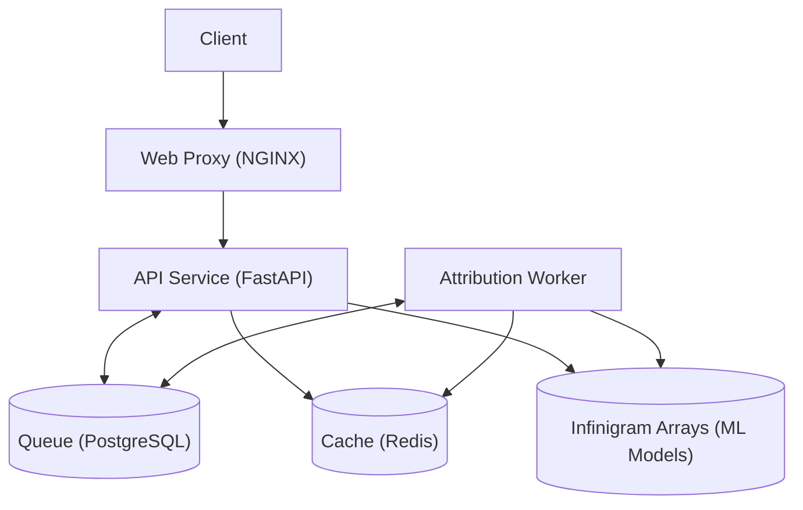
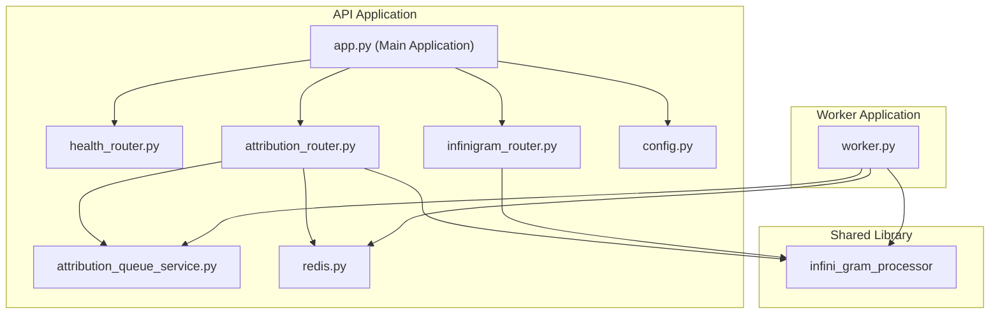
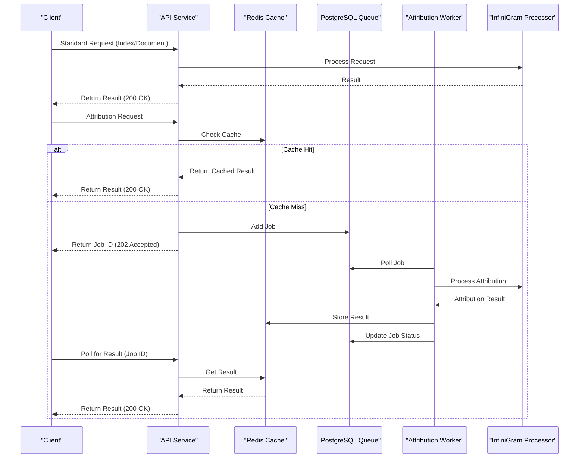

<!-- source: DeepWiki mcp.deepwiki.com · repo allenai/infinigram-api · page 1 Overview · fetched 2026-10-26 -->

# Overview

Relevant source files

The following files were used as context for generating this wiki page:

- [README.md](README.md)
- [api/README.md](api/README.md)
- [api/app.py](api/app.py)
- [attribution_worker/README.md](attribution_worker/README.md)
- [docs/CONTRIBUTING.md](docs/CONTRIBUTING.md)
- [docs/indexes.md](docs/indexes.md)
- [packages/infini-gram-processor/README.md](packages/infini-gram-processor/README.md)

This document provides an overview of the infinigram-api repository, a system designed to expose the capabilities of [infini-gram](https://infini-gram.io) through a scalable API interface. For detailed information about specific system components, deployment, or development processes, refer to the specialized wiki pages linked throughout this document.

Sources: [README.md:1-3]()

## Purpose and Scope

The infinigram-api system serves as a scalable, high-performance interface to the underlying infinigram technology, which enables working with n-gram language models trained on vast amounts of text. It was developed to make the research capabilities described in the following paper accessible through an API:

> Liu, Jiacheng and Min, Sewon and Zettlemoyer, Luke and Choi, Yejin and Hajishirzi, Hannaneh (2024).
> Infini-gram: Scaling Unbounded n-gram Language Models to a Trillion Tokens.
> arXiv preprint arXiv:2401.17377

The API supports multiple types of operations, with attribution requests being the most computationally intensive, requiring dedicated worker processes to handle efficiently.

For more information about the detailed system architecture, see [System Architecture](#2).

Sources: [README.md:5-9]()

## Repository Structure

The infinigram-api repository is structured as a uv workspace containing three main components:

1. **API Service** (`api/`): A FastAPI-based web service that handles user requests and interfaces with infinigram indices
2. **Attribution Worker** (`attribution_worker/`): A worker service that processes long-running attribution tasks offloaded from the API
3. **Infini-gram Processor** (`packages/infini-gram-processor/`): A shared library containing code used by both the API and worker components

Sources: [README.md:3](), [api/README.md:1-3](), [attribution_worker/README.md:1-3](), [packages/infini-gram-processor/README.md:1-3]()

## Key Components and Their Relationships

### Main System Components

The system consists of several key components that work together to provide infinigram functionality:

- **API Service**: Handles incoming requests through FastAPI endpoints
- **Attribution Worker**: Processes attribution requests which are too time-intensive for synchronous handling
- **Queue**: PostgreSQL-based queue system that facilitates communication between the API and worker
- **Cache**: Redis-based caching system for storing results and improving performance
- **Infinigram Arrays**: ML models that power the text processing capabilities, mounted as persistent volumes

The API and Attribution Worker are deployed as separate services, allowing them to be scaled independently based on workload requirements.

Sources: [README.md:19-41](), [api/app.py:15-25](), [docs/CONTRIBUTING.md:39-50]()

### Code Organization

The code is organized into several key modules:

- The main API application (`app.py`) integrates multiple routers:
  - `health_router` for health check endpoints
  - `infinigram_router` for index-related operations
  - `attribution_router` for attribution request handling

- The worker application handles jobs from the queue, processes them with the infinigram processor, and stores results

- Both the API and worker use the shared infinigram processor library for core functionality

Sources: [api/app.py:1-69](), [README.md:1-3]()

## Request Flow

### Standard vs. Attribution Request Processing

The system handles two main types of request flows:

1. **Standard Requests** (Infinigram index operations, document retrieval):
   - Processed synchronously by the API service
   - Results returned directly to the client

2. **Attribution Requests** (computationally intensive):
   - API checks cache for existing results
   - If not found, job is added to queue and client receives a job ID
   - Attribution Worker picks up the job, processes it using the Infinigram Processor
   - Results are stored in cache
   - Client polls for results using the job ID

This separation allows the system to efficiently handle both quick queries and resource-intensive attribution operations without blocking the API service.

Sources: [README.md:28-40](), [api/app.py:15-25](), [api/app.py:52-54]()

## Technology Stack

The infinigram-api system leverages several modern technologies:

| Component | Technology |
|-----------|------------|
| API Framework | FastAPI |
| Queue System | SAQ (Simple Async Queue) with PostgreSQL |
| Caching | Redis |
| Containerization | Docker |
| Orchestration | Kubernetes (via Ai2's Skiff platform) |
| Observability | OpenTelemetry |
| Development | uv (Python package management) |

Sources: [api/app.py:6-14](), [api/app.py:56-69](), [docs/CONTRIBUTING.md:12-16]()

## Infinigram Indices

The system works with various infinigram indices (also called arrays), which are the ML models that power text processing capabilities. These indices are stored as array files and mounted as persistent volumes to both the API and worker services.

For information about adding new indices, see [Adding New Indices](#5.3).

Sources: [docs/indexes.md:1-102](), [README.md:14-15]()

## Development and Deployment

The system can be run locally using Docker Compose, which starts all required services with proper connections. For production, it's deployed on Ai2's Skiff platform (a Kubernetes wrapper).

For detailed information about local development setup, see [Local Development](#5.1). For deployment details, see [Kubernetes Deployment](#5.2).

Sources: [docs/CONTRIBUTING.md:39-50](), [README.md:36-40]()

---

